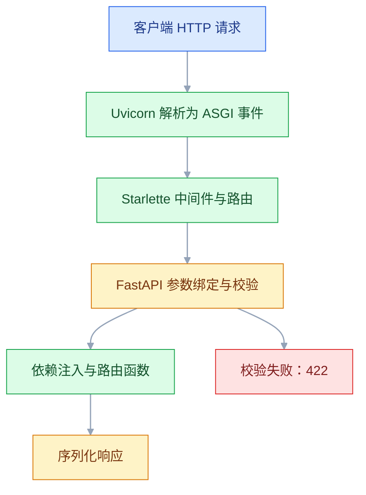
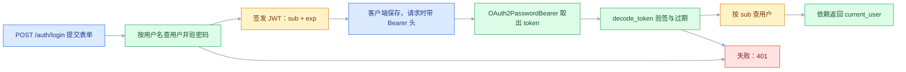

# FastAPI

## 一、工程案例：做一个带鉴权、分页、统一异常、依赖注入的任务接口

**场景**：给内部团队做任务管理后端。要求注册登录、JWT 鉴权、任务增删改查、分页筛选排序、只能操作自己的任务、参数错误返回统一结构、任务完成时发通知、本地一条命令跑起来。

**产出**：一个可运行的 `task-api`，8 个接口（含 `/health`）、Alembic 迁移、pytest 接口测试。选型：FastAPI + Pydantic v2 + SQLAlchemy 2.0（同步）+ SQLite（换 PostgreSQL 只改连接串）+ PyJWT + pwdlib。

> 版本说明：FastAPI、Pydantic、SQLAlchemy、Alembic 的具体版本以官方当前稳定版为准，Python 以 3.12 / 3.13 为当前主线。

```text
task-api/
├── alembic.ini
├── alembic/
├── app/{main,db,models,schemas,security}.py
├── app/routers/{auth,tasks}.py
└── tests/test_tasks.py
```

### 1.1 安装、配置与会话

```bash
mkdir task-api && cd task-api
python3 -m venv .venv && source .venv/bin/activate
pip install "fastapi[standard]" sqlalchemy alembic "pwdlib[argon2]" pyjwt pytest
```

```python
# app/db.py
import os
from collections.abc import Generator
from sqlalchemy import create_engine
from sqlalchemy.orm import DeclarativeBase, Session, sessionmaker

DB_URL = os.getenv("DB_URL", "sqlite:///./task.db")
SECRET_KEY = os.getenv("SECRET_KEY", "dev-only-change-me-32-bytes-minimum")
ALGORITHM = "HS256"
TOKEN_MINUTES = int(os.getenv("TOKEN_MINUTES", "60"))

class Base(DeclarativeBase):
    pass

engine = create_engine(
    DB_URL,
    connect_args={"check_same_thread": False} if DB_URL.startswith("sqlite") else {},
)
SessionLocal = sessionmaker(bind=engine, autoflush=False, expire_on_commit=False)

def get_db() -> Generator[Session, None, None]:
    db = SessionLocal()
    try:
        yield db
    finally:
        db.close()
```

`expire_on_commit=False` 让 commit 后对象仍可读，否则响应序列化时会触发额外查询，甚至 `DetachedInstanceError`。

### 1.2 模型与 Schema

```python
# app/models.py
from datetime import datetime
from sqlalchemy import DateTime, ForeignKey, String, func
from sqlalchemy.orm import Mapped, mapped_column
from app.db import Base

class User(Base):
    __tablename__ = "users"
    id: Mapped[int] = mapped_column(primary_key=True)
    username: Mapped[str] = mapped_column(String(50), unique=True, index=True)
    hashed_password: Mapped[str] = mapped_column(String(200))
    created_at: Mapped[datetime] = mapped_column(DateTime, server_default=func.now())

class Task(Base):
    __tablename__ = "tasks"
    id: Mapped[int] = mapped_column(primary_key=True)
    title: Mapped[str] = mapped_column(String(100), index=True)
    description: Mapped[str] = mapped_column(String(500), default="")
    priority: Mapped[int] = mapped_column(default=3)
    done: Mapped[bool] = mapped_column(default=False)
    owner_id: Mapped[int] = mapped_column(ForeignKey("users.id"), index=True)
    created_at: Mapped[datetime] = mapped_column(DateTime, server_default=func.now())
```

```python
# app/schemas.py
from datetime import datetime
from typing import Literal
from pydantic import BaseModel, ConfigDict, Field, field_validator

SortField = Literal["created_at", "priority", "title"]

class TaskBase(BaseModel):
    title: str = Field(min_length=1, max_length=100, examples=["完成接口文档"])
    description: str = Field(default="", max_length=500)
    priority: int = Field(default=3, ge=1, le=5, description="1 最高，5 最低")

class TaskCreate(TaskBase):
    @field_validator("title")
    @classmethod
    def not_blank(cls, v: str) -> str:
        v = v.strip()
        if not v:
            raise ValueError("标题不能为空")
        return v

class TaskUpdate(BaseModel):
    title: str | None = Field(default=None, min_length=1, max_length=100)
    description: str | None = Field(default=None, max_length=500)
    priority: int | None = Field(default=None, ge=1, le=5)
    done: bool | None = None

class TaskOut(TaskBase):
    id: int
    done: bool
    created_at: datetime
    owner_id: int
    model_config = ConfigDict(from_attributes=True)

class TaskPage(BaseModel):
    total: int
    page: int
    size: int
    pages: int
    items: list[TaskOut]

class UserCreate(BaseModel):
    username: str = Field(min_length=3, max_length=50)
    password: str = Field(min_length=8, max_length=64)

class UserOut(BaseModel):
    id: int
    username: str
    model_config = ConfigDict(from_attributes=True)

class Token(BaseModel):
    access_token: str
    token_type: str = "bearer"
```

**请求模型与响应模型必须分开**：`UserCreate` 收密码，`UserOut` 没有 `hashed_password`，即使代码误把整个 ORM 对象返回，响应也会被过滤。

### 1.3 密码、令牌与认证路由

```python
# app/security.py
from datetime import datetime, timedelta, timezone
import jwt
from pwdlib import PasswordHash
from app.db import ALGORITHM, SECRET_KEY, TOKEN_MINUTES

password_hash = PasswordHash.recommended()   # Argon2

def hash_password(raw: str) -> str:
    return password_hash.hash(raw)

def verify_password(raw: str, hashed: str) -> bool:
    return password_hash.verify(raw, hashed)

def create_token(sub: str) -> str:
    payload = {"sub": sub,
               "exp": datetime.now(timezone.utc) + timedelta(minutes=TOKEN_MINUTES)}
    return jwt.encode(payload, SECRET_KEY, algorithm=ALGORITHM)

def decode_token(token: str) -> str | None:
    try:
        payload = jwt.decode(token, SECRET_KEY, algorithms=[ALGORITHM])
    except jwt.PyJWTError:      # 过期、签名不对、格式错都归到这里
        return None
    sub = payload.get("sub")
    return sub if isinstance(sub, str) else None
```

```python
# app/routers/auth.py
from fastapi import APIRouter, Depends, HTTPException, status
from fastapi.security import OAuth2PasswordBearer, OAuth2PasswordRequestForm
from sqlalchemy import select
from sqlalchemy.exc import IntegrityError
from sqlalchemy.orm import Session

from app.db import get_db
from app.models import User
from app.schemas import Token, UserCreate, UserOut
from app.security import create_token, decode_token, hash_password, verify_password

router = APIRouter(prefix="/auth", tags=["认证"])
oauth2_scheme = OAuth2PasswordBearer(tokenUrl="/api/v1/auth/login")

@router.post("/register", response_model=UserOut, status_code=201)
def register(data: UserCreate, db: Session = Depends(get_db)):
    if db.scalar(select(User).where(User.username == data.username)):
        raise HTTPException(400, "用户名已存在")
    user = User(username=data.username, hashed_password=hash_password(data.password))
    db.add(user)
    try:
        db.commit()
    except IntegrityError:          # 并发注册同名用户时，唯一约束才是最终防线
        db.rollback()
        raise HTTPException(400, "用户名已存在")
    db.refresh(user)
    return user

@router.post("/login", response_model=Token)
def login(form: OAuth2PasswordRequestForm = Depends(), db: Session = Depends(get_db)):
    user = db.scalar(select(User).where(User.username == form.username))
    if not user or not verify_password(form.password, user.hashed_password):
        raise HTTPException(status.HTTP_401_UNAUTHORIZED, "用户名或密码错误",
                            headers={"WWW-Authenticate": "Bearer"})
    return Token(access_token=create_token(user.username))

def get_current_user(token: str = Depends(oauth2_scheme),
                     db: Session = Depends(get_db)) -> User:
    username = decode_token(token)
    user = db.scalar(select(User).where(User.username == username)) if username else None
    if not user:
        raise HTTPException(status.HTTP_401_UNAUTHORIZED, "token 无效或已过期",
                            headers={"WWW-Authenticate": "Bearer"})
    return user
```

`OAuth2PasswordRequestForm` 要求请求体是**表单**，不是 JSON；`python-multipart` 由 `fastapi[standard]` 带上。

### 1.4 任务路由：分页、筛选、排序、归属校验

```python
# app/routers/tasks.py
from typing import Literal
from fastapi import APIRouter, BackgroundTasks, Depends, HTTPException, Query
from sqlalchemy import func, select
from sqlalchemy.orm import Session

from app.db import get_db
from app.models import Task, User
from app.routers.auth import get_current_user
from app.schemas import SortField, TaskCreate, TaskOut, TaskPage, TaskUpdate

router = APIRouter(prefix="/tasks", tags=["任务"])

def get_owned_task(task_id: int, db: Session, user: User) -> Task:
    task = db.get(Task, task_id)
    if not task or task.owner_id != user.id:
        raise HTTPException(404, f"任务 {task_id} 不存在")
    return task

@router.get("", response_model=TaskPage, summary="任务列表")
def list_tasks(
    page: int = Query(1, ge=1),
    size: int = Query(10, ge=1, le=100),
    done: bool | None = None,
    keyword: str | None = None,
    sort: SortField = "created_at",
    order: Literal["asc", "desc"] = "desc",
    db: Session = Depends(get_db),
    user: User = Depends(get_current_user),
):
    conds = [Task.owner_id == user.id]
    if done is not None:
        conds.append(Task.done == done)
    if keyword:
        conds.append(Task.title.contains(keyword))

    total = db.scalar(select(func.count()).select_from(Task).where(*conds)) or 0
    column = getattr(Task, sort)              # sort 是 Literal 白名单，安全
    primary = column.desc() if order == "desc" else column.asc()
    stmt = (select(Task).where(*conds)
            .order_by(primary, Task.id.desc())   # id 兜底，同值顺序才稳定
            .offset((page - 1) * size).limit(size))
    return {"total": total, "page": page, "size": size,
            "pages": (total + size - 1) // size, "items": list(db.scalars(stmt))}

@router.post("", response_model=TaskOut, status_code=201)
def create_task(data: TaskCreate, db: Session = Depends(get_db),
                user: User = Depends(get_current_user)):
    task = Task(**data.model_dump(), owner_id=user.id)
    db.add(task); db.commit(); db.refresh(task)
    return task

@router.get("/{task_id}", response_model=TaskOut)
def get_task(task_id: int, db: Session = Depends(get_db),
             user: User = Depends(get_current_user)):
    return get_owned_task(task_id, db, user)

@router.patch("/{task_id}", response_model=TaskOut)
def update_task(task_id: int, data: TaskUpdate, bg: BackgroundTasks,
                db: Session = Depends(get_db),
                user: User = Depends(get_current_user)):
    task = get_owned_task(task_id, db, user)
    was_done = task.done
    for key, value in data.model_dump(exclude_unset=True).items():
        setattr(task, key, value)
    db.commit(); db.refresh(task)
    if task.done and not was_done:
        bg.add_task(notify_done, user.username, task.title)
    return task

@router.delete("/{task_id}", status_code=204)
def delete_task(task_id: int, db: Session = Depends(get_db),
                user: User = Depends(get_current_user)):
    task = get_owned_task(task_id, db, user)
    db.delete(task); db.commit()

def notify_done(username: str, title: str) -> None:
    import logging, time
    time.sleep(0.5)
    # 挂在 uvicorn.error 上，才继承它的 handler 和 INFO 级别，日志一定可见
    logging.getLogger("uvicorn.error").info("通知 %s：任务『%s』已完成", username, title)
```

三个关键点：`getattr(Task, sort)` 的 `sort` 来自 `Literal` 白名单，用户传不进任意列名；`model_dump(exclude_unset=True)` 保证 PATCH 没传的字段不被覆盖；归属过滤放在 `conds` 第一项，分页和计数用同一组条件。排序末尾再补 `Task.id`，否则同一秒创建的数据在翻页时可能重复或漏掉。

### 1.5 应用入口与统一异常

```python
# app/main.py
from fastapi import FastAPI, Request
from fastapi.exceptions import RequestValidationError
from fastapi.responses import JSONResponse
from app.routers import auth, tasks

app = FastAPI(title="任务管理系统 API", version="1.0.0")

class BizError(Exception):
    def __init__(self, message: str, code: int = 40000):
        self.message, self.code = message, code

@app.exception_handler(BizError)
async def biz_error_handler(request: Request, exc: BizError):
    return JSONResponse(status_code=400,
                        content={"code": exc.code, "message": exc.message})

@app.exception_handler(RequestValidationError)
async def validation_handler(request: Request, exc: RequestValidationError):
    first = exc.errors()[0]
    return JSONResponse(status_code=422, content={
        "code": 42200, "message": "参数校验失败",
        "field": ".".join(str(x) for x in first["loc"][1:]),
        "reason": first["msg"]})

@app.exception_handler(Exception)
async def unhandled_handler(request: Request, exc: Exception):
    return JSONResponse(status_code=500,
                        content={"code": 50000, "message": "服务器内部错误"})

app.include_router(auth.router, prefix="/api/v1")
app.include_router(tasks.router, prefix="/api/v1")

@app.get("/health", tags=["运维"])
def health():
    return {"status": "ok"}
```

业务错误抛 `BizError`，由处理器统一成 `{code, message}`；422 被改写成前端能直接用的 `{code, message, field, reason}`；框架层的 401/404 仍走 `HTTPException` 的 `{"detail": ...}`。要让所有错误只剩一种结构，再补一个 `HTTPException` 处理器，思路见 3.6。

### 1.6 迁移与启动

```bash
alembic init alembic
```

```python
# alembic/env.py 改三处
from app.db import DB_URL, Base
from app import models          # noqa: F401 必须导入，模型才会登记到 metadata
target_metadata = Base.metadata
config.set_main_option("sqlalchemy.url", DB_URL)
```

当前 Alembic 模板的 `alembic.ini` 默认带 `prepend_sys_path = .`，所以在项目根目录执行才能 `from app...`；换目录执行会报 `ModuleNotFoundError: No module named 'app'`。

```bash
alembic revision --autogenerate -m "init users and tasks"
alembic upgrade head
uvicorn app.main:app --reload --port 8000
# INFO:     Uvicorn running on http://127.0.0.1:8000
```

```bash
curl -s -X POST localhost:8000/api/v1/auth/register -H 'Content-Type: application/json' \
  -d '{"username":"alice","password":"secret123"}'
# {"id":1,"username":"alice"}

TOKEN=$(curl -s -X POST localhost:8000/api/v1/auth/login \
  -d 'username=alice&password=secret123' \
  | python3 -c 'import sys,json;print(json.load(sys.stdin)["access_token"])')

curl -s -X POST localhost:8000/api/v1/tasks -H "Authorization: Bearer $TOKEN" \
  -H 'Content-Type: application/json' \
  -d '{"title":"完成接口文档","priority":1,"description":"本周内"}'
# {"title":"完成接口文档","description":"本周内","priority":1,
#  "id":1,"done":false,"created_at":"2026-10-21T09:30:00","owner_id":1}

curl -s -X POST localhost:8000/api/v1/tasks -H "Authorization: Bearer $TOKEN" \
  -H 'Content-Type: application/json' -d '{"title":"   ","priority":9}'
# {"code":42200,"message":"参数校验失败","field":"title","reason":"Value error, 标题不能为空"}
```

### 1.7 接口测试

```python
# tests/test_tasks.py
import os
import tempfile
from pathlib import Path

# app.db 在 import 时读取 DB_URL，必须先设环境变量
os.environ["DB_URL"] = f"sqlite:///{Path(tempfile.mkdtemp()) / 'test.db'}"

from fastapi.testclient import TestClient
from app.db import Base, engine
from app.main import app

Base.metadata.create_all(engine)
client = TestClient(app)

def auth_headers(username: str) -> dict[str, str]:
    client.post("/api/v1/auth/register",
                json={"username": username, "password": "secret123"})
    resp = client.post("/api/v1/auth/login",
                       data={"username": username, "password": "secret123"})
    return {"Authorization": f"Bearer {resp.json()['access_token']}"}

def test_requires_token():
    assert client.get("/api/v1/tasks").status_code == 401

def test_pagination_and_ownership():
    alice, bob = auth_headers("alice"), auth_headers("bob")
    for i in range(3):
        assert client.post("/api/v1/tasks", json={"title": f"任务 {i}"},
                           headers=alice).status_code == 201
    page = client.get("/api/v1/tasks?page=1&size=2", headers=alice).json()
    assert page["total"] == 3 and page["pages"] == 2 and len(page["items"]) == 2
    task_id = page["items"][0]["id"]
    assert client.get(f"/api/v1/tasks/{task_id}", headers=bob).status_code == 404
    updated = client.patch(f"/api/v1/tasks/{task_id}", json={"done": True},
                           headers=alice).json()
    assert updated["done"] is True and updated["title"] == page["items"][0]["title"]
```

从项目根目录跑 `python -m pytest -q`，应看到 `2 passed`；用 `python -m` 是为了把当前目录放进 `sys.path`，否则 `import app` 可能失败。

### 1.8 验收

| # | 检查项 | 命令或检查 | 通过标准 |
|---|---|---|---|
| 1 | 服务启动 | `uvicorn app.main:app --port 8000` | 启动无异常，`/health` 返回 `{"status":"ok"}` |
| 2 | 注册 | `POST /api/v1/auth/register` | 201，响应无 `hashed_password` |
| 3 | 重复注册 | 同名再注册 | 400，`detail` 为「用户名已存在」 |
| 4 | 登录 | 表单 `username/password` | 200，返回 `access_token` 与 `token_type` |
| 5 | 未带令牌 | `GET /api/v1/tasks` | 401，不是 403 或 500 |
| 6 | 创建任务 | `POST /api/v1/tasks` | 201，`owner_id` 是当前用户 |
| 7 | 参数校验 | 标题全空格 + `priority=9` | 422，结构为 `code/message/field/reason` |
| 8 | 分页 | `?page=1&size=2` | `total` 正确，`items` 不超过 2，`pages` 向上取整 |
| 9 | 越权 | 用 bob 的 token 查 alice 的任务 | 404，不是 403 |
| 10 | PATCH 局部更新 | 只传 `{"done": true}` | 其他字段保持原值 |
| 11 | 后台通知 | 观察 uvicorn 日志 | 响应先返回，约 0.5 秒后出现 `通知 alice：...` 日志 |
| 12 | 迁移 | `alembic current` | 显示最新 revision，`upgrade head` 无报错 |
| 13 | 接口测试 | `python -m pytest -q` | `2 passed`，覆盖 401、分页、越权 404、PATCH |

> 第 9 项用 404 而不是 403：403 等于告诉攻击者「这个 id 存在，只是你没权限」，404 不泄露存在性。

---

## 二、高频问答：会卡住你的地方，也是面试最常问的

### 2.1 明明参数都对，接口却返回 422

**现场**

先看 422 里的 `loc`：`["body","title"]` 和 `["query","page"]` 指向完全不同的位置；再在 `/docs` 里展开接口，每个参数都标了 `query` / `path` / `body`。

**要点**

- FastAPI 靠「参数类型 + 有没有默认值 + 在不在路径里」推断来源，不是靠参数名猜。
- 参数位置不对就 422：该进 body 的放进了 query、该用表单的发了 JSON、路径参数类型不匹配。
- 登录接口必须是表单，用 `-d` 而不是 JSON 头。

**追问**

- `loc` 怎么读？→ 第一段是位置（body/query/path），后面是字段路径。
- 为什么 JSON 发登录会 422？→ OAuth2 密码流收的是 `Form`，不是 JSON body。
- 参数是 Pydantic 模型就一定是 body 吗？→ 是，模型类型默认按 body 解析。

### 2.2 一直返回 401 `Not authenticated`

**现场**

打印请求头，确认 `Authorization` 的 scheme 和 token；再用 `jwt.decode` 单独解一次 token，看 `exp` 和 `sub`。

**要点**

- `OAuth2PasswordBearer` 只认 `Authorization: Bearer <token>`。
- 缺头、scheme 写成 `Token`、把 token 放 query，都会得到 401，不是 token 生成错了。
- `tokenUrl` 配错不会让业务接口 401，只会让 `/docs` 的 Authorize 打到 404，所以它必须是从根路径开始的完整路径（本项目是 `/api/v1/auth/login`）。

**追问**

- 401 和 403 怎么选？→ 没认证是 401，认证了但没权限是 403。
- 为什么 token 过期也报 Not authenticated？→ 依赖在验签阶段就抛了 401，没进业务。
- 想让 token 立刻失效要做什么？→ 需要服务端黑名单或版本号，并放共享存储。

### 2.3 浏览器报 CORS，curl 却完全正常

**现场**

在浏览器 Network 里看失败的是 `OPTIONS` 还是实际请求，响应有没有 `Access-Control-Allow-Origin`；再用带 `Origin` 头的请求复现一次。

```python
from fastapi.middleware.cors import CORSMiddleware
app.add_middleware(
    CORSMiddleware,
    allow_origins=["http://localhost:5173"],   # 写具体来源
    allow_credentials=True,
    allow_methods=["*"],
    allow_headers=["*"],
)
```

**要点**

- CORS 是浏览器行为，curl 不执行同源策略，「curl 正常」不能证明配置对。
- 中间件没装、`allow_origins` 不含实际来源，或 `allow_credentials=True` 与 `*` 冲突。
- `add_middleware` 后添加的先执行（插到最外层），要让 CORS 包住业务中间件，就在业务中间件之后再添加 CORS。

**追问**

- 为什么预检失败、实际请求根本没发出？→ 浏览器在 `OPTIONS` 阶段就拦了。
- `allow_credentials=True` 时能写 `*` 吗？→ 不能，必须写具体来源。
- 生产怎么配来源？→ 列出具体前端域名，不要用 `*` 配凭证。

### 2.4 `response_model` 把字段「弄丢了」

**现场**

对比 `TaskOut.model_fields` 与 ORM 对象属性，看是否抛 `ResponseValidationError`；再临时去掉 `response_model` 看原始返回。

**要点**

- `response_model` 是白名单，不是「原样返回再补类型」。
- 响应模型没声明该字段，FastAPI 就按模型过滤；ORM 对象缺 `from_attributes=True` 也会失败。
- 字段在原始返回里有、加上模型就没了，就是模型没声明；密码哈希被过滤掉正是这个机制在起作用。

**追问**

- 为什么要用白名单？→ 防止内部字段（密码哈希、状态位）泄漏给前端。
- `from_attributes=True` 用在哪？→ 模型配置里，允许从 ORM 对象按属性读取。
- 只想排除少数字段怎么办？→ 用 `response_model_exclude` 一类参数，但白名单更安全。

### 2.5 加了 `/tasks/me`，却被 `/tasks/{task_id}` 接走

**现场**

看 422 的 `loc` 是不是 `["path","task_id"]`，确认是动态路由先匹配了；调换注册顺序后再试。

**要点**

- 路由按注册顺序匹配，先注册先命中，不是「更具体的优先」。
- `/tasks/{task_id}` 先注册就会吃掉 `/tasks/me`，`int` 转换失败返回 422。
- 把静态路径放到动态路径之前；本项目不设 `/tasks/me`，当前用户由 `get_current_user` 依赖提供。

**追问**

- 为什么是 422 不是 404？→ 路径匹配上了，但 `me` 转不成 `int`。
- 怎么从结构上避免？→ 静态路径单独前缀，或像本项目一样用依赖拿当前用户。
- 路由多了怎么排查？→ 打印 `app.routes` 看实际注册顺序。

### 2.6 用了 `async def`，服务反而更慢、并发上不去

**现场**

压测时所有请求一起变慢、CPU 不高，就是事件循环被卡住的典型表现；把阻塞调用换成 `asyncio.sleep` 后恢复，就能确认。

**要点**

- `async def` 只表示「可以在 await 处让出」，不代表里面的代码自动变异步。
- 里面调了同步阻塞库（`requests`、同步 SQLAlchemy、`time.sleep`），整个事件循环被卡住。
- 异步链路只调用异步库（`httpx.AsyncClient`、`AsyncSession`）；必须调同步库时用 `await asyncio.to_thread(...)`，或把路由写成 `def`。

**追问**

- 为什么 CPU 不高但很慢？→ 线程没在算，都在等被阻塞的事件循环。
- `def` 路由为什么反而没事？→ 它被丢进线程池，不占事件循环。
- 混用同步和异步会怎样？→ 一个阻塞调用拖慢所有并发请求。

### 2.7 改了模型字段，数据库里没变

**现场**

`alembic current` 与 `alembic heads` 是否一致；再看实际列：`PRAGMA table_info(tasks)`（PostgreSQL 用 `\d tasks`）。

**要点**

- ORM 模型是「代码里的期望」，数据库是「已经存在的事实」，两者靠迁移同步。
- 只改 Python 类不会改表；`create_all` 只建新表，不改旧表。
- 迁移文件里必须真的出现 `add_column`，空迁移通常是模型没被 `env.py` 导入。

**追问**

- 为什么 `create_all` 不改表？→ 它只检查表是否存在，不做结构 diff。
- 空迁移怎么来的？→ 模型没导入，autogenerate 看不到变更。
- 生产能自动迁移吗？→ 迁移要先跑再起服务，别让多副本同时迁移。

### 2.8 多 worker 下缓存、限流、黑名单各算各的

**现场**

用 `--workers 4` 起服务，同一请求连打多次，结果在两组值之间跳，就说明状态落在各自的进程里。

**要点**

- 每个 worker 是独立进程，模块级字典、内存缓存、计数器都不共享。
- 把单进程的「全局变量」当成全局，是这里的根因。
- 需要跨 worker 共享的状态放 Redis / 数据库；JWT 本身无状态不受影响，但黑名单、验证码、限流计数会受影响。

**追问**

- 为什么 JWT 不受影响？→ 验签不需要服务端存状态。
- 限流在多 worker 下怎么做？→ 计数放 Redis，或提到网关层。
- 用共享内存行不行？→ 只能跨本机进程，多副本部署仍然各算各的。

### 2.9 照着旧教程写 Pydantic，一跑就报错

**现场**

看 `pydantic.VERSION`；`orm_mode` 直接报错，`dict()` / `validator` 出现弃用警告，就都是 v1 写法。

**要点**

- v2 重写了校验核心，配置项和序列化方法都换了名字。
- `orm_mode` 已移除，`.dict()`、`@validator` 还能跑但已弃用。
- 按官方迁移指南换成 `from_attributes`、`model_dump()`、`field_validator`，不要为了旧代码把 FastAPI 锁在旧版本。

**追问**

- v1 和 v2 能共存吗？→ 不能，同一个环境只能装一个主版本。
- 迁移先改什么？→ 先换配置项和方法名，校验逻辑基本不用动。
- 为什么弃用的写法还能跑？→ 保留了兼容层，但会在未来版本移除。

### 2.10 测试之间互相污染，单独跑能过、一起跑就挂

**现场**

固定顺序复现，看失败用例依赖了哪条旧数据；再检查 `dependency_overrides` 有没有在用例结束后还原。

**要点**

- 测试隔离要靠 fixture 保证，不能靠「跑的先后顺序刚好对」。
- 常见原因：共用一个数据库文件、前面的数据没清，或 override 没还原。
- 每个测试用独立数据库文件或事务回滚；override 用完必须 `clear()`。

**追问**

- 为什么单独跑能过？→ 没有前一个测试留下的数据。
- `TestClient` 会跑 lifespan 吗？→ 默认不跑，要用 `with TestClient(app)`。
- 事务回滚隔离有什么局限？→ 测不到真实提交后的行为。

### 2.11 访问 `/tasks/` 被 307 跳走，前端直接报错

**现场**

`curl -i` 看 307 和 `Location`，再对比 `@router.get("")` 与 `@router.get("/")` 实际生成的路径。

**要点**

- 路径末尾差一个 `/`，Starlette 的 `redirect_slashes` 默认用 307 跳到另一种写法。
- 307 会保留方法和请求体，浏览器、`requests` 通常自动跟随，所以本地看着「正常」。
- 反向代理、网关或跨域场景下跳转可能失败，表现为前端拿到 307 或 CORS 错误。

**追问**

- 为什么用 307 不用 301？→ 307 保留方法和请求体，301 可能被改成 GET。
- 一个资源该保留哪种写法？→ 只留一种，本项目路由写 `""`，对外就是 `/tasks`。
- 挂在子路径下要注意什么？→ 给应用传 `--root-path`，否则 `Location` 会指到内网地址。

---

## 三、核心知识：从零开始要建立的东西

### 3.1 ASGI 与进程模型

FastAPI 本身不监听端口，它是一个 ASGI 应用；Uvicorn 负责网络收发，把 HTTP 请求翻译成 ASGI 事件。开发用 `--reload` 单进程，生产用多 worker，每个 worker 是独立进程。



| 层 | 负责 | 出问题时的症状 |
|---|---|---|
| Uvicorn | 端口、连接、协议 | 连不上、超时、进程退出 |
| Starlette | 路由、中间件、WebSocket | 404、CORS、中间件顺序 |
| Pydantic | 校验、转换、序列化 | 422、响应字段缺失 |
| 你的代码 | 业务与数据库 | 500、数据不一致 |

> **面试**：常问「FastAPI 和 Uvicorn 是什么关系？多 worker 是怎么回事？」答：FastAPI 是 ASGI 应用，Uvicorn 负责网络，多 worker 是多个独立进程。

### 3.2 路由匹配与参数来源

路由按注册顺序匹配，先命中先执行。参数来源由声明方式决定——路径占位、类型、默认值、显式标记，不靠参数名猜。

| 参数写法 | 来源 | 示例 |
|---|---|---|
| 路径里有 `{id}` | path | `@app.get("/tasks/{id}")` |
| 类型是 Pydantic 模型 | body | `data: TaskCreate` |
| 有默认值的简单类型 | query | `page: int = 1` |
| 单个标量加了 `Body(...)` | body | `q: str = Body(...)` |
| `Depends(...)` | 依赖注入 | `db: Session = Depends(get_db)` |
| `File(...)` / `Form(...)` | 表单 / 文件 | 上传、OAuth2 登录 |
| `Header(...)` / `Cookie(...)` | 请求头 / Cookie | 自定义头、会话 |

边界：静态路径要放在动态路径之前；同一个函数里不要同时收 body 和 `Form`，否则请求体格式会冲突；路径尾斜杠只保留一种写法，避免 307（见 2.11）。

### 3.3 Pydantic 校验管线

FastAPI 先按 `Content-Type` 解析请求体，Pydantic 再按字段类型转换、执行约束和自定义校验器，全部通过才构造模型；任意一项失败会收集所有错误一次性抛出。

`extra="forbid"` 让多传字段直接报错（默认是忽略）；`from_attributes=True` 允许从 ORM 对象读属性；`str_strip_whitespace=True` 自动去首尾空格。边界：`int` 会把 `"18"` 转成 `18`，但 `"abc"` 直接 422；`bool` 接受 `"true"`、`1` 等多种形式，严格枚举用 `Literal`。

### 3.4 依赖注入的解析

`Depends` 声明「我需要什么」，框架在调用路由前把依赖树自底向上算好；同一次请求内同一个依赖默认只算一次。

| 形态 | 用途 |
|---|---|
| 普通函数 | 分页参数、配置、当前用户 |
| 类 | 把一组参数打包 |
| `yield` | 请求级资源，结束后清理（数据库会话） |
| 路由级 `dependencies=[...]` | 整组接口统一鉴权 |

边界：`yield` 依赖的清理代码在响应之后执行，别在里面改已经发出的响应；依赖里抛 `HTTPException` 会直接终止请求，不再进路由函数。

> **面试**：常问「FastAPI 的依赖注入是怎么工作的？`yield` 依赖什么时候清理？」答：调用前自底向上算好依赖树，`yield` 的清理在响应之后执行。

### 3.5 请求生命周期与中间件

顺序是：中间件进入 → 依赖解析 → 路由函数 → 序列化 → 中间件退出。中间件适合日志、请求 ID、耗时统计；业务校验放依赖里更清晰。

边界：body 是流，中间件里不要用 `request.stream()` 手动消费，否则下游路由可能读不到；确需读取时用 `await request.body()` 并限制体积，日志中间件最好只记方法、路径和耗时。CORS 中间件要加在业务中间件外层（`add_middleware` 后添加的在更外层）。

### 3.6 异常与统一响应

`HTTPException` 用于可预期的 4xx，自定义异常用于业务错误，兜底处理器负责 500。默认 `HTTPException` 返回 `{"detail": ...}`，与 `{code, message}` 不同；要前端只判断一种结构，就给 `HTTPException` 也注册处理器，并把 `exc.headers` 原样带回去（401 的 `WWW-Authenticate` 不能丢）。

| 异常 | 默认状态码 | 处理方式 |
|---|---|---|
| `HTTPException` | 自定义 | 直接抛，FastAPI 转成 `{"detail": ...}` |
| `RequestValidationError` | 422 | 覆写处理器改结构 |
| 自定义 `BizError` | 400 | 注册 `exception_handler` |
| 未捕获 `Exception` | 500 | 兜底，记录堆栈，不返回内部信息 |

边界：兜底处理器只负责「返回友好响应」，异常仍会进服务器日志；不要在处理器里再抛异常，否则会变成裸 500。

### 3.7 认证与令牌

流程是：登录校验密码 → 签发带 `exp` 的 JWT → 客户端放 `Authorization: Bearer` → 依赖解析并查用户。服务端不存 session，多 worker 天然一致。



| 环节 | 要点 |
|---|---|
| 密码存储 | 只存 Argon2 / bcrypt 哈希，绝不存明文 |
| 令牌内容 | `sub` 放用户标识，`exp` 必须设置 |
| 密钥 | 从环境变量读，长度足够，不写进代码 |
| 失效 | 短期 token + 刷新 token；黑名单需要共享存储 |
| 越权 | 资源查询必须带 `owner_id` 条件，不能只靠前端 |

边界：JWT 只保证「没被篡改」，不保证「没被偷」；HTTPS 是前提。退出登录若要求立即失效，必须有服务端黑名单或版本号。

> **面试**：常问「JWT 认证的流程是什么？退出登录怎么让它立刻失效？」答：登录签 token，请求带 Bearer 验签查用户；立即失效要靠黑名单或版本号。

### 3.8 会话与事务边界

一个请求一个 `Session`，依赖的 `finally` 负责关闭。一次业务操作要么全部提交，要么全部回滚。

```python
def create_task(...):
    task = Task(...)
    db.add(task)
    try:
        db.commit()
    except IntegrityError:      # 唯一约束冲突，例如用户名重复
        db.rollback()
        raise HTTPException(409, "资源已存在")
    db.refresh(task)
```

边界：`commit` 之后对象默认过期，再读属性会触发新查询；设 `expire_on_commit=False` 或用 `refresh`。先 `SELECT` 再 `INSERT` 仍有竞争窗口，唯一约束和 `IntegrityError` 才是最终兜底，注册接口就按这个模式写。长事务会占连接和锁，不要在事务里调外部 HTTP。

### 3.9 分页与查询构造

分页要同时解决三件事：总数、当前页数据、稳定排序。三者必须用同一组过滤条件，否则页码会对不上。

| 方案 | 适用 | 代价 |
|---|---|---|
| `offset/limit` | 中小数据量、后台管理 | 深页码越翻越慢 |
| 游标（`id > last_id`） | 信息流、大数据量 | 不能随机跳页 |
| 窗口函数 `count(*) over()` | 想一次查询同时拿到 total 和当前页 | 仍要扫完所有匹配行 |

边界：排序字段必须来自白名单，绝不能把用户字符串拼进 SQL；多字段排序要加唯一列（如 `id`）兜底，否则同值顺序不稳定。深分页可加 `(owner_id, id)` 复合索引，让 `WHERE owner_id = ? ORDER BY id` 走索引；覆盖索引把查询用到的列也放进索引，读快但写慢、占空间，它属于索引优化，不是分页方案。

### 3.10 同步路由与异步路由

FastAPI 对 `def` 和 `async def` 的处理不同：`def` 丢进线程池，`async def` 直接在事件循环上跑。

| 路由写法 | 执行位置 | 适合 |
|---|---|---|
| `def` | 线程池 | 同步 ORM、同步 SDK、CPU 轻量计算 |
| `async def` | 事件循环 | 异步驱动、`httpx.AsyncClient`、高并发 IO |

边界：`async def` 里调用同步阻塞函数会卡住所有请求；`def` 路由的线程池大小有限，长时间阻塞会排队。规则只有一句：整条链路要么全同步，要么全异步。

> **面试**：常问「`def` 和 `async def` 路由有什么区别？」答：`def` 进线程池，`async def` 在事件循环上跑，异步链路里不能有阻塞调用。

### 3.11 配置与环境变量

配置从环境变量读，代码里只留安全的默认值；生产环境不依赖 `.env` 文件存在。

```python
from pydantic_settings import BaseSettings, SettingsConfigDict

class Settings(BaseSettings):
    db_url: str = "sqlite:///./task.db"
    secret_key: str
    token_minutes: int = 60
    model_config = SettingsConfigDict(env_file=".env", extra="ignore")
```

案例为了少建文件，配置直接写在 `app/db.py` 的 `os.getenv` 里；正式项目用 `Settings` 统一收口，别让两套配置并存。

边界：`SecretStr` 避免密钥被日志打印；配置在进程启动时读取，改环境变量要重启；多 worker 各自读一次，值必须一致。

### 3.12 测试与部署

`TestClient` 不启动真实服务器，直接把请求交给 ASGI 应用；`dependency_overrides` 用假依赖替换真依赖。

```python
app.dependency_overrides[get_db] = lambda: fake_db
client = TestClient(app)

def test_guard():
    assert client.get("/api/v1/tasks").status_code == 401
```

| 目标 | 手段 |
|---|---|
| 换数据库 | 覆盖 `get_db`，用独立文件、内存库或事务回滚 |
| 换当前用户 | 覆盖 `get_current_user` |
| 触发 lifespan | `with TestClient(app) as client` |
| 隔离数据 | 每个测试 drop/create 或独立文件 |

生产用多 worker + 反向代理，启动前先跑迁移；日志、请求 ID、健康检查是排障的三件套。

```bash
alembic upgrade head
uvicorn app.main:app --host 0.0.0.0 --port 8000 --workers 4
```

边界：override 是全局状态，测试结束必须 `clear()`；`TestClient` 默认不跑 lifespan。多 worker 之间内存不共享，缓存、限流、黑名单要放 Redis；`--reload` 只能开发用，它会额外起监视进程，还会让 `--workers` 失效。

---

## 四、冷门知识汇总

| 知识点 | 为什么冷门 | 用到时的关键词 |
|---|---|---|
| `lifespan` | 多数项目启动时没有需要初始化的资源 | `@asynccontextmanager`、连接池预热 |
| `Depends(get_setting, use_cache=False)` | 默认缓存够用，只有需要每次重新求值才关 | 同一请求内重复调用、动态配置 |
| `Security` 与 scopes | 只用 JWT 时用不到 OAuth2 的权限范围 | `Security(get_user, scopes=["tasks:write"])` |
| `BackgroundTasks` 的执行线程 | 同步函数丢线程池，异步函数在事件循环 | 别在里面做 CPU 密集任务 |
| `slowapi` 限流 | 没有网关时才需要应用层限流 | `@limiter.limit("5/minute")` |
| Celery / RQ | 秒级任务用 BackgroundTasks 就够了 | 长任务、重试、定时任务 |
| WebSocket `ConnectionManager` | 多数业务是请求-响应 | 房间广播、在线列表 |
| 请求 ID + contextvars | 单体应用日志够用时想不起来 | 链路追踪、跨服务串联 |
| `HTTPException` 的 headers | 手动抛时默认不带 `WWW-Authenticate` | 401 规范、前端拦截器 |
| `root_path` | 本地开发永远从根路径访问，只有挂在子路径下才暴露 | `--root-path`、`root_path="/api"`、307 的 `Location` |
| `response_model_exclude_none` | 默认保留 `null`，前端多数能处理就不管了 | `response_model_exclude_none=True`、`exclude_unset` |
| `TestClient` 的 `raise_server_exceptions` | 默认把服务端异常抛回测试，反而看不到 500 响应 | `TestClient(app, raise_server_exceptions=False)`、兜底处理器 |
