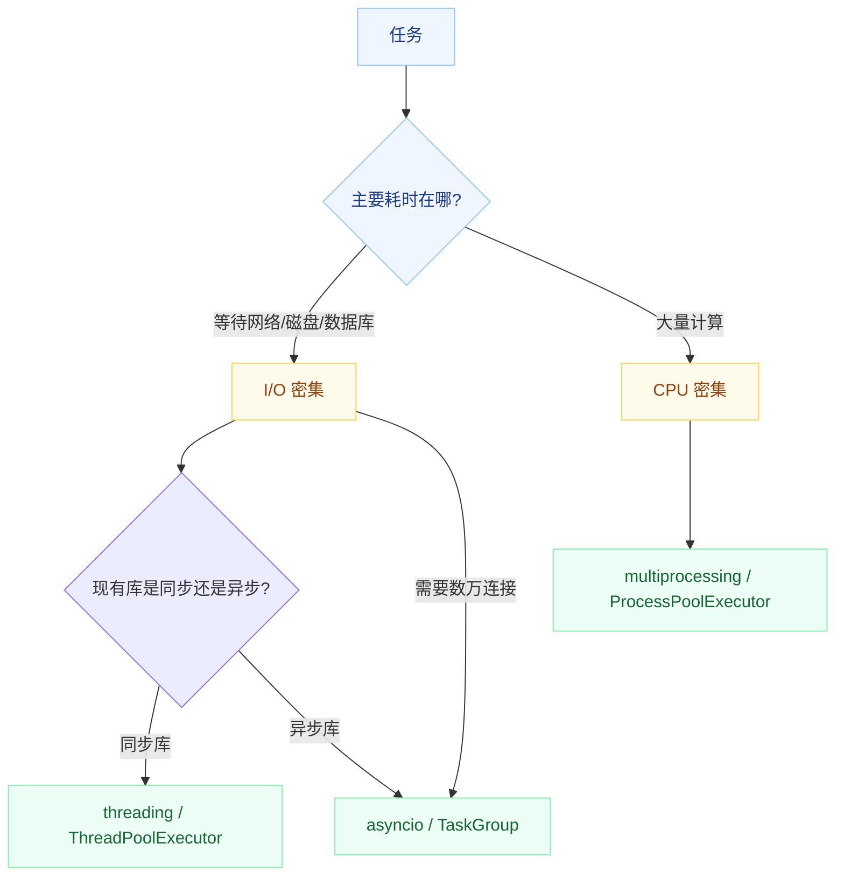

# Python并发与异步

> 这篇从 CPython 的 GIL 和并发模型讲起，经过 threading、multiprocessing、asyncio 基础、异步队列与 httpx 实战、并发选型与故障排查，最后落到一个可运行的服务健康巡检器。
>
> 学完能判断一个任务是 I/O 密集还是 CPU 密集，选对线程、进程或协程，并写出带超时、限流和重试的并发程序。

## 一、并发、并行与 GIL

并发是“同时处理多个任务”，并行是“同时执行多个任务”；Python 的线程能并发，但受 GIL 限制，CPU 密集任务通常不能靠线程并行。

CPython 的全局解释器锁（Global Interpreter Lock，GIL）保证同一时刻只有一个线程执行 Python 字节码。线程在 I/O、`time.sleep()` 和部分 C 扩展调用时会释放 GIL，所以网络、磁盘、数据库等待适合用线程或协程重叠。



| 模型 | 并行执行 Python 字节码 | 适合 | 主要成本 |
|---|---|---|---|
| 线程 | 否（受 GIL） | 阻塞 I/O、现有同步 SDK | 锁、竞态、上下文切换 |
| 进程 | 是 | CPU 计算、隔离故障 | 启动、序列化、内存复制 |
| 协程 | 否（单线程事件循环） | 高并发网络 I/O | 全链路异步、阻塞调用会卡住循环 |

版本基线（2026-11）：Python 3.12+；3.13 提供实验性的 free-threaded 构建，3.14 起 free-threaded 成为正式支持的可选构建，但默认安装仍带 GIL。生产采用前要先验证 C 扩展、数据库驱动和框架是否兼容。

> 边界：GIL 不是“线程安全”的保证。`counter += 1` 是“读-加-写”三步，线程切换可能发生在任意字节码边界，仍会丢更新；共享可变状态必须用锁或队列。

## 二、环境与测量

并发优化先测量再改代码；没有基线的“感觉快了”无法判断是否值得增加复杂度。

```bash
uv init --package concurrent-demo
cd concurrent-demo
uv add httpx
uv add --dev pytest
uv run python --version
```

```python
import time

start = time.perf_counter()   # 单调时钟，适合测耗时
# ... 被测代码 ...
print(f"{time.perf_counter() - start:.3f}s")
```

| 工具 | 用途 | 注意 |
|---|---|---|
| `time.perf_counter()` | 墙钟耗时 | 不受系统时间调整影响 |
| `cProfile` | 函数级 CPU 时间 | 有开销，适合找热点 |
| `py-spy` | 采样分析运行中进程 | 需要安装，生产可用 |
| `asyncio` debug | 慢回调、未等待协程 | `PYTHONASYNCIODEBUG=1` |

> 边界：微基准要固定输入、预热、重复多次取中位数；网络和磁盘测试要区分冷缓存与热缓存。并发程序的耗时受下游容量影响，单机数字不能直接外推到生产。

## 三、threading

线程适合“等待多、计算少”的任务：调用阻塞的数据库驱动、旧版 HTTP 库、文件 I/O。共享状态用 `Lock` 保护，线程间通信用 `queue.Queue`。

### 3.1 竞态与锁

```python
import threading
import time

counter = 0
LOCK = threading.Lock()
USE_LOCK = False


def worker(rounds: int) -> None:
    global counter
    for _ in range(rounds):
        if USE_LOCK:
            with LOCK:
                counter += 1
        else:
            current = counter
            time.sleep(0)   # 主动让出 GIL，放大“读-改-写”之间的竞态
            current += 1
            counter = current


def run(use_lock: bool, rounds: int = 50_000) -> int:
    global counter, USE_LOCK
    counter = 0
    USE_LOCK = use_lock
    threads = [threading.Thread(target=worker, args=(rounds,)) for _ in range(4)]
    for thread in threads:
        thread.start()
    for thread in threads:
        thread.join()
    return counter


if __name__ == "__main__":
    print("no lock:", run(False))
    print("lock:   ", run(True))
```

本机实测（Python 3.13.18，4 线程 × 5 万次）：

```text
no lock: 50000
lock:    200000
```

不加锁时，多个线程读到同一个旧值再写回，最终只有 5 万上下，远少于 20 万；加锁后每次“读-加-写”原子完成。`time.sleep(0)` 是为了稳定复现竞态，真实代码的切换点更随机，但问题相同。

> 边界：锁的粒度要覆盖完整的“读-改-写”，只锁赋值语句没用；多个锁要固定获取顺序，避免死锁。能用 `queue.Queue` 传递数据时，不要共享大对象。

### 3.2 线程池

```python
from concurrent.futures import ThreadPoolExecutor
import time


def blocking_io(task_id: int) -> int:
    time.sleep(0.2)          # 模拟一次阻塞 I/O
    return task_id * 2


start = time.perf_counter()
with ThreadPoolExecutor(max_workers=4) as pool:
    results = list(pool.map(blocking_io, range(8)))
print(results)               # [0, 2, 4, 6, 8, 10, 12, 14]
print(f"{time.perf_counter() - start:.2f}s")  # 约 0.4s，8 个任务分两批
```

`with` 退出时调用 `shutdown(wait=True)`，不要忘记回收线程；长期运行的服务应复用池，而不是每个请求建一个。

### 3.3 线程间通信

```python
import queue
import threading


def producer(q: queue.Queue[int | None]) -> None:
    for item in range(3):
        q.put(item)
    q.put(None)              # 哨兵：通知消费者退出


def consumer(q: queue.Queue[int | None], out: list[int]) -> None:
    while (item := q.get()) is not None:
        out.append(item)
        q.task_done()
    q.task_done()


q: queue.Queue[int | None] = queue.Queue(maxsize=2)
out: list[int] = []
t = threading.Thread(target=consumer, args=(q, out))
t.start()
producer(q)
t.join()
print(out)                   # [0, 1, 2]
```

> 边界：`queue.Queue(maxsize=...)` 有背压，生产速度超过消费时会阻塞，避免内存无限增长；无界队列在突发流量下会吃满内存。线程不能直接 `kill`，退出要靠哨兵、事件或超时。

## 四、multiprocessing

CPU 密集任务要绕开 GIL，用多进程；每个进程有独立解释器和内存，适合并行计算，不适合频繁共享大对象。

```python
import os
import time
from concurrent.futures import ProcessPoolExecutor, ThreadPoolExecutor


def cpu_task(n: int) -> int:
    return sum(i * i for i in range(n))


def bench(label: str, fn) -> None:
    tasks = [4_000_000] * 4
    start = time.perf_counter()
    results = fn(tasks)
    print(f"{label:<10} {time.perf_counter() - start:6.2f}s  checksum={sum(results)}")


if __name__ == "__main__":       # Windows/macOS 的 spawn 模式必须有入口保护
    print("cpu_count:", os.cpu_count())
    bench("sequential", lambda ts: [cpu_task(t) for t in ts])
    with ThreadPoolExecutor(max_workers=4) as pool:
        bench("threads", lambda ts: list(pool.map(cpu_task, ts)))
    with ProcessPoolExecutor(max_workers=4) as pool:
        bench("processes", lambda ts: list(pool.map(cpu_task, ts)))
```

本机实测（10 核 macOS，Python 3.13.18）：

```text
cpu_count: 10
sequential   0.68s  checksum=85333301333336000000
threads      0.65s  checksum=85333301333336000000
processes    0.21s  checksum=85333301333336000000
```

线程版本和串行几乎一样，因为计算不释放 GIL；进程版本真正并行，但启动和序列化有固定开销，任务太小反而更慢。

| 约束 | 说明 |
|---|---|
| 可 pickle | 参数、返回值、异常都要能序列化；lambda、打开的文件、锁不能跨进程 |
| 入口保护 | `if __name__ == "__main__":`，否则 spawn 会递归创建进程 |
| 启动方式 | Linux 3.12/3.13 默认 fork，3.14 起 forkserver；macOS/Windows 默认 spawn；可显式 get_context("spawn") |
| 共享状态 | 优先用返回值/队列；`Value`、`Manager` 有锁和代理开销 |

> 边界：进程池适合可切分的 CPU 批处理（图像、压缩、数值计算）；不适合高频小任务和需要共享大量内存的场景。进程内再开进程池会迅速耗尽资源。

## 五、asyncio 基础

协程适合高并发 I/O：单线程事件循环在 `await` 处切换任务，没有线程栈和锁的开销，但一个阻塞调用会卡住整个循环。

```python
import asyncio
import time


async def fetch(name: str, delay: float) -> str:
    await asyncio.sleep(delay)   # 非阻塞等待，事件循环可以运行其他任务
    return f"{name} done"


async def sequential() -> None:
    start = time.perf_counter()
    for name in ["a", "b", "c"]:
        print(await fetch(name, 0.3))
    print(f"sequential: {time.perf_counter() - start:.2f}s")


async def concurrent() -> None:
    start = time.perf_counter()
    results = await asyncio.gather(*(fetch(name, 0.3) for name in ["a", "b", "c"]))
    print(results)
    print(f"concurrent: {time.perf_counter() - start:.2f}s")


async def main() -> None:
    await sequential()
    await concurrent()


if __name__ == "__main__":
    asyncio.run(main())
```

本机实测：

```text
a done
b done
c done
sequential: 0.91s
['a done', 'b done', 'c done']
concurrent: 0.30s
```

`asyncio.gather` 并发等待多个协程；`asyncio.TaskGroup`（3.11+）提供结构化并发，任一任务失败会取消同组其他任务并抛出 `ExceptionGroup`：

```python
async def run_all() -> None:
    async with asyncio.TaskGroup() as tg:
        tasks = [tg.create_task(fetch(name, 0.3)) for name in ["a", "b", "c"]]
    print([task.result() for task in tasks])


asyncio.run(run_all())
```

超时和取消：

```python
async def with_timeout() -> None:
    try:
        async with asyncio.timeout(0.5):   # 3.11+
            await fetch("slow", 2.0)
    except TimeoutError:
        print("超时，已取消")              # 超时会取消内部任务


task = asyncio.create_task(fetch("x", 10))
task.cancel()
```

> 边界：`async def` 只定义协程函数，调用后得到协程对象，必须 `await` 或交给事件循环；忘记 `await` 会有 `RuntimeWarning: coroutine ... was never awaited`。在协程里调用 `time.sleep()`、`requests.get()`、同步数据库驱动会阻塞整个事件循环。

## 六、asyncio 同步原语与队列

异步代码同样需要限流和背压：`Semaphore` 限制并发数，`Queue` 解耦生产者和消费者，`Lock` 保护跨 `await` 的临界区。

```python
import asyncio


async def producer(queue: asyncio.Queue[int]) -> None:
    for item in range(6):
        await queue.put(item)
        await asyncio.sleep(0.01)
    await queue.put(-1)          # 每个消费者都需要一个结束哨兵


async def consumer(name: str, queue: asyncio.Queue[int], results: list[int]) -> None:
    while True:
        item = await queue.get()
        try:
            if item == -1:
                return
            await asyncio.sleep(0.02)
            results.append(item)
        finally:
            queue.task_done()    # 每个 get 必须配对，join 才能返回


async def main() -> None:
    queue: asyncio.Queue[int] = asyncio.Queue(maxsize=3)  # 有界队列形成背压
    results: list[int] = []
    consumers = [
        asyncio.create_task(consumer(f"c{i}", queue, results)) for i in range(2)
    ]
    await producer(queue)
    await queue.put(-1)          # 两个消费者，两个哨兵
    await queue.join()
    await asyncio.gather(*consumers)
    print("processed:", sorted(results))


asyncio.run(main())
```

```text
processed: [0, 1, 2, 3, 4, 5]
```

| 原语 | 用途 | 常见错误 |
|---|---|---|
| `Semaphore(n)` | 限制同时进行的操作数 | 在 semaphore 外创建连接 |
| `Queue(maxsize)` | 生产者/消费者背压 | 忘记 `task_done()` |
| `Lock` | 保护跨 `await` 的共享状态 | 锁内做慢 I/O |
| `Event` | 广播启动/停止信号 | 忘记 `set()` 导致永久等待 |

> 边界：`asyncio.Lock` 不是线程锁，不能跨线程使用；`asyncio.Queue` 也不是进程队列。锁内不要 `await` 慢操作，否则其他任务全部排队。

## 七、异步 I/O 实战

HTTP 客户端要同时设置超时、连接池和业务并发上限；三者分工不同，不能只靠一个 `Semaphore`。

```python
import asyncio
import httpx


async def fetch(client: httpx.AsyncClient, url: str, sem: asyncio.Semaphore) -> str:
    async with sem:                 # 业务并发上限，保护下游
        for attempt in range(3):
            try:
                async with asyncio.timeout(2.0):
                    response = await client.get(url)
                    response.raise_for_status()
                    return response.text
            except (httpx.HTTPError, TimeoutError):
                if attempt == 2:
                    raise
                await asyncio.sleep(0.1 * (2**attempt))  # 指数退避
    raise RuntimeError("unreachable")


async def main(urls: list[str]) -> None:
    limits = httpx.Limits(max_connections=20, max_keepalive_connections=10)
    timeout = httpx.Timeout(2.0, connect=0.5)
    async with httpx.AsyncClient(limits=limits, timeout=timeout) as client:
        sem = asyncio.Semaphore(8)
        results = await asyncio.gather(
            *(fetch(client, url, sem) for url in urls), return_exceptions=True
        )
        print(sum(not isinstance(r, Exception) for r in results), "ok")
```

| 设置 | 控制什么 | 建议 |
|---|---|---|
| `Semaphore(8)` | 同时在途请求数 | 按下游容量和 SLA 定 |
| `max_connections` | 连接池上限 | 不小于 semaphore 上限 |
| `Timeout(2.0, connect=0.5)` | 总超时/连接超时 | 连接超时短于总超时 |
| 重试次数 | 瞬时故障 | 只重试幂等请求，带抖动 |

> 边界：重试不是越多越好，4xx 通常不该重试；重试要加退避和抖动，避免雪崩。`return_exceptions=True` 会把异常当结果返回，必须显式检查，否则失败会被静默吞掉。

## 八、并发选型

选型只看两个问题：瓶颈是等待还是计算；现有依赖是同步还是异步。其余都是实现细节。

| 场景 | 首选 | 原因 |
|---|---|---|
| 大量 HTTP/数据库等待 | `asyncio` + 异步驱动 | 单线程支撑高并发，内存开销小 |
| 阻塞 SDK、旧驱动 | `ThreadPoolExecutor` | 不改依赖，靠线程重叠等待 |
| 图像/压缩/数值计算 | `ProcessPoolExecutor` | 绕开 GIL，真正并行 |
| 异步服务里偶发 CPU 任务 | `asyncio.to_thread` 或进程池 | 避免阻塞事件循环 |
| 批量离线任务 | 进程池/队列 | 可切分、可重试 |

容量估算：

- CPU 密集：worker 数约等于物理核数，超过只会增加切换。
- 阻塞 I/O：worker 数由下游容量决定，常用 2–10 倍核数起步，再用压测校准。
- 异步 I/O：用 `Semaphore` 把在途请求压在下游能承受的范围内，不要无限 `create_task`。

> 边界：并发不是越高越好。下游连接池、数据库最大连接数、文件描述符和内存都是硬上限；没有超时和限流的并发会把小故障放大成雪崩。

## 九、故障与排查

并发问题优先看“卡在哪”和“谁在等谁”，而不是先改代码；超时、限流和结构化并发是预防手段。

| 现象 | 常见原因 | 第一条命令 |
|---|---|---|
| 程序不退出 | 非 daemon 线程/未取消任务 | `threading.enumerate()`、`asyncio.all_tasks()` |
| CPU 100% 但吞吐低 | 事件循环被同步代码阻塞 | `asyncio` debug 慢回调日志 |
| 死锁 | 多把锁顺序不一致 | `faulthandler.dump_traceback_later(10)` |
| `coroutine was never awaited` | 调用协程没 `await` | 搜 `async def` 调用点 |
| `Task exception was never retrieved` | 任务异常无人取 | 保存 task 引用、用 `TaskGroup` |
| `Too many open files` | 连接/文件未限制 | `ulimit -n`、连接池上限 |
| 进程池卡住 | 参数不可 pickle/入口未保护 | 看子进程 traceback |

```python
import asyncio
import faulthandler

faulthandler.dump_traceback_later(10, repeat=True)  # 10 秒后打印所有线程栈
asyncio.run(main(), debug=True)                      # 慢回调、未等待协程告警
```

```bash
py-spy dump --pid 12345          # 查看运行中进程的调用栈
py-spy top --pid 12345           # 实时看热点函数
```

> 边界：`faulthandler` 只能打印栈，不能恢复死锁；`py-spy` 需要权限，容器里要加 `SYS_PTRACE`。生产环境先限流、加超时，再谈定位。

## 十、最佳实践案例

### 10.1 案例背景

运维平台每 5 分钟巡检 24 个服务端点：18 个正常接口、2 个慢接口（约 400ms）、2 个首次返回 503 的抖动接口、2 个持续 500 的故障接口。旧脚本用 `urllib` 串行请求，单个超时 500ms，整轮约 48 秒，经常超过 5 分钟的巡检窗口；任一接口异常还会中断整轮。

目标是整轮压到 10 秒内、失败不中断、抖动接口重试一次、输出成功/失败数量；约束是 Python 3.12+、允许 `httpx`、下游最多同时承受 8 个连接。

### 10.2 案例实操

```python
from __future__ import annotations

import asyncio
import threading
import time
from http.server import BaseHTTPRequestHandler, ThreadingHTTPServer
from urllib.error import HTTPError, URLError
from urllib.request import urlopen

import httpx


class Handler(BaseHTTPRequestHandler):
    flaky_seen: set[str] = set()
    lock = threading.Lock()

    def do_GET(self) -> None:
        if self.path.startswith("/slow"):
            time.sleep(0.4)          # 慢接口
        elif self.path.startswith("/ok"):
            time.sleep(0.05)         # 普通网络往返
        elif self.path.startswith("/flaky"):
            with self.lock:
                first = self.path not in self.flaky_seen
                self.flaky_seen.add(self.path)
            if first:
                self.send_response(503)   # 首次失败，重试后成功
                self.end_headers()
                return
            time.sleep(0.05)
        elif self.path.startswith("/fail"):
            self.send_response(500)       # 持续故障
            self.end_headers()
            return

        self.send_response(200)
        self.send_header("Content-Type", "text/plain")
        self.end_headers()
        self.wfile.write(b"ok")

    def log_message(self, format: str, *args: object) -> None:
        return                            # 关闭访问日志，避免干扰计时


def check_sync(url: str, retries: int = 1) -> bool:
    for attempt in range(retries + 1):
        try:
            with urlopen(url, timeout=0.5) as response:
                response.read()
                return True
        except (HTTPError, URLError, TimeoutError):
            if attempt == retries:
                return False
            time.sleep(0.05)
    return False


async def check_async(
    client: httpx.AsyncClient, url: str, sem: asyncio.Semaphore, retries: int = 1
) -> bool:
    async with sem:                       # 下游最多 8 个在途请求
        for attempt in range(retries + 1):
            try:
                async with asyncio.timeout(0.5):
                    response = await client.get(url)
                    response.raise_for_status()
                return True
            except (httpx.HTTPError, TimeoutError):
                if attempt == retries:
                    return False
                await asyncio.sleep(0.05)
    return False


async def main() -> None:
    server = ThreadingHTTPServer(("127.0.0.1", 0), Handler)
    port = server.server_address[1]
    threading.Thread(target=server.serve_forever, daemon=True).start()

    paths = [f"/ok/{i}" for i in range(18)]
    paths += [f"/slow/{i}" for i in range(2)]
    paths += [f"/flaky/{i}" for i in range(2)]
    paths += [f"/fail/{i}" for i in range(2)]
    urls = [f"http://127.0.0.1:{port}{path}" for path in paths]

    try:
        start = time.perf_counter()
        sync_results = [check_sync(url) for url in urls]
        sync_elapsed = time.perf_counter() - start

        sem = asyncio.Semaphore(8)
        start = time.perf_counter()
        async with httpx.AsyncClient(timeout=1.0) as client:
            async_results = await asyncio.gather(
                *(check_async(client, url, sem) for url in urls)
            )
        async_elapsed = time.perf_counter() - start

        print(f"端点: {len(urls)}，并发: 8")
        print(f"串行: {sum(sync_results)} 成功，{sync_elapsed:.2f}s")
        print(f"异步: {sum(async_results)} 成功，{async_elapsed:.2f}s")
        print(f"加速: {sync_elapsed / async_elapsed:.1f}x")
    finally:
        server.shutdown()
        server.server_close()


if __name__ == "__main__":
    asyncio.run(main())
```

```bash
uv run --with httpx python healthcheck.py
```

本机实测（Python 3.13.18，含本地 HTTP 服务）：

```text
端点: 24，并发: 8
串行: 22 成功，2.20s
异步: 22 成功，0.68s
加速: 3.2x
```

### 10.3 案例结果

本机实测串行 2.20 秒、异步 0.68 秒，加速 3.2 倍；两个抖动接口在第二次尝试成功，两个持续 500 的接口被计为失败但没有中断整轮，最终 22/24 成功。按真实环境单接口 2 秒、并发 8 估算，24 个端点从 48 秒降到约 6 秒，巡检窗口从“经常超时”变为可留出重试余量。

失败模式与复盘：

- `asyncio.timeout(0.5)` 是单次尝试的超时，重试会重新计时；总耗时上限要由外层 `asyncio.timeout` 或任务调度控制，否则“重试 × 超时”会放大最坏耗时。
- `Semaphore(8)` 限制的是应用层并发，`httpx` 连接池默认上限也要匹配；只改 semaphore 不改连接池，连接会排队。
- `gather` 默认在第一个异常时抛出（`return_exceptions=False`），本例的 `check_async` 把异常转成 `False`，所以能拿到完整结果；如果让异常冒泡，要用 `TaskGroup` 或显式收集。
- 本地 `ThreadingHTTPServer` 每个请求一个线程，不能用来压测真实吞吐；案例验证的是并发结构和失败处理，不是下游性能。
- 重试只适合幂等 GET；支付、下单等非幂等操作要带幂等键，否则重试可能重复扣款。
