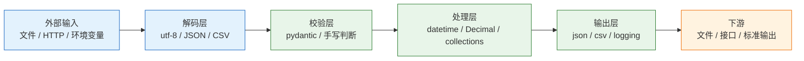
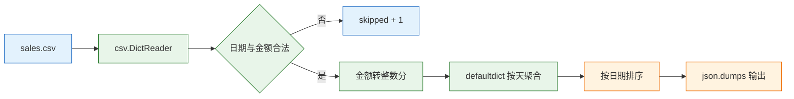

# Python 常用库

---

## 一、Python 常用库的定位

Python 的标准库有两百多个模块，覆盖文件、时间、序列化、正则、网络、日志、命令行等通用能力。日常工程真正反复使用的只有几组：路径与文件、时间与数值、结构化文本、聚合工具、HTTP 客户端、配置校验、日志与参数解析。难点不在记住模块名，而在判断边界：哪些问题标准库已经足够，哪些缺口必须引入第三方，引入后又多承担了哪些依赖和升级成本。

常用库解决的是“通用动作的复用”，不解决领域模型、错误语义和业务流程。一个 CSV 汇总脚本可以全程只用标准库，也可以引入 pandas；选择依据是数据规模、类型复杂度、团队维护能力和部署环境，而不是库的名气。

### 1.1 核心概念

标准库与第三方库的差别，不只是“是否内置”，还包括发布节奏、兼容承诺和依赖树。

- **标准库**：随解释器发布，API 稳定，无额外依赖；缺点是能力偏基础，错误信息偏底层。
- **第三方库**：补足连接池、声明式校验、配置分层等工程缺口；代价是传递依赖、版本冲突和安全更新。
- **传递依赖**：安装一个库时被连带安装的依赖，真正决定升级风险的是整棵依赖树。
- **边界校验**：外部输入进入系统的第一道关卡，负责类型转换、范围检查和错误定位。
- **适配层**：把第三方库的接口包在自己的函数后面，替换实现时只改一层。

| 层次 | 代表模块 | 职责 | 稳定性 |
|---|---|---|---|
| 语言内建 | `str`、`dict`、`pathlib` | 数据与路径表达 | 高 |
| 标准库 | `json`、`csv`、`datetime`、`logging` | 通用格式与运行时 | 高 |
| 第三方基础库 | `httpx`、`pydantic` | 网络与校验 | 中 |
| 领域封装 | 自建模块 | 业务语义 | 由团队控制 |

### 1.2 与相邻技术的关系

选库时最容易混淆的是“功能重叠但边界不同”的几组技术。

| 需求 | 标准库方案 | 常见第三方 | 边界判断 |
|---|---|---|---|
| HTTP 客户端 | `urllib.request` | `httpx`、`requests` | 需要连接池、超时、异步时换 |
| 数据校验 | `dataclass` | `pydantic` | 输入来自网络或文件时换 |
| 配置管理 | `os.environ` | `pydantic-settings` | 多来源、类型转换时换 |
| 日期运算 | `datetime` | `python-dateutil` | 需要“加一个月”时换 |
| 重试 | 无 | `tenacity` | 需要退避、抖动时换 |
| 命令行 | `argparse` | `click`、`typer` | 子命令多、要补全时换 |
| 表格计算 | `csv` | `pandas`、`polars` | 需要列式运算和分组时换 |

`requests` 是同步阻塞客户端，接口简单，但默认没有超时；`httpx` 同步与异步共用一套 API，默认超时 5 秒，支持连接池，HTTP/2 需要安装 `httpx[http2]`。`pandas` 适合探索性分析和中等规模表格，不等于数据库；数据超过内存或需要事务时，应该回到数据库或流式处理。`pydantic` 负责边界校验，不负责 ORM 映射和业务规则。

### 1.3 整体结构

常用库可以按“数据从外部进入到写出结果”的路径分层：输入层负责读取与解码，校验层负责类型与范围，处理层使用标准库做转换和聚合，输出层负责序列化与日志。



| 层 | 关键问题 | 失败表现 |
|---|---|---|
| 解码 | 编码、BOM、换行符 | 乱码、多空行 |
| 校验 | 类型、范围、缺字段 | `ValidationError`、脏数据 |
| 处理 | 时区、精度、排序 | 差 8 小时、金额误差 |
| 输出 | 序列化、转义、原子写 | 下游解析失败、半个文件 |

分层的价值在于定位：出现乱码先查解码层，出现金额误差先查处理层，出现 JSON 解析失败先查输出层。把所有逻辑堆在一个脚本里，故障只能靠猜。

---

## 二、环境与第一个程序

### 2.1 解释器与虚拟环境

> **版本现状（2026-10）**：Python 3.14 为当前稳定主线，3.13 处于安全维护期。第三方库对 3.14 的 C 扩展支持参差不齐，升级前先查依赖的 wheel 发布情况。

```bash
# ========== 确认解释器 ==========
# 版本、构建信息、可执行文件路径
python3 -VV
python3 -c "import sys; print(sys.executable)"

# ========== 创建独立环境 ==========
# 使用 uv 安装指定版本并创建 .venv
uv python install 3.14
uv venv --python 3.14
source .venv/bin/activate

# ========== 验证环境隔离 ==========
# 确认 pip 与 python 来自同一个环境
python -m pip --version
python -c "import sys; print(sys.prefix)"
```

虚拟环境的意义是隔离依赖树。系统解释器被包管理器和其他工具共享，直接安装全局包可能升级掉系统工具依赖的版本。项目内 `.venv` 跟着项目走，删除后重建即可，不污染机器。

### 2.2 依赖管理与版本锁定

依赖清单记录“需要什么”，锁文件记录“实际装了什么”。只有清单没有锁文件，两次安装可能得到不同版本。

```bash
# ========== 添加依赖 ==========
# 运行时依赖
uv add httpx pydantic pydantic-settings

# 开发依赖，不进生产镜像
uv add --dev pytest ruff

# ========== 同步与检查 ==========
# 按锁文件精确安装
uv sync

# 查看依赖树，定位冲突来源
uv tree

# 导出传统 requirements 文件，兼容旧流水线
uv export --format requirements-txt --no-hashes -o requirements.txt
```

| 文件 | 作用 | 是否入库 |
|---|---|---|
| `pyproject.toml` | 声明依赖与工具配置 | 是 |
| `uv.lock` | 锁定精确版本与哈希 | 是 |
| `requirements.txt` | 兼容旧工具 | 按需 |
| `.venv/` | 本地环境 | 否 |

> **注意**：`pip install` 与 `python -m pip install` 在多数环境等价，但后者明确绑定当前解释器。多解释器机器上，直接调用 `pip` 可能装到另一个环境，表现为“装过却 import 不到”。排查时先看 `python -m pip show 包名` 的 `Location`。

### 2.3 最小可运行示例

下面的脚本读取 CSV、按天汇总金额、输出 JSON，覆盖路径、CSV、日期、金额和序列化五个常用点。

```python
import csv
import json
from collections import defaultdict
from datetime import date
from pathlib import Path

def cents(text: str) -> int:
    # 金额转整数分，避免浮点累加误差
    whole, _, frac = text.partition(".")
    return int(whole) * 100 + int((frac + "00")[:2])

daily = defaultdict(int)
with Path("sales.csv").open(encoding="utf-8", newline="") as f:
    for row in csv.DictReader(f):
        try:
            day = date.fromisoformat(row["date"]).isoformat()
            daily[day] += cents(row["amount"])
        except (ValueError, KeyError):
            continue

print(json.dumps({d: v / 100 for d, v in sorted(daily.items())},
                 ensure_ascii=False, indent=2))
```

脚本刻意保持单文件、无第三方依赖，便于在任何环境验证。真实项目再把解析、聚合、输出拆成函数，并补上坏行计数和日志。

---

## 三、路径与文件操作

### 3.1 pathlib 对象模型

`pathlib.Path` 把路径当对象，用 `/` 拼接，方法直接读写，跨平台不用管分隔符。

```python
from pathlib import Path

root = Path("data")
for path in sorted(root.rglob("*.csv")):
    print(path.name, path.stat().st_size)
```

| 目的 | 写法 | 注意 |
|---|---|---|
| 拼路径 | `root / "2026" / "a.csv"` | 不要手拼 `/` |
| 读文本 | `p.read_text(encoding="utf-8")` | 必须显式编码 |
| 写文本 | `p.write_text(s, encoding="utf-8")` | 默认覆盖，不原子 |
| 逐行读 | `with p.open(encoding="utf-8") as f:` | 大文件必须流式 |
| 找文件 | `p.glob("*.py")`、`p.rglob("*.py")` | 结果顺序不保证 |
| 规范化 | `p.resolve()` | 解析符号链接，默认不要求存在 |
| 改后缀 | `p.with_suffix(".json")` | 只改最后一个后缀 |

`Path("a/b")` 不会检查路径是否存在，需要判断时用 `.exists()`、`.is_file()`。`glob` 与 `rglob` 返回生成器，遍历顺序由文件系统决定，需要稳定输出时先排序。`resolve()` 会展开符号链接和 `..`，权限不足时可能抛 `OSError`。

### 3.2 读写与原子替换

普通写入不是原子的：进程在中途挂掉，目标文件会变成半个。重要文件先写同目录临时文件，再用 `os.replace()` 替换。

```python
import os
from pathlib import Path
from tempfile import NamedTemporaryFile

def atomic_write(path: Path, text: str) -> None:
    # 临时文件必须与目标同目录，保证同一文件系统
    with NamedTemporaryFile("w", encoding="utf-8",
                            dir=path.parent, delete=False) as tmp:
        tmp.write(text)
        tmp.flush()
        os.fsync(tmp.fileno())      # 落盘后再替换
    os.replace(tmp.name, path)      # 同文件系统内原子替换
```

读者要么看到旧文件，要么看到新文件，不会看到半成品。`fsync` 保证数据真正写入磁盘，代价是性能；日志、缓存这类可重建的数据不必每次同步。

> **注意**：`Path.unlink()` 只删文件，删除目录用 `shutil.rmtree()`，它是递归删除。执行前必须先确认路径，动态拼接的路径要先用 `resolve()` 规范化并检查是否位于允许的根目录内，否则一个空变量就可能删掉整个工作目录。

### 3.3 临时文件与磁盘检查

| 工具 | 用途 | 生命周期 |
|---|---|---|
| `NamedTemporaryFile` | 需要路径的临时文件 | 手动删除或 `delete=True` |
| `TemporaryDirectory` | 临时目录树 | 上下文退出时递归删除 |
| `shutil.disk_usage` | 查询剩余空间 | 即时读取 |
| `shutil.copy2` | 复制并保留元数据 | 调用方管理目标 |

`TemporaryDirectory()` 适合解压、转码这类中间产物；上下文退出时自动清理，异常退出也能保证删除。`disk_usage()` 返回总量、已用和剩余字节，写入大文件前先检查，比写到一半报 `No space left on device` 更容易处理。

---

## 四、时间与数值精度

### 4.1 naive 与 aware

`datetime` 有两种：不带时区的 naive，和带 `tzinfo` 的 aware。两者相减会抛 `TypeError`；跨时区比较时，naive 会被当成本地时间，结果差几个小时。

```python
from datetime import datetime, timezone
from zoneinfo import ZoneInfo

now = datetime.now(timezone.utc)          # aware，UTC
local = now.astimezone(ZoneInfo("Asia/Shanghai"))
print(local.isoformat())                  # 带 +08:00 偏移的本地时间
```

| 写法 | 时区 | 可比较 | 适用 |
|---|---|---|---|
| `datetime.now()` | naive | 仅同类型 | 不推荐用于业务时间 |
| `datetime.now(timezone.utc)` | aware | 是 | 存储、计算 |
| `astimezone(ZoneInfo(...))` | aware | 是 | 展示 |
| `date.today()` | 无时间 | 按日比较 | 纯日期字段 |

存储用 UTC，展示按用户时区转换。数据库使用带时区的类型，例如 PostgreSQL 的 `timestamptz`。不要用 `datetime.now()` 记录业务时间，它没有时区，换服务器就漂。`datetime.fromisoformat()` 在 3.11 及以上能解析 `Z` 结尾的 UTC 时间，更老的格式要先确认。

`timedelta` 以天、秒、微秒存储，没有“一个月”的概念；月末和闰年要用 `dateutil.relativedelta` 或业务规则。`strftime` 的 `%b`、`%a` 受 locale 影响，接口输出统一用 ISO 8601，不要给机器读本地化字符串。

### 4.2 时区数据库与夏令时

`zoneinfo` 读取系统时区数据库。Linux 和 macOS 一般自带，精简容器和 Windows 可能没有，需要安装 `tzdata`，否则 `ZoneInfo("Asia/Shanghai")` 抛 `ZoneInfoNotFoundError`。

| 环境 | 时区数据来源 | 处理 |
|---|---|---|
| 普通 Linux | 系统 `/usr/share/zoneinfo` | 直接使用 |
| 精简容器 | 常被裁剪 | 安装 `tzdata` 包 |
| Windows | 无系统库 | 安装 `tzdata` |
| 跨时区调度 | UTC | 只在展示层转换 |

夏令时切换当天，本地时间可能不存在或重复。调度系统按 UTC 存储和触发，展示时再按规则转换；直接用本地时间做定时任务，会在切换日出现跳过或重复执行。

### 4.3 Decimal 与金额

`float` 是 IEEE 754 双精度，`0.1 + 0.2 == 0.3` 为 `False`。金额用 `Decimal`，并且从字符串构造，不要从 float 构造。

```python
from decimal import Decimal, ROUND_HALF_UP

price = Decimal("19.99")
tax = Decimal("0.13")
total = (price * (1 + tax)).quantize(Decimal("0.01"), rounding=ROUND_HALF_UP)
print(total)          # 22.59
```

| 方案 | 精度 | 性能 | 适用 |
|---|---|---|---|
| `float` | 二进制近似 | 高 | 科学计算、容差比较 |
| `Decimal` | 十进制精确 | 较低 | 金额、计费、报表 |
| 整数分 | 精确 | 高 | 支付、账单存储 |

浮点比较用 `math.isclose`，不要用 `==`。`Decimal` 的上下文决定精度和舍入方式，跨模块传递时要统一，否则同一笔金额在两个服务里算出不同结果。

---

## 五、结构化文本处理

### 5.1 JSON 序列化

| 格式 | 保留类型 | 可读与安全 | 典型用途 |
|---|---|---|---|
| JSON | 对象、数组、字符串、数字、布尔、null | 可读、反序列化安全 | 接口、配置、日志 |
| CSV | 全是字符串 | 可读、反序列化安全 | 表格导出、批量导入 |
| TOML | 日期、整数、数组 | 可读、反序列化安全 | 项目配置 |
| pickle | 任意 Python 对象 | 不可读、反序列化不安全 | 进程间临时缓存 |

> **安全警告**：不要对不可信数据调用 `pickle.loads()`。反序列化可以执行任意代码，等同于把 shell 交给对方；跨进程、跨网络传输一律用 JSON、MessagePack 等纯数据格式。

JSON 有三个高频问题：中文默认被转义成 `\uXXXX`，要 `ensure_ascii=False` 才可读；`datetime`、`Decimal`、`set` 不能直接序列化，要用 `default=` 明确转换；`NaN` 和 `Infinity` 不是标准 JSON，Python 默认能写出，其他语言可能解析失败，需要严格时设 `allow_nan=False`。

`json.load()` 会把整个文件读进内存。几十 MB 没问题，GB 级要换 NDJSON（一行一个对象）逐行读，或用 `ijson` 做流式解析。写批量数据给下游时，NDJSON 比一个巨大数组更容易追加和断点续跑。

### 5.2 CSV 读写

CSV 必须用 `newline=""` 打开，否则 Windows 上会多出空行。Excel 导出的文件可能带 BOM，读取时用 `utf-8-sig`。

```python
import csv
from pathlib import Path

with Path("in.csv").open(encoding="utf-8-sig", newline="") as f:
    reader = csv.DictReader(f)
    rows = [row for row in reader]

with Path("out.csv").open("w", encoding="utf-8", newline="") as f:
    writer = csv.DictWriter(f, fieldnames=["date", "amount"])
    writer.writeheader()
    writer.writerows(rows)
```

`DictReader` 和 `DictWriter` 按表头取值，比下标稳定。CSV 不推断类型：读出来全是字符串，空单元格是 `""` 而不是 `None`，数字和日期要自己转换，转换失败要当坏行处理。字段内含逗号、引号、换行时由 `csv` 模块负责转义，不要自己拼字符串。

### 5.3 正则表达式

```python
import re

LINE = re.compile(r"(?P<method>[A-Z]+) (?P<path>/\S*) (?P<status>\d{3})")
m = LINE.fullmatch("GET /tasks 200")
print(m.group("path"))   # /tasks
```

| 函数 | 匹配范围 | 典型用途 |
|---|---|---|
| `re.match` | 从开头匹配 | 前缀固定 |
| `re.search` | 任意位置 | 提取片段 |
| `re.fullmatch` | 整个字符串 | 严格校验 |
| `re.findall` | 所有非重叠匹配 | 批量提取 |
| `re.sub` | 替换 | 清洗文本 |

用原始字符串 `r""`，否则 `\d`、`\b` 会被 Python 先转义。匹配整个字符串用 `fullmatch`，不要用 `match` 加 `$` 猜。命名组让取值不依赖下标。`re` 模块内部会缓存编译结果，`compile` 的主要收益是复用和可读性，不是省一次编译。

避免嵌套量词，例如 `(a+)+$`；恶意输入会触发灾难性回溯，把 CPU 打满。不要用正则解析 HTML、JSON、SQL，这些格式有嵌套结构，应该用对应解析器。

---

## 六、聚合与迭代工具

### 6.1 collections

| 工具 | 作用 | 复杂度 | 注意 |
|---|---|---|---|
| `Counter` | 计数与 Top N | 平均 O(1) 更新 | 缺失键返回 0 |
| `defaultdict` | 缺键自动创建 | 平均 O(1) | 工厂函数不能带参数 |
| `deque` | 双端队列 | 两端 O(1) | 中间查找 O(n) |
| `OrderedDict` | 显式有序字典 | 平均 O(1) | 普通 dict 已有插入序 |
| `namedtuple` | 轻量记录 | 属性访问 O(1) | 不可变，字段多时用 dataclass |

`Counter` 的 `most_common(n)` 在元素多时使用堆，适合取 Top N；`defaultdict(list)` 省掉“键不存在就建列表”的判断，但读取不存在的键会悄悄创建条目，遍历前要意识到这一点。

### 6.2 itertools

`itertools.groupby` 只合并相邻的相同键，必须先按同一个 key 排序，否则相同 key 会被拆成多组。

```python
from itertools import groupby

rows = [("web", 12), ("app", 7), ("web", 3)]
for channel, group in groupby(sorted(rows), key=lambda r: r[0]):
    print(channel, sum(v for _, v in group))
```

```text
app 7
web 15
```

`itertools.batched`（3.12+）按固定大小切块，批量请求和批量写库常用；`chain` 拼接多个可迭代对象；`islice` 在流上截取前 N 条，不会物化全部数据。

### 6.3 functools 缓存

`functools.cache` 是无上限缓存，`lru_cache(maxsize=N)` 有上限。参数必须可哈希，缓存不会自动失效。

```python
from functools import lru_cache

@lru_cache(maxsize=1024)
def exchange_rate(currency: str, day: str) -> float:
    # 真实实现会查数据库或接口
    return 7.1
```

| 装饰器 | 上限 | 适用 | 风险 |
|---|---|---|---|
| `cache` | 无 | 参数空间小且稳定 | 内存持续上涨 |
| `lru_cache(maxsize=N)` | 有 | 热点有限 | 淘汰后重新计算 |
| `cached_property` | 每实例一份 | 昂贵只读属性 | 实例不可变才安全 |

`cache` 的典型事故是把 `self` 或大对象当参数，缓存越积越大；把会变的配置读进缓存，改配置不生效。缓存键就是参数，设计时先想清楚“什么算同一次调用”。

---

## 七、HTTP 客户端

### 7.1 同步客户端与连接池

`httpx` 的同步客户端支持连接池、超时和代理，接口与异步版一致。

```python
import httpx

with httpx.Client(timeout=5.0, headers={"user-agent": "demo/1.0"}) as client:
    resp = client.get("https://example.com")
    resp.raise_for_status()
    print(resp.status_code, resp.headers.get("content-type"))
```

`Client` 必须复用：每个请求新建一次，连接池和 TLS 握手全部白做。服务里在启动时创建一个客户端，关闭时调用 `close()`；临时脚本用 `with` 保证释放。

### 7.2 超时、重试与代理

| 参数 | 作用 | 不设的后果 |
|---|---|---|
| `timeout` | 连接、读、写、池等待的超时 | 对端不响应时线程一直挂住 |
| `limits` | 连接池上限、keep-alive 数量 | 高并发时打满文件描述符 |
| `follow_redirects` | 是否跟随 3xx | 拿到 302 空响应 |
| `transport=HTTPTransport(retries=N)` | 仅连接失败重试 | 误以为 5xx 也会重试 |

`raise_for_status()` 只对 4xx、5xx 抛异常，不处理业务错误码。重试要自己判断是否幂等，`POST` 不能无脑重试；连接失败可以重试，明确的 `400`、`401`、`404` 重试没有意义。httpx 默认读取 `HTTP_PROXY`、`HTTPS_PROXY` 环境变量，容器里代理配错时请求会绕路或直接失败，可用 `trust_env=False` 排除这一层。

```python
# ========== 关闭环境代理 ==========
import httpx

with httpx.Client(trust_env=False, timeout=3.0) as client:
    print(client.get("http://internal.example.com/health").status_code)
```

### 7.3 异步客户端边界

`httpx.AsyncClient` 只能在事件循环内使用，不要跨事件循环复用。异步代码里不能用 `requests`，它会把事件循环卡住。服务关闭时要 `await client.aclose()`，否则连接池和后台任务可能残留。

| 客户端 | 阻塞 | 适用 | 禁止 |
|---|---|---|---|
| `httpx.Client` | 是 | 同步脚本、线程池 | 协程内直接调用 |
| `httpx.AsyncClient` | 否 | asyncio 服务 | 跨事件循环共享 |
| `requests` | 是 | 传统同步服务 | 异步框架内 |

> **安全警告**：日志和异常信息里不要打印 `Authorization`、Cookie 和完整请求体。排查时记录请求 ID、状态码和耗时即可，凭据一旦进入日志系统，清理成本远高于重新签发。

---

## 八、校验与配置

### 8.1 Pydantic 模型

Pydantic v2 把外部输入解析成模型，类型不对、缺字段、越界都会给出字段路径。

```python
from pydantic import BaseModel, Field

class OrderIn(BaseModel):
    order_no: str = Field(min_length=6, max_length=32)
    amount: int = Field(gt=0)          # 整数分，避免浮点
    channel: str = "web"

payload = OrderIn.model_validate({"order_no": "A10001", "amount": 1999})
print(payload.model_dump())            # {'order_no': 'A10001', 'amount': 1999, 'channel': 'web'}
```

| 能力 | 方法 | 用途 |
|---|---|---|
| 校验 | `model_validate(obj)` | 从字典或对象构造 |
| 导出 | `model_dump()` | 转回字典 |
| 部分更新 | `model_dump(exclude_unset=True)` | PATCH 只输出传入字段 |
| ORM 读取 | `from_attributes=True` | 从对象属性取值 |
| 严格模式 | `strict=True` | 禁止隐式类型转换 |

内部数据结构用 `dataclass` 就够；只有跨边界（HTTP、消息、配置文件）才需要 Pydantic 的转换和校验。模型里不要做数据库查询或 HTTP 调用，校验层保持纯函数。

### 8.2 pydantic-settings 优先级

`BaseSettings` 在 v2 已拆到 `pydantic-settings`，需要单独安装。

```python
from pydantic import Field
from pydantic_settings import BaseSettings, SettingsConfigDict

class Settings(BaseSettings):
    model_config = SettingsConfigDict(env_file=".env", extra="ignore")

    database_url: str = "sqlite:///./app.db"
    debug: bool = False
    port: int = Field(default=8000, ge=1, le=65535)

settings = Settings()
```

优先级从高到低：初始化参数 → 环境变量 → `.env` → secrets 目录 → 默认值。

| 配置项 | 作用 | 建议 |
|---|---|---|
| `env_file` | 读取 .env | 本地开发使用 |
| `extra="ignore"` | 忽略多余键 | 兼容旧配置 |
| `extra="forbid"` | 多余键报错 | 升级期发现拼写错误 |
| `case_sensitive` | 是否区分大小写 | 与部署环境一致 |

密钥不放默认值，错误信息不打印整个配置对象。`extra="ignore"` 让旧配置多出的键不报错；要严格就设 `"forbid"`，升级时能发现拼错的变量名。

### 8.3 配置对象生命周期

模块级 `settings = Settings()` 会在 import 时读环境，测试里难替换。用 `get_settings()` 加缓存，或在 fixture 里构造 `Settings(_env_file=None)`。

```python
from functools import lru_cache

@lru_cache
def get_settings() -> Settings:
    # 首次调用时读取环境，测试可清缓存后替换
    return Settings()
```

| 写法 | 读取时机 | 可测试性 | 适用 |
|---|---|---|---|
| 模块级实例 | import 时 | 差 | 简单脚本 |
| `get_settings()` + 缓存 | 首次调用 | 好 | 应用服务 |
| 显式传参 | 调用方决定 | 最好 | 库与核心逻辑 |

配置对象是只读快照，运行中修改环境变量不会自动生效。需要热更新时，重新构造并替换引用，同时保证读取方拿到的是同一份。

---

## 九、日志与命令行

### 9.1 logging 层级

库代码只取 logger，不配 handler：

```python
import logging
log = logging.getLogger(__name__)

def load(path):
    log.info("loading %s", path)
```

日志器按名称形成层级，`a.b` 是 `a` 的子级；记录会向上传播到 root，直到某个 handler 处理。级别从低到高是 `DEBUG`、`INFO`、`WARNING`、`ERROR`、`CRITICAL`，logger 的有效级别由自身和父级共同决定。

| 问题 | 表现 | 处理 |
|---|---|---|
| 库函数调用 `basicConfig` | 宿主日志格式被改 | 库只取 logger |
| handler 重复挂载 | 同一条日志打两遍 | 入口统一配置或 `propagate=False` |
| `log.error(str(e))` | 丢失堆栈 | 用 `log.exception(...)` |
| 级别过滤不掉 | 子 logger 设了更低级别 | 检查有效级别 |

### 9.2 dictConfig

```python
import logging.config

logging.config.dictConfig({
    "version": 1,
    "disable_existing_loggers": False,
    "formatters": {
        "plain": {"format": "%(asctime)s %(levelname)s %(name)s %(message)s"}
    },
    "handlers": {
        "stdout": {"class": "logging.StreamHandler", "formatter": "plain"}
    },
    "root": {"level": "INFO", "handlers": ["stdout"]},
})
```

生产日志建议一行一条 JSON，采集端按字段检索；本地开发用可读格式。请求 ID 用 `contextvars` 存，配一个 logging filter 注入，不要在每个函数参数里传。

### 9.3 argparse

`argparse` 足够处理大部分脚本：位置参数、`--flag`、`type=` 转换、`choices=` 限制、子命令 `add_subparsers()`。

```python
import argparse

parser = argparse.ArgumentParser(description="daily sales report")
parser.add_argument("input", type=str, help="input csv path")
parser.add_argument("--date", required=False, help="filter by ISO date")
parser.add_argument("--verbose", action="store_true")
args = parser.parse_args()
```

| 需求 | 写法 | 说明 |
|---|---|---|
| 必填位置参数 | `add_argument("path")` | 顺序即位置 |
| 开关 | `action="store_true"` | 默认 False |
| 枚举 | `choices=["a", "b"]` | 非法值直接报错 |
| 子命令 | `add_subparsers()` | 多动作脚本 |
| 默认值 | `default=...` | 与帮助文本一致 |

要 shell 补全和更友好的帮助，再考虑 `click` 或 `typer`。不要自己遍历 `sys.argv`，参数一多必错。

---

## 十、完整示例：CSV 按天汇总

### 10.1 输入与金额转换

`sales.csv`：

```csv
date,amount,channel
2026-10-01,12.50,web
2026-10-01,7.00,app
2026-10-02,3.20,web
bad,1.00,web
```

金额先转整数分，避免浮点累加误差；日期用 `date.fromisoformat` 严格校验；坏行跳过并计数，而不是让整批失败。

### 10.2 聚合实现

```python
import csv
import json
import sys
from collections import defaultdict
from datetime import date
from pathlib import Path

def cents(text: str) -> int:
    # 只处理非负金额；超过两位小数时截断，业务要求不同需显式改
    whole, _, frac = text.partition(".")
    return int(whole) * 100 + int((frac + "00")[:2])

daily = defaultdict(lambda: {"total": 0, "channels": defaultdict(int)})
skipped = 0

with Path("sales.csv").open(encoding="utf-8", newline="") as f:
    for row in csv.DictReader(f):
        try:
            day = date.fromisoformat(row["date"]).isoformat()
            amount = cents(row["amount"])
        except (ValueError, KeyError):
            skipped += 1
            continue
        daily[day]["total"] += amount
        daily[day]["channels"][row["channel"]] += amount

out = {
    day: {
        "total": data["total"] / 100,
        "channels": {k: v / 100 for k, v in data["channels"].items()},
    }
    for day, data in sorted(daily.items())
}
print(json.dumps(out, ensure_ascii=False, indent=2))
print(f"skipped {skipped}", file=sys.stderr)
```



### 10.3 输出与验证

标准输出是下面的 JSON，标准错误单独输出 `skipped 1`，两者分开便于管道消费。

预期输出：

```json
{
  "2026-10-01": {
    "total": 19.5,
    "channels": {
      "web": 12.5,
      "app": 7.0
    }
  },
  "2026-10-02": {
    "total": 3.2,
    "channels": {
      "web": 3.2
    }
  }
}
```

这段代码的选择都有原因：金额转整数分，避免浮点累加误差；`newline=""` 防止 CSV 空行；坏行跳过而不是整批失败；输出前按日期排序，保证同一份输入永远同一份结果。

| 测试输入 | 预期 | 覆盖点 |
|---|---|---|
| 正常行 | 计入总额 | 主流程 |
| 金额三位小数 | 按实现截断 | 精度边界 |
| 日期非法 | skipped 加一 | 坏行处理 |
| 渠道为空 | 生成空字符串键 | 缺省值 |

把 `cents()` 单独测，因为它是最容易在边界上错的纯函数；超过两位小数时这段实现是截断而不是四舍五入，业务要求不同就显式改。整段脚本再用一份小 CSV 做端到端比对。要接入数据库，把 `daily` 换成批量 upsert，解析层不用动。

---

## 十一、工程实践

### 11.1 依赖治理

| 实践 | 做法 | 原因 |
|---|---|---|
| 锁定版本 | 提交锁文件 | 构建可复现 |
| 限制直接依赖 | 只声明真正使用的库 | 缩小升级面 |
| 定期审计 | 检查安全公告与许可证 | 降低供应链风险 |
| 隔离开发依赖 | `--dev` 分组 | 生产镜像更小 |
| 固定解释器 | `.python-version` | 团队环境一致 |

依赖越少越好，但“少”指传递依赖和运行时风险，不是数字本身。为了零依赖手写 HTTP 客户端，通常比多一个成熟库更贵。选库前先查 release 记录和 issue 响应速度，比看 star 数可靠。

### 11.2 边界显式化

- 编码：所有文本读写显式 `utf-8`，带 BOM 用 `utf-8-sig`。
- 时区：存储用 aware UTC，展示才转本地。
- 金额：`Decimal` 或整数分，不用 float。
- 类型：外部输入先校验再进入领域层。
- 空值：`None` 与空字符串分开处理，不用一个值表达两种含义。

### 11.3 可测试性

纯函数优先：解析、转换、聚合都做成不依赖 IO 的函数，测试直接传数据。IO 放在薄薄的一层，用临时目录和小样本验证。时间、随机数、网络通过参数注入，避免测试依赖真实时钟和外部服务。

| 层次 | 测试方式 | 重点 |
|---|---|---|
| 纯函数 | 单元测试 | 边界值、坏输入 |
| 文件读写 | 临时目录 | 编码、原子性 |
| HTTP | 本地 mock 服务 | 超时、重试、错误码 |
| 配置 | 构造 `Settings` | 优先级、缺字段 |

---

## 十二、常见错误与排查

### 12.1 故障对照表

| 现象 | 最可能原因 | 处理 |
|---|---|---|
| `ModuleNotFoundError`，但确实装过 | 装到了另一个解释器或虚拟环境 | `python -m pip show 包名`，确认 `sys.executable` |
| 中文乱码或 `UnicodeDecodeError` | 没写 `encoding`，系统 locale 不同 | 显式 `utf-8`；带 BOM 用 `utf-8-sig` |
| 时间差 8 小时 | naive 当成了本地时间 | 统一 aware UTC，展示时转换 |
| `Object of type datetime is not JSON serializable` | JSON 没有日期类型 | `default=` 明确转换 |
| 正则把 CPU 打满 | 嵌套量词回溯 | 简化表达式，限制输入长度 |
| `lru_cache` 内存持续上涨 | 无上限或参数是大对象 | 设 `maxsize`，检查缓存键 |
| httpx 请求偶发超时 | 对端慢或默认超时不够 | 显式设置并区分连接、读超时 |
| 日志每行打印两次 | handler 重复或 `propagate` 叠加 | 入口统一配置，库不配 handler |
| CSV 多出空行 | 写文件没加 `newline=""` | 打开时显式设置 |
| Pydantic 报字段多余 | 配置里有旧键 | `extra="ignore"` 或清理配置 |
| 容器里 `ZoneInfoNotFoundError` | 镜像没有时区数据库 | 安装 `tzdata` 或挂载 zoneinfo |
| CSV 数字排序结果不对 | 读出来是字符串，按字典序排 | 显式转换后再排 |

### 12.2 排查顺序

1. 确认解释器和包路径：`python -VV`、`python -c "import 包; print(包.__file__)"`。
2. 缩成最小输入，确认是数据问题还是库行为。
3. 查编码、时区、类型这三个边界。
4. 再看版本差异和依赖树，用 `uv tree` 定位冲突。
5. 最后才替换库；先确认标准库能否复现，避免把库的问题误判为环境问题。

> **核心结论**：标准库解决通用动作，第三方补连接池、校验和配置这类工程缺口；编码、时区、金额和类型必须在边界显式声明；依赖要有锁文件，库的 API 面越大，替换成本越高。
