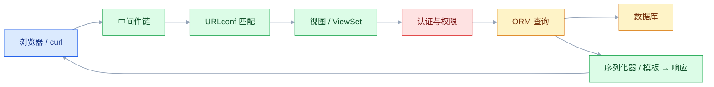
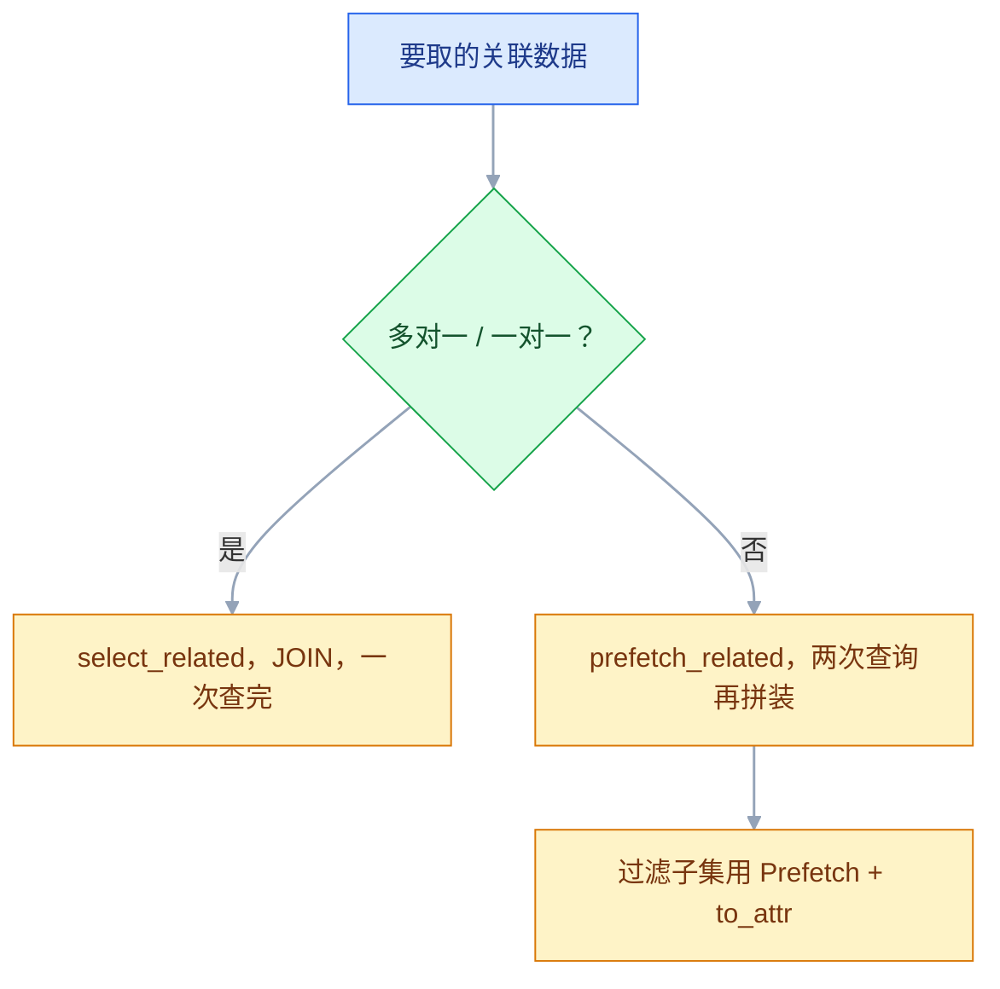
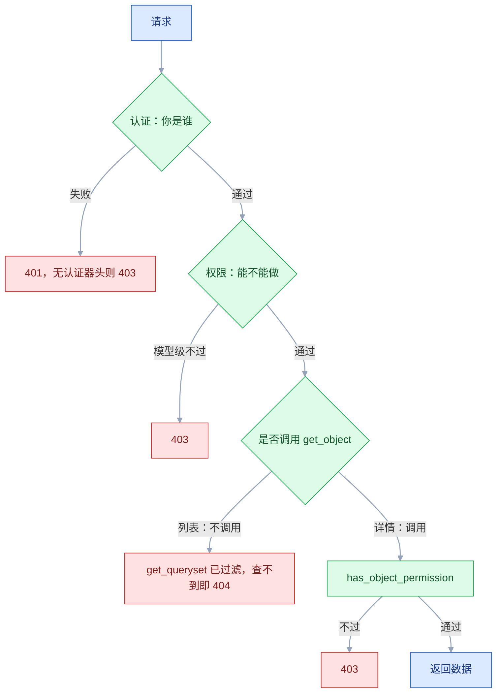

# Django

## 一、工程案例：做一个带分页、权限、事务的任务列表接口

**场景**：给一个 10 人团队做内部任务板后端。项目有负责人和成员；任务属于项目，有状态、优先级、指派人、截止日；只有项目成员能看和改；列表要分页、按状态筛选、按关键词搜索、按优先级排序；「批量关闭」要么全成功要么全失败，并留操作日志；运营用 Admin 维护数据。

**为什么拿这个当主线**：它把 Django 项目里最容易出错、也最值钱的五件事压在一个能跑的小系统里——迁移、关联查询、对象级权限、事务、分页筛选。做完这一节，换成订单、工单、内容审核，骨架是同一套。

**动手前确认**：本机有 PostgreSQL；没有就先用 SQLite 跑通，再换 PG 验证一次。Django 版本以官方当前 LTS 为准，下面的 `CheckConstraint(condition=...)` 需要较新的 LTS，老版本写回 `check`。

```text
taskboard/
├── config/{settings,urls,wsgi,asgi}.py
├── tasks/{models,admin,serializers,views,tests}.py
├── tasks/migrations/0001_initial.py
└── manage.py
```

### 1.1 建项目与配置

```bash
python3 -m venv .venv && source .venv/bin/activate
pip install "django" djangorestframework django-filter "psycopg[binary]" gunicorn
django-admin startproject config .      # 结尾的点：配置目录建在当前目录
python manage.py startapp tasks
createdb taskboard                      # 用 SQLite 跑通就跳过；建表在 1.2 一次做完
```

```python
# config/settings.py（只列改动；文件顶部 import os）
INSTALLED_APPS = [
    "django.contrib.admin", "django.contrib.auth", "django.contrib.contenttypes",
    "django.contrib.sessions", "django.contrib.messages", "django.contrib.staticfiles",
    "rest_framework", "rest_framework.authtoken", "django_filters", "tasks",
]

DATABASES = {"default": {
    "ENGINE": "django.db.backends.postgresql",
    "NAME": os.environ.get("DB_NAME", "taskboard"),
    "USER": os.environ.get("DB_USER") or os.environ.get("USER"),  # 默认当前系统用户
    "PASSWORD": os.environ.get("DB_PASSWORD", ""),
    "HOST": os.environ.get("DB_HOST", "127.0.0.1"),
    "PORT": os.environ.get("DB_PORT", "5432"),
    "CONN_MAX_AGE": 60,          # 复用连接，别每个请求都握手
}}
# 只用 SQLite 跑通时，这一段整体不要换，保留 startproject 生成的 sqlite3 配置

LANGUAGE_CODE, TIME_ZONE, USE_TZ = "zh-hans", "Asia/Shanghai", True
STATIC_ROOT = BASE_DIR / "staticfiles"
DEFAULT_AUTO_FIELD = "django.db.models.BigAutoField"

REST_FRAMEWORK = {
    "DEFAULT_AUTHENTICATION_CLASSES": [
        "rest_framework.authentication.SessionAuthentication",
        "rest_framework.authentication.TokenAuthentication",
    ],
    "DEFAULT_PERMISSION_CLASSES": ["rest_framework.permissions.IsAuthenticated"],
    "DEFAULT_PAGINATION_CLASS": "rest_framework.pagination.PageNumberPagination",
    "PAGE_SIZE": 20,
    "DEFAULT_FILTER_BACKENDS": [
        "django_filters.rest_framework.DjangoFilterBackend",
        "rest_framework.filters.SearchFilter",
        "rest_framework.filters.OrderingFilter",
    ],
}
```

### 1.2 模型与迁移

```python
# tasks/models.py
from django.conf import settings
from django.db import models


class Project(models.Model):
    name = models.CharField("项目名", max_length=100)
    owner = models.ForeignKey(settings.AUTH_USER_MODEL, on_delete=models.PROTECT,
                              related_name="owned_projects")
    members = models.ManyToManyField(settings.AUTH_USER_MODEL, through="Membership",
                                     related_name="projects", blank=True)
    created_at = models.DateTimeField(auto_now_add=True)

    class Meta:
        ordering = ["-created_at"]


class Membership(models.Model):
    project = models.ForeignKey(Project, on_delete=models.CASCADE, related_name="memberships")
    user = models.ForeignKey(settings.AUTH_USER_MODEL, on_delete=models.CASCADE,
                             related_name="memberships")
    role = models.CharField("角色", max_length=10, default="member")

    class Meta:
        constraints = [models.UniqueConstraint(fields=["project", "user"],
                                               name="uniq_project_member")]


class Task(models.Model):
    STATUS = [("todo", "待办"), ("doing", "进行中"), ("done", "已完成")]
    project = models.ForeignKey(Project, on_delete=models.CASCADE, related_name="tasks")
    title = models.CharField("标题", max_length=200)
    detail = models.TextField("详情", blank=True)
    status = models.CharField("状态", max_length=10, choices=STATUS, default="todo")
    priority = models.PositiveSmallIntegerField("优先级", default=2)
    assignee = models.ForeignKey(settings.AUTH_USER_MODEL, null=True, blank=True,
                                 on_delete=models.SET_NULL, related_name="assigned_tasks")
    due_date = models.DateField("截止日", null=True, blank=True)
    created_at = models.DateTimeField(auto_now_add=True)
    updated_at = models.DateTimeField(auto_now=True)

    class Meta:
        ordering = ["-priority", "-created_at"]
        indexes = [models.Index(fields=["project", "status"])]
        constraints = [models.CheckConstraint(
            condition=models.Q(priority__gte=1) & models.Q(priority__lte=5),
            name="priority_between_1_5")]


class TaskLog(models.Model):
    task = models.ForeignKey(Task, on_delete=models.CASCADE, related_name="logs")
    actor = models.ForeignKey(settings.AUTH_USER_MODEL, on_delete=models.PROTECT)
    action = models.CharField(max_length=50)
    created_at = models.DateTimeField(auto_now_add=True)
```

```bash
python manage.py makemigrations tasks
# Migrations for 'tasks': tasks/migrations/0001_initial.py
#   + Create model Project
#   + Create model Membership
#   + Create model Task
#   + Create model TaskLog
python manage.py sqlmigrate tasks 0001 | head -12     # 先看 Django 要执行什么 DDL
python manage.py migrate                             # 内置表 + tasks 一起建
# Applying contenttypes.0001_initial... OK
# ...
# Applying tasks.0001_initial... OK
python manage.py showmigrations tasks
# tasks
#  [X] 0001_initial
```

### 1.3 Admin：运营当天就能录数据

```python
# tasks/admin.py
from django.contrib import admin
from .models import Project, Task


@admin.register(Project)
class ProjectAdmin(admin.ModelAdmin):
    list_display = ("id", "name", "owner", "created_at")
    search_fields = ("name",)                # 被 autocomplete_fields 引用时必须配
    autocomplete_fields = ("owner",)


@admin.register(Task)
class TaskAdmin(admin.ModelAdmin):
    list_display = ("id", "title", "project", "status", "priority", "assignee", "due_date")
    list_filter = ("status", "priority", "project", "created_at")
    search_fields = ("title", "detail")
    list_editable = ("status", "priority")   # 列表页直接改
    autocomplete_fields = ("project", "assignee")
    list_select_related = ("project", "assignee")   # Admin 列表也会 N+1
```

### 1.4 序列化器、对象级权限、视图集

```python
# tasks/serializers.py
from rest_framework import serializers
from .models import Task


class TaskSerializer(serializers.ModelSerializer):
    project_name = serializers.CharField(source="project.name", read_only=True)
    assignee_name = serializers.SerializerMethodField()

    class Meta:
        model = Task
        fields = ["id", "project", "project_name", "title", "detail", "status",
                  "priority", "assignee", "assignee_name", "due_date", "created_at"]
        read_only_fields = ["created_at"]

    def get_assignee_name(self, obj):
        return obj.assignee.username if obj.assignee_id else None   # 不再查一次库

    def validate_project(self, project):
        if not project.memberships.filter(user=self.context["request"].user).exists():
            raise serializers.ValidationError("不是该项目成员")
        return project
```

```python
# tasks/views.py
from django.db import transaction
from django.utils import timezone
from rest_framework import permissions, serializers, viewsets
from rest_framework.decorators import action
from rest_framework.response import Response

from .models import Membership, Task, TaskLog
from .serializers import TaskSerializer


class IsProjectMember(permissions.BasePermission):     # 对象级：必须是项目成员
    message = "不是该项目成员"

    def has_object_permission(self, request, view, obj):
        return obj.project.memberships.filter(user=request.user).exists()


class TaskViewSet(viewsets.ModelViewSet):
    serializer_class = TaskSerializer
    permission_classes = [permissions.IsAuthenticated, IsProjectMember]
    filterset_fields = ["status", "priority", "assignee", "project"]
    search_fields = ["title", "detail"]
    ordering_fields = ["priority", "created_at", "due_date"]
    ordering = ["-priority", "-created_at"]

    def get_queryset(self):
        # Membership 上有 (project, user) 唯一约束，一个任务最多命中一行，不需要 distinct()
        return (Task.objects.filter(project__memberships__user=self.request.user)
                .select_related("project", "assignee"))

    @action(detail=False, methods=["post"], url_path="bulk-close")
    def bulk_close(self, request):
        ids = request.data.get("ids") or []
        if not isinstance(ids, list) or not ids:
            raise serializers.ValidationError({"ids": "传一个非空数组"})

        # 锁行时不要 select_related("assignee")：可空外键是 LEFT JOIN，
        # PostgreSQL 不允许对可空侧 FOR UPDATE。用子查询绕开关联。
        member_projects = Membership.objects.filter(user=request.user).values_list(
            "project_id", flat=True)

        with transaction.atomic():
            tasks = list(Task.objects.filter(id__in=ids, project_id__in=member_projects)
                         .select_for_update())
            if len(tasks) != len(set(ids)):
                raise serializers.ValidationError({"ids": "包含不存在或无权访问的任务"})
            Task.objects.filter(id__in=[t.id for t in tasks]).update(
                status="done",
                updated_at=timezone.now(),   # update() 不触发 auto_now，必须手写
            )
            TaskLog.objects.bulk_create(
                [TaskLog(task=t, actor=request.user, action="bulk_close") for t in tasks])

        return Response({"closed": len(tasks)})
```

```python
# config/urls.py
from django.contrib import admin
from django.urls import include, path
from rest_framework.authtoken.views import obtain_auth_token
from rest_framework.routers import DefaultRouter
from tasks.views import TaskViewSet

router = DefaultRouter()
router.register("tasks", TaskViewSet, basename="task")

urlpatterns = [
    path("admin/", admin.site.urls),
    path("api/", include(router.urls)),
    path("api-token-auth/", obtain_auth_token),
]
```

### 1.5 跑起来并用 curl 验收

```bash
python manage.py createsuperuser        # 另开一个终端跑 runserver
python manage.py shell -c "
from django.contrib.auth.models import User
from tasks.models import Project, Membership, Task
a,_ = User.objects.get_or_create(username='alice'); b,_ = User.objects.get_or_create(username='bob')
a.set_password('secret123'); a.save(); b.set_password('secret123'); b.save()
p,_ = Project.objects.get_or_create(name='官网改版', defaults={'owner': a})
Membership.objects.get_or_create(project=p, user=a, defaults={'role':'owner'})
for t,pr in [('写接口文档',3),('接支付回调',5),('补单元测试',2)]:
    Task.objects.get_or_create(project=p, title=t, defaults={'priority':pr})
print('tasks =', Task.objects.count())"
# tasks = 3

TOKEN=$(curl -s -X POST http://127.0.0.1:8000/api-token-auth/ \
  -H 'Content-Type: application/json' \
  -d '{"username":"alice","password":"secret123"}' | python -c 'import json,sys;print(json.load(sys.stdin)["token"])')
BOB_TOKEN=$(python manage.py shell -c "from django.contrib.auth.models import User;from rest_framework.authtoken.models import Token;print(Token.objects.get_or_create(user=User.objects.get(username='bob'))[0].key)")
TASK_ID=$(python manage.py shell -c "from tasks.models import Task;print(Task.objects.filter(project__name='官网改版').first().id)")
# ① 分页 + 筛选 + 排序
curl -s "http://127.0.0.1:8000/api/tasks/?status=todo&ordering=-priority" \
  -H "Authorization: Token $TOKEN"
# {"count":3,"next":null,"previous":null,"results":[
#   {"id":2,"title":"接支付回调","priority":5,"project_name":"官网改版",...}]}

# ② 非成员访问 → 404（queryset 里没有这条，不是 403）
curl -s -o /dev/null -w "%{http_code}\n" "http://127.0.0.1:8000/api/tasks/$TASK_ID/" \
  -H "Authorization: Token $BOB_TOKEN"
# 404

# ③ 批量关闭混入不存在的 id → 400，且一条都没改
curl -s -o /dev/null -w "%{http_code}\n" -X POST \
  http://127.0.0.1:8000/api/tasks/bulk-close/ \
  -H "Authorization: Token $TOKEN" -H 'Content-Type: application/json' \
  -d "{\"ids\":[$TASK_ID,999999]}"
# 400
python manage.py shell -c "from tasks.models import Task, TaskLog; print(Task.objects.filter(status='done').count(), TaskLog.objects.count())"
# 0 0

# ④ 只传合法 id → 200，日志逐条落下
curl -s -X POST http://127.0.0.1:8000/api/tasks/bulk-close/ \
  -H "Authorization: Token $TOKEN" -H 'Content-Type: application/json' \
  -d "{\"ids\":[$TASK_ID]}"
# {"closed":1}
python manage.py shell -c "from tasks.models import Task, TaskLog; print(Task.objects.filter(status='done').count(), TaskLog.objects.count())"
# 1 1
```

### 1.6 验收表（9 项全过才算交付）

| # | 检查项 | 命令或检查 | 通过标准 |
|---|---|---|---|
| 1 | 迁移已生成并执行 | `python manage.py showmigrations tasks` | `[X] 0001_initial`，且 `makemigrations --check --dry-run` 无输出 |
| 2 | 约束落到数据库 | `python manage.py sqlmigrate tasks 0001` | 能看到 `CHECK` 与 `UNIQUE`，不只在 Python 层 |
| 3 | 列表分页 | `GET /api/tasks/?page=1` | 返回 `count` / `next` / `results` |
| 4 | 筛选与排序 | `?status=todo&ordering=-priority` | 只含 todo，priority 降序 |
| 5 | 越权读被挡 | 非成员请求详情 | 404，且不泄露任务是否存在 |
| 6 | 事务回滚 | 批量关闭混入假 id | 400，任务状态与日志均无变化 |
| 7 | 批量关闭成功路径 | 只传本人项目的合法 id | 200，`closed` 等于传入条数，日志同数新增 |
| 8 | 查询次数不随行数涨 | 造 10 条与 100 条各请求一次首页，比 SQL 条数 | 两次条数相同（数法见 2.2） |
| 9 | 部署自检 | `python manage.py check --deploy` | 不再出现 `security.W009` / `W018` / `W020` |

> 第 6、7 项必须真的各发一次请求。只读代码看不出「异常被转成 400 之后事务是否回滚」，也看不出成功路径的日志条数对不对，这类问题只有跑一次才知道。

---

## 二、高频问答：会卡住你的地方，也是面试最常问的

### 2.1 改了 `models.py`，页面和接口一点变化都没有

**现场**

`python manage.py makemigrations --check --dry-run` 有输出，就是还有未生成的迁移；`showmigrations` 里有 `[ ]` 就是没执行。

**要点**

- 改了模型不改表：模型类只负责生成 SQL 和映射结果，表长什么样由迁移文件决定。
- Django 启动时**不会**自动改表，必须 `makemigrations` 加 `migrate`，漏一步都白改。
- 全是 `[X]` 却报 `column does not exist`，说明迁移的库和运行的库不是同一个（见 2.6）。

**追问**

- 能不能靠 `migrate --run-syncdb` 自动同步？→ 它只给没有迁移的表建表，已有表的结构变更不会同步。
- 线上能不能自动跑 `migrate`？→ 能，但要单实例先跑并备份，多副本并发跑会抢锁。
- `makemigrations --check` 在 CI 里怎么用？→ 有未生成迁移就非零退出，拦住"只改模型不提交迁移"。

### 2.2 列表接口一上量，数据库 CPU 直接打满

**现场**

`DEBUG=True` 时数 `connection.queries`；或装 `django-debug-toolbar` 看 SQL 面板。

```python
from django.db import connection, reset_queries
reset_queries()
rows = list(Task.objects.all()[:50])          # 1 条 SQL
print(len(connection.queries))                # 1
print({t.assignee.username for t in rows if t.assignee_id})
print(len(connection.queries))                # 51
```

**要点**

- 一上量数据库打满，先数 SQL 条数，不要先怀疑配置、换库或上缓存。
- N+1 的来源是序列化器每访问一次外键或反向关系就多一条 SQL，20 条数据等于 21 次查询。
- 加索引只让单条 SQL 变快，减少不了往返次数；返回条数从 10 改成 100、SQL 从 11 变 101，就是 N+1。
- 修法是用 `select_related` / `prefetch_related`（见 3.4）。

**追问**

- 什么时候用 `select_related`，什么时候用 `prefetch_related`？→ 多对一、一对一用前者 JOIN；多对多、反向外键用后者两次查询。
- 已经 prefetch 的关系再 `.filter()` 为什么又查库？→ 它生成新的 QuerySet，prefetch 缓存不继承。
- 怎么防止回归？→ `assertNumQueries` 把查询数写进测试，数字先测出来再写死。

### 2.3 `DEBUG = False` 之后全站 500

**现场**

看日志 traceback 第一行；`curl -I` 只有 500，具体异常在日志里。

```python
DEBUG = False
ALLOWED_HOSTS = ["example.com", "www.example.com"]   # 不带协议、不带端口
SECRET_KEY = os.environ["DJANGO_SECRET_KEY"]
```

**要点**

- 先查 `ALLOWED_HOSTS` 是不是空列表，空的话任何请求都抛 `DisallowedHost`；其次是 `SECRET_KEY` 没注入。
- `DEBUG=True` 时会自动放行 `localhost`、`127.0.0.1`，还渲染详细错误页，把配置问题遮住了。
- `ALLOWED_HOSTS` 写域名，不带协议、不带端口。

**追问**

- 为什么不能改回 `DEBUG=True` 先顶着？→ 错误页会泄露配置、SQL 和堆栈，等于把内部结构公开。
- 反代后面 `ALLOWED_HOSTS` 写什么？→ 写客户端访问的域名，不是上游地址。
- 还有哪些开关要一起改？→ `SECURE_SSL_REDIRECT`、`CSRF_TRUSTED_ORIGINS`、`STATIC_ROOT`，用 `check --deploy` 一次列全。

### 2.4 页面没有样式，`/static/` 全是 404

**现场**

`ls staticfiles/admin/css/` 有没有文件；`curl -I http://站点/static/admin/css/base.css`。

**要点**

- 生产形态下 Django **不负责**发静态文件，`runserver` 的静态服务只是开发便利。
- 三个常见原因：没跑 `collectstatic`；`STATIC_ROOT` 与 Nginx 的 `alias` 不是同一个目录；`DEBUG=False` 下还指望 `runserver` 发。
- 用了 `ManifestStaticFilesStorage` 时，报 `Missing staticfiles manifest entry` 同样是没收集或文件名大小写对不上。

**追问**

- `collectstatic` 跑过了还 404？→ 先确认文件在磁盘上，再确认 Nginx `alias` 指向同一路径，最后才怀疑权限。
- 为什么加了 Manifest 存储文件名会变？→ 内容 hash 进文件名，模板必须走 ``。
- `STATIC_ROOT` 和开发期的查找目录是什么关系？→ 前者只是 `collectstatic` 的落地目录，开发期不参与查找。

### 2.5 POST 请求 403，提示 CSRF verification failed

**现场**

响应体是 `CSRF Failed: ...`，不是 `Authentication credentials were not provided`。

**要点**

- 403 不等于没权限，CSRF 失败也返回 403，别去改 `permission_classes`。
- `SessionAuthentication` 会强制校验 CSRF；前端没带 `X-CSRFToken`，或跨域时 `CSRF_TRUSTED_ORIGINS` 没配。
- 同一请求改用 `Authorization: Token ...` 再发一次，通过就说明问题在 CSRF；前后端分离项目通常直接用 Token，从根上避开这条。

**追问**

- 为什么 GET 不校验 CSRF？→ 它不改资源状态，规范上安全方法不要求。
- CSRF token 放在哪？→ 请求头 `X-CSRFToken`，值从 cookie 或模板里取。
- 跨域时还要配什么？→ `CSRF_TRUSTED_ORIGINS` 要带协议，携带 cookie 还要 CORS 允许凭据。

### 2.6 报 `no such table` 或 `relation does not exist`

**现场**

`python manage.py dbshell` 里 `\dt` 看表；`shell` 里打印 `connection.settings_dict`。

**要点**

- 十有八九是连到了另一个库，不是数据库坏了。
- 常见来源：`.env` 没加载、Docker 里 `HOST` 写成 `127.0.0.1`、或 `migrate` 用了另一套 `--settings`。
- 删库重建最危险：只要配置还错，重建出来的表仍在另一个库里，数据却没了。

**追问**

- 怎么最快确认连的是哪个库？→ 打印 `connection.settings_dict` 的 `NAME`/`HOST`/`PORT`，比看配置文件可靠。
- Docker 里为什么不能写 `127.0.0.1`？→ 那是容器自己，数据库在另一个容器，要用服务名。
- 为什么测试库也报这个？→ 测试库每次从零迁移，"本地能跑、测试报错"几乎都是迁移文件缺失或没提交。

### 2.7 接口返回的时间差 8 小时

**现场**

`timezone.now()` 与 `datetime.now()` 相差 8 小时就是 naive / aware 混用；看接口返回串结尾是 `Z`、`+00:00` 还是 `+08:00`。

**要点**

- `USE_TZ=True` 时库里存 UTC，差 8 小时通常是 naive 的本地时间被当作 UTC 存了进去。
- `TIME_ZONE` 只决定 aware 时间怎么本地化，不会转换已经存进去的数据。
- 三选一：代码里用 `datetime.now()` 写库；前端拿到带偏移的 ISO 串又按本地时间换算一次；改过 `TIME_ZONE`，历史数据还是旧时区写的。

**追问**

- 为什么 DRF 有时输出 `Z`、有时输出 `+08:00`？→ `USE_TZ=True` 时按当前时区输出；还是 UTC 说明 `TIME_ZONE` 是默认值，或字段被 `format` 成了字符串。
- 写库统一用什么？→ `timezone.now()`，展示交给序列化器或前端。
- 为什么两边都转会差两次？→ 出口已经本地化，前端再加 8 小时就重复换算。

### 2.8 事务没生效，异常了数据还是写进去了

**现场**

在块尾故意 `raise`，看数据是否落库；`connection.in_atomic_block` 看是否在事务里。

```python
with transaction.atomic():
    order.save()
    try: pay()                # ❌ 吞掉异常 → 事务照常提交
    except Exception: pass
```

**要点**

- `atomic` 只在异常**穿出**块边界时才回滚，块内被 `try/except` 吞掉的异常等于没发生。
- 写操作不在同一个块里、或跨库写入，`atomic` 也管不住。
- 要吞异常又保留回滚，用 `transaction.set_rollback(True)` 明确标记。

**追问**

- 嵌套 `atomic` 怎么算？→ 内层是 savepoint，内层回滚不影响外层，外层回滚会带走全部。
- 跨库怎么写？→ 每个库各自开事务，一个 `atomic` 管不了两个库。
- `ATOMIC_REQUESTS=True` 有什么代价？→ 每个请求一个事务，慢请求变成长事务，高并发慎用。

### 2.9 两个人同时改模型，出现两个 `0002`，`migrate` 报冲突

**现场**

`python manage.py showmigrations --plan` 直接报 `Conflicting migrations detected`；用 `makemigrations --merge tasks` 生成合并迁移。

**要点**

- 迁移是一条线性链，两个 `0002` 都指向 `0001`，形成两个 leaf 节点，Django 不知道先执行哪个。
- 删文件只对"从没执行过该迁移"的库有效；跑过的库 `django_migrations` 里还留着记录，删了状态和表结构就对不上。
- 先分清是"没生成"还是"两个 leaf"，只有后者用 `--merge`。

**追问**

- `--merge` 生成的空迁移要写什么？→ 通常什么都不写，只声明两个父节点，把链合回一条。
- 为什么 CI 要拦迁移冲突？→ 它会阻塞所有部署，越晚发现越难合。
- 已经上线的迁移能改吗？→ 不能，只能新增一条。

### 2.10 Admin 编辑页打开要十几秒，外键下拉几千条

**现场**

浏览器 Network 看 HTML 体积是否随外键表行数涨；想改用 autocomplete 时若报 `admin.E040`，就是被引用方还没配 `search_fields`。

**要点**

- 不是机器慢，是查询形态错了：普通外键在 Admin 里渲染成 `<select>`，会把关联表**全量**查出来塞进 HTML，几万行就是几十 MB。
- 修法是 `autocomplete_fields` 加被引用方的 `search_fields`。
- 判断依据是页面 HTML 大小是否随关联表行数增长。

**追问**

- 为什么 autocomplete 要求对方有 `search_fields`？→ 它靠搜索接口分页取数据，没有搜索字段就查不了。
- Admin 列表还有哪里会 N+1？→ `list_display` 里的外键，用 `list_select_related`。
- 几万行非要用下拉怎么办？→ 换 `raw_id_fields`，只存 id，不渲染选项。

### 2.11 未登录请求返回 403，前端按 401 跳登录失效

**现场**

看响应头有没有 `WWW-Authenticate`；只留 `TokenAuthentication` 再请求一次，应得 401。

**要点**

- 401 是"不知道你是谁"，403 是"知道你是谁但不许做"，前端要按这两个码分别处理。
- `SessionAuthentication` 不返回 `WWW-Authenticate` 头，DRF 无法回 401，只能退化成 403。
- 把 `IsAuthenticated` 改成 `AllowAny` 是把鉴权关掉，不是修状态码。

**追问**

- 为什么会话认证不能回 401？→ 401 语义要求带 `WWW-Authenticate`，浏览器看到会弹原生登录框，DRF 选择降级 403。
- 前端拦截器该怎么分？→ 401 清 token 跳登录，403 提示无权限，不能都跳。
- 换成 JWT 呢？→ 认证类自己带 `WWW-Authenticate`，能正常回 401。

### 2.12 用户上传的图片，接口返回了 URL 但打开是 404

**现场**

服务器上 `ls MEDIA_ROOT/...` 看文件在不在；在就说明是"谁来回这个 URL"的问题。

**要点**

- 上传没失败：文件确实写进了 `MEDIA_ROOT`，只是没有进程在服务 `MEDIA_URL`。
- 存储和访问是两件事：`MEDIA_ROOT` 决定存哪，`MEDIA_URL` 只是字符串前缀。
- `DEBUG=False` 下 Django 不代发，Nginx 也没配 `location /media/`，就会 404。

**追问**

- 为什么开发期能打开、上线就 404？→ 开发期 `runserver` 代发了，上线后没人接这个前缀。
- 生产该怎么发？→ Nginx 用 `alias` 指向 `MEDIA_ROOT`，或直接放对象存储。
- 私有文件怎么控权限？→ 公开的走 Nginx，私有的走带鉴权的视图或签名 URL。

### 2.13 上线后想加手机号登录，发现用户模型换不动

**现场**

改完设置跑 `migrate`，报 `InconsistentMigrationHistory`（`admin.0001_initial` 已应用，它依赖的新用户模型迁移却没应用），或惰性引用找不到模型。

**要点**

- 内置 `User` 的表名和字段由 `auth` 的迁移固定，改源码等于 monkey patch，升级就覆盖。
- `AUTH_USER_MODEL` 一旦被任何迁移引用过就换不了，`admin`、`auth`、业务表的外键全指向旧模型——它是迁移图的根之一。
- 已上线项目的唯一低风险路：不动用户模型，用 `OneToOneField` 挂一张 `Profile` 补字段（规则见 3.7）。

**追问**

- 为什么新项目必须在第一次 `migrate` 之前定？→ 迁移一旦落库，换模型要重算整张依赖图。
- 能不能硬换？→ 只能手工改迁移和外键、迁数据，风险远大于收益。
- `Profile` 方案有什么代价？→ 多一次 JOIN，查询要 `select_related`。

---

## 三、核心知识：从零开始要建立的东西

### 3.1 请求生命周期与 MTV

一次请求被拆成固定几段，**排查的第一步是定位它挂在哪一段**：



MTV 和 MVC 是同一件事的不同叫法，只是「View」这个词被换掉了：

| MTV（Django） | MVC（经典） | 职责 |
|---|---|---|
| Model | Model | 表结构与数据访问 |
| Template | View | 长什么样 |
| View | Controller | 收到请求做什么 |

**边界**：模板只做展示，不要在里面查库；视图只做编排，复杂查询放模型管理器。业务一复杂，视图最先变成垃圾场。URLconf 从上到下匹配，第一条命中就停，所以具体路径要写在通配前面；跳转别写死路径，用 `path(..., name="task-list")` 配 `reverse()` 或模板里的 ``。

### 3.2 模型、字段与删除行为

模型类 = 一张表，类属性 = 字段，实例 = 一行。真正决定「数据能不能坏」的不是 Python 代码，而是**数据库约束**：

| 约束 | 写法 | 拦住什么 |
|---|---|---|
| 唯一 | `UniqueConstraint(fields=[...], name=...)` | 并发重复插入 |
| 检查 | `CheckConstraint(condition=Q(...), name=...)` | 越界值 |
| 外键 | `ForeignKey(..., on_delete=...)` | 悬空引用 |

`on_delete` 由 Django 的删除收集器在 ORM 层执行，数据库只负责「外键指向的行必须存在」，不会替你级联：

| 值 | 行为 | 典型用法 |
|---|---|---|
| `CASCADE` | 跟着删 | 任务删了，日志一起删 |
| `PROTECT` | 有引用就报错 | 有项目的用户不能删 |
| `SET_NULL` | 置空（需 `null=True`） | 指派人离职，任务还在 |

**边界**：`save()` **不会**调用 `full_clean()`，`choices`、`max_length` 在 ORM 直接写入时不一定被校验，关键规则要落到数据库约束；`CheckConstraint` 的参数在新版是 `condition`，老版是 `check`。删除同样要留意：`CASCADE` / `SET_NULL` 只在走 `Model.delete()` / QuerySet 删除时发生，手工 SQL 删父行会被外键约束直接拒绝。

### 3.3 QuerySet 的懒执行与缓存

`filter()` 只是拼 SQL，**不碰数据库**；真正执行发生在遍历、切片、`len()`、`bool()` 这些动作上：

```python
qs = Task.objects.filter(status="todo")   # 没有 SQL
qs = qs.filter(priority__gte=3)           # 还是没有 SQL
for t in qs: ...                          # 这里才执行，结果缓存在 qs 上
list(qs)                                  # 复用缓存，不再查
```

| 动作 | 是否查库 | 是否填缓存 |
|---|---|---|
| `filter()` / `order_by()` | 否 | — |
| `for` / `list()` / `len()` | 是 | 是 |
| `qs[0]` | 是（`LIMIT 1`） | **否**，再取又查 |
| `qs.exists()` | 是（`SELECT 1`） | 否 |
| `qs.count()` | 是（`COUNT(*)`） | 否 |

**边界**：`if qs:` 会触发全量查询（为了判断非空），判空一律用 `qs.exists()`。缓存只活在同一个 QuerySet 对象上，`qs.filter()` 出来的是新对象，缓存不继承。

### 3.4 关联查询与 N+1



```python
Task.objects.select_related("project", "assignee")     # 外键 / 一对一：JOIN
Project.objects.prefetch_related("tasks")              # 多对多 / 反向：两次查询

from django.db.models import Prefetch
Project.objects.prefetch_related(
    Prefetch("tasks", queryset=Task.objects.filter(status="todo"), to_attr="open_tasks"))
# 之后用 p.open_tasks，而不是 p.tasks.all()
```

| 方式 | 查询次数 | 适用 | 代价 |
|---|---|---|---|
| 不优化 | 1 + N | 只取一条时无所谓 | 行数一多就崩 |
| `select_related` | 1 | 外键、一对一 | JOIN 变宽，列太多会慢 |
| `prefetch_related` | 2 | 多对多、反向外键 | 关联表大时内存高 |
| `Prefetch(to_attr=...)` | 2 | 需要过滤后的子集 | 属性名与 `related_name` 不一致 |

**边界**：对已经 prefetch 的关系再 `.filter()`，Django 会**重新查库**，prefetch 白做；`select_related` 不能用在多对多上，会直接报错。

> **面试**：常问「线上 N+1 怎么发现、怎么修？」答：先数 SQL 条数，多对一用 `select_related`、多对多用 `prefetch_related`，再用 `assertNumQueries` 锁住回归。

### 3.5 迁移系统

迁移是「数据库结构的版本控制」，四个命令分工明确：

| 命令 | 作用 | 什么时候跑 |
|---|---|---|
| `makemigrations` | 对比模型与迁移文件，生成脚本 | 改完 `models.py` |
| `migrate` | 按顺序执行未执行的脚本 | 部署时、拉代码后 |
| `sqlmigrate` | 打印某条迁移会执行的 SQL | 上线前审查 |
| `showmigrations` | 看哪些已执行 | 排查「为什么没生效」 |

```bash
python manage.py makemigrations --check --dry-run   # CI 用：有未生成迁移就非零退出
python manage.py migrate --plan                     # 只列计划，不动库
```

**三条铁律**：迁移文件必须提交 git；已上线的迁移不要改，要改就新增一条；重命名字段用 `makemigrations` 交互确认，别手改文件。**边界**：给大表加「非空且无默认值」的列会锁表，标准做法是先加可空列、回填、再改非空；回填用 `RunPython` 写迁移，不要塞进 `save()`。

> **面试**：常问「迁移冲突怎么处理？大表加字段怎么加？」答：两个 leaf 用 `--merge` 合并；大表先加可空列、回填、再改非空。

### 3.6 事务与并发控制

```python
from django.db import transaction
from django.db.models import F

with transaction.atomic():                 # 整块要么全成，要么全不成
    order.status = "paid"
    order.save(update_fields=["status"])
    Stock.objects.filter(pk=sku_id).update(left=F("left") - 1)   # 数据库层自减

with transaction.atomic():                 # 行锁：事务结束前别人改不了这一行
    task = Task.objects.select_for_update().get(pk=1)
    task.priority += 1
    task.save()
```

| 手段 | 解决什么 | 代价 |
|---|---|---|
| `atomic` | 多条写操作的原子性 | 事务越长，锁持有越久 |
| `F()` | 读改写竞态（丢更新） | 改完要 `refresh_from_db()` 才看到新值 |
| `select_for_update()` | 并发改同一行 | 必须包在事务里，否则报错 |
| 唯一约束 | 并发插入重复 | 要处理 `IntegrityError` |

**边界**：事务里**不要**做 HTTP 调用、发邮件、推长任务——外部服务一慢，连接和锁全被占住，这类动作放 `transaction.on_commit()`。`ATOMIC_REQUESTS=True` 能让每个请求一个事务，方便但会把慢请求变成长事务，高并发慎用。

> **面试**：常问「`transaction.atomic()` 为什么没回滚？」答：异常必须穿出块边界，被 `try/except` 吞掉就照常提交；要保留回滚用 `set_rollback(True)`。

### 3.7 用户、组与权限

`auth` 提供三层：用户 → 组 → 权限（`app_label.action_model`）。

```python
@login_required
@permission_required("tasks.change_task", raise_exception=True)
def edit_task(request, pk): ...
user.has_perm("tasks.add_task")     # 单条判断
user.groups.add(group)              # 组 = 一批权限
```

| 概念 | 是什么 | 常见误用 |
|---|---|---|
| `User` | 账号 | 直接 `create()`，密码变明文 |
| `Group` | 权限集合 | 把业务角色硬编码成组名到处判断 |
| `Permission` | 模型级增删改查权限 | 当成对象级权限用 |
| `is_staff` | 能否进 Admin | 当成「是不是管理员」 |
| `is_superuser` | 绕过所有权限检查 | 日常账号给成超级用户 |

**边界**：模型级权限管不了「这条记录是不是你的」，那要对象级判断（案例里的 `has_object_permission`）。**新项目第一件事**是换自定义用户模型（`AUTH_USER_MODEL = "accounts.User"`），必须在第一次 `migrate` 之前定，事后换要动所有外键。

### 3.8 认证与权限的两层

顺序是：**认证决定 `request.user` 是谁，权限决定这个请求放不放行。**

| 层 | 配置项 | 回答的问题 | 失败状态 |
|---|---|---|---|
| 认证 | `DEFAULT_AUTHENTICATION_CLASSES` | 你是谁 | 401（有 `WWW-Authenticate` 时） |
| 权限 | `DEFAULT_PERMISSION_CLASSES` | 你能不能做 | 403 |



**边界**：`has_object_permission` 只在 `get_object()` 被调用时触发（详情、更新、删除）；列表不会逐条调用它，所以**列表必须在 `get_queryset()` 里过滤**，否则越权数据整页返回。这也是案例里非成员拿到 404 而不是 403 的原因。

> **面试**：常问「401 和 403 怎么分？列表接口为什么不触发 `has_object_permission`？」答：401 身份未确认、403 无权；列表不调 `get_object()`，越权过滤必须写在 `get_queryset()` 里。

### 3.9 序列化器的读写分离

一个模型常按用途拆成多个形状：列表（轻）、详情（全）、写入（只收能改的字段）。

```python
class TaskWriteSerializer(serializers.ModelSerializer):
    project_id = serializers.PrimaryKeyRelatedField(
        queryset=Project.objects.all(), source="project", write_only=True)

    class Meta:
        model = Task
        fields = ["id", "title", "status", "project_id"]
        read_only_fields = ["id"]
```

| 声明 | 含义 |
|---|---|
| `read_only=True` | 只出现在输出，写入被忽略 |
| `write_only=True` | 只接受输入，不出现在响应 |
| `source="tags"` | 输入字段名与模型字段名解耦 |
| `SerializerMethodField` | 输出自定义值（注意别在里面查库） |

**边界**：`many=True` 时 `.data` 会对每个对象序列化一次，方法字段里的查询会变成 N+1；嵌套序列化器默认只读，要支持写入必须自己实现 `create` / `update`。

### 3.10 分页、筛选、排序

| 分页器 | 参数 | 适合 |
|---|---|---|
| `PageNumberPagination` | `?page=2` | 后台列表，能跳页 |
| `LimitOffsetPagination` | `?limit=20&offset=40` | 移动端下拉加载 |
| `CursorPagination` | `?cursor=xxx` | 大数据量、深翻页 |

```python
class TaskPagination(PageNumberPagination):
    page_size = 20
    page_size_query_param = "page_size"
    max_page_size = 100          # 不设上限，等于允许一次拉全表
```

**边界**：`PageNumberPagination` 每次都要 `COUNT(*)`，表到千万级时这个 count 本身就很贵；深翻页还要扫掉前面所有行，这时换 `CursorPagination`。`CursorPagination` 不能跳页，也不能随便排序，必须在视图上给一个唯一且稳定的 `ordering`（比如 `-created_at`），否则翻页会漏行或重复。筛选字段要建索引，`?status=todo` 在无索引表上就是全表扫描。

### 3.11 Admin：不写前端也能交付后台

注册模型就有增删改查，定制集中在 `ModelAdmin` 的几个配置上：

| 配置 | 作用 | 注意 |
|---|---|---|
| `list_display` | 列表显示哪些列 | 不能放多对多和反向外键 |
| `search_fields` | 搜索框，也是 autocomplete 的数据源 | 被 `autocomplete_fields` 引用时必须写 |
| `list_filter` | 右侧过滤器 | 外键字段默认渲染成全量 `<select>` |
| `list_editable` | 列表页直接改 | 字段必须先在 `list_display` 里，且不能是第一列（除非另设 `list_display_links`） |
| `list_select_related` | 列表页预取外键 | 不配就按行查，Admin 也会 N+1 |

**边界**：外键有几千条时用 `autocomplete_fields` 加被引用方 `search_fields`，替代全量下拉（否则 `check` 报 `admin.E040`）；批量操作用 `actions` 挂函数并写 `short_description`；Admin 的权限走 `has_*_permission`，与 DRF 的权限类互不影响，别指望配了一边另一边就生效。

### 3.12 部署形态与配置

```bash
python manage.py check --deploy            # 先让框架把不安全配置列出来
python manage.py migrate
python manage.py collectstatic --noinput
gunicorn config.wsgi:application -w 4 -b 127.0.0.1:8000 --timeout 60
```

请求路径是：Nginx 接 80/443，`/static/` 与 `/media/` 直接发文件，其余 `proxy_pass` 给 gunicorn，gunicorn 再进 Django 进程和数据库。

| 配置 | 作用 | 默认值的坑 |
|---|---|---|
| `DEBUG=False` | 关详细错误页 | 忘了 `ALLOWED_HOSTS` 就全站 500 |
| `SECRET_KEY` | 签名 | 写死在代码里，泄露即失守 |
| `SECURE_SSL_REDIRECT` | 强制 HTTPS | 反代下要配 `SECURE_PROXY_SSL_HEADER` |

**边界**：`-w 4` 是同步 worker，适合普通 CRUD；I/O 等待多的接口换 `gthread`，但先量再调。配置用 `settings/base.py` 加 `local.py` / `prod.py` 拆分，靠 `DJANGO_SETTINGS_MODULE` 切换，密钥只从环境变量读。

### 3.13 测试与查询数回归

```python
# tasks/tests.py
from django.contrib.auth import get_user_model
from rest_framework.test import APITestCase

from .models import Membership, Project, Task


class TaskApiTest(APITestCase):
    def setUp(self):
        self.user = get_user_model().objects.create_user("alice", password="secret123")
        self.project = Project.objects.create(name="官网改版", owner=self.user)
        Membership.objects.create(project=self.project, user=self.user, role="owner")
        Task.objects.bulk_create(
            [Task(project=self.project, title=f"任务{i}") for i in range(30)])

    def test_list_requires_login(self):
        self.assertEqual(self.client.get("/api/tasks/").status_code, 401)

    def test_query_count_is_flat(self):
        self.client.force_authenticate(self.user)
        with self.assertNumQueries(2):        # COUNT + 一页数据
            resp = self.client.get("/api/tasks/?page=1")
        self.assertEqual(len(resp.data["results"]), 20)

    def test_bulk_close_is_atomic(self):
        self.client.force_authenticate(self.user)
        first = Task.objects.first().pk
        resp = self.client.post("/api/tasks/bulk-close/",
                                {"ids": [first, 999999]}, format="json")
        self.assertEqual(resp.status_code, 400)
        self.assertFalse(Task.objects.filter(status="done").exists())
```

| 要点 | 说明 |
|---|---|
| 测试库 | `manage.py test` 新建独立空库并跑全部迁移，不碰开发库 |
| 认证 | `force_authenticate(user=...)` 绕过登录流程，也不会去查 token 表 |
| 查询数 | `assertNumQueries` 用来锁住 N+1 回归，数字先测出来再写死 |
| 事务 | `TestCase` 把每个用例包在事务里，测 `on_commit` 要用 `captureOnCommitCallbacks` |

**边界**：测试库每次从零迁移，所以「本地能跑、测试报 `no such table`」几乎都是迁移文件缺失或没提交；`--keepdb` 只省时间，不改这个事实。

---

## 四、冷门知识汇总

| 知识点 | 为什么冷门 | 用到时的关键词 |
|---|---|---|
| `CONN_MAX_AGE` 与连接池 | 本地开发无感，压测时才看出握手开销 | `CONN_MAX_AGE`、pgbouncer、`CONN_HEALTH_CHECKS` |
| `transaction.on_commit` | 只有「提交后才该发生」的动作才需要 | 发邮件、推 Celery、清缓存 |
| `Prefetch(to_attr=...)` | 普通 prefetch 够用，直到要拿过滤后的子集 | `Prefetch`、`to_attr` |
| `Exists` / `Subquery` | 大部分统计 `annotate(Count())` 就够 | `OuterRef`、`Exists`、`Subquery` |
| `iterator(chunk_size=...)` | 数据量小时完全无感 | 导出百万行；配 prefetch 必须给 chunk_size |
| `bulk_update` | 批量改字段快，但不触发信号与 `auto_now` | `bulk_update(objs, ["status"])` |
| `select_for_update` 的 `of` / `skip_locked` | 单机小流量用不到 | 抢单、队列消费、`of=("self",)` |
| `QuerySet.explain()` | 平时看日志就够，慢查询复盘时才用 | `EXPLAIN`、是否走索引、`analyze=True` |
| 多数据库路由 | 读写分离是架构决策，不是框架默认 | `DATABASE_ROUTERS`、`.using("replica")` |
| 缓存框架 | 有 Redis 后常直接用它，绕过 Django 缓存层 | `CACHES`、`cache.get_or_set`、`vary_on_cookie` |
| 信号 signals | 上手容易、调试难，很多团队直接禁用 | `post_save`、`pre_delete`、`dispatch_uid` |
| Admin 的 `get_queryset` | 默认 Admin 列表同样会 N+1 | `list_select_related`、覆写 `get_queryset` |
| `SECURE_*` 与 HSTS | 上了 HTTPS 就以为安全了 | `check --deploy`、`SECURE_HSTS_SECONDS` |
| 异步视图里的同步 ORM | 生态仍以同步为主，async 视图里直接查会抛异常 | `async def`、`sync_to_async`、`aget`、`SynchronousOnlyOperation` |
| DRF Token 明文存库 | 开箱即用，安全评审时才被提出来 | 哈希存储、过期策略、JWT |
| `get_or_create` 的并发 | 单线程测试永远不报错 | `IntegrityError`、唯一约束、重试 |
