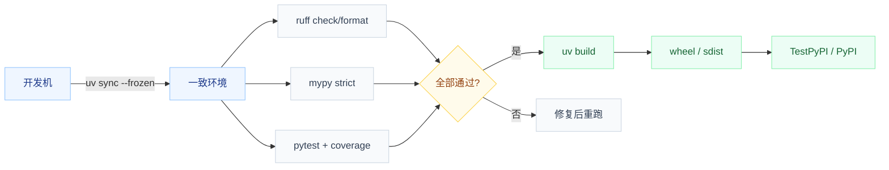

# Python工程化与测试

> 这篇从工程化要交付什么讲起，经过 uv 项目初始化、pyproject 与依赖分层、ruff 规范、src 布局、pytest 测试设计、覆盖率门禁、CI、打包发布和排障，最后把一个财务脚本做成可安装的 CLI 包。
>
> 学完能独立搭建一个可复现、可测试、可发布，并且能在 CI 里自动拦截问题的 Python 项目。

## 一、工程化的交付物

工程化不是多装几个工具，而是让另一个开发者在干净机器上用三条命令得到同样结果：同步依赖、运行检查、构建产物。



| 交付物 | 作用 | 不该做什么 |
|---|---|---|
| `pyproject.toml` | 元数据、依赖、工具配置的唯一入口 | 把配置散落在 setup.py、tox.ini、.flake8 |
| `uv.lock` | 锁定可复现的依赖版本 | 应用项目不提交锁文件 |
| `src/` 布局 | 隔离源码与项目根目录 | 在仓库根目录堆模块 |
| `tests/` | 可重复执行的验收 | 依赖本地数据库和手工数据 |
| CI 配置 | 每次提交自动跑门禁 | 只在发布前手动跑一次 |
| wheel/sdist | 可安装、可分发的产物 | 把 `.venv` 和缓存打进包 |

版本基线（2026-11）：Python 3.12+（本篇在 3.13.18 验证）、uv 0.13.x、pytest 9.2（兼容 8.3+）、mypy 1.20（项目锁定 1.x，2.x 升级需单独评估）、ruff 0.17。

> 边界：一次性脚本不需要 src 布局、CI 和发布流程；当脚本开始被别人依赖、需要定时运行或多人维护时，再逐步补齐。工程化的每一项都要有对应的失败场景，否则只是增加维护成本。

## 二、初始化项目

项目用 `uv init --package` 生成 src 布局和构建配置，依赖和虚拟环境都由 uv 管理，不再手工 `pip install`。

### 2.1 安装 uv

| 环境 | 命令 |
|---|---|
| Windows 10/11 | `powershell -c "irm https://astral.sh/uv/install.ps1 \| iex"` |
| macOS | `brew install uv` |
| Ubuntu 24.04 | `curl -LsSf https://astral.sh/uv/install.sh \| sh` |
| Rocky/CentOS 9 | `curl -LsSf https://astral.sh/uv/install.sh \| sh` |

```bash
uv --version
```

```text
uv 0.13.7 (316c827d0 2026-11-03)
```

### 2.2 生成项目

```bash
uv init --package order-report --python 3.13
cd order-report
uv add --dev pytest pytest-cov mypy ruff
```

生成的结构：

```text
order-report/
├── pyproject.toml
├── uv.lock
├── README.md
├── src/
│   └── order_report/
│       ├── __init__.py
│       └── py.typed
└── tests/
```

`uv add` 会同时更新 `pyproject.toml`、`uv.lock` 和虚拟环境；`uv sync --frozen` 只按锁文件安装，CI 必须用它，避免解析出不同版本。

| 命令 | 作用 | 使用场景 |
|---|---|---|
| `uv sync` | 按锁文件同步环境 | 本地日常 |
| `uv sync --frozen` | 锁文件不一致时失败 | CI、部署 |
| `uv lock` | 重新解析并写锁 | 改依赖后 |
| `uv lock --upgrade` | 升级所有依赖 | 定期维护 |
| `uv run <cmd>` | 在项目环境执行 | 所有脚本和工具 |

> 边界：`uv run` 会自动同步环境，但 CI 仍要显式 `uv sync --frozen`，让“锁文件过期”在安装阶段失败，而不是悄悄解析新版本。不要同时用 pip 和 uv 改同一个环境。

## 三、pyproject 与依赖分层

`pyproject.toml` 是项目唯一的配置入口：元数据、运行依赖、开发依赖、构建后端、ruff、mypy、pytest、coverage 都写在这里。

```toml
[project]
name = "order-report"
version = "0.1.0"
description = "Clean order CSV files and print a summary."
readme = "README.md"
requires-python = ">=3.12"
dependencies = []

[project.scripts]
order-report = "order_report.cli:main"

[build-system]
requires = ["uv_build>=0.13.7,<0.14.0"]
build-backend = "uv_build"

[dependency-groups]
dev = [
    "mypy>=1.11,<2",
    "pytest>=8.3",
    "pytest-cov>=5",
    "ruff>=0.6",
]

[tool.ruff]
line-length = 100
target-version = "py312"

[tool.ruff.lint]
select = ["E", "F", "I", "B", "UP", "SIM"]

[tool.mypy]
python_version = "3.12"
strict = true
warn_unreachable = true
warn_unused_ignores = true

[tool.pytest.ini_options]
testpaths = ["tests"]
addopts = "-ra"

[tool.coverage.run]
branch = true
source = ["order_report"]

[tool.coverage.report]
show_missing = true
skip_covered = true
```

| 配置段 | 内容 | 规则 |
|---|---|---|
| `project.dependencies` | 运行时依赖 | 只放 import 需要的包 |
| `dependency-groups.dev` | 开发工具 | 测试、lint、类型检查 |
| `project.optional-dependencies` | 可选功能 | 按 extra 安装，如 `docs` |
| `project.scripts` | 命令行入口 | 函数返回 `int` 作为退出码 |
| `build-system` | 构建后端 | 库和 CLI 用 uv_build/hatchling |

依赖版本策略：

- 应用项目用锁文件锁定精确版本，`pyproject` 写兼容范围；
- 库项目不要锁死上游，写 `>=1.11,<2` 这类范围，把精确版本交给使用方；
- 升级一次只动一个包，跑完整测试，再提交 `uv.lock`；
- 安全更新用 `uv lock --upgrade-package <name>`，不要全量升级后再排查。

```bash
uv tree                       # 查看依赖树
uv lock --upgrade-package httpx
uv export --format requirements.txt --no-dev > requirements.txt
```

> 边界：`uv export` 只用于需要 `requirements.txt` 的旧部署系统；能直接 `uv sync --frozen` 的环境不要多一层导出文件，否则两份依赖会漂移。`[dependency-groups]` 是 PEP 735 的开发依赖，不会打进 wheel。

## 四、规范与格式化

规范由工具执行，不靠代码评审记忆：ruff 负责 lint 和格式，mypy 负责类型，pre-commit 负责在提交前跑一遍。

```bash
uv run ruff check .
uv run ruff check . --fix
uv run ruff format .
uv run ruff format --check .
```

```text
All checks passed!
9 files already formatted
```

`select` 的常用规则：

| 规则 | 检查什么 | 典型问题 |
|---|---|---|
| `E` / `F` | pycodestyle / pyflakes | 未使用导入、未定义变量 |
| `I` | import 排序 | 分组和字母序不一致 |
| `B` | bugbear | 可变默认参数、循环里的 `except` |
| `UP` | pyupgrade | 旧式 ` typing.List`、过时语法 |
| `SIM` | simplify | 可合并的 `if`、多余的 `else` |

pre-commit 配置：

```yaml
repos:
  - repo: https://github.com/astral-sh/ruff-pre-commit
    rev: v0.17.5
    hooks:
      - id: ruff
        args: [--fix]
      - id: ruff-format
  - repo: https://github.com/pre-commit/mirrors-mypy
    rev: v1.20.2
    hooks:
      - id: mypy
```

> 边界：格式化只解决风格，不解决设计；不要为了“全绿”批量 `# noqa`。行宽 100 是团队约定，改宽度要一次改完并单独提交，否则每次格式化都会产生大 diff。

## 五、项目结构与模块边界

src 布局把“可导入的包”和“项目根目录”分开，测试必须通过安装后的包导入，能提前发现漏打包的文件。

```text
order-report/
├── pyproject.toml
├── README.md
├── src/order_report/
│   ├── __init__.py       # 只做导出和版本号
│   ├── __main__.py       # python -m order_report
│   ├── models.py         # 领域类型，不依赖 I/O
│   ├── core.py           # 解析、汇总、渲染
│   ├── cli.py            # 参数、退出码、标准输出
│   └── py.typed          # 告诉类型检查器包内自带注解
└── tests/
    ├── test_core.py
    ├── test_cli.py
    └── test_entrypoint.py
```

依赖方向只能从外向内：`cli -> core -> models`，`models` 不导入 `core`，`core` 不读 `sys.argv`。这样核心逻辑可以脱离命令行测试，CLI 只做参数转换和输出。

```python
# src/order_report/__init__.py
"""Order report package."""

from importlib.metadata import version

from order_report.models import Order, OrderStatus

__all__ = ["Order", "OrderStatus", "__version__"]
__version__ = version("order-report")
```

```python
# src/order_report/__main__.py
from order_report.cli import main

raise SystemExit(main())
```

> 边界：`__init__.py` 不要放数据库连接、日志配置和业务计算；一次 `import order_report` 触发副作用，会让测试和工具链难以使用。需要暴露的公共 API 用 `__all__` 明确列出。

## 六、pytest 基础

pytest 用普通 `assert` 和函数名发现测试；fixture 管理依赖，`parametrize` 覆盖多组输入，`tmp_path` 提供隔离的临时目录。

### 6.1 测试文件与断言

```python
from decimal import Decimal

import pytest

from order_report.core import RowError, parse_amount


@pytest.mark.parametrize(
    ("raw", "expected"),
    [("128.5", Decimal("128.50")), ("0.01", Decimal("0.01")), ("1e2", Decimal("100.00"))],
)
def test_parse_amount_accepts_positive(raw: str, expected: Decimal) -> None:
    assert parse_amount(raw) == expected


@pytest.mark.parametrize("raw", ["", "abc", "-1", "0", "NaN", "Infinity"])
def test_parse_amount_rejects_invalid(raw: str) -> None:
    with pytest.raises(RowError):
        parse_amount(raw)
```

`pytest.raises` 还能检查异常消息：

```python
with pytest.raises(ValueError, match="表头"):
    load_orders(path)
```

### 6.2 fixture 与临时文件

```python
from pathlib import Path


def test_load_orders_skips_bad_rows(tmp_path: Path) -> None:
    path = tmp_path / "orders.csv"
    path.write_text(
        "order_id,customer,amount,status\n"
        "A1,张三,128.50,paid\n"
        "A2,李四,0,paid\n",
        encoding="utf-8",
    )
    orders, rejected = load_orders(path)
    assert [order.order_id for order in orders] == ["A1"]
    assert [row.line_no for row in rejected] == [3]
```

常用 fixture：

| fixture | 作用 | 范围 |
|---|---|---|
| `tmp_path` | 每个测试独立的临时目录 | function |
| `capsys` | 捕获 stdout/stderr | function |
| `monkeypatch` | 临时改环境变量/属性 | function |
| `caplog` | 捕获日志 | function |
| 自定义 fixture | 共享构造逻辑 | function/session |

```python
def test_cli_prints_summary(tmp_path: Path, capsys: pytest.CaptureFixture[str]) -> None:
    source = tmp_path / "orders.csv"
    source.write_text("order_id,customer,amount,status\nA1,张三,10.00,paid\n", encoding="utf-8")
    assert main([str(source)]) == 0
    assert "订单总数: 1" in capsys.readouterr().out
```

> 边界：fixture 默认 function 作用域，测试之间不共享状态；`session` 作用域只用于真正只读、创建成本高的资源（如测试容器），并且要保证测试不会修改它。不要用 `autouse=True` 隐藏依赖。

## 七、测试设计

测试按“单元 → 集成 → 端到端”分层，单元测试覆盖分支和边界，集成测试验证模块拼接，端到端只保留少量关键路径。

| 层次 | 测什么 | 速度 | 数量 |
|---|---|---|---|
| 单元 | 函数、分支、异常 | 毫秒 | 最多 |
| 集成 | 文件读写、CLI 参数 | 百毫秒 | 中等 |
| 端到端 | 安装后的入口、真实依赖 | 秒级 | 少量 |

金额解析的边界至少覆盖：

- 合法：整数、小数、科学计数法、恰好两位；
- 非法：空串、非数字、负数、0、`NaN`、`Infinity`、超过上限；
- 边界：`0.01`、`1000000.00`、`1000000.01`；
- 格式：前后空格、Excel 的 BOM、表头缺列。

测试遵循 Arrange-Act-Assert，一个测试只验证一个行为：

```python
def test_summarize_net_equals_paid_minus_refunded() -> None:
    orders = [
        Order("A1", "张三", Decimal("128.50"), OrderStatus.PAID),
        Order("A2", "李四", Decimal("50.00"), OrderStatus.REFUNDED),
    ]

    summary = summarize(orders)

    assert summary.net == Decimal("78.50")
```

> 边界：覆盖率不能证明正确性，测试要断言“业务结果”而不是“实现步骤”；不要 mock 被测对象自身，否则测试只是在重复实现。涉及时间的测试注入时钟，涉及网络的测试注入客户端或本地服务器。

## 八、覆盖率与质量门禁

覆盖率是下限，不是目标；分支覆盖率能发现“只测了 if 没测 else”的漏洞，`--cov-fail-under` 把下限写进 CI。

```bash
uv run pytest --cov=order_report --cov-branch --cov-report=term-missing --cov-fail-under=85
```

本机实测输出：

```text
..............                                                           [100%]
================================ tests coverage =================================
Name                       Stmts   Miss Branch BrPart  Cover   Missing
------------------------------------------------------------------------------
src/order_report/core.py      82      2     16      2    96%   48, 56
src/order_report/cli.py       26      0      6      2    94%   29->32, 33->37
------------------------------------------------------------------------------
TOTAL                        126      4     22      4    95%
Required test coverage of 85% reached. Total coverage: 94.59%
14 passed in 0.07s
```

补上边界用例后，最终为 `16 passed`、`100%`。`Missing` 列直接指出未执行的行和分支，先补异常路径，再补正常路径。

| 指标 | 建议 | 说明 |
|---|---|---|
| 行覆盖 | ≥85% | 低于此值通常有未测分支 |
| 分支覆盖 | ≥80% | 只测主路径会漏 `else` |
| 关键模块 | 100% | 金额、权限、状态机 |
| diff 覆盖 | ≥90% | 只要求新增代码达标 |

> 边界：`# pragma: no cover` 只用于解释器入口、平台分支等无法测试的代码；大量使用等于关闭门禁。覆盖率 100% 仍可能有逻辑错误，关键规则要用表驱动用例和属性测试补强。

## 九、CI 流水线

CI 的价值是“每次提交都从干净环境重跑同一套门禁”，顺序是依赖同步 → lint → 类型 → 测试 → 构建，失败越早越省时间。

```yaml
name: ci

on:
  push:
  pull_request:

jobs:
  test:
    runs-on: ubuntu-24.04
    strategy:
      matrix:
        python-version: ["3.12", "3.13"]
    steps:
      - uses: actions/checkout@v4
      - uses: astral-sh/setup-uv@v6
        with:
          python-version: ${{ matrix.python-version }}
          enable-cache: true
      - run: uv sync --frozen
      - run: uv run ruff check .
      - run: uv run ruff format --check .
      - run: uv run mypy src tests
      - run: uv run pytest --cov=order_report --cov-branch --cov-fail-under=85
      - run: uv build
      - uses: actions/upload-artifact@v4
        with:
          name: dist-${{ matrix.python-version }}
          path: dist/
```

预期日志（关键行）：

```text
All checks passed!
9 files already formatted
Success: no issues found in 8 source files
16 passed in 0.06s
Successfully built dist/order_report-0.1.0.tar.gz
Successfully built dist/order_report-0.1.0-py3-none-any.whl
```

GitLab CI 等价片段：

```yaml
test:
  image: python:3.13-slim
  before_script:
    - pip install uv
  script:
    - uv sync --frozen
    - uv run ruff check .
    - uv run mypy src tests
    - uv run pytest --cov=order_report --cov-branch --cov-fail-under=85
```

> 边界：CI 里不要用 `uv sync` 代替 `--frozen`；不要在每个 job 里重复安装依赖，用缓存和矩阵；发布 job 只允许在 tag 上运行，并限制 secrets 权限。

## 十、打包与发布

`uv build` 生成 sdist 和 wheel；wheel 是安装时真正使用的产物，必须检查它包含哪些文件，再在干净环境验证入口命令。

```bash
uv build
unzip -l dist/order_report-0.1.0-py3-none-any.whl
```

```text
  Length      Date    Time    Name
---------  ---------- -----   ----
        0  01-01-1980 00:00   order_report/
      153  01-01-1980 00:00   order_report/__init__.py
       60  01-01-1980 00:00   order_report/__main__.py
     1198  01-01-1980 00:00   order_report/cli.py
     4411  01-01-1980 00:00   order_report/core.py
      316  01-01-1980 00:00   order_report/models.py
        0  01-01-1980 00:00   order_report/py.typed
      ...
```

在干净环境安装并运行：

```bash
uv venv /tmp/order-report-venv --python 3.13
uv pip install --python /tmp/order-report-venv/bin/python dist/order_report-0.1.0-py3-none-any.whl
/tmp/order-report-venv/bin/order-report examples/orders.csv
```

```text
订单总数: 6
状态分布: paid=3, pending=1, refunded=2
已收: 528.49  已退: 1050.00  净额: -521.51
客户贡献（paid）:
  1. 李四 399.99
  2. 张三 128.50
```

发布到 TestPyPI 再发布正式包：

```bash
uv publish --index testpypi dist/*
uv publish dist/*
```

仓库配置 `testpypi` 的地址和令牌，令牌用 CI secret，不要写进命令历史。GitHub Actions 支持 trusted publishing（OIDC），比长期令牌更安全。

| 检查 | 命令 |
|---|---|
| 版本号一致 | `uv run python -c "import order_report; print(order_report.__version__)"` |
| wheel 含 `py.typed` | `unzip -l dist/*.whl \| grep py.typed` |
| 入口可执行 | 干净 venv 安装后运行 `order-report --help` |
| 元数据完整 | `uv build` 后检查 `METADATA` 的 name/version/requires-python |

> 边界：TestPyPI 是独立索引，同名同版本可以在两个索引各发布一次；同一个索引里版本不能重复，失败后要升版本。应用项目通常不需要发布到 PyPI，构建 Docker 镜像或上传制品库即可。

## 十一、排障

工程化问题先区分“环境没同步”“包没装进去”“工具配置没生效”，再改代码。

| 现象 | 常见原因 | 第一条命令 |
|---|---|---|
| `ModuleNotFoundError` | 没同步/包没安装 | `uv sync`、`uv run python -c "import order_report; print(order_report.__file__)"` |
| 锁文件过期 | 改了 pyproject 没 lock | `uv lock --check`、`uv sync --frozen` |
| pytest 收集 0 个 | 路径/命名不对 | `uv run pytest --collect-only -q` |
| mypy 找不到库 | 缺 stub 或包未安装 | `uv run mypy --install-types` |
| 覆盖率 0 | source 路径不对 | `--cov=src/order_report` 或改 `source` |
| 构建缺 README | `readme` 指向不存在的文件 | `ls README.md`、`uv build -v` |
| 入口命令找不到 | 没重装/脚本名不一致 | `uv sync --reinstall`、检查 `[project.scripts]` |

```bash
uv lock --check
uv run python -c "import sys; print(sys.executable)"
uv run pytest --collect-only -q
uv build -v
```

> 边界：不要用 `PYTHONPATH=.` 掩盖打包问题；本地能导入、wheel 里缺文件，说明包发现配置错了。CI 的 Python 版本要和 `requires-python` 一致。

## 十二、最佳实践案例

### 12.1 案例背景

财务每月从电商后台导出订单 CSV，用一个 200 行的脚本在个人电脑上跑。脚本依赖全局安装的 pandas，换机器就报版本冲突；坏行会中断整批；结果只打印在终端，无法复核；每次改规则都靠口头交接。

目标是把它变成 `order-report` 命令行包：只依赖标准库，金额精确到分，坏行跳过并给出行号，输出可写回 CSV，带完整测试和 CI，能构建 wheel 在干净机器安装。约束是 Python 3.12+、不接数据库、不引入 pandas。

### 12.2 案例实操

项目文件如下，目录结构与第五章一致；`__init__.py`、`__main__.py` 见第五章，`py.typed` 是空文件，`README.md` 写项目用途和三条命令，示例输入与 [Python基本语法](../01-Python语法/01-Python基本语法.md) 的案例 `orders.csv` 相同。

```toml
# pyproject.toml
[project]
name = "order-report"
version = "0.1.0"
description = "Clean order CSV files and print a summary."
readme = "README.md"
requires-python = ">=3.12"
dependencies = []

[project.scripts]
order-report = "order_report.cli:main"

[build-system]
requires = ["uv_build>=0.13.7,<0.14.0"]
build-backend = "uv_build"

[dependency-groups]
dev = [
    "mypy>=1.11,<2",
    "pytest>=8.3",
    "pytest-cov>=5",
    "ruff>=0.6",
]

[tool.ruff]
line-length = 100
target-version = "py312"

[tool.ruff.lint]
select = ["E", "F", "I", "B", "UP", "SIM"]

[tool.mypy]
python_version = "3.12"
strict = true
warn_unreachable = true
warn_unused_ignores = true

[tool.pytest.ini_options]
testpaths = ["tests"]
addopts = "-ra"

[tool.coverage.run]
branch = true
source = ["order_report"]

[tool.coverage.report]
show_missing = true
skip_covered = true
```

```python
# src/order_report/models.py
from dataclasses import dataclass
from decimal import Decimal
from enum import StrEnum


class OrderStatus(StrEnum):
    PENDING = "pending"
    PAID = "paid"
    REFUNDED = "refunded"


@dataclass(frozen=True, slots=True)
class Order:
    order_id: str
    customer: str
    amount: Decimal
    status: OrderStatus
```

```python
# src/order_report/core.py
from __future__ import annotations

import csv
from collections import Counter, defaultdict
from collections.abc import Sequence
from dataclasses import dataclass
from decimal import Decimal, InvalidOperation
from pathlib import Path

from order_report.models import Order, OrderStatus

FIELDS = ("order_id", "customer", "amount", "status")
MAX_AMOUNT = Decimal("1000000.00")


class RowError(ValueError):
    """A CSV row cannot be converted into an Order."""


@dataclass(frozen=True, slots=True)
class RejectedRow:
    line_no: int
    reason: str


@dataclass(frozen=True, slots=True)
class Summary:
    total: int
    by_status: dict[str, int]
    paid: Decimal
    refunded: Decimal
    top_customers: tuple[tuple[str, Decimal], ...]

    @property
    def net(self) -> Decimal:
        return self.paid - self.refunded


def parse_amount(raw: str) -> Decimal:
    text = raw.strip()
    try:
        value = Decimal(text)
    except InvalidOperation as exc:
        raise RowError(f"金额不是数字: {raw!r}") from exc
    if not value.is_finite() or value <= 0:
        raise RowError(f"金额必须为正数: {raw!r}")
    if value > MAX_AMOUNT:
        raise RowError(f"金额超过上限: {raw!r}")
    return value.quantize(Decimal("0.01"))


def parse_row(row: dict[str, str | None], line_no: int) -> Order:
    def required(key: str) -> str:
        value = (row.get(key) or "").strip()
        if not value:
            raise RowError(f"第 {line_no} 行 {key} 为空")
        return value

    status_text = required("status").lower()
    try:
        status = OrderStatus(status_text)
    except ValueError as exc:
        raise RowError(f"未知状态: {status_text!r}") from exc
    return Order(
        order_id=required("order_id"),
        customer=required("customer"),
        amount=parse_amount(required("amount")),
        status=status,
    )


def load_orders(path: Path) -> tuple[list[Order], list[RejectedRow]]:
    orders: list[Order] = []
    rejected: list[RejectedRow] = []
    with path.open(encoding="utf-8-sig", newline="") as handle:
        reader = csv.DictReader(handle)
        if reader.fieldnames is None or tuple(reader.fieldnames) != FIELDS:
            raise ValueError(f"表头必须是 {','.join(FIELDS)}")
        for line_no, row in enumerate(reader, start=2):
            try:
                orders.append(parse_row(row, line_no))
            except RowError as exc:
                rejected.append(RejectedRow(line_no=line_no, reason=str(exc)))
    return orders, rejected


def summarize(orders: Sequence[Order]) -> Summary:
    counts = Counter(order.status.value for order in orders)
    paid = sum(
        (order.amount for order in orders if order.status is OrderStatus.PAID),
        Decimal("0"),
    )
    refunded = sum(
        (order.amount for order in orders if order.status is OrderStatus.REFUNDED),
        Decimal("0"),
    )
    by_customer: defaultdict[str, Decimal] = defaultdict(Decimal)
    for order in orders:
        if order.status is OrderStatus.PAID:
            by_customer[order.customer] += order.amount
    top = tuple(sorted(by_customer.items(), key=lambda item: item[1], reverse=True)[:3])
    return Summary(
        total=len(orders),
        by_status=dict(counts),
        paid=paid,
        refunded=refunded,
        top_customers=top,
    )


def render(summary: Summary) -> str:
    status_line = ", ".join(f"{key}={value}" for key, value in sorted(summary.by_status.items()))
    lines = [
        f"订单总数: {summary.total}",
        "状态分布: " + status_line,
        f"已收: {summary.paid:.2f}  已退: {summary.refunded:.2f}  净额: {summary.net:.2f}",
        "客户贡献（paid）:",
    ]
    lines.extend(
        f"  {index}. {name} {amount:.2f}"
        for index, (name, amount) in enumerate(summary.top_customers, start=1)
    )
    return "\n".join(lines)


def write_clean(path: Path, orders: Sequence[Order]) -> None:
    with path.open("w", encoding="utf-8", newline="") as handle:
        writer = csv.DictWriter(handle, fieldnames=FIELDS)
        writer.writeheader()
        for order in orders:
            writer.writerow(
                {
                    "order_id": order.order_id,
                    "customer": order.customer,
                    "amount": f"{order.amount:.2f}",
                    "status": order.status.value,
                }
            )
```

```python
# src/order_report/cli.py
from __future__ import annotations

import argparse
import sys
from collections.abc import Sequence
from pathlib import Path

from order_report.core import load_orders, render, summarize, write_clean


def build_parser() -> argparse.ArgumentParser:
    parser = argparse.ArgumentParser(
        prog="order-report",
        description="清洗订单 CSV 并输出汇总。",
    )
    parser.add_argument("input", type=Path, help="原始 CSV 路径")
    parser.add_argument("-o", "--output", type=Path, help="可选：写出干净 CSV")
    return parser


def main(argv: Sequence[str] | None = None) -> int:
    args = build_parser().parse_args(argv)
    try:
        orders, rejected = load_orders(args.input)
    except (OSError, ValueError) as exc:
        print(f"读取失败: {exc}", file=sys.stderr)
        return 2

    if args.output is not None:
        args.output.parent.mkdir(parents=True, exist_ok=True)
        write_clean(args.output, orders)

    print(render(summarize(orders)))
    if rejected:
        print(f"跳过 {len(rejected)} 行", file=sys.stderr)
        for row in rejected:
            print(f"  第 {row.line_no} 行: {row.reason}", file=sys.stderr)
    return 0
```

测试覆盖金额边界、汇总逻辑、坏行、坏表头和 CLI：

```python
# tests/test_core.py
from decimal import Decimal
from pathlib import Path

import pytest

from order_report.core import RowError, load_orders, parse_amount, summarize
from order_report.models import Order, OrderStatus


@pytest.mark.parametrize(
    ("raw", "expected"),
    [("128.5", Decimal("128.50")), ("0.01", Decimal("0.01")), ("1e2", Decimal("100.00"))],
)
def test_parse_amount_accepts_positive(raw: str, expected: Decimal) -> None:
    assert parse_amount(raw) == expected


@pytest.mark.parametrize("raw", ["", "abc", "-1", "0", "NaN", "Infinity", "1000000.01"])
def test_parse_amount_rejects_invalid(raw: str) -> None:
    with pytest.raises(RowError):
        parse_amount(raw)


def test_summarize_counts_and_net() -> None:
    orders = [
        Order("A1", "张三", Decimal("128.50"), OrderStatus.PAID),
        Order("A2", "李四", Decimal("300.00"), OrderStatus.PAID),
        Order("A3", "张三", Decimal("50.00"), OrderStatus.REFUNDED),
        Order("A4", "王五", Decimal("75.25"), OrderStatus.PENDING),
    ]
    summary = summarize(orders)
    assert summary.total == 4
    assert summary.by_status == {"paid": 2, "refunded": 1, "pending": 1}
    assert summary.paid == Decimal("428.50")
    assert summary.refunded == Decimal("50.00")
    assert summary.net == Decimal("378.50")
    assert summary.top_customers[0] == ("李四", Decimal("300.00"))


def test_load_orders_skips_bad_rows(tmp_path: Path) -> None:
    path = tmp_path / "orders.csv"
    path.write_text(
        "order_id,customer,amount,status\n"
        "A1,张三,128.50,paid\n"
        "A2,李四,0,paid\n"
        "A3,王五,42.00,unknown\n"
        ",赵六,10.00,paid\n",
        encoding="utf-8",
    )
    orders, rejected = load_orders(path)
    assert [order.order_id for order in orders] == ["A1"]
    assert [row.line_no for row in rejected] == [3, 4, 5]


def test_load_orders_rejects_bad_header(tmp_path: Path) -> None:
    path = tmp_path / "orders.csv"
    path.write_text("id,customer,amount,status\n", encoding="utf-8")
    with pytest.raises(ValueError, match="表头"):
        load_orders(path)
```

```python
# tests/test_cli.py
from pathlib import Path

import pytest

from order_report.cli import main


def test_cli_prints_summary_and_writes_clean(
    tmp_path: Path, capsys: pytest.CaptureFixture[str]
) -> None:
    source = tmp_path / "orders.csv"
    source.write_text(
        "order_id,customer,amount,status\n"
        "A1,张三,128.50,paid\n"
        "A2,李四,50.00,refunded\n"
        "A3,王五,0,paid\n",
        encoding="utf-8",
    )
    output = tmp_path / "out" / "clean.csv"
    assert main([str(source), "-o", str(output)]) == 0

    captured = capsys.readouterr()
    assert "订单总数: 2" in captured.out
    assert "净额: 78.50" in captured.out
    assert "跳过 1 行" in captured.err
    assert output.read_text(encoding="utf-8").count("A1") == 1


def test_cli_missing_file_returns_2(
    tmp_path: Path, capsys: pytest.CaptureFixture[str]
) -> None:
    assert main([str(tmp_path / "missing.csv")]) == 2
    assert "读取失败" in capsys.readouterr().err
```

```python
# tests/test_entrypoint.py
import runpy
import sys
from pathlib import Path

import pytest


def test_module_entrypoint_runs(
    tmp_path: Path, monkeypatch: pytest.MonkeyPatch, capsys: pytest.CaptureFixture[str]
) -> None:
    source = tmp_path / "orders.csv"
    source.write_text("order_id,customer,amount,status\nA1,张三,10.00,paid\n", encoding="utf-8")
    monkeypatch.setattr(sys, "argv", ["order-report", str(source)])

    with pytest.raises(SystemExit) as exc_info:
        runpy.run_module("order_report", run_name="__main__")

    assert exc_info.value.code == 0
    assert "订单总数: 1" in capsys.readouterr().out
```

执行完整门禁：

```bash
uv sync --frozen
uv run ruff check .
uv run ruff format --check .
uv run mypy src tests
uv run pytest --cov=order_report --cov-branch --cov-report=term-missing --cov-fail-under=85
uv build
```

本机实测输出：

```text
All checks passed!
9 files already formatted
Success: no issues found in 8 source files
................                                                         [100%]
TOTAL     128      0     22      0   100%
Required test coverage of 85% reached. Total coverage: 100.00%
16 passed in 0.06s
Successfully built dist/order_report-0.1.0.tar.gz
Successfully built dist/order_report-0.1.0-py3-none-any.whl
```

运行打包后的命令：

```bash
uv run order-report examples/orders.csv -o out/clean.csv
```

```text
订单总数: 6
状态分布: paid=3, pending=1, refunded=2
已收: 528.49  已退: 1050.00  净额: -521.51
客户贡献（paid）:
  1. 李四 399.99
  2. 张三 128.50
```

### 12.3 案例结果

本机实测（Python 3.13.18、uv 0.13.7、pytest 9.2.0、mypy 1.20.2、ruff 0.17.5）：ruff 与 mypy 零错误，16 个测试全部通过，行/分支覆盖率 100%，`uv build` 生成 sdist 和 wheel，干净 venv 安装后 `order-report` 入口可执行。10 行输入得到 6 行有效、4 行拒绝，净额 `-521.51`，与手工核对一致。

失败模式与复盘：

- 首次运行 `-o out/clean.csv` 时，`out/` 不存在导致 `FileNotFoundError`；修复是在 CLI 写文件前 `mkdir(parents=True, exist_ok=True)`，并把测试改成嵌套目录，覆盖该分支。
- `uv add --dev mypy` 默认装到了 2.x，而项目约束是 1.x；在 `pyproject.toml` 写 `mypy>=1.11,<2` 后重新 `uv lock`。依赖范围要显式写，不能依赖“当时的最新版”。
- `py.typed` 不加进 wheel，使用方安装后 mypy 会认为包没有类型；`unzip -l` 检查并在构建后验证，比只看源码更可靠。
- 覆盖率 100% 来自补了上限、空字段、坏表头、入口脚本等用例，不是靠 `# pragma: no cover`；但 100% 仍不能证明业务规则正确，金额舍入和状态流转需要单独的规则测试。
- CI 只构建不发布；发布 job 应只对 tag 运行，并在 TestPyPI 演练后再发正式包，避免把 0.1.0 这种版本永久占住。
