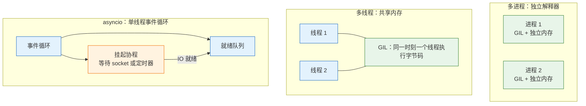
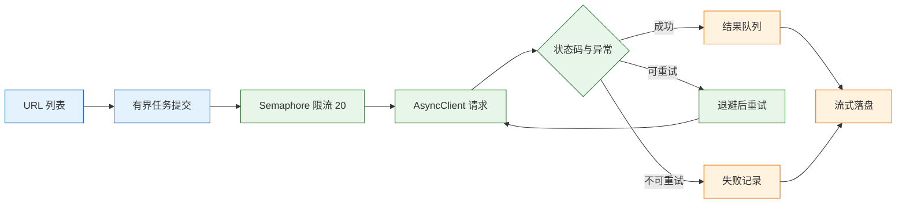

# 异步与并发

---

## 一、异步与并发的定位

并发指多个任务在时间上重叠推进，并行指多个任务在同一时刻真正同时执行。Python 里这两件事由三套机制分别承担：线程共享内存、受 GIL 约束；进程各自拥有解释器和内存、可以真正并行；协程在单线程事件循环上协作式切换、适合大量 IO 等待。选错模型，代码可能“看起来并发了”，吞吐却没有变化，甚至更慢。

并发解决的是等待重叠，不解决单次请求本身慢、下游限流、锁竞争和数据竞争。一个接口单次 40ms，压到 50 并发变成 2 秒，先要判断时间花在等 IO 还是算 CPU，再决定加线程、加进程还是改协程。没有度量就调大线程池，只是把瓶颈推到连接池或下游。

### 1.1 核心概念

- **并发（concurrency）**：任务交替推进，任一时刻只有一个在执行。
- **并行（parallelism）**：任务同时执行，需要多核与独立执行流。
- **IO 密集型**：大部分时间在等网络、磁盘、数据库，等待时不占 CPU。
- **CPU 密集型**：大部分时间在计算，受单核频率和指令数限制。
- **协作式调度**：协程只在 `await` 等让出点切换，不会被时间片强制打断。
- **背压（backpressure）**：下游处理不过来时，让上游减速，而不是无限堆积。

| 概念 | 关键约束 | 典型手段 | 失效表现 |
|---|---|---|---|
| 并发 | 任务可交错 | 线程、协程 | 以为并发就是更快 |
| 并行 | 需要多核 | 多进程 | 核数不足仍排队 |
| IO 密集 | 等待不占 CPU | 线程池、asyncio | 阻塞调用卡住执行流 |
| CPU 密集 | 受 GIL 限制 | 进程池、C 扩展 | 线程越多越慢 |
| 背压 | 队列有上限 | 有界队列、信号量 | 内存持续上涨 |

### 1.2 与相邻技术的关系

| 模型 | 执行单元 | 内存与切换 | 适用 |
|---|---|---|---|
| 串行 | 当前线程 | 共享、无切换 | 任务少、依赖强 |
| 多线程 | 线程 | 共享、切换较低 | 阻塞 IO、同步库 |
| 多进程 | 进程 | 独立、切换高 | 纯 Python 计算 |
| asyncio | 协程 | 共享、切换很低 | 大量长连接、异步库 |

线程与协程都共享进程内存，区别在调度方式：线程由操作系统抢占式调度，任意字节码边界都可能切换；协程由事件循环协作式调度，只在 `await` 处让出。多进程绕开 GIL，但参数和返回值要序列化，进程间不能直接共享可变对象。

`concurrent.futures` 把线程和进程统一成 `Executor` 接口，适合任务粒度高、结果需要汇总的场景；`asyncio` 提供事件循环、任务和结构化并发，适合 IO 密集且依赖链全异步的服务。两者不是替代关系：Web 服务常见组合是多个 worker 进程，每个进程一个事件循环，阻塞库放线程池。

### 1.3 整体结构



| 层 | 组件 | 职责 | 观察方式 |
|---|---|---|---|
| 调度层 | 操作系统、事件循环 | 决定谁在何时运行 | `top`、`py-spy` |
| 执行层 | 线程、进程、协程 | 承载任务 | 线程栈、进程列表 |
| 资源层 | 连接池、信号量、队列 | 限制并发与缓冲 | 池占用、队列长度 |
| 观测层 | 日志、指标、追踪 | 定位等待与失败 | p95、在途数、错误率 |

---

## 二、环境与第一个程序

### 2.1 版本与运行时检查

> **版本现状（2026-10）**：3.13 引入实验性的 free-threaded 构建，3.14 起被官方支持（PEP 779），但默认下载的仍是带 GIL 的构建，free-threaded 要单独安装 `python3.14t`。单线程性能有折损，第三方 C 扩展要显式声明兼容，不要因为“听说没 GIL”就切换。

```bash
# ========== 确认解释器 ==========
python3 -VV
python3 -c "import sys; print(sys._is_gil_enabled())"

# ========== 安装 free-threaded 构建（仅在验证时） ==========
uv python install 3.14t

# ========== 观察事件循环调试信息 ==========
PYTHONASYNCIODEBUG=1 python app.py
```

`sys._is_gil_enabled()` 默认构建通常返回 `True`。free-threaded 构建的模块名和路径带有 `t` 标识，虚拟环境要单独创建，不能和普通构建混用同一个 `.venv`。

### 2.2 最小协程示例

```python
import asyncio

async def main() -> None:
    # 协程对象创建后不会执行，await 才进入事件循环
    await asyncio.sleep(0.1)
    print("done")

asyncio.run(main())
```

`asyncio.run()` 负责创建事件循环、运行主协程、收尾并关闭循环。一个线程只能有一个运行中的事件循环，不要在协程内部再次调用 `asyncio.run()`。

### 2.3 并发模型的对照实验

下面的骨架用于观察同一批任务在不同模型下的行为，具体耗时依赖机器和网络，不能把某次输出当成结论。

```python
import asyncio
import time
from concurrent.futures import ThreadPoolExecutor

def blocking_task(i: int) -> int:
    time.sleep(0.1)          # 模拟阻塞 IO
    return i

async def async_task(i: int) -> int:
    await asyncio.sleep(0.1) # 模拟异步 IO
    return i

# 串行：总时间约等于任务数乘以单次等待
start = time.perf_counter()
[blocking_task(i) for i in range(10)]
print("serial", time.perf_counter() - start)

# 线程：等待被重叠，受线程数和下游容量限制
with ThreadPoolExecutor(max_workers=8) as pool:
    list(pool.map(blocking_task, range(10)))

# 协程：单线程内切换，适合大量 IO
async def run() -> None:
    await asyncio.gather(*(async_task(i) for i in range(10)))

asyncio.run(run())
```

| 模型 | 等待是否重叠 | CPU 是否并行 | 主要成本 |
|---|---|---|---|
| 串行 | 否 | 否 | 总延迟累加 |
| 线程 | 是 | 受 GIL 限制 | 线程栈、切换 |
| 进程 | 是 | 是 | 启动、序列化 |
| 协程 | 是 | 否 | 全链路必须异步 |

观察这组实验时，重点不是绝对耗时，而是同一批任务在不同模型下的相对变化：串行总延迟随任务数线性增长；线程和协程把等待重叠后，总延迟接近最慢的单个任务；进程还要叠加启动和序列化成本。若线程版的收益远低于预期，先检查任务里是否有长时间持有 GIL 的纯计算，或下游连接池是否已成为瓶颈。协程版的收益则取决于依赖链是否真的异步，任何一处同步调用都会把重叠打回串行。

---

## 三、GIL 与执行模型

### 3.1 GIL 行为

CPython 默认构建有全局解释器锁：同一时刻只有一个线程执行 Python 字节码。线程在 IO 等待、`time.sleep()`、C 扩展主动释放 GIL 时会让出，所以线程适合 IO，不适合纯 Python CPU 计算。

```python
import sys
print(sys._is_gil_enabled())   # 默认构建通常是 True
```

GIL 不是“永远只有一个线程在跑”。解释器按切换间隔在线程间轮转，默认约 5ms，可用 `sys.getswitchinterval()` 查询；IO 和部分 C 扩展期间也会释放。因此线程仍能重叠等待，只是纯 Python 字节码不并行。

| 场景 | GIL 是否释放 | 线程能否提速 | 说明 |
|---|---|---|---|
| `time.sleep()` | 是 | 能 | 纯等待 |
| socket 读写 | 是 | 能 | IO 阻塞时让出 |
| 纯 Python 循环 | 否 | 不能 | 抢同一把锁 |
| `hashlib` 大块计算 | 是 | 通常能 | C 扩展主动释放 |
| `numpy` 向量运算 | 部分 | 视实现 | 取决于底层库 |

### 3.2 free-threaded 构建

free-threaded 构建移除 GIL，让多线程可以并行执行 Python 字节码。代价是单线程性能折损、内存占用上升，以及 C 扩展需要适配新的对象模型。它解决多线程 CPU 并行，不解决跨进程共享状态，也不自动让现有代码变快。

| 维度 | 默认构建 | free-threaded |
|---|---|---|
| GIL | 有 | 无 |
| 单线程性能 | 基准 | 通常更低 |
| C 扩展兼容 | 广泛 | 需显式支持 |
| 多线程 CPU 并行 | 不支持 | 支持 |
| 生产建议 | 默认选择 | 先 profile 再评估 |

### 3.3 切换与释放

线程切换由解释器按间隔触发，切换点通常在字节码边界。复合操作不是原子的：`counter += 1` 包含读取、相加、写回三步，线程可能在中间被切换。GIL 保证字节码不并行，不保证复合操作原子。

协程没有时间片，也没有抢占。一个协程里跑 10 秒的纯计算，其他协程 10 秒内都没有机会执行；长任务要主动 `await asyncio.sleep(0)` 让出，或拆成小块丢进进程池。

---

## 四、线程模型

### 4.1 线程池

```python
from concurrent.futures import ThreadPoolExecutor, as_completed

def fetch(url: str) -> int:
    ...  # 同步 HTTP 调用

with ThreadPoolExecutor(max_workers=8) as pool:
    futures = [pool.submit(fetch, u) for u in urls]
    for future in as_completed(futures):
        print(future.result())
```

默认 `max_workers` 是 `min(32, os.cpu_count() + 4)`；IO 密集可以调大，但受下游连接数和文件描述符限制。线程池不是越大越好：线程切换、栈内存、下游连接池都会成为新瓶颈。异常不会在 `submit` 时抛出，而是在 `future.result()` 时抛出；不调用 `result()` 就永远不知道失败，日志里可能只剩一行线程异常，拿不到完整堆栈。

| 参数/行为 | 含义 | 常见错误 |
|---|---|---|
| `max_workers` | 同时运行的线程数 | 按请求数设置 |
| `submit` | 提交单个任务 | 不保存 Future |
| `map` | 批量提交并保序 | 误以为惰性 |
| `as_completed` | 按完成顺序产出 | 结果与输入错位 |
| `with` 退出 | 默认等待全部结束 | 进程退出卡住 |

### 4.2 共享状态与锁

```python
import threading

counter = 0
lock = threading.Lock()

def work() -> None:
    global counter
    for _ in range(100_000):
        with lock:
            counter += 1

threads = [threading.Thread(target=work) for _ in range(2)]
for t in threads:
    t.start()
for t in threads:
    t.join()
print(counter)   # 200000
```

去掉 `with lock`，结果通常小于 200000，而且每次不同。锁的粒度要覆盖完整的“读—改—写”，只锁一半等于没锁。共享可变状态也可以改用 `queue.Queue` 传递消息，把共享改成通信。`list.append` 在 CPython 里看起来原子，但这是实现细节，不是语言保证。

> **安全警告**：线程无法被安全强杀。`future.result(timeout=...)` 只让等待超时，不会停止线程；线程里的阻塞调用只能等它自己返回。给阻塞调用设置底层超时，或用可取消的异步客户端，才是可控的做法。

### 4.3 超时与取消边界

Python 没有安全的线程强制终止机制。`Thread.join(timeout)` 返回后线程可能仍在运行，`Future.cancel()` 只能取消尚未开始的任务。需要可靠取消时，应让任务周期性检查停止标志，或改用支持取消的异步 IO。

| 操作 | 作用范围 | 是否停止执行 |
|---|---|---|
| `future.result(timeout)` | 等待 | 否 |
| `future.cancel()` | 未开始的任务 | 是 |
| `thread.join(timeout)` | 等待 | 否 |
| `asyncio.Task.cancel()` | 协程 | 下一个 `await` 点 |

---

## 五、进程模型

### 5.1 进程池

```python
from concurrent.futures import ProcessPoolExecutor

def compress(path: str) -> tuple[str, int]:
    ...  # 纯 Python 计算或调用 C 库
    return path, size

if __name__ == "__main__":
    with ProcessPoolExecutor() as pool:
        for path, size in pool.map(compress, paths):
            print(path, size)
```

每个进程有独立解释器和内存，不受 GIL 限制。代价是启动成本、序列化开销，以及进程间不能直接共享可变对象。进程数按可用 CPU 核数设置，不是按请求数；每请求起一个进程，开销会吞掉收益。

### 5.2 序列化约束

参数和返回值必须可 pickle。lambda、本地类、打开的文件、数据库连接、锁都不行；函数要定义在模块顶层。

| 对象 | 可 pickle | 替代方案 |
|---|---|---|
| 顶层函数 | 是 | — |
| lambda | 否 | 改成顶层函数 |
| 本地类实例 | 否 | 移到模块级 |
| 数据库连接 | 否 | `initializer` 内创建 |
| 大数组 | 是 | 注意传输成本 |

连接这类不可 pickle 的资源，用 `initializer` 在每个 worker 启动后创建，而不是当参数传：

```python
def init_worker(url: str) -> None:
    global conn
    conn = connect(url)

with ProcessPoolExecutor(initializer=init_worker, initargs=(db_url,)) as pool:
    ...
```

### 5.3 启动方式与初始化

Windows 和 macOS 默认用 `spawn`，子进程重新 import 主模块，所以必须有 `if __name__ == "__main__":` 保护；`ProcessPoolExecutor` 在 Linux 等非 macOS 的 Unix 上，3.14 起默认也从 `fork` 改为 `forkserver`，不要依赖 fork 继承全局状态。

| 启动方式 | 平台默认 | 子进程初始化 | 风险 |
|---|---|---|---|
| `fork` | 旧版 Linux | 继承父进程内存 | 锁与连接状态被复制 |
| `spawn` | Windows、macOS | 重新 import 主模块 | 缺少 guard 会递归启动 |
| `forkserver` | 3.14 起 Unix 默认 | 通过服务进程派生 | 全局状态不自动继承 |

`initializer` 每个 worker 只跑一次，连接在子进程里创建，不会被 fork 共享。进程池适合批处理：图片转码、批量计算、离线清洗。Web 请求里不要为单个请求起进程，用 worker 进程加进程内并发。

---

## 六、asyncio 事件循环

### 6.1 协程与 await

协程对象创建后不会执行，被 `await` 或调度进事件循环才运行。`await` 是让出点：遇到 IO 未就绪，协程挂起，事件循环去跑别的任务；IO 就绪后再恢复。没有 `await` 的长循环会卡住整个循环。


`async with` 对应 `__aenter__` 和 `__aexit__`，异步客户端、连接池、事务都用它；`async for` 对应 `__aiter__` 和 `__anext__`，用于流式响应。它们只是协议，不会自动把同步对象变成异步。

### 6.2 任务与结构化并发

| 写法 | 结果顺序 | 异常行为 | 适用 |
|---|---|---|---|
| `await coro` | 单个 | 直接抛出 | 顺序依赖 |
| `asyncio.gather` | 按输入保序 | 默认首个异常向外抛 | 批量收集 |
| `gather(return_exceptions=True)` | 按输入保序 | 异常作为结果返回 | 部分失败容忍 |
| `TaskGroup` | 自行读取 | 任一失败取消同组 | 要么全成要么全停 |
| `create_task` | 不保证 | 需保存引用并等待 | 后台任务 |

`gather` 默认遇到第一个异常就向外抛，其他任务不会自动取消，还在后台跑；要全部收结果用 `return_exceptions=True`。`TaskGroup` 是结构化并发：任一任务失败，取消同组其余任务，最后抛 `ExceptionGroup`。

```python
async def run() -> None:
    async with asyncio.TaskGroup() as tg:
        t1 = tg.create_task(fetch("a", sem))
        t2 = tg.create_task(fetch("b", sem))
    # 块结束时所有任务已完成
    print(t1.result(), t2.result())
```

块正常退出时所有任务已完成；任一任务抛异常，其余被取消，退出时抛 `ExceptionGroup`。要在组内做部分失败容忍，就在任务内部捕获并返回结果对象，而不是让异常穿出去。需要“谁先完成谁先处理”时用 `asyncio.as_completed`，它按完成顺序产出结果，适合边下载边写入；需要与输入顺序对齐时仍用 `gather`。

> **注意**：`create_task` 后不保存引用，任务可能被垃圾回收，表现为“执行到一半消失”。把任务放进集合，或用 `TaskGroup` 管理生命周期。

### 6.3 取消与超时

取消是协作式的：取消请求在下一个 `await` 点变成 `CancelledError`。捕获后必须继续抛，吞掉会让超时和停机失效。`CancelledError` 继承 `BaseException`，`except Exception` 接不住。

```python
async def limited() -> None:
    try:
        async with asyncio.timeout(0.1):
            await asyncio.sleep(1)
    except TimeoutError:
        print("timeout")

asyncio.run(limited())
```

```text
timeout
```

超时用 `asyncio.timeout()`（3.11+）：超时抛 `TimeoutError`，块内协程被取消；`wait_for` 是旧写法。一个线程一个事件循环，跨线程提交协程用 `asyncio.run_coroutine_threadsafe()`，不要直接操作另一个 loop。

---

## 七、同步阻塞的隔离

### 7.1 to_thread

```python
import asyncio
from pathlib import Path

async def ok():
    # 阻塞调用挪到默认线程池，避免卡住事件循环
    return await asyncio.to_thread(Path("big.json").read_text, encoding="utf-8")
```

`to_thread` 用的是默认线程池，适合少量阻塞调用；大量阻塞会打满线程池，应该换异步驱动。CPU 计算放 `to_thread` 没用，仍然抢 GIL，应该用进程池。

| 调用类型 | 放在哪里 | 原因 |
|---|---|---|
| 文件读写 | `to_thread` | 阻塞系统调用 |
| 同步 HTTP | 线程池或异步客户端 | 等待时间长 |
| 同步数据库 | 线程池或异步驱动 | 连接不可跨线程 |
| 纯 Python 计算 | 进程池 | 绕开 GIL |
| 短小纯函数 | 直接调用 | 切换成本更高 |

### 7.2 异步驱动替换

异步要全链路：Web 框架、HTTP 客户端、数据库驱动、缓存客户端都异步。一个同步点就能把收益吃光。判断方法很直接：协程里出现 `requests`、同步 ORM、`time.sleep`，事件循环就会被阻塞。

```python
# 错：整个事件循环被卡住
async def bad():
    import requests
    return requests.get("https://example.com", timeout=5).text

# 对：换成异步客户端，或至少用 to_thread 隔离
async def good(client):
    resp = await client.get("https://example.com", timeout=5.0)
    resp.raise_for_status()
    return resp.text
```

### 7.3 事件循环调试

调试时用 `asyncio.run(main(), debug=True)` 或环境变量 `PYTHONASYNCIODEBUG=1`，事件循环会打印执行超过 100ms 的回调，那通常就是阻塞点。

| 工具 | 观察对象 | 适用 |
|---|---|---|
| `PYTHONASYNCIODEBUG=1` | 慢回调、未等待协程 | 开发与压测 |
| `py-spy dump` | 线程栈 | 线上卡死 |
| `cProfile` | CPU 热点 | 计算密集 |
| 事件循环慢回调日志 | 阻塞调用 | 定位同步点 |

---

## 八、并发控制与容错

### 8.1 信号量与背压

```python
import asyncio
import random

async def fetch(name: str, sem: asyncio.Semaphore) -> str:
    async with sem:
        await asyncio.sleep(random.uniform(0.05, 0.2))
        if name == "bad":
            raise RuntimeError("upstream 500")
        return f"{name} ok"

async def main() -> None:
    sem = asyncio.Semaphore(3)
    names = [f"u{i}" for i in range(1, 7)] + ["bad"]
    results = await asyncio.gather(
        *(fetch(name, sem) for name in names),
        return_exceptions=True,
    )
    for name, result in zip(names, results):
        print(name, result if isinstance(result, Exception) else "OK")

asyncio.run(main())
```

预期输出（完成顺序随机，输出顺序固定）：

```text
u1 OK
u2 OK
u3 OK
u4 OK
u5 OK
u6 OK
bad upstream 500
```

`Semaphore(3)` 把同时在跑的请求限制在 3 个；`return_exceptions=True` 让一个失败不丢其他结果；`gather` 按输入顺序返回，方便和 `names` 对齐。信号量只限制“同时进入”的数量，不限制创建 task 的数量；先建一百万个 task 再限流，内存已经爆了。

> **安全警告**：无界并发会把内存和下游连接一起打满。`asyncio.Queue(maxsize=N)` 的队列满时生产者 `await put()` 自然减速，消费者数量固定；无界队列不叫缓冲，叫把内存当磁盘用。批量任务要分批提交，结果流式落盘。

### 8.2 异常收敛

| 策略 | 行为 | 适用 |
|---|---|---|
| 快速失败 | 首个异常终止整批 | 强一致任务 |
| 收集异常 | `return_exceptions=True` | 批量抓取、部分可失败 |
| 结构化并发 | `TaskGroup` 取消同组 | 要么全成要么全停 |
| 结果对象 | 返回 `Ok/Err` | 业务上可预期失败 |

失败项要带标识和原因落盘，否则只能整批重跑。异常信息记录请求 ID、状态码和重试次数，不要记录凭据。

### 8.3 重试与退避

只重试幂等请求和明确的临时错误；`400`、`401`、`404` 重试没有意义。退避加抖动，避免所有任务同一秒重试；尊重 `Retry-After`。

| 错误类型 | 是否重试 | 说明 |
|---|---|---|
| 连接超时 | 是 | 网络抖动 |
| 429 | 是 | 按 `Retry-After` 等待 |
| 500、502、503 | 是 | 临时故障，限次数 |
| 400、401、403 | 否 | 请求本身有问题 |
| 404 | 否 | 资源不存在 |

---

## 九、完整示例：批量接口抓取

### 9.1 目标与结构

目标是抓取 500 个 URL，对端限制 20 并发，单请求 5 秒超时，429 和 5xx 重试两次，结果落文件，失败项单独记录。示例只展示并发、重试与结果分类，落盘按输出格式补；片段需要网络，未实跑。



### 9.2 实现

```python
import asyncio
import httpx

async def fetch(client: httpx.AsyncClient, url: str, sem: asyncio.Semaphore):
    async with sem:
        for attempt in range(3):
            try:
                resp = await client.get(url, timeout=5.0)
            except (httpx.TimeoutException, httpx.TransportError):
                if attempt == 2:
                    raise
            else:
                retryable = resp.status_code == 429 or 500 <= resp.status_code < 600
                if not retryable:
                    resp.raise_for_status()
                    return resp.json()
                if attempt == 2:
                    resp.raise_for_status()
            # 生产还应读 Retry-After，并加随机抖动
            await asyncio.sleep(2 ** attempt)

async def run(urls: list[str]) -> None:
    sem = asyncio.Semaphore(20)
    async with httpx.AsyncClient() as client:
        results = await asyncio.gather(
            *(fetch(client, u, sem) for u in urls),
            return_exceptions=True,
        )
    ok = [r for r in results if not isinstance(r, Exception)]
    bad = [r for r in results if isinstance(r, Exception)]
    print(f"成功 {len(ok)}，失败 {len(bad)}")
```

### 9.3 结果与验证

| 判断点 | 做法 | 原因 |
|---|---|---|
| 并发度 | 信号量不超过连接池上限 | 超出只会在池里排队 |
| 重试范围 | 只重试幂等请求与临时错误 | 避免放大故障 |
| 退避 | 指数退避加抖动 | 防止同时重试 |
| 结果 | 成功与失败分开记录 | 支持断点续跑 |
| 总超时 | `asyncio.timeout(60)` 包住整批 | 防止个别卡死拖长批次 |

生产还应给整批加总超时：`async with asyncio.timeout(60): await asyncio.gather(...)`，否则个别卡死会把批次无限拖长。结果不要全堆在内存里，500 个可以，50 万个要流式写队列或文件。失败记录至少包含 URL、异常类型、重试次数和最后状态码，恢复时按 URL 去重后只补失败项，避免整批重跑浪费下游配额。

---

## 十、工程实践

### 10.1 模型选型

| 场景 | 模型 | 并发度起点 | 主要代价 |
|---|---|---|---|
| 几个 HTTP 请求 | asyncio 或线程池 | 5–20 | 调试复杂 |
| 同步数据库驱动 | 线程池隔离 | 按连接池 | 连接数、线程数 |
| 图片、视频转码 | 进程池 | CPU 核数 | 内存、启动 |
| 纯 Python 批量计算 | 进程池 | CPU 核数 | pickle、冷启动 |
| Web 服务 | 每 worker 一个事件循环 | worker × 协程上限 | 同步点拖垮 worker |
| 一次性脚本 | 串行 | 1 | 无 |

默认串行。只有当等待时间占比高、且任务之间独立时，并发才有收益。IO 密集优先 asyncio；团队不熟或库全是同步的，用线程池更稳。CPU 密集用进程池，并接受序列化和冷启动成本。

### 10.2 容量规划

稳定状态下，在途请求数约等于 `QPS × 平均延迟`：目标 100 QPS、平均 200ms，至少要有 20 个在途，再乘 1.5 到 2 的安全系数。算出来是 40，却把信号量设成 500，多出来的 460 个只会在连接池或下游队列里排队。

| 参数 | 计算依据 | 过大的后果 |
|---|---|---|
| 线程数 | 等待时间占比、下游容量 | 切换与栈内存 |
| 进程数 | CPU 核数、容器 limit | 内存与启动开销 |
| 信号量 | QPS × 延迟 × 安全系数 | 下游被打满 |
| 连接池 | 并发请求数 | 文件描述符耗尽 |
| 队列长度 | 峰值与处理速率差 | 内存堆积 |

容器里要按 CPU limit 算 worker 数，不要按宿主机核数，否则一堆 worker 抢同样的配额。容量规划还要留出故障余量：下游某个实例变慢时，在途请求会上升，连接池和队列要能吸收短时抖动；把所有资源按平均负载配满，第一次重试风暴就会把服务压垮。上限的作用是让过载表现为可控的排队和拒绝，而不是雪崩。

### 10.3 可观测性

并发代码的复杂度要用可观测性换：队列长度、在途数、失败率、p95，缺一个就只能靠猜。压测环境要和生产的 CPU、连接池、下游容量同构。

| 指标 | 含义 | 异常信号 |
|---|---|---|
| 在途任务数 | 当前并发 | 长期贴上限 |
| 队列长度 | 积压程度 | 持续上升 |
| 任务耗时 p95 | 尾部延迟 | 随并发线性上升 |
| 失败率 | 重试后仍失败 | 突增或集中 |
| 线程池占用 | 阻塞任务 | 饱和后排队 |

日志记录任务 ID、重试次数、耗时和结果分类；追踪把一次请求经过的线程、协程和下游调用串起来。不要在每个函数参数里传请求 ID，用 `contextvars` 保存并在日志过滤器注入。压测按阶梯提升并发，每一档记录 p95、错误率和下游连接池占用；吞吐不再上升而延迟继续上升的点就是饱和点，生产并发应停在该点之前，而不是压到报错再回调。

---

## 十一、常见错误与排查

### 11.1 故障对照表

| 现象 | 最可能原因 | 处理 |
|---|---|---|
| 加了 `async def` 吞吐没涨 | 里面调了 `requests`、同步数据库、`time.sleep` | 换异步库，或 `to_thread` 隔离 |
| 一个慢请求拖垮所有接口 | 同步阻塞卡住事件循环 | 查阻塞调用，开 debug 看慢回调 |
| `gather` 一个失败，其他结果全丢 | 没设 `return_exceptions=True` | 收集异常，或改 `TaskGroup` |
| 任务执行到一半消失 | `create_task` 后没保存引用 | 存进集合，或用 `TaskGroup` |
| 取消或超时不生效 | 吞了 `CancelledError`，或在阻塞调用里 | 继续抛，检查阻塞点 |
| 线程池越大越慢 | CPU 密集，或下游被打满 | 换进程池、降并发、加限流 |
| `Can't pickle local object` | 进程池传了 lambda 或本地类 | 顶层函数，参数可序列化 |
| `SQLite objects created in a thread` | 连接跨线程使用 | 每线程建连接，或换数据库 |
| macOS、Windows 进程池反复启动 | 没写 `if __name__ == "__main__"` | 加 guard |
| 内存持续上涨 | 无界并发、结果全留内存 | 信号量、分批、流式落盘 |
| 容器里 CPU 用不满 | 只开一个 worker，或按宿主核数设置 | 按容器限额设置 worker 数 |
| `asyncio.run() cannot be called from a running event loop` | 在协程里又调了 `run` | 入口只 `run` 一次，内部用 `await` |
| `Task was destroyed but it is pending` | 退出时还有任务没结束 | 取消并 `gather` 等它收尾 |

### 11.2 排查顺序

1. 先量瓶颈：`py-spy dump` 看栈，`cProfile` 看 CPU，日志看等待时间。
2. 确认事件循环有没有被同步调用阻塞；开 `PYTHONASYNCIODEBUG=1` 看慢回调。
3. 看并发上限：信号量、连接池、线程池、下游配额，哪一层先满。
4. 看超时和重试是否把失败放大，确认重试只覆盖幂等请求。
5. 最后才调参；没有度量时调参等于赌博。

> **核心结论**：先分清 IO 等待还是 CPU 计算；线程等 IO，进程绕 GIL，协程管大量连接；异步要全链路，任何并发都要有上限、超时和取消，失败要可记录、可重跑。
