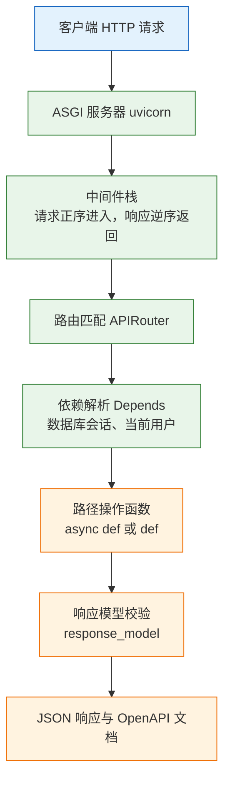
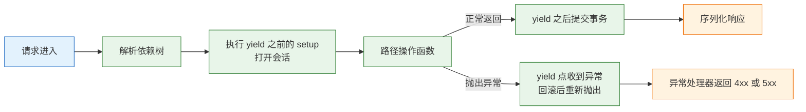
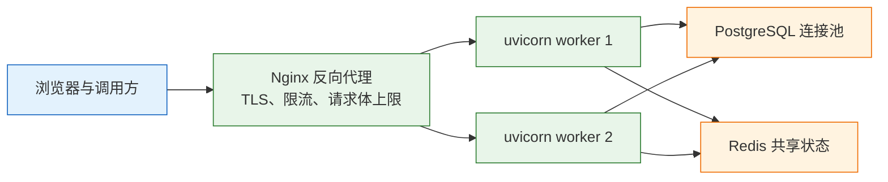

# FastAPI

---

## 一、FastAPI 是什么

FastAPI 是建立在 Starlette 与 Pydantic 之上的 Web 框架，用 Python 类型注解同时完成三件事：解析请求参数、校验数据、生成 OpenAPI 文档。它只负责 HTTP 边界，不提供 ORM、数据库迁移、管理后台和模板引擎。

它的价值出现在接口数量增长之后。三五个接口时，手写 `if not title: return 400` 也能跑；三十个接口时，每个作者对“缺字段算 400 还是 422”“用户 ID 从 query 还是 token 取”各有一套写法，联调成本会超过开发成本。FastAPI 把这些约定收进类型系统：参数来源由签名决定，校验规则由模型声明，错误结构由框架统一。

它不解决的问题同样明确：事务边界、分页策略、权限模型、多进程状态共享，仍然要自己设计。`async def` 也不会让阻塞代码变快，只决定这段代码跑在事件循环还是线程池。

### 1.1 核心概念

理解 FastAPI 需要先分清五个对象，它们各自有独立的生命周期。

- **应用对象**：`FastAPI()` 返回的 `app`，本质是一个 ASGI 可调用对象，签名是 `async def __call__(scope, receive, send)`。服务器只认这个签名，不认装饰器。
- **路径操作**：`@app.get("/tasks")` 装饰的函数，负责一次请求的业务处理。装饰器把函数、HTTP 方法、路径、响应模型登记进路由表。
- **路由**：`APIRouter` 把一组路径操作打包，通过 `include_router` 挂到应用上，用于按业务域拆分文件。
- **依赖**：`Depends(callable)` 声明的可调用对象，在路径操作执行前完成准备工作，例如打开数据库会话、解析当前用户、读取分页参数。
- **模型**：Pydantic 类，负责请求体解析与响应序列化。它只工作在边界，不进入领域逻辑。

| 概念 | 代码载体 | 职责 | 不负责 |
|---|---|---|---|
| 应用 | `FastAPI` 实例 | 装配中间件、路由、异常处理 | 进程管理、TLS |
| 路径操作 | `@app.get` / `@router.post` | 单次请求的业务编排 | 参数格式校验 |
| 路由 | `APIRouter` | 按前缀分组、挂载 | 业务分层 |
| 依赖 | `Depends` / `Security` | 资源准备、身份解析 | 业务规则 |
| 模型 | `BaseModel` | 解析、校验、序列化 | 持久化 |

五个概念的边界要守住：模型不做 IO，依赖不做业务，路径操作不拼 SQL，路由不承担权限。任一层越界，测试都会变得难写，因为无法单独替换。

### 1.2 与相邻技术的关系

FastAPI 经常和 Starlette、Pydantic、uvicorn、Django、SQLAlchemy 一起出现，边界不清会导致重复建设或职责错位。

- **Starlette**：ASGI 工具集，提供路由、中间件、请求响应对象、测试客户端。`FastAPI` 继承自 `Starlette`，所以 `app.add_middleware`、`Request`、`Response` 都来自它。FastAPI 增加的是依赖注入、参数解析和 OpenAPI 生成。
- **Pydantic**：数据校验库，与 Web 无关。FastAPI 把“函数签名里的模型”翻译成请求体解析器，把 `response_model` 翻译成序列化器。
- **uvicorn**：ASGI 服务器，负责监听端口、解析 HTTP、管理事件循环和 worker 进程。它不知道路由存在，换 Hypercorn 也能跑同一个 `app`。
- **Django**：全栈框架，自带 ORM、迁移、Admin、认证、模板。FastAPI 只覆盖其中的 HTTP 层，其余要自己组合。
- **Flask**：WSGI 框架，同步模型，生态成熟。FastAPI 的异步能力与文档生成是主要差异，不是全面替代。
- **SQLAlchemy + Alembic**：持久化与迁移的事实组合。FastAPI 不感知 ORM，会话通过依赖注入传入。

| 技术 | 解决的问题 | 与 FastAPI 的边界 |
|---|---|---|
| Starlette | ASGI 路由与中间件 | 被继承，不是并列选型 |
| Pydantic | 数据结构校验 | 边界层，不替代领域模型 |
| uvicorn | 进程与协议处理 | 部署层，不参与业务 |
| Django | 全栈一体化 | 替代关系，按项目形态选 |
| SQLAlchemy | ORM 与连接池 | 通过依赖注入接入 |
| Alembic | 表结构迁移 | 独立命令，不在应用启动时跑 |

> **注意**：`pip install fastapi` 不会安装服务器。缺少 uvicorn 时，`uvicorn app.main:app` 直接报命令不存在；只装 `fastapi` 也无法 `uv run uvicorn`。

### 1.3 架构组成

一次请求在 FastAPI 内部经过五层，每层都可以单独替换或关闭。



| 层 | 组件 | 可替换性 | 排障入口 |
|---|---|---|---|
| 服务器 | uvicorn / Hypercorn | 高，换服务器不改应用 | 启动日志、worker 数 |
| 中间件 | CORS、请求 ID、异常 | 高，注意顺序 | `add_middleware` 调用顺序 |
| 路由 | `APIRouter` | 高，按前缀拆分 | `/openapi.json` 的 paths |
| 依赖 | `Depends` 树 | 高，测试可覆盖 | `dependency_overrides` |
| 边界模型 | Pydantic | 高，独立于框架 | 422 响应里的 `loc` |

中间件是洋葱结构：请求从最外层进入，响应从最内层返回。Starlette 中后 `add_middleware` 的位于外层，因此 CORS 通常最后添加，保证异常响应也带跨域头。

> **注意**：中间件栈在第一次请求时构建。应用开始处理请求后再调用 `add_middleware` 会抛 `RuntimeError`，因此中间件、路由、异常处理器都必须在模块加载阶段装配完成。

---

## 二、环境准备与最小服务

### 2.1 版本与依赖安装

> **版本现状（2026-10）**：FastAPI 配合 Pydantic v2、Starlette 与 uvicorn 使用，小版本迭代较快，具体版本以官方发布记录为准。本篇只使用 0.100 之后稳定下来的 `Annotated` 依赖写法、`lifespan` 与 Pydantic v2 API，不依赖某个具体小版本的新特性。

用 uv 管理环境，锁文件保证本地与 CI 装到同一套依赖。

```bash
# 创建项目骨架，生成 pyproject.toml 与 .venv
uv init fastapi-demo
cd fastapi-demo

# 运行依赖：standard 额外带上 uvloop、httptools、websockets
uv add fastapi "uvicorn[standard]" pydantic-settings

# 测试依赖：pytest 与 TestClient 所需的 httpx
uv add --dev pytest httpx

# 确认版本与依赖树
uv run python -c "import fastapi, pydantic; print(fastapi.__version__, pydantic.VERSION)"
uv tree --depth 1
```

| 包 | 作用 | 缺失时的表现 |
|---|---|---|
| `fastapi` | 框架本体 | 无法导入 `FastAPI` |
| `uvicorn` | ASGI 服务器 | 命令不存在，应用无法监听端口 |
| `httpx` | `TestClient` 的传输层 | 导入 `TestClient` 时报缺依赖 |
| `pytest` | 测试运行器 | 无法收集用例 |
| `pydantic-settings` | 环境变量配置 | 需要手写 `os.environ` 解析 |

### 2.2 最小可运行示例

最小应用只需要一个应用对象和一条路由。它足以验证安装、端口和文档三条链路。

```python
# app/main.py
from fastapi import FastAPI

# 标题会出现在 OpenAPI 文档首页，不是装饰性字段
app = FastAPI(title="tasks", version="0.1.0")

@app.get("/health")
async def health() -> dict[str, str]:
    # 只证明进程能响应，不检查数据库等外部依赖
    return {"status": "ok"}
```

```bash
# 开发模式启动，代码变更后自动重载
uv run uvicorn app.main:app --reload --port 8000

# 另开一个终端验证
curl -i http://127.0.0.1:8000/health
curl -s http://127.0.0.1:8000/openapi.json | head -c 200
```

预期输出类似：

```text
INFO:     Uvicorn running on http://127.0.0.1:8000 (Press CTRL+C to quit)
INFO:     Started reloader process [12345] using StatReload

HTTP/1.1 200 OK
content-type: application/json

{"status":"ok"}
```

打开 `http://127.0.0.1:8000/docs` 会看到 Swagger UI，`/redoc` 是另一种排版，`/openapi.json` 是机器可读的契约。三者由同一份路由与模型声明生成，不需要手写。

| 路径 | 内容 | 生产建议 |
|---|---|---|
| `/docs` | Swagger UI | 内网保留，公网关闭或加鉴权 |
| `/redoc` | ReDoc 页面 | 同上 |
| `/openapi.json` | OpenAPI 描述 | 同上，会暴露全部路由 |
| `/health` | 自定义健康检查 | 保留，禁止重查询 |

### 2.3 目录与工程结构

单文件只在验证阶段成立。接口超过十个后，按“装配、路由、模型、依赖、业务”拆开，能让每个文件只有一个变更理由。

```text
fastapi-demo/
├── pyproject.toml
├── uv.lock
├── .env.example
├── app/
│   ├── __init__.py
│   ├── main.py          # 应用装配：中间件、路由、lifespan
│   ├── config.py        # 配置模型，启动时校验
│   ├── models.py        # Pydantic 请求与响应模型
│   ├── deps.py          # 会话、当前用户等依赖
│   ├── service.py       # 业务逻辑与查询
│   └── api/
│       ├── __init__.py
│       └── tasks.py     # APIRouter，只做参数解析与调用
└── tests/
    └── test_tasks.py
```

`app/api/tasks.py` 用 `APIRouter` 声明前缀，`main.py` 只负责挂载：

```python
# app/api/tasks.py
from fastapi import APIRouter

router = APIRouter(prefix="/tasks", tags=["tasks"])

@router.get("")
async def list_tasks() -> list[dict[str, str]]:
    return []
```

```python
# app/main.py
from fastapi import FastAPI
from app.api import tasks

app = FastAPI(title="tasks")
# 统一版本前缀放在挂载点，路由文件里不重复写 /api/v1
app.include_router(tasks.router, prefix="/api/v1")
```

`prefix="/tasks"` 加空路径 `""` 得到 `/api/v1/tasks`，不会产生尾斜杠。写成 `"/"` 会得到 `/api/v1/tasks/`，客户端访问不带斜杠时触发 307。

| 目录 | 放什么 | 不应该放 |
|---|---|---|
| `app/main.py` | 应用装配、生命周期 | 业务逻辑 |
| `app/api/` | 路由与参数声明 | SQL、事务 |
| `app/models.py` | 边界模型 | ORM 实体 |
| `app/deps.py` | 会话、身份依赖 | 查询语句 |
| `app/service.py` | 业务规则、事务 | HTTP 异常细节 |
| `tests/` | 接口与单元测试 | 生产配置 |

---

## 三、路由与参数解析机制

### 3.1 路由注册与匹配顺序

路由表是一个有序列表，匹配从上到下，第一个命中即停止。这个规则决定了两类常见故障：静态路径被动态路径截获，以及不同前缀的同名路由互相遮蔽。

```python
from fastapi import APIRouter

router = APIRouter(prefix="/tasks")

# 静态段必须写在动态段之前，否则 me 会被当成 task_id
@router.get("/me")
async def my_tasks() -> list[str]:
    return []

@router.get("/{task_id}")
async def get_task(task_id: int) -> dict[str, int]:
    return {"id": task_id}
```

`/tasks/me` 命中第一条，`/tasks/42` 命中第二条。若顺序反过来，`me` 先进入 `task_id: int` 的解析，类型转换失败返回 422，而不是 404。这类错误在日志里看不出路由问题，只能从 `loc` 字段判断。

| 写法 | 匹配结果 | 说明 |
|---|---|---|
| `/tasks/me` 在 `/{task_id}` 前 | 正常 | 静态优先 |
| `/tasks/me` 在 `/{task_id}` 后 | 422 | `me` 无法转 int |
| `/{task_id}` 与 `/{slug}` 并存 | 前者全拦截 | 同层级只能有一个动态段 |
| 同一路径注册两次 | 先注册的生效 | 后注册的永远不命中 |

`include_router` 的顺序同样生效。两个路由文件都声明 `GET /tasks` 时，先挂载的胜出，后挂载的静默失效。发现“接口改了没反应”，先查 `/openapi.json` 里该路径对应的 `operationId` 和标签，确认是哪一个函数在服务。

### 3.2 参数来源与校验规则

FastAPI 根据类型注解和默认值推断参数来源，推断规则固定，不依赖参数名。

| 来源 | 声明方式 | 示例 | 校验失败 |
|---|---|---|---|
| 路径 | 路径中出现的同名参数 | `/tasks/{task_id}` + `task_id: int` | 422 |
| 查询 | 非路径的简单类型 | `limit: int = Query(20, ge=1)` | 422 |
| 请求体 | Pydantic 模型 | `payload: TaskIn` | 422 |
| 请求头 | `Header(...)` | `x_api_key: str = Header(...)` | 422 |
| Cookie | `Cookie(...)` | `session: str = Cookie(...)` | 422 |
| 表单与文件 | `Form(...)`、`File(...)` | `UploadFile` 上传 | 422 |
| 依赖 | `Depends(callable)` | 当前用户、数据库会话 | 由依赖决定 |

几个直接后果需要在写代码前就接受：

- 路径参数写 `task_id: int`，`/tasks/abc` 返回 422，不是 404。语义上这是“参数不合法”，不是“资源不存在”。
- 必填请求头缺失也是 422。要让“未登录”返回 401，必须把请求头设为可选，自己判断后抛 `HTTPException(401)`，或者改用 `HTTPBearer` 这类安全方案。
- 查询参数名默认与函数参数名一致。`x_api_key` 会自动映射到请求头 `x-api-key`，因为 `Header` 默认开启下划线转换；客户端按 `x_api_key` 发会读不到。
- 简单类型默认进 query，Pydantic 模型默认进 body。想让模型走 query，需要 `Depends()` 包装成依赖。
- 请求体与上传大小要在网关和应用两层限制，否则一个大 JSON 或文件就能把进程内存打满。
- 布尔查询参数接受 `true`、`false`、`1`、`0` 等写法，其他值返回 422。

推荐用 `Annotated` 把约束和类型放在一起，便于复用：

```python
from typing import Annotated
from fastapi import Query

# 分页约束只定义一次，所有列表接口共用
Limit = Annotated[int, Query(ge=1, le=100, description="单页条数")]
Offset = Annotated[int, Query(ge=0, description="跳过的条数")]

async def list_tasks(limit: Limit = 20, offset: Offset = 0) -> list[dict[str, int]]:
    return []
```

| 约束 | 作用 | 越界结果 |
|---|---|---|
| `ge` / `le` | 闭区间 | 422 |
| `gt` / `lt` | 开区间 | 422 |
| `min_length` / `max_length` | 字符串或列表长度 | 422 |
| `pattern` | 正则匹配 | 422 |
| `alias` | 对外字段名 | 按别名解析 |

> **注意**：`Query(20, ge=1, le=100)` 里的 `20` 是默认值，不是约束。写成 `Query(ge=1, le=100)` 而不给默认值时，该参数变为必填，漏传返回 422。两者只差一个位置参数，排查时容易看漏。

### 3.3 响应模型与状态码

`response_model` 不是注释，它在返回前做一次字段过滤和类型校验。数据库实体多出的密码哈希、内部备注，只要没写进响应模型就不会出现在 JSON 里。

```python
from datetime import datetime
from pydantic import BaseModel, Field

class TaskOut(BaseModel):
    id: int
    title: str = Field(min_length=1, max_length=100)
    done: bool = False
    created_at: datetime

@app.get("/tasks/{task_id}", response_model=TaskOut)
async def get_task(task_id: int) -> TaskOut:
    # load_task 是仓储函数；返回 ORM 对象时模型需要 from_attributes=True
    return load_task(task_id)
```

| 参数 | 作用 | 常见误用 |
|---|---|---|
| `response_model` | 过滤与校验输出字段 | 省略后内部字段泄漏 |
| `status_code` | 声明成功状态码 | 创建接口仍返回 200 |
| `response_model_exclude_none` | 去掉空值字段 | 前端按字段存在性判断 |
| `response_class` | 指定响应类型 | 文件下载仍用 JSON |
| `responses` | 补充错误响应文档 | 文档与实际错误码不符 |

状态码要在装饰器里声明，而不是在函数体里 `return JSONResponse(status_code=201)`。后者会绕过 `response_model` 的过滤与校验，文档里声明的成功响应也和实际返回对不上。

`datetime` 默认序列化为 ISO 8601 字符串，UTC 时间以 `Z` 结尾。数据库里存 UTC、序列化时保留时区信息，前端才能正确转换；把无时区的 `datetime` 直接返回，客户端会按本地时区解释，跨时区部署时相差数小时。

---

## 四、Pydantic 模型与配置写法

### 4.1 模型定义与字段约束

请求模型和响应模型要分开定义。请求模型决定“允许传什么”，响应模型决定“允许看什么”，二者共用会导致内部字段被动暴露。

```python
from datetime import datetime
from pydantic import BaseModel, ConfigDict, Field

class TaskIn(BaseModel):
    # forbid 拒绝未声明字段，避免前端拼错字段被静默忽略
    model_config = ConfigDict(extra="forbid", str_strip_whitespace=True)

    title: str = Field(min_length=1, max_length=100)
    done: bool = False
    due_at: datetime | None = None

class TaskOut(BaseModel):
    # 允许直接校验 ORM 对象，不必先转 dict
    model_config = ConfigDict(from_attributes=True)

    id: int
    title: str
    done: bool
    owner: str
    created_at: datetime
```

| 配置项 | 作用 | 代价 |
|---|---|---|
| `extra="forbid"` | 拒绝多余字段 | 前端多传一个字段即 422 |
| `extra="ignore"` | 静默丢弃多余字段 | 拼错字段不报错 |
| `strict=True` | 禁止类型强转 | `"1"` 不再变成 `1` |
| `from_attributes=True` | 按属性读取对象 | 属性名必须与字段一致 |
| `str_strip_whitespace=True` | 自动去首尾空格 | 原样保留空白的场景不适用 |
| `populate_by_name=True` | 别名与字段名都可用 | 契约变宽，需在文档说明 |

`extra="forbid"` 与 `strict=True` 不是默认值，也不会因为“更严格”就无条件更好。对外 API 开启 `forbid` 后，客户端新增字段会被拒绝，属于破坏性约束；内部服务之间可以开，公网接口要评估兼容成本。

`model_dump(exclude_unset=True)` 只输出客户端真正传过的字段，适合 PATCH；`model_dump()` 会带上全部默认值，用它做部分更新会把未传字段覆盖成默认值。这个差异是 PATCH 接口最常见的 bug 来源。

### 4.2 校验器与模型配置

字段级约束表达不了跨字段规则。例如“开始时间必须早于结束时间”“至少填一个联系方式”，要用模型级校验器。

```python
from datetime import datetime
from pydantic import BaseModel, field_validator, model_validator

class Window(BaseModel):
    start_at: datetime
    end_at: datetime
    note: str = ""

    @field_validator("note")
    @classmethod
    def strip_note(cls, value: str) -> str:
        # 字段级：只处理当前字段，模式 after 表示类型转换之后
        return value.strip()

    @model_validator(mode="after")
    def check_order(self) -> "Window":
        # 模型级：可以读取多个字段，必须返回 self
        if self.start_at >= self.end_at:
            raise ValueError("start_at must be earlier than end_at")
        return self
```

校验器必须是纯函数：不查数据库、不调外部接口、不读当前时间以外的全局状态。原因很实际——它会在请求解析阶段执行，抛出的异常会被包装成 422，堆栈不会出现在业务日志里；一旦里面发生 IO 超时，排查会误以为是校验失败。

Pydantic v2 与 v1 的写法不兼容，照旧教程抄会直接报错：

| v1 写法 | v2 写法 | 说明 |
|---|---|---|
| `@validator("f")` | `@field_validator("f")` | 需配 `@classmethod` |
| `class Config:` | `model_config = ConfigDict(...)` | 配置变成类属性 |
| `Field(regex="...")` | `Field(pattern="...")` | 参数改名 |
| `.dict()` / `.json()` | `.model_dump()` / `.model_dump_json()` | 序列化方法改名 |
| `parse_obj()` | `model_validate()` | 校验入口改名 |
| `orm_mode = True` | `from_attributes=True` | ORM 读取开关 |

> **注意**：`@field_validator` 如果不加 `@classmethod`，Pydantic v2 在类创建阶段就会报错，错误信息指向装饰器而非字段，容易误判成版本冲突。

### 4.3 应用配置与生命周期

配置从环境变量读取，代码只解析一次，缺关键项时启动失败。带默认值的配置项只用于开发，生产必须显式注入。

```python
# app/config.py
from functools import lru_cache
from pydantic_settings import BaseSettings, SettingsConfigDict

class Settings(BaseSettings):
    model_config = SettingsConfigDict(env_file=".env", extra="ignore")

    database_url: str                      # 无默认值，缺失即启动失败
    api_key: str                           # 密钥只从环境注入
    debug: bool = False
    pool_size: int = 10

@lru_cache
def get_settings() -> Settings:
    return Settings()
```

| 来源 | 优先级 | 用途 |
|---|---|---|
| 构造参数 | 最高 | 测试中显式覆盖 |
| 环境变量 | 高 | 容器与 CI 注入 |
| `.env` 文件 | 中 | 仅本地开发 |
| 字段默认值 | 最低 | 开发兜底 |

生命周期钩子用 `lifespan`，每个 worker 进程启动时执行一次，适合建连接池、预热缓存、注册信号处理。`@app.on_event("startup")` 是旧写法，新项目统一用 `lifespan`。

```python
from contextlib import asynccontextmanager
from fastapi import FastAPI

@asynccontextmanager
async def lifespan(app: FastAPI):
    # yield 之前：进程启动，建立共享资源
    app.state.engine = create_async_engine(get_settings().database_url)
    yield
    # yield 之后：进程退出，释放连接，等待在途请求结束
    await app.state.engine.dispose()

app = FastAPI(title="tasks", lifespan=lifespan)
```

`lifespan` 抛异常会让 worker 起不来，这是期望行为：配置错了应该启动失败，而不是带病运行到第一个请求才崩。不要在 `lifespan` 里处理请求，也不要在这里做耗时迁移，迁移是发布步骤。

> **安全警告**：`debug=True` 与 `--reload` 只用于本地。生产开启 reload 会启动额外的监视进程，代码变更即重启；调试模式还会把异常细节和源码路径带进响应，等于向调用方公开内部结构。

---

## 五、依赖注入与数据访问

### 5.1 依赖解析与缓存

`Depends` 把可调用对象的返回值注入参数。可调用对象可以是函数、带 `__call__` 的类、生成器，解析发生在路径操作之前。

```python
from typing import Annotated
from fastapi import Depends, Header, HTTPException

async def current_user(
    x_api_key: Annotated[str | None, Header()] = None,
) -> str:
    # 设为可选，缺失时由这里返回 401，而不是框架的 422
    if x_api_key != "dev-key":
        raise HTTPException(status_code=401, detail="invalid api key")
    return "alice"

CurrentUser = Annotated[str, Depends(current_user)]

@app.get("/tasks")
async def list_tasks(user: CurrentUser) -> list[str]:
    return []
```

同一个请求内，同一个依赖默认只执行一次（`use_cache=True`）。`current_user` 被三个依赖间接引用时，认证只跑一次；数据库会话也只会打开一次。

| 特性 | 行为 | 适用 |
|---|---|---|
| 默认缓存 | 每个请求内复用结果 | 会话、当前用户 |
| `use_cache=False` | 每次声明都重新执行 | 需要独立实例的资源 |
| 生成器依赖 | `yield` 前 setup、后 teardown | 会话、临时目录、锁 |
| 类依赖 | 实例化并注入 | 带配置的服务对象 |
| 子依赖 | 依赖里再声明依赖 | 分层组合 |
| 覆盖 | `dependency_overrides` 替换 | 测试、灰度 |

生成器依赖的异常路径要理解清楚：路径操作抛异常时，异常会被抛进 `yield` 所在位置，`except` 能捕获并回滚，`finally` 一定会执行。正因如此，事务提交应放在 `yield` 之后、`except` 之外。

```python
from collections.abc import AsyncIterator

# SessionLocal 的构造见 5.2，这里只关注依赖的收尾顺序
async def get_session() -> AsyncIterator[AsyncSession]:
    async with SessionLocal() as session:
        try:
            yield session
            await session.commit()       # 端点正常返回才提交
        except Exception:
            await session.rollback()     # 任意异常整体回滚
            raise
        finally:
            await session.close()        # 连接归还池
```

一个请求只在一个地方管事务。端点里再手动 `commit()`，会让“失败回滚”的边界变得不确定：部分写入已提交，后续异常只能回滚剩下的一半。



> **注意**：依赖缓存只在一次请求内有效。在依赖上挂 `@lru_cache` 会跨请求复用，权限变更、连接失效都不会反映出来；跨请求缓存要显式放到 Redis，并设计失效策略。

### 5.2 数据库会话与事务边界

异步驱动下，会话、引擎、连接池三者的数量关系必须算清楚。

```python
from sqlalchemy.ext.asyncio import AsyncSession, async_sessionmaker, create_async_engine

settings = get_settings()

engine = create_async_engine(
    settings.database_url,          # postgresql+asyncpg://...
    pool_size=10,                   # 每个 worker 常驻连接数
    max_overflow=5,                 # 峰值可临时增加的连接
    pool_pre_ping=True,             # 取连接前探活，避免用到已断开的连接
    echo=False,
)

SessionLocal = async_sessionmaker(engine, expire_on_commit=False)
```

连接总数按 `worker 数 × (pool_size + max_overflow)` 估算。4 个 worker、`pool_size=10`、`max_overflow=5`，峰值就是 60 条连接；数据库 `max_connections` 只有 100 时，再叠一个后台任务进程就会打满。把 worker 数调大之前先算这笔账。

| 配置 | 作用 | 设置过大 |
|---|---|---|
| `pool_size` | 常驻连接数 | 空闲连接占用数据库配额 |
| `max_overflow` | 峰值附加连接 | 突发流量打满数据库 |
| `pool_timeout` | 取连接等待上限 | 请求长时间挂起 |
| `pool_recycle` | 连接最长存活秒数 | 用到被中间件断开的连接 |
| `pool_pre_ping` | 使用前探活 | 每次多一次往返 |

查询要避免 N+1。列表页取 20 条任务再逐条访问 `task.project.name`，会多发 20 条 SQL；用 `selectinload` 预加载关联，把总数压到 2 条。分页的排序列必须有索引，`ORDER BY created_at DESC LIMIT 20` 在没有索引时是全表排序。

分页方案要在写接口前定下来：

| 方案 | 优点 | 代价 | 适用 |
|---|---|---|---|
| `offset` / `limit` | 能跳页、能算总数 | 深页慢，数据变动会重复或漏行 | 后台管理、小数据量 |
| 游标（`created_at` + `id`） | 深页稳定、耗时恒定 | 不能跳页、实现复杂 | 信息流、大数据量 |
| 键集（`WHERE id < last_id`） | SQL 简单、走索引 | 只适合单调键 | 按 ID 倒序的列表 |

`offset` 在数据变化时不稳定：翻到第二页时前面插入一条，第二页会重复上一页的最后一条。`COUNT(*)` 在深页和复杂过滤下同样昂贵；后台可以缓存总数，信息流干脆不提供总页数。

### 5.3 认证与授权依赖

认证回答“是谁”，授权回答“能做什么”，两者失败的状态码不同：401 表示没有识别出身份，403 表示身份已识别但权限不足。

```python
from fastapi import Depends, HTTPException
from fastapi.security import HTTPAuthorizationCredentials, HTTPBearer

bearer = HTTPBearer(auto_error=False)

async def current_user(
    cred: HTTPAuthorizationCredentials | None = Depends(bearer),
) -> User:
    if cred is None:
        # 401 必须带 WWW-Authenticate，客户端才知道该用哪种方案
        raise HTTPException(
            status_code=401,
            detail="not authenticated",
            headers={"WWW-Authenticate": "Bearer"},
        )
    return await verify_token(cred.credentials)

async def require_admin(user: User = Depends(current_user)) -> User:
    if "admin" not in user.roles:
        raise HTTPException(status_code=403, detail="forbidden")
    return user
```

| 场景 | 状态码 | 响应头 | 客户端动作 |
|---|---|---|---|
| 未带令牌 | 401 | `WWW-Authenticate: Bearer` | 跳转登录或刷新令牌 |
| 令牌过期 | 401 | 同上 | 用刷新令牌换新 |
| 令牌有效但无权限 | 403 | 无 | 提示无权限，不重试登录 |
| 资源不属于当前用户 | 404 | 无 | 不回显资源是否存在 |
| 请求体字段不合法 | 422 | 无 | 按 `loc` 修正字段 |

`HTTPBearer(auto_error=False)` 让框架不自动抛 401，便于统一错误体；用默认的 `auto_error=True` 时，缺令牌返回 `{"detail":"Not authenticated"}`，格式与其他错误不一致。

> **安全警告**：API Key 与令牌不能写进代码、日志和仓库。比较密钥用 `secrets.compare_digest`，普通 `==` 存在时序侧信道；日志里只记录令牌哈希或后四位。

---

## 六、完整示例：任务接口

示例保留模型校验、依赖注入、归属校验、分页与测试五条主线，用进程内字典代替数据库，便于直接运行。多 worker 下字典不共享，这一点在 7.3 节说明。

### 6.1 模型与存储层

```python
# app/models.py
from datetime import UTC, datetime
from pydantic import BaseModel, ConfigDict, Field

class TaskIn(BaseModel):
    model_config = ConfigDict(extra="forbid", str_strip_whitespace=True)
    title: str = Field(min_length=1, max_length=100)
    done: bool = False

class TaskOut(BaseModel):
    id: int
    title: str
    done: bool
    owner: str
    created_at: datetime

class TaskPage(BaseModel):
    items: list[TaskOut]
    total: int
    limit: int
    offset: int
```

```python
# app/service.py
import asyncio
from datetime import UTC, datetime
from .models import TaskIn, TaskOut

class TaskStore:
    def __init__(self) -> None:
        self._rows: dict[int, TaskOut] = {}
        self._seq = 0
        # 进程内互斥：并发创建时 id 不会重号
        self._lock = asyncio.Lock()

    async def create(self, payload: TaskIn, owner: str) -> TaskOut:
        async with self._lock:
            self._seq += 1
            task = TaskOut(
                id=self._seq,
                owner=owner,
                created_at=datetime.now(UTC),
                **payload.model_dump(),
            )
            self._rows[task.id] = task
            return task

    async def get(self, task_id: int, owner: str) -> TaskOut | None:
        # 归属写进查询条件，不先查出来再比较
        task = self._rows.get(task_id)
        return task if task and task.owner == owner else None

    async def list(self, owner: str, done: bool | None, limit: int, offset: int) -> tuple[list[TaskOut], int]:
        rows = [
            t for t in self._rows.values()
            if t.owner == owner and (done is None or t.done == done)
        ]
        rows.sort(key=lambda t: t.id, reverse=True)
        return rows[offset:offset + limit], len(rows)
```

### 6.2 路由与业务逻辑

```python
# app/api/tasks.py（由 main.py 以 prefix="/api/v1" 挂载）
from typing import Annotated
from fastapi import APIRouter, Depends, HTTPException, Query, status

from ..deps import CurrentUser, get_store
from ..models import TaskIn, TaskOut, TaskPage
from ..service import TaskStore

router = APIRouter(prefix="/tasks", tags=["tasks"])

@router.post("", response_model=TaskOut, status_code=status.HTTP_201_CREATED)
async def create_task(
    payload: TaskIn,
    user: CurrentUser,
    store: Annotated[TaskStore, Depends(get_store)],
) -> TaskOut:
    return await store.create(payload, user)

@router.get("", response_model=TaskPage)
async def list_tasks(
    user: CurrentUser,
    store: Annotated[TaskStore, Depends(get_store)],
    done: bool | None = None,
    limit: Annotated[int, Query(ge=1, le=100)] = 20,
    offset: Annotated[int, Query(ge=0)] = 0,
) -> TaskPage:
    items, total = await store.list(user, done, limit, offset)
    return TaskPage(items=items, total=total, limit=limit, offset=offset)

@router.get("/{task_id}", response_model=TaskOut)
async def get_task(
    task_id: int,
    user: CurrentUser,
    store: Annotated[TaskStore, Depends(get_store)],
) -> TaskOut:
    task = await store.get(task_id, user)
    if task is None:
        # 不存在与不属于当前用户返回同一结果，避免枚举资源
        raise HTTPException(status_code=404, detail="task not found")
    return task
```

```python
# app/deps.py
from typing import Annotated
from fastapi import Depends, Header, HTTPException
from .service import TaskStore

_store = TaskStore()

def get_store() -> TaskStore:
    return _store

async def current_user(x_api_key: Annotated[str | None, Header()] = None) -> str:
    # 可选头：缺失与错误都归为 401，语义一致
    if x_api_key != "dev-key":
        raise HTTPException(status_code=401, detail="invalid api key")
    return "alice"

CurrentUser = Annotated[str, Depends(current_user)]
```

| 方法与路径 | 作用 | 成功状态码 | 主要失败码 |
|---|---|---|---|
| `POST /api/v1/tasks` | 创建任务 | 201 | 401、422 |
| `GET /api/v1/tasks` | 分页列表 | 200 | 401、422 |
| `GET /api/v1/tasks/{id}` | 单条详情 | 200 | 401、404、422 |
| `GET /health` | 存活检查 | 200 | 无 |

### 6.3 请求验证与自动化测试

```bash
# 创建：成功；main.py 中以 prefix=/api/v1 挂载
curl -s -X POST http://127.0.0.1:8000/api/v1/tasks \
  -H 'content-type: application/json' \
  -H 'x-api-key: dev-key' \
  -d '{"title":"write notes"}'

# 缺必填字段：422，detail 里带 loc
curl -s -X POST http://127.0.0.1:8000/api/v1/tasks \
  -H 'content-type: application/json' \
  -H 'x-api-key: dev-key' \
  -d '{"done":true}'

# 密钥错误：401
curl -s -o /dev/null -w '%{http_code}\n' \
  -H 'x-api-key: wrong' http://127.0.0.1:8000/api/v1/tasks
```

预期输出类似：

```json
{"id":1,"title":"write notes","done":false,"owner":"alice","created_at":"2026-10-29T02:15:00.123456Z"}
```

```json
{"detail":[{"type":"missing","loc":["body","title"],"msg":"Field required","input":{"done":true}}]}
```

```text
401
```

`loc` 是定位字段的唯一可靠线索：`["body","title"]` 表示请求体缺少 `title`，`["query","limit"]` 表示查询参数越界，`["header","x-api-key"]` 表示请求头缺失。嵌套模型会给出更长的路径，从最内层开始看。

```python
# tests/test_tasks.py
import pytest
from fastapi.testclient import TestClient

from app.deps import current_user, get_store
from app.main import app
from app.service import TaskStore

@pytest.fixture
def client():
    # 每个测试用独立存储，避免用例之间互相污染
    app.dependency_overrides[get_store] = lambda: TaskStore()
    app.dependency_overrides[current_user] = lambda: "alice"
    # with 进入上下文才会执行 lifespan
    with TestClient(app) as c:
        yield c
    app.dependency_overrides.clear()

def test_create_and_read(client):
    created = client.post("/api/v1/tasks", json={"title": "t"})
    assert created.status_code == 201
    task_id = created.json()["id"]

    got = client.get(f"/api/v1/tasks/{task_id}")
    assert got.status_code == 200
    assert got.json()["title"] == "t"

def test_missing_title_returns_422(client):
    resp = client.post("/api/v1/tasks", json={"done": True})
    assert resp.status_code == 422
    assert resp.json()["detail"][0]["loc"] == ["body", "title"]

def test_unknown_task_returns_404(client):
    assert client.get("/api/v1/tasks/999").status_code == 404
```

直接 `TestClient(app)` 而不进入 `with` 上下文时，`lifespan` 不会执行；依赖启动资源的用例会失败。统一写成 `with TestClient(app) as client`，启动与关闭才会触发。

> **注意**：`app.dependency_overrides` 是全局字典，测试并发执行时会互相覆盖。串行运行或给每个测试建独立 `app` 实例（app factory）才安全。

---

## 七、工程实践

### 7.1 分层与项目组织

分层的判断标准是“变更理由是否单一”，不是文件数量。把路由、校验、业务、存储混在一个文件里，接口到二十个后每次改动都要读完整篇。

| 层 | 职责 | 允许依赖 | 禁止 |
|---|---|---|---|
| `api/` | 参数声明、状态码、调用服务 | 模型、依赖、服务 | SQL、事务 |
| `service/` | 业务规则、事务边界 | 模型、仓储 | `Request`、`HTTPException` |
| `repository/` | 查询与持久化 | ORM、连接 | HTTP 语义 |
| `models.py` | 边界数据结构 | Pydantic | 数据库会话 |
| `deps.py` | 资源与身份解析 | 配置、服务 | 业务分支 |

服务层抛业务异常，由统一的异常处理器映射成 HTTP 状态码，控制器就不会散落 `try/except`。例如 `TaskNotFound` 映射 404、`TaskConflict` 映射 409，映射表集中在一处，新增错误类型只改一个文件。

路由文件按资源拆分，不按 HTTP 方法拆分。`tasks.py` 里同时有 `GET`、`POST`、`PATCH`，比 `tasks_get.py`、`tasks_post.py` 更容易看出资源全貌。

### 7.2 跨域、文档与安全配置

跨域是浏览器行为，curl 不会触发，因此“命令行正常、浏览器报错”几乎都出在 CORS 配置。

```python
from fastapi.middleware.cors import CORSMiddleware

# 最后添加的中间件在最外层，异常响应也能带上跨域头
app.add_middleware(
    CORSMiddleware,
    allow_origins=["https://app.example.com"],   # 带凭据时不能写 *
    allow_credentials=True,
    allow_methods=["GET", "POST", "PATCH", "DELETE"],
    allow_headers=["Authorization", "Content-Type"],
    max_age=600,                                 # 预检结果缓存 10 分钟
)
```

| 配置 | 约束 | 错误表现 |
|---|---|---|
| `allow_origins` | 带凭据时必须是具体源 | 浏览器拒绝响应 |
| `allow_credentials` | 与 `*` 互斥 | 登录态不携带 |
| `allow_methods` | 必须含实际方法 | 预检失败 |
| `allow_headers` | 必须含自定义头 | 请求头被拦 |
| `max_age` | 过短导致频繁预检 | 延迟升高 |

> **安全警告**：CORS 不是访问控制。它只限制浏览器读取响应，服务端仍然要对每个请求做认证与授权；把 `allow_origins=["*"]` 当作“开放接口”会让任意站点携带用户凭据调用。

文档在生产环境要收口。`/openapi.json` 会列出全部路由、参数结构和模型字段，等于给攻击者一份接口清单。

```python
# 生产装配：关闭交互文档，保留 schema 供内部网关读取时可单独开放
app = FastAPI(
    title="tasks",
    docs_url=None,
    redoc_url=None,
    openapi_url=None,
)
```

### 7.3 部署与进程模型

```bash
# 生产启动：只传 import string，让每个 worker 自己导入应用
uv run uvicorn app.main:app \
  --host 0.0.0.0 --port 8000 \
  --workers 4 \
  --proxy-headers \
  --forwarded-allow-ips='127.0.0.1'
```

| 参数 | 作用 | 注意事项 |
|---|---|---|
| `--workers` | 启动多个进程 | 只接受 import string，不能传 app 对象 |
| `--reload` | 监视文件变更重启 | 与 `--workers` 互斥，生产禁用 |
| `--proxy-headers` | 采信代理转发头 | 必须配可信代理 IP |
| `--forwarded-allow-ips` | 限定可信代理 | 写成 `*` 等于允许伪造来源 IP |
| `--timeout-keep-alive` | 空闲连接保持时间 | 要小于上游代理的超时 |



多 worker 是多个独立进程，模块级字典、计数器、内存限流各算各的。示例里的 `TaskStore` 在 4 个 worker 下会有 4 份数据，创建后可能查不到。需要共享就放 Redis 或数据库，进程内状态只适合缓存和只读配置。

健康检查分两级：`/health` 只证明进程活着，供负载均衡摘流；`/ready` 检查数据库、缓存等关键依赖，供发布流程判断能否接流量。两者都不要执行重查询，否则探针本身会把数据库打满。

> **注意**：`BackgroundTasks` 在响应返回后于同一进程执行，进程重启就丢、失败不重试。发邮件、写审计这类必须可靠的动作，用任务表或消息队列，不要把它当队列。

容器部署用非 root 用户，只装运行依赖：

```dockerfile
FROM python:3.14-slim
COPY --from=ghcr.io/astral-sh/uv:0.8 /uv /usr/local/bin/uv
WORKDIR /app
ENV UV_COMPILE_BYTECODE=1 UV_LINK_MODE=copy

# 非包项目：先同步依赖，源码变化不会让依赖层失效
COPY pyproject.toml uv.lock ./
RUN uv sync --frozen --no-dev

# 源码目录位于工作目录下，可被直接导入
COPY app ./app
USER 10001
CMD ["/app/.venv/bin/uvicorn", "app.main:app", "--host", "0.0.0.0", "--port", "8000"]
```

先复制依赖清单再复制源码，源码变更不会让依赖层失效；`--no-dev` 保证 pytest、ruff 不进镜像。uv 镜像版本要按团队实际使用固定，不要长期用 `latest`。

---

## 八、常见错误与排查

### 8.1 故障对照表

| 现象 | 最可能原因 | 处理 |
|---|---|---|
| 参数看着都对，返回 422 | 类型不匹配、缺必填、别名不一致 | 看 `detail[].loc`，从最内层字段查 |
| 一直 401 `Not authenticated` | 请求头名写错、缺 `Bearer` 前缀 | `curl -i` 带全，核对大小写与安全方案 |
| 路由存在却 404 | 路径顺序、尾斜杠、挂载前缀 | 看 `/openapi.json` 里的真实路径 |
| 405 Method Not Allowed | 方法写错或路由前缀错 | 对比装饰器与请求方法 |
| `response_model` 字段丢失 | 模型未声明，或 ORM 未开 `from_attributes` | 补字段或补 `model_config` |
| `async def` 并发上不去 | 内部调了同步数据库、HTTP、`time.sleep` | 换异步库，或改成 `def` 走线程池 |
| 多 worker 下计数不准 | 状态存在进程内存 | 移到 Redis 或数据库 |
| 浏览器 CORS 报错，curl 正常 | 允许源、凭据、预检未配 | 具体源 + `allow_credentials` |
| 改了模型但表结构没变 | 只改校验层，没做迁移 | 改表并执行迁移 |
| 容器里 `--reload` 不生效 | 文件事件不传递、监听目录不对 | 显式 `--reload-dir`，生产禁用 |
| POST 被 307 到带斜杠路径 | 尾斜杠自动重定向 | 统一路径规范，或显式定义两条 |
| 大请求把内存打满 | 未限制请求体与上传大小 | 网关与应用双层限制 |
| 启动时报缺 `httpx` | 测试依赖没装 | `uv add --dev httpx` |

### 8.2 排查顺序

1. 先 `curl -i` 直连服务，绕开前端与网关，确认状态码和响应体到底是哪一层返回的。
2. 422 看 `detail[].loc`，定位到具体字段；不要从 `msg` 猜，`msg` 是英文模板，`loc` 才是路径。
3. 401 与 403 分开处理：401 查令牌是否到达服务端，403 查角色与对象归属。
4. 500 看服务端日志的完整堆栈，响应体里不会有；用请求 ID 把日志与客户端报错对上。
5. 打开 `/openapi.json`，确认路由、参数来源、响应模型与预期一致，排除挂载前缀和注册顺序问题。
6. 最后查网关、代理、worker 数与容器配置；应用日志正常而外部异常，多半在传输层。

> **核心结论**：FastAPI 把参数解析、校验、文档收进类型系统，但事务边界、分页策略、权限模型、多进程状态仍要自己决定；`async def` 只改变执行位置，不改变阻塞事实。
