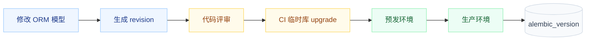

# Alembic数据库迁移

> 这篇从数据库版本化的必要性讲起，经过安装初始化、连接配置、autogenerate、升降级与日常变更、分支合并、多环境发布和零停机回滚，最后落到一个 200 万行订单表加非空列的迁移。
>
> 学完能独立为 SQLAlchemy 项目管理迁移历史，在开发、预发和生产上安全升级、回滚和合并分支，并把大表变更拆成可发布的步骤。

## 一、迁移工具在交付链中的位置

Alembic 把数据库结构变更写成带版本号的 Python 文件，用 `alembic_version` 表记录当前版本；代码和 schema 一起评审、一起发布，才能避免“代码上线了，列还没加”。

迁移文件不是数据库备份。它只描述“从上一版到这一版怎么改”，执行结果依赖当前库的真实状态；因此生产变更前必须有备份和回滚方案。



### 1.1 revision 与 version 表

每个迁移文件有 `revision` 和 `down_revision` 两个标识，前者是本版号，后者指向上一版；`down_revision = None` 表示起点。Alembic 按链表顺序执行，把当前版本写进 `alembic_version.version_num`。

```text
migrations/versions/
├── 0001_baseline.py          revision=0001, down_revision=None
├── 0002_add_tenant.py        revision=0002, down_revision=0001
└── 0003_enforce_tenant.py    revision=0003, down_revision=0002
```

多个开发分支同时改库时，链表会分叉成多个 head；第六章用 `merge` 收口。

### 1.2 与 create_all 的边界

| 能力 | `create_all()` | Alembic |
|---|---|---|
| 新建缺失表 | 支持 | 支持 |
| 加列、改类型 | 不支持 | 支持 |
| 删除列、重命名 | 不支持 | 支持 |
| 数据回填 | 不支持 | 支持 |
| 版本记录与回滚 | 无 | 有 |
| 多环境一致性 | 依赖模型 | 依赖迁移历史 |

`create_all()` 只适合本地临时库和测试。生产库只要存在过一次手工 ALTER，就必须用 `stamp` 接管基线，再走迁移。

## 二、安装与初始化

这一章建立迁移目录、连接配置和第一份基线，让空库能升到与模型一致的状态。

### 2.1 安装

```bash
uv add "alembic>=1.14" "sqlalchemy>=2.0.36"
```

Alembic 依赖 SQLAlchemy，但不会自动安装数据库驱动；PostgreSQL 还要装 `psycopg[binary]>=3.2`。Windows 用 PowerShell 安装脚本，macOS 用 `brew install uv` 或脚本，Ubuntu 24.04 用 `apt install python3.12-venv`，Rocky 9 用 `dnf install python3.12`；`uv add` 命令三端一致。

```bash
# 确认命令可用
uv run alembic --version
```

预期输出：

```text
alembic 1.20.1
```

版本号随安装时间变化，1.14 以上即可；本文在 1.20.1 上验证，2026-11 的新项目直接用当前稳定版。

### 2.2 初始化目录

```bash
uv run alembic init migrations
```

```text
Creating directory .../migrations ...  done
Creating directory .../migrations/versions ...  done
Generating .../migrations/env.py ...  done
Generating .../alembic.ini ...  done
```

| 文件 | 用途 | 是否提交 |
|---|---|---|
| `alembic.ini` | 脚本位置、日志、默认 URL | 提交 |
| `migrations/env.py` | 连接数据库、注入模型元数据 | 提交 |
| `migrations/script.py.mako` | 新迁移文件模板 | 提交 |
| `migrations/versions/` | 迁移脚本 | 提交 |
| `migrations/README` | 模板说明 | 可删 |

`alembic.ini` 至少要改三处：

```ini
[alembic]
script_location = %(here)s/migrations   # 用配置文件位置定位，避免从其他目录执行时找不到
prepend_sys_path = .                    # 让 env.py 能 import app.models
sqlalchemy.url =                        # 留空，运行时从环境变量注入
```

### 2.3 基线迁移

空库第一次生成迁移：

```bash
uv run alembic revision --autogenerate -m "baseline"
uv run alembic upgrade head
```

预期输出：

```text
INFO  [alembic.runtime.migration] Running upgrade  -> 4f2c1a9d7b10, baseline
```

已有数据的库不能直接 `upgrade`，否则会重复建表。先确认模型与现有 schema 一致，再用 `stamp` 写入版本号：

```bash
uv run alembic stamp head
uv run alembic current
```

```text
4f2c1a9d7b10 (head)
```

> 边界：`stamp` 只改版本号，不执行任何 DDL。模型与真实库不一致时使用 `stamp`，等于把差异永久藏起来。

## 三、连接配置与模型元数据

`env.py` 是迁移的入口：它决定连哪个库、拿哪份 `MetaData` 做对比、是否比较类型和默认值。

### 3.1 从环境变量注入 URL

```python
# migrations/env.py
import os

from alembic import context
from sqlalchemy import engine_from_config, pool

from app.models import Base

config = context.config
config.set_main_option(
    "sqlalchemy.url",
    os.environ["DATABASE_URL"].replace("%", "%%"),  # ConfigParser 会把 % 当插值符号
)
target_metadata = Base.metadata
```

`alembic.ini` 里的 URL 留空，避免密码进入版本库；CI 和本地各自设置 `DATABASE_URL`。

### 3.2 让 autogenerate 看见模型

`target_metadata` 必须指向包含全部模型的 `MetaData`。只 import `Base` 不够，模型模块必须先被导入，否则表不会注册到元数据。

```python
# app/models/__init__.py
from app.models.order import Order
from app.models.user import User

__all__ = ["Order", "User"]
```

```python
# migrations/env.py
from app.models import Base  # 触发 app.models.__init__，把所有表注册进 Base.metadata
```

大型项目把模型集中导入一个 `models/__init__.py`，`env.py` 只依赖这个入口，避免漏表。

### 3.3 对比选项

```python
context.configure(
    connection=connection,
    target_metadata=target_metadata,
    compare_type=True,           # 检测 VARCHAR(50) -> VARCHAR(100)
    compare_server_default=True, # 检测默认值变化，PostgreSQL 下可能产生噪声
    include_schemas=True,        # 多 schema 项目才开
    version_table_schema="public",
)
```

`compare_server_default=True` 在 PostgreSQL 上常把 `now()` 和 `CURRENT_TIMESTAMP` 判为不同，产生无意义迁移；团队要先统一默认值写法，再决定是否开启。

### 3.4 异步引擎的 env.py

异步项目用 `alembic init -t async migrations` 生成模板，驱动仍要单独安装（例如 `uv add asyncpg`），核心差异是 `async_engine_from_config` 和 `connection.run_sync`：

```python
import asyncio

from sqlalchemy.ext.asyncio import async_engine_from_config


def do_run_migrations(connection):
    context.configure(connection=connection, target_metadata=target_metadata)
    with context.begin_transaction():
        context.run_migrations()


async def run_async_migrations():
    connectable = async_engine_from_config(
        config.get_section(config.config_ini_section, {}),
        prefix="sqlalchemy.",
        poolclass=pool.NullPool,
    )
    async with connectable.connect() as connection:
        await connection.run_sync(do_run_migrations)  # 迁移 API 是同步的，交给 run_sync
    await connectable.dispose()


asyncio.run(run_async_migrations())
```

Alembic 本身不执行异步 SQL，它只是借用异步驱动的连接；迁移脚本里的 `op.*` 仍然是同步调用。

> 边界：`env.py` 不要执行应用启动逻辑（加载缓存、连消息队列）。迁移只需要数据库连接和元数据。

## 四、生成与审查迁移

`--autogenerate` 只生成差异草稿，不保证正确；审查比生成更重要。

### 4.1 标准工作流

```bash
# 1. 改完模型后生成草稿
uv run alembic revision --autogenerate -m "add order channel"

# 2. 打开新文件，逐行审查

# 3. 在本地库执行
uv run alembic upgrade head

# 4. 验证降级能回到上一版
uv run alembic downgrade -1
uv run alembic upgrade head
```

生成的骨架：

```python
"""add order channel

Revision ID: 7c1e2d9a4b30
Revises: 4f2c1a9d7b10
"""
from alembic import op
import sqlalchemy as sa

revision = "7c1e2d9a4b30"
down_revision = "4f2c1a9d7b10"
branch_labels = None
depends_on = None


def upgrade() -> None:
    op.add_column("orders", sa.Column("channel", sa.String(length=20), nullable=True))


def downgrade() -> None:
    op.drop_column("orders", "channel")
```

### 4.2 审查清单

| 检查项 | 危险信号 | 处理 |
|---|---|---|
| 删表删列 | `op.drop_*` 不在预期内 | 确认无代码依赖，先备份 |
| 非空列 | `nullable=False` 且无默认值 | 先加可空列，回填后再收紧 |
| 索引 | 大表直接 `create_index` | 改用 `CONCURRENTLY` |
| 类型变更 | `VARCHAR(50)` 缩到 `VARCHAR(20)` | 先清洗超长数据 |
| 重命名 | 生成 drop + add | 改成 `alter_column(new_column_name=...)` |

autogenerate 识别不了表重命名和列重命名，会把它们拆成“删旧建新”；这类变更必须手写。

### 4.3 常用命令

| 命令 | 用途 | 注意 |
|---|---|---|
| `alembic current` | 当前库版本 | 连不上库时先查 URL |
| `alembic heads` | 所有 head | 多个 head 说明有分支 |
| `alembic history` | 版本链 | 加 `-v` 看详情 |
| `alembic check` | 模型与库是否有差异 | 有差异时退出码 1，可进 CI |
| `alembic upgrade +1` | 只升一版 | 逐步排错时用 |
| `alembic downgrade -1` | 回退一版 | 先确认 downgrade 可逆 |
| `alembic stamp <rev>` | 只改版本号 | 不执行 DDL |

`alembic check` 适合放在 CI 的“模型改动必须带迁移”门禁：

```bash
uv run alembic check
```

```text
No new upgrade operations detected.
```

有未生成的变更时输出 `New upgrade operations detected` 并以非零码退出。

### 4.4 autogenerate 的盲区

- 表/列重命名、视图、触发器、存储过程、部分索引表达式；
- 数据回填、字符集转换、分区表维护；
- 不同数据库的方言差异，例如 SQLite 不支持大部分 `ALTER COLUMN`；
- 权限、扩展、序列的归属。

这些变更手写迁移，并在文件里写清“为什么不能自动生成”，让下一位维护者不再尝试 autogenerate。

> 边界：迁移文件一旦合入主干并被其他环境执行，就不能再改内容；修正要新增一版，否则各环境校验和与执行结果不一致。

## 五、日常变更与数据迁移

这一章覆盖加列、改类型、建索引和回填数据，每种变更都要同时考虑锁、时长和可逆性。

### 5.1 加列与默认值

```python
def upgrade() -> None:
    op.add_column(
        "orders",
        sa.Column("channel", sa.String(length=20), nullable=False, server_default="web"),
    )
    op.alter_column("orders", "channel", server_default=None)  # 默认值只用于回填旧行，之后由应用显式写入
```

PostgreSQL 11+ 加带常量默认值的非空列不会重写全表，但仍要短暂持有 `ACCESS EXCLUSIVE` 锁；大表先设 `lock_timeout`，拿不到锁就失败重试，而不是排队堵住后续请求。

### 5.2 改类型

```python
def upgrade() -> None:
    op.alter_column(
        "orders",
        "amount_cents",
        existing_type=sa.Integer(),
        type_=sa.BigInteger(),
        existing_nullable=False,
    )
```

PostgreSQL 从 `integer` 扩到 `bigint` 会重写表；数据量大时用“新增列 + 双写 + 回填 + 切换”替代。MySQL 的 `ALTER TABLE` 行为又不同，跨库项目必须分别验证。

### 5.3 索引与并发

```python
def upgrade() -> None:
    with op.get_context().autocommit_block():  # CONCURRENTLY 不能放在事务里
        op.create_index(
            "ix_orders_tenant_created",
            "orders",
            ["tenant_id", "created_at"],
            postgresql_concurrently=True,
        )
```

`CREATE INDEX CONCURRENTLY` 不阻塞写入，但耗时更长，失败后会留下 `INVALID` 索引；失败重试前先查 `pg_index.indisvalid` 并删除残留索引。

### 5.4 数据回填

小表可以直接在迁移里更新：

```python
def upgrade() -> None:
    op.execute(
        sa.text("UPDATE orders SET channel = 'legacy' WHERE channel IS NULL")
    )
```

大表不要在单个迁移事务里跑百万行 `UPDATE`：长事务会撑大 WAL、阻塞 autovacuum、放大回滚成本。把回填拆成独立脚本，按主键分批提交：

```python
# scripts/backfill_channel.py
from sqlalchemy import text
from app.db import engine

BATCH = 10_000
last_id = 0
with engine.connect() as conn:
    max_id = conn.execute(text("SELECT COALESCE(MAX(id), 0) FROM orders")).scalar_one()
while last_id < max_id:
    with engine.begin() as conn:
        result = conn.execute(
            text(
                "UPDATE orders SET channel = 'legacy' "
                "WHERE id > :last_id AND id <= :upper_id AND channel IS NULL"
            ),
            {"last_id": last_id, "upper_id": last_id + BATCH},
        )
    last_id += BATCH
    print(f"backfilled through id={last_id} ({result.rowcount} rows)")
```

按主键范围推进，每批独立事务；每次运行都从 0 开始扫描，`channel IS NULL` 保证只处理未回填的行，进度以数据库为准，不依赖内存状态。

### 5.5 SQLite 的 batch 模式

SQLite 不支持 `ALTER COLUMN`，旧版本也不支持 `DROP COLUMN`；Alembic 的 batch 模式会“建新表、拷数据、换名”：

```python
def upgrade() -> None:
    with op.batch_alter_table("orders") as batch_op:
        batch_op.alter_column("channel", type_=sa.String(length=40))

def downgrade() -> None:
    with op.batch_alter_table("orders") as batch_op:
        batch_op.alter_column("channel", type_=sa.String(length=20))
```

batch 模式会复制整表，大库执行前要评估磁盘空间和锁时间；生产 PostgreSQL 不需要它。

> 边界：数据迁移的 `downgrade` 往往无法还原被覆盖的数据。涉及删除或覆盖的迁移，降级只恢复结构，数据从备份恢复。

## 六、分支、合并与多环境

多人同时改 schema 会产生多个 head，合并迁移是把它们接回一条链，而不是删除其中一版。

### 6.1 分支与多 head

```bash
# A 分支：加租户列
uv run alembic revision --autogenerate -m "add tenant id" --branch-label tenant

# B 分支：加渠道列
uv run alembic revision --autogenerate -m "add channel" --branch-label channel

uv run alembic heads
```

```text
a1b2c3d4e5f6 (tenant) (head)
f6e5d4c3b2a1 (channel) (head)
```

两个 head 说明两条迁移链都基于同一个父版本。发布前合并：

```bash
uv run alembic merge -m "merge tenant and channel" a1b2c3d4e5f6 f6e5d4c3b2a1
uv run alembic heads
```

```text
9f8e7d6c5b4a (head)
```

合并文件只声明 `down_revision = ("a1b2c3d4e5f6", "f6e5d4c3b2a1")`，`upgrade()` 为空；两条链的 DDL 已经各自执行过。

### 6.2 多环境发布

同一套迁移文件配不同 `DATABASE_URL`，不要为每个环境维护一份迁移目录。

| 环境 | 执行方式 | 门禁 |
|---|---|---|
| 本地 | `alembic upgrade head` | 先 `downgrade base` 再全量升 |
| CI | 临时 PostgreSQL 容器 | `upgrade head` + `downgrade base` |
| 预发 | 与生产同版本快照 | 跑迁移并回归核心接口 |
| 生产 | 发布窗口内执行 | 备份、锁超时、监控、回滚脚本 |

CI 的最小验证：

```bash
docker run -d --name pg-ci -e POSTGRES_PASSWORD=ci -p 5432:5432 postgres:17
export DATABASE_URL="postgresql+psycopg://postgres:ci@127.0.0.1:5432/postgres"
uv run alembic upgrade head
uv run alembic downgrade base
uv run alembic upgrade head
```

`downgrade base` 能暴露“只写了 upgrade、没写 downgrade”的迁移；不是所有项目都要求可降级，但至少要在 CI 里明确知道哪些版本不可逆。

### 6.3 stamp 的使用边界

`stamp` 用于接管已有库、修复人工改过的版本号、把某个环境对齐到指定版本。

```bash
# 已有库 schema 与 0001 一致，写入版本号但不执行 DDL
uv run alembic stamp 0001
```

错误用法是“迁移失败了，stamp 到上一版假装没发生”。这会让 `alembic_version` 与真实 schema 脱节，下一次 autogenerate 生成无法执行的 SQL。

## 七、零停机与回滚

大表变更的核心不是“SQL 写得快”，而是“锁持有时间短、每一步都可独立发布、失败能停”。

### 7.1 expand-contract 四步

| 步骤 | 数据库 | 应用 | 可回滚 |
|---|---|---|---|
| expand | 加可空列、加并发索引 | 新旧代码都能跑 | 删除新列 |
| migrate | 分批回填 | 双写新旧字段 | 停写新字段 |
| contract | 加非空、加外键 | 只写新字段 | 保留旧字段一段时间 |
| cleanup | 删旧列、删旧索引 | 已稳定 | 从备份恢复 |

一次发布只做一步；把“加列 + 回填 + 设非空”塞进一个迁移，等于让整张表在发布窗口里不可写。

### 7.2 PostgreSQL 的锁与超时

```sql
SET LOCAL lock_timeout = '3s';        -- 只作用于当前事务，拿不到锁就失败
SET LOCAL statement_timeout = '30s';  -- 防止迁移语句无限执行
```

迁移脚本可以在 `upgrade()` 开头执行：

```python
op.execute("SET LOCAL lock_timeout = '3s'")
op.execute("SET LOCAL statement_timeout = '30s'")
```

`SET LOCAL` 只作用于当前事务；`CONCURRENTLY` 在 autocommit 块里执行，超时设置要单独确认。

### 7.3 非空与外键的在线加法

直接 `ALTER TABLE ... SET NOT NULL` 会全表扫描并持有 `ACCESS EXCLUSIVE` 锁。PostgreSQL 12+ 可以先用 `NOT VALID` 的 CHECK 约束验证，再加非空：

```sql
ALTER TABLE orders ADD CONSTRAINT ck_orders_tenant_not_null
  CHECK (tenant_id IS NOT NULL) NOT VALID;
ALTER TABLE orders VALIDATE CONSTRAINT ck_orders_tenant_not_null;  -- 只持 SHARE UPDATE EXCLUSIVE
ALTER TABLE orders ALTER COLUMN tenant_id SET NOT NULL;             -- 复用已验证约束，跳过全表扫描
ALTER TABLE orders DROP CONSTRAINT ck_orders_tenant_not_null;
```

外键同理：先 `NOT VALID` 加约束，再 `VALIDATE CONSTRAINT`，避免在建约束时锁住两张表。

### 7.4 回滚判断

| 场景 | 首选动作 | 原因 |
|---|---|---|
| 迁移执行到一半失败 | 修数据/修 SQL 后重试 | 当前版本通常随事务回滚，autocommit 块中的 DDL 除外 |
| 新列导致旧代码报错 | 回滚应用版本 | 列可空，旧代码通常兼容 |
| 新列已被大量写入 | 前滚修复 | 降级会丢数据 |
| 索引建失败留下 INVALID | 删索引后重建 | `REINDEX` 也可能长时间锁表 |

生产迁移前必须确认：备份可恢复、迁移可重入、回滚脚本经过演练。只写“出问题就 downgrade”不算方案。

## 八、最佳实践案例

### 8.1 案例背景

一个 B2B 订单平台有 200 万行 `orders` 表，PostgreSQL 17，4 个应用实例，要求 7×24 可用。业务要从单租户升级为多租户，需要给 `orders` 增加 `tenant_id BIGINT NOT NULL`，存量数据全部归到租户 1，并建立按租户查询的索引。

约束：发布窗口只有 30 分钟；迁移期间订单写入不能中断；任何一步失败都要能停在中间，不影响旧代码。现状是 `orders` 只有主键索引，应用代码直接 `INSERT` 不带 `tenant_id`。

```sql
-- 基线：存量表由旧系统创建，已有 200 万行
CREATE TABLE tenants (
    id BIGSERIAL PRIMARY KEY,
    name TEXT NOT NULL
);
INSERT INTO tenants (name) VALUES ('默认租户');

CREATE TABLE orders (
    id BIGSERIAL PRIMARY KEY,
    customer_id BIGINT NOT NULL,
    amount_cents INTEGER NOT NULL,
    created_at TIMESTAMPTZ NOT NULL DEFAULT now()
);
INSERT INTO orders (customer_id, amount_cents)
SELECT g % 1000, (g % 50000) + 100
FROM generate_series(1, 2000000) AS g;
```

基线迁移只提供版本链起点，`upgrade()`/`downgrade()` 留空；已有表由上面的 SQL 创建，用 `stamp` 接管。

```bash
uv run alembic revision --rev-id 0001 -m "baseline"
uv run alembic stamp 0001
```

### 8.2 案例实操

第一步，加可空列和并发索引。这一版不要求应用写新列，旧代码继续工作。

```python
# migrations/versions/0002_add_tenant_id.py
"""add tenant id

Revision ID: 0002
Revises: 0001
"""
from alembic import op
import sqlalchemy as sa

revision = "0002"
down_revision = "0001"
branch_labels = None
depends_on = None


def upgrade() -> None:
    op.add_column("orders", sa.Column("tenant_id", sa.BigInteger(), nullable=True))
    with op.get_context().autocommit_block():  # CONCURRENTLY 必须在事务外
        op.create_index(
            "ix_orders_tenant_created",
            "orders",
            ["tenant_id", "created_at"],
            postgresql_concurrently=True,
        )


def downgrade() -> None:
    with op.get_context().autocommit_block():
        op.drop_index("ix_orders_tenant_created", table_name="orders",
                      postgresql_concurrently=True)
    op.drop_column("orders", "tenant_id")
```

```bash
uv run alembic upgrade head
```

```text
INFO  [alembic.runtime.migration] Running upgrade 0001 -> 0002, add tenant id
```

第二步，发布应用新版本：写入订单时显式带 `tenant_id`，读取时兼容 `NULL`。这一步只改代码，不改库。

第三步，分批回填存量数据。每批 1 万行，独立事务，按主键推进。

```python
# scripts/backfill_tenant.py
from sqlalchemy import text
from app.db import engine

BATCH = 10_000
last_id = 0
with engine.connect() as conn:
    max_id = conn.execute(text("SELECT COALESCE(MAX(id), 0) FROM orders")).scalar_one()
while last_id < max_id:
    with engine.begin() as conn:
        conn.execute(
            text(
                "UPDATE orders SET tenant_id = 1 "
                "WHERE id > :last_id AND id <= :upper_id AND tenant_id IS NULL"
            ),
            {"last_id": last_id, "upper_id": last_id + BATCH},
        )
    last_id += BATCH
    print(f"backfilled through id={last_id}", flush=True)
```

```bash
uv run python scripts/backfill_tenant.py
```

```text
backfilled through id=10000
backfilled through id=20000
...
backfilled through id=2000000
```

第四步，收紧约束：先用 `NOT VALID` 的 CHECK 验证非空，再加外键，最后把列设为 `NOT NULL`。

```python
# migrations/versions/0003_enforce_tenant_id.py
"""enforce tenant id

Revision ID: 0003
Revises: 0002
"""
from alembic import op

revision = "0003"
down_revision = "0002"
branch_labels = None
depends_on = None


def upgrade() -> None:
    op.execute("SET LOCAL lock_timeout = '3s'")
    op.execute(
        "ALTER TABLE orders ADD CONSTRAINT ck_orders_tenant_not_null "
        "CHECK (tenant_id IS NOT NULL) NOT VALID"
    )
    op.execute("ALTER TABLE orders VALIDATE CONSTRAINT ck_orders_tenant_not_null")
    op.alter_column("orders", "tenant_id", nullable=False)  # 复用已验证约束，避免全表扫描
    op.execute("ALTER TABLE orders DROP CONSTRAINT ck_orders_tenant_not_null")
    op.execute(
        "ALTER TABLE orders ADD CONSTRAINT fk_orders_tenant_id "
        "FOREIGN KEY (tenant_id) REFERENCES tenants(id) NOT VALID"
    )
    op.execute("ALTER TABLE orders VALIDATE CONSTRAINT fk_orders_tenant_id")


def downgrade() -> None:
    op.execute("ALTER TABLE orders DROP CONSTRAINT IF EXISTS fk_orders_tenant_id")
    op.alter_column("orders", "tenant_id", nullable=True)
```

```bash
uv run alembic upgrade head
uv run alembic current
```

```text
INFO  [alembic.runtime.migration] Running upgrade 0002 -> 0003, enforce tenant id
0003 (head)
```

验证：

```sql
SELECT count(*) FILTER (WHERE tenant_id IS NULL) AS null_rows,
       count(DISTINCT tenant_id) AS tenants
FROM orders;
```

```text
 null_rows | tenants
-----------+---------
         0 |       1
```

### 8.3 案例结果

示例环境为 4 核 8 GB 的 PostgreSQL 17，`orders` 200 万行。`0002` 加列与并发建索引约 4.2 秒，期间写入 P95 从 18 ms 升到 31 ms；回填 200 万行分 200 批，总耗时约 48 秒，每批提交后释放锁；`0003` 的验证与加约束约 1.6 秒，未出现 5xx。以上为示例环境的量级，真实耗时随行数、磁盘和索引数变化。

失败模式与复盘：

- 直接加 `NOT NULL DEFAULT 1` 在 PostgreSQL 11+ 虽不重写表，但仍要短锁；流量高峰仍可能排队，必须配合 `lock_timeout` 和低峰发布。
- 回填放在迁移事务里会让 WAL 持续增长、autovacuum 追不上；拆批后中断可续，失败只影响当前批次。
- `CREATE INDEX CONCURRENTLY` 失败会留下无效索引，重跑前先查 `pg_index.indisvalid`。
- 应用双写阶段不能让 `tenant_id` 为空；旧代码路径要显式补默认租户，否则回填刚清完又出现空值。
- 降级只回退结构，已回填的租户数据不会丢；如果业务已开始写多租户数据，降级前必须先停写并评估数据归属。

上线检查清单：备份可用、`alembic current` 与预期一致、迁移在预发全量演练、锁超时已设置、回滚脚本已演练、监控覆盖写入延迟与错误率。
