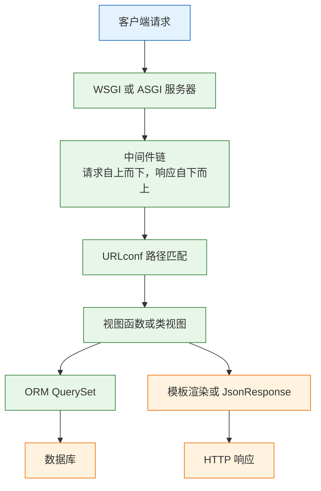
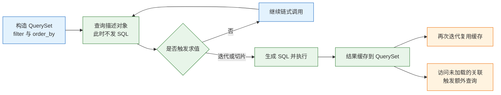
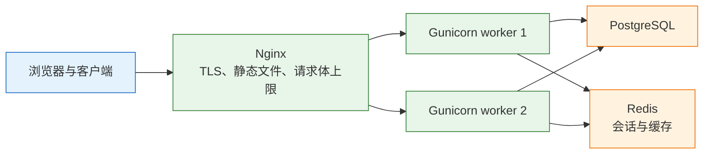

# Django

---

## 一、Django 是什么

Django 是一个自带 ORM、数据库迁移、管理后台、认证授权和模板引擎的全栈 Web 框架。它用一套统一的约定，把“建表、改表、录入数据、分配权限、渲染页面”这些每个业务系统都要重做一遍的事情，收进框架本身。

它解决的问题不是“如何写一个接口”，而是“如何让一个需要长期维护的业务系统保持结构一致”。模型定义表，迁移记录结构变更，Admin 直接生成录入界面，auth 提供用户与权限，URLconf 把请求分发到视图。新增一个字段，从模型改到迁移再到后台表单，是一条固定路径。

代价是耦合。目录结构、配置加载、ORM 写法、模板语法、认证流程都按 Django 的方式组织；顺着约定走，收益随项目规模放大，一边用一边绕开，成本会高于自己组装。判断标准很实际：需要后台录入、需要完整的账号与权限、表结构会持续变化，Django 划算；只对外提供 JSON 接口，FastAPI 或 Flask 更直接。

### 1.1 核心概念

Django 的六个核心对象构成一条固定链路，理解它们的职责边界比记住 API 更重要。

- **项目与 app**：项目是配置与路由的容器，app 是可复用的功能单元。一个项目可以装多个 app，一个 app 可以被多个项目复用。
- **模型（Model）**：Python 类到数据库表的映射。字段类型、约束、关系都写在类里，建表语句由迁移生成。
- **迁移（Migration）**：模型变更的版本化记录，是一个可审阅、可回滚的 Python 文件，不是运行时自动同步。
- **视图（View）**：接收 `HttpRequest`、返回 `HttpResponse` 的可调用对象。函数视图与类视图只是组织方式不同。
- **URLconf**：路径到视图的映射表，支持命名与反向解析。
- **中间件（Middleware）**：包裹每次请求与响应的处理层，会话、CSRF、认证都挂在这里。

| 概念 | 载体 | 职责 | 常见误用 |
|---|---|---|---|
| 项目 | `config/` 包 | 配置、根路由、部署入口 | 把业务代码塞进项目包 |
| app | `tasks/` 包 | 一个业务域的模型与视图 | 每张表建一个 app |
| 模型 | `models.py` | 表结构、关系、约束 | 在模型里写业务查询 |
| 迁移 | `migrations/` | 结构变更历史 | 手改已应用的迁移 |
| 视图 | `views.py` | 请求编排与响应 | 直接拼 SQL |
| URLconf | `urls.py` | 路径分发 | 手拼路径字符串 |

Django 的“约定优于配置”体现在默认值上：不写 `DATABASES` 就用 SQLite，不写模板引擎就用 DTL，`INSTALLED_APPS` 里注册了 `django.contrib.admin` 就自动有后台入口。默认值适合起步，生产必须逐项覆盖。

### 1.2 与相邻技术的关系

Django 与 FastAPI、Flask、DRF、Celery、Nginx 经常同时出现，边界清晰才能避免两套体系并存。

- **FastAPI**：API 框架，异步优先，自带 OpenAPI。Django 是全能型框架，异步支持局限在视图层，ORM 仍以同步为主。二者是选型关系，不是叠加关系。
- **Flask**：微框架，只提供路由与请求上下文，其余靠扩展。Django 把这些扩展做成内置组件，代价是必须接受它的组织方式。
- **DRF（Django REST Framework）**：独立项目，在 Django 之上提供序列化器、ViewSet、路由器、权限类。它复用 Django 的 ORM、迁移与认证，不替换它们。
- **Celery**：异步任务队列，处理发信、导出、定时任务。Django 请求周期内不应执行长任务，二者通过 broker 连接。
- **Gunicorn / uvicorn**：生产应用服务器。`runserver` 只用于开发，不具备并发与稳定性保障。
- **Nginx**：反向代理，负责 TLS、静态文件、请求体上限与超时。

| 技术 | 解决的问题 | 与 Django 的边界 |
|---|---|---|
| FastAPI | 高性能 JSON API | 替代关系，按接口形态选 |
| Flask | 轻量路由与扩展 | 替代关系，Django 更重 |
| DRF | REST 序列化与视图抽象 | 插件，复用 Django 的模型与认证 |
| Celery | 后台任务与定时调度 | 外置组件，不共享请求事务 |
| Gunicorn | WSGI 进程管理 | 部署层，替换 `runserver` |
| Nginx | 反向代理与静态文件 | 部署层，不参与业务 |

> **注意**：DRF 不是 Django 内置模块。`pip install django` 之后直接用 `rest_framework` 会报模块不存在；权限、分页、序列化也不会因为装了 DRF 就自动正确。

### 1.3 架构组成

Django 采用 MTV 分层：Model 管数据，Template 管展示，View 管编排。对外提供 JSON 时，Template 这一层可以省略，但中间件、URLconf、ORM 三层始终存在。



| 组件 | 职责 | 配置入口 |
|---|---|---|
| 应用服务器 | 解析协议、管理进程 | 命令行或进程管理器 |
| 中间件 | 会话、CSRF、认证、安全头 | `MIDDLEWARE` |
| URLconf | 路径到视图的映射 | `ROOT_URLCONF` |
| 视图 | 请求处理与响应构造 | `views.py` |
| ORM | 查询构造与结果映射 | `DATABASES` |
| 模板 | 服务端渲染 | `TEMPLATES` |
| 静态文件 | CSS、JS、上传文件 | `STATIC_ROOT`、`MEDIA_ROOT` |

请求进入后先经过中间件，`AuthenticationMiddleware` 把用户挂到 `request.user`，`CsrfViewMiddleware` 校验非安全方法。视图执行完返回响应，中间件按相反顺序再处理一遍，因此“请求阶段越早的中间件，响应阶段越晚”。

---

## 二、环境准备与最小服务

### 2.1 版本与依赖安装

> **版本现状（2026-10）**：Django 5.2 是 LTS 版本，6.x 为当前主线；本篇只使用 4.2 以来稳定的 API，包括 `Meta.constraints`、`check --deploy` 与异步视图接口。具体小版本以官方发布说明为准。

```bash
# 创建项目目录并声明依赖
uv init django-demo
cd django-demo
uv add django

# 确认解释器与 Django 版本
uv run python -VV
uv run python -m django --version

# 生成项目骨架：末尾的点表示在当前目录展开，不能省
uv run django-admin startproject config .

# 创建一个业务 app
uv run python manage.py startapp tasks
```

`startproject config .` 与 `startproject config` 的差别只在目录层级：带点时生成 `./manage.py` 与 `./config/`，不带点时多套一层 `config/`，后续所有命令都要多进一级目录。

| 命令 | 作用 | 产物 |
|---|---|---|
| `startproject` | 生成项目骨架 | `manage.py`、`config/settings.py`、`config/urls.py` |
| `startapp` | 生成业务 app 骨架 | `models.py`、`views.py`、`apps.py`、`migrations/` |
| `makemigrations` | 由模型差异生成迁移 | `migrations/0001_initial.py` |
| `migrate` | 把迁移应用到数据库 | 表结构与 `django_migrations` 记录 |
| `check` | 静态检查配置与模型 | 问题列表，非零退出码 |
| `shell` | 进入带 Django 环境的交互式解释器 | 可直接操作 ORM |

### 2.2 项目创建与最小视图

项目生成后先做三件事：注册 app、确认数据库、写一条能返回 JSON 的路由。

```python
# config/settings.py（节选）
INSTALLED_APPS = [
    "django.contrib.admin",
    "django.contrib.auth",
    "django.contrib.contenttypes",
    "django.contrib.sessions",
    "django.contrib.messages",
    "django.contrib.staticfiles",
    "tasks",                      # 新 app 必须注册，否则模型与迁移都发现不了
]

ALLOWED_HOSTS = ["127.0.0.1", "localhost"]   # 生产填真实域名
```

```python
# config/urls.py
from django.http import JsonResponse
from django.urls import path

def health(request):
    # 只返回进程状态，不查询数据库
    return JsonResponse({"status": "ok"})

urlpatterns = [
    path("health", health, name="health"),
]
```

```bash
# 应用内置 app 的迁移，建立用户、会话、权限等表
uv run python manage.py migrate

# 启动开发服务器
uv run python manage.py runserver
```

预期输出类似：

```text
Watching for file changes with StatReloader
Performing system checks...

System check identified no issues (0 silenced).
October 29, 2026 - 10:00:00
Django version 5.2, using settings 'config.settings'
Starting development server at http://127.0.0.1:8000/
Quit the server with CONTROL-C.
```

```bash
# 验证路由
curl -i http://127.0.0.1:8000/health
```

`runserver` 自带自动重载、静态文件伺服和详细错误页，这三项都只适合开发。它是单进程多线程的开发服务器，没有进程管理、优雅重启和抗压能力，错误页还会暴露配置、代码片段与局部变量。

> **安全警告**：`DEBUG=True` 时任何未捕获异常都会把堆栈、settings 片段和 SQL 显示在浏览器里。生产必须 `DEBUG=False`，并把 `ALLOWED_HOSTS` 收窄到真实域名，否则会返回 400 或暴露内部信息。

### 2.3 目录结构与配置入口

```text
django-demo/
├── manage.py                 # 命令入口，设置 DJANGO_SETTINGS_MODULE
├── pyproject.toml
├── uv.lock
├── config/
│   ├── __init__.py
│   ├── settings.py           # 单文件配置，项目变大后拆成包
│   ├── urls.py               # 根路由
│   ├── asgi.py               # ASGI 入口，异步部署用
│   └── wsgi.py               # WSGI 入口，gunicorn 用
├── tasks/
│   ├── models.py             # 表结构
│   ├── views.py              # 请求处理
│   ├── urls.py               # app 内路由
│   ├── admin.py              # 后台注册
│   ├── apps.py               # app 配置类
│   ├── migrations/           # 迁移历史，必须进版本库
│   └── tests.py
└── static/                   # 开发期静态资源
```

| 文件 | 作用 | 变更频率 |
|---|---|---|
| `manage.py` | 命令入口 | 几乎不改 |
| `settings.py` | 全局配置 | 随环境增加 |
| `urls.py` | 路由挂载 | 随接口增加 |
| `models.py` | 表结构 | 随业务增加 |
| `migrations/` | 结构历史 | 每次模型变更 |
| `admin.py` | 后台展示 | 随运营需求 |
| `apps.py` | app 元信息 | 极少改 |

按领域拆 app，不按表拆。`tasks` 里可以同时有任务、标签、评论三张表，它们共享一套业务规则；把每张表拆成独立 app，会让外键跨 app、迁移依赖变长、事务边界分散。

---

## 三、请求处理与路由机制

### 3.1 中间件链

`MIDDLEWARE` 是一个有序列表。请求按列表从上到下经过，响应按相反方向返回。顺序错了不会报错，但行为会变。

| 中间件 | 作用 | 顺序要求 |
|---|---|---|
| `SecurityMiddleware` | HTTPS 跳转、HSTS、内容类型嗅探防护 | 尽量靠前 |
| `SessionMiddleware` | 解析会话 Cookie，挂载 `request.session` | 在认证之前 |
| `CommonMiddleware` | 尾斜杠追加、URL 规范化 | 在路由之前 |
| `CsrfViewMiddleware` | 校验非安全方法的 CSRF Token | 在认证之前 |
| `AuthenticationMiddleware` | 把用户挂到 `request.user` | 在会话之后 |
| `XFrameOptionsMiddleware` | 设置防嵌入响应头 | 靠后 |

`AuthenticationMiddleware` 依赖 `SessionMiddleware` 提供的会话；顺序反过来时 `request.user` 永远是匿名用户，登录接口看起来成功，下一个请求仍然未认证。

请求阶段越靠前的中间件，响应阶段越靠后。自定义中间件若在响应里读取 `request.user`，必须保证它在认证中间件之后注册（即列表位置更靠下），否则读到的是 `AnonymousUser`。

> **注意**：中间件对每个请求都执行，包括静态文件、健康检查和错误页。在里面查数据库、调外部接口，会把所有请求的延迟一起抬高；需要请求级数据时用 `request.state` 传递，不要在中间件里做重活。

### 3.2 URLconf 匹配与命名

URLconf 从上到下匹配，第一个命中即停止。路径转换器决定参数类型，命名决定反向解析。

```python
# tasks/urls.py
from django.urls import path
from . import views

app_name = "tasks"

urlpatterns = [
    path("", views.task_list, name="list"),
    path("create", views.task_create, name="create"),
    path("<int:pk>", views.task_detail, name="detail"),
]
```

```python
# config/urls.py
from django.contrib import admin
from django.urls import include, path

urlpatterns = [
    path("admin/", admin.site.urls),
    # 命名空间让 reverse("tasks:detail") 不与其它 app 冲突
    path("api/tasks/", include("tasks.urls")),
]
```

| 转换器 | 匹配 | 失败结果 |
|---|---|---|
| `<int:pk>` | 非负整数 | 404，不进入视图 |
| `<str:slug>` | 不含斜杠的字符串 | 404 |
| `<uuid:id>` | UUID 格式 | 404 |
| `<path:rest>` | 可含斜杠 | 404 |

路径里不要手拼字符串，用 `reverse("tasks:detail", args=[task.id])` 或模板的 ``。手拼的路径在改前缀时会全部失效，而反向解析只改 URLconf 一处。

`APPEND_SLASH=True`（默认）时，访问 `/api/tasks` 而路由定义是 `/api/tasks/`，会先 301 跳到带斜杠版本。POST 遇到 301 时部分客户端不会重发请求体，表现为“接口偶发参数为空”。统一一种写法，或在网关层做规范化。

### 3.3 视图与响应

函数视图直白，类视图省重复，通用视图再抽象一层。层次越高，定制时越需要读源码；业务初期用函数视图，列表与详情重复到第三遍再抽类视图。

```python
# tasks/views.py
import json

from django.http import JsonResponse
from django.views.decorators.http import require_GET, require_POST

from .models import Task

@require_GET
def task_list(request):
    if not request.user.is_authenticated:
        return JsonResponse({"error": "unauthorized"}, status=401)

    # QueryDict 取单值用 get，同名多值用 getlist
    raw_limit = request.GET.get("limit", "20")
    try:
        limit = max(1, min(int(raw_limit), 100))
    except ValueError:
        return JsonResponse({"error": "invalid limit"}, status=400)

    # 归属写进过滤条件，不查全表再判断
    rows = Task.objects.filter(owner=request.user).values("id", "title", "done")[:limit]
    return JsonResponse({"items": list(rows)})

@require_POST
def task_create(request):
    if not request.user.is_authenticated:
        return JsonResponse({"error": "unauthorized"}, status=401)
    try:
        payload = json.loads(request.body)
        title = payload["title"]
        if not isinstance(title, str):
            raise TypeError
        title = title.strip()
    except (json.JSONDecodeError, KeyError, TypeError):
        return JsonResponse({"error": "title required"}, status=400)
    if not title:
        return JsonResponse({"error": "title required"}, status=400)

    task = Task.objects.create(title=title[:100], owner=request.user)
    return JsonResponse({"id": task.id, "title": task.title}, status=201)
```

| 返回方式 | 适用 | 注意 |
|---|---|---|
| `JsonResponse` | JSON 接口 | 默认只接受 dict，列表要 `safe=False` |
| `HttpResponse` | 文本、二进制 | 需自己设 `content_type` |
| `render` | 模板页面 | 需要 `TEMPLATES` 配置 |
| `redirect` | 跳转 | 改变状态的操作用 303 或 307 |
| `HttpResponseNotFound` | 404 语义 | 也可用 `status=404` |

`request.POST` 只解析 `application/x-www-form-urlencoded` 与 `multipart/form-data`。JSON 请求体必须读 `request.body` 并自行反序列化；`request.body` 首次访问会把整个请求体读进内存并缓存，大文件上传不能走它。

状态码显式写：创建 201、删除 204、参数错 400、未认证 401、无权限 403、不存在 404、冲突 409。全部返回 200 再把错误塞进 `{"code": ...}`，会让网关、监控和客户端重试策略全部失效。

---

## 四、模型与 ORM 机制

### 4.1 模型字段与关系

模型是表结构的唯一来源。字段类型决定列类型，参数决定约束，`Meta` 决定排序与索引。

```python
# tasks/models.py
from django.conf import settings
from django.db import models

class Task(models.Model):
    title = models.CharField(max_length=100)          # 变长字符串，必须有 max_length
    done = models.BooleanField(default=False)
    owner = models.ForeignKey(
        settings.AUTH_USER_MODEL,                     # 用配置引用，不直接 import User
        on_delete=models.CASCADE,                     # 用户删除时级联删除任务
        related_name="tasks",                         # 反向访问 user.tasks.all()
        db_index=True,
    )
    created_at = models.DateTimeField(auto_now_add=True)

    class Meta:
        ordering = ["-created_at"]                    # 默认排序，影响所有查询
        indexes = [models.Index(fields=["owner", "-created_at"])]
        constraints = [
            models.UniqueConstraint(fields=["owner", "title"], name="uniq_owner_title"),
        ]

    def __str__(self) -> str:
        # Admin、日志、shell 里显示对象时使用
        return self.title
```

| 字段 | 用途 | 关键参数 |
|---|---|---|
| `CharField` | 短文本 | `max_length` 必填 |
| `TextField` | 长文本 | 不设长度上限 |
| `BooleanField` | 布尔 | 建议给 `default` |
| `DateTimeField` | 时间 | `auto_now_add` 仅创建时写 |
| `ForeignKey` | 多对一 | `on_delete` 必填 |
| `ManyToManyField` | 多对多 | 生成中间表 |
| `DecimalField` | 金额 | 必填 `max_digits`、`decimal_places` |

`on_delete` 没有默认值，必须显式选择：`CASCADE` 级联删除、`PROTECT` 阻止删除、`SET_NULL` 置空（字段需 `null=True`）。选错会导致删用户时连带删掉订单，或反之删不掉。

`settings.AUTH_USER_MODEL` 是字符串引用，允许项目替换用户模型而不改外键定义。直接 `from django.contrib.auth.models import User` 会在替换用户模型后失效。

金额不要用 `FloatField`。二进制浮点无法精确表示 0.1，累加会出现 0.30000000000000004；用 `DecimalField` 或整数分。

### 4.2 QuerySet 的惰性执行

QuerySet 是查询描述，不是结果集。构造时不发 SQL，真正需要数据时才执行。

```python
qs = Task.objects.filter(done=False)     # 不发 SQL
qs = qs.order_by("-created_at")          # 不发 SQL
rows = list(qs)                          # 此时才执行
```

| 动作 | 是否执行 | 说明 |
|---|---|---|
| `filter()`、`exclude()`、`order_by()` | 否 | 继续构造查询 |
| 迭代、`list()`、`len()` | 是 | 取全部结果 |
| `qs[0]`、`qs[:20]` | 是 | 带 LIMIT |
| `qs[::2]` | 是 | 步长切片会取全表 |
| `count()`、`exists()` | 是 | 独立聚合查询 |
| `bool(qs)` | 是 | 取一条判断 |



N+1 是列表页最常见的性能问题：取 20 条任务，再逐条访问 `task.owner.username`，会额外发 20 条 SQL。

```python
# 反例：每行一次外键查询
for task in Task.objects.all():
    print(task.owner.username)

# 正例：外键与一对一用 JOIN，一次查回
for task in Task.objects.select_related("owner"):
    print(task.owner.username)
```

| 关系 | 方法 | SQL 形态 | 注意 |
|---|---|---|---|
| 外键、一对一 | `select_related` | JOIN | 关联表字段多时行宽变大 |
| 多对多、反向一对多 | `prefetch_related` | 两次查询后在内存拼装 | 可用 `Prefetch` 过滤 |
| 只取部分列 | `values`、`only`、`defer` | 减少列 | `defer` 后访问被延后字段会再查 |
| 大结果集 | `iterator(chunk_size=2000)` | 游标分批 | 不可再用缓存 |

聚合与条件更新交给数据库，不要在 Python 里循环：

```python
from django.db.models import F, Q, Count

# F 表达式在数据库内计算，避免读改写竞态；此处假设模型有 views 整数字段
Task.objects.filter(pk=task_id).update(views=F("views") + 1)

# Q 组合 OR 条件，exclude 生成 NOT
Task.objects.filter(Q(title__icontains="report") | Q(done=False))

# annotate 做分组统计，一次查询完成
Task.objects.values("owner").annotate(total=Count("id")).order_by("-total")
```

`update()` 不触发模型的 `save()` 与信号，也不更新已加载对象的属性；依赖信号的逻辑要显式调用，或改用逐条保存。

索引不是越多越好。给过滤列、排序列、外键建索引；联合索引注意列顺序，把选择性高的放前面。`Task.objects.filter(owner=user).order_by("-created_at")` 需要 `(owner, created_at)` 联合索引，只给 `owner` 建索引仍要排序。用 `qs.explain()` 看执行计划，确认走的是索引扫描而不是全表扫描。

### 4.3 事务与迁移

```python
from django.db import transaction
from django.db.models import F

with transaction.atomic():
    order = Order.objects.create(user=user, total=total)
    # 行锁：同一 SKU 的并发扣减串行化
    stock = Stock.objects.select_for_update().get(sku=sku)
    if stock.count < qty:
        raise ValueError("insufficient stock")     # 抛出即回滚
    Stock.objects.filter(pk=stock.pk).update(count=F("count") - qty)
```

| 场景 | 行为 | 处理 |
|---|---|---|
| 块内抛异常 | 整体回滚 | 让异常抛出块外 |
| 块内捕获数据库异常后继续 | 事务进入坏状态 | 用嵌套 `atomic` 保存点 |
| 块内做外部 HTTP 调用 | 锁持有时间被拉长 | 移到事务外 |
| `update()`、`bulk_create()` | 不触发 `save()` 与信号 | 显式处理依赖逻辑 |
| 提交后要发通知 | 用 `transaction.on_commit` | 避免通知发出但事务回滚 |

在 `atomic` 块内捕获异常后继续执行，后续查询会报 “An error occurred in the current transaction”。数据库已经把整个事务标记为失败，只有回滚或保存点能恢复。

迁移是表结构的历史，必须进版本库：

```bash
# 由模型差异生成迁移文件
uv run python manage.py makemigrations tasks

# 先看将执行哪些迁移，再实际执行
uv run python manage.py migrate --plan
uv run python manage.py migrate

# 查看已应用与未应用的迁移
uv run python manage.py showmigrations tasks
```

| 规则 | 原因 | 违反后果 |
|---|---|---|
| 不手改已应用的迁移 | 文件是历史记录 | 各环境结构不一致 |
| 多分支冲突用 `--merge` | 迁移有依赖图 | 执行顺序错乱 |
| 数据修复写 `RunPython` | 需要可回滚 | 回滚失败 |
| 发布时先迁移再启新代码 | 新代码依赖新列 | 启动即报错 |
| 多实例不在启动时迁移 | 并发执行会竞争 | 锁等待或部分失败 |

数据迁移要提供 `reverse_code`：

```python
from django.db import migrations

def forwards(apps, schema_editor):
    Task = apps.get_model("tasks", "Task")
    Task.objects.filter(title="").update(title="untitled")

def backwards(apps, schema_editor):
    # 回滚时无需恢复空标题，显式写空函数让迁移可逆
    pass

class Migration(migrations.Migration):
    dependencies = [("tasks", "0001_initial")]
    operations = [migrations.RunPython(forwards, backwards)]
```

迁移要向前兼容一个版本：先加可空列，发版写入，再改非空。直接加非空列会让旧数据无法迁移，回滚旧代码又读不懂新表。

---

## 五、配置写法与安全设置

### 5.1 settings 的组织方式

单文件 `settings.py` 在项目早期够用，出现第二套环境后就要拆。常用做法是 `config/settings/base.py`、`dev.py`、`prod.py`，由 `DJANGO_SETTINGS_MODULE` 选择。

```python
# config/settings/prod.py
import os
from .base import *

DEBUG = False
SECRET_KEY = os.environ["DJANGO_SECRET_KEY"]        # 缺失即启动失败
ALLOWED_HOSTS = ["app.example.com"]
CSRF_TRUSTED_ORIGINS = ["https://app.example.com"]

DATABASES = {
    "default": {
        "ENGINE": "django.db.backends.postgresql",
        "NAME": os.environ.get("DB_NAME", "app"),
        "USER": os.environ.get("DB_USER", "app"),
        "PASSWORD": os.environ["DB_PASSWORD"],
        "HOST": os.environ.get("DB_HOST", "127.0.0.1"),
        "PORT": os.environ.get("DB_PORT", "5432"),
        "CONN_MAX_AGE": 60,          # 复用连接，减少握手开销
    }
}
```

| 配置 | 开发 | 生产 |
|---|---|---|
| `DEBUG` | `True` | `False` |
| `SECRET_KEY` | 本地占位值 | 环境变量注入 |
| `ALLOWED_HOSTS` | `["*"]` 或本机 | 具体域名 |
| 数据库 | SQLite | PostgreSQL |
| 静态文件 | `runserver` 伺服 | `collectstatic` + Nginx |
| 日志 | 控制台可读格式 | stdout JSON |

`SECRET_KEY` 用于签名会话、密码重置令牌和 CSRF Token。泄露后攻击者可以伪造会话；换掉它会让所有现有会话与令牌立即失效。它只能来自环境变量或密钥管理服务，不能有可用的默认值。

> **安全警告**：`SECRET_KEY` 泄露等同于会话与令牌可被伪造。它不能写进镜像、日志或异常信息；轮换时要接受现有会话全部失效，因此要预留重新登录的窗口。

### 5.2 数据库、会话与缓存

Django 的 Session 默认存数据库，多实例共用一个库就能共享登录态。换成缓存后端时，缓存必须可靠，否则用户会随机掉线。

```python
import os

# 使用 RedisCache 需要安装 redis 客户端包
# 缓存与 Session 使用同一套 Redis，减少组件数量
CACHES = {
    "default": {
        "BACKEND": "django.core.cache.backends.redis.RedisCache",
        "LOCATION": os.environ.get("REDIS_URL", "redis://127.0.0.1:6379/1"),
        "TIMEOUT": 300,
    }
}

SESSION_ENGINE = "django.contrib.sessions.backends.cache"
SESSION_COOKIE_AGE = 60 * 60 * 8          # 8 小时
SESSION_SAVE_EVERY_REQUEST = False        # 每次请求都写会放大 Redis 压力
```

| 组件 | 默认 | 生产建议 |
|---|---|---|
| 数据库 | SQLite | PostgreSQL |
| Session | 数据库表 | Redis 或数据库 |
| 缓存 | 本地内存 | Redis |
| 静态文件 | app 内 `static/` | `STATIC_ROOT` + Nginx |
| 上传文件 | 本地磁盘 | 对象存储 |

SQLite 的写锁是库级锁，并发写入会报 `database is locked`。它适合开发和单写入的低并发场景，不适合多实例生产。

缓存的键必须带用户或租户维度。`cache.set(f"task:{task_id}", data)` 在多租户下会把 A 的数据返回给 B；写操作后要主动删键，并设短 TTL 兜底。

### 5.3 安全配置

```python
# HTTPS 与 Cookie 安全，仅在确认全站 HTTPS 后开启
SECURE_SSL_REDIRECT = True
SESSION_COOKIE_SECURE = True
CSRF_COOKIE_SECURE = True
SECURE_HSTS_SECONDS = 31536000
SECURE_HSTS_INCLUDE_SUBDOMAINS = True
SECURE_CONTENT_TYPE_NOSNIFF = True
X_FRAME_OPTIONS = "DENY"

# 反向代理后，Django 需要信任代理传来的协议头
SECURE_PROXY_SSL_HEADER = ("HTTP_X_FORWARDED_PROTO", "https")
```

| 配置 | 作用 | 配错的后果 |
|---|---|---|
| `SECURE_SSL_REDIRECT` | HTTP 跳 HTTPS | 代理未传协议时无限重定向 |
| `SESSION_COOKIE_SECURE` | Cookie 只走 HTTPS | 本地 HTTP 调试无法登录 |
| `CSRF_COOKIE_SECURE` | CSRF Cookie 只走 HTTPS | 同上 |
| `SECURE_HSTS_SECONDS` | 强制浏览器用 HTTPS | 证书未就绪时锁死域名 |
| `SECURE_PROXY_SSL_HEADER` | 识别原始协议 | 缺省时 Django 认为请求是 HTTP |
| `X_FRAME_OPTIONS` | 防 iframe 嵌入 | 需要嵌入时改 `SAMEORIGIN` |

发布前跑一次内置检查：

```bash
# 以生产配置运行部署检查，输出按严重级别分组
uv run python manage.py check --deploy --settings=config.settings.prod

# 收集静态文件到 STATIC_ROOT
uv run python manage.py collectstatic --noinput
```

> **安全警告**：`SECURE_HSTS_SECONDS` 一旦下发，浏览器会在有效期内强制使用 HTTPS，无法由服务端撤回。上线前确认证书链、所有子域和备用域名都已就绪，先设小值观察，再逐步加长。

> **安全警告**：`CSRF_TRUSTED_ORIGINS` 只填受信任的完整源（含协议），不要用通配符。把它当作跨域开关随意放宽，等于放弃 CSRF 防护。

---

## 六、完整示例：任务管理接口

示例包含模型、迁移、列表、创建、详情与测试，保留归属校验和事务两条主线，去掉 DRF 依赖，直接展示 Django 原生写法。

### 6.1 模型与迁移

```python
# tasks/models.py
from django.conf import settings
from django.db import models

class Task(models.Model):
    title = models.CharField(max_length=100)
    done = models.BooleanField(default=False)
    owner = models.ForeignKey(
        settings.AUTH_USER_MODEL,
        on_delete=models.CASCADE,
        related_name="tasks",
    )
    created_at = models.DateTimeField(auto_now_add=True)
    internal_note = models.TextField(blank=True, default="")

    class Meta:
        ordering = ["-created_at"]
        indexes = [models.Index(fields=["owner", "-created_at"])]

    def __str__(self) -> str:
        return self.title
```

```bash
# 生成并应用迁移；真实项目里迁移文件要提交到版本库
uv run python manage.py makemigrations tasks
uv run python manage.py migrate

# 造一个测试用户与两条数据
uv run python manage.py shell -c "
from django.contrib.auth import get_user_model
from tasks.models import Task
u = get_user_model().objects.create_user('demo', 'demo@example.com', 'demo-pass-123')
Task.objects.create(title='write notes', owner=u)
"
```

### 6.2 列表、创建与详情视图

```python
# tasks/views.py
import json

from django.core.paginator import Paginator
from django.db import transaction
from django.http import JsonResponse
from django.views.decorators.http import require_GET, require_POST

from .models import Task

def _payload(request):
    # JSON 请求体只能读一次，统一在这里解析
    try:
        data = json.loads(request.body)
    except json.JSONDecodeError:
        return None
    return data if isinstance(data, dict) else None

@require_GET
def task_list(request):
    if not request.user.is_authenticated:
        return JsonResponse({"error": "unauthorized"}, status=401)

    qs = Task.objects.filter(owner=request.user)
    if request.GET.get("done") in {"true", "false"}:
        qs = qs.filter(done=request.GET["done"] == "true")

    # Paginator 先 COUNT 再取当前页，数据量大时 COUNT 也是成本
    page = Paginator(qs, 20).get_page(request.GET.get("page"))
    return JsonResponse({
        "items": [
            {"id": t.id, "title": t.title, "done": t.done}
            for t in page.object_list
        ],
        "page": page.number,
        "pages": page.paginator.num_pages,
        "total": page.paginator.count,
    })

@require_POST
def task_create(request):
    if not request.user.is_authenticated:
        return JsonResponse({"error": "unauthorized"}, status=401)

    data = _payload(request)
    if data is None:
        return JsonResponse({"error": "invalid json"}, status=400)

    title = data.get("title")
    if not isinstance(title, str) or not title.strip():
        return JsonResponse({"error": "title required"}, status=400)

    with transaction.atomic():
        task = Task.objects.create(title=title.strip()[:100], owner=request.user)
    return JsonResponse({"id": task.id, "title": task.title}, status=201)

@require_GET
def task_detail(request, pk: int):
    if not request.user.is_authenticated:
        return JsonResponse({"error": "unauthorized"}, status=401)
    # 归属直接进查询条件，查不到就是 404，不区分“不存在”与“不属于”
    task = Task.objects.filter(pk=pk, owner=request.user).first()
    if task is None:
        return JsonResponse({"error": "not found"}, status=404)
    return JsonResponse({"id": task.id, "title": task.title, "done": task.done})
```

| 方法与路径 | 作用 | 成功状态码 | 主要失败码 |
|---|---|---|---|
| `GET /api/tasks/` | 分页列表 | 200 | 401、400 |
| `POST /api/tasks/create` | 创建任务 | 201 | 400、401 |
| `GET /api/tasks/<pk>` | 单条详情 | 200 | 401、404 |

```bash
# 浏览器登录 Admin 后，从开发者工具取出 sessionid 与 csrftoken 两个 Cookie
curl -s -b "sessionid=<sessionid>; csrftoken=<csrftoken>" \
  http://127.0.0.1:8000/api/tasks/

# POST 还需把同一个 csrftoken 放进 X-CSRFToken 头
curl -s -b "sessionid=<sessionid>; csrftoken=<csrftoken>" \
  -X POST http://127.0.0.1:8000/api/tasks/create \
  -H 'content-type: application/json' \
  -H 'X-CSRFToken: <csrftoken>' \
  -d '{"title":"ship"}'
```

会话认证下，POST 必须带 CSRF Token，值来自 `csrftoken` Cookie，放进 `X-CSRFToken` 请求头。缺失或不匹配会返回 403；临时加 `@csrf_exempt` 只是让 curl 方便，不能作为生产配置。

### 6.3 校验与自动化测试

```python
# tasks/tests.py
from django.contrib.auth import get_user_model
from django.test import TestCase
from .models import Task

class TaskApiTests(TestCase):
    def setUp(self):
        self.user = get_user_model().objects.create_user("tester", password="test-pass-123")
        self.other = get_user_model().objects.create_user("other", password="test-pass-123")

    def test_list_only_returns_own_tasks(self):
        Task.objects.create(title="mine", owner=self.user)
        Task.objects.create(title="theirs", owner=self.other)
        self.client.force_login(self.user)
        resp = self.client.get("/api/tasks/")
        self.assertEqual(resp.status_code, 200)
        self.assertEqual([i["title"] for i in resp.json()["items"]], ["mine"])

    def test_create_requires_title(self):
        self.client.force_login(self.user)
        resp = self.client.post(
            "/api/tasks/create",
            data="{}",
            content_type="application/json",
        )
        self.assertEqual(resp.status_code, 400)

    def test_anonymous_is_unauthorized(self):
        self.assertEqual(self.client.get("/api/tasks/").status_code, 401)
```

`TestCase` 把每个用例包在事务里，结束后回滚，用例之间互不污染；测试数据库由 `migrate` 自动建立。`TransactionTestCase` 才能看到真实提交，速度慢，只在验证事务与信号时使用。

| 测试对象 | 断言重点 | 覆盖的身份 |
|---|---|---|
| 列表 | 只返回本人数据 | 登录用户 |
| 创建 | 缺字段 400、成功 201 | 登录用户 |
| 详情 | 他人资源 404 | 登录用户 |
| 未登录 | 401 | 匿名 |
| 管理员 | 可见全部 | 管理员 |

权限测试必须覆盖“未登录、他人资源、管理员”三种身份。只测成功路径，等于没有验证权限。

---

## 七、Admin 与认证权限

### 7.1 Admin 注册与字段控制

Admin 是 Django 最省时间的部分：列表、过滤、搜索、增删改、权限控制都由模型元数据生成。

```python
# tasks/admin.py
from django.contrib import admin
from .models import Task

@admin.register(Task)
class TaskAdmin(admin.ModelAdmin):
    list_display = ("id", "title", "done", "owner", "created_at")
    list_filter = ("done", "created_at")
    search_fields = ("title",)
    list_select_related = ("owner",)          # 列表页避免 N+1
    readonly_fields = ("created_at",)
    exclude = ("internal_note",)              # 敏感字段不进表单
```

| 选项 | 作用 | 风险 |
|---|---|---|
| `list_display` | 列表列 | 放外键字段不配 `list_select_related` 会 N+1 |
| `list_filter` | 右侧过滤器 | 高基数字段会拖慢页面 |
| `search_fields` | 搜索框 | 默认模糊匹配，大表需全文索引 |
| `readonly_fields` | 只读展示 | 不等于权限控制 |
| `exclude` | 表单排除字段 | 新增字段默认仍会暴露 |

Admin 按模型直接暴露字段。密码哈希、内部备注、成本价这类字段要么不注册模型，要么显式 `exclude`。`readonly_fields` 只阻止编辑，不阻止查看。

### 7.2 用户、组与权限

Django 内置 `User`、`Group`、`Permission` 三张表。`request.user` 在 `AuthenticationMiddleware` 之后可用。

| 对象 | 粒度 | 用法 |
|---|---|---|
| `User` | 账号 | `request.user`、`is_authenticated` |
| `Group` | 角色集合 | 给组批量授权 |
| `Permission` | 模型级动作 | `add_task`、`change_task`、`delete_task` |
| 对象级校验 | 单条记录 | 自己写查询条件 |

```python
from django.contrib.auth.decorators import login_required, permission_required

@login_required
@permission_required("tasks.change_task", raise_exception=True)
def task_update(request, pk: int):
    # 模型级权限通过后，仍要校验这条记录是否属于当前用户
    task = Task.objects.filter(pk=pk, owner=request.user).first()
    ...
```

`@login_required` 对未登录请求返回 302 跳转登录页，对 API 客户端不合适；接口应显式返回 401。`@permission_required` 检查的是模型级权限，不检查具体对象归属。列表、详情、修改、删除四个入口都要做对象级校验，漏一个就等于绕过。

> **注意**：`AUTH_USER_MODEL` 必须在第一次 `migrate` 之前确定。项目跑起来再换用户模型，外键、迁移依赖和已有数据都要手工处理，成本远高于重建。

### 7.3 认证方式与 CSRF 边界

| 认证方式 | 凭据位置 | CSRF | 适用 |
|---|---|---|---|
| Session | Cookie | 必须校验 | 同源浏览器、Admin |
| DRF Token | `Authorization` 头 | 不需要 | 内部服务、脚本 |
| JWT | `Authorization` 头 | 不需要 | 前后端分离 |
| HTTP Basic | `Authorization` 头 | 通常不需要 | 调试、内部工具 |

CSRF 利用浏览器自动携带 Cookie 的行为。攻击者在第三方站点构造表单，浏览器带上受害者的会话 Cookie，服务端无法区分来源。只要认证依赖 Cookie，就必须校验 CSRF Token；纯 Token 放请求头的接口不依赖 Cookie，可以关闭 CSRF，但仍要防 XSS 与重放。

> **安全警告**：不要因为“前端是 SPA”就全局 `@csrf_exempt`。SPA 同样使用 Cookie 时会暴露在 CSRF 下；正确做法是从 Cookie 读取 Token 放入请求头，并在服务端保持校验。

> **安全警告**：跨域由 `django-cors-headers` 一类的中间件处理，`CORS_ALLOW_ALL_ORIGINS=True` 只应出现在本地。CORS 只限制浏览器读取响应，不能替代服务端的认证与授权。

---

## 八、工程实践

### 8.1 分层与 app 划分

Django 默认把逻辑放在视图里，接口增长后视图会变成事务、校验、查询、序列化的混合体。按职责拆开，测试才能独立。

| 层 | 位置 | 职责 | 禁止 |
|---|---|---|---|
| 视图 | `views.py` | 参数解析、状态码、调用服务 | 复杂查询、跨模型事务 |
| 服务 | `services.py` | 业务规则、事务边界 | 读取 `request` |
| 查询 | `selectors.py` | 复用查询与预加载 | 修改数据 |
| 表单 | `forms.py` | 表单校验与渲染 | 业务分支 |
| 序列化 | `serializers.py` | JSON 结构 | 数据库写入 |

app 按业务域划分，例如 `accounts`、`tasks`、`billing`。跨 app 的模型关系用字符串引用 `"app.Model"`，避免循环导入；需要复用查询时，把函数放进 `selectors.py`，视图只调用。

### 8.2 性能与缓存

| 手段 | 收益 | 代价 |
|---|---|---|
| `select_related` | 消除外键 N+1 | JOIN 行宽变大 |
| `prefetch_related` | 消除多对多 N+1 | 两次查询与内存拼装 |
| 联合索引 | 覆盖过滤与排序 | 写放大、占用空间 |
| `values` / `only` | 减少传输列 | 字段访问受限 |
| `iterator` | 大结果集不爆内存 | 不能复用缓存 |
| 缓存热点查询 | 降低数据库压力 | 一致性延迟 |

缓存的三件事必须同时做到：键带用户或租户维度、写操作后主动失效、设 TTL 兜底。只做其中一件，都会出现“数据串号”或“改了不生效”。

`CONN_MAX_AGE` 让连接在请求间复用，减少握手开销；它要与数据库 `max_connections` 一起算，并发处理请求的线程数决定实际连接数，不能超过上限。设为 `None` 表示无限复用，长连接被中间件断开后会报连接已关闭，需要配 `CONN_HEALTH_CHECKS`。

### 8.3 部署与发布



```bash
# 发布前：静态检查与部署检查
uv run python manage.py check --deploy --settings=config.settings.prod

# 收集静态文件，交给 Nginx 或 WhiteNoise
uv run python manage.py collectstatic --noinput

# 迁移是独立发布步骤，多实例不要各自执行
uv run python manage.py migrate --settings=config.settings.prod

# 首次部署前安装生产服务器（gunicorn 不是 Django 依赖）
uv add gunicorn

# WSGI 启动，worker 数按 CPU 与内存实测确定
uv run gunicorn config.wsgi:application \
  --bind 0.0.0.0:8000 \
  --workers 4 \
  --timeout 30 \
  --access-logfile -
```

| 事项 | 做法 | 反例 |
|---|---|---|
| 调试开关 | `DEBUG=False` | 生产保留错误页 |
| 密钥 | 环境变量注入 | 写进 `settings.py` |
| 静态文件 | `collectstatic` + Nginx | 依赖 `runserver` |
| 迁移 | 发布流程独立执行 | 应用启动时自动 `migrate` |
| 时区 | `USE_TZ=True`，存 UTC | 混存本地时间 |
| 进程 | gunicorn / uvicorn | `runserver` 上生产 |

`USE_TZ=True` 时数据库存 UTC，模板按当前时区转换，API 需显式转换或直接返回 UTC 由客户端处理；`TIME_ZONE` 只影响默认展示与 Admin。关掉 `USE_TZ` 会让跨时区部署的时间相差数小时，且夏令时切换时出现重复或缺失的时间段。

ASGI 部署用 `uvicorn config.asgi:application`。异步视图里调用同步 ORM 会抛 `SynchronousOnlyOperation`，需要用 `sync_to_async` 包装，或改用异步查询方法。框架支持 ASGI 不等于整条链路异步。

---

## 九、常见错误与排查

### 9.1 故障对照表

| 现象 | 最可能原因 | 处理 |
|---|---|---|
| `no such table: tasks_task` | 未 `migrate`，或连了另一个数据库 | `showmigrations`，核对 `DATABASES` |
| `database is locked` | SQLite 并发写 | 缩短事务，换 PostgreSQL |
| 列表页慢、SQL 很多 | N+1 查询 | `select_related` / `prefetch_related` |
| `DisallowedHost` | `ALLOWED_HOSTS` 未配 | 加真实域名 |
| 静态文件 404 | `DEBUG=False` 且未 `collectstatic` | 收集并交给 Nginx |
| 迁移冲突 | 多分支各自生成 | `makemigrations --merge` 后检查依赖 |
| `AppRegistryNotReady` | 导入模型过早 | 延迟导入，检查 `INSTALLED_APPS` |
| `CSRF verification failed` | 缺 Token 或代理丢 Referer | 模板加 ``，核对可信源 |
| POST 返回 403、GET 正常 | 会话认证未带 CSRF Token | 请求头或表单补 Token |
| 时间差 8 小时 | `USE_TZ` 或展示未转换 | 存 UTC，展示时 `localtime` |
| 改了用户模型后迁移失败 | 初始迁移已应用 | 新项目重建，老项目做数据迁移 |
| 反向代理后重定向循环 | 未识别原始协议 | 配 `SECURE_PROXY_SSL_HEADER` |
| 缓存出现他人数据 | 键未带用户维度 | 键加维度，写后失效 |
| `SynchronousOnlyOperation` | 异步视图调同步 ORM | `sync_to_async` 包装 |
| Admin 列表加载慢 | 外键 N+1、高基数过滤 | `list_select_related`、收敛过滤器 |

### 9.2 排查顺序

1. 读完整 traceback，不要只看最后一行；Django 的异常链会指出是中间件、URLconf 还是 ORM。
2. 跑 `python manage.py check` 与 `showmigrations`，先排除配置与表结构问题。
3. 打印 `qs.query` 或开 Debug Toolbar，看实际 SQL 条数与执行计划。
4. 确认请求经过的中间件顺序、命中的 URLconf 与 `request.user` 状态。
5. 检查数据库、缓存、代理与静态文件配置；应用日志正常而页面异常，多半在传输层。
6. 最后才改代码。用 `csrf_exempt`、`DEBUG=True`、放宽 `ALLOWED_HOSTS` 掩盖问题，会把故障推迟到上线后。

> **核心结论**：Django 用约定换开发速度，模型与迁移管表，Admin 管录入，auth 管身份；代价是耦合，顺着 `models → migrations → admin → views` 走，比绕开它更省成本。
