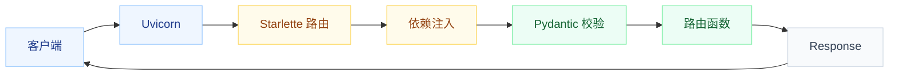

# FastAPI应用框架

> 这篇从 FastAPI 的 ASGI 组成讲起，经过环境与最小应用、路由、Pydantic 校验、依赖注入、异步与生命周期、中间件、项目结构与测试、上线检查，最后落到一个可测试的任务 API。
>
> 学完能独立搭建分层清晰、带输入校验和统一错误处理、能用 pytest 验证的 FastAPI 服务。

## 一、FastAPI 的组成与适用边界

FastAPI 不是完整的 Web 框架，它在 Starlette 之上补了类型驱动的参数解析、Pydantic 校验和 OpenAPI 文档；理解这三层分工，才能判断问题出在路由、校验还是 ASGI 服务器。

| 层 | 负责 | 典型入口 |
|---|---|---|
| Starlette | ASGI（异步服务器网关接口）、路由、中间件、请求响应 | `Request`、`Response`、`Middleware` |
| Pydantic | 数据解析、校验、序列化 | `BaseModel`、`Field`、`ConfigDict` |
| FastAPI | 依赖注入、参数绑定、OpenAPI | `APIRouter`、`Depends`、`app` |
| Uvicorn | 监听端口、协议解析、进程管理 | `uvicorn app.main:app` |



### 1.1 sync def 与 async def

`async def` 路由运行在事件循环里，适合 `await` 数据库、HTTP、Redis 等 IO；`def` 路由由 Starlette 放进线程池，适合尚未异步化的同步驱动。

```python
@app.get("/sync")
def sync_route():
    return blocking_db_call()   # 在线程池执行，不阻塞事件循环

@app.get("/async")
async def async_route():
    return await async_db_call()  # 必须全程 await，不能调用同步驱动
```

在 `async def` 里调用 `requests.get()`、`time.sleep()`、同步 SQLAlchemy Session，会阻塞整个 worker 的事件循环，所有并发请求一起变慢。这类代码要么改成异步驱动，要么退回 `def` 路由。

### 1.2 什么时候不用 FastAPI

CPU 密集型任务（图像转码、加密批处理）不应放在 API 进程里，应交给独立 worker 或任务队列；只提供一个静态页面或极简回调时，Flask 或纯 ASGI 更轻。

FastAPI 的优势在“类型即契约”：请求体、查询参数、响应模型都能生成 OpenAPI，客户端和测试可以直接复用这些模型。

> 边界：FastAPI 不负责数据库事务、认证和任务调度。这些能力来自 SQLAlchemy、JWT 库和 Celery，框架只提供依赖注入把它们串起来。

## 二、安装与最小应用

这一章用 uv 建项目、装依赖、启动 Uvicorn，并确认 `/docs` 与健康检查可用。

### 2.1 安装

```bash
# macOS / Linux
curl -LsSf https://astral.sh/uv/install.sh | sh

# Windows PowerShell
powershell -ExecutionPolicy ByPass -c "irm https://astral.sh/uv/install.ps1 | iex"

uv init task-service
cd task-service
uv add "fastapi>=0.115" "uvicorn[standard]>=0.32"
```

| 系统 | 额外准备 | 说明 |
|---|---|---|
| Ubuntu 24.04+ | `sudo apt install python3.12-venv` | 使用系统 Python 时需要 |
| Rocky/CentOS 9+ | `sudo dnf install python3.12` | 或 `uv python install 3.12` |
| macOS | 无 | uv 会管理独立解释器 |
| Windows | PowerShell 5.1+ | 路径分隔符不影响命令 |

### 2.2 最小应用

```python
# app/main.py
from fastapi import FastAPI

app = FastAPI(title="Task API", version="1.0.0")


@app.get("/health")
def health() -> dict[str, str]:
    return {"status": "ok"}
```

```bash
uv run uvicorn app.main:app --reload --port 8000
```

```text
INFO:     Uvicorn running on http://127.0.0.1:8000 (Press CTRL+C to quit)
INFO:     Application startup complete.
```

```bash
curl -s http://127.0.0.1:8000/health
curl -s http://127.0.0.1:8000/openapi.json | head -c 120
```

```text
{"status":"ok"}
{"openapi":"3.1.0","info":{"title":"Task API","version":"1.0.0"}
```

浏览器打开 `http://127.0.0.1:8000/docs` 可以看到 Swagger UI，`/redoc` 是另一套文档视图。

### 2.3 版本基线

| 组件 | 基线 | 说明 |
|---|---|---|
| Python | 3.12+ | 3.13 已验证 |
| FastAPI | 0.115+ | 本文写法兼容 0.115–0.162 |
| Pydantic | 2.9+ | 只用 v2 API |
| Uvicorn | 0.32+ | 生产可用 `--workers` |
| pytest | 8.x | 测试单独安装 |

> 边界：`--reload` 只用于开发，它会启动文件监听进程；生产用固定 worker 数，并由进程管理器负责重启。

## 三、路由与请求响应

路由层只做三件事：把 HTTP 输入绑定到函数参数、声明输出形状、把业务异常翻译成状态码。

### 3.1 APIRouter 与前缀

```python
# app/api/tasks.py
from fastapi import APIRouter

router = APIRouter(prefix="/api/v1/tasks", tags=["tasks"])


@router.get("")
def list_tasks() -> list[dict[str, object]]:
    return []
```

```python
# app/main.py
from app.api.tasks import router

app.include_router(router)
```

`prefix` 统一版本前缀，`tags` 决定 OpenAPI 分组。版本号放在 URL 里，比放在 Header 更容易被网关和日志识别。

### 3.2 参数来源

| 位置 | 写法 | 示例 |
|---|---|---|
| 路径 | 函数参数名与 `{name}` 一致 | `/tasks/{task_id}` |
| 查询 | 非路径的简单类型参数 | `?status=todo&limit=20` |
| 请求体 | Pydantic 模型参数 | JSON body |
| 请求头 | `Annotated[str, Header()]` | `X-Request-ID` |
| Cookie | `Annotated[str, Cookie()]` | 会话标识 |

```python
from typing import Annotated
from fastapi import Header, Path, Query


@router.get("/{task_id}")
def get_task(
    task_id: Annotated[int, Path(ge=1)],
    verbose: Annotated[bool, Query()] = False,
    request_id: Annotated[str | None, Header()] = None,
):
    return {"id": task_id, "verbose": verbose, "request_id": request_id}
```

路径参数默认必填，查询参数给默认值后可选；`Path(ge=1)`、`Query(le=100)` 把边界写进契约，非法值在进入函数前就返回 422。

### 3.3 状态码与错误

```python
from fastapi import HTTPException, status

@router.post("", status_code=status.HTTP_201_CREATED)
def create_task(payload: TaskCreate):
    if not payload.title.strip():
        raise HTTPException(status_code=422, detail="title cannot be blank")
    return service.create(payload)
```

`HTTPException` 的 `detail` 会进入 `{"detail": ...}` 响应；认证失败要带 `WWW-Authenticate` 头，否则客户端不知道用哪种认证方式。

### 3.4 路由顺序与尾斜杠

```python
@router.get("/stats")          # 必须放在 /{task_id} 前面
def stats(): ...

@router.get("/{task_id}")      # 否则 stats 会被当成 task_id，返回 422
def get_task(task_id: int): ...
```

静态路径先注册，动态路径后注册。`/tasks` 与 `/tasks/` 被视为不同路径，FastAPI 默认返回 307 重定向；客户端要跟随重定向，或者统一约定不带尾斜杠。

> 边界：`response_model` 会过滤未声明的字段，但不会改变数据库查询；敏感字段应在查询层就不取，而不是依赖序列化时剔除。

## 四、Pydantic 模型与校验

Pydantic 模型是 API 的输入输出契约；请求模型、响应模型和数据库模型要分开，避免把密码哈希、内部状态暴露给客户端。

### 4.1 字段约束

```python
from pydantic import BaseModel, ConfigDict, Field


class TaskCreate(BaseModel):
    model_config = ConfigDict(extra="forbid")  # 拼错的字段直接报错，避免静默忽略

    title: str = Field(min_length=1, max_length=80)
    priority: int = Field(default=3, ge=1, le=5)


class TaskRead(BaseModel):
    model_config = ConfigDict(from_attributes=True)  # 允许从 ORM 对象或普通对象读取属性

    id: int
    title: str
    priority: int
    status: str
```

`extra="forbid"` 适合内部 API；公开 API 若需要向前兼容，可保留默认的 `ignore`，但要记录未知字段。

### 4.2 自定义校验

```python
from datetime import date

from pydantic import field_validator, model_validator


class DateRange(BaseModel):
    start: date
    end: date

    @field_validator("start", "end")
    @classmethod
    def not_future(cls, value: date) -> date:
        if value > date.today():
            raise ValueError("date cannot be in the future")
        return value

    @model_validator(mode="after")
    def check_order(self):
        if self.end < self.start:
            raise ValueError("end must be after start")
        return self
```

字段校验器处理单字段，模型校验器处理跨字段。校验器只做数据规则，不查数据库、不发消息；需要查库的唯一性校验放在服务层，并返回 409。

### 4.3 422 响应形状

```json
{
  "detail": [
    {
      "type": "string_too_short",
      "loc": ["body", "title"],
      "msg": "String should have at least 1 character",
      "input": ""
    }
  ]
}
```

`loc` 给出错误位置，`type` 适合客户端做机器判断，`msg` 面向开发者。不要把所有校验错误都改成 400，422 表示“格式正确但语义不合法”，网关和客户端会区别处理。

### 4.4 输入输出模型分离

| 模型 | 用途 | 包含字段 |
|---|---|---|
| `TaskCreate` | 创建请求 | title、priority |
| `TaskUpdate` | 局部更新 | 全部可选 |
| `TaskRead` | 响应 | id、status、created_at |
| `TaskInDB` | 内部持久化 | 加 owner_id、deleted_at |

一个模型贯穿所有层，最终会把 `password_hash` 或 `is_admin` 带进响应。分离模型多写几个类，但字段暴露范围可审计。

> 边界：`from_attributes=True` 只改变读取来源，字段仍按模型类型校验和转换；ORM 的 `Decimal`、`datetime` 要确认序列化格式符合客户端约定。

## 五、依赖注入

依赖注入把“取数据库 Session、当前用户、租户、分页参数”从路由函数里抽出来，测试时可以整体替换。

### 5.1 Depends 与 Annotated

```python
from typing import Annotated
from fastapi import Depends


def get_repo() -> TaskRepository:
    return repo


Repo = Annotated[TaskRepository, Depends(get_repo)]


@router.get("")
def list_tasks(repo: Repo):
    return repo.list()
```

`Annotated` 把类型和依赖写在一起，路由签名可读，也方便复用类型别名。

### 5.2 带 yield 的依赖

```python
from collections.abc import Iterator


def get_session() -> Iterator[Session]:
    with SessionLocal.begin() as session:  # 请求结束提交，异常回滚
        yield session
```

`yield` 之前的代码在进入路由前执行，之后的代码在响应发送后执行；退出阶段再抛异常已经改不了响应，提交失败要靠日志和补偿处理。数据库 Session、临时文件、锁都适合这种生命周期；不要在 `finally` 里吞掉异常。

### 5.3 子依赖与类依赖

```python
def get_current_user(token: Annotated[str, Depends(oauth2_scheme)]) -> User:
    return decode_user(token)


def get_admin(user: Annotated[User, Depends(get_current_user)]) -> User:
    if user.role != "admin":
        raise HTTPException(status_code=403, detail="admin required")
    return user
```

依赖可以嵌套，FastAPI 按拓扑顺序解析并在同一请求内缓存结果；`get_current_user` 被多个依赖引用时只执行一次。

### 5.4 测试替换

```python
app.dependency_overrides[get_repo] = lambda: FakeRepo()
```

覆盖只影响当前 `app` 实例，测试结束要清理：

```python
app.dependency_overrides.clear()
```

> 边界：依赖缓存按请求生效，不能用来跨请求缓存用户或数据库连接；跨请求缓存用 Redis 或应用级单例。

## 六、异步、生命周期与中间件

这一章处理进程级资源、请求级横切逻辑和后台任务，三者混在一起最容易出现“连接没关、日志没 ID、异常没兜底”。

### 6.1 lifespan 管理连接池

```python
from contextlib import asynccontextmanager


@asynccontextmanager
async def lifespan(app: FastAPI):
    app.state.redis = await create_redis_pool()
    yield
    await app.state.redis.close()


app = FastAPI(lifespan=lifespan)
```

`lifespan` 在应用启动时执行一次，关闭时释放连接池；不要用模块级全局变量在 import 时连数据库，测试导入模块就会建立真实连接。

### 6.2 中间件顺序

Starlette 的中间件是栈：后添加的在外层。请求先经过最外层，再逐层进入路由；顺序错了会出现“错误响应没有 CORS 头”或“日志里拿不到 request_id”。

请求 ID 中间件：

```python
@app.middleware("http")
async def request_id(request: Request, call_next):
    request_id = request.headers.get("X-Request-ID", uuid4().hex)
    request.state.request_id = request_id
    response = await call_next(request)
    response.headers["X-Request-ID"] = request_id
    return response
```

CORS 最后注册，才处于最外层，错误响应才能带跨域头：

```python
from fastapi.middleware.cors import CORSMiddleware

app.add_middleware(
    CORSMiddleware,
    allow_origins=["https://app.example.com"],  # 生产不要用 * 配合凭证
    allow_methods=["GET", "POST", "PATCH"],
    allow_headers=["Authorization", "Content-Type", "X-Request-ID"],
)
```

### 6.3 异常处理

```python
@app.exception_handler(ValueError)
async def value_error_handler(request: Request, exc: ValueError):
    return JSONResponse(
        status_code=409,
        content={"detail": str(exc), "request_id": request.state.request_id},
    )
```

业务异常统一转成稳定结构，客户端不需要解析 Python 异常文本。未捕获异常交给默认 500，但要在日志里记录堆栈和 request_id。

### 6.4 后台任务与队列

```python
@router.post("/reports", status_code=202)
def create_report(payload: ReportIn, background: BackgroundTasks):
    background.add_task(send_email, payload.email)
    return {"status": "accepted"}
```

`BackgroundTasks` 与请求同进程，进程重启会丢任务，也没有重试；发邮件、生成报表这类需要可靠性的任务交给 Celery，API 只返回任务 ID。

> 边界：异步路由里不要用 `time.sleep()`；需要限流、重试、熔断时引入对应库，不要在一个中间件里手写所有逻辑。

## 七、项目结构与测试

项目结构决定改动一个功能要碰几个文件；按“接口层、服务层、数据层”分开，路由函数只做参数绑定和响应组装。

### 7.1 目录结构

```text
task-service/
├── pyproject.toml
├── app/
│   ├── main.py              # 应用装配、lifespan、中间件
│   ├── settings.py          # pydantic-settings 配置
│   ├── api/
│   │   └── tasks.py         # 路由与状态码
│   ├── schemas.py           # 请求/响应模型
│   ├── repository.py        # 数据访问
│   └── dependencies.py      # 依赖提供者
└── tests/
    └── test_tasks.py
```

小项目不必强行拆 service 层；当路由函数超过 30 行、开始出现事务和外部调用时，再把业务移到 service。

### 7.2 配置

```python
from pydantic_settings import BaseSettings, SettingsConfigDict


class Settings(BaseSettings):
    model_config = SettingsConfigDict(env_file=".env", extra="ignore")

    database_url: str = "sqlite:///./tasks.db"
    log_level: str = "INFO"


settings = Settings()
```

环境变量优先级高于 `.env`，`.env` 不提交仓库；配置项缺失时启动即失败，比运行到一半才报错好。

### 7.3 TestClient

```python
from fastapi.testclient import TestClient
from app.main import app


def test_create_and_complete():
    with TestClient(app) as client:          # with 触发 lifespan
        created = client.post("/api/v1/tasks", json={"title": "写周报"})
        assert created.status_code == 201
        task_id = created.json()["id"]

        done = client.patch(f"/api/v1/tasks/{task_id}/complete")
        assert done.json()["status"] == "done"


def test_blank_title_rejected():
    with TestClient(app) as client:
        response = client.post("/api/v1/tasks", json={"title": ""})
        assert response.status_code == 422
```

```bash
uv add --dev "pytest>=8.3"
uv run pytest -q
```

```text
..                                                                       [100%]
2 passed in 0.18s
```

`TestClient` 直接调用 ASGI 应用，不经过真实网络；需要验证超时、连接池时，再用 `httpx.AsyncClient` 连接真实端口，或用 `ASGITransport` 做进程内异步测试。

### 7.4 异步测试

```python
import pytest
from httpx import ASGITransport, AsyncClient
from app.main import app


@pytest.fixture
def anyio_backend() -> str:
    return "asyncio"  # 只跑 asyncio，避免 anyio 默认再参数化一个未安装的 trio


@pytest.mark.anyio
async def test_health():
    transport = ASGITransport(app=app)
    async with AsyncClient(transport=transport, base_url="http://test") as client:
        response = await client.get("/health")
    assert response.json() == {"status": "ok"}
```

异步测试要装 `anyio`（自带 pytest 插件）或 `pytest-asyncio`；`ASGITransport` 不触发 `lifespan`，依赖启动资源的用例要用 `TestClient` 或 `asgi-lifespan` 包一层。只测纯函数时不需要起应用。

> 边界：测试共享同一个进程内仓库会互相污染；每个测试用 fixture 重置状态，或给应用挂独立数据库。

## 八、常见故障与上线检查

现场问题先看状态码和响应体，再看 Uvicorn 日志；状态码已经能区分参数错误、认证失败和服务端异常。

| 现象 | 常见原因 | 第一条命令 |
|---|---|---|
| 422 | 请求体字段缺失或类型不符 | 看 `detail[0].loc` |
| 307 | 尾斜杠不一致 | `curl -i` 看 `Location` |
| 405 | 方法没注册 | 查 `/openapi.json` 的 paths |
| CORS 报错 | 中间件顺序或 origin 未配置 | 看响应是否有 `access-control-allow-origin` |
| 接口整体变慢 | async 路由里调同步 IO | `py-spy dump --pid <pid>` |
| 启动即退出 | 配置缺失、端口占用 | `uvicorn ... --log-level debug` |

上线检查：

- 关闭 `--reload`，worker 数与 CPU/连接池匹配；
- `/health/live` 与 `/health/ready` 分开，就绪检查覆盖数据库和缓存；
- 请求体大小、超时、CORS 白名单在网关和应用两层都配置；
- OpenAPI 不暴露内部字段，生产可关闭 `/docs` 或加访问控制；
- 日志带 request_id，异常带堆栈，敏感字段脱敏。

## 九、最佳实践案例

### 9.1 案例背景

一个 4 人小组要为一个内部工具提供任务 API：创建任务、按状态分页查询、标记完成。前端是 Vue 3，后端只有这一组接口，预计日请求 2 万次。

约束：两周上线；团队没有专职运维；需要能本地一键跑、CI 能跑测试；后续要接数据库和登录。现状是 Flask 单体脚本，参数靠手写 `if` 校验，错误格式不统一。

目标是做出一个分层最小服务：Pydantic 校验输入、依赖注入提供仓库、统一 404/422 响应、请求 ID 可追踪，并用 pytest 覆盖核心路径。

### 9.2 案例实操

```text
task-service/
├── app/
│   ├── __init__.py
│   ├── main.py
│   ├── schemas.py
│   ├── repository.py
│   ├── dependencies.py
│   └── api/
│       ├── __init__.py
│       └── tasks.py
└── tests/
    └── test_tasks.py
```

`app/schemas.py`：

```python
from datetime import datetime
from typing import Literal

from pydantic import BaseModel, ConfigDict, Field


class TaskCreate(BaseModel):
    title: str = Field(min_length=1, max_length=80)
    priority: int = Field(default=3, ge=1, le=5)


class TaskRead(BaseModel):
    model_config = ConfigDict(from_attributes=True)

    id: int
    title: str
    priority: int
    status: Literal["todo", "done"]
    created_at: datetime
```

`app/repository.py`：

```python
from datetime import datetime, timezone
from itertools import count
from threading import Lock

from app.schemas import TaskCreate


class Task:
    def __init__(self, task_id: int, title: str, priority: int):
        self.id = task_id
        self.title = title
        self.priority = priority
        self.status = "todo"
        self.created_at = datetime.now(timezone.utc)


class TaskRepository:
    def __init__(self) -> None:
        self._items: dict[int, Task] = {}
        self._ids = count(1)
        self._lock = Lock()

    def create(self, payload: TaskCreate) -> Task:
        with self._lock:  # 进程内仓库也要防并发写，生产换成数据库事务
            task = Task(next(self._ids), payload.title, payload.priority)
            self._items[task.id] = task
            return task

    def list(self, status: str | None, limit: int, offset: int) -> list[Task]:
        with self._lock:
            rows = [t for t in self._items.values() if status is None or t.status == status]
            rows.sort(key=lambda t: t.id, reverse=True)
            return rows[offset:offset + limit]

    def complete(self, task_id: int) -> Task | None:
        with self._lock:
            task = self._items.get(task_id)
            if task is not None:
                task.status = "done"
            return task

    def clear(self) -> None:
        with self._lock:
            self._items.clear()
```

`app/dependencies.py`：

```python
from app.repository import TaskRepository

_repo = TaskRepository()


def get_repo() -> TaskRepository:
    return _repo
```

`app/api/tasks.py`：

```python
from typing import Annotated

from fastapi import APIRouter, Depends, HTTPException, Query, status

from app.dependencies import get_repo
from app.repository import Task, TaskRepository
from app.schemas import TaskCreate, TaskRead

router = APIRouter(prefix="/api/v1/tasks", tags=["tasks"])


@router.post("", response_model=TaskRead, status_code=status.HTTP_201_CREATED)
def create_task(
    payload: TaskCreate,
    repo: Annotated[TaskRepository, Depends(get_repo)],
) -> Task:
    return repo.create(payload)


@router.get("", response_model=list[TaskRead])
def list_tasks(
    repo: Annotated[TaskRepository, Depends(get_repo)],
    task_status: Annotated[str | None, Query(alias="status")] = None,
    limit: Annotated[int, Query(ge=1, le=100)] = 20,
    offset: Annotated[int, Query(ge=0)] = 0,
) -> list[Task]:
    return repo.list(task_status, limit, offset)


@router.patch("/{task_id}/complete", response_model=TaskRead)
def complete_task(
    task_id: int,
    repo: Annotated[TaskRepository, Depends(get_repo)],
) -> Task:
    task = repo.complete(task_id)
    if task is None:
        raise HTTPException(status_code=404, detail="task not found")
    return task
```

`app/main.py`：

```python
from contextlib import asynccontextmanager
from uuid import uuid4

from fastapi import FastAPI, Request
from fastapi.responses import JSONResponse

from app.api.tasks import router
from app.dependencies import get_repo
from app.schemas import TaskCreate


@asynccontextmanager
async def lifespan(app: FastAPI):
    get_repo().clear()
    get_repo().create(TaskCreate(title="阅读 FastAPI 文档", priority=1))  # 一条种子数据，便于 curl 验证
    yield
    get_repo().clear()


app = FastAPI(title="Task API", version="1.0.0", lifespan=lifespan)


@app.middleware("http")
async def request_id_middleware(request: Request, call_next):
    request_id = request.headers.get("X-Request-ID", uuid4().hex)
    request.state.request_id = request_id
    response = await call_next(request)
    response.headers["X-Request-ID"] = request_id
    return response


@app.exception_handler(ValueError)
async def value_error_handler(request: Request, exc: ValueError):
    return JSONResponse(
        status_code=409,
        content={"detail": str(exc), "request_id": request.state.request_id},
    )


app.include_router(router)
```

`tests/test_tasks.py`：

```python
from fastapi.testclient import TestClient

from app.main import app


def test_create_and_complete():
    with TestClient(app) as client:
        created = client.post("/api/v1/tasks", json={"title": "写周报", "priority": 2})
        assert created.status_code == 201
        task_id = created.json()["id"]

        done = client.patch(f"/api/v1/tasks/{task_id}/complete")
        assert done.status_code == 200
        assert done.json()["status"] == "done"


def test_validation_error():
    with TestClient(app) as client:
        response = client.post("/api/v1/tasks", json={"title": ""})
        assert response.status_code == 422
        assert response.json()["detail"][0]["loc"] == ["body", "title"]
```

启动与验证：

```bash
uv run uvicorn app.main:app --port 8000
```

```bash
curl -s -X POST http://127.0.0.1:8000/api/v1/tasks \
  -H 'content-type: application/json' \
  -d '{"title":"写周报","priority":2}'
```

```text
{"id":2,"title":"写周报","priority":2,"status":"todo","created_at":"2026-11-13T02:54:18.329749Z"}
```

```bash
curl -s "http://127.0.0.1:8000/api/v1/tasks?status=todo&limit=10"
curl -s -X PATCH http://127.0.0.1:8000/api/v1/tasks/2/complete
curl -s -X PATCH http://127.0.0.1:8000/api/v1/tasks/999/complete
```

```text
[{"id":2,"title":"写周报","priority":2,"status":"todo","created_at":"..."},
 {"id":1,"title":"阅读 FastAPI 文档","priority":1,"status":"todo","created_at":"..."}]
{"id":2,"title":"写周报","priority":2,"status":"done","created_at":"..."}
{"detail":"task not found"}
```

```bash
uv run pytest -q
```

```text
..                                                                       [100%]
2 passed in 0.21s
```

迁移到生产时只替换仓库实现：`TaskRepository` 改成基于 SQLAlchemy Session 的类，路由、模型和测试依赖不变。数据库事务、连接池和迁移分别由 SQLAlchemy 与 Alembic 负责。

### 9.3 案例结果

接口从手写校验改为 Pydantic 模型后，非法请求在进入业务前返回 422，错误结构稳定为 `detail[].loc/msg/type`；列表接口通过 `limit/offset` 限制单次返回，默认 20 条、最大 100 条。示例环境本地测试 2 个用例全部通过，TestClient 100 次请求的 P95 约 2 ms（进程内仓库，不含网络与数据库）。

失败模式与复盘：

- 仓库是进程内单例，多 worker 之间数据不共享；上生产必须换数据库，测试也要用独立事务隔离。
- `Query(alias="status")` 让 Python 参数避开与 `status` 模块重名，但 OpenAPI 仍暴露为 `status`，客户端无需感知。
- 请求 ID 只在应用内生成，网关若已生成要透传 `X-Request-ID`，否则链路追踪会断。
- 示例没有鉴权；接入登录后把用户作为依赖注入，仓库查询必须带 `tenant_id` 或 `owner_id`，不能只按任务 ID 查。
