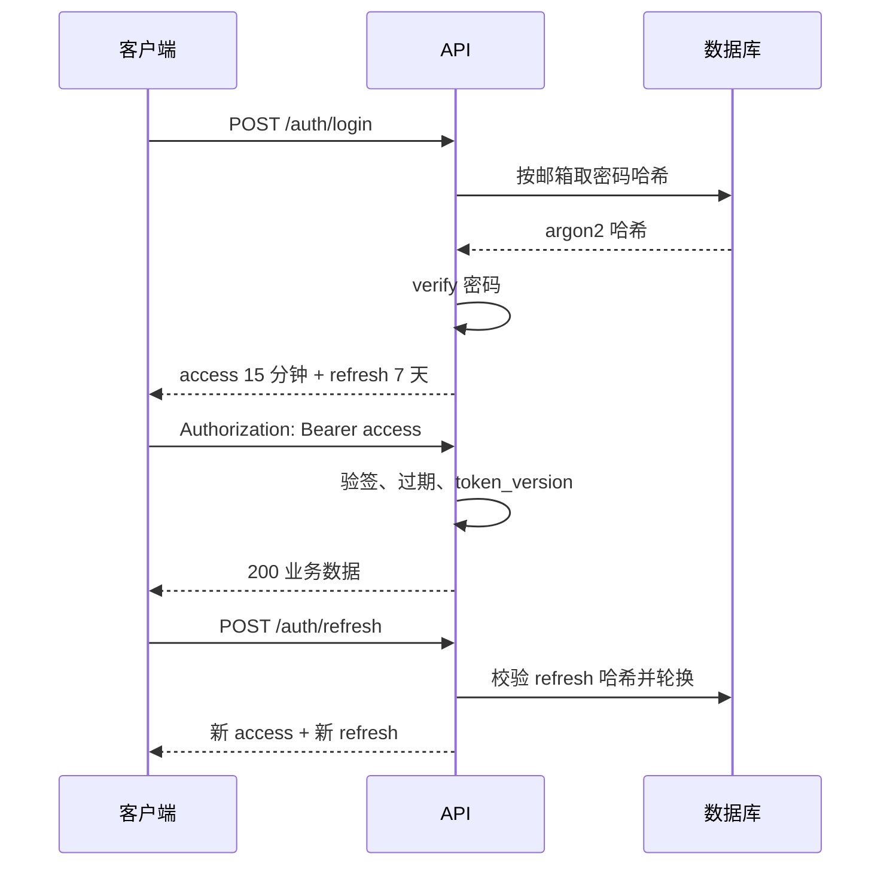

# FastAPI认证与授权

> 这篇从认证与授权的区别讲起，经过密码存储、JWT 签发校验、OAuth2 依赖、角色权限、刷新轮换与登出、常见漏洞与排障，最后落到一个多租户 SaaS 的完整鉴权服务。
>
> 学完能独立实现注册、登录、访问令牌、刷新令牌、角色校验和全端登出，并能识别算法混淆、令牌泄露和越权访问。

## 一、认证与授权的边界

认证回答“是谁”，授权回答“能做什么”；两者失败的状态码不同：未认证返回 401，已认证但无权限返回 403。

把 403 写成 401 会让客户端反复跳登录页；把 401 写成 403 会让用户以为账号被禁用。接口契约要先固定这两个语义。



### 1.1 会话 Cookie 与令牌

| 方式 | 状态存放 | 优点 | 风险 |
|---|---|---|---|
| 服务端 Session | 服务端存储 | 可即时吊销 | 多实例要共享存储 |
| JWT Access | 客户端持有 | 无状态、跨服务 | 到期前难撤销 |
| Refresh Token | 数据库/Redis | 可轮换、可吊销 | 存储泄露等于长期入口 |

JWT 不是加密，只是签名。任何拿到令牌的人都能读取 payload，因此不能放手机号、身份证号、内部角色清单等敏感信息。

### 1.2 OAuth2 密码模式的位置

`OAuth2PasswordRequestForm` 对应 OAuth2 的 Resource Owner Password Credentials 流程，只适用于第一方应用（自家 App、自家前端）。第三方登录用 Authorization Code + PKCE，不能把用户名密码交给第三方页面。

FastAPI 的 `/docs` 的 Authorize 按钮默认走 `tokenUrl`，用密码模式能把 Swagger 调试串起来；这不代表密码模式适合所有场景。

### 1.3 令牌类型

| 令牌 | 生命周期 | 存放 | 用途 |
|---|---|---|---|
| Access Token | 5–15 分钟 | 内存或 HttpOnly Cookie | 调用业务接口 |
| Refresh Token | 7–30 天 | HttpOnly Cookie 或安全存储 | 换新 access |
| ID Token | 与登录会话一致 | 前端 | 展示身份，不用于授权 |

Access 短、Refresh 长，是“泄露影响可控”和“用户体验”之间的折中。Refresh 必须可吊销，否则长期有效等于永久后门。

> 边界：JWT 适合服务间无状态校验，不适合需要秒级撤销的高危操作；转账、改密等操作要额外校验会话或二次认证。

## 二、安装与最小认证闭环

这一章装依赖、生成密钥、跑通“登录发令牌、带令牌访问受保护接口”的最小闭环。

### 2.1 安装

```bash
uv add "fastapi>=0.115" "uvicorn[standard]>=0.32" \
  "pyjwt>=2.9" "pwdlib[argon2]>=0.2" "python-multipart>=0.0.9"
```

| 包 | 作用 | 版本基线 |
|---|---|---|
| `pyjwt` | JWT 签发与校验 | 2.9+ |
| `pwdlib[argon2]` | Argon2id 密码哈希 | 0.2+ |
| `python-multipart` | 解析登录表单 | 0.0.9+ |
| `fastapi` | Web 框架与 OAuth2 工具 | 0.115+ |

`pwdlib` 取代了停更的 `passlib`；`passlib` 与新版 `bcrypt` 的兼容问题在 2024 年后已不适合新项目。Windows 用 PowerShell 安装 uv，macOS 用 `brew install uv` 或脚本，Ubuntu 24.04 装 `python3.12-venv`，Rocky 9 装 `python3.12`；依赖命令三端一致。

### 2.2 生成密钥

```bash
openssl rand -hex 32
```

```text
9f2c7e1a4b8d3c6f0a5e2d9b7c4a1f8e6d3b0c9a7f4e2d1b8c5a3f0e9d6b4c2a
```

密钥放进环境变量 `JWT_SECRET`，至少 32 字节；不要提交仓库，不要在日志里打印。多实例部署必须共享同一密钥，否则 A 实例签的令牌 B 实例验不过。

### 2.3 最小闭环

```python
# app/main.py —— 最小示例，完整版见第九章
import os
from datetime import datetime, timedelta, timezone

import jwt
from fastapi import Depends, FastAPI, HTTPException
from fastapi.security import OAuth2PasswordBearer, OAuth2PasswordRequestForm
from pydantic import BaseModel

SECRET = os.environ["JWT_SECRET"]
ALGORITHM = "HS256"
oauth2_scheme = OAuth2PasswordBearer(tokenUrl="/auth/login")
app = FastAPI()


class Token(BaseModel):
    access_token: str
    token_type: str = "bearer"


@app.post("/auth/login", response_model=Token)
def login(form: OAuth2PasswordRequestForm = Depends()):
    if form.username != "demo" or form.password != "demo-password":
        raise HTTPException(status_code=401, detail="bad credentials")
    now = datetime.now(timezone.utc)
    token = jwt.encode(
        {"sub": "1", "exp": now + timedelta(minutes=15), "iat": now},
        SECRET,
        algorithm=ALGORITHM,
    )
    return Token(access_token=token)


@app.get("/users/me")
def me(token: str = Depends(oauth2_scheme)):
    try:
        payload = jwt.decode(token, SECRET, algorithms=[ALGORITHM])
    except jwt.PyJWTError as exc:
        raise HTTPException(status_code=401, detail="invalid token") from exc
    return {"user_id": payload["sub"]}
```

```bash
export JWT_SECRET="$(openssl rand -hex 32)"
uv run uvicorn app.main:app --port 8000
```

```bash
curl -s -X POST http://127.0.0.1:8000/auth/login \
  -d 'username=demo&password=demo-password'
```

```text
{"access_token":"eyJhbGciOiJIUzI1NiIsInR5cCI6IkpXVCJ9...","token_type":"bearer"}
```

```bash
TOKEN="<上一步的 access_token>"
curl -s http://127.0.0.1:8000/users/me -H "Authorization: Bearer $TOKEN"
```

```text
{"user_id":"1"}
```

### 2.4 版本基线

| 组件 | 基线 | 说明 |
|---|---|---|
| Python | 3.12+ | 3.13 已验证 |
| FastAPI | 0.115+ | 依赖注入与 OAuth2 工具稳定 |
| PyJWT | 2.9+ | 只用 `jwt.encode/decode` |
| pwdlib | 0.2+ | 默认 Argon2id |

> 边界：示例把用户写死在代码里，只用于验证链路；真实系统必须查数据库，且密码只存哈希。

## 三、密码存储

密码只能存不可逆哈希，并使用带盐、可调成本的算法；Argon2id 是当前新项目的默认选择。

### 3.1 Argon2id 哈希

```python
from pwdlib import PasswordHash

password_hash = PasswordHash.recommended()  # Argon2id，参数随库版本更新

stored = password_hash.hash("correct horse battery staple")
print(stored)
print(password_hash.verify("correct horse battery staple", stored))
print(password_hash.verify("wrong", stored))
```

```text
$argon2id$v=19$m=65536,t=3,p=4$c29tZXNhbHQ$...
True
False
```

哈希串自带算法、参数和盐，验证时不需要另存盐。参数调高会增加单次验证耗时，登录接口的 CPU 成本要纳入容量评估。

### 3.2 不存在的用户也要验证一次

```python
DUMMY_HASH = password_hash.hash("dummy-password-for-timing")


def authenticate(email: str, password: str):
    user = find_user(email)
    if user is None:
        password_hash.verify(password, DUMMY_HASH)  # 让耗时接近真实用户，降低枚举信号
        return None
    if not password_hash.verify(password, user.password_hash):
        return None
    return user
```

只判断“用户不存在”就立即返回，攻击者可以用响应时间区分邮箱是否注册。统一走一次哈希验证，再返回同样的 401。

### 3.3 存储与策略

```sql
CREATE TABLE users (
    id BIGSERIAL PRIMARY KEY,
    email TEXT NOT NULL UNIQUE,
    password_hash TEXT NOT NULL,
    role TEXT NOT NULL DEFAULT 'member',
    tenant_id BIGINT NOT NULL,
    token_version INTEGER NOT NULL DEFAULT 0,
    created_at TIMESTAMPTZ NOT NULL DEFAULT now()
);
```

- 密码长度至少 10 位，上限 128 位；Argon2 没有 bcrypt 的 72 字节截断问题；
- 不限制特殊字符组合，长度和泄露检查比复杂度规则有效；
- 哈希在服务端做，客户端哈希不能替代 TLS；
- 改密成功要递增 `token_version`，让旧令牌全部失效。

> 边界：Argon2 参数不是越高越好。单次 200 ms 会让登录接口在压测时先打满 CPU，按机器核数和登录 QPS 实测后再定。

## 四、JWT 的签发与校验

JWT（JSON Web Token）由 Header、Payload、Signature 三段 Base64URL 组成，服务端只验证签名和声明，不依赖会话存储。

### 4.1 声明设计

| 声明 | 含义 | 建议 |
|---|---|---|
| `sub` | 用户 ID | 用不可变主键，不用邮箱 |
| `exp` | 过期时间 | Access 15 分钟，Refresh 7 天 |
| `iat` | 签发时间 | 用于审计和时钟判断 |
| `jti` | 令牌唯一 ID | 用于吊销和重放检测 |
| `iss` / `aud` | 签发方 / 接收方 | 多服务必须校验 |
| `ver` | 用户令牌版本 | 改密、登出时递增 |

自定义声明按业务加，例如 `tenant`、`role`；但授权判断要以数据库为准，声明只用于减少查询或前端展示。

### 4.2 签发

```python
from datetime import datetime, timedelta, timezone
from uuid import uuid4

import jwt

now = datetime.now(timezone.utc)
access = jwt.encode(
    {
        "sub": "42",
        "tenant": 7,
        "role": "admin",
        "ver": 3,
        "type": "access",
        "jti": uuid4().hex,
        "iat": now,
        "exp": now + timedelta(minutes=15),
        "iss": "https://api.example.com",
        "aud": "example-web",
    },
    SECRET,
    algorithm="HS256",
)
```

时间统一用 UTC aware datetime；PyJWT 会自动转成 Unix 时间戳。不要用本地时间或 naive datetime，否则跨时区部署会提前或延后过期。

### 4.3 校验

```python
def decode_access(token: str) -> dict:
    try:
        return jwt.decode(
            token,
            SECRET,
            algorithms=["HS256"],          # 固定算法，禁止 none 和算法混淆
            audience="example-web",
            issuer="https://api.example.com",
            options={"require": ["exp", "iat", "sub", "jti"]},
            leeway=10,                      # 容忍 10 秒时钟偏差
        )
    except jwt.ExpiredSignatureError as exc:
        raise HTTPException(status_code=401, detail="token expired") from exc
    except jwt.PyJWTError as exc:
        raise HTTPException(status_code=401, detail="invalid token") from exc
```

`algorithms` 必须是列表且只包含预期算法。接受 `none` 或把 `algorithms` 设为用户可控，攻击者可以伪造无签名令牌。

### 4.4 对称与非对称

| 算法 | 适用 | 密钥管理 |
|---|---|---|
| HS256 | 单体或共享密钥的服务 | 所有服务持有同一密钥 |
| RS256 | 多服务、外部验证方 | 私钥签发，公钥验证 |
| EdDSA | 新系统、短签名 | 私钥签发，公钥验证 |

服务数量一多，HS256 的共享密钥会成为扩散面；用 RS256/EdDSA 把签发权集中到认证服务，业务服务只拿公钥。

> 边界：JWT payload 可被客户端解码，不能放密码、密钥、完整身份证号；需要保密的数据放服务端，令牌只放标识。

## 五、OAuth2 依赖与 401/403

FastAPI 的 `OAuth2PasswordBearer` 从 `Authorization: Bearer` 头取令牌，并在缺失时返回 401 和 `WWW-Authenticate` 头。

### 5.1 当前用户依赖

```python
from typing import Annotated
from fastapi import Depends
from fastapi.security import OAuth2PasswordBearer

oauth2_scheme = OAuth2PasswordBearer(tokenUrl="/auth/login")


def get_current_user(token: Annotated[str, Depends(oauth2_scheme)]) -> User:
    payload = decode_access(token)
    user = load_user(int(payload["sub"]))
    if user is None or payload["ver"] != user.token_version:
        raise HTTPException(
            status_code=401,
            detail="token revoked",
            headers={"WWW-Authenticate": "Bearer"},
        )
    return user


CurrentUser = Annotated[User, Depends(get_current_user)]
```

`tokenUrl` 让 Swagger 的 Authorize 弹窗知道去哪里换令牌；真实登录接口接收表单，不是 JSON。

### 5.2 401 与 403 的分工

```python
def require_admin(user: CurrentUser) -> User:
    if user.role != "admin":
        raise HTTPException(status_code=403, detail="admin role required")
    return user
```

| 状态码 | 含义 | 响应头 | 客户端动作 |
|---|---|---|---|
| 401 | 没登录、令牌无效或过期 | `WWW-Authenticate: Bearer` | 跳登录或刷新令牌 |
| 403 | 已登录但权限不足 | 无 | 提示无权限，不跳登录 |
| 404 | 资源不存在或无权查看 | 无 | 按不存在处理，避免枚举 |

资源级权限常把“无权查看”返回 404，避免攻击者通过 403/404 差异判断资源是否存在。

### 5.3 OAuth2 Scopes

```python
oauth2_scheme = OAuth2PasswordBearer(
    tokenUrl="/auth/login",
    scopes={"orders:read": "读取订单", "orders:write": "创建订单"},
)


def require_scope(scope: str):
    def checker(token: Annotated[str, Depends(oauth2_scheme)]) -> dict:
        payload = decode_access(token)
        if scope not in payload.get("scopes", []):
            raise HTTPException(status_code=403, detail=f"missing scope: {scope}")
        return payload
    return checker
```

Scopes 适合粗粒度 API 权限；细粒度资源归属仍要查数据库，不能只看令牌里的 `tenant`。

> 边界：依赖里不要做耗时操作。每次请求都查用户表可以接受；如果 QPS 很高，用短 TTL 缓存用户状态，并在改密/登出时主动失效。

## 六、角色与资源级授权

RBAC（基于角色的访问控制，Role-Based Access Control）把权限绑定到角色，再把角色分配给用户；资源级授权再叠加“这条数据属于谁”。

### 6.1 角色矩阵

| 角色 | 查看自己的任务 | 查看租户全部 | 管理成员 | 修改计费 |
|---|---|---|---|---|
| viewer | 是 | 否 | 否 | 否 |
| member | 是 | 否 | 否 | 否 |
| admin | 是 | 是 | 是 | 否 |
| owner | 是 | 是 | 是 | 是 |

小系统用 `users.role` 一列足够；角色超过 5 个、权限点超过 20 个时，拆成 `roles`、`permissions`、`role_permissions` 三张表，避免字符串散落在代码里。

### 6.2 角色依赖工厂

```python
def require_roles(*roles: str):
    def checker(user: CurrentUser) -> User:
        if user.role not in roles:
            raise HTTPException(status_code=403, detail="insufficient role")
        return user
    return checker


@router.get("/admin/users", dependencies=[Depends(require_roles("admin", "owner"))])
def list_users(): ...
```

路由装饰器上的 `dependencies` 只做校验，不传返回值；需要用户对象时把依赖写在函数参数里。

### 6.3 资源归属与租户隔离

```python
@router.get("/orders/{order_id}")
def get_order(order_id: int, user: CurrentUser, session: Session = Depends(get_session)):
    order = session.scalar(
        select(Order).where(
            Order.id == order_id,
            Order.tenant_id == user.tenant_id,  # 租户条件下推到 SQL，不依赖后续 if
        )
    )
    if order is None:
        raise HTTPException(status_code=404, detail="order not found")
    if user.role == "viewer" and order.owner_id != user.id:
        raise HTTPException(status_code=403, detail="not your order")
    return order
```

租户条件必须进查询，不能查出来再判断；后者容易在某个分支忘记 `return`，造成越权。

> 边界：前端隐藏按钮不是授权。每个写接口都要在服务端重新校验角色、租户和资源归属。

## 七、刷新、登出与令牌吊销

Access Token 到期前天然有效，吊销要靠短 TTL、`token_version` 或 denylist；Refresh Token 必须落库并支持轮换。

### 7.1 刷新轮换

```python
from hashlib import sha256

from fastapi import HTTPException


def rotate_refresh(old_token: str, conn) -> TokenPair:
    claims = decode_refresh(old_token)
    token_hash = sha256(old_token.encode()).hexdigest()
    row = conn.execute(
        "SELECT * FROM refresh_tokens WHERE token_hash = ?", (token_hash,)
    ).fetchone()
    if row is None:
        raise HTTPException(status_code=401, detail="unknown refresh token")
    if row["revoked"]:
        conn.execute("UPDATE refresh_tokens SET revoked = 1 WHERE user_id = ?", (row["user_id"],))
        conn.execute("UPDATE users SET token_version = token_version + 1 WHERE id = ?", (row["user_id"],))
        conn.commit()
        raise HTTPException(status_code=401, detail="refresh token reuse detected")
    conn.execute("UPDATE refresh_tokens SET revoked = 1 WHERE jti = ?", (row["jti"],))
    return issue_pair(conn, load_user(row["user_id"]))
```

每次刷新都作废旧 refresh，发新的一对令牌。旧 refresh 再次出现说明泄露，撤销该用户全部 refresh 并递增 `token_version`，让已签发的 access 也立即失效。

### 7.2 登出

```python
@router.post("/auth/logout")
def logout(user: CurrentUser, session: Session = Depends(get_session)):
    user.token_version += 1
    session.execute(
        update(RefreshToken)
        .where(RefreshToken.user_id == user.id, RefreshToken.revoked.is_(False))
        .values(revoked=True)
    )
    session.commit()
    return {"detail": "logged out on all devices"}
```

`token_version` 存在用户表，每次请求校验一次；代价是一次主键查询，换来“登出立即生效”。

### 7.3 存储位置

| 存储 | XSS | CSRF | 适用 |
|---|---|---|---|
| `localStorage` | 可被脚本读取 | 无 | 不推荐放 refresh |
| 内存变量 | 刷新即丢 | 无 | 短期 access |
| HttpOnly Cookie | 脚本不可读 | 需要 CSRF 防护 | 浏览器 refresh |
| 移动端 Keychain | 系统保护 | 无 | App |

浏览器方案常用“access 放内存、refresh 放 HttpOnly + Secure + SameSite=Lax Cookie”，并给刷新接口加 CSRF token 或自定义头校验。

### 7.4 Redis denylist 的取舍

需要秒级撤销单个 access、又不想每次查用户表时，可以把 `jti` 写入 Redis，TTL 设为 token 剩余寿命：

```text
SET revoked:jti:<jti> 1 EX <remaining_seconds>
```

代价是每个请求多一次 Redis 查询，且 Redis 故障会影响鉴权；小系统用 `token_version` 更简单。

> 边界：Refresh Token 的哈希存库，不存明文；数据库泄露时攻击者不能直接拿哈希换令牌。

## 八、常见漏洞与排障

令牌问题的根因集中在算法、密钥、过期和存储四处；先复现 401，再判断是签名、声明还是用户状态。

| 现象 | 常见原因 | 第一条命令 |
|---|---|---|
| 401 且无 `WWW-Authenticate` | 依赖没抛标准异常 | `curl -i` 看响应头 |
| 令牌刚签发就过期 | 服务器时钟偏差 | `date -u` 对比签发机 |
| 换环境后全部 401 | `JWT_SECRET` 不一致 | 对比各实例环境变量 |
| 刷新后旧令牌仍可用 | 没有轮换/吊销 | 查 `refresh_tokens.revoked` |
| 算法报错 | `algorithms` 未固定 | 检查 `jwt.decode` 参数 |
| 越权读到其他租户数据 | 查询漏 `tenant_id` | 看 SQL 的 `WHERE` |

高危清单：

- 接受 `alg=none` 或把 `algorithms` 设为用户可控；
- 密钥短于 32 字节、提交到仓库、在日志打印；
- 令牌没有 `exp`、`aud`、`iss`，或从不校验；
- 把 access 放 URL 查询串，被网关和浏览器历史记录；
- Refresh 永久有效、不轮换、不落库；
- 只在前端隐藏管理菜单，后端不校验角色。

> 边界：不要在生产令牌上使用在线解码网站。需要排查时在本地用 `jwt.decode(..., options={"verify_signature": False})` 只读 payload，且不要在工单里贴完整令牌。

## 九、最佳实践案例

### 9.1 案例背景

一个 B2B SaaS 有 40 个租户，角色分为 `admin` 和 `member`。现状是登录后发一个 24 小时有效的 JWT，登出只删前端 localStorage；员工离职后令牌仍可用，客户要求“一键下线所有设备”。

目标：access 15 分钟、refresh 7 天并轮换；登出立即失效；管理员只能看到本租户用户；密码用 Argon2id；接口返回统一的 401/403。约束：第一期不引入 Redis，使用 PostgreSQL；本地用 SQLite 复现。

### 9.2 案例实操

完整服务放在 `app/main.py`，依赖 `fastapi`、`pyjwt`、`pwdlib[argon2]`、`python-multipart`。

```python
# app/main.py —— 可直接运行：uv run uvicorn app.main:app --port 8000
from __future__ import annotations

import hashlib
import os
import sqlite3
from contextlib import asynccontextmanager, contextmanager
from datetime import datetime, timedelta, timezone
from typing import Annotated, Iterator
from uuid import uuid4

import jwt
from fastapi import Depends, FastAPI, HTTPException
from fastapi.security import OAuth2PasswordBearer, OAuth2PasswordRequestForm
from pydantic import BaseModel, ConfigDict, Field
from pwdlib import PasswordHash

DB_PATH = os.environ.get("AUTH_DB", "./auth.db")
SECRET = os.environ["JWT_SECRET"]
ALGORITHM = "HS256"
ISSUER = "auth-demo"
AUDIENCE = "auth-demo-api"
ACCESS_TTL = timedelta(minutes=15)
REFRESH_TTL = timedelta(days=7)

password_hash = PasswordHash.recommended()
DUMMY_HASH = password_hash.hash("dummy-password-for-timing")
oauth2_scheme = OAuth2PasswordBearer(tokenUrl="/auth/login")


def now() -> datetime:
    return datetime.now(timezone.utc)


@contextmanager
def db() -> Iterator[sqlite3.Connection]:
    conn = sqlite3.connect(DB_PATH)
    conn.row_factory = sqlite3.Row
    try:
        yield conn
        conn.commit()
    except Exception:
        conn.rollback()
        raise
    finally:
        conn.close()


def init_db() -> None:
    with db() as conn:
        conn.executescript(
            """
            CREATE TABLE IF NOT EXISTS users (
                id INTEGER PRIMARY KEY AUTOINCREMENT,
                email TEXT NOT NULL UNIQUE,
                password_hash TEXT NOT NULL,
                role TEXT NOT NULL DEFAULT 'member',
                tenant_id INTEGER NOT NULL,
                token_version INTEGER NOT NULL DEFAULT 0
            );
            CREATE TABLE IF NOT EXISTS refresh_tokens (
                jti TEXT PRIMARY KEY,
                user_id INTEGER NOT NULL,
                token_hash TEXT NOT NULL UNIQUE,
                expires_at TEXT NOT NULL,
                revoked INTEGER NOT NULL DEFAULT 0
            );
            """
        )


class RegisterIn(BaseModel):
    email: str = Field(pattern=r"^[^@\s]+@[^@\s]+\.[^@\s]+$")
    password: str = Field(min_length=10, max_length=128)
    tenant_id: int = Field(ge=1)


class UserOut(BaseModel):
    model_config = ConfigDict(from_attributes=True)

    id: int
    email: str
    role: str
    tenant_id: int


class TokenPair(BaseModel):
    access_token: str
    refresh_token: str
    token_type: str = "bearer"
    expires_in: int = 900


class RefreshIn(BaseModel):
    refresh_token: str


def public_user(row: sqlite3.Row) -> UserOut:
    return UserOut(id=row["id"], email=row["email"], role=row["role"],
                   tenant_id=row["tenant_id"])


def decode(token: str, expected_type: str) -> dict:
    try:
        payload = jwt.decode(
            token, SECRET, algorithms=[ALGORITHM], audience=AUDIENCE, issuer=ISSUER,
            options={"require": ["exp", "iat", "sub", "jti"]},
        )
    except jwt.PyJWTError as exc:
        raise HTTPException(status_code=401, detail="invalid or expired token",
                            headers={"WWW-Authenticate": "Bearer"}) from exc
    if payload.get("type") != expected_type:
        raise HTTPException(status_code=401, detail="wrong token type")
    return payload


def issue_pair(conn: sqlite3.Connection, user: sqlite3.Row) -> TokenPair:
    issued = now()
    refresh_jti = uuid4().hex
    access = jwt.encode(
        {"sub": str(user["id"]), "role": user["role"], "tenant": user["tenant_id"],
         "ver": user["token_version"], "type": "access", "jti": uuid4().hex,
         "iat": issued, "exp": issued + ACCESS_TTL, "iss": ISSUER, "aud": AUDIENCE},
        SECRET, algorithm=ALGORITHM,
    )
    refresh = jwt.encode(
        {"sub": str(user["id"]), "type": "refresh", "jti": refresh_jti,
         "iat": issued, "exp": issued + REFRESH_TTL, "iss": ISSUER, "aud": AUDIENCE},
        SECRET, algorithm=ALGORITHM,
    )
    conn.execute(
        "INSERT INTO refresh_tokens (jti, user_id, token_hash, expires_at) VALUES (?, ?, ?, ?)",
        (refresh_jti, user["id"], hashlib.sha256(refresh.encode()).hexdigest(),
         (issued + REFRESH_TTL).isoformat()),
    )
    return TokenPair(access_token=access, refresh_token=refresh)


def current_user(token: Annotated[str, Depends(oauth2_scheme)]) -> sqlite3.Row:
    payload = decode(token, "access")
    with db() as conn:
        user = conn.execute("SELECT * FROM users WHERE id = ?", (int(payload["sub"]),)).fetchone()
    if user is None or payload.get("ver") != user["token_version"]:
        raise HTTPException(status_code=401, detail="token revoked")
    return user


CurrentUser = Annotated[sqlite3.Row, Depends(current_user)]


def require_admin(user: CurrentUser) -> sqlite3.Row:
    if user["role"] != "admin":
        raise HTTPException(status_code=403, detail="admin role required")
    return user


@asynccontextmanager
async def lifespan(app: FastAPI):
    init_db()
    yield


app = FastAPI(title="Auth Demo", version="1.0.0", lifespan=lifespan)


@app.post("/auth/register", response_model=UserOut, status_code=201)
def register(payload: RegisterIn) -> UserOut:
    with db() as conn:
        if conn.execute("SELECT 1 FROM users WHERE email = ?", (payload.email,)).fetchone():
            raise HTTPException(status_code=409, detail="email already registered")
        cursor = conn.execute(
            "INSERT INTO users (email, password_hash, tenant_id) VALUES (?, ?, ?)",
            (payload.email, password_hash.hash(payload.password), payload.tenant_id),
        )
        row = conn.execute("SELECT * FROM users WHERE id = ?", (cursor.lastrowid,)).fetchone()
    return public_user(row)


@app.post("/auth/login", response_model=TokenPair)
def login(form: Annotated[OAuth2PasswordRequestForm, Depends()]) -> TokenPair:
    with db() as conn:
        user = conn.execute("SELECT * FROM users WHERE email = ?", (form.username,)).fetchone()
        if user is None:
            password_hash.verify(form.password, DUMMY_HASH)  # 对齐不存在用户的耗时
            raise HTTPException(status_code=401, detail="bad credentials")
        if not password_hash.verify(form.password, user["password_hash"]):
            raise HTTPException(status_code=401, detail="bad credentials")
        return issue_pair(conn, user)


@app.post("/auth/refresh", response_model=TokenPair)
def refresh(payload: RefreshIn) -> TokenPair:
    claims = decode(payload.refresh_token, "refresh")
    token_hash = hashlib.sha256(payload.refresh_token.encode()).hexdigest()
    with db() as conn:
        row = conn.execute("SELECT * FROM refresh_tokens WHERE token_hash = ?",
                           (token_hash,)).fetchone()
        if row is None:
            raise HTTPException(status_code=401, detail="unknown refresh token")
        if row["user_id"] != int(claims["sub"]):  # 签名有效但用户不匹配，按无效令牌处理
            raise HTTPException(status_code=401, detail="refresh token subject mismatch")
        if row["revoked"]:
            conn.execute("UPDATE refresh_tokens SET revoked = 1 WHERE user_id = ?",
                         (row["user_id"],))
            conn.execute("UPDATE users SET token_version = token_version + 1 WHERE id = ?",
                         (row["user_id"],))
            conn.commit()  # 先落库再抛异常，否则 contextmanager 的 rollback 会撤销吊销
            raise HTTPException(status_code=401, detail="refresh token reuse detected")
        conn.execute("UPDATE refresh_tokens SET revoked = 1 WHERE jti = ?", (row["jti"],))
        user = conn.execute("SELECT * FROM users WHERE id = ?", (int(claims["sub"]),)).fetchone()
        if user is None:
            raise HTTPException(status_code=401, detail="user not found")
        return issue_pair(conn, user)


@app.post("/auth/logout")
def logout(user: CurrentUser) -> dict[str, str]:
    with db() as conn:
        conn.execute("UPDATE users SET token_version = token_version + 1 WHERE id = ?",
                     (user["id"],))
        conn.execute("UPDATE refresh_tokens SET revoked = 1 WHERE user_id = ?", (user["id"],))
    return {"detail": "logged out on all devices"}


@app.get("/users/me", response_model=UserOut)
def me(user: CurrentUser) -> UserOut:
    return public_user(user)


@app.get("/admin/users", response_model=list[UserOut])
def admin_users(user: Annotated[sqlite3.Row, Depends(require_admin)]) -> list[UserOut]:
    with db() as conn:
        rows = conn.execute("SELECT * FROM users WHERE tenant_id = ? ORDER BY id",
                            (user["tenant_id"],)).fetchall()
    return [public_user(row) for row in rows]


@app.get("/users/{user_id}", response_model=UserOut)
def read_user(user_id: int, user: CurrentUser) -> UserOut:
    if user["role"] != "admin" and user["id"] != user_id:
        raise HTTPException(status_code=403, detail="cannot read other users")
    with db() as conn:
        row = conn.execute("SELECT * FROM users WHERE id = ? AND tenant_id = ?",
                           (user_id, user["tenant_id"])).fetchone()
    if row is None:
        raise HTTPException(status_code=404, detail="user not found")
    return public_user(row)
```

启动并注册管理员：

```bash
export JWT_SECRET="$(openssl rand -hex 32)"
uv run uvicorn app.main:app --port 8000
```

```bash
curl -s -X POST http://127.0.0.1:8000/auth/register \
  -H 'content-type: application/json' \
  -d '{"email":"admin@example.com","password":"AdminPass123!","tenant_id":7}'
```

```text
{"id":1,"email":"admin@example.com","role":"member","tenant_id":7}
```

```bash
# 第一期没有后台管理界面，运维用 SQL 提升首个管理员
sqlite3 auth.db "UPDATE users SET role='admin' WHERE email='admin@example.com';"

curl -s -X POST http://127.0.0.1:8000/auth/login \
  -d 'username=admin@example.com&password=AdminPass123!'
```

```text
{"access_token":"eyJhbGciOiJIUzI1NiIs...","refresh_token":"eyJhbGciOiJIUzI1NiIs...","token_type":"bearer","expires_in":900}
```

```bash
ACCESS="<access_token>"
REFRESH="<refresh_token>"

curl -s http://127.0.0.1:8000/users/me -H "Authorization: Bearer $ACCESS"
curl -s http://127.0.0.1:8000/admin/users -H "Authorization: Bearer $ACCESS"

# 轮换：旧 refresh 立即作废
curl -s -X POST http://127.0.0.1:8000/auth/refresh \
  -H 'content-type: application/json' -d "{\"refresh_token\":\"$REFRESH\"}"

# 再用旧 refresh，触发重用检测
curl -s -X POST http://127.0.0.1:8000/auth/refresh \
  -H 'content-type: application/json' -d "{\"refresh_token\":\"$REFRESH\"}"
```

```text
{"id":1,"email":"admin@example.com","role":"admin","tenant_id":7}
[{"id":1,"email":"admin@example.com","role":"admin","tenant_id":7}]
{"access_token":"...","refresh_token":"...","token_type":"bearer","expires_in":900}
{"detail":"refresh token reuse detected"}
```

登出后，同一 access 再访问 `/users/me` 返回 401：

```bash
curl -s -X POST http://127.0.0.1:8000/auth/logout -H "Authorization: Bearer $ACCESS"
curl -s -i http://127.0.0.1:8000/users/me -H "Authorization: Bearer $ACCESS" | head -1
```

```text
HTTP/1.1 401 Unauthorized
```

### 9.3 案例结果

示例环境为 SQLite、单进程 Uvicorn。登录签发 15 分钟 access 与 7 天 refresh；刷新轮换后旧 refresh 立即失效，重用检测会把该用户全部 refresh 置为 revoked 并递增 `token_version`，已签发的 access 也在下一次请求被拒绝。登出使同端所有 access 立即 401，满足“离职一键下线”。

失败模式与复盘：

- `users.token_version` 每次请求查库，QPS 很高时是额外主键查询；可以加 30 秒缓存，但登出后最多延迟 30 秒生效，安全等级要匹配业务。
- 刷新重用检测会误伤“客户端网络重试导致同一 refresh 提交两次”的场景；客户端要保证刷新请求串行，服务端可给极短的重试宽限。
- 角色从数据库读取，令牌里的 `role` 只用于展示；管理员被降级后，旧 access 不能继续调用管理接口。
- SQLite 的并发写入能力有限，生产换 PostgreSQL，并确认 `refresh_tokens.token_hash`、`users.email` 有唯一索引。
- `RegisterIn` 直接接受 `tenant_id` 只适合演示；生产注册必须由邀请码、域名或管理员操作确定租户，不能信任客户端传入的租户 ID。
- 第一期没有验证邮箱和登录限流；上线前要加验证码/限流、失败审计和密码泄露检查。
