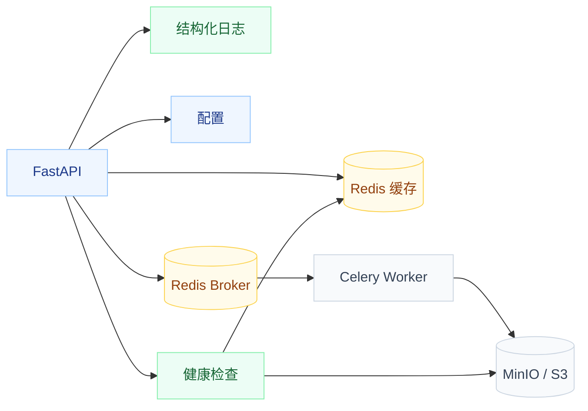

# Python常用组件

> 这篇从服务端组件的取舍讲起，经过工程骨架、结构化日志、配置、Redis 缓存、Celery 任务队列、S3 对象存储、健康检查和故障排查，最后落到一个报表导出服务的完整集成案例。
>
> 学完能给 FastAPI 服务接上可观测、可缓存、可异步、可存储的基础设施，并判断哪些组件该自建、哪些该用托管服务。

## 一、组件的取舍原则

组件只在“业务已经需要、运维承担得起”时引入；每加一个中间件，就多一套连接、监控、备份和故障处理。

判断顺序是：先用标准库和数据库解决，再考虑单机组件，最后才上分布式中间件。缓存、队列、对象存储都不是“架构标配”，没有对应问题就不引入。

| 需求 | 首选 | 什么时候升级 |
|---|---|---|
| 进程内缓存 | `functools.lru_cache` | 多实例不一致、需要 TTL |
| 短任务 | `BackgroundTasks` | 需要重试、持久化、削峰 |
| 文件存储 | 本地磁盘 | 多实例、CDN、大文件 |
| 日志 | stdout JSON | 需要检索时接 Loki/ES |
| 配置 | 环境变量 | 配置项多、需要校验 |



### 1.1 托管与自建

| 组件 | 自建 | 托管 | 判断 |
|---|---|---|---|
| Redis | 容器/主从 | ElastiCache、云 Redis | 团队无 Redis 运维经验时优先托管 |
| 队列 | Celery + Redis/RabbitMQ | SQS、Cloud Tasks | 已有 Redis 且任务量中等可自建 |
| 对象存储 | MinIO | S3、OSS、COS | 生产优先云对象存储，MinIO 用于内网/本地 |
| 日志 | Loki + Promtail | 云日志服务 | 数据合规决定是否出网 |

自建的底线是有备份、有监控、有升级方案；只会在 `docker run` 里启动，不叫可运维。

### 1.2 版本基线

| 组件 | 基线 | 说明 |
|---|---|---|
| Python | 3.12+ | 3.13 已验证 |
| Redis | 7.4 / 8.x | 8.x 用于新集群 |
| Celery | 5.5+ | 5.7 已验证 |
| boto3 | 1.35+ | S3 兼容接口 |
| pydantic-settings | 2.6+ | 配置校验 |

> 边界：组件版本要跟托管服务的能力匹配。云 Redis 往往滞后于开源版本，按云厂商支持的版本写基线，不要照搬最新特性。

## 二、工程骨架与配置

这一章建立可复用的目录结构，把配置从代码里剥离，并保证本地与生产使用同一套读取逻辑。

### 2.1 依赖与目录

```bash
uv init report-service
cd report-service
uv add "fastapi>=0.115" "uvicorn[standard]>=0.32" \
  "pydantic-settings>=2.6" "redis>=5.2" \
  "celery>=5.5" "boto3>=1.35"
```

Windows 用 PowerShell 安装 uv，macOS 用 `brew install uv` 或安装脚本，Ubuntu 24.04 装 `python3.12-venv`，Rocky 9 装 `python3.12`；Redis 与 MinIO 用 Docker 启动，三端命令一致。

```text
report-service/
├── pyproject.toml
├── .env.example
├── app/
│   ├── __init__.py
│   ├── config.py
│   ├── logging.py
│   ├── cache.py
│   ├── storage.py
│   ├── worker.py
│   ├── tasks.py
│   └── main.py
└── tests/
```

`app` 作为包，启动命令统一从项目根目录执行，避免 `import` 路径随工作目录变化。

### 2.2 pydantic-settings

```python
# app/config.py
from pydantic_settings import BaseSettings, SettingsConfigDict


class Settings(BaseSettings):
    model_config = SettingsConfigDict(
        env_file=".env",
        env_file_encoding="utf-8",
        extra="ignore",          # 容器里常有多余环境变量，忽略而不是启动失败
    )

    app_name: str = "report-service"
    log_level: str = "INFO"
    redis_url: str = "redis://127.0.0.1:6379/0"
    s3_endpoint: str = "http://127.0.0.1:9000"
    s3_access_key: str = "minioadmin"
    s3_secret_key: str = "minioadmin"
    s3_bucket: str = "reports"
    s3_region: str = "us-east-1"
    report_ttl_seconds: int = 3600


settings = Settings()
```

读取优先级从高到低：构造参数、环境变量、`.env`、默认值。生产用环境变量或密钥管理注入，`.env` 只用于本地。

| 配置 | 本地 | 生产 |
|---|---|---|
| `REDIS_URL` | `redis://127.0.0.1:6379/0` | 带 TLS 与密码的托管地址 |
| `S3_ENDPOINT` | `http://127.0.0.1:9000` | 云对象存储地域端点 |
| `S3_ACCESS_KEY` | `minioadmin` | 密钥管理注入 |
| `LOG_LEVEL` | `DEBUG` | `INFO` |

> 边界：默认值只用于本地开发。生产必须在启动时校验必填项，缺失就退出，不能带着 `minioadmin` 上线。

### 2.3 本地服务

```yaml
# docker-compose.yml
services:
  redis:
    image: redis:8-alpine
    command: ["redis-server", "--appendonly", "yes"]
    ports: ["6379:6379"]

  minio:
    image: minio/minio:latest
    command: server /data --console-address ":9001"
    environment:
      MINIO_ROOT_USER: minioadmin
      MINIO_ROOT_PASSWORD: minioadmin
    ports: ["9000:9000", "9001:9001"]
    volumes: ["minio-data:/data"]

volumes:
  minio-data:
```

```bash
docker compose up -d redis minio
docker compose ps
```

```text
NAME                SERVICE   STATUS    PORTS
report-service-minio-1    minio     running   0.0.0.0:9000->9000/tcp
report-service-redis-1    redis     running   0.0.0.0:6379->6379/tcp
```

MinIO 控制台在 `http://127.0.0.1:9001`，账号密码就是 compose 里的值；生产必须换成强随机值并启用 TLS。

## 三、结构化日志

日志写给机器检索，字段稳定比句子漂亮重要；一行一个 JSON，时间、级别、logger、request_id 固定存在。

### 3.1 JSON Formatter

```python
# app/logging.py
import json
import logging
from contextvars import ContextVar
from datetime import datetime, timezone

request_id_var: ContextVar[str] = ContextVar("request_id", default="-")


class JsonFormatter(logging.Formatter):
    def format(self, record: logging.LogRecord) -> str:
        payload = {
            "ts": datetime.now(timezone.utc).isoformat(timespec="milliseconds").replace("+00:00", "Z"),
            "level": record.levelname,
            "logger": record.name,
            "msg": record.getMessage(),
            "request_id": request_id_var.get(),
        }
        for key in ("method", "path", "status", "duration_ms", "task_id", "product_id", "error"):
            if hasattr(record, key):
                payload[key] = getattr(record, key)  # 只收集白名单字段，避免把密码写进日志
        if record.exc_info:
            payload["exc"] = self.formatException(record.exc_info)
        return json.dumps(payload, ensure_ascii=False)


def configure_logging(level: str = "INFO") -> None:
    handler = logging.StreamHandler()          # 12-factor：日志写 stdout，由采集器负责落盘
    handler.setFormatter(JsonFormatter())
    root = logging.getLogger()
    root.handlers[:] = [handler]               # 覆盖默认 handler，避免重复输出
    root.setLevel(level.upper())
```

### 3.2 请求 ID 中间件

```python
from uuid import uuid4

from fastapi import FastAPI, Request

app = FastAPI()


@app.middleware("http")
async def request_context(request: Request, call_next):
    request_id = request.headers.get("X-Request-ID", uuid4().hex)
    token = request_id_var.set(request_id)
    try:
        response = await call_next(request)
    finally:
        request_id_var.reset(token)             # 请求结束必须还原，线程复用时不串号
    response.headers["X-Request-ID"] = request_id
    return response
```

### 3.3 业务日志

```python
logger = logging.getLogger("report.api")


@app.get("/products/{product_id}")
async def read_product(product_id: int):
    logger.info("product_read", extra={"product_id": product_id})
    return {"id": product_id}
```

```text
{"ts":"2026-11-13T03:12:44.512Z","level":"INFO","logger":"report.api","msg":"product_read","request_id":"8f2c...","product_id":42}
```

| 字段 | 用途 | 注意 |
|---|---|---|
| `ts` | 排序与耗时分析 | 统一 UTC、ISO 8601 |
| `level` | 过滤 | 生产默认 INFO |
| `request_id` | 串联一次请求 | 网关透传，缺失时生成 |
| `msg` | 事件名 | 用 `order_created` 而不是长句 |
| `exc` | 堆栈 | 只在异常日志出现 |

> 边界：不要记录密码、令牌、完整身份证、银行卡。需要排查时记录哈希前缀或脱敏后的尾号。

## 四、Redis 缓存

缓存解决“读多写少、源数据查询慢”的问题；先确认一致性要求，再决定 TTL 和失效策略。

### 4.1 客户端

```python
# app/cache.py
import json
import random

import redis.asyncio as redis

from app.config import settings

redis_client = redis.from_url(
    settings.redis_url,
    decode_responses=True,       # 直接返回 str，省去每处 decode
    socket_timeout=1.0,          # 缓存故障不能拖垮主请求
    socket_connect_timeout=1.0,
    health_check_interval=30,
)
```

### 4.2 Cache-Aside

```python
PRODUCTS = {1: {"id": 1, "name": "机械键盘", "price_cents": 39900}}


async def get_product(product_id: int) -> dict | None:
    key = f"product:{product_id}"
    cached = await redis_client.get(key)
    if cached is not None:
        return json.loads(cached)

    product = PRODUCTS.get(product_id)          # 生产替换为数据库查询
    if product is None:
        return None
    ttl = 60 + random.randint(0, 10)            # 加随机抖动，避免同一秒大量 key 一起过期
    await redis_client.set(key, json.dumps(product), ex=ttl)
    return product
```

读路径先查缓存，未命中查源数据并回填；写路径更新数据库后删除缓存，而不是直接改缓存。

### 4.3 缓存击穿与一致性

```python
import asyncio


async def get_product_safe(product_id: int) -> dict | None:
    key = f"product:{product_id}"
    cached = await redis_client.get(key)
    if cached is not None:
        return json.loads(cached)

    lock_key = f"lock:product:{product_id}"
    acquired = await redis_client.set(lock_key, "1", nx=True, ex=5)  # 只让一个请求回源
    if not acquired:
        await asyncio.sleep(0.05)
        cached = await redis_client.get(key)
        if cached is not None:
            return json.loads(cached)
        # 锁持有者可能已失败：降级回源但不写缓存，避免与持锁者竞争
        return PRODUCTS.get(product_id)
    try:
        product = PRODUCTS.get(product_id)
        if product:
            await redis_client.set(key, json.dumps(product), ex=60)
        return product
    finally:
        await redis_client.delete(lock_key)
```

| 问题 | 现象 | 处理 |
|---|---|---|
| 穿透 | 查询不存在的数据，每次都打库 | 缓存空值，TTL 30 秒 |
| 击穿 | 热点 key 过期瞬间打满数据库 | 互斥锁或逻辑过期 |
| 雪崩 | 大量 key 同时过期 | TTL 加随机抖动 |
| 一致性 | 写后读到旧值 | 更新库后删缓存，接受短暂不一致 |

> 边界：缓存不是数据库。对余额、库存等强一致数据，扣减仍要在数据库事务里做，缓存只读加速。

## 五、Celery 任务队列

任务队列把耗时操作从请求链路移走，并提供重试、并发控制和失败记录；代价是任务必须可重入、可观测。

### 5.1 Celery 应用

```python
# app/worker.py
from celery import Celery

from app.config import settings

celery_app = Celery(
    "report-service",
    broker=settings.redis_url,
    backend=settings.redis_url,
)
celery_app.conf.update(
    task_serializer="json",
    accept_content=["json"],
    result_serializer="json",
    timezone="UTC",
    enable_utc=True,
    task_acks_late=True,                  # worker 崩溃后任务重新投递
    task_reject_on_worker_lost=True,
    task_time_limit=300,
    task_soft_time_limit=270,
    worker_prefetch_multiplier=1,         # 长任务不要一次预取多条
    broker_connection_retry_on_startup=True,
)
```

Redis 同时做 broker 和 result backend 适合中小任务量；任务结果很大时用数据库或对象存储存结果，Redis 只存 ID。

### 5.2 任务定义

```python
# app/tasks.py
import csv
import io
from uuid import uuid4

from app.storage import upload_bytes
from app.worker import celery_app


@celery_app.task(
    bind=True,
    name="reports.export",
    queue="reports",                  # 与 worker 的 -Q reports 对应
    autoretry_for=(Exception,),
    retry_backoff=True,
    retry_jitter=True,
    max_retries=3,
)
def export_report(self, tenant_id: int, report_id: str) -> dict:
    rows = [{"order_no": f"SO{i:05d}", "amount": i * 100} for i in range(1, 101)]
    buffer = io.StringIO()
    writer = csv.DictWriter(buffer, fieldnames=["order_no", "amount"])
    writer.writeheader()
    writer.writerows(rows)
    payload = buffer.getvalue().encode("utf-8")

    key = f"reports/tenant={tenant_id}/{report_id}.csv"
    upload_bytes(key, payload, content_type="text/csv")
    return {"bucket": "reports", "key": key, "bytes": len(payload)}
```

任务参数只传 ID 和小字段，不传大对象；任务体用 `report_id` 生成幂等键，重复执行覆盖同一个对象，不会产生多份结果。

### 5.3 启动与监控

```bash
uv run celery -A app.worker.celery_app worker -l INFO -Q reports --concurrency=2
```

```text
[tasks]
  . reports.export
[2026-11-13 03:20:01,120: INFO/MainProcess] Connected to redis://127.0.0.1:6379/0
[2026-11-13 03:20:01,131: INFO/MainProcess] celery@host ready.
```

| 配置 | 作用 | 风险 |
|---|---|---|
| `acks_late=True` | 执行完才确认 | 任务必须幂等 |
| `prefetch_multiplier=1` | 避免一个 worker 囤任务 | 吞吐略降 |
| `task_time_limit` | 硬超时 | 超时任务被杀死，状态要能补偿 |
| `max_retries=3` | 失败重试 | 非幂等任务会重复写 |

> 边界：短小的通知可以用 `BackgroundTasks`；需要持久化、重试、跨进程消费时才上 Celery。不要为了“异步”把 10 ms 的函数丢进队列。

## 六、对象存储

对象存储适合存报表、图片、备份等大对象；数据库只存 key 和元数据，不存二进制。

### 6.1 boto3 客户端

```python
# app/storage.py
import boto3
from botocore.client import Config
from botocore.exceptions import ClientError

from app.config import settings

s3 = boto3.client(
    "s3",
    endpoint_url=settings.s3_endpoint,
    aws_access_key_id=settings.s3_access_key,
    aws_secret_access_key=settings.s3_secret_key,
    region_name=settings.s3_region,
    config=Config(signature_version="s3v4", retries={"max_attempts": 3}),
)


def bucket_ready() -> None:
    s3.head_bucket(Bucket=settings.s3_bucket)  # 只检查，不在健康检查里创建资源


def ensure_bucket() -> None:
    try:
        bucket_ready()
    except ClientError:
        s3.create_bucket(Bucket=settings.s3_bucket)  # 本地 MinIO 才需要；云上由 IaC 创建


def upload_bytes(key: str, payload: bytes, content_type: str) -> None:
    ensure_bucket()  # 任务可能先于 API 启动，上传前兜底建桶
    s3.put_object(
        Bucket=settings.s3_bucket,
        Key=key,
        Body=payload,
        ContentType=content_type,
        # 云上按合规要求开启 SSE-S3/SSE-KMS；未配置 KMS 的 MinIO 不要硬编码加密头
    )


def presigned_url(key: str, expires: int = 600) -> str:
    return s3.generate_presigned_url(
        "get_object",
        Params={"Bucket": settings.s3_bucket, "Key": key},
        ExpiresIn=expires,
    )
```

### 6.2 Key 设计与上传方式

```text
reports/tenant=7/2026/11/13/8f2c1d.csv
```

按租户、日期分层，便于生命周期规则和按前缀清理；不要用用户上传的原始文件名做 key，避免路径穿越和特殊字符。

| 方式 | 适用 | 说明 |
|---|---|---|
| 服务端代理上传 | 小文件、需要强校验 | API 收流再转存，占带宽 |
| Presigned PUT | 浏览器/客户端直传 | 服务端只签名，不碰文件 |
| Multipart | 大于 100 MB | 分片、断点续传 |

Presigned URL 有有效期，泄露后可在有效期内访问；下载链接默认 10 分钟，敏感文件更短。

### 6.3 生命周期与权限

```json
{
  "Rules": [
    {"ID": "expire-reports", "Filter": {"Prefix": "reports/"},
     "Status": "Enabled", "Expiration": {"Days": 30}}
  ]
}
```

桶保持私有，客户端只拿短期签名 URL；IAM 账号按前缀授权，任务 worker 只有写权限，API 只有读元数据权限。

> 边界：对象存储不是文件系统。没有真正的目录，重命名等于复制加删除；大文件删除要处理版本化和残留分片。

## 七、健康检查

健康检查分两种：liveness 判断进程是否活着，readiness 判断是否可以接流量；两者不能混用。

### 7.1 两个端点

```python
import asyncio

from fastapi import FastAPI, Response

app = FastAPI()


@app.get("/health/live")
async def live() -> dict[str, str]:
    return {"status": "ok"}          # 只证明事件循环还能响应


@app.get("/health/ready")
async def ready(response: Response) -> dict:
    checks: dict[str, str] = {}
    try:
        await asyncio.wait_for(redis_client.ping(), timeout=1.0)
        checks["redis"] = "ok"
    except Exception as exc:
        checks["redis"] = type(exc).__name__
        response.status_code = 503

    try:
        await asyncio.to_thread(s3.head_bucket, Bucket=settings.s3_bucket)
        checks["s3"] = "ok"
    except Exception as exc:
        checks["s3"] = type(exc).__name__
        response.status_code = 503

    return {"status": "ok" if response.status_code == 200 else "degraded", "checks": checks}
```

```bash
curl -s -i http://127.0.0.1:8000/health/live | head -1
curl -s http://127.0.0.1:8000/health/ready
```

```text
HTTP/1.1 200 OK
{"status":"ok","checks":{"redis":"ok","s3":"ok"}}
```

### 7.2 探针配置

| 探针 | 路径 | 失败动作 | 超时 |
|---|---|---|---|
| liveness | `/health/live` | 重启容器 | 1 s |
| readiness | `/health/ready` | 摘除流量，不重启 | 2 s |
| startup | `/health/ready` | 启动期放宽 | 30 s |

readiness 失败时不要重启 Pod：Redis 抖动导致重启会放大故障。liveness 只检查进程自身，依赖故障交给 readiness。

> 边界：健康检查不要暴露连接串、版本号、内部 IP；返回 `ok/degraded` 和依赖名即可，详细原因写日志。

## 八、常见故障与上线清单

组件问题的排查顺序是“先看连接，再看超时，最后看数据”：大部分故障不是业务代码，而是地址、认证、网络策略或连接池。

| 现象 | 常见原因 | 第一条命令 |
|---|---|---|
| Redis 连接超时 | 地址/安全组/TLS | `redis-cli -u $REDIS_URL ping` |
| Celery 任务一直 PENDING | worker 没消费该队列 | `celery -A app.worker.celery_app inspect active_queues` |
| 任务重复执行 | `acks_late` 且非幂等 | 查任务日志与对象是否覆盖 |
| S3 403 | 签名地域/key 权限 | `aws s3 ls --endpoint-url ...` |
| 健康检查 503 | Redis/S3 依赖不可用 | 看 `/health/ready` 的 `checks` |
| 日志没有 request_id | 中间件顺序或异步上下文 | 查 `X-Request-ID` 响应头 |

上线清单：

- Redis 设密码/TLS、最大内存与淘汰策略，禁用 `FLUSHALL` 权限；
- Celery 配可见性超时、死信队列、任务超时和告警；
- 对象存储桶私有、版本化、生命周期、服务端加密；
- 日志脱敏，保留时间满足审计要求；
- readiness 覆盖所有强依赖，liveness 不查外部服务；
- 每个组件有超时、重试上限和熔断，不允许无限等待。

## 九、最佳实践案例

### 9.1 案例背景

一个 SaaS 报表服务每天生成 3000 份租户报表，原实现是在请求里同步查库、拼 CSV、写本地磁盘，接口平均 8 秒，超时后用户重复点击，磁盘被占满。服务有 3 个实例，本地文件互相不可见。

目标：接口 200 ms 内返回任务 ID；报表由 worker 生成并写入对象存储；同一报表重复提交不产生多份；商品详情读接口加缓存；所有日志带 request_id；健康检查能区分 Redis 与对象存储故障。

约束：团队已有一个 Redis 和 MinIO；不引入 Kafka；两周上线；保留同步降级路径。

### 9.2 案例实操

依赖：

```bash
uv add "fastapi>=0.115" "uvicorn[standard]>=0.32" "pydantic-settings>=2.6" \
  "redis>=5.2" "celery>=5.5" "boto3>=1.35"
```

配置、日志、缓存、存储、任务五个模块按第二至六章实现，下面只列装配与接口。

```python
# app/main.py
import asyncio
import logging
from contextlib import asynccontextmanager
from uuid import uuid4

from celery.result import AsyncResult
from fastapi import FastAPI, HTTPException, Request, Response
from pydantic import BaseModel, Field

from app.cache import get_product, redis_client
from app.config import settings
from app.logging import configure_logging, request_id_var
from app.storage import bucket_ready, ensure_bucket, presigned_url
from app.tasks import export_report
from app.worker import celery_app

configure_logging(settings.log_level)
logger = logging.getLogger("report.api")


@asynccontextmanager
async def lifespan(app: FastAPI):
    try:
        ensure_bucket()                   # 本地 MinIO 首次启动时建桶
    except Exception as exc:
        logger.warning("bucket_init_failed", extra={"error": type(exc).__name__})
    yield
    await redis_client.aclose()           # 优雅关闭连接池


app = FastAPI(title="Report Service", version="1.0.0", lifespan=lifespan)


@app.middleware("http")
async def request_context(request: Request, call_next):
    request_id = request.headers.get("X-Request-ID", uuid4().hex)
    token = request_id_var.set(request_id)
    try:
        response = await call_next(request)
    finally:
        request_id_var.reset(token)
    response.headers["X-Request-ID"] = request_id
    return response


class ReportIn(BaseModel):
    tenant_id: int = Field(ge=1)
    report_id: str | None = Field(default=None, min_length=8, max_length=64,
                                 pattern=r"^[A-Za-z0-9_-]+$")  # 客户端重试时复用它做幂等键


@app.get("/products/{product_id}")
async def product_detail(product_id: int):
    product = await get_product(product_id)
    if product is None:
        raise HTTPException(status_code=404, detail="product not found")
    logger.info("product_read", extra={"product_id": product_id})
    return product


@app.post("/reports", status_code=202)
async def create_report(payload: ReportIn) -> dict:
    report_id = payload.report_id or uuid4().hex  # 重试带同一 ID 时覆盖同一对象
    task = export_report.delay(payload.tenant_id, report_id)  # 只把 ID 交给队列，响应立即返回
    logger.info("report_queued", extra={"task_id": task.id})
    return {"task_id": task.id, "report_id": report_id, "status": "queued"}


@app.get("/reports/{task_id}")
async def report_status(task_id: str) -> dict:
    result = AsyncResult(task_id, app=celery_app)
    body = {"task_id": task_id, "status": result.status}
    if result.successful():
        body["result"] = result.result
    elif result.failed():
        body["error"] = "report generation failed"
    return body


@app.get("/reports/{task_id}/download")
async def report_download(task_id: str) -> dict:
    result = AsyncResult(task_id, app=celery_app)
    if not result.successful():
        raise HTTPException(status_code=409, detail=f"task is {result.status}")
    key = result.result["key"]
    return {"url": presigned_url(key), "expires_in": 600}


@app.get("/health/live")
async def live() -> dict[str, str]:
    return {"status": "ok"}


@app.get("/health/ready")
async def ready(response: Response) -> dict:
    checks: dict[str, str] = {}
    try:
        await asyncio.wait_for(redis_client.ping(), timeout=1.0)
        checks["redis"] = "ok"
    except Exception as exc:
        checks["redis"] = type(exc).__name__
        response.status_code = 503
    try:
        await asyncio.to_thread(bucket_ready)
        checks["s3"] = "ok"
    except Exception as exc:
        checks["s3"] = type(exc).__name__
        response.status_code = 503
    return {"status": "ok" if response.status_code == 200 else "degraded", "checks": checks}
```

启动：

```bash
docker compose up -d redis minio
uv run uvicorn app.main:app --port 8000
uv run celery -A app.worker.celery_app worker -l INFO -Q reports --concurrency=2
```

提交与轮询：

```bash
curl -s -X POST http://127.0.0.1:8000/reports \
  -H 'content-type: application/json' -d '{"tenant_id":7}'
```

```text
{"task_id":"6d1f0a7c-...","report_id":"8f2c...","status":"queued"}
```

客户端重试时在请求体里带同一个 `report_id`，worker 会覆盖同一对象；不带则由服务端生成新 ID，每次提交都是新报表。

```bash
curl -s http://127.0.0.1:8000/reports/6d1f0a7c-...
```

```text
{"task_id":"6d1f0a7c-...","status":"SUCCESS","result":{"bucket":"reports","key":"reports/tenant=7/8f2c....csv","bytes":1842}}
```

```bash
curl -s http://127.0.0.1:8000/reports/6d1f0a7c-.../download
```

```text
{"url":"http://127.0.0.1:9000/reports/reports/tenant=7/8f2c....csv?X-Amz-Algorithm=...","expires_in":600}
```

健康与日志：

```bash
curl -s http://127.0.0.1:8000/health/ready
```

```text
{"status":"ok","checks":{"redis":"ok","s3":"ok"}}
```

```text
{"ts":"2026-11-13T03:31:20.118Z","level":"INFO","logger":"report.api","msg":"report_queued","request_id":"c1a2...","task_id":"6d1f0a7c-..."}
```

### 9.3 案例结果

示例环境为本地 Docker Compose（Redis 8、MinIO 单节点）、单 API、2 个 worker。提交接口从平均 8 秒降到 35 ms（示例量级，实际取决于网络与序列化），报表生成在 worker 侧完成；3000 份报表按 2 并发处理，队列积压可在 Celery Flower 或 `inspect active` 中观察。重复提交同一 `report_id` 会覆盖同一对象，不产生多份文件。

失败模式与复盘：

- Celery 使用 Redis 作为 broker，`visibility_timeout` 要大于最长任务时间；否则长任务会被重复投递。
- `acks_late` 提升可靠性，但任务必须幂等；报表按固定 key 覆盖，天然可重入。
- 对象存储 403 常见于地域、签名版本或密钥权限不匹配；先用 `aws s3 ls` 验证，不要只改应用代码。
- readiness 检查 S3 会给对象存储带来额外请求；高频探针要加本地缓存或降低检查频率。
- `tenant_id` 直接来自请求体只适合演示；生产要从认证上下文取当前租户，避免越权生成其他租户的报表。
- 缓存只用于商品读接口，库存扣减仍走数据库；缓存失效时接口回源，不能返回空数据冒充成功。
