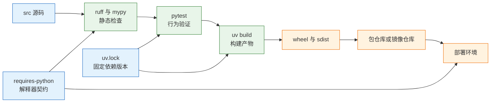
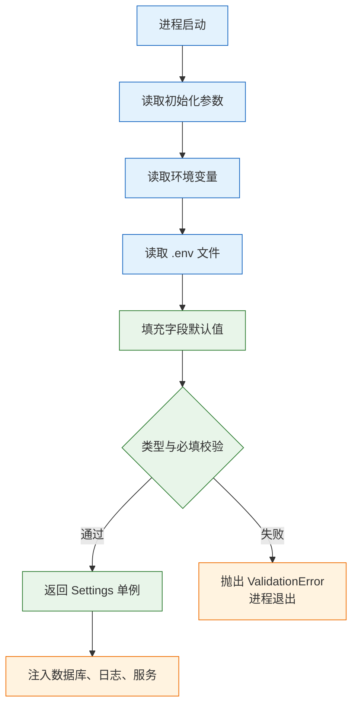

# Python 工程化

---

## 一、Python 工程化是什么

工程化是把“能跑的脚本”变成“可交付的软件”的那套约束：别人拿到仓库能一次装好、跑通测试、构建出同样的产物；线上出问题能追到具体版本和依赖；换一台机器、换一个 CI 环境，结果不变。

它解决的是可重复性，不是业务正确性。代码逻辑对不对、接口快不快、架构合不合理，工程化都不负责。它只保证同一份源码在开发机、CI、容器里得到同一套依赖、同一套检查、同一套产物。

判断一段代码需不需要工程化，看三个问题：会不会被别人安装、会不会长期维护、会不会进 CI。三个都是否，一个文件加 `argparse` 就够；有一个为是，就应该有锁文件、测试和构建配置。

### 1.1 核心概念

工程化由七个概念支撑，它们各自解决一类不确定性。

- **解释器版本**：语法与标准库的边界。`requires-python`、CI 矩阵、容器基础镜像三处必须一致。
- **虚拟环境**：项目依赖的隔离边界。每个项目一个，不往系统 Python 里装包。
- **依赖声明**：写“允许什么版本范围”，不写死具体补丁版本。
- **锁文件**：写“这次实际装了哪些版本、哪个哈希”，保证跨机器一致。
- **包元数据**：名称、版本、入口点、依赖，写在 `pyproject.toml` 里，是构建工具的输入。
- **构建产物**：wheel 是安装物，sdist 是源码包。用户装的是产物，不是仓库目录。
- **流水线**：把检查、测试、构建、发布固化成一条命令，本地与 CI 共用。

| 概念 | 载体 | 解决的问题 | 失效后果 |
|---|---|---|---|
| 解释器版本 | `requires-python` | 语法与标准库差异 | 本地能跑、线上语法错误 |
| 虚拟环境 | `.venv/` | 依赖互相污染 | 升级一个包弄坏另一个项目 |
| 依赖声明 | `dependencies` | 允许的版本范围 | 装到不兼容版本 |
| 锁文件 | `uv.lock` | 实际版本与哈希 | 两台机器装出不同结果 |
| 元数据 | `[project]` | 包身份与入口 | 装上了但命令不存在 |
| 构建产物 | `dist/*.whl` | 可分发单元 | 漏文件、缺依赖 |
| 流水线 | CI 配置 | 执行顺序固定 | 本地与 CI 结果不一致 |

这七个概念里，最容易被忽略的是锁文件与产物。仓库里能 `import`，只说明源码目录在 `sys.path` 里；装 wheel 能跑，才说明元数据、入口点、包数据都正确。

### 1.2 与相邻技术的关系

工程化不是某一个工具，它把包管理、构建、检查、测试、容器、CI 串成一条链。每一环都有替代品，边界要清楚。

- **包管理器**：uv、pip、Poetry、conda。负责解析依赖、装包、生成锁文件，不负责构建产物。
- **构建后端**：hatchling、setuptools、flit、poetry-core。负责把源码打成 wheel 与 sdist，遵循 PEP 517。
- **静态检查**：ruff、mypy。读源码，不改行为；发现的是风格、缺陷模式与类型不一致。
- **测试框架**：pytest。验证行为，不验证打包。
- **容器**：Docker。固定运行时与系统依赖，不替代锁文件。
- **CI**：GitHub Actions、GitLab CI、Jenkins。按顺序执行上面这些命令，不产生新的正确性。

| 技术 | 负责 | 不负责 | 常见误用 |
|---|---|---|---|
| uv | 解析、安装、锁版本 | 代码质量 | 把它当构建工具 |
| hatchling | 打包 wheel 与 sdist | 依赖解析 | 与 uv 的职责混淆 |
| ruff | 风格与缺陷检查 | 类型正确性 | 一次开满全部规则 |
| mypy | 类型一致性 | 运行时行为 | 全局忽略缺失类型 |
| pytest | 行为验证 | 打包完整性 | 只测成功路径 |
| Docker | 运行时隔离 | 依赖可复现 | 构建时联网装最新版 |
| CI | 自动执行与留痕 | 替代本地验证 | 本地与 CI 命令不一致 |

一个常见误解是“上了 Docker 就 reproducible”。镜像里 `pip install -r requirements.txt` 而 `requirements.txt` 没有锁版本，每次构建装到的补丁版本都不同；镜像只是把不确定性封进去了。

### 1.3 架构组成

一条完整的工程链路从源码出发，经过检查、测试、构建，产出可分发产物，再进入部署。



| 环节 | 输入 | 输出 | 失败信号 |
|---|---|---|---|
| 静态检查 | 源码、规则配置 | 问题列表 | 非零退出码 |
| 类型检查 | 源码、类型注解 | 不一致列表 | 非零退出码 |
| 测试 | 源码、测试用例 | 通过或失败 | 用例失败、覆盖率下降 |
| 构建 | 源码、元数据 | wheel、sdist | 缺文件、元数据错误 |
| 发布 | 产物、凭据 | 仓库中的版本 | 推送被拒、版本已存在 |
| 部署 | 产物、配置 | 运行中的服务 | 健康检查失败 |

链路上每一环都要能单独复现：本地能装、CI 能装、镜像里也能装。任何一环依赖“我机器上是好的”，这条链就断了。

---

## 二、环境准备与最小工程

### 2.1 解释器与虚拟环境

> **版本现状（2026-10）**：Python 3.14 是当前稳定主线，`requires-python` 写 `>=3.14`，CI 也跑 3.14。需要 free-threaded 构建时单独加一个 `3.14t` 的 job，不要把它当默认运行时。

```bash
# 确认系统解释器版本，低于 3.14 时先安装
python3 --version

# 每个项目一个虚拟环境，不装进系统 Python
python3.14 -m venv .venv
source .venv/bin/activate          # Windows: .venv\Scripts\activate

# 用 python -m pip 保证装进当前解释器
python -m pip install -U pip

# 先按可编辑方式安装项目本身，再装开发工具
python -m pip install -e .
python -m pip install pytest pytest-cov ruff mypy
```

`python -m pip` 比裸 `pip` 可靠：后者可能指向另一个环境的脚本，装完在项目里 import 不到。`-e` 是可编辑安装，改源码立即生效，代价是依赖项目目录，不能作为发布产物。

用 uv 时日常只需 `uv run`，它会先确保环境与 `uv.lock` 一致再执行命令：

```bash
# 固定项目解释器版本，生成 .python-version
uv python pin 3.14

# 同步环境并执行命令，不手动激活虚拟环境
uv run python -VV
uv run pytest
```

| 方式 | 隔离 | 锁文件 | 适用 |
|---|---|---|---|
| venv + pip | 是 | 需自己维护 | 老项目、最大兼容性 |
| uv | 是 | `uv.lock` | 新项目、CI、容器 |
| Poetry | 是 | `poetry.lock` | 需要发布包的项目 |
| conda | 是 | `environment.yml` | 数据科学、非 Python 依赖 |
| 系统 Python | 否 | 无 | 只用于系统工具 |

> **注意**：虚拟环境目录不要提交到版本库。`.venv` 里有绝对路径，换机器后不可用；重新 `uv sync` 比复制环境快，也更可靠。

### 2.2 最小可运行工程

最小工程要包含四样东西：元数据、依赖、一个可导入的包、一条测试。少于四样，构建或测试环节就会缺输入。

```bash
# 生成带 src 布局的包结构
uv init --package demo-app
cd demo-app

# 加入运行依赖与开发依赖
uv add httpx
uv add --dev pytest ruff mypy
```

```toml
# pyproject.toml（生成后补齐的字段）
[project]
name = "demo-app"
version = "0.1.0"
description = "A small demo service"
requires-python = ">=3.14"
dependencies = ["httpx>=0.27"]

[project.scripts]
demo = "demo_app.cli:main"

[build-system]
requires = ["hatchling"]
build-backend = "hatchling.build"

[dependency-groups]
dev = [
    "pytest>=8",
    "pytest-cov>=5",
    "ruff>=0.6",
    "mypy>=1.11",
]
```

```python
# src/demo_app/cli.py
def main() -> None:
    # 入口函数只做参数解析与调用，业务放在 service 里
    print("hello from demo-app")
```

```bash
# 通过入口点运行，验证元数据与包安装都正确
uv run demo
```

预期输出：

```text
hello from demo-app
```

| 文件 | 必需 | 作用 |
|---|---|---|
| `pyproject.toml` | 是 | 元数据、依赖、工具配置 |
| `uv.lock` | 是 | 锁定实际版本与哈希 |
| `src/demo_app/__init__.py` | 是 | 声明普通包 |
| `tests/` | 是 | 测试用例 |
| `README.md` | 建议 | 安装、运行、测试说明 |
| `.env.example` | 建议 | 列出配置键，不含真实值 |

### 2.3 目录与包结构

```text
demo-app/
├── pyproject.toml
├── uv.lock
├── README.md
├── .env.example
├── .gitignore
├── src/
│   └── demo_app/
│       ├── __init__.py
│       ├── config.py
│       ├── cli.py
│       └── service.py
└── tests/
    └── test_service.py
```

- **src 布局**：包放在 `src/` 下，当前目录的同名目录不会遮蔽已安装的包。`import demo_app` 永远来自安装后的包，而不是碰巧在 cwd。
- **`__init__.py`**：明确普通包。命名空间包只在确实要跨发行版拼命名空间时用。
- **tests 与 src 分开**：测试不进 wheel，也不会被误 import 成运行时模块。
- **`.venv`、`__pycache__`、`.pytest_cache`、`.env`、`dist/`** 进 `.gitignore`；`.env.example` 进版本库，写清楚需要哪些键，不写真实值。

| 布局 | 导入来源 | 优点 | 缺点 |
|---|---|---|---|
| 扁平布局 | 当前目录 | 简单 | 同名目录会遮蔽安装包 |
| src 布局 | 安装后的包 | 导入确定、测试真实 | 必须先安装 |
| 单文件脚本 | 直接执行 | 零配置 | 无法复用、无法打包 |

README 至少写清五件事：项目做什么、怎么装、怎么跑、怎么测、需要哪些环境变量。缺了这些，接手的人只能靠读代码猜，工程化就只剩目录好看。

---

## 三、依赖与构建配置写法

### 3.1 pyproject 的元数据

`pyproject.toml` 是 PEP 518 定义的标准配置文件，构建工具、检查工具、测试工具都从这里读配置，不再各自维护 `setup.py`、`setup.cfg`、`.flake8`。

```toml
[project]
name = "demo-app"                 # 发布名，PyPI 上唯一
version = "0.1.0"                 # 单一来源，不要在代码里再写一份
description = "A small demo service"
readme = "README.md"
requires-python = ">=3.14"
dependencies = [
    "httpx>=0.27",                # 只写下限，实际版本由锁文件固定
]

[project.scripts]
demo = "demo_app.cli:main"        # 生成 console_scripts 入口

[tool.hatch.build.targets.wheel]
packages = ["src/demo_app"]      # 明确告诉构建后端打包哪个目录
```

| 字段 | 作用 | 写错的后果 |
|---|---|---|
| `name` | 分发名 | 与仓库中已有名字冲突，发布被拒 |
| `version` | 版本 | 重复发布被拒、回滚找不到版本 |
| `requires-python` | 解释器范围 | 装到低版本环境后语法错误 |
| `dependencies` | 运行依赖 | 漏写导致运行时报 ModuleNotFound |
| `[project.scripts]` | 命令行入口 | 装完没有可执行命令 |
| `packages` | 打包目录 | wheel 里缺包，导入失败 |

分发名与导入名可以不同：`demo-app` 安装后导入 `demo_app`，命令是 `demo`。三者混用是“装上了但用不了”的常见原因。

`readme`、`license`、`classifiers` 不是装饰字段：私有仓库、合规扫描与下游安装都会读取它们。缺失时本地构建仍能通过，发布审核或下游引入时才会被拦下。

### 3.2 依赖分组与锁文件

依赖分三类：运行依赖、开发依赖、可选功能依赖。运行依赖进 `dependencies`，开发工具进 `[dependency-groups]` 的 `dev` 组，可选功能用 extra 单独成组。

```bash
# 安装全部默认组，包含 dev
uv sync

# 只装运行依赖，用于生产与镜像
uv sync --no-dev

# CI 使用冻结模式：锁文件过期直接失败，不偷偷升级
uv sync --frozen

# 检查锁文件是否与声明一致
uv lock --check

# 查看依赖来源，排查版本冲突
uv tree
```

| 依赖类型 | 位置 | 是否进镜像 | 用途 |
|---|---|---|---|
| 运行依赖 | `dependencies` | 是 | 启动服务必需 |
| 开发依赖 | `dependency-groups.dev` | 否 | 测试、检查、格式化 |
| 可选功能 | `optional-dependencies.xxx` | 按需 | 导出、监控等扩展 |
| 传递依赖 | 锁文件 | 是 | 由解析器决定 |

依赖要定期更新，但不能在功能分支里顺手全升。做法是单独开分支执行 `uv lock --upgrade`，跑完整测试再看变更日志；安全漏洞用 `pip-audit` 或代码托管平台的依赖扫描发现，先修可利用的，再排期大版本升级。长期不升级，最后会变成一次无法回滚的大改。

依赖写下限，谨慎写上上限。库被别的项目依赖时，锁死上限会阻碍安全更新；应用则靠 `uv.lock` 固定实际版本。需要 `requirements.txt` 的平台用 `uv export --format requirements-txt` 导出，不要手工维护两份清单。

锁文件必须进 Git。它记录解析结果与哈希，合并冲突时不要手改，重新 `uv lock` 生成再提交。缺少锁文件，CI 与本地就可能装到不同的小版本，问题只在特定机器上复现。

> **注意**：`uv sync` 默认会按锁文件安装，但会在声明变化时重新解析；CI 用 `--frozen` 才能保证“锁文件过期就失败”，而不是悄悄改写锁文件后继续跑。

### 3.3 构建后端与产物

构建后端遵循 PEP 517，常见选择是 hatchling、setuptools、flit。新项目不要手写 `setup.py`，`pyproject.toml` 已能表达全部元数据。

```bash
# 构建 wheel 与 sdist，输出到 dist/
uv build

# 查看产物
ls dist
```

```text
demo_app-0.1.0-py3-none-any.whl
demo_app-0.1.0.tar.gz
```

| 产物 | 内容 | 用途 |
|---|---|---|
| wheel（`.whl`） | 已构建的包，解压即用 | 安装、进镜像 |
| sdist（`.tar.gz`） | 源码与构建配置 | 源码分发、审计 |
| 镜像 | 运行时 + 依赖 + 应用 | 部署 |

wheel 文件名里的 `py3-none-any` 表示纯 Python、无平台限制。带 C 扩展的包会变成 `cp314-cp314-manylinux_2_17_x86_64` 这类平台标签，跨平台安装时找不到对应 wheel 就会退化为源码编译。

版本遵循语义化：破坏性变更升主版本，新增功能升次版本，修复升补丁版本。版本号只在一个地方维护，代码里要读版本用 `importlib.metadata.version("demo-app")`，不要复制一份 `__version__`。

---

## 四、代码质量工具链

### 4.1 静态检查与格式化

ruff 取代 flake8、isort、black 的组合，一个工具、一套配置、一次运行完成风格检查与自动修复。

```toml
[tool.ruff]
line-length = 100
target-version = "py314"

[tool.ruff.lint]
# 先开基础组，稳定后再加 B、UP、SIM
select = ["E", "F", "I"]

[tool.ruff.format]
quote-style = "double"
```

```bash
# 检查，不修改文件
uv run ruff check .

# 自动修复可安全修复的问题
uv run ruff check --fix .

# 格式化
uv run ruff format .

# CI 中只检查不修改
uv run ruff format --check .
```

| 规则组 | 检查内容 | 建议 |
|---|---|---|
| `E`、`F` | 语法错误、未使用导入、未定义名 | 必开 |
| `I` | import 排序 | 必开 |
| `B` | 常见缺陷模式 | 稳定后开 |
| `UP` | 升级到新语法 | 稳定后开 |
| `SIM` | 可简化写法 | 稳定后开 |

规则一次开太多，历史代码会全红，团队时间花在改格式而不是改缺陷。先用 `E,F,I` 建立基线，再按模块逐步加组。

### 4.2 类型检查

mypy 读注解做静态推断，能在运行前发现“传了 None 却当字符串用”“返回类型与声明不符”这类问题。

```toml
[tool.mypy]
python_version = "3.14"
warn_unused_ignores = true
check_untyped_defs = true
warn_return_any = true

[[tool.mypy.overrides]]
module = ["some_untyped_lib.*"]
ignore_missing_imports = true
```

```bash
# 只检查源码目录，测试目录单独配置
uv run mypy src
```

| 配置 | 作用 | 适用 |
|---|---|---|
| `check_untyped_defs` | 检查无注解函数体 | 渐进迁移 |
| `warn_unused_ignores` | 多余忽略也报错 | 防止抑制失效后残留 |
| `ignore_missing_imports` | 跳过无类型第三方库 | 按模块配置 |
| `strict` | 打开全部严格项 | 新项目、核心模块 |

mypy 从关键模块开始，不要第一天就全仓 `strict`。第三方库没有类型信息时，用 `[[tool.mypy.overrides]]` 按模块忽略，不要全局关掉——全局关闭等于放弃这项检查。

自己发布的库要带 `py.typed` 标记文件，否则下游即使装了包，mypy 也会认为它没有类型信息。

### 4.3 提交前钩子

pre-commit 只放快的检查：ruff、尾随空格、YAML 语法。mypy 与全量测试放 CI，否则每次提交都要等几分钟，最后大家会加 `--no-verify` 跳过。

```yaml
# .pre-commit-config.yaml
repos:
  - repo: https://github.com/astral-sh/ruff-pre-commit
    rev: v0.6.9
    hooks:
      - id: ruff
        args: ["--fix"]
      - id: ruff-format
  - repo: https://github.com/pre-commit/pre-commit-hooks
    rev: v4.6.0
    hooks:
      - id: end-of-file-fixer
      - id: check-yaml
```

| 检查 | 放在哪里 | 原因 |
|---|---|---|
| ruff | 提交前 + CI | 秒级完成，能自动修复 |
| 尾随空格、文件结尾 | 提交前 | 零成本 |
| mypy | CI | 全仓检查需要几十秒到几分钟 |
| pytest | 提交前可选，CI 必跑 | 全量测试慢 |
| 构建 | CI | 需要干净环境 |

钩子可以绕过，所以它只是加速反馈，不是质量门禁。真正的门禁在 CI：分支保护要求检查通过才能合并。

---

## 五、配置、日志与测试机制

### 5.1 配置的启动校验

配置从环境变量来，代码只读一次，默认值只用于开发。缺关键项时启动失败，比运行到一半才发现端口是字符串要好。

```python
# src/demo_app/config.py
from functools import lru_cache
from pydantic_settings import BaseSettings, SettingsConfigDict

class Settings(BaseSettings):
    model_config = SettingsConfigDict(env_file=".env", extra="ignore")

    database_url: str = "sqlite:///./app.db"
    debug: bool = False
    log_level: str = "INFO"
    api_token: str                          # 无默认值，缺失即启动失败

@lru_cache
def get_settings() -> Settings:
    # 进程内只解析一次，避免每个请求都读环境变量
    return Settings()
```



| 来源 | 优先级 | 典型用途 |
|---|---|---|
| 构造参数 | 最高 | 测试显式覆盖 |
| 环境变量 | 高 | 容器与 CI 注入 |
| `.env` 文件 | 中 | 仅本地开发 |
| 字段默认值 | 最低 | 开发兜底 |

- 密钥不放默认值，不进日志，不进异常信息。
- 测试里 `get_settings.cache_clear()`，或直接构造 `Settings(_env_file=None)`；模块级单例会让测试互相污染。
- 不要在 import 时建连接、加载大文件；import 应该只定义，启动由 `main()` 或生命周期钩子负责。

> **安全警告**：`debug=True`、示例密钥、默认口令只能出现在本地配置。生产启动时缺少密钥或仍在使用默认值，应当直接失败，而不是带默认值运行。

开发与生产用同一份代码、不同的配置：生产不装开发依赖、不开 debug、不用 reload；配置由环境注入，日志写 stdout，进程交给 systemd 或容器管理。这些差异写进启动脚本或镜像，不要靠部署的人临场加参数。

### 5.2 日志配置的分层

```python
import logging.config

logging.config.dictConfig({
    "version": 1,
    "disable_existing_loggers": False,          # 保留第三方库已有的 logger
    "formatters": {
        "std": {"format": "%(asctime)s %(levelname)s %(name)s %(message)s"},
    },
    "handlers": {
        "console": {"class": "logging.StreamHandler", "formatter": "std"},
    },
    "root": {"handlers": ["console"], "level": "INFO"},
})
```

| 规则 | 做法 | 反例 |
|---|---|---|
| 库代码不配 handler | 只 `getLogger(__name__)` | 在库里调 `basicConfig` |
| 输出到 stdout | 由容器或 systemd 采集 | 自己切文件、做轮转 |
| 惰性占位 | `log.info("rows=%s", n)` | 先拼字符串再传 |
| 保留堆栈 | `log.exception()` | 只打 `str(e)` |
| 结构化字段 | 生产用 JSON formatter | 一行里混多种格式 |

重复日志通常是 handler 挂了两次，或 `propagate` 叠加。一个进程只配置一次，入口处调用；库代码不要动全局日志配置，否则引入方会被迫接受统一格式。

请求级日志要能串起来：入口生成请求 ID，放进日志字段与响应头，下游调用继续传递。排查时用请求 ID 检索，比按时间翻日志可靠。

日志级别要按处理方式区分：`ERROR` 表示需要人介入，`WARNING` 表示可自愈的异常，`INFO` 记录状态变化，`DEBUG` 只用于短期排查。把每次请求都打成 `INFO`，高峰期日志量会超过业务流量，采集端先被压垮；访问日志交给网关或访问日志中间件，应用日志只记录业务事件与异常。

### 5.3 测试的层次

```python
# src/demo_app/service.py
def cents(text: str) -> int:
    whole, _, frac = text.partition(".")
    return int(whole) * 100 + int((frac + "00")[:2])
```

```python
# tests/test_service.py
import os

import pytest
from demo_app.service import cents

@pytest.mark.parametrize(
    ("text", "expected"),
    [("12.50", 1250), ("0.01", 1), ("7", 700)],
)
def test_cents(text: str, expected: int) -> None:
    assert cents(text) == expected

def test_write_and_read(tmp_path):
    # 临时目录由 pytest 管理，结束后自动清理
    path = tmp_path / "a.txt"
    path.write_text("x", encoding="utf-8")
    assert path.read_text(encoding="utf-8") == "x"

def test_env_override(monkeypatch):
    # 环境变量在用例结束后自动恢复
    monkeypatch.setenv("DEMO_MODE", "test")
    assert os.environ["DEMO_MODE"] == "test"
```

| 层 | 测什么 | 速度 | 依赖 |
|---|---|---|---|
| 单元 | 纯函数、解析、金额、日期 | 毫秒 | 无 |
| 集成 | 模块 + 数据库或缓存 | 秒 | 临时库或容器 |
| 接口 | HTTP 路由、状态码、鉴权 | 秒 | 测试客户端 |
| 端到端 | 真实部署链路 | 分钟 | 完整环境 |

测试金字塔不是教条：纯函数多测，集成测关键路径，端到端只覆盖“登录→下单→支付”这类不能断的流程。反过来的组合又慢又脆。

测试必须顺序无关、可重复。依赖当前时间、随机数、时区、执行顺序的用例，在 CI 上迟早会红。覆盖率看缺口，不追百分比；没有断言的“跑通”不算测试。

fixture 的作用域决定隔离与成本的平衡：`session` 级共享数据库连接、容器这类昂贵资源，`function` 级保证每个用例拿到干净状态。fixture 里创建的可变数据要在 teardown 清理，只 `yield` 而不清理，用例顺序一变就会互相污染。

---

## 六、完整示例：从脚本到可安装包

### 6.1 初始化与入口

```bash
# 生成包结构、pyproject 与示例模块
uv init --package demo-app
cd demo-app

# 加入运行依赖
uv add httpx
```

```python
# src/demo_app/service.py
def greet(name: str) -> str:
    # 业务逻辑保持纯函数，便于单测
    return f"hello, {name}"
```

```python
# src/demo_app/cli.py
import argparse
from .service import greet

def main() -> None:
    parser = argparse.ArgumentParser(prog="demo")
    parser.add_argument("name", nargs="?", default="world")
    args = parser.parse_args()
    print(greet(args.name))
```

```toml
[project.scripts]
demo = "demo_app.cli:main"
```

| 入口方式 | 依赖 | 适用 |
|---|---|---|
| `uv run demo` | 源码可编辑安装 | 开发 |
| `python -m demo_app` | 有 `__main__.py` | 调试 |
| 安装 wheel 后的 `demo` | 元数据与入口点 | 发布 |
| `python -c "..."` | 无 | 一次性验证 |

### 6.2 构建与干净环境验证

```bash
# 构建 wheel 与 sdist
uv build

# 新建干净环境，只装 wheel，不引用源码目录
python3.14 -m venv /tmp/venv-check
/tmp/venv-check/bin/pip install dist/demo_app-0.1.0-py3-none-any.whl

# 在项目目录外执行，确认不是 cwd 碰巧导入
cd /tmp && /tmp/venv-check/bin/demo alice
```

预期输出：

```text
hello, alice
```

这一步能过，才说明包元数据、入口点、依赖声明、包数据都正确。只在 `uv run` 里能跑，可能只是 `src` 在 `sys.path` 里。

| 验证项 | 命令 | 失败含义 |
|---|---|---|
| 元数据 | `pip show demo-app` | 名称或版本写错 |
| 入口点 | `demo --help` | `[project.scripts]` 缺失 |
| 依赖 | 干净环境直接运行 | 依赖未声明 |
| 包数据 | 访问模板、配置等非 py 文件 | `packages` 或 `include` 配置漏项 |
| 导入路径 | `python -c "import demo_app; print(demo_app.__file__)"` | src 布局未生效 |

### 6.3 容器构建

```dockerfile
# 运行阶段只保留虚拟环境与应用源码
FROM python:3.14-slim
COPY --from=ghcr.io/astral-sh/uv:0.8 /uv /usr/local/bin/uv
WORKDIR /app

# 编译字节码加快启动，copy 模式避免跨文件系统硬链接失败
ENV UV_COMPILE_BYTECODE=1 UV_LINK_MODE=copy

# 先复制依赖清单，源码变化不会让依赖层失效
COPY pyproject.toml uv.lock ./
RUN uv sync --frozen --no-install-project --no-dev

COPY src ./src
RUN uv sync --frozen --no-dev

# 非 root 运行；UID 要与文件属主匹配
USER 10001
CMD ["/app/.venv/bin/demo"]
```

| 实践 | 作用 | 忽略的后果 |
|---|---|---|
| 先复制依赖清单 | 复用构建缓存 | 每次改代码都重装依赖 |
| `--no-dev` | 镜像不含测试工具 | 镜像多出几十 MB |
| `.dockerignore` | 排除 `.git`、`.venv`、`.env` | 构建慢、密钥进镜像 |
| 非 root 用户 | 降低逃逸影响 | 容器内进程拥有 root |
| 固定基础镜像 | 构建可复现 | 每次构建系统库不同 |

> **安全警告**：`COPY . .` 会把 `.env`、`.git`、本地虚拟环境一起打进镜像，密钥随镜像进入仓库。必须配 `.dockerignore`，并只复制明确的目录。

---

## 七、CI 流水线与发布

### 7.1 流水线阶段


```yaml
name: ci
on:
  push:
    branches: [main]
  pull_request:

jobs:
  test:
    runs-on: ubuntu-latest
    steps:
      - uses: actions/checkout@v4
      - uses: astral-sh/setup-uv@v6
        with:
          enable-cache: true
          python-version: "3.14"
      - run: uv sync --frozen
      - run: uv run ruff check .
      - run: uv run ruff format --check .
      - run: uv run mypy src
      - run: uv run pytest --cov=demo_app --cov-report=term-missing
```

| 阶段 | 目的 | 失败处理 |
|---|---|---|
| lint | 拦截风格与明显缺陷 | 本地修复后重推 |
| 类型检查 | 拦截接口不一致 | 修注解或按模块抑制 |
| 测试 | 验证行为 | 复现用例，不跳过 |
| 构建 | 验证能打包 | 检查元数据与包目录 |
| 镜像 | 验证能运行 | 检查基础镜像与依赖 |

顺序按“快、便宜、能早失败”排：lint → 类型 → 测试 → 构建。把构建放前面，会为每个格式错误的提交都跑一次几分钟的打包。

流水线还要限制并发与超时：同一分支的新提交应取消上一次未完成的运行，避免旧构建覆盖新产物；每个 job 设置超时，防止卡住的集成测试占满 runner。发布 job 只允许在主分支或 tag 上运行，并要求人工确认，减少误发。

### 7.2 缓存与矩阵

- 缓存只缓存依赖下载，不缓存测试结果；缓存键要带锁文件哈希，锁一变缓存自动失效。
- `--frozen` 保证 CI 不改锁文件；锁文件过期直接失败，而不是悄悄升级依赖。
- 矩阵至少覆盖 3.14；需要兼容 3.13 就加一行，不要只在本机版本上测。
- 构建产物只在主分支或 tag 上做，避免每个 PR 都推镜像。
- CI 的凭据用平台 secret 注入，只在需要的 job 里可见，日志里不能打印。
- 产物保留要能追溯：镜像 tag 用版本号加提交短哈希，保留最近若干个，回滚按 tag 取，不依赖构建机的本地缓存。

| 配置 | 作用 | 常见错误 |
|---|---|---|
| `--frozen` | 不改锁文件 | 省略后 CI 悄悄升级 |
| 缓存键含锁文件哈希 | 依赖变更即失效 | 用固定键，装到旧缓存 |
| 版本矩阵 | 覆盖支持范围 | 只测本机版本 |
| 分支过滤 | 控制发布频率 | 每个 PR 都推镜像 |
| 最小权限 | 限制 secret 暴露 | 全 job 共享发布凭据 |

本地与 CI 跑同一套命令，用一个 `Makefile` 收口：

```makefile
.PHONY: lint test build
lint:
	uv run ruff check .
	uv run ruff format --check .
	uv run mypy src
test:
	uv run pytest
build:
	uv build
```

CI 调 `make lint test build`，本地也调同一组；工具版本与参数只有一处，不会漂。

### 7.3 版本、发布与回滚

| 动作 | 命令或位置 | 注意 |
|---|---|---|
| 升版本 | `pyproject.toml` 的 `version` | 单一来源 |
| 打标签 | `git tag v0.1.0` | 与版本号一致 |
| 构建 | `uv build` | 在干净环境验证 |
| 发布 | 上传到私有或公共仓库 | 凭据从 secret 注入 |
| 回滚 | 部署上一个 tag 的产物 | 不回滚已执行的迁移 |

```bash
# 发布前的一致性检查
uv lock --check
uv build
uv run python -c "from importlib.metadata import version; print(version('demo-app'))"

# 打标签并推送，触发发布流水线
git tag -a v0.1.0 -m "release 0.1.0"
git push origin v0.1.0
```

回滚要能回到上一个产物，而不是在现场改代码。数据库迁移要向前兼容一个版本，否则旧代码读不懂新表，回滚会失败。发布记录至少包含版本号、变更类型、迁移影响与回滚步骤；破坏性变更要提前一个版本标注弃用，直接删除公共函数或字段，会让下游在升级当天才发现。

可复现构建靠三样：锁文件固定依赖，基础镜像固定版本（最好用 digest），构建命令只走 CI 里那一套。三者缺一个，不同机器构建出的 wheel 或镜像就可能不同。

> **注意**：私有仓库的地址与凭据不要写进 `pyproject.toml`。索引地址可以配置在用户级或 CI 环境变量里，凭据用密钥管理，避免随源码扩散。

---

## 八、常见错误与排查

### 8.1 故障对照表

| 现象 | 最可能原因 | 处理 |
|---|---|---|
| 本地能 import，CI 不能 | 没按包安装，靠 cwd 导入 | 用 src 布局，`uv sync` 安装项目 |
| 改了代码不生效 | 装的是旧 wheel，或用了另一个解释器 | `python -c "import 包; print(包.__file__)"` |
| 依赖冲突 | 未锁版本，或直接依赖范围过宽 | `uv lock`、`uv tree` 查来源 |
| 本地测试过，CI 失败 | 时区、随机、环境变量、执行顺序 | 固定 TZ 与 seed，测试隔离 |
| mypy 报第三方库缺类型 | 包没带 `py.typed` 或 stub | 按模块 `ignore_missing_imports` |
| 日志重复 | handler 配置两次，`propagate` 叠加 | 入口统一配置，库不配 handler |
| 镜像很大 | 带了开发依赖、缓存、`.git` | `--no-dev`，配 `.dockerignore` |
| 启动很慢 | import 时建连接、加载大文件 | 移到入口或首次使用 |
| 密钥进了镜像 | `COPY . .` 带入 `.env` | `.dockerignore`，运行时注入 |
| 版本号对不上 | `pyproject` 与 `__version__` 双写 | 用 `importlib.metadata` |
| wheel 里缺文件 | 构建配置没包含包数据 | 检查 `packages`，装 wheel 后验证 |
| 回滚后行为仍旧 | 部署了旧代码但没回滚迁移 | 迁移向前兼容，写清回滚步骤 |
| Linux 容器里装依赖失败 | 锁的是 macOS wheel | 在目标平台解析，或装编译工具 |
| `uv sync` 改了锁文件 | CI 未用 `--frozen` | 加 `--frozen`，锁文件变更单独提交 |

### 8.2 排查顺序

1. 确认解释器与包路径：`uv run python -VV`、`uv run python -c "import 包; print(包.__file__)"`。
2. 看锁文件与依赖树：`uv lock --check`、`uv tree`，确认装的是声明的那一套。
3. 在干净环境复现：新建 venv，只装 wheel，不靠源码目录。
4. 对比本地与 CI 的环境变量、时区、Python 版本、平台标签。
5. 确认构建配置是否包含全部包数据；用 `unzip -l` 查看 wheel 内容。
6. 最后才怀疑代码。工程问题多数在环境、打包与权限，不在业务逻辑。

> **核心结论**：工程化不是加工具，而是让安装、测试、构建、发布四步可重复；锁文件固定依赖，src 布局固定导入，CI 固定验证顺序。
