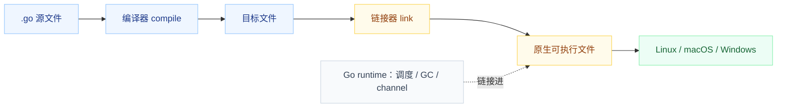
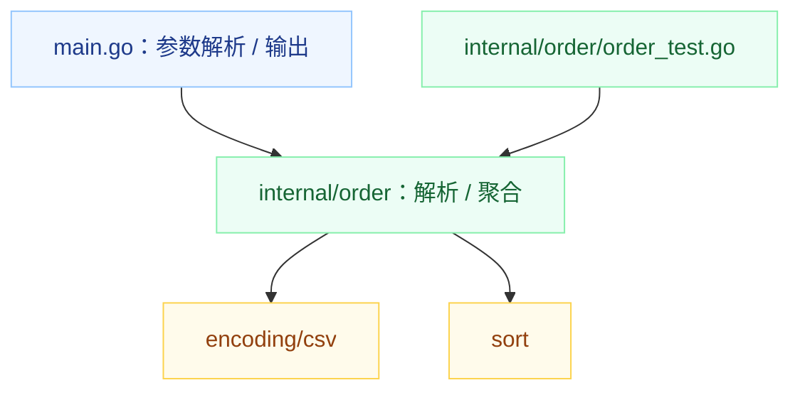

# Go基本语法

> 这篇从 Go 的编译运行模型讲起，经过工具链、变量与类型、复合类型、控制流、函数、方法与接口、defer 和包管理，最后落到一个可测试的命令行程序。
>
> 学完能独立编写、编译、测试和交叉编译一个小型 Go 程序，并能解释值拷贝、切片共享、接口 nil 和 defer 执行顺序这些高频边界。

> 版本基线（2026-11-13）：语言基线 Go 1.24+，当前稳定版为 Go 1.27.4；示例的 `go.mod` 写 `go 1.24`，在 Go 1.27.x 上验证。

## 一、Go 的运行模型

Go 是静态类型、编译型语言。`go build` 把当前包和依赖一起编译、链接成单个原生可执行文件，运行时（runtime）直接链接进二进制，不需要预先安装虚拟机。程序启动后，runtime 创建主 goroutine、初始化堆和调度器，再调用 `main.main`。

这个模型带来三个直接结果。第一，部署通常只需要一个文件，交叉编译时设置 `GOOS` 和 `GOARCH` 即可。第二，编译期会检查类型、未使用的导入和未使用的局部变量，很多错误不会拖到运行期。第三，Go 没有类继承，代码复用靠结构体、方法和接口组合，理解“值”和“引用”比理解继承层级更重要。



runtime 里最值得先知道的部分：

| 组件 | 职责 | 对写代码的影响 |
|---|---|---|
| 调度器（GMP） | 把 goroutine 调度到系统线程上 | goroutine 很便宜，但阻塞系统调用仍会占用线程 |
| 垃圾回收器 | 并发标记清除，自动回收堆对象 | 减少手动释放，但不等于可以无限分配 |
| 栈管理 | goroutine 栈按需增长和收缩 | 递归很深时仍可能栈溢出 |
| channel | goroutine 之间的同步和通信 | “通过通信共享内存”，但滥用 channel 也会慢 |
| panic 机制 | 沿调用栈展开并执行 defer | panic 不是普通错误处理，库代码应优先返回 error |

> 边界：Go 二进制默认不依赖 libc；使用 cgo、系统 DNS 解析或某些数据库驱动时会出现动态依赖。需要完全静态的 Linux 镜像时，用 `CGO_ENABLED=0 go build`，并确认没有引入 cgo 包。

> 版本基线：Go 1.27.4 是 2026-11 的稳定版，官方只维护最近两个大版本；新项目直接用 1.27.x，存量项目至少保证 `go.mod` 的语言版本不低于 1.24。Go 1.22 起循环变量按迭代创建，这个变化会直接影响闭包行为，后文会单独说明。

## 二、工具链与第一个程序

### 2.1 安装与验证

| 环境 | 安装方式（2026-11） | 验证 |
|---|---|---|
| Windows 10/11 | `winget install GoLang.Go`，或从 go.dev 下载安装包 | `go version`；安装包会自动配置 PATH |
| macOS | `brew install go`，或从 go.dev 下载 pkg | `go version`；`go env GOROOT` |
| Ubuntu 24.04/26.04 | `sudo snap install go --classic`，或下载官方 tar.gz 解压到 `/usr/local/go` | `go version`；`go env GOROOT` |
| Rocky/CentOS 9/10 | 下载官方 tar.gz，解压后把 `/usr/local/go/bin` 加入 PATH | `go version`；`go env GOPATH` |

安装后验证：

```bash
go version
go env GOROOT GOPATH GOMODCACHE GOOS GOARCH
```

预期输出（版本号和路径可能不同）：

```text
go version go1.27.4 darwin/arm64
/opt/homebrew/Cellar/go/1.27.4/libexec
/Users/jimbo/go
/Users/jimbo/go/pkg/mod
darwin
arm64
```

`GOROOT` 是 Go 安装目录，`GOPATH` 是工作区，`GOMODCACHE` 是模块缓存。日常开发不需要手工设置 `GOPATH`，但要知道依赖下载到了哪里，排查“本地能跑、CI 拉不到包”时会用到。

### 2.2 创建模块并运行

```bash
mkdir hello && cd hello
go mod init example.com/hello
```

`go mod init` 生成 `go.mod`：

```text
module example.com/hello

go 1.24
```

创建 `main.go`：

```go
package main // 可执行程序必须使用 main 包

import "fmt"

func main() {
	// Println 自动换行，多个参数之间加空格
	fmt.Println("Hello, Go 1.27")
}
```

运行和构建：

```bash
go run .                 # 编译到临时目录并运行，不留下二进制
go build -o hello .      # 生成当前平台的 hello
./hello                  # 输出 Hello, Go 1.27
go install .             # 安装到 GOBIN 或 GOPATH/bin
```

预期输出：

```text
Hello, Go 1.27
```

> 边界：`go run .` 里的 `.` 表示当前目录的包，不是“运行所有文件”。目录里存在多个 `package main` 文件时，它们会一起编译；存在非 main 包时，`go run .` 会报错。

### 2.3 日常命令

| 命令 | 用途 | 关键点 |
|---|---|---|
| `go run .` | 编译并运行 | 适合本地试跑，不产出可执行文件 |
| `go build ./...` | 编译所有包 | `./...` 递归匹配子目录 |
| `go test ./...` | 运行测试 | 加 `-race` 检查数据竞争，加 `-cover` 看覆盖率 |
| `go vet ./...` | 静态检查 | 能发现格式串、锁拷贝、无效断言等问题 |
| `go fmt ./...` | 格式化 | 团队统一用 gofmt，不手工调缩进 |
| `go mod tidy` | 增删依赖 | 会改写 `go.mod` 和 `go.sum`，提交前运行 |
| `go doc fmt.Println` | 查文档 | 不离开终端看标准库签名 |
| `go list -m all` | 列出模块 | 排查依赖版本冲突 |

Go 的语法外形有三个硬规则：

- 左花括号必须和 `if`、`for`、`func` 等关键字在同一行，因为编译器会在行尾自动插入分号；
- 不需要写分号，也不要为了“看起来整齐”把 `{` 换到下一行；
- 未使用的导入和未使用的局部变量是编译错误，不是警告。

```go
func main() {
	if true { // 正确：左括号与 if 同行
		fmt.Println("ok")
	}
	// if true
	// { // 错误：换行后编译器在 true 后插入了分号
	// }
}
```

> 边界：`go fmt` 只负责格式，不负责修复逻辑。提交前至少跑 `go fmt ./...`、`go vet ./...`、`go test ./...` 三件事。

## 三、变量、常量与类型

### 3.1 声明、零值与短变量

Go 的变量声明有四种常见写法：

```go
var age int          // 只声明，使用零值
var name = "Go"      // 类型由右值推断
var width, height float64 = 3.5, 2.0 // 一次声明多个
count := 10          // 只能在函数内使用，类型由右值推断
```

零值是 Go 保证“声明后即可安全使用”的基础：

| 类型 | 零值 | 说明 |
|---|---|---|
| 数值类型 | `0` | `int`、`float64`、`byte` 等都一样 |
| `bool` | `false` | 不会出现未初始化的随机值 |
| `string` | `""` | 空字符串，不是 nil |
| 指针、切片、map、channel、函数、接口 | `nil` | 使用前要判断或初始化 |

```go
var n int
var s string
var p *int
var xs []int
var m map[string]int
var f func() int
var err error

fmt.Println(n, s == "", p == nil, xs == nil, m == nil, f == nil, err == nil)
// 输出：0 true true true true true true
```

短变量声明 `:=` 只能在函数内部使用，而且左侧至少要有一个新变量：

```go
func main() {
	name := "Go"
	name, age := "Gopher", 10 // name 被重新赋值，age 是新变量
	fmt.Println(name, age)    // Gopher 10
}
```

> 边界：`:=` 不是“声明并赋值”的万能写法。包级变量只能用 `var`；在 `if`、`for`、`switch` 的初始化语句里用 `:=`，变量只在该语句和对应代码块内可见。

变量遮蔽（shadowing）是新手最容易踩的坑：

```go
x := 1
if x := 2; x > 0 {
	fmt.Println(x) // 2：这是 if 内部的新变量
}
fmt.Println(x) // 1：外层 x 没有被修改
```

```go
var err error
if _, err := doSomething(); err != nil {
	// 这里的 err 是 if 内部的新变量
}
// 外层的 err 仍是 nil，容易漏掉错误
```

> 边界：遇到“明明赋值了，外面还是旧值”，先检查是不是 `:=` 造出了新变量。需要复用外层变量时用 `=`，或者把结果赋给已有变量。

### 3.2 基本类型

| 类型 | 大小 / 取值 | 典型用途 |
|---|---|---|
| `bool` | `true` / `false` | 条件、开关 |
| `string` | 字节序列，不可变 | 文本、JSON、日志 |
| `int` | 32 或 64 位，随平台 | 下标、计数、一般整数 |
| `int8` / `int16` / `int32` / `int64` | 固定位宽 | 协议字段、时间戳、金额分 |
| `uint` / `uint8` / `uint16` / `uint32` / `uint64` | 无符号整数 | 位运算、哈希、长度 |
| `float32` / `float64` | IEEE 754 浮点 | 科学计算、统计近似值 |
| `byte` | `uint8` 的别名 | 二进制数据、UTF-8 字节 |
| `rune` | `int32` 的别名，表示 Unicode 码点 | 字符遍历、文本处理 |
| `complex64` / `complex128` | 复数 | 信号处理、数学计算 |

选择类型时抓住三个默认：

- 一般整数用 `int`，不要为了“省内存”把下标写成 `int8`；
- 金额用 `int64` 存“分”，时间用 `int64` 存 Unix 秒或毫秒，避免浮点和时区歧义；
- 需要和外部协议、数据库字段对齐时，用固定位宽类型，不用 `int`。

Go 没有隐式类型转换，不同类型之间必须显式转换：

```go
var n int32 = 7
var m int64 = int64(n) // 必须写转换，不能直接赋值
fmt.Println(m)         // 7

var f float64 = 3.9
var i int = int(f) // 截断小数部分，不是四舍五入
fmt.Println(i)     // 3
```

整数溢出在运行时按二进制补码回绕：

```go
var u uint8 = 255
u++
fmt.Println(u) // 0

var i8 int8 = 127
i8++
fmt.Println(i8) // -128
```

> 边界：常量表达式溢出是编译错误，变量运算溢出才会回绕。涉及金额、计数器、长度时，先估算上限再选位宽。

常量和 `iota`：

```go
const Pi = 3.14159 // 无类型常量，使用时按上下文取类型

const (
	StatusNew     = iota // 0
	StatusPaid           // 1
	StatusShipped        // 2
)

const (
	_  = iota             // 跳过 0
	KB = 1 << (10 * iota) // 1 << 10
	MB                    // 1 << 20
	GB                    // 1 << 30
)
```

`iota` 在每个 `const` 块内从 0 开始，每行加 1，遇到新的 `const` 块重置。用 `_` 可以跳过不需要的值。

### 3.3 字符串、字节与 rune

Go 的 `string` 是只读的字节序列，通常存放 UTF-8 文本。`len(s)` 返回字节数，不是字符数：

```go
s := "Go语言"
fmt.Println(len(s))                    // 8：G(1) o(1) 语(3) 言(3)
fmt.Println(utf8.RuneCountInString(s)) // 4：四个 Unicode 码点
fmt.Println(s[0], s[1])                // 71 111：按字节取，得到 G 和 o
fmt.Println(s[0:2])                    // Go：按字节切片
fmt.Println(string([]rune(s)[2:]))     // 语言：先转 rune 再切，避免切碎汉字
```

用 `range` 遍历字符串时，Go 会自动按 UTF-8 解码，返回字节下标和 `rune`：

```go
for i, r := range "Go语言" {
	fmt.Printf("%d %c U+%04X\n", i, r, r)
}
```

预期输出：

```text
0 G U+0047
1 o U+006F
2 语 U+8BED
5 言 U+8A00
```

字符串不可变，循环里用 `+` 拼接会不断分配新字符串：

```go
var sb strings.Builder
sb.Grow(32) // 预分配，减少扩容
for i := 0; i < 3; i++ {
	sb.WriteString(strconv.Itoa(i))
	sb.WriteByte(',')
}
fmt.Println(sb.String()) // 0,1,2,
```

常见字符串操作：

```go
fmt.Println(strings.Contains("hello", "ell")) // true
fmt.Println(strings.HasPrefix("hello", "he")) // true
fmt.Println(strings.Split("a,b,c", ","))      // [a b c]
fmt.Println(strings.Join([]string{"a", "b"}, "-")) // a-b
fmt.Println(strings.TrimSpace("  hi  "))      // hi
fmt.Println(strings.ReplaceAll("a-b-c", "-", "/")) // a/b/c
```

> 边界：`s[i]` 取到的是字节，`for _, r := range s` 取到的是 rune。对中文、emoji 做“取前 N 个字符”时，先转 `[]rune`，不要直接切字节。反引号原始字符串不处理转义，适合写正则、JSON 模板和多行文本。

### 3.4 指针

指针保存变量的地址，用 `&` 取地址，用 `*` 解引用：

```go
func inc(p *int) {
	*p++ // 修改指针指向的变量
}

x := 1
inc(&x)
fmt.Println(x) // 2
```

结构体指针可以直接用 `.` 访问字段，编译器会自动解引用：

```go
type Counter struct {
	n int
}

c := &Counter{}
c.n++ // 等价于 (*c).n++
fmt.Println(c.n) // 1
```

`new(T)` 返回指向零值的指针，`&T{}` 更常用，因为可以顺便初始化字段：

```go
p := new(int)      // *int，指向 0
q := &Counter{n: 1} // *Counter
fmt.Println(*p, q.n) // 0 1
```

Go 指针没有算术运算，不能 `p++` 在内存里移动。返回局部变量的地址是安全的，runtime 会通过逃逸分析把变量分配到堆上：

```go
func newCounter() *Counter {
	c := Counter{} // 逃逸到堆，返回后仍然有效
	return &c
}
```

> 边界：nil 指针解引用会 panic；函数返回指针时，调用方要判断是否为 nil。不要为了“看起来像 Java”给每个参数都加指针，值传递更清晰，只有需要修改或结构体很大时才用指针。

### 3.5 数组与切片

数组长度是类型的一部分，赋值会复制整个数组：

```go
arr := [3]int{1, 2, 3}
copyArr := arr
copyArr[0] = 99
fmt.Println(arr[0], copyArr[0]) // 1 99
```

切片是数组的视图，包含指针、长度和容量三个字段。切片赋值只复制这三个字段，底层数组仍然共享：

```go
s := []int{1, 2, 3}
t := s
t[0] = 99
fmt.Println(s[0], t[0]) // 99 99
```

`make` 可以指定长度和容量，`append` 在容量足够时复用底层数组，容量不够时重新分配：

```go
a := make([]int, 2, 4) // len=2 cap=4
a[0], a[1] = 1, 2

b := append(a, 3) // 容量够，b 和 a 共享底层数组
b[0] = 99
fmt.Println(a[0], len(a), cap(a)) // 99 2 4

c := append(a, 4, 5, 6) // 容量不够，重新分配
c[0] = 7
fmt.Println(a[0], c[0]) // 99 7
```

> 边界：`append` 可能返回新的切片，必须写 `s = append(s, x)`。两个切片共享底层数组时，修改元素会互相影响；需要独立副本用 `copy` 或 `slices.Clone`。

常用切片操作：

```go
s := []int{1, 2, 3}
s = append(s, 4)                 // [1 2 3 4]
fmt.Println(len(s), cap(s))      // 4 6（容量增长策略以实现为准）
fmt.Println(s[1:3])              // [2 3]
fmt.Println(s[:2])               // [1 2]
fmt.Println(s[2:])               // [3 4]

copyOf := make([]int, len(s))
copy(copyOf, s)                  // 独立副本
fmt.Println(copyOf)              // [1 2 3 4]
```

nil 切片和空切片都能用 `len`、`append`、`range`，但 JSON 序列化结果不同：

```go
var nilSlice []int
emptySlice := []int{}
fmt.Println(nilSlice == nil, emptySlice == nil) // true false
```

> 边界：API 返回 JSON 数组时，nil 切片会编码成 `null`，空切片会编码成 `[]`。如果前端按数组处理，初始化成 `make([]T, 0)` 更稳妥。

### 3.6 map

map 是哈希表，必须用 `make` 或字面量初始化后才能写入：

```go
ages := map[string]int{
	"alice": 30,
	"bob":   28,
}
ages["carol"] = 26

age, ok := ages["dave"]
fmt.Println(age, ok) // 0 false

delete(ages, "bob")
fmt.Println(len(ages)) // 2
```

读取不存在的键返回零值，所以用“逗号 ok”区分“键不存在”和“值恰好是零值”：

```go
counts := map[string]int{"a": 0}
if v, ok := counts["a"]; ok {
	fmt.Println("存在，值为", v) // 存在，值为 0
}
if v, ok := counts["b"]; !ok {
	fmt.Println("不存在", v) // 不存在 0
}
```

nil map 可以读，不能写：

```go
var m map[string]int
fmt.Println(m["x"]) // 0，读取安全
// m["x"] = 1       // panic: assignment to entry in nil map
```

map 的遍历顺序是随机的，不能依赖顺序：

```go
for k, v := range ages {
	fmt.Println(k, v) // 每次运行顺序可能不同
}
```

> 边界：map 不是并发安全的，多个 goroutine 同时写会触发 runtime fatal，不能用 recover 兜底。并发场景用 `sync.RWMutex` 保护，或改用 `sync.Map`（只适合读多写少、键集合稳定的场景）。map 的键必须可比较，切片、map、函数不能作键。

### 3.7 结构体

结构体把一组字段组合成一个类型：

```go
type Order struct {
	ID          int64
	Customer    string
	AmountCents int64
	Status      string
}

o := Order{
	ID:          1001,
	Customer:    "alice",
	AmountCents: 12800,
	Status:      "paid",
}
fmt.Println(o.AmountCents) // 12800
```

结构体是值类型，赋值和传参都会复制：

```go
p := o
p.Status = "refunded"
fmt.Println(o.Status, p.Status) // paid refunded
```

需要修改原对象时传指针：

```go
func (o *Order) Pay() {
	o.Status = "paid" // 指针接收者修改的是原对象
}
```

字段名大写才能在包外访问；小写字段只在定义它的包内可见：

```go
type user struct {
	ID   int64
	name string // 包外不能直接读写
}
```

结构体嵌入可以复用字段和方法，但它不是继承：

```go
type Base struct {
	ID int64
}

type Audit struct {
	CreatedBy string
}

type Record struct {
	Base
	Audit
	Title string
}

r := Record{
	Base:  Base{ID: 1},
	Audit: Audit{CreatedBy: "alice"},
	Title: "demo",
}
fmt.Println(r.ID, r.CreatedBy) // 1 alice
```

字段标签常用来给 JSON、数据库映射提供元数据：

```go
type APIOrder struct {
	ID          int64  `json:"id"`
	AmountCents int64  `json:"amount_cents"`
	Status      string `json:"status"`
}
```

> 边界：带标签的结构体字段仍然遵循导出规则，小写字段不会被 `encoding/json` 序列化。位置字面量 `Order{1, "alice", 12800, "paid"}` 依赖字段顺序，跨包使用时字段一改就编译失败，优先用字段名。

### 3.8 定义类型与别名

`type UserID int64` 定义了一个新类型，和 `int64` 不能直接混用；`type Alias = UserID` 只是别名，完全是同一个类型：

```go
type UserID int64

func (id UserID) String() string {
	return fmt.Sprintf("U%d", int64(id))
}

var id UserID = 42
fmt.Println(id) // U42

type Alias = UserID
var a Alias = id // 不需要转换
fmt.Println(a)   // U42
```

定义类型可以为底层类型添加方法，这是给“字符串 ID”“金额”“状态码”增加语义的常用手段：

```go
type Status string

func (s Status) Valid() bool {
	switch s {
	case "paid", "refunded", "shipped":
		return true
	default:
		return false
	}
}
```

> 边界：新类型不会继承底层类型的方法，但可以显式转换后使用；别名不会产生新类型，适合迁移期兼容旧名字。

## 四、控制流

### 4.1 if

`if` 不需要括号，条件必须是 `bool`，左花括号必须同行。可以在条件前加初始化语句，变量的可见范围限于整个 `if-else`：

```go
if v, ok := ages["alice"]; ok {
	fmt.Println("alice:", v)
} else {
	fmt.Println("alice 不存在")
}
```

```go
if err := save(); err != nil {
	fmt.Println("保存失败:", err)
	return
}
```

> 边界：Go 没有“真值”概念，`if 1`、`if "x"` 都不能编译。判断字符串、切片是否为空要写 `s == ""`、`len(xs) == 0`。

### 4.2 for

Go 只有 `for` 一种循环关键字，常见三种形式：

```go
// 1. 三段式
for i := 1; i <= 3; i++ {
	fmt.Println("第", i, "次")
}

// 2. 只保留条件，相当于其他语言的 while
n := 3
for n > 0 {
	fmt.Println(n)
	n--
}

// 3. 无限循环，靠 break 退出
for {
	break
}
```

Go 1.22 起可以直接 range 一个整数：

```go
for i := range 3 { // 0 1 2
	fmt.Print(i, " ")
}
```

range 可以遍历切片、数组、字符串、map 和 channel：

```go
nums := []int{10, 20, 30}
for i, v := range nums {
	fmt.Println(i, v)
}

for _, v := range nums { // 不需要下标时用 _
	fmt.Println(v)
}
```

遍历字符串时，下标是字节位置，值是 rune：

```go
for i, r := range "Go语言" {
	fmt.Println(i, string(r))
}
```

> 边界：range 切片时，循环开始前就确定了长度；循环体里 `append` 的新元素不会被本次遍历访问。遍历 map 的顺序随机，需要稳定顺序时先把键取出来排序。

循环变量在 Go 1.22 起按迭代创建，闭包捕获的是当次迭代的变量：

```go
var fns []func() int
for i := 0; i < 3; i++ {
	fns = append(fns, func() int { return i })
}
for _, f := range fns {
	fmt.Print(f(), " ") // Go 1.22+：0 1 2
}
```

如果模块的 `go` 指令低于 1.22，旧语义仍然生效，输出会变成 `3 3 3`。升级老项目时，这一点要重点回归。

标签可以跳出多层循环：

```go
outer:
for i := 0; i < 3; i++ {
	for j := 0; j < 3; j++ {
		if i*j == 2 {
			break outer // 跳出外层循环，不只是内层
		}
		fmt.Println(i, j)
	}
}
```

### 4.3 switch

`switch` 默认不贯穿，命中一个 `case` 就结束，不需要 `break`：

```go
status := "paid"
switch status {
case "paid", "shipped":
	fmt.Println("计入营收")
case "refunded":
	fmt.Println("需要扣除")
default:
	fmt.Println("未知状态")
}
```

需要贯穿时显式写 `fallthrough`，但大多数业务代码不该用：

```go
switch n := 1; n {
case 1:
	fmt.Println("one")
	fallthrough
case 2:
	fmt.Println("two")
}
// 输出 one 和 two
```

没有表达式的 `switch` 相当于更清晰的 `if-else` 链：

```go
score := 86
switch {
case score >= 90:
	fmt.Println("优秀")
case score >= 60:
	fmt.Println("及格")
default:
	fmt.Println("不及格")
}
```

类型 switch 用来判断接口值的动态类型：

```go
func describe(v any) string {
	switch t := v.(type) {
	case string:
		return "string: " + t
	case int:
		return fmt.Sprintf("int: %d", t)
	case nil:
		return "nil"
	default:
		return fmt.Sprintf("other: %T", t)
	}
}
```

> 边界：`switch` 里的 `break` 只跳出 switch，不跳出外层循环；要跳出循环用标签。`case` 的值必须可比较，不能写范围表达式。

### 4.4 常见控制流坑

```go
// 坑 1：修改 range 的 value 不会改原切片
nums := []int{1, 2, 3}
for _, v := range nums {
	v *= 10 // v 是副本
}
fmt.Println(nums) // [1 2 3]

// 正确：用下标修改
for i := range nums {
	nums[i] *= 10
}
fmt.Println(nums) // [10 20 30]
```

```go
// 坑 2：整数除法截断
fmt.Println(5 / 2)   // 2
fmt.Println(5 / 2.0) // 2.5

// 坑 3：字符串拼接在循环里是 O(n²)
// 用 strings.Builder 或先收集到切片再 Join
```

> 边界：`for i, v := range s` 里的 `v` 是元素副本，结构体很大时每次迭代都会复制；只读大结构体时用 `for i := range s` 加 `s[i]`，或者把切片元素改成指针。

## 五、函数

### 5.1 声明与多返回值

函数用 `func` 声明，参数类型写在变量名后面，返回值可以多个：

```go
func divide(a, b float64) (float64, error) {
	if b == 0 {
		// 错误作为最后一个返回值，是 Go 的惯例
		return 0, fmt.Errorf("divide by zero")
	}
	return a / b, nil
}

result, err := divide(10, 4)
if err != nil {
	fmt.Println("error:", err)
	return
}
fmt.Println(result) // 2.5
```

命名返回值适合短函数，可以在 `defer` 里修改返回值：

```go
func minMax(xs []int) (min, max int) {
	min, max = xs[0], xs[0] // 调用方必须保证 xs 非空
	for _, v := range xs[1:] {
		if v < min {
			min = v
		}
		if v > max {
			max = v
		}
	}
	return // 裸返回，只建议在短函数里用
}
```

> 边界：裸返回会让读者难以一眼看出返回了什么；函数超过十几行时，显式写 `return min, max` 更清楚。命名返回值也不是“自动初始化成业务默认值”，它仍然是零值。

### 5.2 可变参数

最后一个参数写成 `...T`，调用时可以传任意个 `T`，函数内部按 `[]T` 处理：

```go
func sum(nums ...int) int {
	total := 0
	for _, n := range nums {
		total += n
	}
	return total
}

fmt.Println(sum(1, 2, 3)) // 6
xs := []int{4, 5}
fmt.Println(sum(xs...)) // 9：切片后加 ... 展开
```

> 边界：可变参数可以是零个，`sum()` 返回 0。不要把 `...` 当成“传数组”，`sum(xs)` 会编译失败，必须写 `sum(xs...)`。

### 5.3 函数值与闭包

函数是一等值，可以赋给变量、作为参数、作为返回值：

```go
func filter(xs []int, keep func(int) bool) []int {
	out := make([]int, 0, len(xs))
	for _, x := range xs {
		if keep(x) {
			out = append(out, x)
		}
	}
	return out
}

evens := filter([]int{1, 2, 3, 4}, func(n int) bool { return n%2 == 0 })
fmt.Println(evens) // [2 4]
```

闭包会捕获外部变量，而不是复制值：

```go
func counter() func() int {
	n := 0
	return func() int {
		n++ // 每次调用都修改同一个 n
		return n
	}
}

next := counter()
fmt.Println(next(), next(), next()) // 1 2 3
```

> 边界：闭包捕获的是变量本身。多个 goroutine 同时调用同一个闭包时，`n++` 不是原子操作，需要加锁或用 `atomic`。

### 5.4 递归

```go
func fib(n int) int {
	if n < 2 {
		return n
	}
	return fib(n-1) + fib(n-2)
}

fmt.Println(fib(10)) // 55
```

这个写法的时间复杂度是 O(2^n)，只适合演示。真实代码用循环或记忆化：

```go
func fibMemo(n int, memo map[int]int) int {
	if n < 2 {
		return n
	}
	if v, ok := memo[n]; ok {
		return v
	}
	memo[n] = fibMemo(n-1, memo) + fibMemo(n-2, memo)
	return memo[n]
}
```

> 边界：Go 没有尾调用优化，递归深度过大仍会栈溢出。goroutine 栈会增长，但有上限；处理深树、深链表时优先用显式栈或迭代。

### 5.5 值传递与引用语义

Go 只有值传递。数组、结构体传参时复制整个值；切片、map、channel 复制的是描述符，底层数据仍然共享：

```go
type Point struct {
	X, Y int
}

func move(p Point) {
	p.X = 100 // 修改副本，调用方看不到
}

func movePtr(p *Point) {
	p.X = 100 // 修改原对象
}

p := Point{X: 1, Y: 2}
move(p)
fmt.Println(p.X) // 1
movePtr(&p)
fmt.Println(p.X) // 100
```

切片作为参数时，修改元素可见，但 `append` 不一定可见：

```go
func modify(s []int) {
	s[0] = 99      // 修改底层数组，调用方可见
	s = append(s, 100) // 只修改本地切片头，调用方 len 不变
}

xs := []int{1, 2}
modify(xs)
fmt.Println(xs) // [99 2]
```

> 边界：不要把“切片是引用类型”理解成“切片赋值共享长度”。两个切片可以共享底层数组，但各自有独立的 len 和 cap。函数要返回追加后的切片，必须把 `append` 的结果返回给调用方。

## 六、方法、接口与组合

### 6.1 方法接收者

方法就是带接收者的函数。接收者可以是值，也可以是指针：

```go
type Counter struct {
	n int
}

func (c Counter) Value() int { // 值接收者：拿副本，适合只读
	return c.n
}

func (c *Counter) Inc() { // 指针接收者：修改原对象
	c.n++
}

c := Counter{}
c.Inc() // 编译器自动写成 (&c).Inc()
fmt.Println(c.Value()) // 1
```

方法集决定了接口实现：

- 类型 `T` 的方法集包含所有值接收者方法；
- 类型 `*T` 的方法集包含值接收者和指针接收者方法；
- 因此 `*T` 能实现更多接口，`T` 不一定能实现指针接收者的接口。

```go
type Incrementer interface {
	Inc()
}

var _ Incrementer = (*Counter)(nil) // 编译期断言：*Counter 实现了接口
// var _ Incrementer = Counter{}    // 编译错误：Inc 是指针接收者
```

> 边界：方法内部修改字段、结构体较大、需要避免复制时用指针接收者；只读的小结构体用值接收者。同一个类型的方法接收者风格要统一，不要一半值一半指针。

### 6.2 接口

接口只描述行为，不关心具体类型。类型只要实现了接口里的所有方法，就自动满足接口，不需要 `implements`：

```go
type Notifier interface {
	Notify(msg string) error
}

type Email struct {
	Addr string
}

func (e Email) Notify(msg string) error {
	fmt.Println("email to", e.Addr, ":", msg)
	return nil
}

type SMS struct {
	Phone string
}

func (s SMS) Notify(msg string) error {
	fmt.Println("sms to", s.Phone, ":", msg)
	return nil
}

func send(n Notifier, msg string) error {
	return n.Notify(msg)
}

send(Email{Addr: "a@example.com"}, "order paid")
send(SMS{Phone: "13800000000"}, "order paid")
```

接口应该小，常用接口通常只有一两个方法：

```go
type Reader interface {
	Read(p []byte) (int, error)
}

type Writer interface {
	Write(p []byte) (int, error)
}

// 接口可以嵌入接口，组合出更大的行为集合
type ReadWriter interface {
	Reader
	Writer
}
```

空接口 `any` 可以装任意值，但使用前要做类型断言：

```go
var x any = "hello"

s, ok := x.(string)
fmt.Println(s, ok) // hello true

n, ok := x.(int)
fmt.Println(n, ok) // 0 false
```

类型断言失败且不使用“逗号 ok”时会 panic：

```go
var v any = 42
// s := v.(string) // panic: interface conversion: interface {} is int, not string
```

> 边界：`any` 不是“动态类型万能药”。把业务数据塞进 `map[string]any` 会丢失类型检查，取值时到处断言；能用结构体就用结构体。

### 6.3 接口 nil 的陷阱

接口值由“动态类型 + 动态值”两部分组成。只有两部分都为 nil，接口才等于 nil：

```go
type MyError struct{}

func (e *MyError) Error() string { return "my error" }

func returnsError() error {
	var p *MyError = nil
	return p // 接口里保存了类型 *MyError 和值 nil
}

fmt.Println(returnsError() == nil) // false
```

这就是“typed nil”问题。函数返回 `error` 时，如果可能失败，直接返回 `nil`，不要返回一个为 nil 的具体指针：

```go
func do() error {
	var p *MyError
	if p == nil {
		return nil // 正确：接口整体是 nil
	}
	return p
}
```

> 边界：接口比较时，如果动态类型不可比较（例如切片），`==` 会 panic。判断接口是否为空用 `== nil`，判断动态类型用类型断言或 `reflect`。

### 6.4 嵌入与接口组合

嵌入结构体可以提升字段和方法，但不会产生子类型关系：

```go
type Logger struct {
	Prefix string
}

func (l Logger) Log(msg string) {
	fmt.Println(l.Prefix, msg)
}

type Service struct {
	Logger // 嵌入：Service 拥有 Log 方法
	Name   string
}

s := Service{Logger: Logger{Prefix: "[order]"}, Name: "order"}
s.Log("created") // [order] created
```

接口也可以嵌入接口，把多个小接口组合成大接口：

```go
type Closer interface {
	Close() error
}

type ReadCloser interface {
	Reader
	Closer
}
```

> 边界：嵌入不是继承。`Service` 不是 `Logger` 的子类，不能把 `Service` 赋给 `Logger` 类型的变量；需要多态时面向接口编程，而不是面向具体结构体。

### 6.5 泛型的最小用法

Go 1.18 起支持类型参数。算法相同、类型不同的场景可以用泛型，避免复制代码或滥用 `any`：

```go
func Map[T, U any](xs []T, f func(T) U) []U {
	out := make([]U, 0, len(xs))
	for _, x := range xs {
		out = append(out, f(x))
	}
	return out
}

nums := []int{1, 2, 3}
strs := Map(nums, strconv.Itoa)
fmt.Println(strs) // [1 2 3]
```

约束可以限定底层类型：

```go
type Number interface {
	~int | ~int64 | ~float64
}

func Sum[T Number](xs []T) T {
	var total T
	for _, x := range xs {
		total += x
	}
	return total
}

fmt.Println(Sum([]int{1, 2, 3}))       // 6
fmt.Println(Sum([]float64{1.5, 2.5})) // 4
```

> 边界：泛型不是用来替代接口的。需要运行时多态、不同实现有不同行为时用接口；只有“同一套算法适配多种类型”时才用泛型。`~` 表示底层类型，`int` 和 `type UserID int` 都能匹配 `~int`。

## 七、defer、panic 与 recover

### 7.1 defer 的执行顺序

`defer` 把函数调用推迟到当前函数返回前执行，多个 `defer` 按后进先出（LIFO）顺序执行：

```go
func demo() {
	defer fmt.Println("first")
	defer fmt.Println("second")
	defer fmt.Println("third")
	fmt.Println("body")
}
```

预期输出：

```text
body
third
second
first
```

`defer` 的参数在语句执行时立即求值，函数体在返回前才执行：

```go
for i := 0; i < 3; i++ {
	defer fmt.Println("defer", i)
}
```

预期输出：

```text
defer 2
defer 1
defer 0
```

最常见的用途是释放资源：

```go
func readFile(path string) error {
	f, err := os.Open(path)
	if err != nil {
		return err
	}
	defer f.Close() // 打开成功后立刻 defer，后续 return 不会漏掉关闭

	data, err := io.ReadAll(f)
	if err != nil {
		return fmt.Errorf("read %s: %w", path, err)
	}
	fmt.Println(len(data))
	return nil
}
```

> 边界：`defer f.Close()` 的错误通常被忽略。只读文件可以接受；写入文件时，关闭失败可能意味着缓冲区没有落盘，应该显式处理：

```go
defer func() {
	if err := f.Close(); err != nil {
		log.Printf("close %s: %v", path, err)
	}
}()
```

### 7.2 defer 与命名返回值

`return` 不是原子操作：先给返回值赋值，再执行 defer，最后真正返回。命名返回值可以被 defer 修改：

```go
func double(x int) (result int) {
	defer func() {
		result *= 2 // 修改命名返回值
	}()
	return x // 先执行 result = x，再执行 defer
}

fmt.Println(double(5)) // 10
```

> 边界：这个技巧适合统一的日志、重试、结果修正，但不要滥用。返回值多、函数长时，defer 修改返回值会让调用方难以追踪。

### 7.3 循环里的 defer

defer 属于函数，不属于循环。循环里 defer 会把清理动作全部堆到函数结束：

```go
func closeAll(paths []string) error {
	for _, path := range paths {
		f, err := os.Open(path)
		if err != nil {
			return err
		}
		defer f.Close() // 所有文件直到 closeAll 返回才关闭
	}
	return nil
}
```

文件多时可能耗尽文件描述符。正确做法是把每次打开收进一个函数，或者显式关闭：

```go
func closeAll(paths []string) error {
	for _, path := range paths {
		if err := processFile(path); err != nil {
			return err
		}
	}
	return nil
}

func processFile(path string) error {
	f, err := os.Open(path)
	if err != nil {
		return err
	}
	defer f.Close() // 每次 processFile 返回就关闭
	_, err = io.Copy(io.Discard, f)
	return err
}
```

> 边界：连接、锁、事务的释放都遵循同样原则。循环里需要立即释放的资源，用闭包包一层，或者不用 defer 而是显式调用并在错误路径处理。

### 7.4 panic 与 recover

panic 用于不可恢复的编程错误，例如数组越界、nil 解引用、断言失败。panic 会沿调用栈展开，执行每一层的 defer，然后终止程序，除非被 recover 捕获。

recover 只能在 defer 调用的函数里直接生效：

```go
func safeDiv(a, b int) (result int, err error) {
	defer func() {
		if r := recover(); r != nil {
			err = fmt.Errorf("recovered: %v", r)
		}
	}()

	return a / b, nil // b 为 0 时 panic，被 defer 捕获
}

fmt.Println(safeDiv(10, 2)) // 5 <nil>
fmt.Println(safeDiv(10, 0)) // 0 recovered: runtime error: integer divide by zero
```

goroutine 里的 panic 必须在该 goroutine 内 recover，否则整个进程退出：

```go
func safeGo(fn func()) {
	go func() {
		defer func() {
			if r := recover(); r != nil {
				log.Printf("panic: %v", r)
			}
		}()
		fn()
	}()
}
```

错误、panic 和 `os.Exit` 的选择：

| 机制 | 适用场景 | 后果 |
|---|---|---|
| `error` | 可预期的失败：文件不存在、参数非法、网络超时 | 调用方决定如何处理，可重试或降级 |
| `panic` | 程序自身 bug、 invariant 被破坏 | 展开 defer，未恢复则进程退出 |
| `os.Exit` | 命令行工具需要立即退出 | 不执行 defer，不执行后续代码 |

```go
func main() {
	if err := run(); err != nil {
		fmt.Fprintln(os.Stderr, err)
		os.Exit(1) // main 里集中处理退出码
	}
}
```

> 边界：库代码不要随意 panic，返回 error 让调用方决定。`log.Fatal` 内部调用 `os.Exit(1)`，defer 不会执行；需要清理资源时不要用它。

## 八、包、模块与测试

### 8.1 包

一个目录对应一个包，目录下所有 `.go` 文件必须声明同一个包名。可执行程序的入口包叫 `main`，必须包含 `func main()`：

```go
package main

import (
	"fmt"
	"os"

	"example.com/orders/internal/order"
)

func main() {
	fmt.Println(os.Args[0])
	_ = order.Order{}
}
```

标识符首字母大写才能导出到包外：

```go
package order

type Order struct { // 包外可见
	ID int64       // 包外可见
}

func New() *Order { // 包外可见
	return &Order{}
}

func validate() bool { // 只在 order 包内可见
	return true
}
```

导入时可以使用别名、空白导入和点导入：

```go
import (
	"fmt"
	jsoniter "github.com/json-iterator/go" // 别名，避免和标准库 json 冲突
	_ "github.com/lib/pq"                  // 只执行 init，注册驱动
)
```

> 边界：空白导入通常用于驱动注册，副作用不透明，团队要约定集中放置。点导入会把包内标识符引入当前命名空间，容易冲突，业务代码不要用。

### 8.2 init 与包初始化顺序

包初始化按依赖顺序进行：先初始化被导入的包，再初始化当前包。同一个包内，先初始化包级变量，再执行 `init` 函数：

```go
var Config = loadConfig() // 先于 init 执行

func init() {
	// 包级变量初始化完成后执行
	Config.Name = "orders"
}
```

> 边界：`init` 适合注册驱动、设置默认值，不适合做网络请求、读大量文件、启动 goroutine。副作用越多，测试越难隔离；能显式调用就不要藏在 init 里。

### 8.3 模块与依赖

`go.mod` 描述模块路径、Go 版本和依赖；`go.sum` 记录依赖的校验和：

```text
module example.com/orders

go 1.24

require github.com/google/uuid v1.6.0
```

常用命令：

```bash
go mod init example.com/orders   # 初始化模块
go get github.com/google/uuid@v1.6.0
go mod tidy                      # 删除未使用依赖，补齐缺失依赖
go list -m all                   # 查看最终依赖版本
go mod why github.com/google/uuid
go mod download                  # 预下载到模块缓存
```

> 边界：`replace` 指令适合临时指向本地目录或 fork，但不要提交到主干后忘记删除；`go.sum` 必须提交，否则 CI 可能拉到被篡改的依赖。多模块仓库可以用 `go.work` 在本地联动，但 `go.work` 通常不提交。

### 8.4 工程结构

一个小型 CLI 可以这样组织：

```text
orders/
├── go.mod
├── main.go
├── orders.csv
└── internal/
    └── order/
        ├── order.go
        └── order_test.go
```



`internal` 目录下的包只能被同一模块内的代码导入，适合放不准备对外暴露的实现。`cmd/` 目录适合放多个可执行程序，每个子目录一个 `main` 包。

> 边界：不要为了“分层”过早创建 `controller/service/repository` 三层空包。Go 项目更常见的是按业务能力组织包，让依赖方向清晰，避免循环导入。

### 8.5 测试

测试文件以 `_test.go` 结尾，测试函数以 `Test` 开头，参数是 `*testing.T`：

```go
package order

import (
	"strings"
	"testing"
)

func TestSummarize(t *testing.T) {
	orders := []Order{
		{ID: "1", AmountCents: 1200, Status: "paid"},
		{ID: "2", AmountCents: 800, Status: "paid"},
		{ID: "3", AmountCents: 500, Status: "refunded"},
	}

	got := Summarize(orders, 0)
	if len(got) != 2 {
		t.Fatalf("got %d summaries, want 2", len(got))
	}
	if got[0].Status != "paid" || got[0].Count != 2 || got[0].TotalCents != 2000 {
		t.Fatalf("unexpected paid summary: %+v", got[0])
	}
	if got[0].AverageCents() != 1000 {
		t.Errorf("paid average = %d, want 1000", got[0].AverageCents())
	}
}

func TestParseSkipsBadRows(t *testing.T) {
	input := "1,alice,1200,paid\n2,bob,oops,paid\n3,carol,500,refunded\n"

	orders, warnings, err := Parse(strings.NewReader(input))
	if err != nil {
		t.Fatalf("Parse() error = %v", err)
	}
	if len(orders) != 2 {
		t.Fatalf("got %d orders, want 2", len(orders))
	}
	if len(warnings) != 1 {
		t.Fatalf("got %d warnings, want 1", len(warnings))
	}
}
```

运行测试：

```bash
go test ./...
go test -v -race -cover ./...
```

预期输出（耗时和覆盖率会不同）：

```text
=== RUN   TestSummarize
--- PASS: TestSummarize (0.00s)
=== RUN   TestParseSkipsBadRows
--- PASS: TestParseSkipsBadRows (0.00s)
PASS
coverage: 78.6% of statements
ok  	example.com/orders/internal/order	0.004s
```

表驱动测试适合覆盖多组输入：

```go
func TestStatusValid(t *testing.T) {
	tests := []struct {
		name  string
		value Status
		want  bool
	}{
		{"paid", Status("paid"), true},
		{"empty", Status(""), false},
		{"unknown", Status("void"), false},
	}

	for _, tt := range tests {
		t.Run(tt.name, func(t *testing.T) {
			if got := tt.value.Valid(); got != tt.want {
				t.Errorf("Valid() = %v, want %v", got, tt.want)
			}
		})
	}
}
```

> 边界：`t.Fatalf` 会立即终止当前测试函数，`t.Errorf` 只记录失败并继续。子测试里要用 `t.Run` 包住，否则一个用例失败后很难定位。涉及文件、环境变量时用 `t.TempDir` 和 `t.Setenv`，不要污染本机。

### 8.6 构建与交叉编译

```bash
# 当前平台构建
go build -o orders .

# Linux amd64 静态二进制，适合 scratch/alpine 镜像
CGO_ENABLED=0 GOOS=linux GOARCH=amd64 go build -o orders-linux .

# 注入版本号，前提是 main 包里有 var version string
go build -ldflags "-s -w -X main.version=1.0.0" -o orders .

# 查看二进制信息
go version -m orders
```

`-s -w` 去掉符号表和调试信息，能减小体积，但 panic 栈和调试工具会受影响；生产环境是否使用要结合排查需求。

> 边界：交叉编译涉及 cgo 时要准备目标平台的 C 工具链，通常直接 `CGO_ENABLED=0` 更省事。SQLite、Oracle 等依赖 cgo 的驱动不能这样静态构建，需要单独方案。

## 九、最佳实践案例

### 9.1 案例背景

一个运营团队每天从订单系统导出 CSV，需要按状态统计订单笔数、总金额和平均金额。现有做法是手工拖进表格，问题是金额用浮点计算会出现分位误差，坏行会中断整批统计，状态顺序每次都不一样。

目标是用一个命令行工具完成：

- 读取 CSV，列为 `id,customer,amount_cents,status`；
- 跳过金额非法、状态为空、字段数不对的坏行，并在 stderr 给出警告；
- 金额全程用 `int64` 分表示，输出时再格式化成元；
- 支持 `-file` 指定文件、`-min` 过滤最低金额、`-version` 打印版本；
- 聚合逻辑放在 `internal/order` 包，能用表驱动测试覆盖。

示例数据 `orders.csv`：

```text
1001,alice,12800,paid
1002,bob,9900,paid
1003,carol,5000,refunded
1004,dave,oops,paid
1005,eve,-100,paid
1006,frank,7600,shipped
```

### 9.2 案例实操

先初始化模块和目录：

```bash
mkdir -p orders/internal/order
cd orders
go mod init example.com/orders
```

`internal/order/order.go`：

```go
package order

import (
	"encoding/csv"
	"errors"
	"fmt"
	"io"
	"sort"
	"strconv"
	"strings"
)

// Order 用分保存金额，避免 float64 在累加时产生分位误差。
type Order struct {
	ID          string
	Customer    string
	AmountCents int64
	Status      string
}

// Summary 是一个状态下的聚合结果。
type Summary struct {
	Status     string
	Count      int
	TotalCents int64
}

// AverageCents 返回平均金额；除数为 0 时返回 0，避免调用方额外判断。
func (s Summary) AverageCents() int64 {
	if s.Count == 0 {
		return 0
	}
	return s.TotalCents / int64(s.Count)
}

// Parse 从 CSV 读取订单。坏行记入 warnings 后继续，只有读取层面的错误才返回 error。
func Parse(r io.Reader) ([]Order, []error, error) {
	cr := csv.NewReader(r)
	cr.FieldsPerRecord = 4 // 固定四列，列数不符由 csv.Reader 直接报错
	cr.TrimLeadingSpace = true

	var orders []Order
	var warnings []error
	line := 0

	for {
		rec, err := cr.Read()
		if errors.Is(err, io.EOF) {
			break
		}
		line++

		if err != nil {
			var parseErr *csv.ParseError
			if errors.As(err, &parseErr) {
				// 单行格式问题不终止整批，记录行号后继续
				warnings = append(warnings, fmt.Errorf("line %d: %w", parseErr.Line, err))
				continue
			}
			// 真正的 I/O 错误继续读也没有意义，直接返回
			return nil, warnings, fmt.Errorf("read csv: %w", err)
		}

		o, err := parseRecord(rec)
		if err != nil {
			warnings = append(warnings, fmt.Errorf("line %d: %w", line, err))
			continue
		}
		orders = append(orders, o)
	}

	return orders, warnings, nil
}

func parseRecord(rec []string) (Order, error) {
	if len(rec) != 4 {
		return Order{}, fmt.Errorf("want 4 fields, got %d", len(rec))
	}

	id := strings.TrimSpace(rec[0])
	customer := strings.TrimSpace(rec[1])
	if id == "" {
		return Order{}, errors.New("id is empty")
	}

	amount, err := strconv.ParseInt(strings.TrimSpace(rec[2]), 10, 64)
	if err != nil {
		return Order{}, fmt.Errorf("amount %q: %w", rec[2], err)
	}
	if amount < 0 {
		return Order{}, fmt.Errorf("amount must be >= 0, got %d", amount)
	}

	status := strings.ToLower(strings.TrimSpace(rec[3]))
	if status == "" {
		return Order{}, errors.New("status is empty")
	}

	return Order{
		ID:          id,
		Customer:    customer,
		AmountCents: amount,
		Status:      status,
	}, nil
}

// Summarize 按状态聚合，金额低于 minCents 的订单不参与统计。
func Summarize(orders []Order, minCents int64) []Summary {
	byStatus := make(map[string]*Summary)

	for _, o := range orders {
		if o.AmountCents < minCents {
			continue
		}
		s, ok := byStatus[o.Status]
		if !ok {
			s = &Summary{Status: o.Status}
			byStatus[o.Status] = s
		}
		s.Count++
		s.TotalCents += o.AmountCents
	}

	result := make([]Summary, 0, len(byStatus))
	for _, s := range byStatus {
		result = append(result, *s)
	}

	// map 遍历顺序随机，排序后输出才能稳定，测试也不必依赖运气
	sort.Slice(result, func(i, j int) bool {
		return result[i].Status < result[j].Status
	})
	return result
}
```

`main.go`：

```go
package main

import (
	"flag"
	"fmt"
	"io"
	"os"
	"text/tabwriter"

	"example.com/orders/internal/order"
)

// version 由构建命令注入：-ldflags "-X main.version=1.0.0"
var version = "dev"

func main() {
	file := flag.String("file", "orders.csv", "订单 CSV 文件路径")
	min := flag.Int64("min", 0, "只统计金额不低于该值（分）的订单")
	showVersion := flag.Bool("version", false, "打印版本号")
	flag.Parse()

	if *showVersion {
		fmt.Println(version)
		return
	}

	if err := run(*file, *min, os.Stdout); err != nil {
		fmt.Fprintln(os.Stderr, "error:", err)
		os.Exit(1) // 统一在 main 处理退出码，run 保持可测试
	}
}

func run(path string, minCents int64, out io.Writer) error {
	f, err := os.Open(path)
	if err != nil {
		return fmt.Errorf("open %s: %w", path, err)
	}
	defer f.Close() // 打开成功后立即注册关闭，避免后续 return 漏掉

	orders, warnings, err := order.Parse(f)
	if err != nil {
		return fmt.Errorf("parse %s: %w", path, err)
	}
	for _, w := range warnings {
		fmt.Fprintln(os.Stderr, "warn:", w)
	}

	summaries := order.Summarize(orders, minCents)

	// tabwriter 负责列对齐，避免手工拼空格
	tw := tabwriter.NewWriter(out, 0, 4, 2, ' ', 0)
	fmt.Fprintln(tw, "STATUS\tCOUNT\tTOTAL\tAVG")
	for _, s := range summaries {
		fmt.Fprintf(tw, "%s\t%d\t%s\t%s\n",
			s.Status, s.Count, money(s.TotalCents), money(s.AverageCents()))
	}
	// tabwriter 有缓冲，Flush 的错误必须返回给调用方
	return tw.Flush()
}

func money(cents int64) string {
	return fmt.Sprintf("¥%d.%02d", cents/100, cents%100)
}
```

`internal/order/order_test.go`：

```go
package order

import (
	"strings"
	"testing"
)

func TestSummarize(t *testing.T) {
	orders := []Order{
		{ID: "1", AmountCents: 1200, Status: "paid"},
		{ID: "2", AmountCents: 800, Status: "paid"},
		{ID: "3", AmountCents: 500, Status: "refunded"},
	}

	got := Summarize(orders, 0)
	if len(got) != 2 {
		t.Fatalf("got %d summaries, want 2", len(got))
	}
	if got[0].Status != "paid" || got[0].Count != 2 || got[0].TotalCents != 2000 {
		t.Fatalf("unexpected paid summary: %+v", got[0])
	}
	if got[0].AverageCents() != 1000 {
		t.Errorf("paid average = %d, want 1000", got[0].AverageCents())
	}
}

func TestSummarizeMin(t *testing.T) {
	orders := []Order{
		{ID: "1", AmountCents: 1200, Status: "paid"},
		{ID: "2", AmountCents: 500, Status: "refunded"},
	}

	got := Summarize(orders, 1000)
	if len(got) != 1 || got[0].Status != "paid" {
		t.Fatalf("got %+v, want only paid", got)
	}
}

func TestParseSkipsBadRows(t *testing.T) {
	input := "1,alice,1200,paid\n2,bob,oops,paid\n3,carol,500,refunded\n"

	orders, warnings, err := Parse(strings.NewReader(input))
	if err != nil {
		t.Fatalf("Parse() error = %v", err)
	}
	if len(orders) != 2 {
		t.Fatalf("got %d orders, want 2", len(orders))
	}
	if len(warnings) != 1 {
		t.Fatalf("got %d warnings, want 1", len(warnings))
	}
}
```

运行测试和工具：

```bash
go fmt ./...
go vet ./...
go test -v ./...
```

预期输出：

```text
=== RUN   TestSummarize
--- PASS: TestSummarize (0.00s)
=== RUN   TestSummarizeMin
--- PASS: TestSummarizeMin (0.00s)
=== RUN   TestParseSkipsBadRows
--- PASS: TestParseSkipsBadRows (0.00s)
PASS
ok  	example.com/orders/internal/order	0.004s
```

运行程序：

```bash
go run . -file orders.csv
```

预期输出（stderr 的警告和 stdout 的表格可能交错显示）：

```text
warn: line 4: amount "oops": strconv.ParseInt: parsing "oops": invalid syntax
warn: line 5: amount must be >= 0, got -100
STATUS    COUNT  TOTAL    AVG
paid      2      ¥227.00  ¥113.50
refunded  1      ¥50.00   ¥50.00
shipped   1      ¥76.00   ¥76.00
```

只统计 60 元以上的订单：

```bash
go run . -file orders.csv -min 6000
```

预期输出：

```text
STATUS    COUNT  TOTAL    AVG
paid      2      ¥227.00  ¥113.50
shipped   1      ¥76.00   ¥76.00
```

构建并注入版本号：

```bash
go build -ldflags "-X main.version=1.0.0" -o orders .
./orders -version
```

预期输出：

```text
1.0.0
```

### 9.3 案例结果

工具把每天的 CSV 统计从手工表格变成一条命令，金额全程用分计算，坏行只产生警告不会中断整批。聚合结果按状态排序，运营可以直接贴进日报；`-min` 支持临时过滤小额订单，`-version` 让构建产物可追溯。

| 指标 | 手工表格 | 本案例 |
|---|---|---|
| 金额精度 | 浮点，可能出现分位误差 | `int64` 分，精确到分 |
| 坏行处理 | 整批中断或手工删除 | 跳过并输出行号警告 |
| 输出顺序 | 看排序操作 | 按状态稳定排序 |
| 复用方式 | 每次重复操作 | 命令 + 可单测的包 |
| 构建发布 | 无 | 单二进制，可交叉编译 |

失败模式与复盘：

- 最初用 `float64` 累加金额，`0.1 + 0.2` 这类误差在汇总时被放大；改成“分”后彻底消失；
- 只判断 `csv.Read` 的 `err != nil` 就退出，csv 的格式错误其实可以按行跳过；用 `errors.As` 区分 `*csv.ParseError` 和真正的 I/O 错误；
- 聚合后直接遍历 map 输出，每次顺序不同，测试也不稳定；补了 `sort.Slice` 后结果可复现；
- `defer f.Close()` 放在循环里会积累文件描述符；本例只有一个文件，但多人协作时把“循环里 defer”列为 review 检查项；
- `append` 的结果没有赋回原切片，调用方看不到新元素；统一约定“append 必须写 `s = append(s, x)`”；
- 用 `log.Fatal` 处理业务错误，导致 defer 不执行、临时文件残留；改成 `main` 返回错误、集中 `os.Exit`。
