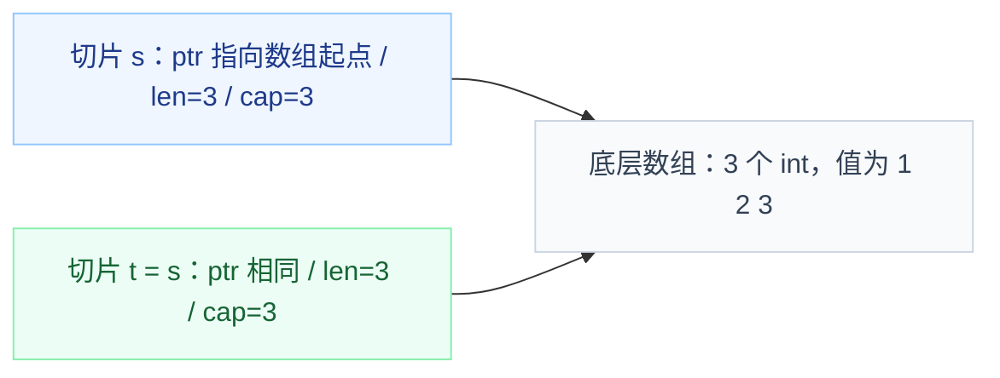
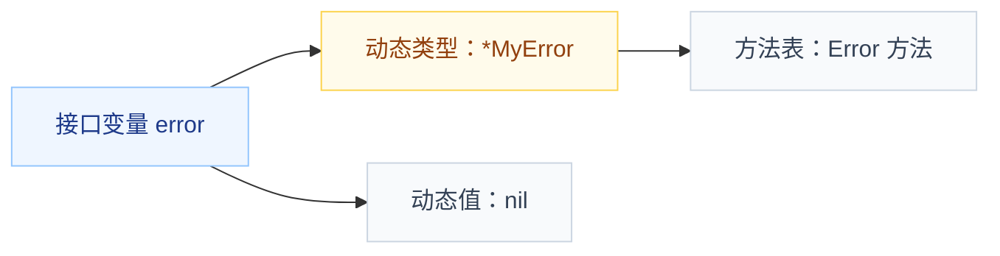

# Go复合类型与接口

> 这篇从切片和 map 的运行时结构讲起，经过结构体的布局与组合、指针与方法集、接口的表示与 nil 边界，再到类型断言和泛型约束，最后落到一个用接口组合折扣规则、用泛型统一金额计算的计价程序。
>
> 学完能为业务对象划清值语义与共享语义的边界，用嵌入和小接口替代继承，安全地做类型断言，并在重复算法上正确使用泛型。

> 版本基线（2026-11-13）：语言基线 Go 1.24+，示例在 Go 1.27.x 上验证。`slices`、`maps`、`clear` 的基础 API 需要 Go 1.21+，`maps.Keys` 的迭代器形式与 `slices.Collect` 需要 Go 1.23+，泛型类型别名需要 Go 1.24+，模块的 `go.mod` 写 `go 1.24`。

## 一、切片的头结构与共享语义

这章解决“为什么改了一个切片，另一个也变了”以及“append 之后原切片为什么没变”。切片不是数组，也不是引用类型，它是一个包含指针、长度、容量的值。

### 1.1 数组与切片的区别

数组的长度是类型的一部分，赋值和传参都复制整个数组；切片是数组的一段视图，赋值只复制三个机器字。

```go
arr := [3]int{1, 2, 3}
copyArr := arr
copyArr[0] = 99
fmt.Println(arr[0], copyArr[0]) // 1 99：数组是完整复制

s := []int{1, 2, 3}
t := s
t[0] = 99
fmt.Println(s[0], t[0]) // 99 99：两个切片头指向同一个底层数组
```



切片头在 64 位平台上占 24 字节（`unsafe.Sizeof(s)` 可验证），传参复制的就是这 24 字节。底层数组不在切片头里，所以“切片是值传递”和“元素被共享修改”并不矛盾。

> 边界：`len` 是当前可见的元素个数，`cap` 是从切片起点到底层数组末尾的容量。`s[1:3]` 的容量是 `cap(s)-1`，不是高索引减低索引；`cap(s)=4` 时结果是 3，不是 2。

### 1.2 append 的扩容规则

`append` 在容量足够时直接写底层数组，容量不足时分配新数组并复制。扩容后的容量由运行时决定，代码不能依赖具体数值。

```go
s := []int{1, 2, 3}
fmt.Println(len(s), cap(s)) // 3 3

s = append(s, 4)
fmt.Println(len(s), cap(s)) // 4 6（示例，具体容量随版本变化）
```

运行时的增长策略大致是：容量小于 256 时按约 2 倍增长，超过后按约 1.25 倍增长，最后再对齐到内存分配器的尺寸档。不同版本、不同元素大小会有差异，测试里断言 `cap` 的具体值一定会碎。

```go
// 片段：观察扩容点，输出随版本和平台变化
s := make([]int, 0)
prev := cap(s)
for i := 0; i < 1024; i++ {
	s = append(s, i)
	if cap(s) != prev {
		fmt.Printf("len=%d cap=%d\n", len(s), cap(s))
		prev = cap(s)
	}
}
```

预期输出（示例，Go 1.27 darwin/arm64 的前几行）：

```text
len=1 cap=1
len=2 cap=2
len=3 cap=4
len=5 cap=8
len=9 cap=16
...
```

> 边界：能预估大小时直接 `make([]T, 0, n)` 预分配，避免多次复制。不要用“扩容是 2 倍”做容量计算，那不是语言规范。

### 1.3 共享底层数组的三个陷阱

第一个陷阱是 `append` 写入了“以为不属于自己”的位置。

```go
a := []int{1, 2, 3, 4}
b := a[:2]        // len=2 cap=4
b = append(b, 99) // 容量够，直接写 a[2]
fmt.Println(a)    // [1 2 99 4]：原切片被改了
```

要隔断这种影响，用三索引切片把容量也切掉：

```go
a := []int{1, 2, 3, 4}
b := a[:2:2]       // len=2 cap=2
b = append(b, 99)  // 必须扩容，分配新数组
fmt.Println(a)     // [1 2 3 4]
fmt.Println(b)     // [1 2 99]
```

第二个陷阱是子切片让整个底层数组无法回收。从一个 100 万行的缓冲区取前 2 行，只要返回值还活着，100 万行的数组就活着。

```go
func firstTwo(xs []int) []int {
	return xs[:2] // 底层数组整体被引用，GC 无法回收
}

func firstTwoSafe(xs []int) []int {
	return slices.Clone(xs[:2]) // 只保留需要的两个元素
}
```

第三个陷阱是 `copy` 的目标长度由目标切片决定，不是源切片：

```go
src := []int{1, 2, 3}
dst := make([]int, 2)
n := copy(dst, src)
fmt.Println(n, dst) // 2 [1 2]：只复制了 dst 能容纳的部分
```

> 边界：`copy(dst, src)` 复制 `min(len(dst), len(src))` 个元素。需要完整副本用 `slices.Clone(src)`，它会按源长度分配。

### 1.4 切片作为参数与返回值

切片传参时，函数内修改元素调用方可见，但函数内的 `append` 只改本地切片头，调用方看不到新长度。

```go
func modify(xs []int) {
	xs[0] = 99         // 改底层数组，调用方可见
	xs = append(xs, 1) // 只改本地切片头，调用方 len 不变
}

xs := []int{10, 20}
modify(xs)
fmt.Println(xs) // [99 20]
```

因此“向切片追加”的函数必须把结果返回：

```go
func add(xs []int, v int) []int {
	return append(xs, v) // 调用方必须接收返回值
}
```

> 边界：不要写出“传切片进去、指望函数内 append 后调用方 len 变化”的接口。要么返回新切片，要么传 `*[]T`（少见且难读），要么让调用方自己 append。

### 1.5 slices 包的常用操作

Go 1.21 起标准库提供泛型版切片操作，替代了大量手写循环。

```go
xs := []int{3, 1, 2}

slices.Sort(xs)                     // 升序原地排序
fmt.Println(xs)                     // [1 2 3]
fmt.Println(slices.Contains(xs, 2)) // true
fmt.Println(slices.Index(xs, 3))    // 2
fmt.Println(slices.Max(xs), slices.Min(xs)) // 3 1

ys := slices.Clone(xs)              // 独立副本
fmt.Println(slices.Equal(xs, ys))   // true
```

| 函数 | 用途 | 注意 |
|---|---|---|
| `slices.Sort` | 有序类型排序 | 原地修改，不稳定 |
| `slices.SortFunc` | 自定义比较 | 比较函数返回 int |
| `slices.BinarySearch` | 二分查找 | 必须先排序 |
| `slices.Clone` | 复制切片 | nil 输入返回 nil |
| `slices.Delete` | 删除区间 | 尾部元素被清零 |
| `slices.Clip` | 去掉多余容量 | 防止底层数组泄漏 |

```go
type User struct {
	Name string
	Age  int
}

users := []User{{"alice", 30}, {"bob", 25}}
slices.SortFunc(users, func(a, b User) int {
	return b.Age - a.Age // 按年龄降序
})
fmt.Println(users) // [{alice 30} {bob 25}]
```

> 边界：`slices.SortFunc` 的比较函数必须满足严格弱序，返回 0 表示相等。用减法比较 `int` 在极端值上会溢出，通用写法是 `cmp.Compare(a.Age, b.Age)`。完整的 `slices`/`maps` 用法见 [Go集合与标准库](../02-Go常用库/01-Go集合与标准库.md)。

## 二、map 的行为与边界

这章解决 map 的初始化、键的选择、遍历顺序和并发写入。map 是哈希表，零值是 nil，nil map 可读不可写。

### 2.1 初始化与零值

```go
var m map[string]int       // nil map，只能读
fmt.Println(m["x"])        // 0，读取安全
// m["x"] = 1              // panic: assignment to entry in nil map

m = make(map[string]int)   // 初始化后才能写
m["x"] = 1

ages := map[string]int{"alice": 30} // 字面量初始化
```

带容量提示的 `make` 可以减少扩容时的 rehash，适合已知规模：

```go
m := make(map[int64]string, 10_000) // 提示容量，不是上限
fmt.Println(len(m))                 // 0
```

`clear` 删除全部键但保留已分配的桶，适合复用大 map：

```go
m := map[string]int{"a": 1, "b": 2}
clear(m)        // Go 1.21+
fmt.Println(len(m), m["a"]) // 0 0
```

> 边界：`make(map[K]V, n)` 的 `n` 只是容量提示，不会限制插入数量。需要限制数量时在业务层判断 `len(m)`。

### 2.2 键的可比较性与哈希

map 的键必须可比较。布尔、数值、字符串、指针、channel、接口，以及由这些字段组成的结构体都可以作键；切片、map、函数不行。接口作键时，动态值也必须可比较，否则运行时会 panic。

```go
type Point struct{ X, Y int }
grid := map[Point]string{{1, 2}: "a"} // 结构体字段都可比，合法

// type Bad struct{ Tags []string }
// map[Bad]int{} // 编译错误：Bad 含切片字段，不可比较
```

浮点键可以编译，但 `NaN` 不等于自身，写进去就取不出来：

```go
m := map[float64]int{}
m[math.NaN()] = 1
fmt.Println(len(m), m[math.NaN()]) // 1 0：写进去了，但读不回来
```

> 边界：金额、ID、时间这类业务键，用整数或字符串，不用浮点。结构体作键时，任何字段未来加上切片都会让整个类型失去可比较性，接口层要谨慎。

### 2.3 遍历顺序、删除与判空

map 的遍历顺序是随机的，运行时还会故意打乱起始位置。需要稳定输出时先取键排序。

```go
m := map[string]int{"a": 1, "b": 2, "c": 3}

keys := slices.Collect(maps.Keys(m)) // Go 1.23+，maps.Keys 返回迭代器
slices.Sort(keys)
for _, k := range keys {
	fmt.Println(k, m[k]) // a 1 / b 2 / c 3，顺序稳定
}

delete(m, "b") // 删除不存在的键是安全的，不会 panic
fmt.Println(len(m)) // 2
```

判断“键不存在”和“值恰好为零值”必须用逗号 ok：

```go
counts := map[string]int{"a": 0}
if v, ok := counts["a"]; ok {
	fmt.Println("存在", v) // 存在 0
}
if v, ok := counts["b"]; !ok {
	fmt.Println("不存在", v) // 不存在 0
}
```

> 边界：`for k := range m` 时删除当前键是安全的；遍历中新增键，新键可能被访问也可能不被访问，行为未定义，不要依赖。

### 2.4 并发写与 sync.Map

map 不是并发安全的。多个 goroutine 同时写会触发 runtime fatal，这个错误不是 panic，`recover` 捕获不到。

```go
m := map[int]int{}
var wg sync.WaitGroup
for i := 0; i < 100; i++ {
	wg.Add(1)
	go func(i int) {
		defer wg.Done()
		m[i] = i // 并发写：fatal error: concurrent map writes
	}(i)
}
wg.Wait()
```

需要并发访问时有两种选择：

```go
// 选择一：读写锁保护普通 map，适合读写都频繁、键集合会变化
var (
	mu sync.RWMutex
	m  = map[string]int{}
)

func inc(k string) {
	mu.Lock()
	m[k]++
	mu.Unlock()
}

func get(k string) int {
	mu.RLock()
	defer mu.RUnlock()
	return m[k]
}
```

```go
// 选择二：sync.Map，适合读多写少、键集合基本固定
var sm sync.Map

sm.Store("config", 1)
v, ok := sm.Load("config")
fmt.Println(v, ok) // 1 true
sm.Delete("config")
```

| 方案 | 适用场景 | 代价 |
|---|---|---|
| 普通 map + RWMutex | 读写均衡、需要 len/range | 锁竞争 |
| `sync.Map` | 读多写少、键固定 | 接口装箱、无 len |
| 分片 map | 超高并发计数 | 实现复杂 |

> 边界：`sync.Map` 保存的是 `any`，每次读写都有装箱和断言成本。计数场景优先 `atomic.Int64` 或分片锁，不要为了“无锁”把一切都塞进 `sync.Map`。

### 2.5 map 的内存行为

map 删除键不会立即缩小桶数组，大量增删后内存占用仍然偏高。周期性重建是常见做法。

```go
// 片段：大批量删除后重建，释放旧桶
func compact(m map[string][]byte) map[string][]byte {
	out := make(map[string][]byte, len(m))
	for k, v := range m {
		out[k] = v
	}
	return out
}
```

> 边界：Go 1.24 起 map 的 Swiss Table 实现改善了小 map 的内存和查找性能，但“删除不缩容”的语义没有变。长期运行的服务要监控 map 的常驻大小。

## 三、结构体：布局、嵌入与标签

这章解决“数据怎么组织、字段怎么复用、元数据放哪里”。结构体是 Go 唯一的用户自定义复合类型，组合优于继承。

### 3.1 字段布局与对齐

字段顺序影响结构体大小。对齐规则要求每个字段的地址是自身对齐值的倍数，编译器会在中间插入 padding。

```go
type Bad struct {
	A bool  // 1 字节
	B int64 // 对齐 8，前面补 7 字节
	C bool  // 1 字节，尾部补 7 字节
}

type Good struct {
	B int64 // 8
	A bool  // 1
	C bool  // 1，尾部补 6 字节
}

fmt.Println(unsafe.Sizeof(Bad{}), unsafe.Sizeof(Good{})) // 24 16
```

字段多的热点结构体，把大字段放前面能省内存；普通业务结构体不必为此牺牲可读性。

```go
// 片段：查看字段偏移
var b Bad
fmt.Println(unsafe.Offsetof(b.A), unsafe.Offsetof(b.B), unsafe.Offsetof(b.C))
// 0 8 16
```

> 边界：`unsafe` 依赖具体平台和版本，业务代码不要用它做序列化或内存布局约定。跨进程协议用明确的编码格式，不用结构体内存布局。

### 3.2 值语义与指针语义的选择

结构体赋值复制全部字段。小结构体按值传递清晰、无别名；大结构体或需要修改时用指针。

```go
type Config struct {
	Host string
	Port int
}

func withPort(c Config, port int) Config {
	c.Port = port // 改副本，调用方不受影响
	return c
}

func setPort(c *Config, port int) {
	c.Port = port // 改原对象
}
```

判断标准：

- 方法要修改接收者，用指针接收者；
- 结构体超过几个机器字，或包含 `sync.Mutex` 这类不可复制字段，用指针；
- 只读的小结构体（如 `time.Time`、坐标点）用值接收者；
- 同一个类型的接收者风格必须统一。

> 边界：包含 `sync.Mutex`、`sync.WaitGroup` 的结构体复制后，锁状态也被复制，`go vet` 会报 `copylocks`。这类类型应始终以指针传递，并且不要放进 map 的值里。

### 3.3 嵌入与字段、方法提升

嵌入（embedding）把匿名字段的字段和方法提升到外层，是组合复用的主要手段。

```go
type Base struct {
	ID int64
}

func (b Base) Describe() string {
	return fmt.Sprintf("base:%d", b.ID)
}

type Audit struct {
	CreatedBy string
}

type Record struct {
	Base
	Audit
	Title string
}

r := Record{
	Base:  Base{ID: 1},
	Audit: Audit{CreatedBy: "alice"},
	Title: "demo",
}
fmt.Println(r.ID, r.CreatedBy, r.Describe()) // 1 alice base:1
```

外层可以定义同名方法覆盖提升的方法：

```go
func (r Record) Describe() string {
	return fmt.Sprintf("record:%d:%s", r.ID, r.Title) // 覆盖 Base 的提升方法
}

fmt.Println(r.Describe()) // record:1:demo
fmt.Println(r.Base.Describe()) // base:1：仍可显式访问内层
```

> 边界：嵌入不是继承。`Record` 不是 `Base` 的子类型，不能把 `Record` 赋给 `Base` 变量，也不能靠嵌入实现运行时多态。多态用接口，复用用嵌入。

### 3.4 标签与反射入口

标签（tag）是挂在字段上的字符串元数据，`encoding/json`、校验库、ORM 通过反射读取。

```go
type APIOrder struct {
	ID          int64  `json:"id"`
	Customer    string `json:"customer"`
	AmountCents int64  `json:"amount_cents"`
	Status      string `json:"status,omitempty"`
	internal    string // 小写字段不会被 json 包导出
}

b, _ := json.Marshal(APIOrder{ID: 1, Customer: "alice", AmountCents: 12800})
fmt.Println(string(b))
// {"id":1,"customer":"alice","amount_cents":12800}
```

反射读取标签：

```go
t := reflect.TypeOf(APIOrder{})
f, _ := t.FieldByName("AmountCents")
fmt.Println(f.Tag.Get("json")) // amount_cents
```

> 边界：标签只是字符串，写错不会编译报错，只会静默失效。改完标签必须跑一次序列化测试。带标签的字段仍遵循导出规则，小写字段不会被外部包看到。

### 3.5 可比较性与零值可用

所有字段可比较的结构体可以作 map 键，也可以用 `==` 比较。

```go
type Version struct {
	Major, Minor int
}

a := Version{1, 2}
b := Version{1, 2}
fmt.Println(a == b) // true

m := map[Version]string{{1, 2}: "stable"}
fmt.Println(m[a]) // stable
```

结构体的零值应当可以直接使用，这是 Go API 设计的默认约定：

```go
type Buffer struct {
	data []byte
}

func (b *Buffer) Write(p []byte) (int, error) {
	b.data = append(b.data, p...) // 零值 Buffer 直接可用，无需构造函数
	return len(p), nil
}

var buf Buffer
buf.Write([]byte("hi"))
fmt.Println(string(buf.data)) // hi
```

> 边界：`time.Time` 可比较，但包含单调时钟和时区指针，业务比较应该用 `Equal`。含切片、map、函数字段的结构体不可比较，也不可作 map 键。

## 四、指针与方法集

这章解决“什么时候用指针、接口为什么有时满足有时不满足”。方法集规则直接决定类型能否赋给接口。

### 4.1 指针的基本规则

`&` 取地址，`*` 解引用，结构体指针用 `.` 直接访问字段。

```go
type Counter struct {
	n int
}

c := &Counter{}
c.n++ // 等价于 (*c).n++
fmt.Println(c.n) // 1
```

`new(T)` 返回指向零值的指针，`&T{}` 可以顺便初始化，后者更常用：

```go
p := new(int)          // *int，指向 0
q := &Counter{n: 1}    // *Counter
fmt.Println(*p, q.n)   // 0 1
```

Go 指针没有算术运算，不能像 C 那样移动指针。返回局部变量的地址是安全的，逃逸分析会把变量放到堆上。

```go
func NewCounter() *Counter {
	c := Counter{} // 逃逸到堆
	return &c
}
```

> 边界：nil 指针解引用会 panic。返回指针的 API 要么保证非 nil，要么让调用方显式判断。不要给每个参数都加指针来“避免复制”，小结构体按值更清楚。

### 4.2 值接收者与指针接收者

```go
func (c Counter) Value() int { // 值接收者：拿副本，适合只读
	return c.n
}

func (c *Counter) Inc() { // 指针接收者：修改原对象
	c.n++
}

c := Counter{}
c.Inc()               // 编译器自动写成 (&c).Inc()
fmt.Println(c.Value()) // 1
```

值接收者方法对指针和值都能调用（编译器自动取地址或解引用），但方法集不同：

| 类型 | 方法集包含 | 能实现的接口 |
|---|---|---|
| `T` | 值接收者方法 | 只含值接收者方法的接口 |
| `*T` | 值接收者 + 指针接收者方法 | 全部 |

```go
type Incrementer interface {
	Inc()
}

var _ Incrementer = (*Counter)(nil) // 编译期断言：*Counter 满足接口
// var _ Incrementer = Counter{}    // 编译错误：Inc 是指针接收者
```

> 边界：编译期断言 `var _ Iface = (*T)(nil)` 是确认接口实现的低成本手段，放在包级变量处，接口一改就编译失败。它不会执行，也不分配内存。

### 4.3 方法集与接口赋值

接口赋值看的是方法集，不是“有没有这个方法名”。

```go
type Stringer interface {
	String() string
}

type ID int64

func (id ID) String() string { return fmt.Sprintf("U%d", id) }

id := ID(42)
var s Stringer = id      // ID 的方法集包含 String，满足
fmt.Println(s.String())  // U42

var p Stringer = &id     // *ID 的方法集也包含 String，满足
fmt.Println(p.String())  // U42
```

如果方法写成指针接收者，值类型就不再满足接口：

```go
type Code int

func (c *Code) String() string { return fmt.Sprintf("C%d", int(*c)) }

code := Code(1)
// var s Stringer = code   // 编译错误：Code 的方法集没有 String
var s Stringer = &code     // 正确：取地址后满足
```

> 边界：把 `*T` 赋给接口后，接口里存的是指针。之后修改 `*T` 指向的对象，接口看到的值也变。把 `T` 赋给接口则是复制，后续修改原变量不影响接口。

### 4.4 逃逸分析与返回指针

变量分配在栈还是堆由编译器决定，可以用 `-gcflags=-m` 观察。

```bash
go build -gcflags='-m' ./...
```

预期输出（关键行）：

```text
./main.go:12:2: moved to heap: c
./main.go:20:6: &Counter{} escapes to heap
```

逃逸不等于慢，堆分配只是增加了 GC 压力。真正要避免的是热循环里的大对象反复逃逸。

```go
// 片段：闭包捕获也会让变量逃逸
func makeAdder(base int) func(int) int {
	return func(x int) int { return base + x } // base 逃逸到堆
}
```

> 边界：不要为了“零逃逸”把代码写扭曲。先测 `-benchmem`，确认分配是瓶颈再优化。返回小结构体值通常比返回指针更快，也更容易被内联。

### 4.5 nil 接收者

指针接收者方法允许接收者为 nil，只要方法内部先判断，就能提供“空对象”的默认行为。

```go
type List struct {
	head *node
}

type node struct {
	val  int
	next *node
}

func (l *List) Len() int {
	if l == nil {
		return 0 // nil 链表长度为 0，调用方不必先判空
	}
	n := 0
	for p := l.head; p != nil; p = p.next {
		n++
	}
	return n
}

var l *List
fmt.Println(l.Len()) // 0
```

> 边界：nil 接收者只在“零值有明确语义”时使用。读操作可以这么做，写操作仍应返回错误或 panic，不要静默丢弃。

## 五、接口的表示与设计

这章解决“接口变量里到底存了什么、为什么 `err != nil` 有时判断不出来”。接口是方法集合，值由动态类型和动态值两部分组成。

### 5.1 隐式实现与最小接口

类型实现了接口的全部方法就自动满足接口，不需要声明。接口应当小，常用接口通常只有一到两个方法。

```go
type Notifier interface {
	Notify(msg string) error
}

type Email struct{ Addr string }

func (e Email) Notify(msg string) error {
	fmt.Println("email", e.Addr, msg)
	return nil
}

type SMS struct{ Phone string }

func (s SMS) Notify(msg string) error {
	fmt.Println("sms", s.Phone, msg)
	return nil
}

func send(n Notifier, msg string) error {
	return n.Notify(msg)
}

send(Email{Addr: "a@example.com"}, "paid")
send(SMS{Phone: "13800000000"}, "paid")
```

标准库的接口几乎都是小接口：

```go
type Reader interface {
	Read(p []byte) (int, error)
}

type Writer interface {
	Write(p []byte) (int, error)
}

type ReadWriter interface {
	Reader
	Writer
}
```

> 边界：接口定义在消费方，不在实现方。为了让某个包能测试而提前抽大接口，会让实现方被迫依赖无关方法。先有需求，再抽接口。

### 5.2 接口的内部结构与 nil 判断

非空接口在运行时是“类型表指针 + 数据指针”，空接口是“类型指针 + 数据指针”。接口等于 nil 的条件是两部分都为 nil。

```go
type MyError struct{}

func (e *MyError) Error() string { return "my error" }

func returnsError() error {
	var p *MyError = nil
	return p // 接口里存了类型 *MyError，值 nil
}

fmt.Println(returnsError() == nil) // false
```



正确写法是“失败就返回 nil 接口”：

```go
func do() error {
	var p *MyError
	if p == nil {
		return nil // 接口整体为 nil
	}
	return p
}
```

> 边界：函数返回 `error` 时，不要返回“类型已确定、值为 nil”的具体指针。要么返回真正的 `nil`，要么返回非 nil 的错误值。`errors.Is` 也无法把 typed nil 变成 nil。

### 5.3 接口嵌入与能力组合

接口可以嵌入接口，组合出更大的能力集合，实现方只需实现组合后的全部方法。

```go
type Closer interface {
	Close() error
}

type ReadCloser interface {
	Reader
	Closer
}

type File struct{ name string }

func (f *File) Read(p []byte) (int, error) { return 0, io.EOF }
func (f *File) Close() error               { return nil }

var rc ReadCloser = &File{name: "a.txt"} // *File 同时实现两个方法
_ = rc
```

结构体嵌入接口也是常见技巧：外层只覆盖部分方法，其余委托给内层。

```go
type loggingReader struct {
	io.Reader // 未覆盖的方法自动委托
}

func (l loggingReader) Read(p []byte) (int, error) {
	n, err := l.Reader.Read(p)
	fmt.Println("read", n) // 只加日志，读逻辑复用
	return n, err
}
```

> 边界：嵌入 nil 接口会让外层方法调用 panic。构造时必须保证内层接口非 nil，或者在方法里判断。

### 5.4 接口与 any 的边界

`any` 是 `interface{}` 的别名，能装任意值，但取出来要断言，编译期类型检查全部丢失。

```go
var x any = "hello"

s, ok := x.(string)
fmt.Println(s, ok) // hello true

n, ok := x.(int)
fmt.Println(n, ok) // 0 false
```

装箱本身有成本：小整数、字符串进 `any` 可能触发堆分配。

```go
// 片段：接口切片比具体类型切片多一次装箱和断言
var items []any
for i := 0; i < 1000; i++ {
	items = append(items, i) // 每个 int 装箱
}
```

> 边界：`map[string]any` 只适合解析未知结构的 JSON 或做通用中间层。业务数据结构一旦确定，就用结构体；接口边界处尽早断言成具体类型。

## 六、类型断言与类型分支

这章解决“接口里的值怎么安全取回具体类型”。断言有两种形式：带逗号 ok 的安全形式和直接断言，后者失败会 panic。

### 6.1 逗号 ok 断言

```go
var v any = 42

if n, ok := v.(int); ok {
	fmt.Println("int", n) // int 42
}

if s, ok := v.(string); ok {
	fmt.Println("string", s)
} else {
	fmt.Println("not string") // not string
}
```

直接断言失败会 panic：

```go
var v any = 42
// s := v.(string)
// panic: interface conversion: interface {} is int, not string
```

> 边界：只有“类型不匹配就是程序 bug”的场景才用直接断言，例如内部约定某个 context key 一定存了 `*User`。边界输入一律用逗号 ok。

### 6.2 类型分支

类型 switch 按动态类型分派，一个变量可以匹配多个 case，`nil` 单独处理。

```go
func describe(v any) string {
	switch t := v.(type) {
	case nil:
		return "nil"
	case string:
		return "string:" + t
	case int, int64:
		return fmt.Sprintf("number:%v", t)
	case fmt.Stringer:
		return "stringer:" + t.String()
	default:
		return fmt.Sprintf("other:%T", t)
	}
}
```

case 的顺序有意义：接口类型的 case 会匹配所有实现该接口的类型。把 `fmt.Stringer` 放在 `string` 前面，字符串不会被它匹配（`string` 没有 `String()` 方法），但自定义类型可能同时满足多个 case，先匹配的生效。

```go
type Order struct{ ID int64 }

func (o Order) String() string { return fmt.Sprintf("order-%d", o.ID) }

fmt.Println(describe(Order{ID: 7})) // stringer:order-7
fmt.Println(describe(nil))          // nil
```

> 边界：类型参数 `T` 不能做类型 switch，编译器不知道 `T` 的具体类型。需要按类型分派时，用接口方法或传入 `reflect.Type`，不要试图 `v.(type)` 一个泛型值。

### 6.3 断言到接口

断言目标可以是具体类型，也可以是接口。断言到接口用于“只要它具备某个能力”。

```go
type Validator interface {
	Validate() error
}

type User struct{ Name string }

func (u User) Validate() error {
	if u.Name == "" {
		return errors.New("name is empty")
	}
	return nil
}

var v any = User{Name: "alice"}
if val, ok := v.(Validator); ok {
	fmt.Println(val.Validate()) // <nil>
}
```

> 边界：断言到接口只检查方法集，不检查业务语义。`Validate` 返回 nil 不代表对象一定合法，业务校验仍要执行。

### 6.4 断言的性能与替代方案

接口断言是一次运行时类型比较，热路径上大量断言会明显变慢。更好的做法是把行为放进接口方法。

```go
// 差：调用方遍历后逐个断言
func totalBad(items []any) int {
	sum := 0
	for _, it := range items {
		if n, ok := it.(int); ok {
			sum += n
		}
	}
	return sum
}

// 好：让元素自己提供求和能力，调用方不做类型判断
type Summable interface {
	Value() int
}

func totalGood(items []Summable) int {
	sum := 0
	for _, it := range items {
		sum += it.Value()
	}
	return sum
}
```

> 边界：接口方法调用本身也有动态分派成本，但比“断言 + 分支”更可维护。只有确实需要异构容器时才用 `[]any`。

## 七、泛型：约束、类型参数与实例化

这章解决“同一套算法要适配多种类型”时的重复代码。泛型在编译期实例化，不做运行时装箱，和接口是互补关系。

### 7.1 泛型函数与类型推断

```go
func Map[T, U any](xs []T, f func(T) U) []U {
	out := make([]U, 0, len(xs)) // 预分配，长度与输入一致
	for _, x := range xs {
		out = append(out, f(x))
	}
	return out
}

nums := []int{1, 2, 3}
strs := Map(nums, strconv.Itoa)
fmt.Println(strs) // [1 2 3]
```

`Filter` 只涉及一个类型参数：

```go
func Filter[T any](xs []T, keep func(T) bool) []T {
	out := make([]T, 0, len(xs))
	for _, x := range xs {
		if keep(x) {
			out = append(out, x)
		}
	}
	return out
}

evens := Filter(nums, func(n int) bool { return n%2 == 0 })
fmt.Println(evens) // [2]
```

> 边界：泛型函数不能有类型参数专属的方法，也不能对 `T` 做算术运算，除非约束允许。`T` 的零值用 `var zero T` 获取。

### 7.2 约束与底层类型

约束是接口，描述类型参数允许的操作。`~` 表示“底层类型是”，让自定义类型也能匹配。

```go
type Number interface {
	~int | ~int64 | ~float64
}

func Sum[T Number](xs []T) T {
	var total T
	for _, x := range xs {
		total += x // 约束里有数值类型，+ 才合法
	}
	return total
}

type Cents int64

fmt.Println(Sum([]int{1, 2, 3}))          // 6
fmt.Println(Sum([]Cents{100, 250}))       // 350：Cents 的底层类型是 int64
fmt.Println(Sum([]float64{1.5, 2.5}))     // 4
```

`comparable` 是预声明约束，允许 `==`、`!=` 和作 map 键：

```go
func Unique[T comparable](xs []T) []T {
	seen := make(map[T]struct{}, len(xs))
	out := make([]T, 0, len(xs))
	for _, x := range xs {
		if _, ok := seen[x]; ok {
			continue
		}
		seen[x] = struct{}{} // 空结构体不占内存，只作集合标记
		out = append(out, x)
	}
	return out
}

fmt.Println(Unique([]string{"a", "b", "a"})) // [a b]
```

> 边界：约束里写 `int | int64` 只匹配这两个具体类型；写 `~int | ~int64` 才包含底层类型相同的自定义类型。约束越窄，编译器能做的优化越多。

### 7.3 泛型类型与方法

泛型类型把类型参数带进结构体，方法沿用同一组参数。

```go
type Stack[T any] struct {
	items []T
}

func (s *Stack[T]) Push(v T) {
	s.items = append(s.items, v)
}

func (s *Stack[T]) Pop() (T, bool) {
	var zero T
	if len(s.items) == 0 {
		return zero, false // 空栈返回零值和 false，不 panic
	}
	v := s.items[len(s.items)-1]
	s.items = s.items[:len(s.items)-1]
	return v, true
}

var st Stack[string]
st.Push("a")
st.Push("b")
v, ok := st.Pop()
fmt.Println(v, ok) // b true
```

> 边界：泛型类型的方法不能引入新的类型参数。`func (s *Stack[T]) Map[U any](...)` 不合法，需要写成普通泛型函数，接收 `*Stack[T]`。

### 7.4 方法集约束与接口的取舍

约束可以要求方法，这时泛型参数只能调用约束里的方法：

```go
type Line interface {
	Subtotal() Cents
}

func TotalOf[T Line](items []T) Cents {
	var total Cents
	for _, it := range items {
		total += it.Subtotal()
	}
	return total
}
```

这和“参数写成 `[]Line`”效果接近，差别在存储和分派：

| 写法 | 存储 | 分派 | 适用 |
|---|---|---|---|
| `[]T` + 方法约束 | 具体类型连续存储 | 编译期确定 | 同类型集合、性能敏感 |
| `[]Line` | 接口，含类型指针 | 运行时动态分派 | 异构实现集合 |

> 边界：泛型不能替代接口。需要运行时切换实现、插件式扩展、异构集合时用接口；算法相同、元素类型不同时用泛型。两者经常组合：接口定义能力，泛型写通用算法。

### 7.5 泛型的使用边界

泛型不是默认选择。以下情况不该引入类型参数：

- 只有一个具体类型在用，直接写具体类型；
- 逻辑依赖运行时类型判断，泛型帮不上忙；
- 为了“看起来通用”把简单函数改成 `func Do[T any](v T)`，调用方还要显式写类型。

```go
// 过度泛型：没有任何类型关系，只是把参数转了一圈
func Identity[T any](v T) T { return v }

// 合理泛型：算法与类型无关，但需要类型间关系
func Keys[K comparable, V any](m map[K]V) []K {
	out := make([]K, 0, len(m))
	for k := range m {
		out = append(out, k)
	}
	return out
}
```

> 边界：Go 1.24 起支持泛型类型别名（`type Set[T comparable] = map[T]struct{}`），但别名不产生新类型，方法仍不能定义在别名上。需要方法就用定义类型。

## 八、最佳实践案例

### 8.1 案例背景

一个电商团队把促销规则从硬编码改成配置驱动。现状是三种折扣写在一个 300 行的 `price()` 函数里，用 `if kind == "percent"` 分支；新增“满减”要改函数、改测试、改文档，且金额用 `float64` 累加，出现过 0.01 元的对账差异。

目标与约束：

- 金额全程用 `int64` 分表示，只在展示时格式化；
- 规则实现统一接口，新增规则不改计价流程；
- 规则从 `map[string]any` 配置解析，非法配置要返回可读错误；
- 计价结果逐行可追溯，每步折扣前后金额都能打印；
- 核心包可单测，`main` 只负责组装和输出。

示例订单：`KB-01` 单价 99.00 元买 2 件，`MS-02` 单价 150.00 元买 1 件，原价 348.00 元。规则依次为满 300 减 40、会员 85 折、满 250 减 20。

### 8.2 案例实操

初始化模块和目录：

```bash
mkdir -p pricing/internal/pricing
cd pricing
go mod init example.com/pricing
```

`internal/pricing/money.go`，金额类型和泛型求和：

```go
package pricing

import "fmt"

// Cents 用分表示金额，整型运算不会出现浮点误差。
type Cents int64

// String 让金额在日志和表格里按元展示，同时满足 fmt.Stringer。
func (c Cents) String() string {
	sign := ""
	if c < 0 {
		sign = "-"
		c = -c
	}
	return fmt.Sprintf("%s¥%d.%02d", sign, int64(c)/100, int64(c)%100)
}

// Line 只需要“能算出小计”，泛型约束用方法集表达，比空接口更安全。
type Line interface {
	Subtotal() Cents
}

// TotalOf 对同类型条目求和；T 在编译期确定，不经过接口装箱。
func TotalOf[T Line](items []T) Cents {
	var total Cents
	for _, it := range items {
		total += it.Subtotal()
	}
	return total
}
```

`internal/pricing/discount.go`，接口、实现和组合：

```go
package pricing

import (
	"errors"
	"fmt"
	"strings"
)

// Discount 是一种折扣规则；String 用于输出规则名，便于对账。
type Discount interface {
	fmt.Stringer
	Apply(amount Cents) Cents
}

// Percent 表示按比例打折，Rate=85 表示 85 折。
type Percent struct {
	Label string
	Rate  int
}

func (p Percent) String() string { return p.Label }

func (p Percent) Apply(amount Cents) Cents {
	// 先乘后除，最后一步才截断，减少中间精度损失。
	return amount * Cents(p.Rate) / 100
}

// Threshold 表示满减，Min 是门槛，Off 是减免额。
type Threshold struct {
	Label string
	Min   Cents
	Off   Cents
}

func (t Threshold) String() string { return t.Label }

func (t Threshold) Apply(amount Cents) Cents {
	if amount < t.Min {
		return amount // 未达门槛，保持原样
	}
	next := amount - t.Off
	if next < 0 {
		return 0 // 减免不能把金额减成负数
	}
	return next
}

// Chain 把多条规则按顺序串起来；顺序由业务确认后写进配置。
type Chain []Discount

func (c Chain) Apply(amount Cents) Cents {
	for _, d := range c {
		amount = d.Apply(amount)
	}
	return amount
}

func (c Chain) String() string {
	names := make([]string, len(c))
	for i, d := range c {
		names[i] = d.String()
	}
	return strings.Join(names, " + ")
}
```

`internal/pricing/cart.go`，条目与计价流程：

```go
package pricing

import "fmt"

type Item struct {
	SKU  string
	Unit Cents
	Qty  int
}

func (i Item) Subtotal() Cents {
	if i.Qty <= 0 {
		return 0 // 数量非法时不参与计价，避免负数抵扣
	}
	return i.Unit * Cents(i.Qty)
}

type Cart struct {
	Items     []Item
	Discounts Chain
}

// Price 返回最终金额和逐行轨迹；轨迹让每一步都能对账。
func (c Cart) Price() (Cents, []string) {
	amount := TotalOf(c.Items)
	lines := make([]string, 0, len(c.Discounts)+1)
	lines = append(lines, fmt.Sprintf("原价\t%s", amount))

	for _, d := range c.Discounts {
		next := d.Apply(amount)
		lines = append(lines, fmt.Sprintf("%s\t%s -> %s", d, amount, next))
		amount = next
	}
	return amount, lines
}
```

`internal/pricing/config.go`，从 `map[string]any` 解析规则：

```go
package pricing

import (
	"errors"
	"fmt"
)

// ParseDiscount 把 JSON 解码后的通用 map 转成具体规则。
func ParseDiscount(raw map[string]any) (Discount, error) {
	kind, ok := raw["type"].(string)
	if !ok {
		return nil, errors.New("discount: missing type")
	}
	label, _ := raw["label"].(string) // label 可有可无，缺失时用类型名补

	switch kind {
	case "percent":
		rate, ok := raw["rate"].(float64) // encoding/json 把数字解成 float64
		if !ok || rate <= 0 || rate > 100 {
			return nil, fmt.Errorf("discount %q: rate must be in (0,100]", label)
		}
		return Percent{Label: label, Rate: int(rate)}, nil

	case "threshold":
		min, okMin := raw["min_cents"].(float64)
		off, okOff := raw["off_cents"].(float64)
		if !okMin || !okOff || min <= 0 || off <= 0 || off > min {
			return nil, fmt.Errorf("discount %q: invalid min/off", label)
		}
		return Threshold{
			Label: label,
			Min:   Cents(int64(min)),
			Off:   Cents(int64(off)),
		}, nil

	default:
		// 未知类型显式报错，避免配置写错后静默不生效
		return nil, fmt.Errorf("discount: unknown type %q", kind)
	}
}
```

`main.go` 组装并输出：

```go
package main

import (
	"fmt"

	"example.com/pricing/internal/pricing"
)

func main() {
	cart := pricing.Cart{
		Items: []pricing.Item{
			{SKU: "KB-01", Unit: 9900, Qty: 2},
			{SKU: "MS-02", Unit: 15000, Qty: 1},
		},
		Discounts: pricing.Chain{
			pricing.Threshold{Label: "满300减40", Min: 30000, Off: 4000},
			pricing.Percent{Label: "会员85折", Rate: 85},
			pricing.Threshold{Label: "满250减20", Min: 25000, Off: 2000},
		},
	}

	total, lines := cart.Price()
	for _, line := range lines {
		fmt.Println(line)
	}
	fmt.Println("应付", total)
}
```

`internal/pricing/cart_test.go`，覆盖计价、边界和配置解析：

```go
package pricing

import "testing"

func TestCartPrice(t *testing.T) {
	cart := Cart{
		Items: []Item{
			{SKU: "KB-01", Unit: 9900, Qty: 2},
			{SKU: "MS-02", Unit: 15000, Qty: 1},
		},
		Discounts: Chain{
			Threshold{Label: "满300减40", Min: 30000, Off: 4000},
			Percent{Label: "会员85折", Rate: 85},
			Threshold{Label: "满250减20", Min: 25000, Off: 2000},
		},
	}

	got, lines := cart.Price()
	if got != 24180 {
		t.Fatalf("Price() = %s, want ¥241.80", got)
	}
	if len(lines) != 4 { // 原价 + 三条规则
		t.Fatalf("got %d lines, want 4", len(lines))
	}
}

func TestThresholdNeverNegative(t *testing.T) {
	d := Threshold{Label: "超额减免", Min: 1000, Off: 1500}
	if got := d.Apply(1000); got != 0 {
		t.Fatalf("Apply() = %d, want 0", got)
	}
	if got := d.Apply(999); got != 999 {
		t.Fatalf("Apply() below min = %d, want 999", got)
	}
}

func TestParseDiscount(t *testing.T) {
	tests := []struct {
		name    string
		raw     map[string]any
		wantErr bool
	}{
		{"percent", map[string]any{"type": "percent", "label": "9折", "rate": 90.0}, false},
		{"threshold", map[string]any{"type": "threshold", "label": "满100减10", "min_cents": 10000.0, "off_cents": 1000.0}, false},
		{"unknown", map[string]any{"type": "coupon"}, true},
		{"bad rate", map[string]any{"type": "percent", "rate": 120.0}, true},
		{"missing type", map[string]any{"label": "x"}, true},
	}

	for _, tt := range tests {
		t.Run(tt.name, func(t *testing.T) {
			_, err := ParseDiscount(tt.raw)
			if (err != nil) != tt.wantErr {
				t.Fatalf("ParseDiscount() error = %v, wantErr %v", err, tt.wantErr)
			}
		})
	}
}
```

运行测试与程序：

```bash
go fmt ./...
go vet ./...
go test -v ./...
go run .
```

预期输出：

```text
=== RUN   TestCartPrice
--- PASS: TestCartPrice (0.00s)
=== RUN   TestThresholdNeverNegative
--- PASS: TestThresholdNeverNegative (0.00s)
=== RUN   TestParseDiscount
=== RUN   TestParseDiscount/percent
=== RUN   TestParseDiscount/threshold
=== RUN   TestParseDiscount/unknown
=== RUN   TestParseDiscount/bad_rate
=== RUN   TestParseDiscount/missing_type
--- PASS: TestParseDiscount (0.00s)
PASS
ok  	example.com/pricing/internal/pricing	0.003s
原价	¥348.00
满300减40	¥348.00 -> ¥308.00
会员85折	¥308.00 -> ¥261.80
满250减20	¥261.80 -> ¥241.80
应付 ¥241.80
```

### 8.3 案例结果

计价从 348.00 经过三步得到 241.80，与手工计算一致，每一步都能打印出来对账。新增“第二件半价”只需增加一个实现 `Discount` 的类型，并在 `ParseDiscount` 加一个 case；`Cart.Price` 的计价循环不动。

| 指标 | 改造前 | 本案例 |
|---|---|---|
| 新增规则改动范围 | 计价函数 + 测试 | 新类型 + 一个 case |
| 金额精度 | `float64` 累加 | `int64` 分 |
| 非法配置 | 静默跳过 | 返回带规则名的错误 |
| 计价过程 | 只看到最终价 | 逐行前后金额 |
| 类型检查 | `any` 到处断言 | 接口 + 泛型约束 |

失败模式与复盘：

- 最初用 `[]any` 存条目再逐个断言，泛型 `TotalOf` 改成方法集约束后，类型错误在编译期暴露；
- `Threshold.Apply` 没有把结果夹到 0，配置 `off > min` 时出现负金额；补了 `next < 0` 分支，并在 `ParseDiscount` 里提前拒绝 `off > min`；
- `Percent.Rate` 用 `int`，直接构造字面量可以传 0 或 120，`Apply` 会把金额算成 0 或放大；约定生产路径只走 `ParseDiscount`，测试里才直接构造；
- `ParseDiscount` 把 `float64` 直接转成 `int`/`int64`，配置里出现小数会被截断；生产解析层要显式拒绝非整数比例和分值；
- 规则顺序写进配置后，测试只断言最终金额，换顺序仍可能通过；补了 `lines` 长度和逐行断言，顺序变更会被发现；
- `Chain.String()` 在空链时返回空串，日志里看不出“没有规则”；输出层改为显式打印“无优惠”，避免误判。
