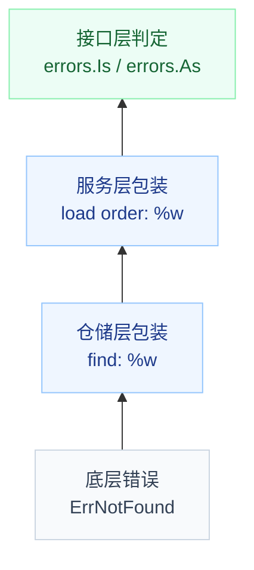

# Go错误处理与IO

> 这篇从 `error` 接口和错误值讲起，经过包装与拆包、panic/recover 的边界，再到文件读写、`io` 流、`bufio` 缓冲、JSON 编解码和排障，最后落到一个把 JSONL 订单清洗成汇总 JSON 的工具。
>
> 学完能设计一条可追踪的错误链，区分可重试错误和程序缺陷，安全地读写文件与流，并用流式 JSON 处理大输入。

> 版本基线（2026-11-13）：Go 1.24+，示例在 Go 1.27.x 验证。`errors.Join` 与多 `%w` 包装需要 Go 1.20+，`errors.Is/As` 需要 Go 1.13+。

## 一、error 接口与错误值

这章解决“错误怎么表示、怎么判断”。Go 的错误是普通值，不是异常；调用方显式检查，控制流一眼可见。

### 1.1 error 是一个接口

`error` 只要求一个方法：

```go
type error interface {
	Error() string
}
```

任何实现了 `Error() string` 的类型都是错误。标准库用 `errors.New` 和 `fmt.Errorf` 创建最普通的错误值：

```go
var ErrNotFound = errors.New("not found")

func find(id int) (string, error) {
	if id <= 0 {
		return "", ErrNotFound
	}
	return "alice", nil
}
```

错误信息写成小写、不带结尾标点，因为它经常被拼进更长的上下文：

```text
open /etc/app.json: permission denied
```

> 边界：错误信息不是 API 契约。调用方不应该比较 `err.Error() == "not found"`，改一个字就失效；判断用哨兵值或错误类型，见下一章。

### 1.2 哨兵错误与自定义错误类型

哨兵错误（sentinel error）是包级导出的固定值，调用方用 `errors.Is` 判断：

```go
package store

var (
	ErrNotFound = errors.New("not found")
	ErrConflict = errors.New("conflict")
)
```

需要携带字段时定义错误类型：

```go
type ValidationError struct {
	Field string
	Value any
}

func (e *ValidationError) Error() string {
	return fmt.Sprintf("field %s: invalid value %v", e.Field, e.Value)
}
```

```go
func validate(age int) error {
	if age < 0 || age > 150 {
		return &ValidationError{Field: "age", Value: age} // 指针：调用方用 As 取字段
	}
	return nil
}
```

| 方式 | 适用 | 调用方判断 |
|---|---|---|
| `errors.New` 哨兵 | 固定类别，无额外数据 | `errors.Is` |
| 自定义类型 | 需要字段、分类处理 | `errors.As` |
| `fmt.Errorf` 一次包装 | 加动作和路径上下文 | `errors.Is/As` 沿链查找 |
| `errors.Join` | 多个独立错误一起返回 | `errors.Is/As` 任一匹配 |

> 边界：哨兵错误适合“调用方需要分支处理”的少数类别，不要给每个错误都建哨兵。错误越多，包的导出面越大，兼容负担越重。

### 1.3 错误判定：从 == 到 errors.Is

直接比较只对同一个值有效，包装一层后就失效：

```go
wrapped := fmt.Errorf("load config: %w", ErrNotFound)
fmt.Println(wrapped == ErrNotFound)      // false
fmt.Println(errors.Is(wrapped, ErrNotFound)) // true
```

`errors.Is(err, target)` 的行为：

1. 如果 `err == target`，返回 true；
2. 如果 `err` 实现了 `Is(error) bool`，调用它；
3. 否则拆开 `Unwrap()`，继续比较，直到链尾。

```go
type retryableError struct{ err error }

func (e *retryableError) Error() string { return e.err.Error() }
func (e *retryableError) Unwrap() error { return e.err }
func (e *retryableError) Is(target error) bool {
	return target == ErrNotFound // 自定义判定：NotFound 视为可重试
}
```

> 边界：`errors.Is` 的比较目标应该是值或实现 `Is` 的类型，不要传一个新 `errors.New("...")`，那永远不相等。包装链很深时 `Is` 是线性遍历，热路径上可先缓存判断结果。

### 1.4 错误的创建位置与信息层次

错误应该在“知道上下文”的地方加信息，在“能处理”的地方处理。同一个错误只在边界加一次上下文。

```go
func LoadConfig(path string) (*Config, error) {
	data, err := os.ReadFile(path)
	if err != nil {
		return nil, fmt.Errorf("read config %s: %w", path, err) // 加文件路径
	}
	var cfg Config
	if err := json.Unmarshal(data, &cfg); err != nil {
		return nil, fmt.Errorf("parse config %s: %w", path, err) // 加动作
	}
	return &cfg, nil
}
```

最终打印出来是一条可读的链：

```text
read config /etc/app.json: open /etc/app.json: permission denied
```

> 边界：每层都写 `failed to` 会让信息重复。约定每层只加“动作 + 关键参数”，最外层打印一次即可。

## 二、包装、拆包与错误链

这章解决“错误经过多层调用后怎么保留原因、怎么取回具体类型”。包装不改变错误值，只增加上下文。

### 2.1 %w 与 %v 的区别

```go
base := ErrNotFound

wrapped := fmt.Errorf("query user: %w", base) // 包装，保留错误链
replaced := fmt.Errorf("query user: %v", base) // 只格式化，链断了

fmt.Println(errors.Is(wrapped, base))  // true
fmt.Println(errors.Is(replaced, base)) // false
```

`%w` 只能用于 `error` 类型，且每个格式化动词只能对应一个错误参数（Go 1.20 起允许多个 `%w`）。

```go
err := fmt.Errorf("load %s: %w", path, err)
```



> 边界：只在需要保留原因时用 `%w`。把内部错误暴露给调用方，等于把实现细节变成契约；对外的 API 边界可以只返回哨兵错误或自定义类型，把细节写进日志。

### 2.2 Unwrap、Is、As 的语义

```go
func Unwrap(err error) error
func Is(err, target error) bool
func As(err error, target any) bool
```

- `Unwrap` 只拆一层，返回 `Unwrap() error` 的结果；它不展开 `errors.Join` 的 `Unwrap() []error`，多错误由 `Is`/`As` 遍历；业务代码很少直接调用；
- `Is` 沿链查找“是不是这个错误”；
- `As` 沿链查找“是不是这个类型”，找到后把值写入 `target` 指向的变量。

```go
type NotFoundError struct {
	Resource string
	ID       string
}

func (e *NotFoundError) Error() string {
	return fmt.Sprintf("%s %s not found", e.Resource, e.ID)
}

func load(id string) error {
	return fmt.Errorf("load order: %w", &NotFoundError{Resource: "order", ID: id})
}

var nf *NotFoundError
if errors.As(load("A-1"), &nf) {
	fmt.Println(nf.Resource, nf.ID) // order A-1
}
```

`As` 的 target 必须是非 nil 指针，指向实现 `error` 的类型或任意接口；否则 panic：

```go
// var nf NotFoundError
// errors.As(err, nf)   // panic：target 不是指针
// errors.As(err, &nf)  // 正确
```

> 边界：`errors.As` 找到第一个匹配就停止。链上有多个同类型错误时，只有最外层那个能被取到；需要全部结果用 `errors.Join` 配合自定义遍历。

### 2.3 多错误合并

Go 1.20 起 `errors.Join` 把多个错误合成一个，`Is/As` 会检查每一个：

```go
err := errors.Join(
	fmt.Errorf("validate name: %w", ErrInvalid),
	fmt.Errorf("validate age: %w", ErrInvalid),
)
fmt.Println(err) // 两行错误信息
fmt.Println(errors.Is(err, ErrInvalid)) // true
```

`fmt.Errorf` 也可以带多个 `%w`，效果等价于 `Join`：

```go
err := fmt.Errorf("import failed: %w; %w", errA, errB)
```

批量校验是典型场景：一次返回所有字段的问题，而不是发现第一个就返回。

```go
func validateAll(u User) error {
	var errs []error
	if u.Name == "" {
		errs = append(errs, fmt.Errorf("name: %w", ErrInvalid))
	}
	if u.Age < 0 {
		errs = append(errs, fmt.Errorf("age: %w", ErrInvalid))
	}
	return errors.Join(errs...) // 没有错误时返回 nil
}
```

> 边界：`errors.Join()` 不带参数返回 nil，可以直接作为累加器的收尾。合并后的错误字符串用换行分隔，写日志时注意多行格式。

### 2.4 自定义错误的 Unwrap 与 Is

包装链可以自己实现，用于把底层错误映射成领域错误：

```go
type QueryError struct {
	Op  string
	Err error
}

func (e *QueryError) Error() string { return e.Op + ": " + e.Err.Error() }
func (e *QueryError) Unwrap() error { return e.Err }

func (e *QueryError) Is(target error) bool {
	// 数据库连接失败归为“服务不可用”，上层可以统一重试
	return target == ErrUnavailable && errors.Is(e.Err, syscall.ECONNREFUSED)
}
```

> 边界：`Is` 方法里不要再调用 `errors.Is(e, target)`，会无限递归。只比较底层原因或字段，不要比较错误字符串。

### 2.5 包装一次，处理一次

同一条错误链上只应该有一次“翻译成用户可读信息”和一次“决定是否重试”。

```go
func (s *Service) Get(id string) (*Order, error) {
	o, err := s.repo.Find(id)
	if err != nil {
		return nil, fmt.Errorf("get order %s: %w", id, err) // 加业务上下文，不判定
	}
	return o, nil
}

func (h *Handler) Get(w http.ResponseWriter, r *http.Request) {
	o, err := h.svc.Get(r.PathValue("id"))
	switch {
	case errors.Is(err, store.ErrNotFound):
		http.Error(w, "not found", http.StatusNotFound)
	case err != nil:
		h.log.Error("get order", "err", err) // 细节进日志
		http.Error(w, "internal error", http.StatusInternalServerError)
	default:
		writeJSON(w, o)
	}
}
```

> 边界：不要在每个函数里 `log` 一次再 `return err`，同一条错误会打印多遍。日志只在最终处理点写，中间层只包装。

## 三、panic、recover 与进程退出

这章解决“什么情况该 panic、recover 放在哪、为什么日志里看不到 defer 的输出”。panic 是程序缺陷的信号，不是业务错误的通道。

### 3.1 panic 的展开过程

panic 会沿调用栈向上展开，执行每一层已经注册的 defer，然后终止进程，除非被 recover 拦住。

```go
func main() {
	defer fmt.Println("main defer")
	a()
}

func a() {
	defer fmt.Println("a defer")
	panic("boom")
}
```

预期输出：

```text
a defer
main defer
panic: boom

goroutine 1 [running]:
...
```

> 边界：panic 的值可以是任意类型，`runtime.Error` 表示运行时错误（越界、nil 解引用）。日志里只打印 `panic: boom` 会丢掉堆栈，生产环境用 `debug.Stack()` 或让进程崩溃由 supervisor 收集。

### 3.2 recover 的正确位置

`recover` 只在 defer 调用的函数里直接执行才有效，包一层普通函数就失效：

```go
func safe(fn func()) (err error) {
	defer func() {
		if r := recover(); r != nil {
			err = fmt.Errorf("recovered: %v", r) // 必须直接写在 defer 的闭包里
		}
	}()
	fn()
	return nil
}

fmt.Println(safe(func() { panic("x") })) // recovered: x
```

```go
func badRecover() {
	defer recover() // 无效：recover 不是由 defer 的函数调用，panic 继续
	panic("boom")
}
```

转换 panic 为错误时，保留类型信息：

```go
func runTask(fn func() error) (err error) {
	defer func() {
		if r := recover(); r != nil {
			err = fmt.Errorf("task panic: %v\n%s", r, debug.Stack())
		}
	}()
	return fn()
}
```

> 边界：recover 之后当前函数不会从 panic 点继续，而是从 defer 之后返回。已经修改了一半的状态要显式回滚，recover 不会自动恢复数据。

### 3.3 goroutine 里的 panic

主 goroutine 的 panic 会终止进程；子 goroutine 的 panic 同样会终止整个进程，而且不会被其他 goroutine 的 recover 捕获。

```go
func goSafe(fn func()) {
	go func() {
		defer func() {
			if r := recover(); r != nil {
				log.Printf("goroutine panic: %v", r) // 每个 goroutine 自己兜底
			}
		}()
		fn()
	}()
}
```

> 边界：后台任务、消息消费和自建的 HTTP 服务要在 goroutine 入口加 recover；`net/http` 会恢复 handler 的 panic，但仍建议用中间件统一记录并返回 500。recover 之后这个 goroutine 结束，不要指望它继续处理队列。

### 3.4 error、panic 与 os.Exit 的选择

| 机制 | 适用场景 | 后果 |
|---|---|---|
| `error` | 可预期失败：文件不存在、参数非法、超时 | 调用方决定重试、降级或返回 |
| `panic` | 程序缺陷：不变量被破坏、配置不可能为空 | 展开 defer，未恢复则进程退出 |
| `os.Exit` | 命令行工具需要指定退出码 | 不执行 defer，不刷新缓冲 |

```go
func main() {
	if err := run(); err != nil {
		fmt.Fprintln(os.Stderr, "error:", err)
		os.Exit(1) // 统一在 main 退出，run 内部照常 defer
	}
}
```

`log.Fatal` 内部调用 `os.Exit(1)`，defer 不会执行：

```go
f, err := os.Create("out.tmp")
if err != nil {
	log.Fatal(err) // 直接退出，已打开的资源不会关闭
}
defer f.Close()
```

> 边界：库代码不要 panic，也不要调用 `os.Exit`。把错误返回给调用方，由 `main` 决定退出码；`init` 里更不要 panic，测试和工具链都会受影响。

## 四、文件与目录操作

这章解决“文件怎么打开、什么时候用一次性读写、目录怎么遍历、写文件怎么避免半成品”。文件操作的第一原则是：打开成功后立刻安排关闭。

### 4.1 打开、创建与权限

```go
f, err := os.Open("data.csv") // 只读
if err != nil {
	return fmt.Errorf("open data.csv: %w", err)
}
defer f.Close()

out, err := os.OpenFile("out.csv",
	os.O_CREATE|os.O_WRONLY|os.O_TRUNC, // 不存在则创建，存在则截断
	0o644)                             // 受 umask 影响，实际权限通常更小
if err != nil {
	return fmt.Errorf("create out.csv: %w", err)
}
defer out.Close()
```

常用 flag：

| flag | 含义 | 典型组合 |
|---|---|---|
| `O_RDONLY` | 只读 | `os.Open` 的默认值 |
| `O_WRONLY` | 只写 | 配合 `O_CREATE` |
| `O_RDWR` | 读写 | 需要原地修改 |
| `O_APPEND` | 追加 | 日志文件 |
| `O_TRUNC` | 截断 | 重写整个文件 |
| `O_EXCL` | 已存在则失败 | 配合 `O_CREATE` 做锁文件 |

> 边界：`0o644` 只是请求权限，最终权限是 `0644 &^ umask`。需要严格权限（如私钥）时先创建再用 `os.Chmod`，并确认所在文件系统支持。

### 4.2 一次性读写与流式读写

小文件用 `os.ReadFile` / `os.WriteFile`，代码短且内部处理了打开和关闭：

```go
data, err := os.ReadFile("config.json")
if err != nil {
	return fmt.Errorf("read config: %w", err)
}

if err := os.WriteFile("config.bak", data, 0o644); err != nil {
	return fmt.Errorf("write backup: %w", err)
}
```

大文件必须流式处理，`ReadFile` 会把整个文件读进内存：

```go
// 片段：按块复制，内存占用与文件大小无关
src, err := os.Open("big.bin")
if err != nil {
	return err
}
defer src.Close()

dst, err := os.Create("big.copy")
if err != nil {
	return err
}
defer dst.Close()

if _, err := io.Copy(dst, src); err != nil { // 内部使用 32KB 缓冲
	return fmt.Errorf("copy: %w", err)
}
```

> 边界：`os.ReadFile` 适合配置、模板、小 JSON。上传文件、日志、导出数据用流式接口；需要限流时套 `io.LimitReader`。

### 4.3 判断文件是否存在

不要用“打开失败就是不存在”，用 `errors.Is` 判断具体原因：

```go
_, err := os.Stat("config.json")
switch {
case err == nil:
	fmt.Println("exists")
case errors.Is(err, fs.ErrNotExist):
	fmt.Println("missing") // 只有这一种才是“不存在”
default:
	fmt.Printf("stat error: %v\n", err) // 权限、路径过长等
}
```

> 边界：`os.IsNotExist` 是旧接口，新代码用 `errors.Is(err, fs.ErrNotExist)`。检查存在再打开存在竞态，正确做法是直接打开并处理错误。

### 4.4 目录遍历

`filepath.WalkDir` 按字典序深度优先遍历，回调拿到 `fs.DirEntry`，不需要额外 `Stat`：

```go
err := filepath.WalkDir("logs", func(path string, d fs.DirEntry, err error) error {
	if err != nil {
		return fmt.Errorf("walk %s: %w", path, err) // 权限错误等
	}
	if d.IsDir() {
		if d.Name() == ".git" {
			return fs.SkipDir // 跳过整个目录
		}
		return nil
	}
	if filepath.Ext(path) != ".log" {
		return nil
	}
	fmt.Println(path)
	return nil
})
```

`fs.SkipAll` 可以提前结束整个遍历，`fs.SkipDir` 只跳过当前目录。

> 边界：遍历时删除或重命名文件会让行为依赖文件系统。需要批量修改时先收集路径，遍历结束后再操作。

### 4.5 原子写：临时文件加 rename

直接 `os.Create` 覆盖目标文件，写到一半崩溃会留下半截文件。原子写先在同一个目录写临时文件，`fsync` 后 `rename`：

```go
func WriteFileAtomic(path string, data []byte) (err error) {
	dir := filepath.Dir(path)
	tmp, err := os.CreateTemp(dir, ".tmp-*") // 同目录，rename 不跨文件系统
	if err != nil {
		return fmt.Errorf("create temp: %w", err)
	}
	tmpName := tmp.Name()
	defer func() {
		if err != nil {
			_ = os.Remove(tmpName) // 失败时清理半成品
		}
	}()

	if _, err = tmp.Write(data); err != nil {
		tmp.Close()
		return fmt.Errorf("write temp: %w", err)
	}
	if err = tmp.Sync(); err != nil { // 数据落盘后再 rename
		tmp.Close()
		return fmt.Errorf("sync temp: %w", err)
	}
	if err = tmp.Close(); err != nil {
		return fmt.Errorf("close temp: %w", err)
	}
	if err = os.Chmod(tmpName, 0o644); err != nil {
		return fmt.Errorf("chmod temp: %w", err)
	}
	if err = os.Rename(tmpName, path); err != nil {
		return fmt.Errorf("rename: %w", err)
	}
	return nil
}
```

> 边界：`rename` 只保证“要么旧文件、要么新文件”，不保证目录项的持久化。掉电场景还需要对目录 `fsync`，普通业务文件可以忽略。Windows 上目标文件被占用时 `rename` 会失败，需要重试。

## 五、Reader、Writer 与 bufio

这章解决“流式数据怎么读写、缓冲怎么用、Scanner 为什么会报 token too long”。`io.Reader` 和 `io.Writer` 是整个标准库的粘合层。

### 5.1 Reader 与 Writer 的契约

```go
type Reader interface {
	Read(p []byte) (n int, err error)
}

type Writer interface {
	Write(p []byte) (n int, err error)
}
```

`Read` 的返回值有三个要点：

- `n > 0` 时，`p[:n]` 是本次读到的数据，必须先处理再判断 `err`；
- `err == io.EOF` 表示正常结束，不是故障；
- `n == 0 && err == nil` 是合法的，调用方不能当成结束。

```go
buf := make([]byte, 4)
for {
	n, err := r.Read(buf)
	if n > 0 {
		process(buf[:n]) // 先处理数据，再处理错误
	}
	if errors.Is(err, io.EOF) {
		break
	}
	if err != nil {
		return err
	}
}
```

> 边界：`Write` 可能短写（`n < len(p)`），`io.Writer` 的约定是返回错误；用 `io.Copy` 或 `io.WriteString` 时标准库已经处理了循环。

### 5.2 常用组合函数

```go
// 原样复制，返回字节数和第一个错误
n, err := io.Copy(dst, src)

// 只复制前 1MB，防止解压炸弹和超大响应
n, err = io.Copy(dst, io.LimitReader(src, 1<<20))

// 同时写多个目标，任一失败即返回
w := io.MultiWriter(os.Stdout, file)

// 读的同时把内容抄给另一个 Writer，适合调试和审计
tr := io.TeeReader(src, logFile)

// 读全部，只用于确定大小的输入
data, err := io.ReadAll(io.LimitReader(r, 4<<20))
```

`strings.NewReader`、`bytes.NewReader`、`bytes.Buffer` 把内存数据适配成 Reader，测试里最常用：

```go
r := strings.NewReader("id,amount\n1,100\n")
data, _ := io.ReadAll(r)
fmt.Println(string(data))
```

> 边界：`io.ReadAll` 没有大小上限，处理外部输入时一定套 `io.LimitReader`。`TeeReader` 的写入错误会从 `Read` 返回，日志文件写满会中断读取。

### 5.3 bufio.Scanner 与 Reader

`bufio.Scanner` 按行或自定义分隔符切分，接口最简单；默认单行上限 64KB，超过返回 `bufio.ErrTooLong`。

```go
sc := bufio.NewScanner(f)
for sc.Scan() {
	line := sc.Text() // 不含换行符
	fmt.Println(line)
}
if err := sc.Err(); err != nil { // 必须检查，Scan 返回 false 可能是出错
	return fmt.Errorf("scan: %w", err)
}
```

放宽上限：

```go
sc := bufio.NewScanner(f)
sc.Buffer(make([]byte, 0, 64*1024), 4*1024*1024) // 最大 4MB
```

需要保留换行符或按字节读取时用 `bufio.Reader`：

```go
br := bufio.NewReader(f)
for {
	line, err := br.ReadString('\n') // 保留 \n
	if len(line) > 0 {
		process(line)
	}
	if errors.Is(err, io.EOF) {
		break
	}
	if err != nil {
		return err
	}
}
```

| 方式 | 适合 | 注意 |
|---|---|---|
| `Scanner` | 按行、按词 | 单 token 有上限 |
| `Reader.ReadString` | 需要分隔符 | 返回内容含分隔符 |
| `Reader.ReadBytes` | 二进制分隔 | 每次可能分配 |
| `io.ReadAll` | 小输入 | 无上限 |

> 边界：`Scanner` 不适合读取超长 JSON 行、Base64 块，默认上限会直接报错。要么调大 `Buffer`，要么改用 `bufio.Reader`。

### 5.4 bufio.Writer 与 Flush

`bufio.Writer` 把多次小写合并成一次系统调用，必须 `Flush`，且要检查 Flush 的错误：

```go
bw := bufio.NewWriterSize(out, 64*1024)
fmt.Fprintln(bw, "header")
fmt.Fprintln(bw, "row")
if err := bw.Flush(); err != nil { // 缓冲里的数据这时才真正写出
	return fmt.Errorf("flush: %w", err)
}
```

常见的错误写法是 defer 里忽略错误：

```go
defer bw.Flush() // 磁盘满时错误被吞掉，调用方以为写成功了
```

命名返回值可以补上：

```go
func writeReport(w io.Writer) (err error) {
	bw := bufio.NewWriter(w)
	defer func() {
		if ferr := bw.Flush(); ferr != nil && err == nil {
			err = fmt.Errorf("flush: %w", ferr)
		}
	}()
	// ... 写入
	return nil
}
```

> 边界：进程退出前必须 Flush，`os.Exit` 不会执行 defer。写文件时 Flush 成功不代表落盘，需要持久化再 `Sync`。

## 六、JSON 编解码

这章解决“结构体和 JSON 怎么互转、字段缺失和 null 怎么区分、大数字为什么丢精度”。JSON 是 API 和配置的主要格式，边界都在类型映射上。

### 6.1 结构体标签与基本编解码

```go
type Order struct {
	ID          string `json:"id"`
	Customer    string `json:"customer"`
	AmountCents int64  `json:"amount_cents"`
	Status      string `json:"status,omitempty"`
	Note        string `json:"-"`
}

b, err := json.Marshal(Order{ID: "A-1", Customer: "alice", AmountCents: 12800})
if err != nil {
	return err
}
fmt.Println(string(b))
// {"id":"A-1","customer":"alice","amount_cents":12800}
```

反序列化：

```go
var o Order
if err := json.Unmarshal(b, &o); err != nil {
	return fmt.Errorf("decode order: %w", err)
}
```

| 标签 | 效果 |
|---|---|
| `json:"name"` | 改字段名 |
| `json:"name,omitempty"` | 零值省略 |
| `json:"-"` | 永不序列化 |
| `json:"name,string"` | 数字或布尔按字符串编码 |

> 边界：`omitempty` 对 `0`、`""`、`false`、nil 指针、空切片都生效。业务需要区分“未提供”和“显式传 0”时，用指针字段或 `*int64`。

### 6.2 字段缺失、null 与指针

```go
type Patch struct {
	Name  *string `json:"name"`  // nil 表示没传，非 nil 表示显式传了值
	Age   *int    `json:"age"`
	Email string  `json:"email"`
}
```

- 字段缺失：指向字段的指针保持 nil；
- 显式 `null`：指针也是 nil，无法与缺失区分；
- 需要区分时用 `json.RawMessage` 或自定义 `UnmarshalJSON`。

```go
func (p *Patch) UnmarshalJSON(data []byte) error {
	var raw map[string]json.RawMessage
	if err := json.Unmarshal(data, &raw); err != nil {
		return err
	}
	// 只演示 name 字段：键存在时才覆盖，缺失时保留原值
	if v, ok := raw["name"]; ok {
		var name *string
		if err := json.Unmarshal(v, &name); err != nil {
			return err
		}
		p.Name = name
	}
	return nil
}
```

这段只处理 `name`；真实类型要把其余字段一起解码，或用 alias 类型先解公共字段，再单独处理需要区分 `null` 和缺失的字段。

> 边界：API 的部分更新用指针字段最省事。需要严格区分 `null` 和缺失时，接受自定义解码的复杂度，并在接口文档里写清语义。

### 6.3 流式解码与严格模式

`json.Decoder` 从 Reader 逐个解码，适合 JSONL、大数组和 HTTP 请求体：

```go
dec := json.NewDecoder(r)
for {
	var o Order
	err := dec.Decode(&o)
	if errors.Is(err, io.EOF) {
		break
	}
	if err != nil {
		return fmt.Errorf("decode: %w", err)
	}
	process(o)
}
```

默认忽略未知字段，配置场景通常要严格：

```go
dec := json.NewDecoder(f)
dec.DisallowUnknownFields() // 拼错的字段直接报错
var cfg Config
if err := dec.Decode(&cfg); err != nil {
	return fmt.Errorf("decode config: %w", err)
}
```

> 边界：`DisallowUnknownFields` 会让旧版本程序拒绝新字段，滚动发布期间可能中断。配置用严格模式，跨版本 API 用宽松模式并保留扩展字段。

### 6.4 数字精度与 RawMessage

`encoding/json` 默认把数字解成 `float64`，超过 2^53 的整数会丢精度。用 `UseNumber` 保留原文：

```go
dec := json.NewDecoder(r)
dec.UseNumber()
var payload map[string]any
if err := dec.Decode(&payload); err != nil {
	return err
}
id, _ := payload["order_id"].(json.Number)
fmt.Println(id.String()) // 9007199254740993，未丢精度
```

需要延迟解析时用 `json.RawMessage`：

```go
type Event struct {
	Type string          `json:"type"`
	Data json.RawMessage `json:"data"` // 先存原始字节
}

var ev Event
json.Unmarshal([]byte(`{"type":"paid","data":{"id":"A-1"}}`), &ev)
switch ev.Type {
case "paid":
	var p struct{ ID string `json:"id"` }
	json.Unmarshal(ev.Data, &p) // 按类型再解析
	fmt.Println(p.ID) // A-1
}
```

> 边界：`json.Number` 只在 Decoder 上生效，`json.Unmarshal` 仍然产生 `float64`。金额和 ID 用字符串或 `json.Number`，不要用 `float64` 中转。

### 6.5 编码选项

```go
enc := json.NewEncoder(w)
enc.SetIndent("", "  ")   // 便于人读，传输时不要开
enc.SetEscapeHTML(false) // 不把 < > & 转成 \u003c
if err := enc.Encode(v); err != nil {
	return fmt.Errorf("encode: %w", err)
}
```

`json.MarshalIndent` 适合一次性输出；`Encoder` 适合流式写多个对象，每个对象后自动加换行。

> 边界：`Encoder.Encode` 只写一个 JSON 值，多次调用产生多个值，不是合法 JSON 数组。需要数组时先构造切片再编码。

## 七、错误与 IO 排障手册

这章按“现象 → 原因 → 第一条命令”组织，用于线上和本地快速定位。

### 7.1 文件与路径错误

| 现象 | 原因 | 第一条命令 |
|---|---|---|
| `no such file or directory` | 工作目录不同、路径拼错 | `pwd; ls -l 路径` |
| `permission denied` | 权限或父目录不可执行 | `namei -l 路径` |
| `is a directory` | 把目录当文件打开 | `ls -ld 路径` |
| `no space left on device` | 磁盘满或 inode 满 | `df -h; df -i` |
| `too many open files` | fd 泄漏、循环里 defer | `lsof -p 进程号` 看句柄数 |

```bash
# 查看进程 fd 上限和当前使用
ulimit -n
lsof -p "$(pgrep -f orderclean)" | wc -l
```

> 边界：容器里的 `ulimit -n` 可能被编排平台限制，改代码前先确认运行环境的实际值。

### 7.2 错误链判断失败

现象是明明包装了错误，`errors.Is` 却返回 false。原因通常是用了 `%v` 而不是 `%w`，或者中途 `errors.New(err.Error())` 重建了错误。

```go
// 错误：链断了
return fmt.Errorf("load: %v", err)

// 正确：保留链
return fmt.Errorf("load: %w", err)
```

第一条检查命令：

```bash
grep -rn 'fmt.Errorf' --include='*.go' . | grep -v '%w'
```

> 边界：对外暴露的错误不需要保留内部链时，用 `%v` 是合理的；同一层里混用两种风格最难排查，团队统一规则。

### 7.3 JSON 解码错误

| 现象 | 原因 | 处理 |
|---|---|---|
| `unexpected end of JSON input` | 数据被截断、为空 | 检查长度和来源 |
| `invalid character` | 前面有 BOM、日志前缀 | 去 BOM、只取 JSON 行 |
| `cannot unmarshal number into ... string` | 类型不匹配 | 改字段类型或用 `json.Number` |
| `unknown field` | 开了严格模式 | 对齐结构体标签 |
| 数字末尾变 0 | `float64` 精度 | `UseNumber` |

定位具体位置：

```go
var syn *json.SyntaxError
var typ *json.UnmarshalTypeError
switch {
case errors.As(err, &syn):
	fmt.Println("offset", syn.Offset)
case errors.As(err, &typ):
	fmt.Printf("field %s: %s -> %s\n", typ.Field, typ.Value, typ.Type)
}
```

> 边界：`UnmarshalTypeError.Field` 只给字段名，嵌套结构需要结合 `Struct` 和原始数据定位。

### 7.4 流与缓冲错误

现象：处理到某一行突然返回 `bufio.Scanner: token too long`。原因是单行超过 `Scanner.Buffer` 的上限。

```go
if errors.Is(err, bufio.ErrTooLong) {
	// 调大 Buffer，或改用 bufio.Reader 按需读取
}
```

现象：写文件成功但内容为空。原因是 `bufio.Writer` 没有 Flush，或者 `defer` 在 `os.Exit` 之后不会执行。

```bash
# 确认文件确实写入了字节
stat -c '%s %n' out.json
```

> 边界：`Scanner` 的默认上限是 64KB，日志里出现超长堆栈就会触发。用 `Scanner.Buffer` 明确设上限，比事后猜更可靠。

### 7.5 超时与取消

现象：文件读一半返回 `context deadline exceeded`。原因通常是上层传入了已取消的 context，而底层把 `ctx.Err()` 包装进了错误。

```go
if errors.Is(err, context.DeadlineExceeded) {
	// 超时：可以重试或降级
}
if errors.Is(err, context.Canceled) {
	// 主动取消：通常不需要重试
}
```

> 边界：`context` 只传递取消信号，不会中断已经阻塞的系统调用。文件 IO 需要可取消时，用 `os.File.SetReadDeadline`（只对管道、终端等支持期限的文件类型有效，普通文件会返回错误），或分包读取并检查 `ctx.Done()`。

## 八、最佳实践案例

### 8.1 案例背景

一个对账服务每天接收上游推送的 JSONL 文件，每行一个订单。上游偶尔推送坏行：金额写成字符串、金额为负、ID 为空；文件可能很大，单行最长接近 1MB。现有脚本遇到第一个坏行就退出，人工修完再重跑，经常拖到凌晨。

目标与约束：

- 逐行读取，坏行跳过并在 stderr 输出行号与原因，好行继续处理；
- 金额用 `int64` 分，状态只接受 `paid`、`refunded`、`shipped`；
- 汇总结果写成 JSON，必须原子落盘，进程崩溃不能留下半个文件；
- 文件不存在、权限不足等致命错误返回非零退出码；
- 核心逻辑可单测，不依赖真实文件路径。

示例输入 `orders.jsonl`：

```text
{"id":"A-1","customer":"alice","amount_cents":12800,"status":"paid","created_at":"2026-11-01T09:30:00+08:00"}
{"id":"A-2","customer":"bob","amount_cents":9900,"status":"paid","created_at":"2026-11-01T10:00:00+08:00"}
{"id":"A-3","customer":"carol","amount_cents":5000,"status":"refunded","created_at":"2026-11-01T11:15:00+08:00"}
{"id":"A-4","customer":"dave","amount_cents":"oops","status":"paid","created_at":"2026-11-01T12:00:00+08:00"}
{"id":"A-5","customer":"eve","amount_cents":-100,"status":"paid","created_at":"2026-11-01T12:30:00+08:00"}
{"id":"A-6","customer":"frank","amount_cents":7600,"status":"shipped","created_at":"2026-11-01T13:00:00+08:00"}
{"id":"","customer":"grace","amount_cents":100,"status":"paid","created_at":"2026-11-01T14:00:00+08:00"}
```

### 8.2 案例实操

初始化模块：

```bash
mkdir -p orderclean/internal/clean
cd orderclean
go mod init example.com/orderclean
```

`internal/clean/clean.go`：

```go
package clean

import (
	"bufio"
	"bytes"
	"encoding/json"
	"errors"
	"fmt"
	"os"
	"path/filepath"
	"time"
)

// ErrInvalid 是业务校验失败的哨兵，调用方可以据此统计坏行。
var ErrInvalid = errors.New("invalid order")

type Order struct {
	ID          string    `json:"id"`
	Customer    string    `json:"customer"`
	AmountCents int64     `json:"amount_cents"`
	Status      string    `json:"status"`
	CreatedAt   time.Time `json:"created_at"`
}

// Validate 只返回业务规则错误，字段级原因通过 %w 保留。
func (o Order) Validate() error {
	if o.ID == "" {
		return fmt.Errorf("%w: id is empty", ErrInvalid)
	}
	if o.AmountCents < 0 {
		return fmt.Errorf("%w: amount_cents %d < 0", ErrInvalid, o.AmountCents)
	}
	switch o.Status {
	case "paid", "refunded", "shipped":
	default:
		return fmt.Errorf("%w: unknown status %q", ErrInvalid, o.Status)
	}
	if o.CreatedAt.IsZero() {
		return fmt.Errorf("%w: created_at is zero", ErrInvalid)
	}
	return nil
}

// Load 逐行解码。坏行进 warnings，只有读取层面的错误才返回 error。
func Load(path string) ([]Order, []error, error) {
	f, err := os.Open(path)
	if err != nil {
		return nil, nil, fmt.Errorf("open %s: %w", path, err)
	}
	defer f.Close() // 打开成功后立刻注册，后续 return 不会漏

	sc := bufio.NewScanner(f)
	sc.Buffer(make([]byte, 0, 64*1024), 4*1024*1024) // 单行上限放到 4MB，覆盖上游的长行

	var (
		orders []Order
		warns  []error
		line   int
	)
	for sc.Scan() {
		line++
		raw := bytes.TrimSpace(sc.Bytes())
		if len(raw) == 0 {
			continue // 空行不是错误，也不计入统计
		}

		var o Order
		if err := json.Unmarshal(raw, &o); err != nil {
			warns = append(warns, fmt.Errorf("line %d: %w", line, err))
			continue
		}
		if err := o.Validate(); err != nil {
			warns = append(warns, fmt.Errorf("line %d: %w", line, err))
			continue
		}
		orders = append(orders, o)
	}
	if err := sc.Err(); err != nil { // 读取中断（如 token 过长）必须上报
		return nil, warns, fmt.Errorf("scan %s: %w", path, err)
	}
	return orders, warns, nil
}

type StatusSummary struct {
	Count      int   `json:"count"`
	TotalCents int64 `json:"total_cents"`
}

type Summary struct {
	GeneratedAt time.Time                `json:"generated_at"`
	Scanned     int                      `json:"scanned"`
	Accepted    int                      `json:"accepted"`
	Skipped     int                      `json:"skipped"`
	ByStatus    map[string]StatusSummary `json:"by_status"`
}

func Summarize(orders []Order, skipped int, now time.Time) Summary {
	s := Summary{
		GeneratedAt: now.UTC(),
		Accepted:    len(orders),
		Skipped:     skipped,
		Scanned:     len(orders) + skipped,
		ByStatus:    make(map[string]StatusSummary, 4),
	}
	for _, o := range orders {
		cur := s.ByStatus[o.Status]
		cur.Count++
		cur.TotalCents += o.AmountCents
		s.ByStatus[o.Status] = cur // map 的值是副本，必须写回
	}
	return s
}

// WriteFileAtomic 先写同目录临时文件，落盘后 rename 覆盖目标。
func WriteFileAtomic(path string, v any) (err error) {
	dir := filepath.Dir(path)
	tmp, err := os.CreateTemp(dir, ".summary-*.json")
	if err != nil {
		return fmt.Errorf("create temp in %s: %w", dir, err)
	}
	tmpName := tmp.Name()
	defer func() {
		if err != nil {
			_ = os.Remove(tmpName) // 失败路径清理，成功时 rename 已移走
		}
	}()

	enc := json.NewEncoder(tmp)
	enc.SetIndent("", "  ")
	enc.SetEscapeHTML(false)
	if err = enc.Encode(v); err != nil {
		tmp.Close()
		return fmt.Errorf("encode %s: %w", tmpName, err)
	}
	if err = tmp.Sync(); err != nil {
		tmp.Close()
		return fmt.Errorf("sync %s: %w", tmpName, err)
	}
	if err = tmp.Close(); err != nil {
		return fmt.Errorf("close %s: %w", tmpName, err)
	}
	if err = os.Chmod(tmpName, 0o644); err != nil {
		return fmt.Errorf("chmod %s: %w", tmpName, err)
	}
	if err = os.Rename(tmpName, path); err != nil {
		return fmt.Errorf("rename %s to %s: %w", tmpName, path, err)
	}
	return nil
}
```

`main.go`：

```go
package main

import (
	"flag"
	"fmt"
	"io"
	"os"
	"time"

	"example.com/orderclean/internal/clean"
)

func main() {
	in := flag.String("in", "orders.jsonl", "输入 JSONL 文件")
	out := flag.String("out", "summary.json", "输出汇总 JSON")
	flag.Parse()

	if err := run(*in, *out, os.Stderr); err != nil {
		fmt.Fprintln(os.Stderr, "error:", err)
		os.Exit(1) // 统一出口，run 内部的 defer 已经执行完
	}
}

func run(in, out string, warn io.Writer) error {
	orders, warns, err := clean.Load(in)
	if err != nil {
		return err // Load 已带文件和动作上下文，这里不再包装
	}
	for _, w := range warns {
		fmt.Fprintln(warn, "warn:", w)
	}

	summary := clean.Summarize(orders, len(warns), time.Now())
	if err := clean.WriteFileAtomic(out, summary); err != nil {
		return err
	}
	fmt.Printf("scanned=%d accepted=%d skipped=%d\n",
		summary.Scanned, summary.Accepted, summary.Skipped)
	return nil
}
```

`internal/clean/clean_test.go`：

```go
package clean

import (
	"encoding/json"
	"errors"
	"os"
	"path/filepath"
	"strings"
	"testing"
	"time"
)

func TestLoadSkipsBadLines(t *testing.T) {
	dir := t.TempDir()
	path := filepath.Join(dir, "orders.jsonl")
	input := strings.Join([]string{
		`{"id":"A-1","customer":"alice","amount_cents":12800,"status":"paid","created_at":"2026-11-01T09:30:00+08:00"}`,
		`{"id":"A-2","customer":"bob","amount_cents":-1,"status":"paid","created_at":"2026-11-01T10:00:00+08:00"}`,
		`{"id":"A-3","customer":"carol","amount_cents":"oops","status":"paid","created_at":"2026-11-01T11:00:00+08:00"}`,
		`{"id":"A-4","customer":"dave","amount_cents":100,"status":"paid","created_at":"2026-11-01T12:00:00+08:00"}`,
	}, "\n")
	if err := os.WriteFile(path, []byte(input), 0o644); err != nil {
		t.Fatal(err)
	}

	orders, warns, err := Load(path)
	if err != nil {
		t.Fatalf("Load() error = %v", err)
	}
	if len(orders) != 2 {
		t.Fatalf("got %d orders, want 2", len(orders))
	}
	if len(warns) != 2 {
		t.Fatalf("got %d warnings, want 2", len(warns))
	}
	if !errors.Is(warns[0], ErrInvalid) {
		t.Fatalf("warning %v does not wrap ErrInvalid", warns[0])
	}
}

func TestSummarize(t *testing.T) {
	now := time.Date(2026, 11, 13, 10, 0, 0, 0, time.UTC)
	orders := []Order{
		{ID: "1", AmountCents: 12800, Status: "paid"},
		{ID: "2", AmountCents: 9900, Status: "paid"},
		{ID: "3", AmountCents: 5000, Status: "refunded"},
	}

	got := Summarize(orders, 1, now)
	if got.Scanned != 4 || got.Accepted != 3 || got.Skipped != 1 {
		t.Fatalf("unexpected counters: %+v", got)
	}
	if got.ByStatus["paid"].Count != 2 || got.ByStatus["paid"].TotalCents != 22700 {
		t.Fatalf("unexpected paid summary: %+v", got.ByStatus["paid"])
	}
}

func TestWriteFileAtomic(t *testing.T) {
	dir := t.TempDir()
	path := filepath.Join(dir, "summary.json")

	if err := WriteFileAtomic(path, map[string]int{"count": 2}); err != nil {
		t.Fatalf("WriteFileAtomic() error = %v", err)
	}
	data, err := os.ReadFile(path)
	if err != nil {
		t.Fatal(err)
	}
	var got map[string]int
	if err := json.Unmarshal(data, &got); err != nil {
		t.Fatalf("output is not valid json: %v", err)
	}
	if got["count"] != 2 {
		t.Fatalf("got %v, want count=2", got)
	}
	if left, _ := filepath.Glob(filepath.Join(dir, ".summary-*")); len(left) != 0 {
		t.Fatalf("temp files left behind: %v", left)
	}
}
```

运行：

```bash
go fmt ./...
go vet ./...
go test -v ./...
go run . -in orders.jsonl -out summary.json
```

预期输出：

```text
=== RUN   TestLoadSkipsBadLines
--- PASS: TestLoadSkipsBadLines (0.00s)
=== RUN   TestSummarize
--- PASS: TestSummarize (0.00s)
=== RUN   TestWriteFileAtomic
--- PASS: TestWriteFileAtomic (0.00s)
PASS
ok  	example.com/orderclean/internal/clean	0.004s
warn: line 4: json: cannot unmarshal string into Go struct field Order.amount_cents of type int64
warn: line 5: invalid order: amount_cents -100 < 0
warn: line 7: invalid order: id is empty
scanned=7 accepted=4 skipped=3
```

查看输出：

```bash
cat summary.json
```

预期输出（`generated_at` 为运行时刻，其余字段固定）：

```json
{
  "generated_at": "2026-11-13T02:15:04.123456Z",
  "scanned": 7,
  "accepted": 4,
  "skipped": 3,
  "by_status": {
    "paid": {
      "count": 2,
      "total_cents": 22700
    },
    "refunded": {
      "count": 1,
      "total_cents": 5000
    },
    "shipped": {
      "count": 1,
      "total_cents": 7600
    }
  }
}
```

验证致命错误路径：

```bash
go run . -in missing.jsonl
echo "exit=$?"
```

预期输出：

```text
error: open missing.jsonl: no such file or directory
exit=1
```

### 8.3 案例结果

工具把“遇错即停”改成“坏行跳过、好行继续”，7 行输入得到 4 条有效订单、3 条带行号的警告，退出码 0；文件不存在时退出码 1。汇总文件先写临时文件再 rename，进程在任意时刻被杀都不会留下半个 JSON。

| 指标 | 旧脚本 | 本案例 |
|---|---|---|
| 坏行处理 | 第一条即退出 | 跳过并给行号 |
| 大文件内存 | 全量读入 | 逐行读取 |
| 单行上限 | 无（可能 OOM） | 64KB 起步、可调 |
| 输出完整性 | 直接覆盖 | 临时文件 + rename |
| 致命错误 | 堆栈 + 非零码 | `error: ...` + 退出码 1 |

失败模式与复盘：

- 最初用 `io.ReadAll` 读整个文件，1GB 输入直接 OOM；改成 `bufio.Scanner` 后内存与文件大小无关；
- `Scanner` 默认 64KB，上游长行触发 `token too long`，且代码只判断 `Scan()` 返回 false 就当成正常结束；补了 `sc.Buffer` 和 `sc.Err()`；
- 只判断 JSON 解码错误，没有业务校验，负金额进入汇总；`Validate` 返回 `ErrInvalid` 包装，使调用方能统计坏行类别；
- `defer f.Close()` 的错误被忽略，只读场景可接受；写汇总时改用命名返回值，把 `Close` 和 `Sync` 的错误带回；
- 先用 `os.Create` 覆盖输出，进程崩溃留下空文件；改为同目录临时文件加 `Sync`、`Rename`，并补了“失败时删除临时文件”的 defer；
- `errors.Is(err, ErrInvalid)` 一开始不生效，原因是校验层用了 `%v`；统一规则：需要保留链的包装一律 `%w`，对外 API 才用 `%v` 切断。
