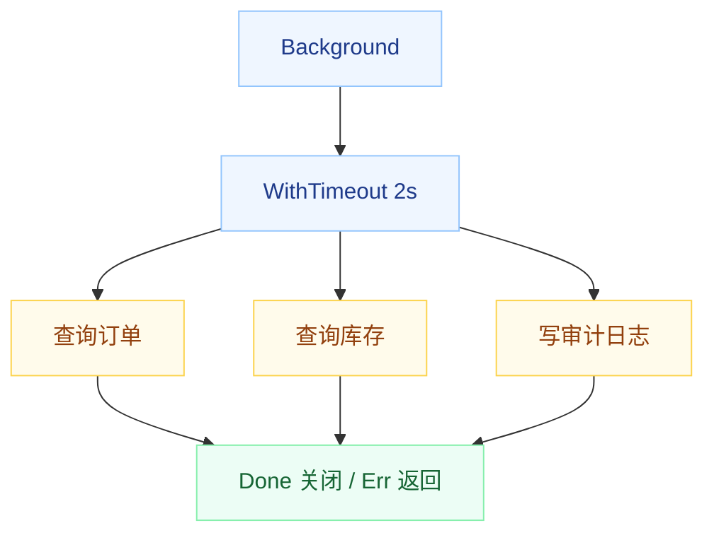

# Go集合与标准库

> 这篇从 `slices` 和 `maps` 两个泛型包讲起，经过 `sort` 的排序与二分、`strings`/`strconv` 的文本处理、`time` 的时刻与时区，再到 `context` 的取消传播和 `cmp`、`rand/v2`、迭代器，最后落到一个访问日志聚合分析器。
>
> 学完能用标准库完成集合操作、稳定排序、时间窗口计算和带超时的批处理，并避开时区、`Duration` 截断和 context 泄漏这些高频错误。

> 版本基线（2026-11-13）：Go 1.24+，示例在 Go 1.27.x 验证。`slices`、`maps`、`cmp`、`min`/`max` 内建需要 Go 1.21+；`maps.Keys` 返回迭代器、`slices.Collect` 需要 Go 1.23+；`rand/v2` 需要 Go 1.22+。

## 一、slices：查找、排序与删除

这章解决“切片上的通用操作还要不要手写循环”。Go 1.21 起 `slices` 提供泛型实现，类型安全，不再依赖 `sort.Slice` 的反射。

### 1.1 slices 与 sort 的分工

`slices` 面向切片，函数签名带类型参数；`sort` 面向任意可比较集合，接口更旧。新代码优先 `slices`。

```go
xs := []int{3, 1, 2}
slices.Sort(xs) // 原地升序，T 必须满足 cmp.Ordered
fmt.Println(xs) // [1 2 3]
```

```go
type User struct {
	Name string
	Age  int
}

users := []User{{"alice", 30}, {"bob", 25}}
slices.SortFunc(users, func(a, b User) int {
	return cmp.Compare(a.Age, b.Age) // 用 cmp 避免减法溢出
})
fmt.Println(users) // [{bob 25} {alice 30}]
```

| 需求 | 函数 | 说明 |
|---|---|---|
| 升序排序 | `slices.Sort` | 原地、不稳定 |
| 自定义比较 | `slices.SortFunc` | 返回负数/0/正数 |
| 稳定排序 | `slices.SortStableFunc` | 相等元素保持原序 |
| 是否有序 | `slices.IsSorted` | 调试断言常用 |
| 查找 | `slices.Index` / `IndexFunc` | 线性扫描 |
| 二分 | `slices.BinarySearch` | 必须先排序 |

> 边界：`slices.Sort` 不保证相等元素的相对顺序。需要“先按年龄、年龄相同保持插入顺序”时用 `SortStableFunc`。排序会修改入参，不想影响调用方就先 `slices.Clone`。

### 1.2 查找、插入与删除

```go
xs := []int{10, 20, 30, 40}

fmt.Println(slices.Contains(xs, 20))  // true
fmt.Println(slices.Index(xs, 30))     // 2
fmt.Println(slices.Index(xs, 99))     // -1

xs = slices.Insert(xs, 1, 15)         // 在下标 1 插入
fmt.Println(xs)                       // [10 15 20 30 40]

xs = slices.Delete(xs, 1, 3)          // 删除 [1,3)
fmt.Println(xs)                       // [10 30 40]
```

`Delete` 会把尾部腾出来的位置清零，避免底层数组继续引用被删元素：

```go
type Payload struct {
	Data [1024]byte
}

ps := []Payload{{}, {}, {}}
ps = slices.Delete(ps, 0, 2)
fmt.Println(len(ps), cap(ps)) // 1 3
// 尾部两个 Payload 已被清零，可以被 GC 回收
```

按条件删除用 `DeleteFunc`，去重相邻元素用 `Compact`：

```go
nums := []int{1, 1, 2, 2, 3}
nums = slices.Compact(nums)
fmt.Println(nums) // [1 2 3]

even := slices.DeleteFunc(nums, func(n int) bool { return n%2 == 0 })
fmt.Println(even) // [1 3]
```

> 边界：`Compact` 只去除相邻重复，输入未排序时结果不符合直觉；先去重前排序，或用 map 版 `Unique`。`Delete` 返回新切片，必须接收返回值。

### 1.3 复制、拼接与容量控制

```go
a := []int{1, 2, 3}
b := slices.Clone(a)     // 独立副本，nil 输入返回 nil
b[0] = 99
fmt.Println(a[0], b[0])  // 1 99

c := slices.Concat(a, b) // 新切片，不共享底层数组
fmt.Println(c)           // [1 99 2 3]

d := slices.Clip(a)      // 容量收到长度，切断对多余底层数组的引用
fmt.Println(len(d), cap(d)) // 3 3
```

`Grow` 预分配容量，适合已知最终长度的循环：

```go
out := make([]string, 0)
out = slices.Grow(out, 1000) // 一次性分配，避免反复扩容
for i := 0; i < 1000; i++ {
	out = append(out, strconv.Itoa(i))
}
```

> 边界：`slices.Clone(nil)` 返回 nil，`slices.Clone([]T{})` 返回空切片，两者 JSON 编码不同。API 返回数组时，需要 `[]` 而不是 `null` 就用 `make([]T, 0)` 或 `slices.Clone` 后判空处理。

### 1.4 比较与批量判断

```go
a := []int{1, 2, 3}
b := []int{1, 2, 3}

fmt.Println(slices.Equal(a, b))   // true
fmt.Println(slices.Compare(a, b)) // 0
fmt.Println(slices.EqualFunc(a, b, func(x, y int) bool { return x == y })) // true

hasLong := slices.ContainsFunc([]string{"a", "bbbb"}, func(s string) bool {
	return len(s) > 3
})
fmt.Println(hasLong) // true
```

`slices.Compare` 按字典序比较两个切片；比较两个元素用 `cmp.Compare` 或 `strings.Compare`：

```go
words := []string{"pear", "apple", "fig"}
slices.SortFunc(words, func(a, b string) int {
	return strings.Compare(a, b)
})
fmt.Println(words) // [apple fig pear]
```

> 边界：`slices.Equal` 要求元素可比较；元素含切片时用 `EqualFunc` 加自定义比较，否则编译不通过。

## 二、maps 与有序输出

这章解决“map 怎么复制、怎么比较、怎么稳定输出”。map 的遍历顺序随机，任何依赖顺序的输出都要显式排序。

### 2.1 复制、比较与批量删除

```go
src := map[string]int{"a": 1, "b": 2}

dst := maps.Clone(src) // 浅拷贝，值为指针时仍共享
dst["c"] = 3
fmt.Println(len(src), len(dst)) // 2 3

fmt.Println(maps.Equal(src, map[string]int{"b": 2, "a": 1})) // true

maps.Copy(dst, src) // 把 src 的键值合并进 dst，覆盖同名键
fmt.Println(dst["a"]) // 1

maps.DeleteFunc(dst, func(k string, v int) bool { return v < 2 })
fmt.Println(dst) // map[c:3]
```

> 边界：`maps.Clone` 只复制一层。值里放 `[]byte` 或另一个 map 时，副本与原 map 共享内部数据，需要深拷贝就自己写。

### 2.2 键、值与有序遍历

Go 1.23 起 `maps.Keys` 和 `maps.Values` 返回迭代器，不再返回切片：

```go
m := map[string]int{"b": 2, "a": 1, "c": 3}

keys := slices.Collect(maps.Keys(m)) // 收集成切片
slices.Sort(keys)
for _, k := range keys {
	fmt.Println(k, m[k])
}
```

`slices.Sorted` 一步完成“收集 + 排序”：

```go
for _, k := range slices.Sorted(maps.Keys(m)) {
	fmt.Print(k, " ") // a b c
}
```

如果模块的 `go` 指令低于 1.23，`maps.Keys` 返回 `[]K`，写法变成 `keys := maps.Keys(m); slices.Sort(keys)`。升级时这类调用需要回归。

> 边界：`slices.Sorted` 会把所有键加载进内存。键有几百万个时，改用外部排序或数据库 `ORDER BY`，不要在主流程里全量排序。

### 2.3 用 map 做集合与计数

```go
// 集合：值用空结构体，不占额外内存
seen := make(map[string]struct{}, 128)
for _, w := range []string{"a", "b", "a"} {
	seen[w] = struct{}{}
}
fmt.Println(len(seen)) // 2

// 计数：直接自增，零值可用
counts := make(map[string]int)
for _, w := range strings.Fields("go go java") {
	counts[w]++
}
fmt.Println(counts["go"]) // 2
```

> 边界：map 的键必须可比较，切片不能作键。需要“多值键”时把切片拼成字符串，或改用 `map[string]map[string]int` 两级结构。

### 2.4 map 的内存与预分配

map 删除键不会缩容，长期运行的服务要关注常驻大小。已知规模时给容量提示：

```go
// 10 万条记录，容量提示能减少 rehash
index := make(map[int64]string, 100_000)
_ = index
```

> 边界：容量提示只是减少扩容次数，不会预分配完整桶数组。超大 map 建议分片，每片一个锁，降低单 map 的竞争和扩容停顿。

## 三、sort 包：稳定排序与二分查找

这章解决“旧代码里的 `sort.Slice` 怎么写对、二分查找怎么用”。新代码优先 `slices`，但维护老项目必须读懂 `sort.Interface`。

### 3.1 sort.Slice 与稳定性

```go
type Order struct {
	ID     string
	Amount int64
}

orders := []Order{{"A", 300}, {"B", 100}, {"C", 300}}

sort.Slice(orders, func(i, j int) bool {
	return orders[i].Amount < orders[j].Amount
})
fmt.Println(orders) // [{B 100} {A 300} {C 300}] 或 C/A 顺序不定

sort.SliceStable(orders, func(i, j int) bool {
	return orders[i].Amount < orders[j].Amount
})
fmt.Println(orders) // 相等元素保持输入顺序
```

`less` 必须满足严格弱序：不可比较自身返回 true，不可出现 `a<b` 且 `b<a`。

```go
// 错误：相等时也返回 true，排序结果未定义
sort.Slice(xs, func(i, j int) bool { return xs[i] <= xs[j] })

// 正确
sort.Slice(xs, func(i, j int) bool { return xs[i] < xs[j] })
```

> 边界：`sort.Slice` 用反射访问元素，比 `slices.SortFunc` 慢；只在维护旧代码或需要 `sort.Interface` 时使用。排序不稳定，分页场景容易看到元素跳动。

### 3.2 多字段排序

```go
type Record struct {
	Status string
	Amount int64
}

records := []Record{{"paid", 300}, {"paid", 100}, {"refunded", 50}}

slices.SortFunc(records, func(a, b Record) int {
	if c := cmp.Compare(a.Status, b.Status); c != 0 {
		return c // 第一关键字：状态升序
	}
	return cmp.Compare(b.Amount, a.Amount) // 第二关键字：金额降序
})
fmt.Println(records)
// [{paid 300} {paid 100} {refunded 50}]
```

> 边界：多字段比较要从主到次逐级返回，不能把多个差值相加：不同字段的量纲不同，相加会互相抵消。

### 3.3 二分查找

`sort.Search` 接受“第一个满足条件的下标”谓词，返回 `[0, n]` 范围内的位置：

```go
xs := []int{1, 3, 5, 7, 9}
i := sort.Search(len(xs), func(i int) bool { return xs[i] >= 6 })
fmt.Println(i) // 3，xs[3] == 7

j := sort.SearchInts(xs, 5)
fmt.Println(j) // 2
```

`slices.BinarySearch` 同时返回是否命中：

```go
idx, found := slices.BinarySearch(xs, 5)
fmt.Println(idx, found) // 2 true

idx, found = slices.BinarySearch(xs, 6)
fmt.Println(idx, found) // 3 false：6 应插入的位置是 3
```

> 边界：二分前必须排序，且比较函数与排序时一致。`sort.Search` 的谓词必须“前面全 false、后面全 true”，否则结果不可预测。

### 3.4 sort.Interface 的复用

当同一类型要按多种规则排序，定义一个命名类型实现 `sort.Interface`，或者用 `slices.SortFunc` 配不同比较函数。

```go
type ByAmount []Order

func (b ByAmount) Len() int           { return len(b) }
func (b ByAmount) Less(i, j int) bool { return b[i].Amount < b[j].Amount }
func (b ByAmount) Swap(i, j int)      { b[i], b[j] = b[j], b[i] }

sort.Sort(ByAmount(orders))
```

> 边界：`sort.Sort` 同样不稳定。需要稳定结果时用 `sort.Stable`，或者先给元素加原始下标作为最后一级比较键。

## 四、strings 与 strconv

这章解决“字符串拼接、切分、替换和数字转换怎么写才不慢”。Go 的字符串不可变，每次 `+` 都分配新内存。

### 4.1 strings.Builder

循环拼接用 `Builder`，`Grow` 预分配能进一步减少扩容：

```go
var sb strings.Builder
sb.Grow(64) // 预分配，避免多次扩容复制

for i, w := range []string{"go", "java", "rust"} {
	if i > 0 {
		sb.WriteByte(',')
	}
	sb.WriteString(w)
}
fmt.Println(sb.String()) // go,java,rust
```

`Builder` 不能复制，传给函数要用指针：

```go
func join(dst *strings.Builder, parts []string) {
	for _, p := range parts {
		dst.WriteString(p)
	}
}
```

> 边界：`Builder` 的零值可用，但用过之后复制会 panic（内部有 `copyCheck`）。不要把它放进结构体再按值传递。

### 4.2 切分与截取

```go
s := "  id=42; name=alice  "

fmt.Println(strings.TrimSpace(s))          // id=42; name=alice
fmt.Println(strings.Fields("a  b\tc"))     // [a b c]

k, v, ok := strings.Cut("id=42", "=")
fmt.Println(k, v, ok)                      // id 42 true

before, after, found := strings.Cut(s, ";")
fmt.Println(strings.TrimSpace(before), strings.TrimSpace(after), found)
// id=42 name=alice true
```

`Cut` 比 `SplitN` 更直接，返回“分隔符前、分隔符后、是否找到”，只扫描一次。

```go
fmt.Println(strings.CutPrefix("v1.2.3", "v")) // 1.2.3 true
fmt.Println(strings.CutSuffix("a.go", ".go")) // a true
```

> 边界：`Cut` 只切第一个分隔符；要切全部用 `strings.Split`。`Split(s, "")` 按 rune 切分，返回每个字符，不是空切片。

### 4.3 替换与清理

```go
s := "a-b-c-d"

fmt.Println(strings.ReplaceAll(s, "-", "/")) // a/b/c/d
fmt.Println(strings.Replace(s, "-", "/", 2)) // a/b-c-d，只替换前 2 个

r := strings.NewReplacer("<", "&lt;", ">", "&gt;", "&", "&amp;")
fmt.Println(r.Replace("<a&b>")) // &lt;a&amp;b&gt;
```

多处替换用 `NewReplacer`，它一次性扫描，比连续 `ReplaceAll` 少多次分配。

```go
fmt.Println(strings.TrimPrefix("prefix-key", "prefix-")) // key
fmt.Println(strings.TrimLeft("aaab", "a"))               // b
fmt.Println(strings.Trim("xxhixx", "x"))                 // hi
```

> 边界：`TrimLeft`/`TrimRight` 的第二个参数是“字符集合”，不是前缀字符串。去固定前缀用 `TrimPrefix`，否则 `TrimLeft("http://a", "http")` 会得到 `://a` 之外的结果。

### 4.4 strconv 与错误处理

```go
n, err := strconv.Atoi("42")
if err != nil {
	return fmt.Errorf("parse count: %w", err)
}
fmt.Println(n) // 42

i64, err := strconv.ParseInt("9007199254740993", 10, 64)
fmt.Println(i64, err) // 9007199254740993 <nil>

f, err := strconv.ParseFloat("3.14", 64)
fmt.Println(f, err) // 3.14 <nil>
```

格式化：

```go
fmt.Println(strconv.Itoa(42))                     // 42
fmt.Println(strconv.FormatInt(255, 16))           // ff
fmt.Println(strconv.FormatFloat(3.14159, 'f', 2, 64)) // 3.14
fmt.Println(strconv.Quote("a\nb"))                // "a\nb"
```

| 函数 | 输入 | 典型错误 |
|---|---|---|
| `Atoi` | 十进制字符串 | 空串、溢出、非数字 |
| `ParseInt` | 指定进制和位宽 | 超出位宽 |
| `ParseFloat` | 浮点字符串 | `NaN`、溢出 |
| `ParseBool` | true/false/1/0 | 其他拼写 |

> 边界：`Atoi` 在 32 位平台上等价于 `ParseInt(s, 10, 0)`，位宽随平台变化；跨平台协议字段用 `ParseInt(s, 10, 64)` 明确位宽。

### 4.5 大小写与 Unicode

```go
fmt.Println(strings.EqualFold("GoLang", "golang")) // true，忽略大小写比较
fmt.Println(strings.ToLower("GO"))                 // go
fmt.Println(len("İ"))                              // 2，不是 1
```

需要按 Unicode 规则处理时用 `unicode` 包逐 rune 判断：

```go
var letters int
for _, r := range "Go语言123" {
	if unicode.IsLetter(r) {
		letters++
	}
}
fmt.Println(letters) // 4
```

> 边界：`strings.ToUpper` 不保证长度不变（如 `ß` → `SS`），不要用它做“等长归一化”。大小写不敏感比较用 `EqualFold`，不要先 `ToLower` 再比。

## 五、time：时刻、时长与时区

这章解决“时间为什么差 8 小时、`Sub` 为什么是负数、序列化后时区去哪了”。`time.Time` 同时携带时刻、单调时钟和时区。

### 5.1 Time 与 Duration

```go
now := time.Now()
later := now.Add(90 * time.Minute)
fmt.Println(later.Sub(now)) // 1h30m0s

d, err := time.ParseDuration("1h30m")
if err != nil {
	return err
}
fmt.Println(d.Seconds()) // 5400
```

`Duration` 是 `int64` 纳秒，直接打印会得到可读格式；参与计算时用常量相乘：

```go
timeout := 2 * time.Second
fmt.Println(timeout)          // 2s
fmt.Println(timeout.Milliseconds()) // 2000
```

> 边界：`time.Duration` 表示“时间间隔”，不表示“某一天”。`24 * time.Hour` 不等于“一天”，夏令时切换那天可能是 23 或 25 小时。

### 5.2 解析与格式化

Go 用固定参考时刻定义布局，不是 `yyyy-MM-dd` 占位符：

```go
t, err := time.Parse(time.RFC3339, "2026-11-13T09:30:00+08:00")
if err != nil {
	return err
}
fmt.Println(t.Format("2006-01-02 15:04:05")) // 2026-11-13 09:30:00
fmt.Println(t.UTC().Format(time.RFC3339))    // 2026-11-13T01:30:00Z
```

参考时刻是 `Mon Jan 2 15:04:05 MST 2006`，每个数字都有固定含义：

| 布局片段 | 含义 | 示例 |
|---|---|---|
| `2006` | 四位年 | 2026 |
| `01` | 两位月 | 11 |
| `02` | 两位日 | 13 |
| `15` | 24 小时制 | 09 |
| `04` | 分钟 | 30 |
| `05` | 秒 | 00 |
| `-07:00` | 数字时区偏移 | +08:00 |

> 边界：`15` 是 24 小时制，`03` 是 12 小时制。写错布局不会报错，只会输出奇怪的结果，格式化后必须校验一次。

### 5.3 时区与 Location

```go
loc, err := time.LoadLocation("Asia/Shanghai")
if err != nil {
	return err
}
t := time.Date(2026, 11, 13, 9, 30, 0, 0, loc)
fmt.Println(t.Format(time.RFC3339)) // 2026-11-13T09:30:00+08:00
```

容器里没有 tzdata 时 `LoadLocation` 会失败。两种解决办法：

```go
// 方案一：导入内置时区数据，二进制增大几 MB
import _ "time/tzdata"

// 方案二：构建镜像时安装 tzdata
// Ubuntu: apt-get install -y tzdata
// Rocky:  dnf install -y tzdata
```

> 边界：服务器统一用 UTC 存储和计算，只在展示层转本地时区。`time.Local` 依赖系统环境变量 `TZ`，容器里默认可能是 UTC。

### 5.4 单调时钟与时间比较

`time.Now()` 同时带墙上时钟和单调时钟。`Sub` 和 `Since` 优先用单调时钟，不受系统时间调整影响：

```go
start := time.Now()
time.Sleep(10 * time.Millisecond)
fmt.Println(time.Since(start) > 0) // true，即使期间校时也不受影响
```

经过序列化或手工构造的 Time 没有单调读数：

```go
t1, _ := time.Parse(time.RFC3339, "2026-11-13T09:30:00Z")
t2 := t1.Add(time.Hour)
fmt.Println(t2.Sub(t1)) // 1h0m0s，纯墙上时钟计算
```

比较用方法，不用 `==`：

```go
a := time.Now()
b := a.In(time.UTC)

fmt.Println(a == b)      // false：时区指针不同
fmt.Println(a.Equal(b))  // true：同一时刻
fmt.Println(a.Before(b)) // false
```

> 边界：`==` 会比较单调时钟读数和时区指针，同一时刻的两种表示可能不相等。业务比较统一用 `Equal`、`Before`、`After`。

### 5.5 截断、取整与时间窗口

```go
t := time.Date(2026, 11, 13, 9, 37, 42, 0, time.UTC)

fmt.Println(t.Truncate(time.Hour))  // 2026-11-13 09:00:00 +0000 UTC
fmt.Println(t.Round(15*time.Minute)) // 2026-11-13 09:45:00 +0000 UTC

start := t.Truncate(5 * time.Minute)
end := start.Add(5 * time.Minute)
fmt.Println(start.Format("15:04"), end.Format("15:04")) // 09:35 09:40
```

`time.Date` 会自动归一化越界值，常用于“当月最后一天”这类计算：

```go
// 下个月的第 0 天 = 本月最后一天
last := time.Date(2026, 12, 0, 0, 0, 0, 0, time.UTC)
fmt.Println(last.Format("2006-01-02")) // 2026-11-30
```

> 边界：`Truncate` 基于绝对时间（UTC）截断，不是按本地时区。按“自然日”聚合时，先转目标时区再截断，或用 `time.Date(y, m, d, 0, 0, 0, 0, loc)`。

## 六、context：取消、超时与传值

这章解决“请求取消了后台还在跑、超时后 goroutine 不退出、context 被塞进结构体”。`context` 只做三件事：传递取消信号、传递截止时间、传递请求范围内的少量元数据。

### 6.1 接口与约定

```go
type Context interface {
	Deadline() (deadline time.Time, ok bool)
	Done() <-chan struct{}
	Err() error
	Value(key any) any
}
```

约定：

- 作为函数的第一个参数，命名 `ctx`；
- 不存进结构体，不设为可选参数（不要 `ctx = nil`）；
- 由创建者调用 `cancel`，调用方只传递；
- `Value` 只放请求级元数据（trace ID、用户身份），不放业务参数。

```go
func (s *Service) Get(ctx context.Context, id string) (*Order, error) {
	return s.repo.Find(ctx, id)
}
```

> 边界：`context.Background()` 只用于 `main`、初始化、测试；请求入口用 `context.TODO()` 占位也可以，但不要传 nil，很多库会直接 panic。

### 6.2 取消与超时

```go
ctx, cancel := context.WithTimeout(context.Background(), 2*time.Second)
defer cancel() // 必须调用：释放定时器，取消子 context

if err := work(ctx); err != nil {
	if errors.Is(err, context.DeadlineExceeded) {
		return fmt.Errorf("work timeout: %w", err)
	}
	return err
}
```

`WithCancel` 用于手动停止，`WithDeadline` 用于绝对时间点：

```go
ctx, cancel := context.WithCancel(context.Background())
go func() {
	time.Sleep(100 * time.Millisecond)
	cancel() // 通知所有派生 context
}()

<-ctx.Done()
fmt.Println(ctx.Err()) // context canceled
```



> 边界：`defer cancel()` 要写在 `WithTimeout` 之后立刻执行，不要放在分支里。即使函数正常返回，也要 cancel，否则定时器直到超时才释放。

### 6.3 取消原因与派生规则

Go 1.21 起可以带原因取消：

```go
ctx, cancel := context.WithCancelCause(context.Background())
cancel(ErrQuotaExceeded) // 自定义原因

<-ctx.Done()
fmt.Println(context.Cause(ctx)) // ErrQuotaExceeded
fmt.Println(ctx.Err())          // context canceled
```

`WithTimeout` 派生出的子 context 会继承父级的取消；父级取消时，所有子级同时收到信号。

```go
parent, cancelParent := context.WithCancel(context.Background())
child, cancelChild := context.WithTimeout(parent, time.Second)
defer cancelChild()

cancelParent()
<-child.Done()
fmt.Println(child.Err()) // context canceled，父级原因优先
```

需要在后台继续执行、不跟随请求取消时用 `context.WithoutCancel`：

```go
detached := context.WithoutCancel(ctx) // Go 1.21+，保留 Value，去掉取消
go writeAuditLog(detached)             // 请求返回后仍能完成
```

> 边界：`WithoutCancel` 会丢失超时约束，后台任务要自己再套一个 `WithTimeout`，否则可能永久挂起。

### 6.4 Value 的使用边界

```go
type ctxKey string

const userKey ctxKey = "user"

func WithUser(ctx context.Context, id string) context.Context {
	return context.WithValue(ctx, userKey, id) // 私有 key 类型，避免包间冲突
}

func UserFrom(ctx context.Context) (string, bool) {
	id, ok := ctx.Value(userKey).(string)
	return id, ok
}
```

`Value` 查找沿链向上，层数越深越慢；只在请求入口写一次，业务层读取。

```go
ctx := WithUser(context.Background(), "alice")
id, ok := UserFrom(ctx)
fmt.Println(id, ok) // alice true
```

| 适合放 | 不适合放 |
|---|---|
| trace ID、request ID | 数据库连接、配置对象 |
| 认证后的用户身份 | 可选业务参数 |
| 日志字段 | 大量数据、缓存 |

> 边界：不要用字符串字面量作 key，不同包用同一个字符串会互相覆盖。key 用自定义未导出类型，取值必须做类型断言并处理 `ok`。

### 6.5 常见误用

```go
// 误用一：把 ctx 存进结构体，生命周期混乱
type Service struct {
	ctx context.Context // 不要
}

// 误用二：忘记 cancel，定时器和子 goroutine 泄漏
ctx, _ := context.WithTimeout(context.Background(), time.Second) // 泄漏

// 误用三：在循环里反复派生 context
for _, id := range ids {
	ctx, cancel := context.WithTimeout(ctx, time.Second) // ctx 层层嵌套，超时越来越短
	defer cancel()
}
```

> 边界：循环里需要单独超时，就在循环体内基于父 ctx 派生，并在本轮结束前 `cancel()`，不要 `defer` 到函数结束。

## 七、cmp、rand/v2 与迭代器

这章解决“比较函数怎么写、随机数怎么用、Go 1.23 的迭代器怎么消费”。这三块都是近几个版本新增的标准库能力。

### 7.1 cmp 包与内建 min/max

```go
fmt.Println(cmp.Compare(1, 2))        // -1
fmt.Println(cmp.Compare("b", "a"))    // 1
fmt.Println(cmp.Less(1.5, 2.5))       // true
fmt.Println(min(3, 1, 2), max(3, 1, 2)) // 1 3
```

`cmp.Ordered` 是预声明约束，覆盖整数、浮点、字符串：

```go
func Clamp[T cmp.Ordered](v, lo, hi T) T {
	if v < lo {
		return lo
	}
	if v > hi {
		return hi
	}
	return v
}

fmt.Println(Clamp(15, 0, 10)) // 10
```

> 边界：`cmp.Compare` 对浮点 `NaN` 的顺序未定义，含 NaN 的数据要先清洗。`min`/`max` 是内建函数，不是包函数，不能当值传递。

### 7.2 math/rand/v2

`rand/v2` 的全局函数自动播种，不需要 `rand.Seed`：

```go
fmt.Println(rand.IntN(10))        // 0..9
fmt.Println(rand.Float64())       // [0,1)
fmt.Println(rand.N(5 * time.Second)) // 0..5s 的 Duration
```

需要可复现序列时构造独立的 `*rand.Rand`：

```go
src := rand.NewPCG(1, 2) // 两个种子，算法为 PCG
r := rand.New(src)
fmt.Println(r.IntN(100), r.IntN(100)) // 同一组种子输出固定
```

| 需求 | 用法 | 说明 |
|---|---|---|
| 通用随机整数 | `rand.IntN(n)` | 全局源，自动播种 |
| 可复现测试 | `rand.New(rand.NewPCG(a, b))` | 固定种子 |
| 密码学安全 | `crypto/rand` | 密钥、令牌 |
| 随机排列 | `rand.Perm(n)` | 返回 0..n-1 的排列 |

> 边界：`math/rand` 系列是伪随机，绝不能用于令牌、密码、验证码。`rand.IntN(0)` 会 panic，范围要保证大于 0。

### 7.3 迭代器与 range over func

Go 1.23 引入 `iter.Seq[T]`，标准库的 `maps.Keys`、`slices.Values` 都返回迭代器：

```go
func Count[T comparable](seq iter.Seq[T]) map[T]int {
	counts := make(map[T]int)
	for v := range seq { // 直接 range 一个函数
		counts[v]++
	}
	return counts
}

counts := Count(slices.Values([]string{"a", "b", "a"}))
fmt.Println(counts["a"]) // 2
```

自己实现迭代器时，用“yield 返回 false 就停”的约定：

```go
func Take[T any](xs []T, n int) iter.Seq[T] {
	return func(yield func(T) bool) {
		for i, x := range xs {
			if i >= n {
				return // 调用方提前停止
			}
			if !yield(x) {
				return // range 体里的 break
			}
		}
	}
}

for v := range Take([]int{1, 2, 3, 4}, 2) {
	fmt.Print(v, " ") // 1 2
}
```

> 边界：迭代器是惰性的，`yield` 返回 false 后必须立即停止，否则 `break` 不会生效。不要在迭代器里做有副作用的清理，生命周期由调用方的循环决定。

## 八、最佳实践案例

### 8.1 案例背景

一个网关团队每天要分析访问日志，回答三个问题：哪些接口调用量最高、哪些接口 5xx 多、平均和最大延迟是多少。现有脚本用 Python 写，按行 `split` 后手工累加，问题是：时区解析依赖本机、延迟单位混用毫秒和微秒、输出顺序每次不同、日志超过 500MB 时跑不完。

目标与约束：

- 输入每行五个字段：RFC3339 时间、方法、路径、状态码、延迟（毫秒）；
- 按路径聚合调用数、5xx 数、总延迟、最大延迟，按调用数降序输出；
- 整个分析受 `-timeout` 控制，超时返回非零退出码；
- 坏行跳过并计数，不影响整体；
- 输出用 `text/tabwriter` 对齐，列数固定；
- 核心解析与聚合逻辑可单测。

示例输入 `access.log`：

```text
2026-11-12T08:01:02+08:00 GET /api/orders 200 35ms
2026-11-12T08:01:03+08:00 GET /api/orders 500 120ms
2026-11-12T08:01:04+08:00 POST /api/orders 201 88ms
2026-11-12T08:01:05+08:00 GET /api/users 200 12ms
2026-11-12T08:01:06+08:00 GET /api/users 404 8ms
2026-11-12T08:01:07+08:00 GET /api/orders 200 46ms
2026-11-12T08:01:08+08:00 DELETE /api/orders/9 204 15ms
2026-11-12T08:01:09+08:00 GET /api/orders 502 300ms
```

### 8.2 案例实操

初始化模块：

```bash
mkdir -p logstat
cd logstat
go mod init example.com/logstat
```

`main.go`：

```go
package main

import (
	"bufio"
	"cmp"
	"context"
	"errors"
	"flag"
	"fmt"
	"io"
	"os"
	"slices"
	"strconv"
	"strings"
	"text/tabwriter"
	"time"
)

// Entry 是解析后的一行访问记录，时间统一为带时区的 time.Time。
type Entry struct {
	At      time.Time
	Method  string
	Path    string
	Status  int
	Latency time.Duration
}

var errBadLine = errors.New("bad log line")

// ParseLine 解析五个空白分隔字段；错误用 %w 保留哨兵，便于统计坏行。
func ParseLine(line string) (Entry, error) {
	fields := strings.Fields(line)
	if len(fields) != 5 {
		return Entry{}, fmt.Errorf("%w: want 5 fields, got %d", errBadLine, len(fields))
	}

	at, err := time.Parse(time.RFC3339, fields[0])
	if err != nil {
		return Entry{}, fmt.Errorf("%w: time %q: %v", errBadLine, fields[0], err)
	}
	status, err := strconv.Atoi(fields[3])
	if err != nil {
		return Entry{}, fmt.Errorf("%w: status %q: %v", errBadLine, fields[3], err)
	}

	raw := strings.TrimSuffix(fields[4], "ms")
	ms, err := strconv.Atoi(raw)
	if err != nil {
		return Entry{}, fmt.Errorf("%w: latency %q: %v", errBadLine, fields[4], err)
	}

	return Entry{
		At:      at,
		Method:  fields[1],
		Path:    fields[2],
		Status:  status,
		Latency: time.Duration(ms) * time.Millisecond, // 统一成 Duration，后续不用关心单位
	}, nil
}

type Stat struct {
	Path   string
	Count  int
	Errors int
	Total  time.Duration
	Max    time.Duration
}

// Avg 在 Count 为 0 时返回 0，避免除零。
func (s Stat) Avg() time.Duration {
	if s.Count == 0 {
		return 0
	}
	return s.Total / time.Duration(s.Count)
}

// Analyze 逐行读取并在每行检查一次 ctx，保证超时能及时退出。
func Analyze(ctx context.Context, r io.Reader) ([]Stat, int, error) {
	sc := bufio.NewScanner(r)
	sc.Buffer(make([]byte, 0, 64*1024), 1024*1024)

	byPath := make(map[string]*Stat) // 指针：循环内累加不必写回 map
	bad := 0

	for sc.Scan() {
		if err := ctx.Err(); err != nil {
			return nil, bad, err
		}
		e, err := ParseLine(sc.Text())
		if err != nil {
			bad++ // 坏行只计数，不中断整批
			continue
		}

		s, ok := byPath[e.Path]
		if !ok {
			s = &Stat{Path: e.Path}
			byPath[e.Path] = s
		}
		s.Count++
		s.Total += e.Latency
		if e.Latency > s.Max {
			s.Max = e.Latency
		}
		if e.Status >= 500 {
			s.Errors++
		}
	}
	if err := sc.Err(); err != nil {
		return nil, bad, fmt.Errorf("scan: %w", err)
	}

	stats := make([]Stat, 0, len(byPath))
	for _, s := range byPath {
		stats = append(stats, *s)
	}

	// 调用数降序；相同调用数按路径升序，保证输出可复现
	slices.SortFunc(stats, func(a, b Stat) int {
		if c := cmp.Compare(b.Count, a.Count); c != 0 {
			return c
		}
		return cmp.Compare(a.Path, b.Path)
	})
	return stats, bad, nil
}

func main() {
	in := flag.String("in", "access.log", "访问日志路径")
	timeout := flag.Duration("timeout", 2*time.Second, "整体处理超时")
	flag.Parse()

	if err := run(*in, *timeout, os.Stdout, os.Stderr); err != nil {
		fmt.Fprintln(os.Stderr, "error:", err)
		os.Exit(1)
	}
}

func run(path string, timeout time.Duration, out, errOut io.Writer) error {
	f, err := os.Open(path)
	if err != nil {
		return fmt.Errorf("open %s: %w", path, err)
	}
	defer f.Close()

	ctx, cancel := context.WithTimeout(context.Background(), timeout)
	defer cancel() // 正常返回也要释放定时器

	stats, bad, err := Analyze(ctx, f)
	if errors.Is(err, context.DeadlineExceeded) {
		return fmt.Errorf("analyze %s: timeout after %s", path, timeout)
	}
	if err != nil {
		return fmt.Errorf("analyze %s: %w", path, err)
	}
	if bad > 0 {
		fmt.Fprintf(errOut, "warn: skipped %d bad lines\n", bad)
	}

	tw := tabwriter.NewWriter(out, 0, 4, 2, ' ', 0)
	fmt.Fprintln(tw, "PATH\tCOUNT\t5XX\tAVG\tMAX")
	for _, s := range stats {
		fmt.Fprintf(tw, "%s\t%d\t%d\t%s\t%s\n",
			s.Path, s.Count, s.Errors, s.Avg(), s.Max)
	}
	return tw.Flush() // 缓冲写：Flush 的错误必须给调用方
}
```

`main_test.go`：

```go
package main

import (
	"context"
	"strings"
	"testing"
	"time"
)

func TestParseLine(t *testing.T) {
	e, err := ParseLine("2026-11-12T08:01:02+08:00 GET /api/orders 200 35ms")
	if err != nil {
		t.Fatalf("ParseLine() error = %v", err)
	}
	if e.Path != "/api/orders" || e.Status != 200 {
		t.Fatalf("unexpected entry: %+v", e)
	}
	if e.Latency != 35*time.Millisecond {
		t.Fatalf("latency = %s, want 35ms", e.Latency)
	}
	if e.At.UTC().Hour() != 0 { // +08:00 的 08:01 对应 UTC 00:01
		t.Fatalf("unexpected utc hour: %d", e.At.UTC().Hour())
	}

	if _, err := ParseLine("2026-11-12T08:01:02+08:00 GET /api/orders 200"); err == nil {
		t.Fatal("want error for missing field")
	}
}

func TestAnalyze(t *testing.T) {
	input := strings.Join([]string{
		"2026-11-12T08:01:02+08:00 GET /a 200 10ms",
		"2026-11-12T08:01:03+08:00 GET /a 500 30ms",
		"2026-11-12T08:01:04+08:00 GET /b 200 5ms",
		"bad line",
	}, "\n")

	stats, bad, err := Analyze(context.Background(), strings.NewReader(input))
	if err != nil {
		t.Fatalf("Analyze() error = %v", err)
	}
	if bad != 1 {
		t.Fatalf("bad = %d, want 1", bad)
	}
	if len(stats) != 2 || stats[0].Path != "/a" {
		t.Fatalf("unexpected stats: %+v", stats)
	}
	if stats[0].Count != 2 || stats[0].Errors != 1 || stats[0].Avg() != 20*time.Millisecond {
		t.Fatalf("unexpected /a stat: %+v", stats[0])
	}
}
```

运行：

```bash
go fmt ./...
go vet ./...
go test -v ./...
go run . -in access.log
```

预期输出：

```text
=== RUN   TestParseLine
--- PASS: TestParseLine (0.00s)
=== RUN   TestAnalyze
--- PASS: TestAnalyze (0.00s)
PASS
ok  	example.com/logstat	0.003s
PATH           COUNT  5XX  AVG       MAX
/api/orders    5      2    117.8ms   300ms
/api/users     2      0    10ms      12ms
/api/orders/9  1      0    15ms      15ms
```

超时路径：

```bash
go run . -in access.log -timeout 1ns
echo "exit=$?"
```

预期输出：

```text
error: analyze access.log: timeout after 1ns
exit=1
```

### 8.3 案例结果

8 行日志聚合出三个路径，调用数、5xx、平均和最大延迟一次输出。延迟在解析时统一成 `time.Duration`，聚合阶段不再做单位换算；排序使用 `cmp.Compare` 两级比较，输出顺序稳定，可以直接 diff。

| 指标 | 旧脚本 | 本案例 |
|---|---|---|
| 时区处理 | 依赖本机时区 | RFC3339 显式偏移 |
| 延迟单位 | 毫秒/微秒混用 | `time.Duration` 统一 |
| 输出顺序 | 字典顺序不固定 | 调用数降序 + 路径升序 |
| 大文件 | 全量读入内存 | 逐行扫描 |
| 超时控制 | 无 | `context` 每行检查 |

失败模式与复盘：

- 最初用 `strings.Split(line, " ")`，连续空格产生空字段，解析长度判断失败；改用 `strings.Fields` 后按任意空白切分；
- 延迟字段直接 `Atoi`，遇到 `us` 后缀得到错误值；统一要求 `ms` 并用 `TrimSuffix`，单位写进输入契约；
- `Analyze` 只在开头检查一次 `ctx`，超时对大文件不生效；改为每行检查，代价是一次原子读，可接受；
- 用 `map[string]Stat` 累加，循环里取出的值副本修改后没写回，计数永远是 0；改成 `map[string]*Stat`；
- 排序只按调用数，次数相同的结果顺序随机，测试偶发失败；补了路径作为第二关键字；
- `tabwriter` 的结果没有 `Flush`，输出为空；`run` 改为直接返回 `tw.Flush()` 的错误。
