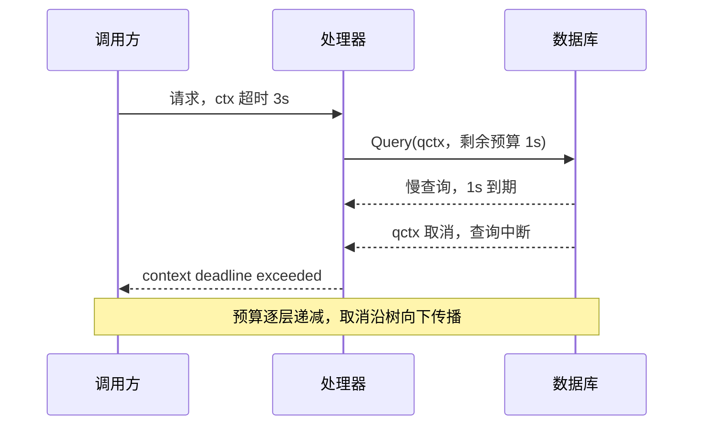
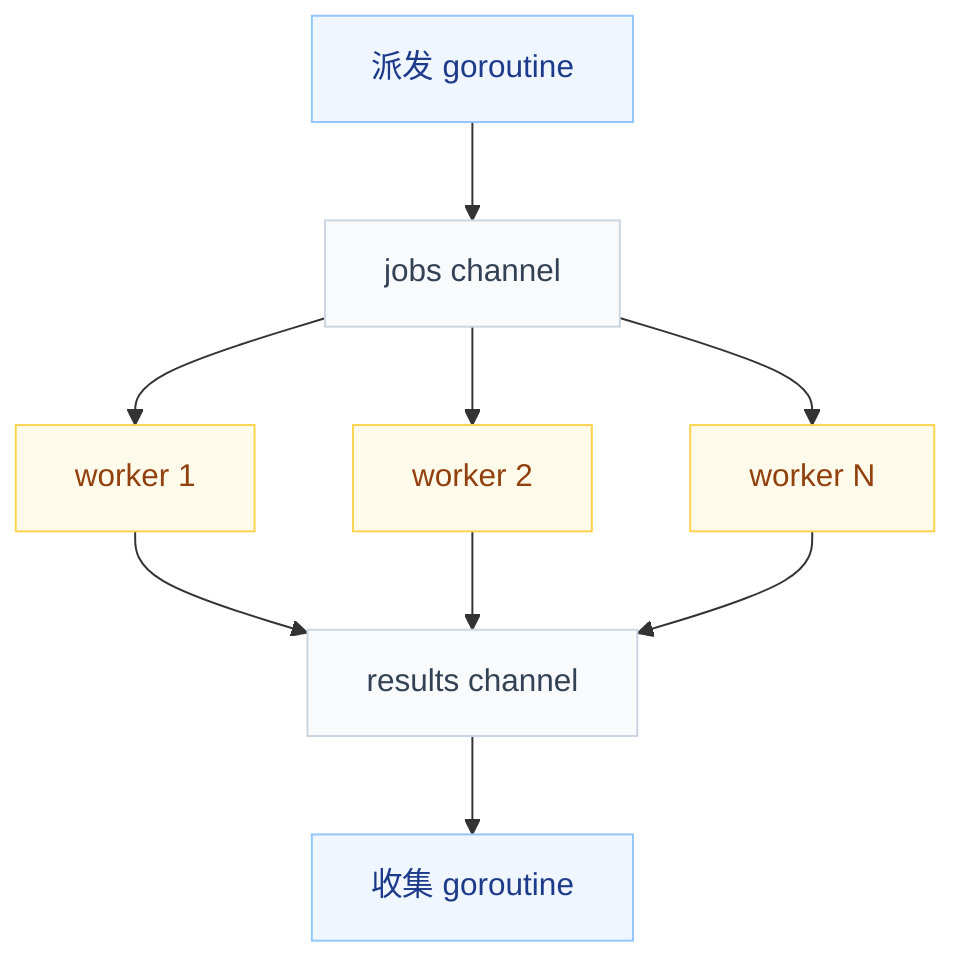

# Go并发模型

> 这篇从 goroutine 的启动与调度讲起，经过 channel 的关闭与方向语义、select 与超时、`sync` 的锁与原子操作、`context` 的取消传播，再到 worker pool 和 fan-in 常用模式，最后落到一个可用 `-race` 验证的并发日志扫描器。
>
> 学完能安全地组织并发任务：正确关闭 channel、避免 goroutine 泄漏、用 `context` 传播取消、用 race 检测器定位数据竞争。

> 版本基线（2026-11-13）：Go 1.24+，示例在 Go 1.27.x 验证。`errgroup` 来自 `golang.org/x/sync`，需要单独 `go get`；其余均为标准库。

## 一、goroutine 与调度

这章解决“goroutine 怎么启动、什么时候退出、为什么 main 返回后后台任务就没了”。goroutine 是运行时调度的轻量执行单元，启动成本只有几 KB 栈。

### 1.1 启动与 main 的退出

```go
func main() {
	go fmt.Println("background") // go 语句立刻返回，不等待
	fmt.Println("main")
}
```

预期输出不包含 `background`：`main` 返回后进程退出，所有 goroutine 直接终止，不会等待。等待必须显式表达：

```go
func main() {
	var wg sync.WaitGroup
	wg.Add(1) // Add 要在 go 之前，否则 Wait 可能先执行

	go func() {
		defer wg.Done() // 任务结束通知等待方
		fmt.Println("background")
	}()

	wg.Wait() // 阻塞到 Done 的计数归零
	fmt.Println("main done")
}
```

预期输出：

```text
background
main done
```

> 边界：`time.Sleep` 不是同步原语，只是碰巧让出时间片。任何依赖 sleep 保证顺序的代码都是错的，CI 慢机器上必然抖动。

### 1.2 GMP 与 GOMAXPROCS

调度器把 goroutine（G）调度到操作系统线程（M）上，中间隔一层逻辑处理器（P）。写业务代码需要知道的只有三点：

| 事实 | 对代码的影响 |
|---|---|
| goroutine 初始栈约 2KB | 开十万个 goroutine 也只是内存问题 |
| 系统调用会让 M 阻塞，runtime 会起新 M | 大量阻塞式 IO 不会卡死其他 goroutine |
| `GOMAXPROCS` 默认等于逻辑 CPU 数 | CPU 密集任务超过这个数只会增加切换 |

Go 1.25 起，容器里的 `GOMAXPROCS` 会自动感知 cgroup 的 CPU 限额，不再需要在 `main` 里手工 `runtime.GOMAXPROCS(n)`；老版本容器里 CPU limit 为 2 核时，默认值仍可能是宿主机核数，导致限流抖动。

```go
fmt.Println(runtime.GOMAXPROCS(0)) // 查询不修改：参数 0 表示只读
fmt.Println(runtime.NumCPU())       // 逻辑 CPU 数
```

> 边界：`GOMAXPROCS` 限制的是同时执行 Go 代码的线程数，不是 goroutine 数量上限。goroutine 数量没有语言级上限，只有内存约束。

### 1.3 goroutine 泄漏

泄漏的典型形态是“goroutine 永远阻塞在发送或接收上”，进程存活多久它就活多久：

```go
func leak() {
	ch := make(chan int) // 无缓冲
	go func() {
		ch <- 1 // 没有接收方，永远阻塞
	}()
	// 函数返回，ch 不可达，goroutine 泄漏
}
```

修正方法是“接收方总在”，或者用 `select` 加超时：

```go
func noLeak() <-chan int {
	ch := make(chan int, 1) // 容量 1：发送不依赖接收方
	go func() {
		ch <- 1
	}()
	return ch
}
```

排查工具：

```bash
# 进程收到 SIGQUIT 时打印全部 goroutine 堆栈
kill -QUIT 进程号

# 或在代码里主动输出
import _ "net/http/pprof"
# 然后 curl http://localhost:6060/debug/pprof/goroutine?debug=1
```

> 边界：泄漏的 goroutine 在 `-race` 和普通测试里都不报错，只有堆栈数量持续上涨能暴露。长期运行的服务要监控 goroutine 数指标。

## 二、channel 的语义

这章解决“channel 什么时候阻塞、关闭谁负责、nil channel 有什么用”。channel 是“通过通信共享内存”的原语，所有行为都由“容量、方向、是否关闭”三个维度决定。

### 2.1 无缓冲与有缓冲

```go
// 无缓冲：发送阻塞到有人接收，接收阻塞到有人发送（会合）
ch := make(chan int)
go func() { ch <- 1 }() // 发送方阻塞，直到主 goroutine 接收
fmt.Println(<-ch)       // 1

// 有缓冲：缓冲未满时发送不阻塞
buf := make(chan int, 2)
buf <- 1 // 立即返回
buf <- 2 // 立即返回
fmt.Println(len(buf), cap(buf)) // 2 2
// buf <- 3 // 缓冲已满，阻塞
```

| 操作 | nil channel | 已关闭 | 正常 |
|---|---|---|---|
| 发送 | 永久阻塞 | panic | 阻塞或入队 |
| 接收 | 永久阻塞 | 立即返回零值、false | 阻塞或取值 |
| 关闭 | panic | panic | 成功 |

> 边界：channel 的容量是创建时固定的，不能扩容。容量选择看语义：容量 1 表示“最多暂存一个最新值”，无缓冲表示“必须同步交接”。不要用“加大容量”掩盖同步设计问题。

### 2.2 关闭与 range

关闭 channel 后，接收方立刻读到零值和 `false`，`range` 自动退出：

```go
ch := make(chan int, 3)
go func() {
	defer close(ch) // 发送方负责关闭
	ch <- 1
	ch <- 2
}()

for v := range ch { // 关闭且缓冲排空后结束
	fmt.Println(v)
}

v, ok := <-ch
fmt.Println(v, ok) // 0 false
```

关闭前可以广播通知多个接收方：

```go
done := make(chan struct{})
go func() {
	<-done
	fmt.Println("worker A stopped")
}()
go func() {
	<-done
	fmt.Println("worker B stopped")
}()
close(done) // 所有等待 <-done 的 goroutine 同时解除阻塞
time.Sleep(10 * time.Millisecond)
```

> 边界：向已关闭的 channel 发送会 panic，重复 close 也会 panic。约定：只有发送方关闭，接收方永远不关；有多个发送方时由唯一的协调者关闭。

### 2.3 nil channel 的用途

nil channel 上的收发永久阻塞，这个特性可以在 `select` 里“关闭某个分支”：

```go
var ch chan int // nil

select {
case v := <-ch: // 永远不会命中
	fmt.Println(v)
default:
	fmt.Println("skip nil") // 立即走到这里
}
```

把 channel 置 nil 是取消订阅的常用手法：事件循环里把不再关心的源置 nil，`select` 的该分支从此不会触发。

> 边界：置 nil 之前要先 close，否则原 channel 的发送方会永久阻塞。置 nil 只影响本 goroutine 对它的引用，不影响其他引用者。

### 2.4 方向类型与所有权

参数类型标注方向，把权限写进签名：

```go
func producer(out chan<- int) { // 只能发送
	out <- 1
}

func consumer(in <-chan int) { // 只能接收
	fmt.Println(<-in)
}

ch := make(chan int, 1)
producer(ch)
consumer(ch)
```

| 责任方 | 应该做 | 不应该做 |
|---|---|---|
| 创建者 | 创建、关闭、交给消费者 | 在消费者读一半时关闭 |
| 只写参数（`chan<-`） | 发完即返回 | 关闭 |
| 只读参数（`<-chan`） | 读完返回 | 反向写回 |

> 边界：方向类型是编译期约束，不能阻止运行时误用（比如创建者提前 close）。channel 的生命周期文档要写在创建处，不要让使用者猜。

## 三、select 与超时控制

这章解决“同时等多个 channel 怎么写、怎么给阻塞操作加期限”。`select` 是 channel 版的多路复用。

### 3.1 多路等待

```go
select {
case v := <-ch1:
	fmt.Println("ch1", v)
case v := <-ch2:
	fmt.Println("ch2", v)
}
```

多个 case 同时就绪时，`select` 随机选一个，保证公平，不会饿死任何一个分支。没有任何 case 就绪时，`select` 整体阻塞（死等）。

```go
select {
case <-time.After(2 * time.Second):
	fmt.Println("timeout")
case v := <-ch:
	fmt.Println("got", v)
}
```

> 边界：`select` 一次只处理一个分支。要持续消费必须放在 `for` 循环里，退出分支通常是 `case <-ctx.Done(): return`。

### 3.2 default 与非阻塞操作

```go
select {
case v := <-ch:
	fmt.Println("got", v)
default:
	fmt.Println("empty") // 没有 case 就绪时立即执行
}
```

`default` 让 select 变成非阻塞探测，常用于“有任务就做，没有就干别的”：

```go
for {
	select {
	case job := <-queue:
		process(job)
	case <-ctx.Done():
		return ctx.Err()
	default:
		maintain() // 队列空时做维护工作
	}
}
```

> 边界：`for` 加 `select` 加 `default` 是忙循环，会吃满 CPU。维护工作做完要 `time.Sleep` 或改为阻塞等待。

### 3.3 time.After 的分配问题

`time.After(d)` 每次调用都会创建新的 timer。放在长循环里，每次迭代都分配一个：

```go
for {
	select {
	case <-time.After(time.Minute): // 每轮循环都分配 timer
		return
	case v := <-ch:
		process(v)
	}
}
```

长时间运行的循环应复用 `Timer`：

```go
timer := time.NewTimer(time.Minute)
defer timer.Stop()

for {
	select {
	case <-timer.C:
		return
	case v := ch:
		process(v)
		if !timer.Stop() {
			<-timer.C // 排空已经触发的信号
		}
		timer.Reset(time.Minute) // 重置继续计时
	}
}
```

> 边界：`Reset` 前必须 `Stop` 并处理“已经触发但没读走”的值，否则下一次等待的时间点不对。这段逻辑容易写错，只有性能敏感的循环才值得写；普通场景直接用 `time.After` 或 `context.WithTimeout`。

### 3.4 done channel 与退出信号

在 `context` 普及前，`done chan struct{}` 是标准做法；现在 `context.Context` 内部仍然是一个 done channel：

```go
func worker(done <-chan struct{}) {
	for {
		select {
		case <-done:
			return // 收到退出信号，结束 goroutine
		default:
		}
		step()
	}
}
```

`worker` 每次循环先探测一次退出信号，保证 `step()` 之间也能响应取消。

> 边界：只有 `<-done` 的写法在 `step()` 阻塞时无法退出。取消检查要放进循环，阻塞操作要能被 `context` 或 deadline 打断。

## 四、sync 包：锁、Once 与原子操作

这章解决“什么时候用锁、什么时候用原子、为什么锁拷贝是编译错误”。共享可变状态必须同步，`sync` 包提供最基本的工具。

### 4.1 Mutex

`sync.Mutex` 零值可用，不可重入，不可拷贝：

```go
type Counter struct {
	mu sync.Mutex
	n  int
}

func (c *Counter) Inc() {
	c.mu.Lock()
	defer c.mu.Unlock() // 用 defer 保证 panic 时也解锁
	c.n++
}

func (c *Counter) Value() int {
	c.mu.Lock()
	defer c.mu.Unlock()
	return c.n
}
```

锁保护的是数据不变量，不是代码块。判断标准：谁读写 `n`，谁就必须持有 `mu`。

```go
// 错误：锁保护不了已经返回出去的数据
func (c *Counter) Get() *int {
	c.mu.Lock()
	defer c.mu.Unlock()
	return &c.n // 调用方无锁读写，竞争依然存在
}
```

> 边界：锁拷贝是 `go vet` 的 `copylocks` 检查项。含 `Mutex` 的结构体要始终用指针传递，也不要把它放进 map 值后修改。`TryLock` 只用于探测，不用于正常流程。

### 4.2 RWMutex

读多写少、临界区短的场景用读写锁：

```go
type Cache struct {
	mu   sync.RWMutex
	data map[string]string
}

func (c *Cache) Get(key string) (string, bool) {
	c.mu.RLock() // 读锁允许多个读者并行
	defer c.mu.RUnlock()
	v, ok := c.data[key]
	return v, ok
}

func (c *Cache) Set(key, value string) {
	c.mu.Lock() // 写锁独占，等待所有读者退出
	defer c.mu.Unlock()
	if c.data == nil {
		c.data = make(map[string]string) // 惰性初始化也要在锁内
	}
	c.data[key] = value
}
```

> 边界：`RWMutex` 有写优先逻辑，读者过多时写者会饥饿；临界区只有几十纳秒时，普通 `Mutex` 反而更快。先测量再换锁。

### 4.3 WaitGroup

```go
var wg sync.WaitGroup
for i := 0; i < 3; i++ {
	wg.Add(1) // 必须在 go 之前 Add
	go func(id int) {
		defer wg.Done()
		work(id)
	}(i)
}
wg.Wait() // 等待全部 Done
```

`Add` 写在 `go` 之后有竞态：`Wait` 可能在 `Add` 执行前就返回。

```go
// 错误：Wait 可能立刻通过
for i := 0; i < 3; i++ {
	go func() {
		wg.Add(1) // 竞态
		defer wg.Done()
		work(i)
	}()
}
wg.Wait()
```

> 边界：`WaitGroup` 复用要等上一轮 `Wait` 返回后再 `Add`，否则 panic。`Add` 传负数等价 `Done`，只用于动态任务数，不要当成技巧。

### 4.4 Once 与单次初始化

```go
var once sync.Once
var conn *Conn

func getConnection() *Conn {
	once.Do(func() {
		conn = dial() // 并发调用也只执行一次
	})
	return conn
}
```

`Do` 里的函数 panic 时，后续 `Do` 会重复 panic；初始化失败的兜底要用 `OnceFunc` 加状态或 `sync.OnceValue`：

```go
var load = sync.OnceValue(func() ([]byte, error) { // Go 1.21+
	return os.ReadFile("config.json")
})

data, err := load() // 结果缓存，错误不缓存语义由实现保证
```

> 边界：`Once` 等待期间其他调用会阻塞。初始化可能很慢（网络、磁盘）时，考虑“启动时顺序初始化”，避免首个请求承担全部延迟。

### 4.5 atomic

简单数值计数用 `atomic`，比锁快一个数量级：

```go
var total atomic.Int64
total.Add(1)                 // 原子自增
fmt.Println(total.Load())    // 读
total.Store(0)               // 写
fmt.Println(total.CompareAndSwap(0, 10)) // false：当前值不是 0
```

`i++` 不是原子操作，多个 goroutine 并发执行会丢更新：

```go
var n int
var wg sync.WaitGroup
for i := 0; i < 1000; i++ {
	wg.Add(1)
	go func() {
		defer wg.Done()
		n++ // 竞态：读、加、写三步可能交错
	}()
}
wg.Wait()
fmt.Println(n) // 几乎必然小于 1000，且 -race 报警
```

> 边界：`atomic` 只适合单个变量的简单操作。复合操作（“检查再更新多个字段”）必须用锁或 channel，`atomic` 救不了。

### 4.6 sync.Map 与 sync.Pool

```go
var sm sync.Map
sm.Store("key", 1)
v, ok := sm.Load("key")
fmt.Println(v, ok) // 1 true

sm.Range(func(k, v any) bool {
	fmt.Println(k, v)
	return true // 返回 false 提前结束遍历
})
```

`sync.Map` 适合两类场景：键集合稳定且读远多于写，或多个不相交的键集被不同 goroutine 写。其他场景普通 map 加锁更快、更可读。

`sync.Pool` 复用临时对象，减少 GC 压力：

```go
var bufPool = sync.Pool{
	New: func() any { return new(bytes.Buffer) },
}

func process(w io.Writer, data []byte) {
	buf := bufPool.Get().(*bytes.Buffer)
	defer func() {
		buf.Reset()         // 复用前清空，避免数据泄漏
		bufPool.Put(buf)
	}()
	buf.Write(data)
	io.Copy(w, buf)
}
```

> 边界：`Pool` 不保证对象存活，GC 时会被清空；不能用来做连接池或缓存。标准库的 `http.Client`、`fmt` 内部都用 Pool 复用缓冲。

## 五、context 与并发取消

这章解决“超时后 worker 为什么还在跑、错误怎么带回主流程”。`context` 是并发任务的取消广播系统。

### 5.1 取消树

每个请求创建一个根 context，派生的子 context 形成一棵树；任何节点取消，其子树全部收到信号：

```go
ctx, cancel := context.WithTimeout(context.Background(), 2*time.Second)
defer cancel()

child, childCancel := context.WithCancel(ctx)
defer childCancel()

go work(child) // work 内部的 <-child.Done() 会同时响应两级取消
```

`Done()` 返回一个 channel，`Err()` 说明原因：

```go
func work(ctx context.Context) error {
	select {
	case <-ctx.Done():
		return ctx.Err() // context deadline exceeded / context canceled
	default:
	}
	// ...
	return nil
}
```

> 边界：`context` 只传递信号，不能打断正在执行的计算。CPU 密集任务要在自己的循环里检查 `ctx.Done()`；阻塞 IO 要用支持 ctx 的库调用。

### 5.2 worker 响应取消

```go
func worker(ctx context.Context, jobs <-chan Job) error {
	for {
		select {
		case <-ctx.Done():
			return ctx.Err() // 退出前把原因带回
		case j, ok := <-jobs:
			if !ok {
				return nil // jobs 关闭，正常退出
			}
			if err := j.Run(ctx); err != nil {
				return fmt.Errorf("job %s: %w", j.ID, err)
			}
		}
	}
}
```

同一个 `select` 同时等取消和任务，是并发 worker 的标准骨架：取消永远比取任务优先级高（就绪时随机选择，但取消时 jobs 一般不会再有数据）。

> 边界：worker 返回错误后，任务派发方要负责 `cancel`，否则其余 worker 继续空转。用 `errgroup` 可以自动完成这个闭环。

### 5.3 errgroup：错误与取消一体化

`golang.org/x/sync/errgroup` 把“并发执行、收集第一个错误、出错即取消”封装好：

```bash
go get golang.org/x/sync/errgroup
```

```go
g, ctx := errgroup.WithContext(ctx) // 派生的 ctx 随 g 的生命周期取消

g.Go(func() error { // 每个子任务一个 g.Go
	return fetchOrders(ctx)
})
g.Go(func() error {
	return fetchInventory(ctx)
})

if err := g.Wait(); err != nil { // 第一个返回非 nil 错误时，其余任务收到取消
	return err
}
```

带并发上限：

```go
g, ctx := errgroup.WithContext(ctx)
g.SetLimit(8) // 最多 8 个 goroutine 同时运行，超出时 g.Go 阻塞

for _, u := range urls {
	u := u // Go 1.22 起循环变量按迭代创建，这行已可省略
	g.Go(func() error {
		return fetch(ctx, u)
	})
}
err := g.Wait()
```

> 边界：`g.Wait` 返回后，派生的 ctx 一定已经取消。需要“全部完成再看结果”时，任务内部要区分“取消导致的错误”并降级处理，否则取消会被当成失败。

### 5.4 超时传递的层次

超时预算应该自顶向下传递，而不是每层各自设固定超时：

```go
// 外层给整体 3 秒预算
ctx, cancel := context.WithTimeout(context.Background(), 3*time.Second)
defer cancel()

// 内层查询最多再用剩余预算里的 1 秒
qctx, qcancel := context.WithTimeout(ctx, time.Second)
defer qcancel()

rows, err := db.Query(qctx, "SELECT ...") // ctx 取消时驱动会中断查询
```



> 边界：库代码不要自设超时，只接收调用方的 ctx；入口层（HTTP handler、CLI）负责分配预算。每层固定 3 秒的“套娃超时”在深层只会剩几十毫秒。

## 六、常见并发模式

这章解决“并发任务怎么组织成管道和工作池”。模式不解决正确性，只减少重复结构。

### 6.1 worker pool

固定数量的 worker 从 jobs channel 取任务，结果写回 results：

```go
func pool(ctx context.Context, jobs []string, workers int) []int {
	jobsCh := make(chan string)
	resultsCh := make(chan int)

	var wg sync.WaitGroup
	wg.Add(workers)
	for i := 0; i < workers; i++ {
		go func() {
			defer wg.Done()
			for j := range jobsCh { // 关闭后自动退出
				select {
				case resultsCh <- len(j):
				case <-ctx.Done():
					return
				}
			}
		}()
	}

	go func() {
		defer close(jobsCh)
		for _, j := range jobs {
			select {
			case jobsCh <- j:
			case <-ctx.Done():
				return
			}
		}
	}()

	go func() {
		wg.Wait()
		close(resultsCh) // 全部 worker 退出后关闭结果通道
	}()

	var out []int
	for r := range resultsCh { // 单 goroutine 收集，不需要锁
		out = append(out, r)
	}
	return out
}
```



> 边界：worker 数不是越多越好。CPU 密集任务设为 `GOMAXPROCS`，IO 密集任务看下游容量；worker 数超过下游承受力只会把阻塞转移成排队。

### 6.2 信号量限流

用带缓冲 channel 做加权信号量：

```go
sem := make(chan struct{}, 4) // 最多 4 个并发

var wg sync.WaitGroup
for _, task := range tasks {
	wg.Add(1)
	go func() {
		defer wg.Done()
		sem <- struct{}{} // 拿到名额才继续
		defer func() { <-sem }() // 完成后释放
		run(task)
	}()
}
wg.Wait()
```

需要“可中断的等待”时，占用也要放进 `select`：

```go
select {
case sem <- struct{}{}:
	defer func() { <-sem }()
	run(task)
case <-ctx.Done():
	return ctx.Err()
}
```

> 边界：channel 信号量不区分权重。需要按“成本”限额（如每个请求消耗不同额度）时用 `golang.org/x/sync/semaphore`。

### 6.3 fan-in 与 fan-out

fan-out：一个任务源分给多个执行者；fan-in：多个执行者的结果汇回一个 channel：

```go
func fanIn(ctx context.Context, chans ...<-chan int) <-chan int {
	out := make(chan int)
	var wg sync.WaitGroup

	wg.Add(len(chans))
	for _, ch := range chans {
		go func(ch <-chan int) {
			defer wg.Done()
			for v := range ch {
				select {
				case out <- v:
				case <-ctx.Done():
					return
				}
			}
		}(ch)
	}

	go func() {
		wg.Wait()    // 所有输入都结束
		close(out)   // 再关闭汇总通道
	}()
	return out
}
```

> 边界：fan-in 的关闭时点由“最后一个输入结束”决定，必须用 WaitGroup 收口，不要靠计数器猜测。

### 6.4 pipeline

管道的每一级只做一件事，级与级之间用 channel 传递：

```go
func gen(ctx context.Context, nums ...int) <-chan int {
	out := make(chan int)
	go func() {
		defer close(out)
		for _, n := range nums {
			select {
			case out <- n:
			case <-ctx.Done():
				return
			}
		}
	}()
	return out
}

func square(ctx context.Context, in <-chan int) <-chan int {
	out := make(chan int)
	go func() {
		defer close(out)
		for v := range in {
			select {
			case out <- v * v:
			case <-ctx.Done():
				return
			}
		}
	}()
	return out
}

ctx, cancel := context.WithCancel(context.Background())
defer cancel()
for v := range square(ctx, gen(ctx, 1, 2, 3)) {
	fmt.Print(v, " ") // 1 4 9
}
```

> 边界：每级的 `select` 都必须有 `<-ctx.Done()` 分支，否则消费者提前退出时，上游永久阻塞在发送上，goroutine 成串泄漏。

## 七、数据竞争与排查

这章解决“怎么发现和定位数据竞争”。数据竞争是未定义行为，`-race` 是唯一可靠的检测手段。

### 7.1 race 检测器

```bash
go test -race ./...
go run -race main.go
go build -race -o app .
```

检测到竞争时的输出（关键片段）：

```text
WARNING: DATA RACE
Read at 0x00c000014128 by goroutine 8:
  main.main.func1()
      /Users/jimbo/workdir/app/main.go:14 +0x3a

Previous write at 0x00c000014128 by goroutine 7:
  main.main.func2()
      /Users/jimbo/workdir/app/main.go:22 +0x50
```

两段堆栈指向同一个地址的读写双方。检测器在事件真正同时发生时才报警，所以测试要加并发压测（`-count=10`、多 goroutine 重复执行），没有报警不代表没有竞争。

> 边界：`-race` 让程序慢 2 到 10 倍、内存涨 5 到 10 倍，只在测试和预发开，不要在生产常驻。CI 必须跑 `-race` 测试。

### 7.2 典型竞争场景

```go
// 场景一：map 并发写，直接 fatal，recover 捕获不到
var m = map[string]int{}
go func() { m["a"] = 1 }()
go func() { m["b"] = 2 }()

// 场景二：append 不是原子操作
var results []int
var wg sync.WaitGroup
for i := 0; i < 10; i++ {
	wg.Add(1)
	go func() {
		defer wg.Done()
		results = append(results, i) // 竞态：可能丢元素或越界 panic
	}()
}
wg.Wait()

// 场景三：结构体字段并发读写
type State struct{ value int }
st := &State{}
go func() { st.value = 1 }()
fmt.Println(st.value) // 竞态
```

修正方式按优先级：

1. 闭包内局部变量，把共享消灭掉；
2. 用 channel 传递数据所有权（`results` 改成带索引的结果 channel 或预先分配的切片，各 goroutine 写自己的下标）；
3. 确实共享，加 `Mutex` 或 `atomic`。

```go
// 正确：预先分配，各 goroutine 写独立下标，无需锁
results := make([]int, 10)
for i := 0; i < 10; i++ {
	wg.Add(1)
	go func(i int) {
		defer wg.Done()
		results[i] = compute(i) // i 作为参数传入，每个 goroutine 拿到自己的副本
	}(i)
}
```

> 边界：`i` 作为参数传入才安全；Go 1.22 起循环变量本身按迭代创建，直接捕获也安全，但存量代码仍要确认模块的 `go` 版本指令。

### 7.3 死锁与活锁

所有 goroutine 都阻塞时，runtime 直接 fatal：

```text
fatal error: all goroutines are asleep - deadlock!

goroutine 1 [chan send]:
...
```

排查三步：

```bash
# 1. 拿到全部 goroutine 堆栈
kill -QUIT 进程号

# 2. pprof 环境下直接看
curl -s http://localhost:6060/debug/pprof/goroutine?debug=1 | head -40

# 3. 代码里按行注释 channel 操作，定位谁在等谁
```

常见死锁：无缓冲 channel 的发送和接收在同一 goroutine；`Mutex` 二次加锁；两个 goroutine 以相反顺序拿两把锁。

> 边界：`select` 有 `default` 时永远不会死等，但会把等待变成忙循环超时退出的假象。超时分支（`time.After`）能掩盖死锁，日志里只看到大量 timeout，根因还是要看堆栈。

### 7.4 happens-before 的最小模型

不需要读完整个内存模型，记四条就够：

| 同步动作 | 保证 |
|---|---|
| channel 发送在对应接收完成前 | 发送方之前的写对接收方可见 |
| `close(ch)` | 关闭前的写对所有观察到关闭的接收方可见 |
| `mu.Unlock()` | 解锁前的写对后续拿锁者可见 |
| `wg.Done()` 到 `wg.Wait()` 返回 | Done 前的写对 Wait 之后可见 |

不在这四条里的共享读写，都要当作竞争处理。

> 边界：“在我机器上跑对了”对并发代码没有意义。未定义行为可能恰好每次都对，直到换平台或加大负载才爆。

## 八、最佳实践案例

### 8.1 案例背景

一个平台组每天要对几百个应用的日志做 ERROR 关键字扫描，生成告警报表。现状是单进程逐个文件扫，10GB 日志要跑 40 分钟；偶尔遇到权限错误会静默跳过，报表数字对不上；某次上游把一个文件写到 2MB 单行，脚本卡死到第二天。

目标与约束：

- 遍历目录下全部 `.log` 文件，用固定数量 worker 并发扫描；
- 每行检查 `context` 取消，支持整体超时；
- 文件级错误（权限、读取中断）逐个上报 stderr，不中断整体；
- 输出按文件名排序的表格和总数，顺序可复现；
- 全程通过 `go vet` 和 `go test -race`。

示例目录 `logs/`：

```bash
mkdir -p logs
cat > logs/app.log <<'EOF'
2026-11-12T08:00:01 INFO server start
2026-11-12T08:00:05 ERROR db timeout
2026-11-12T08:00:06 ERROR retry failed
EOF
cat > logs/billing.log <<'EOF'
2026-11-12T08:01:00 INFO bill ok
2026-11-12T08:01:30 ERROR charge failed
EOF
cat > logs/web.log <<'EOF'
2026-11-12T08:02:00 INFO 200 GET /
2026-11-12T08:02:01 INFO 200 GET /health
EOF
```

### 8.2 案例实操

初始化模块：

```bash
mkdir -p logscan
cd logscan
go mod init example.com/logscan
```

`main.go`：

```go
package main

import (
	"bufio"
	"context"
	"flag"
	"fmt"
	"io"
	"io/fs"
	"os"
	"path/filepath"
	"sort"
	"strings"
	"sync"
	"text/tabwriter"
	"time"
)

// Result 是一个文件的处理结果；Err 非空表示文件级失败。
type Result struct {
	File    string
	Matches int
	Err     error
}

// collectLogs 收集全部 .log 文件并排序，保证任务派发顺序稳定。
func collectLogs(dir string) ([]string, error) {
	var files []string
	err := filepath.WalkDir(dir, func(path string, d fs.DirEntry, err error) error {
		if err != nil {
			return fmt.Errorf("walk %s: %w", path, err) // 权限等错误不吞
		}
		if d.IsDir() || filepath.Ext(path) != ".log" {
			return nil
		}
		files = append(files, path)
		return nil
	})
	if err != nil {
		return nil, err
	}
	sort.Strings(files)
	return files, nil
}

// scanFile 逐行扫描；每行检查一次 ctx，超时能及时中断。
func scanFile(ctx context.Context, path, pattern string) (int, error) {
	f, err := os.Open(path)
	if err != nil {
		return 0, fmt.Errorf("open %s: %w", path, err)
	}
	defer f.Close()

	matches := 0
	sc := bufio.NewScanner(f)
	sc.Buffer(make([]byte, 0, 64*1024), 4*1024*1024) // 单行上限 4MB，防止超长行卡死
	for sc.Scan() {
		if err := ctx.Err(); err != nil {
			return matches, err // 已扫到的部分也要带回，便于统计
		}
		if strings.Contains(sc.Text(), pattern) {
			matches++
		}
	}
	return matches, sc.Err() // Scanner 的错误必须检查
}

// Run 是 worker pool 骨架：派发、执行、收集三级都用 channel，无共享可变状态。
func Run(ctx context.Context, files []string, pattern string, workers int) []Result {
	if workers < 1 {
		workers = 1 // 至少一个消费者，否则 jobs 永远无人接收
	}

	jobs := make(chan string)
	results := make(chan Result)

	var wg sync.WaitGroup
	wg.Add(workers)
	for i := 0; i < workers; i++ {
		go func() {
			defer wg.Done()
			for path := range jobs { // jobs 关闭后 worker 自动退出
				n, err := scanFile(ctx, path, pattern)
				select {
				case results <- Result{File: path, Matches: n, Err: err}:
				case <-ctx.Done():
					return // 取消后不再上报，让收集方尽快退出
				}
			}
		}()
	}

	go func() { // 派发者：唯一负责 close(jobs) 的一方
		defer close(jobs)
		for _, f := range files {
			select {
			case jobs <- f:
			case <-ctx.Done():
				return
			}
		}
	}()

	go func() { // 收口：全部 worker 退出后关闭 results
		wg.Wait()
		close(results)
	}()

	out := make([]Result, 0, len(files))
	for r := range results { // 单 goroutine 收集，避免锁
		out = append(out, r)
	}
	sort.Slice(out, func(i, j int) bool { return out[i].File < out[j].File })
	return out
}

func main() {
	dir := flag.String("dir", "logs", "日志目录")
	pattern := flag.String("pattern", "ERROR", "匹配字符串")
	workers := flag.Int("workers", 4, "并发 worker 数")
	timeout := flag.Duration("timeout", 10*time.Second, "整体超时")
	flag.Parse()

	if err := run(*dir, *pattern, *workers, *timeout, os.Stdout, os.Stderr); err != nil {
		fmt.Fprintln(os.Stderr, "error:", err)
		os.Exit(1)
	}
}

func run(dir, pattern string, workers int, timeout time.Duration, out, errOut io.Writer) error {
	files, err := collectLogs(dir)
	if err != nil {
		return err
	}
	if len(files) == 0 {
		fmt.Fprintln(out, "no .log files")
		return nil
	}

	ctx, cancel := context.WithTimeout(context.Background(), timeout)
	defer cancel()

	results := Run(ctx, files, pattern, workers)

	if err := ctx.Err(); err != nil {
		// 整体超时：不再输出半截报表，直接把原因带回 main
		return fmt.Errorf("scan %s: %w", dir, err)
	}

	tw := tabwriter.NewWriter(out, 0, 4, 2, ' ', 0)
	fmt.Fprintln(tw, "FILE\tMATCHES")
	total := 0
	for _, r := range results {
		if r.Err != nil {
			// 文件级失败：上报后继续统计其他文件
			fmt.Fprintf(errOut, "warn: %v\n", r.Err)
			continue
		}
		fmt.Fprintf(tw, "%s\t%d\n", r.File, r.Matches)
		total += r.Matches
	}
	fmt.Fprintf(tw, "TOTAL\t%d\n", total)
	return tw.Flush()
}
```

`main_test.go`：

```go
package main

import (
	"context"
	"fmt"
	"os"
	"path/filepath"
	"testing"
)

func TestScanFile(t *testing.T) {
	dir := t.TempDir()
	path := filepath.Join(dir, "a.log")
	content := "INFO start\nERROR boom\nERROR again\nINFO end\n"
	if err := os.WriteFile(path, []byte(content), 0o644); err != nil {
		t.Fatal(err)
	}

	n, err := scanFile(context.Background(), path, "ERROR")
	if err != nil {
		t.Fatalf("scanFile() error = %v", err)
	}
	if n != 2 {
		t.Fatalf("matches = %d, want 2", n)
	}
}

func TestScanFileCanceled(t *testing.T) {
	dir := t.TempDir()
	path := filepath.Join(dir, "a.log")
	os.WriteFile(path, []byte("ERROR one\nERROR two\n"), 0o644)

	ctx, cancel := context.WithCancel(context.Background())
	cancel() // 先取消，扫描应立刻返回 DeadlineExceeded 语义

	if _, err := scanFile(ctx, path, "ERROR"); err == nil {
		t.Fatal("want error when ctx canceled")
	}
}

func TestRunConcurrent(t *testing.T) {
	dir := t.TempDir()
	for i := 0; i < 12; i++ {
		name := filepath.Join(dir, fmt.Sprintf("app%02d.log", i))
		os.WriteFile(name, []byte("ERROR x\nINFO\n"), 0o644)
	}

	files, err := collectLogs(dir)
	if err != nil {
		t.Fatal(err)
	}
	results := Run(context.Background(), files, "ERROR", 4)

	total := 0
	for _, r := range results {
		if r.Err != nil {
			t.Fatalf("scan %s: %v", r.File, r.Err)
		}
		total += r.Matches
	}
	if len(results) != 12 || total != 12 {
		t.Fatalf("results = %d, total = %d, want 12/12", len(results), total)
	}
}
```

运行测试（必须带 `-race`）：

```bash
go fmt ./...
go vet ./...
go test -race -v ./...
```

预期输出：

```text
=== RUN   TestScanFile
--- PASS: TestScanFile (0.00s)
=== RUN   TestScanFileCanceled
--- PASS: TestScanFileCanceled (0.00s)
=== RUN   TestRunConcurrent
--- PASS: TestRunConcurrent (0.00s)
PASS
ok  	example.com/logscan	0.012s
```

运行程序（同样带 `-race` 验证无竞争）：

```bash
go run -race . -dir logs -workers 4
```

预期输出：

```text
FILE               MATCHES
logs/app.log       2
logs/billing.log   1
logs/web.log       0
TOTAL              3
```

超时路径（把超时设到纳秒级触发整体取消）：

```bash
go run . -dir logs -timeout 1ns
echo "exit=$?"
```

预期输出：

```text
error: scan logs: context deadline exceeded
exit=1
```

### 8.3 案例结果

三个文件共 7 行日志，3 个 ERROR 命中；4 个 worker 并发扫描，`-race` 运行无告警；文件级错误进 stderr、行级统计进 stdout，整体超时返回退出码 1。worker 数由 `-workers` 控制，CPU 密集场景设为 `GOMAXPROCS`，下游是磁盘 IO 时 4 到 8 已经够用。

| 指标 | 旧脚本 | 本案例 |
|---|---|---|
| 吞吐 | 单文件串行 | N 个 worker 并发 |
| 超长行 | 挂死 | Scanner 上限 4MB |
| 取消响应 | 无 | 每行检查 ctx |
| 错误处理 | 静默跳过 | stderr 上报 + 总数 |
| 竞争验证 | 无 | `go test -race` 通过 |

失败模式与复盘：

- 初版在收集方用 `results = append(results, ...)` 由多个 goroutine 直接写共享切片，`-race` 立刻抓到；改成唯一的 results channel，收集方只有一个 goroutine；
- worker 里 `results <- r` 没有 `select` ctx 分支，超时后全部 worker 阻塞在无人接收的上报上，goroutine 泄漏；补了取消分支；
- `close(results)` 写在派发 goroutine 里，worker 还没跑完就关了通道，向已关闭通道发送 panic；改成 `wg.Wait()` 之后再 close；
- `Scan()` 返回 false 直接当正常结束，2MB 单行触发的 `token too long` 被吞掉；补了 `sc.Buffer` 和 `sc.Err()`；
- 早期版本每个文件一个 goroutine，几百个文件同时打开句柄耗尽；固定 worker 池后句柄数有上界；
- 最初的取消只在派发处检查，worker 扫大文件时取消迟迟不生效；把 `ctx.Err()` 放进逐行检查。
