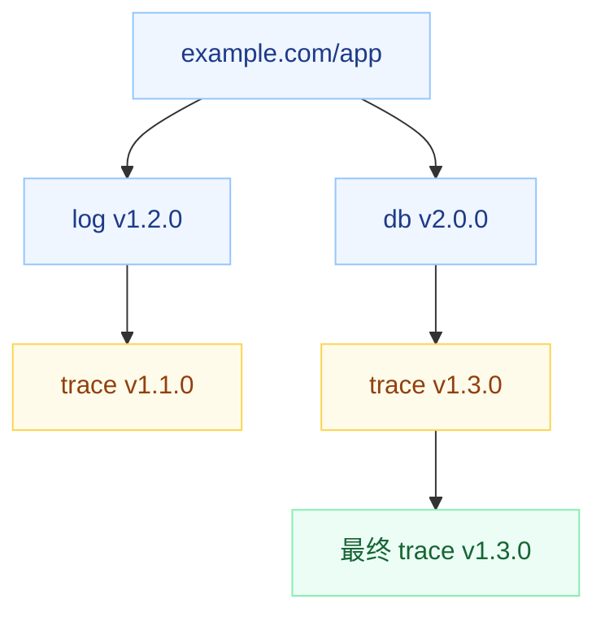
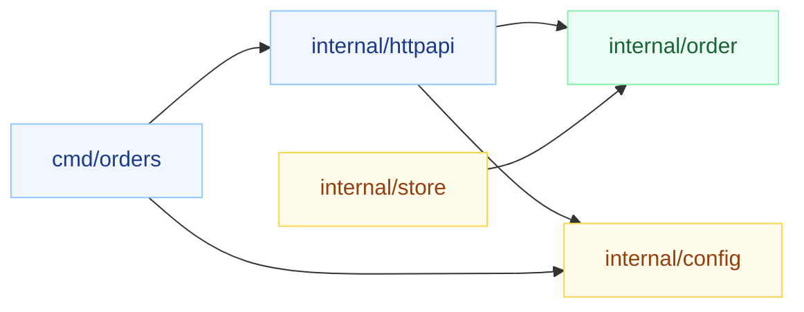

# Go模块与项目构建

> 这篇从 Go 的模块（module）模型讲起，经过 go.mod 与最小版本选择、依赖治理、go.work 工作区、cmd/internal 项目布局、构建与版本注入、项目级测试与 CI 门禁，最后落到一个把单体 main 包改造成可复现构建工程的案例和一份排障现场手册。
>
> 学完能独立初始化、拆分和治理 Go 模块，按依赖方向搭出项目骨架，产出带版本号、可交叉编译的二进制，并把格式检查、静态检查、竞态测试和覆盖率接进流水线。

> 版本基线（2026-11-13）：语言基线 Go 1.24+，当前稳定版为 Go 1.27.4；示例 `go.mod` 写 `go 1.24`，在 Go 1.27.x 上验证。命令默认 Ubuntu 24.04，涉及平台差异处单独标注。

## 一、模块、包与构建单元

Go 的构建以包（package）为单位，分发以模块（module）为单位：模块是带 `go.mod` 的目录树，模块路径（module path）既是导入前缀，也是版本坐标。理解这一层区别，才能判断“加一个文件”和“加一个依赖”分别改动了什么。

包是编译单元，同一目录下的 `.go` 文件必须属于同一个包；模块是版本单元，一个模块可以包含任意多个包。`go build ./...` 编译的是当前模块内的包，`go install example.com/tool@v1.2.3` 安装的是另一个模块的产物。


### 1.1 go.mod 的指令

`go.mod` 只描述“这个模块是谁、需要什么”，不记录构建脚本，也不记录依赖的具体下载地址。

```text
module example.com/orders

go 1.24

toolchain go1.27.4

require (
	github.com/gin-gonic/gin v1.10.0
	github.com/go-sql-driver/mysql v1.9.3
)

require golang.org/x/sys v0.34.0 // indirect

exclude github.com/broken/pkg v1.0.0

replace example.com/legacy => ../legacy
```

| 指令 | 含义 | 常见误用 |
|---|---|---|
| `module` | 模块路径兼导入前缀 | 写成仓库地址但仓库已改名 |
| `go` | 语言版本，决定语法与工具行为 | 手改成高版本导致 CI 工具链不认 |
| `toolchain` | 建议使用的工具链版本 | 被当成“最低版本”理解 |
| `require` | 直接或间接依赖及版本 | 手工删 `// indirect` 行后编译失败 |
| `replace` | 替换依赖来源或版本 | 提交到主干，导致他人构建失败 |

`go` 指令不是“最低 Go 版本”的软提示，它决定编译器启用哪一代语言特性。`go 1.24` 的模块里使用 1.25 才有的语法，编译会直接报错；反过来，用更高版本的工具链编译 `go 1.24` 的模块是允许的。

> 边界：`toolchain` 行是建议值，不是锁定值。默认 `GOTOOLCHAIN=auto` 时，go 命令发现本地版本低于 `toolchain` 会自动下载；内网或 CI 禁止外网时设 `GOTOOLCHAIN=local`，让版本不匹配直接失败，而不是卡在下载。

### 1.2 模块路径、导入路径与主版本

模块路径的最后一个元素决定包的导入前缀，主版本号大于等于 2 时必须写进路径后缀。

| 版本 | 模块路径写法 | 导入写法 |
|---|---|---|
| v0.x / v1.x | `example.com/order` | `example.com/order` |
| v2 及以上 | `example.com/order/v2` | `example.com/order/v2` |
| 未适配模块 | `example.com/order` + `+incompatible` | `example.com/order` |

`+incompatible` 表示该依赖打了 v2 以上标签，却没有把 `/v2` 写进模块路径。它能被拉取，但同一个模块的两个大版本无法共存，升级时只能整体替换。

```bash
go list -m -versions example.com/order
```

预期输出（版本列表来自模块代理，示例）：

```text
example.com/order v1.0.0 v1.1.0 v1.2.3 v2.0.0+incompatible
```

> 边界：内部模块不要用 `v2.0.0+incompatible` 绕过路径规范。正确做法是把模块路径改成 `git.example.com/team/order/v2`，导入路径同步修改，`go mod tidy` 会自动整理。

### 1.3 最小版本选择

Go 采用最小版本选择（Minimal Version Selection，MVS）：每个依赖取所有要求中的最高版本，而不是最新版本。这个规则让构建结果可预测——只要 `go.mod` 不变，解析出的版本集合就不变。



验证当前解析结果：

```bash
go list -m all | head -20
go mod graph | grep 'example.com/trace'
go mod why -m example.com/trace
```

`go mod graph` 输出的是“谁要求了谁”，`go mod why` 回答“为什么这个模块还在依赖图里”。删依赖前先看 `why`，能避免误删仍被间接引用的模块。

> 边界：MVS 只保证“不低于要求”，不保证没有已知漏洞。安全检查要用 `govulncheck`，它按实际调用链判断漏洞是否可达，比只看版本号准确。

### 1.4 internal 与包可见性

`internal` 目录是编译器强制的可见性边界：`example.com/orders/internal/store` 只能被 `example.com/orders` 前缀下的包导入，模块外无法引用。

```text
orders/
├── cmd/orders/main.go          # 可以导入 internal
├── internal/store/store.go     # 只能被本模块导入
└── pkg/client/client.go        # 可以被外部模块导入
```

这条规则解决了“哪些包算公开 API”的争议：外部可见的放 `pkg/` 或模块根，只想内部复用的放 `internal/`。把实现细节放进 `internal/`，重构时不必考虑下游兼容。

> 边界：`internal` 不是安全机制，只是编译期约束。同模块的人仍然可以直接改内部包；真正的接口稳定性靠版本号和测试保证。

### 1.5 什么时候拆成多个模块

单模块是默认答案，拆模块只在三种情况下成立：需要独立发版、需要独立授权、需要独立构建。

| 信号 | 处理 |
|---|---|
| 两个服务发布节奏完全独立 | 拆成两个模块 |
| 公共库要被外部团队引用 | 单独模块 + 版本标签 |
| 只是目录多、文件多 | 不拆，用包分层 |
| 想“看起来整齐” | 不拆 |

拆模块的代价是版本协调：每次改公共库都要打标签、升级依赖、重新构建。团队规模小于十人、发布节奏一致时，单模块加 `internal/` 分层更快。

> 边界：多模块仓库里，根目录不要放 `go.mod` 又放业务代码。根 `go.mod` 会把所有子目录纳入同一模块，子模块的 `go.mod` 反而被忽略，`go build ./...` 的行为与预期不一致。

## 二、依赖管理

依赖管理的目标是三件事：版本可复现、来源可信、升级可控。日常命令只覆盖前两件，第三件靠 `go list` 和测试。

### 2.1 添加、升级与移除

```bash
go get github.com/gin-gonic/gin@v1.10.0   # 指定版本，写入 require
go get github.com/gin-gonic/gin@latest    # 取最新稳定版
go get -u ./...                           # 升级当前模块的直接和间接依赖
go get github.com/gin-gonic/gin@none      # 移除依赖，tidy 后清理 go.sum
go mod tidy                               # 补齐缺失、删除未用
```

`go get` 只改 `go.mod`，不改代码；`go mod tidy` 会根据实际 import 增删依赖。两个命令都可能改写 `go.sum`，提交前必须一起提交。

预期输出（示例）：

```text
go: downloading github.com/gin-gonic/gin v1.10.0
go: added github.com/gin-gonic/gin v1.10.0
```

升级单个依赖前先看差异：

```bash
go list -m -u all          # 列出可升级的模块
go list -m -versions github.com/gin-gonic/gin
```

> 边界：`go get -u ./...` 会连带升级间接依赖，跨大版本时可能改变行为。生产项目按“一次只升一个直接依赖 + 跑全量测试”的节奏推进，不要整批升级后再排查。

### 2.2 go.sum 的校验机制

`go.sum` 记录每个模块版本的哈希，防止下载到的内容与首次构建时不一致。它不锁定版本，锁版本的是 `go.mod`。

```bash
go mod verify        # 校验本地缓存中的依赖是否与 go.sum 一致
go mod download      # 只下载，不构建
```

预期输出：

```text
all modules verified
```

常见的两类报错要区分：

| 报错 | 原因 | 处理 |
|---|---|---|
| `missing go.sum entry` | 新增 import 后没跑 tidy | `go mod tidy` |
| `checksum mismatch` | 代理返回内容被改动或缓存损坏 | 清缓存后重下，核对来源 |
| `verifying module: 410 Gone` | 代理上没有该版本 | 换 `GOPROXY` 或改版本 |

> 边界：不要手改 `go.sum`，也不要把它加入 `.gitignore`。删掉 `go.sum` 后重新生成，等于放弃对历史构建的校验能力。

### 2.3 replace 的两种用途

`replace` 把某个模块的导入解析到另一个路径或版本，只对当前主模块生效，不会被下游继承。

```text
// 本地联调：把公共库指向同级目录
replace example.com/auth => ../auth

// 临时修复：用 fork 的提交替换上游版本
replace github.com/upstream/pkg => github.com/team/pkg v1.4.2-fix.1
```

本地联调时配合 `go.work` 更干净：`replace` 写进 `go.mod` 容易误提交，`go.work` 只在本地生效，不会被 CI 读到。

> 边界：`replace` 指向本地相对路径后，`go install` 和容器构建都会失败，因为构建环境没有那个目录。发布前用 `grep -n 'replace' go.mod` 检查一遍。

### 2.4 私有模块与代理

公司内部模块不在公共代理上，需要让 go 命令绕过代理和校验和数据库。

```bash
go env -w GOPRIVATE=git.example.com/*,github.com/company/*
go env -w GOPROXY=https://goproxy.cn,direct
go env -w GONOSUMDB=git.example.com/*
```

`GOPRIVATE` 是 `GONOPROXY` 和 `GONOSUMDB` 的组合预设：匹配的模块直连源站，并且不查公共校验和。凭证放在 `~/.netrc`，不要写进仓库：

```text
machine git.example.com
login ci-bot
password <token>
```

Ubuntu 与 macOS 上把文件权限设为 `600`；Windows 对应 `%USERPROFILE%\_netrc`。

> 边界：`GOPRIVATE` 只影响 go 命令，不影响 `git`。私有仓库走 SSH 时，CI 需要部署密钥；走 HTTPS 时用 `git config --global url."git@git.example.com:".insteadOf "https://git.example.com/"` 统一改写。

### 2.5 vendor 目录

`go mod vendor` 把依赖复制到项目内的 `vendor/`，构建时不再访问网络。Go 1.14 起，存在 `vendor/modules.txt` 且 `go` 指令不低于 1.14 时自动使用 vendor 模式。

```bash
go mod vendor
go build -mod=vendor ./...
go mod verify
```

| 场景 | 是否用 vendor |
|---|---|
| 内网构建、无法访问代理 | 用 |
| 需要审计依赖源码 | 用 |
| 依赖数量大、更新频繁 | 不用 |
| 开源库对外发布 | 不用 |

> 边界：vendor 目录必须与 `go.mod` 同步，改了依赖却没重新 `go mod vendor`，CI 会报 `inconsistent vendoring`。把 `go mod vendor` 加进发布脚本，而不是靠记忆。

### 2.6 工具依赖

Go 1.24 起可以在 `go.mod` 里声明工具依赖，避免“文档让人装一堆全局命令，版本各不相同”。

```bash
go get -tool golang.org/x/tools/cmd/stringer
go get -tool honnef.co/go/tools/cmd/staticcheck
```

`go.mod` 会增加：

```text
tool (
	golang.org/x/tools/cmd/stringer
	honnef.co/go/tools/cmd/staticcheck
)
```

调用时用 `go tool`：

```bash
go tool stringer -type=Status ./internal/order
go tool staticcheck ./...
```

> 边界：`go tool` 运行的是当前模块锁定的版本，团队成员和 CI 结果一致。仍然需要全局安装的只有 `govulncheck`（它要独立升级漏洞库），其余工具优先走 `tool` 指令。

## 三、工作区 go.work

`go.work` 让多个本地模块共享一次依赖解析，解决“改公共库后要不停 replace 或打标签”的问题。

### 3.1 初始化与日常命令

```bash
mkdir -p services/order services/user libs/auth
go work init ./services/order ./libs/auth
go work use ./services/user
```

生成的 `go.work`：

```text
go 1.24

use (
	./libs/auth
	./services/order
	./services/user
)
```

之后在仓库根目录执行 `go build ./...`、`go test ./...`，会同时覆盖三个模块；`services/order` 里导入 `example.com/auth` 时，直接解析到本地 `libs/auth`，不需要 `replace`。

```bash
go work sync     # 把工作区的依赖版本同步回各模块的 go.mod
go work edit -json
```

> 边界：`go.work` 只对当前目录树生效。子目录里执行 go 命令时，go 会向上查找最近的 `go.work`；如果子模块单独在 CI 中构建（没有 `go.work`），依赖必须仍能由各自的 `go.mod` 解析。

### 3.2 go.work.sum 与提交策略

工作区会生成 `go.work.sum`，记录工作区范围额外的校验和。团队约定通常是二选一：

| 策略 | 做法 | 适用 |
|---|---|---|
| 不提交 go.work | 加进 `.gitignore` | 各人本地模块组合不同 |
| 提交 go.work | 连同 go.work.sum 一起提交 | 单仓库多模块、统一开发环境 |

不提交时，CI 只按各模块的 `go.mod` 构建，能验证“脱离工作区也能编译”，这是更稳的默认。

> 边界：`go.work` 里 `use` 的目录必须存在，否则所有 go 命令都会失败。拉取分支后子模块目录被删、`go.work` 还留着旧路径，报错是 `go: cannot load module ... listed in go.work file`。删掉对应 `use` 行即可。

### 3.3 工作区与 replace 的选择

工作区解决“本地多模块联调”，`replace` 解决“依赖来源替换”，两者不要混用。

```text
需求：本地改公共库，业务模块立刻生效
→ go.work

需求：公司 fork 了上游库，所有环境都用 fork
→ go.mod 的 replace，写进主干

需求：只想临时指向同事的目录
→ go.work，不提交
```

## 四、项目布局

Go 官方没有强制布局，但企业项目有事实标准：`cmd/` 放入口，`internal/` 放私有实现，`pkg/` 放可复用公开包，其余按职责分层。布局的作用是让依赖方向可见，不是让目录看起来整齐。

### 4.1 目录结构与职责

```text
orders/
├── cmd/
│   └── orders/
│       └── main.go            # 只做装配：读配置、建依赖、启动
├── internal/
│   ├── config/config.go       # 配置结构与校验
│   ├── httpapi/               # 路由、中间件、请求响应
│   │   ├── router.go
│   │   └── order_handler.go
│   ├── order/                 # 领域逻辑，不 import httpapi
│   │   ├── service.go
│   │   └── repository.go      # 接口定义
│   └── store/
│       └── mysql_order.go     # 接口实现
├── migrations/
│   └── 0001_init.sql
├── api/
│   └── openapi.yaml
├── scripts/
│   └── build.sh
├── go.mod
├── go.sum
└── Makefile
```

`main.go` 控制在几十行：解析参数、加载配置、连数据库、注册路由、启动服务、处理退出。业务逻辑不写在 `main` 里，否则无法测试。

```go
package main

import (
	"context"
	"log/slog"
	"os"

	"example.com/orders/internal/config"
	"example.com/orders/internal/httpapi"
)

func main() {
	if err := run(); err != nil {
		// main 只负责退出码，错误处理集中在 run，defer 才能正常执行
		slog.Error("server exited", "err", err)
		os.Exit(1)
	}
}

func run() error {
	cfg, err := config.Load()
	if err != nil {
		return err
	}
	srv, err := httpapi.NewServer(cfg)
	if err != nil {
		return err
	}
	return srv.Run(context.Background())
}
```

### 4.2 依赖方向

依赖只能从外层指向内层：`cmd` → `httpapi` → `order` ← `store`。领域包不导入框架，存储实现依赖领域接口，这样换数据库或换 HTTP 框架时不用改业务。



接口定义在消费方（`order`），实现在提供方（`store`），这叫依赖倒置。把接口写在 `store` 包里再由 `order` 导入，会让领域包反向依赖基础设施。

> 边界：不要在 `internal/order` 里出现 `*gin.Context`、`*gorm.DB`。一旦领域层拿到框架类型，单元测试就必须起 HTTP 上下文或数据库，分层失去意义。

### 4.3 包命名与职责

包名用简短小写名词，不加 `util`、`common`、`base` 这类无法判断职责的名字。

| 包名 | 职责 | 反例 |
|---|---|---|
| `order` | 订单领域模型与服务 | `models` |
| `store` | 持久化实现 | `dao` + `mapper` + `db` 三件套 |
| `httpapi` | HTTP 适配层 | `controller` |
| `config` | 配置加载与校验 | `global` |
| `clock` | 可替换的时间源 | `utils` |

`util` 包最终会变成什么都往里塞的垃圾桶。需要工具函数时，按用途新建小包：`idgen`、`retry`、`money`。

### 4.4 单模块与多模块的选择

单模块足以支撑几十万行代码，多模块只在第 1.5 节列出的三种信号出现时才考虑。

| 判断项 | 单模块 | 多模块 |
|---|---|---|
| 发布节奏 | 统一 | 各自独立 |
| 版本管理 | 一个版本号 | 每模块一个 |
| 重构成本 | 低 | 跨模块改版本 |
| 构建范围 | `./...` 全量 | 按模块 |
| 适用规模 | 大多数业务系统 | 平台 + 多产品 |

## 五、构建、交叉编译与版本注入

构建要解决三件事：产物可追溯、结果可复现、部署可移植。`go build` 的默认行为只满足第一件的一半——它不写版本号。

### 5.1 常用参数

```bash
go build -o bin/orders ./cmd/orders
go build -trimpath -o bin/orders ./cmd/orders
go build -tags=integration -o bin/orders ./cmd/orders
go build -gcflags="-m" ./internal/order   # 查看逃逸分析
```

| 参数 | 用途 | 注意 |
|---|---|---|
| `-o` | 指定输出路径 | 目录必须存在 |
| `-trimpath` | 去掉本机绝对路径 | 影响调试符号，发布必开 |
| `-ldflags` | 注入变量、裁剪符号 | 只能改字符串变量 |
| `-tags` | 启用构建标签 | 标签拼错会静默少编译文件 |
| `-buildvcs` | 写入版本控制信息 | 容器内无 `.git` 时设 false |

### 5.2 版本注入

在 `main` 包声明三个字符串变量，构建时用 `-X` 覆盖：

```go
package main

import "fmt"

// 这三个变量必须有初始值，-X 只能覆盖已存在的字符串变量
var (
	version = "dev"
	commit  = "none"
	date    = "unknown"
)

func main() {
	fmt.Printf("orders %s commit=%s built=%s\n", version, commit, date)
}
```

```bash
go build -trimpath \
  -ldflags "-s -w \
    -X main.version=1.4.0 \
    -X main.commit=$(git rev-parse --short HEAD) \
    -X main.date=$(date -u +%Y-%m-%dT%H:%M:%SZ)" \
  -o bin/orders ./cmd/orders

./bin/orders
```

预期输出：

```text
orders 1.4.0 commit=9f2c1ab built=2026-11-13T08:21:07Z
```

`-s -w` 去掉符号表和 DWARF 调试信息，二进制通常缩小 20%–30%。代价是 `panic` 栈里没有行号、`pprof` 的可读性下降；线上需要长期排障时保留符号，另存一份带符号的二进制。

> 边界：`-X` 的目标必须是 `main` 包里的字符串变量，或写成完整导入路径 `-X example.com/orders/internal/version.Version=...`。改 `int`、`bool`、常量都无效，且构建不会报错。

### 5.3 交叉编译

```bash
CGO_ENABLED=0 GOOS=linux   GOARCH=amd64 go build -trimpath -o dist/orders-linux-amd64 ./cmd/orders
CGO_ENABLED=0 GOOS=linux   GOARCH=arm64 go build -trimpath -o dist/orders-linux-arm64 ./cmd/orders
CGO_ENABLED=0 GOOS=darwin  GOARCH=arm64 go build -trimpath -o dist/orders-darwin-arm64 ./cmd/orders
CGO_ENABLED=0 GOOS=windows GOARCH=amd64 go build -trimpath -o dist/orders-windows-amd64.exe ./cmd/orders
```

`CGO_ENABLED=0` 生成纯静态二进制，可以直接放进 `scratch` 或 `distroless/static` 镜像。开启 cgo 后二进制依赖目标平台的 libc，交叉编译还需要对应的 C 工具链。

```bash
go version -m bin/orders
```

预期输出（关键片段）：

```text
bin/orders: go1.27.4
	path	example.com/orders/cmd/orders
	mod	example.com/orders	(devel)
	build	-trimpath
	build	CGO_ENABLED=0
	build	vcs.revision=9f2c1ab...
	build	vcs.time=2026-11-13T08:19:44Z
```

`go version -m` 能读出版本、构建参数和 VCS 提交，这是排查“线上跑的是哪个包”的第一条命令。

> 边界：SQLite（`mattn/go-sqlite3`）、Oracle 驱动、部分 Kerberos 库依赖 cgo，不能靠 `CGO_ENABLED=0` 静态构建。这类项目要么接受动态链接，要么换纯 Go 驱动（如 `modernc.org/sqlite`）。

### 5.4 可复现构建

可复现指同样的源码、同样的工具链、同样的参数，产出字节一致的二进制。Go 的构建本身已接近确定性，破坏它的是路径、时间戳和 VCS 信息。

```bash
CGO_ENABLED=0 go build \
  -trimpath \
  -buildvcs=false \
  -ldflags "-s -w -X main.version=1.4.0 -X main.date=2026-11-13T00:00:00Z" \
  -o bin/orders ./cmd/orders
```

三个变量的处理规则：

| 变量 | 处理 | 原因 |
|---|---|---|
| 源码路径 | `-trimpath` | 否则编译目录泄露且影响哈希 |
| 构建时间 | 用固定值或省略 | `date` 每次都变 |
| VCS 信息 | 容器内 `-buildvcs=false` | 无 `.git` 时构建失败 |

验证两次构建一致：

```bash
sha256sum bin/orders
CGO_ENABLED=0 go build -trimpath -buildvcs=false -ldflags "-s -w -X main.version=1.4.0 -X main.date=2026-11-13T00:00:00Z" -o bin/orders2 ./cmd/orders
sha256sum bin/orders2
```

预期输出（两个哈希相同）：

```text
3f1c0a5e...  bin/orders
3f1c0a5e...  bin/orders2
```

> 边界：`-buildvcs=auto` 在 git 仓库外不会报错，在 git 仓库内但 `git` 不可用时会失败。CI 里显式写 `-buildvcs=false` 比依赖 auto 更稳。

### 5.5 多阶段镜像

```dockerfile
FROM golang:1.27-alpine AS build
WORKDIR /src
COPY go.mod go.sum ./
RUN go mod download
COPY . .
RUN CGO_ENABLED=0 GOOS=linux go build \
    -trimpath -buildvcs=false \
    -ldflags "-s -w -X main.version=1.4.0" \
    -o /out/orders ./cmd/orders

FROM gcr.io/distroless/static-debian12:nonroot
COPY --from=build /out/orders /orders
USER nonroot:nonroot
EXPOSE 8080
ENTRYPOINT ["/orders"]
```

先 `COPY go.mod go.sum` 再 `go mod download`，是为了让依赖层命中缓存：只改业务代码时不必重新下载依赖。

```bash
docker build -t registry.example.com/orders:1.4.0 .
docker run --rm registry.example.com/orders:1.4.0
```

预期输出：

```text
orders 1.4.0 commit=none built=unknown
```

> 边界：镜像里没有 shell、没有 CA 证书、没有时区库。需要访问 HTTPS 外部服务时用 `distroless/static-debian12`（自带 CA），需要时区数据时在构建阶段 `COPY --from=build /usr/share/zoneinfo /usr/share/zoneinfo`，或直接统一用 UTC。

### 5.6 Makefile 与构建脚本

Makefile 把“构建前要记得做的事”固化成一条命令。注意配方行必须以 Tab 开头。

```make
BIN     := bin/orders
VERSION ?= $(shell git describe --tags --always --dirty)
COMMIT  := $(shell git rev-parse --short HEAD)
DATE    := $(shell date -u +%Y-%m-%dT%H:%M:%SZ)
LDFLAGS := -s -w -X main.version=$(VERSION) -X main.commit=$(COMMIT) -X main.date=$(DATE)

.PHONY: build test vet cover run clean

build:
	CGO_ENABLED=0 go build -trimpath -ldflags "$(LDFLAGS)" -o $(BIN) ./cmd/orders

test:
	go test -race -count=1 ./...

vet:
	go vet ./...

cover:
	go test -coverprofile=cover.out ./...
	go tool cover -func=cover.out | tail -1

run:
	go run ./cmd/orders -config ./configs/local.yaml

clean:
	rm -rf bin cover.out
```

```bash
make build
./bin/orders
```

预期输出：

```text
orders v1.4.0-3-g9f2c1ab-dirty commit=9f2c1ab built=2026-11-13T08:21:07Z
```

> 边界：Makefile 的 `$(shell ...)` 在 Windows 的 cmd 下不可用。跨平台团队改用 `scripts/build.sh` + `scripts/build.ps1`，或在 CI 里统一用 Linux 执行构建。

## 六、项目级测试与质量门禁

测试在语法篇已经讲过写法，这一章讲项目级组织：测试放哪、什么进 CI、覆盖率怎么用。

### 6.1 测试文件与包名

测试文件与被测代码同目录，文件名以 `_test.go` 结尾。包名有两种选择：

| 写法 | 包名 | 能访问未导出标识符 | 适用 |
|---|---|---|---|
| 白盒 | `package order` | 能 | 测内部函数、状态机 |
| 黑盒 | `package order_test` | 不能 | 测公开 API，防实现耦合 |

同一个目录里可以同时存在两种测试包，但不要为了“测私有函数方便”把所有测试都写成白盒，否则重构时测试会大面积失效。

测试数据放 `testdata/`，go 工具链会忽略该目录，不会被编译进包。

```text
internal/order/
├── service.go
├── service_test.go
└── testdata/
    ├── orders_valid.csv
    └── orders_bad_rows.csv
```

### 6.2 集成测试与构建标签

依赖数据库、Redis、外部 HTTP 的测试默认不跑，用构建标签隔离：

```go
//go:build integration

package store_test

import (
	"os"
	"testing"
)

func TestMySQLOrderRepository(t *testing.T) {
	dsn := os.Getenv("TEST_MYSQL_DSN")
	if dsn == "" {
		t.Skip("TEST_MYSQL_DSN not set") // 本地没配数据库时跳过，而不是失败
	}
	// 连接、建表、断言
}
```

```bash
go test ./...                          # 不含集成测试
go test -tags=integration ./...       # 含集成测试
go test -tags=integration -run TestMySQL ./internal/store -v
```

构建约束必须写在 `package` 子句之前，并与 `package` 之间空一行，否则标签不生效。

> 边界：构建标签拼错不会报错，只会让文件被静默排除。CI 里用 `go vet -tags=integration ./...` 确认集成测试文件能被编译，比只看 `go test ./...` 通过更可靠。

### 6.3 覆盖率

```bash
go test -coverprofile=cover.out ./...
go tool cover -func=cover.out
go tool cover -html=cover.out -o cover.html
```

预期输出（片段）：

```text
example.com/orders/internal/order/service.go:42:  Summarize   91.7%
example.com/orders/internal/store/mysql.go:88:    FindByID    76.5%
total:                                            (statements) 82.4%
```

覆盖率是发现“完全没测到的分支”的工具，不是 KPI。把阈值设在 60%–70% 能挡住裸奔提交；设到 90% 以上通常换来大量只为凑数的断言。

### 6.4 静态检查

```bash
go fmt ./...
go vet ./...
go tool staticcheck ./...
govulncheck ./...
```

| 工具 | 查什么 | 是否阻塞合并 |
|---|---|---|
| `go fmt` | 格式 | 是，检查 `git diff --exit-code` |
| `go vet` | 格式串、锁拷贝、无效断言 | 是 |
| `staticcheck` | 死代码、错误用法、性能问题 | 是，先按规则白名单 |
| `govulncheck` | 依赖中的已知漏洞是否可达 | 是，高危必修 |

`govulncheck` 安装：

```bash
go install golang.org/x/vuln/cmd/govulncheck@latest
govulncheck ./...
```

预期输出（无漏洞时）：

```text
No vulnerabilities found.
```

### 6.5 CI 流水线

```yaml
name: ci
on: [push, pull_request]

jobs:
  build:
    runs-on: ubuntu-24.04
    steps:
      - uses: actions/checkout@v4
      - uses: actions/setup-go@v5
        with:
          go-version-file: go.mod   # 版本跟随 go.mod，避免两处维护
          cache: true
      - run: go mod verify
      - run: test -z "$(gofmt -l .)"   # 有未格式化文件时立即失败
      - run: go vet ./...
      - run: go test -race -count=1 -coverprofile=cover.out ./...
      - run: go build -trimpath -buildvcs=false -o bin/orders ./cmd/orders
```

`go-version-file: go.mod` 让 CI 与本地使用同一版本来源。`-count=1` 禁用测试结果缓存，避免“本地过了 CI 不过”。

> 边界：`-race` 让测试变慢 2–10 倍，大型项目只在合并请求上跑全量，日常提交用 `-short` 跳过慢用例。竞态检测依赖 cgo，`CGO_ENABLED=0` 时 `-race` 不可用。

## 七、排障现场手册

模块问题几乎都能归到四类：网络拿不到、校验对不上、版本解析错、工具链不一致。按现象查表，再执行第一条命令。

| 现象 | 原因 | 第一条命令 |
|---|---|---|
| `missing go.sum entry` | 新增 import 未 tidy | `go mod tidy` |
| `checksum mismatch` | 缓存或代理内容异常 | `go clean -modcache` 后重下 |
| `410 Gone` | 代理缺该版本 | `GOPROXY=direct go mod download` |
| `unknown revision` | 标签或分支名错 | `git ls-remote --tags origin` |
| `module declares its path as` | 导入路径与模块路径不符 | 改 import 或加 `replace` |
| `import cycle not allowed` | 包之间循环依赖 | <span v-pre>`go list -f '{{.ImportPath}} {{.Imports}}'`</span> |
| `toolchain not available` | 内网禁下载 | `GOTOOLCHAIN=local` |

### 7.1 go.sum 与代理

```bash
go env GOPROXY GOSUMDB GOPRIVATE GOFLAGS
go clean -modcache
go mod download -x
```

`-x` 会打印实际执行的下载命令和 URL，能直接看出请求打到了哪个代理。国内环境常用 `https://goproxy.cn,direct`，`direct` 表示代理没有时回源。

> 边界：`GOFLAGS=-mod=mod` 会让构建自动改 `go.mod`，CI 里应避免，否则构建产物依赖工作区状态。CI 统一用 `-mod=readonly`（Go 1.16 起默认）。

### 7.2 版本冲突

```bash
go list -m all | grep example.com/conflict
go mod graph | grep example.com/conflict
go mod why -m example.com/conflict
```

三条命令分别回答：当前解析成哪个版本、谁引入了它、为什么还需要它。要压到指定版本，用显式 `require` 或 `go get example.com/conflict@v1.2.3`，不要用 `exclude` 硬删——排除后 MVS 会选下一个版本，结果仍可能不是想要的。

### 7.3 工具链不一致

```bash
go version
go env GOTOOLCHAIN GOVERSION
grep -E '^(go|toolchain)' go.mod
```

本地 1.27、CI 1.24 时，`go.mod` 里 `go 1.24` 能编，但用到了 1.25 的标准库 API 就会失败。统一做法：CI 用 `go-version-file: go.mod`，本地用 `go env -w GOTOOLCHAIN=auto` 让工具链自动对齐。

### 7.4 构建缓存异常

```bash
go clean -cache
go build -a ./...        # 强制重编所有包，绕过缓存
go env GOCACHE
```

`-a` 很慢，只用于确认“是不是缓存坏了”。日常遇到“改了代码没生效”，先看 `go env GOFLAGS` 是否带了 `-mod=vendor`，再看运行的是不是旧二进制。

> 边界：`go build` 的产物默认放在当前目录，同名文件会被覆盖。脚本里统一 `-o bin/`，并让 `.gitignore` 忽略 `bin/`，避免把二进制提交进仓库。

## 八、最佳实践案例

### 8.1 案例背景

一个五人团队维护订单服务，代码在一个 `main` 包里堆到 6000 行，包含 HTTP 处理、SQL、CSV 导出和定时任务。现状有四个问题：

- 构建产物没有版本号，线上出问题只能靠部署时间推测是哪个提交；
- 本地 `go test ./...` 要连开发库，新人第一天跑不起来；
- 每次发版手工执行五条命令，漏跑 `go vet` 是常态；
- 公共库改动要打标签才能被服务引用，联调一轮至少半天。

目标是在不改变业务行为的前提下，用两周完成工程化改造：拆出 `cmd/internal` 布局、加版本注入、把集成测试隔离、把检查接进 CI、用 `go.work` 做本地联调。约束是不能停机、不能一次改完所有代码。

### 8.2 案例实操

第一步，记录改造前的基线，作为对比数据：

```bash
git ls-files '*.go' | xargs wc -l | tail -1
time go build -o /tmp/orders-before .
```

预期输出（示例）：

```text
  6014 total
real	0m38.2s
```

第二步，建立目录骨架，把 `main.go` 缩到只做装配：

```bash
mkdir -p cmd/orders internal/config internal/httpapi internal/order internal/store
git mv main.go cmd/orders/main.go
```

`internal/config/config.go`：

```go
package config

import (
	"errors"
	"os"
	"strconv"
)

type Config struct {
	Addr        string
	MySQLDSN    string
	LogLevel    string
	MaxOpenConn int
}

// Load 从环境变量读取配置，缺关键项时立即返回错误，避免带病启动。
func Load() (Config, error) {
	cfg := Config{
		Addr:        getenv("ORDERS_ADDR", ":8080"),
		MySQLDSN:    os.Getenv("ORDERS_MYSQL_DSN"),
		LogLevel:    getenv("ORDERS_LOG_LEVEL", "info"),
		MaxOpenConn: 20,
	}
	if cfg.MySQLDSN == "" {
		return Config{}, errors.New("ORDERS_MYSQL_DSN is required")
	}
	if n, err := strconv.Atoi(getenv("ORDERS_MAX_OPEN_CONN", "20")); err == nil && n > 0 {
		cfg.MaxOpenConn = n
	}
	return cfg, nil
}

func getenv(key, fallback string) string {
	if v := os.Getenv(key); v != "" {
		return v
	}
	return fallback
}
```

`cmd/orders/main.go`：

```go
package main

import (
	"fmt"
	"log/slog"
	"os"

	"example.com/orders/internal/config"
)

var (
	version = "dev"
	commit  = "none"
	date    = "unknown"
)

func main() {
	if len(os.Args) > 1 && os.Args[1] == "-version" {
		fmt.Printf("orders %s commit=%s built=%s\n", version, commit, date)
		return
	}
	cfg, err := config.Load()
	if err != nil {
		slog.Error("load config", "err", err)
		os.Exit(1)
	}
	slog.Info("starting", "addr", cfg.Addr, "version", version)
}
```

第三步，补 `Makefile` 和版本注入，构建一次验证：

```bash
make build
./bin/orders -version
```

预期输出：

```text
orders v1.4.0-3-g9f2c1ab commit=9f2c1ab built=2026-11-13T08:21:07Z
```

第四步，把集成测试挪到构建标签后，本地默认不连库：

```bash
go test ./...
```

预期输出：

```text
ok  	example.com/orders/internal/order	0.004s
ok  	example.com/orders/internal/config	0.002s
```

第五步，用 `go.work` 把公共库和服务放一起联调：

```bash
go work init ./services/order ./libs/auth
go work use ./services/user
go work sync
go build ./...
```

`go.work`：

```text
go 1.24

use (
	./libs/auth
	./services/order
	./services/user
)
```

第六步，接入 CI，并跑一次完整门禁：

```bash
go mod verify && \
test -z "$(gofmt -l .)" && \
go vet ./... && \
go test -race -count=1 -coverprofile=cover.out ./... && \
go build -trimpath -buildvcs=false -o bin/orders ./cmd/orders
```

预期输出（片段）：

```text
all modules verified
ok  	example.com/orders/internal/order	3.114s	coverage: 84.1% of statements
ok  	example.com/orders/internal/store	1.902s	coverage: 71.3% of statements
```

### 8.3 案例结果

改造后构建与检查都收敛到 `make build` 和一条 CI 命令，版本号随二进制可查。下表是这次改造的示例数据，实际数值随代码规模与机器性能变化。

| 指标 | 改造前 | 改造后 |
|---|---|---|
| `main` 包行数 | 6014 | 96 |
| 新增接口耗时 | 改 1 个文件 | 改 handler + service |
| 构建时间 | 38.2s | 21.6s |
| 版本可追溯 | 无 | `-version` + `go version -m` |
| 新人跑测试 | 需连开发库 | 默认全绿，集成测试可选 |
| 发版命令 | 手工五条 | `make build` |

失败模式与复盘：

- 第一次拆包把 `order` 的接口定义放在 `store` 里，结果 `order` 反过来 import `store`，形成循环依赖；把接口移到消费方后消失。判断口诀是“接口跟着使用者走”；
- `-X` 注入的版本变量原来是 `const`，构建不报错但版本一直是 `dev`；改成 `var` 并加空值检查后修复；
- 集成测试加了 `//go:build integration` 却在 `package` 行后空了一行，标签失效，CI 仍然连库。用 `go vet -tags=integration ./...` 能提前发现文件未被识别；
- `go.work` 提交后 CI 报 `cannot load module`，原因是流水线只 checkout 了一个子目录。工作区文件不提交、由各模块独立构建，问题根除；
- 用 `go get -u ./...` 一次性升级 14 个依赖，两个库的默认行为变了，回滚花了半天。改为按依赖逐个升级、每次跑全量测试。

改造没有改任何业务逻辑，风险集中在构建和依赖层，回滚方式是把 `Makefile`、CI 配置和目录结构还原，业务代码不受影响。这类改造适合在需求空档期做，并在完成后连续观察一个发布周期的构建时长和失败率。
