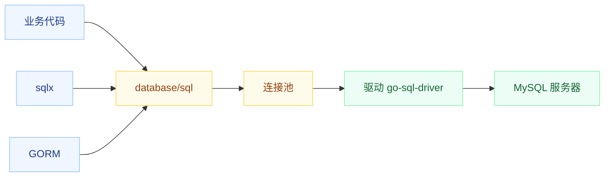
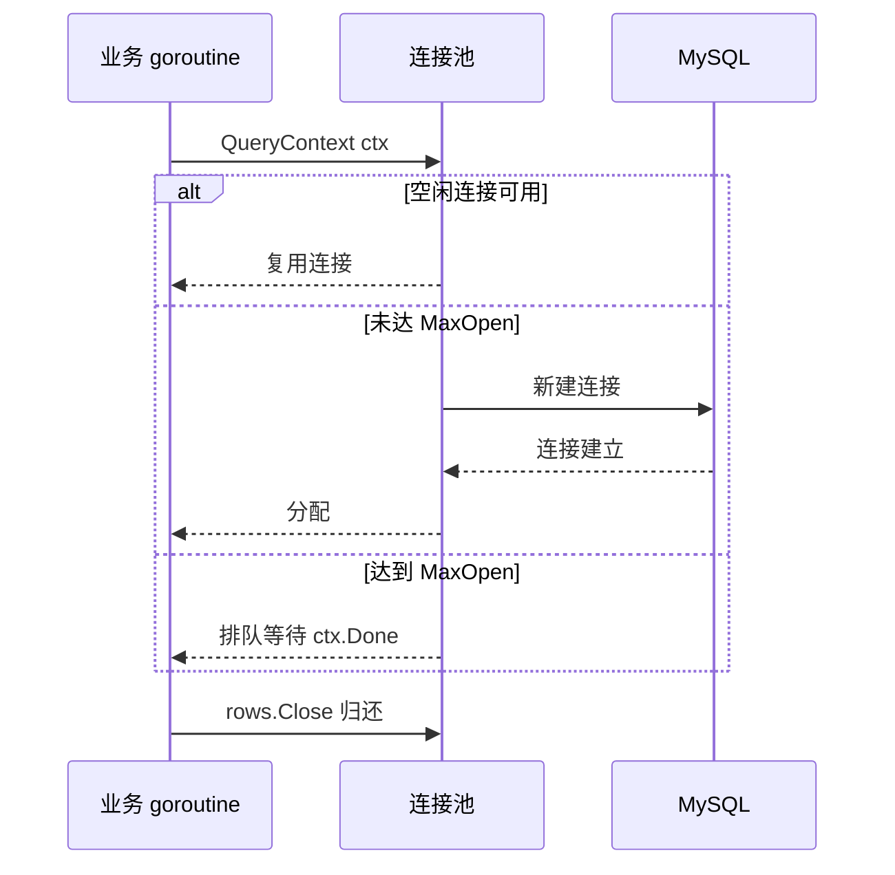

# Go数据库访问

> 这篇从 database/sql 的分层与连接池讲起，经过 CRUD 与 NULL 处理、事务与并发控制、sqlx 的结构化扫描、GORM 的模型与仓储，最后落到积分账户扣减的完整案例和数据库访问排障手册。
>
> 学完能独立写生产级数据访问代码：配好连接池、用参数化 SQL 完成 CRUD、在事务里实现幂等与重试，并按场景在 database/sql、sqlx、GORM 之间做出选型。

> 版本基线（2026-11-13）：Go 1.24+（示例在 Go 1.27.x 验证），`database/sql` 为标准库；sqlx 1.4+；GORM 1.25+；MySQL 8.4 LTS，驱动 `github.com/go-sql-driver/mysql` v1.9+。命令默认 Ubuntu 24.04。

## 一、database/sql 的分层与连接池

Go 访问数据库的标准路径是 `database/sql`：它定义连接池、事务和扫描的通用接口，具体协议交给驱动实现。业务代码只面对 `*sql.DB`，换数据库不改业务层，这是所有上层库（sqlx、GORM）共同的地基。



### 1.1 驱动注册与 DSN

驱动在 `init` 里调用 `sql.Register`，业务代码用空导入触发注册：

```go
import (
	"database/sql"

	_ "github.com/go-sql-driver/mysql" // 只需要驱动的 init 副作用，不直接使用包名
)
```

MySQL 的数据源名称（DSN，Data Source Name）格式固定为 `user:password@tcp(host:port)/dbname?params`：

```text
points:points@tcp(127.0.0.1:3306)/points?charset=utf8mb4&parseTime=true&loc=Local&timeout=3s&readTimeout=3s&writeTimeout=3s&interpolateParams=true
```

| 参数 | 含义 | 不设置的后果 |
|---|---|---|
| `parseTime=true` | DATETIME 扫描为 `time.Time` | 只能扫到 `[]byte` |
| `loc=Local` | 时间字符串按本地时区解析 | 时间差 8 小时 |
| `timeout` | 拨号超时 | 启动时卡死 |
| `interpolateParams=true` | 客户端插值参数 | 每条语句多一次往返 |

> 边界：`interpolateParams` 由驱动在客户端转义，安全性等价于服务端预编译，能减少一次 `PREPARE` 往返，但语句会出现在服务端慢日志里（带真实参数），注意日志脱敏。

### 1.2 连接池参数与默认值

`sql.Open` 不建立连接，只初始化池；第一次真实访问或 `Ping` 才会拨号。默认参数对生产几乎不可用，必须显式配置：

```go
db, err := sql.Open("mysql", dsn)
if err != nil {
	return err
}
db.SetMaxOpenConns(50)              // 0 表示无限制，会被 MySQL max_connections 反向打爆
db.SetMaxIdleConns(50)              // 与 MaxOpen 一致，避免高峰期反复重建连接
db.SetConnMaxLifetime(30 * time.Minute) // 主动早于服务端 wait_timeout 断开
db.SetConnMaxIdleTime(10 * time.Minute) // 回收长期空闲连接
if err := db.PingContext(ctx); err != nil {
	return err
}
```

| 参数 | 默认 | 生产建议 | 依据 |
|---|---|---|---|
| `MaxOpenConns` | 0（无限） | 20–50/实例 | 数据库 `max_connections` 除以实例数再留余量 |
| `MaxIdleConns` | 2 | 等于 MaxOpen | 避免突发时新建连接的风暴 |
| `ConnMaxLifetime` | 0（永生） | 30m–1h | 早于 `wait_timeout` |
| `ConnMaxIdleTime` | 0（不回收） | 5–10m | 控制空闲连接占用 |

`MaxIdleConns` 大于 `MaxOpenConns` 会被静默截断到 MaxOpen，不会报错；写反了要靠 review 发现。

> 边界：连接池参数没有万能值。上限取决于数据库端 `max_connections`、代理（ProxySQL、RDS 代理）的连接复用，以及超时预算。上线后用 `SHOW STATUS LIKE 'Threads_connected'` 与应用指标对账，而不是抄配置。

### 1.3 连接池的行为

池的行为可以概括为三点：有空闲连接就复用；没有且未达上限就新建；达到上限就等待，直到有连接归还或 context 超时。



等待期没有专门的错误信息，只会以 `context deadline exceeded` 冒出来。看到大量请求超时但数据库负载不高，第一怀疑对象就是池耗尽或连接没归还。

> 边界：`*sql.DB` 是并发安全的，全程共享一个实例。在请求里 `sql.Open` 等于每次新建一个池，连接数会失控；`sql.DB` 也不需要关闭重连逻辑，它自己处理坏连接。

## 二、连接、查询与写入

这一章建立最小闭环：建表、插入、单行与多行查询、更新删除，全部用参数化语句。示例统一使用下面的订单表：

```sql
CREATE TABLE orders (
  id           BIGINT UNSIGNED AUTO_INCREMENT PRIMARY KEY,
  customer     VARCHAR(64)  NOT NULL,
  amount_cents BIGINT       NOT NULL,
  status       VARCHAR(16)  NOT NULL DEFAULT 'created',
  paid_at      DATETIME     NULL,
  remark       VARCHAR(255) NULL,
  created_at   DATETIME     NOT NULL DEFAULT CURRENT_TIMESTAMP,
  KEY idx_customer (customer)
) ENGINE=InnoDB DEFAULT CHARSET=utf8mb4;
```

### 2.1 打开连接并写入

```go
func mustOpen(ctx context.Context, dsn string) (*sql.DB, error) {
	db, err := sql.Open("mysql", dsn)
	if err != nil {
		return nil, err
	}
	// 池参数要在第一次使用前配好，Open 本身不连库
	db.SetMaxOpenConns(50)
	db.SetMaxIdleConns(50)
	db.SetConnMaxLifetime(30 * time.Minute)
	db.SetConnMaxIdleTime(10 * time.Minute)
	if err := db.PingContext(ctx); err != nil {
		db.Close() // 失败路径也要释放，否则句柄泄漏
		return nil, err
	}
	return db, nil
}
```

插入并取自增 ID：

```go
res, err := db.ExecContext(ctx,
	`INSERT INTO orders (customer, amount_cents, status) VALUES (?, ?, ?)`,
	"alice", 12800, "created")
if err != nil {
	return err
}
id, err := res.LastInsertId()
```

> 边界：`LastInsertId` 依赖 MySQL 协议返回，只对单行 `INSERT` 有意义；批量插入时返回第一行的 ID，不要拿它做业务主键。

### 2.2 多行查询

```go
rows, err := db.QueryContext(ctx,
	`SELECT id, customer, amount_cents, status FROM orders WHERE status = ? LIMIT 100`, "created")
if err != nil {
	return err
}
defer rows.Close() // 忘记 Close 会占住连接，池最终耗尽

for rows.Next() {
	var (
		id          int64
		customer    string
		amountCents int64
		status      string
	)
	if err := rows.Scan(&id, &customer, &amountCents, &status); err != nil {
		return err
	}
	_ = id
}
// Next 循环正常退出不代表没有错误，网络中断只体现在这里
return rows.Err()
```

三条规则：`defer rows.Close()`、`Scan` 检查错误、循环后检查 `rows.Err()`。少任何一条，都会把“读取中途断连”伪装成“正常结束”。

### 2.3 单行查询与 ErrNoRows

```go
var amountCents int64
err := db.QueryRowContext(ctx,
	`SELECT amount_cents FROM orders WHERE id = ?`, 42).Scan(&amountCents)
switch {
case errors.Is(err, sql.ErrNoRows):
	return ErrOrderNotFound // 唯一允许出现的“正常错误”，要转成业务错误
case err != nil:
	return err
}
```

`QueryRow` 返回的 `*sql.Row` 不需要 Close，内部在 `Scan` 时自动处理；但它只能 `Scan` 一次。

> 边界：`sql.ErrNoRows` 是约定错误，不是异常。把它直接透传给调用方或直接返回 500，都是常见事故；在仓储层就翻译成领域错误（如“订单不存在”）。

### 2.4 更新、删除与受影响行数

```go
res, err := db.ExecContext(ctx,
	`UPDATE orders SET status = ?, paid_at = NOW() WHERE id = ? AND status = 'created'`,
	"paid", 42)
if err != nil {
	return err
}
n, err := res.RowsAffected()
if err != nil {
	return err
}
if n == 0 {
	return ErrStateConflict // 不是异常：说明订单已被并发流程处理过
}
```

把状态机条件写进 `WHERE`，`RowsAffected == 0` 就是并发冲突信号，这是无锁状态流转的标准写法。

### 2.5 NULL 与时间

`NULL` 列不能直接扫进非指针变量，要用 `sql.Null*` 类型或指针：

```go
var (
	remark  sql.NullString // 有 String、Valid 两个字段
	paidAt  sql.NullTime
	other   *string        // 指针也可以承载 NULL，nil 即 NULL
)
err := db.QueryRowContext(ctx,
	`SELECT remark, paid_at FROM orders WHERE id = ?`, 42).
	Scan(&remark, &paidAt)
if remark.Valid {
	fmt.Println(remark.String)
}
```

| 写法 | 读 | 写回 | 适合 |
|---|---|---|---|
| `sql.NullString` | `.Valid` 判断 | 结构体整体传参 | 显式表达可空 |
| `*string` | 判 `nil` | 传 `nil` 即 NULL | 结构体字段 |
| `COALESCE` 到默认值 | 永不为 NULL | 不能写 NULL | 报表类查询 |

时间同理：`parseTime=true` 时 DATETIME 扫进 `time.Time` 或 `sql.NullTime`；不设则只能扫进 `[]byte` 再手工解析。

> 边界：金额、状态这类业务上“必有值”的列定义成 `NOT NULL`，不要靠 `Null*` 类型在代码里到处判空。`NULL` 只留给“语义上就是没有”的字段，如 `paid_at`（未支付就没有支付时间）。

### 2.6 占位符差异

`database/sql` 的占位符是 `?`（MySQL/SQLite），PostgreSQL 是 `$1`、`$2`。直接拼接字符串构造 IN 列表是注入事故的第一来源：

```go
// 错误：ids 来自请求，直接拼进 SQL
q := fmt.Sprintf("SELECT id FROM orders WHERE id IN (%s)", join(ids))

// 正确：动态生成与参数数量相同的占位符
placeholders := make([]string, len(ids))
args := make([]any, len(ids))
for i, id := range ids {
	placeholders[i] = "?"
	args[i] = id
}
q := "SELECT id FROM orders WHERE id IN (" + strings.Join(placeholders, ",") + ")"
rows, err := db.QueryContext(ctx, q, args...)
```

> 边界：IN 列表超过几千个参数会触发 MySQL `max_allowed_packet` 和解析开销上限，分批查询；更优解是临时表或把列表倒过来存。

## 三、事务与并发控制

事务解决“多语句要么都生效、都不生效”的问题；并发控制解决“两个连接同时改同一行”。两者的实现都依赖正确的事务模板，先把它固定下来。

### 3.1 事务模板

```go
func markPaid(ctx context.Context, db *sql.DB, orderID int64) error {
	tx, err := db.BeginTx(ctx, nil)
	if err != nil {
		return err
	}
	// defer Rollback：Commit 之后回滚返回 ErrTxDone，被忽略，安全
	defer tx.Rollback()

	if _, err := tx.ExecContext(ctx,
		`UPDATE orders SET status='paid', paid_at=NOW() WHERE id=? AND status='created'`, orderID); err != nil {
		return err
	}
	if _, err := tx.ExecContext(ctx,
		`INSERT INTO order_events (order_id, event) VALUES (?, 'paid')`, orderID); err != nil {
		return err
	}
	return tx.Commit()
}
```

三个要点：`defer tx.Rollback()` 保证任何 `return` 路径都回滚；事务里的每个语句都用同一个 `ctx`；Commit 是显式的最后一步，忘了 Commit 事务会一直挂着（连接被 `defer Rollback` 在函数退出时释放，但那次回滚发生在持锁之后，放大锁窗口）。

> 边界：事务里不要做外部 HTTP 调用、发消息等慢操作。事务持锁时间等于最慢一步，一条 3 秒的外呼能把死锁率拉高一个量级。先落库、后发消息（事务外），用对账兜底。

### 3.2 context 与事务生命周期

`BeginTx` 把 ctx 绑定到事务：ctx 取消时事务自动回滚。这既是保护也是陷阱——把请求的 ctx 直接传进去，请求超时会导致 Commit 失败且不可重试。

```go
// 需要独立于请求超时的事务，用新的 ctx
txCtx, cancel := context.WithTimeout(context.Background(), 5*time.Second)
defer cancel()
tx, err := db.BeginTx(txCtx, nil)
```

| 场景 | ctx 选择 |
|---|---|
| 在线请求内的短事务 | 请求 ctx |
| 任务型批处理 | 独立 ctx + 独立超时 |
| 二阶段消息/对账 | 独立长超时 |

### 3.3 悲观锁与乐观锁

悲观锁在读取时就加行锁，适合冲突频繁的核心路径：

```go
var balance int64
err := tx.QueryRowContext(ctx,
	`SELECT balance FROM points_account WHERE user_id=? FOR UPDATE`, userID).Scan(&balance)
```

`FOR UPDATE` 锁住选中行直到事务结束；并发事务的同一查询会阻塞等待。锁的范围由 `WHERE` 命中的索引决定，条件不精确会退化成间隙锁，锁住一段范围。

乐观锁不加读锁，写入时用版本条件检测冲突：

```go
res, err := tx.ExecContext(ctx,
	`UPDATE points_account
	 SET balance=balance-?, version=version+1
	 WHERE id=? AND version=? AND balance>=?`,
	amount, id, ver, amount)
n, _ := res.RowsAffected()
if n == 0 {
	// 版本变了或余额不足：读新版本重试，或直接返回冲突
	return ErrConflict
}
```

| 方案 | 开销 | 冲突时 | 适用 |
|---|---|---|---|
| 悲观锁 `FOR UPDATE` | 每次读都持锁 | 排队等待 | 高冲突、短事务 |
| 乐观锁 version | 无读锁 | 重试 | 低冲突、可重试 |
| 条件更新 `balance>=?` | 最小 | 直接失败 | 单行扣减类 |

> 边界：乐观锁的重试必须带退避和次数上限，否则高并发下会退化成自旋。重试次数建议 3 次，指数退避起始 10ms。

### 3.4 死锁与重试

InnoDB 死锁的表现是错误码 1213（`ER_LOCK_DEADLOCK`），被回滚的一方能重试成功：

```go
var mysqlErr *mysql.MySQLError
if errors.As(err, &mysqlErr) && mysqlErr.Number == 1213 {
	// 死锁是正常现象，回退后重试是标准处理
	time.Sleep(backoff)
	continue
}
```

驱动包 `github.com/go-sql-driver/mysql` 的 `MySQLError` 结构带 `Number` 字段，这是区分“可重试错误”和“真错误”的依据。锁等待超时是 1205（`ER_LOCK_WAIT_TIMEOUT`），默认 50 秒，重试前先确认没有长事务持锁。

> 边界：重试只能包住“单次事务”粒度，不能在事务外层套重试还期望部分提交。每次重试都要完整重新执行事务内所有语句，包括幂等检查。

### 3.5 幂等：唯一键兜底

网络重试会导致同一请求被执行两次。数据库唯一键是最可靠的幂等层：

```sql
ALTER TABLE points_ledger ADD UNIQUE KEY uk_request (request_id);
```

```go
_, err := tx.ExecContext(ctx,
	`INSERT INTO points_ledger (account_id, delta, reason, request_id) VALUES (?,?,?,?)`,
	accID, -amount, reason, requestID)
var mysqlErr *mysql.MySQLError
if errors.As(err, &mysqlErr) && mysqlErr.Number == 1062 {
	return ErrDuplicated // 同一 request_id 已经落库，按业务语义返回成功或冲突
}
```

按请求 ID 落唯一键，比“先查后插”可靠：查插之间有并发窗口，唯一键由数据库串行化。

## 四、sqlx：少写扫描代码

sqlx 是 `database/sql` 的薄封装：同样的池、同样的事务，只把 `Scan` 换成按 tag 映射的结构体反射，避免手写几十个字段的对位错误。

### 4.1 连接与映射

```bash
go get github.com/jmoiron/sqlx
```

```go
type Order struct {
	ID          int64     `db:"id"`
	Customer    string    `db:"customer"`
	AmountCents int64     `db:"amount_cents"`
	Status      string    `db:"status"`
	CreatedAt   time.Time `db:"created_at"`
}

db, err := sqlx.Connect("mysql", dsn) // Open + Ping，一步完成
```

`db:"..."` tag 对应列名，不写 tag 时按蛇峰默认规则匹配（`AmountCents` ↔ `amount_cents`），显式写 tag 更抗重命名。

### 4.2 Get 与 Select

```go
var o Order
err := db.GetContext(ctx, &o,
	`SELECT id, customer, amount_cents, status, created_at FROM orders WHERE id=?`, 42)
if errors.Is(err, sql.ErrNoRows) {
	return ErrOrderNotFound
}

var list []Order
err = db.SelectContext(ctx, &list,
	`SELECT id, customer, amount_cents, status, created_at
	 FROM orders WHERE status=? ORDER BY id DESC LIMIT ?`, "created", 50)
```

`Get` 要求恰好一行，`Select` 产出切片。多查列少结构体字段是允许的，反向会报 `missing destination name`。

> 边界：`SELECT *` 配 sqlx 是脆弱组合——表加列后所有查询同时报错。列名显式列出，结构体与查询同步演进。

### 4.3 NamedExec 与批量

```go
_, err = db.NamedExecContext(ctx,
	`INSERT INTO orders (customer, amount_cents, status) VALUES (:customer, :amount_cents, :status)`,
	Order{Customer: "alice", AmountCents: 9900, Status: "created"})
```

IN 查询用 `sqlx.In` 一步生成占位符：

```go
ids := []int64{1, 2, 3}
q, args, err := sqlx.In(`SELECT id, customer FROM orders WHERE id IN (?)`, ids)
if err != nil {
	return err
}
q = db.Rebind(q) // MySQL 的 ? 保持不变，PostgreSQL 需要重绑为 $1
var list []Order
err = db.SelectContext(ctx, &list, q, args...)
```

### 4.4 事务里的 sqlx

```go
tx, err := db.BeginTxx(ctx, nil)
defer tx.Rollback()

var o Order
err = tx.GetContext(ctx, &o, `SELECT ... FOR UPDATE`, id)
err = tx.Commit()
```

`BeginTxx` 返回 `*sqlx.Tx`，拥有与 `*sqlx.DB` 相同的 Get/Select/NamedExec 方法，业务仓储不感知自己跑在事务里还是连接池上。

> 边界：sqlx 不做连接池管理，池参数仍要从 `db.DB` 拿到底层 `*sql.DB` 再配；也不生成 SQL，复杂动态查询要么手写，要么交给查询构建器。

## 五、GORM：模型与仓储

GORM 是 Go 生态最常用的 ORM（对象关系映射）：模型结构体映射表，方法链表达条件，内部仍走 `database/sql`。它的价值是消除样板代码，风险是把 SQL 从代码里藏起来。

### 5.1 连接、日志与连接池

```bash
go get gorm.io/driver/mysql
go get gorm.io/gorm
```

```go
import (
	"gorm.io/driver/mysql"
	"gorm.io/gorm"
	"gorm.io/gorm/logger"
)

gdb, err := gorm.Open(mysql.Open(dsn), &gorm.Config{
	Logger: logger.Default.LogMode(logger.Warn), // 默认 Info 会打印全部 SQL，生产改 Warn
})
sqlDB, err := gdb.DB() // 池还是要回到底层 database/sql 配
if err != nil {
	return err
}
sqlDB.SetMaxOpenConns(50)
sqlDB.SetMaxIdleConns(50)
sqlDB.SetConnMaxLifetime(30 * time.Minute)
sqlDB.SetConnMaxIdleTime(10 * time.Minute)
```

### 5.2 模型约定与迁移

```go
type Order struct {
	ID          uint64         `gorm:"primaryKey"`
	Customer    string         `gorm:"size:64;not null"`
	AmountCents int64          `gorm:"not null"`
	Status      string        `gorm:"size:16;not null;default:created"`
	Remark      *string        // 指针类型对应 NULL 列
	CreatedAt   time.Time
	UpdatedAt   time.Time
	DeletedAt   gorm.DeletedAt // 软删除：查询自动加 deleted_at IS NULL
}

func (Order) TableName() string { return "orders" }
```

`AutoMigrate` 建表、加列、加索引，但从不删列、不缩列宽：

```go
err := gdb.AutoMigrate(&Order{})
```

> 边界：`AutoMigrate` 只适合开发和试验库。生产用版本化迁移工具（golang-migrate、goose、atlas），迁移脚本进代码评审；线上被 `AutoMigrate` 意外加出 `VARCHAR(191)` 或错误索引的团队不在少数。

### 5.3 CRUD 与条件

```go
// 创建
o := Order{Customer: "alice", AmountCents: 12800}
err := gdb.Create(&o).Error // o.ID 回填自增值

// 单条：未命中返回 gorm.ErrRecordNotFound
err := gdb.Where("id = ?", 42).First(&o).Error
if errors.Is(err, gorm.ErrRecordNotFound) {
	// 转业务错误
}

// 列表 + 分页
var list []Order
err := gdb.Where("status = ?", "created").
	Order("id DESC").
	Limit(20).Offset(40).
	Find(&list).Error // Find 找不到返回空切片，不返回错误

// 删除（有 DeletedAt 时是 UPDATE deleted_at）
del := gdb.Where("id = ?", 42).Delete(&Order{})
_ = del.RowsAffected
```

### 5.4 零值更新：结构体与 Map

用结构体做 `Updates` 时，零值字段被跳过——这是 GORM 最高频事故：

```go
// 想把 status 置空字符串，实际不会生效，零值被忽略
gdb.Model(&Order{}).Where("id=?", 42).Updates(Order{Status: ""})

// 需要写入零值时改用 map
gdb.Model(&Order{}).Where("id=?", 42).
	Updates(map[string]any{"status": "", "remark": nil})

// 或用 Select 显式点名字段
gdb.Model(&Order{}).Select("status").Updates(Order{Status: ""})
```

| 写法 | 零值字段 | 适用 |
|---|---|---|
| `Updates(struct)` | 跳过 | 部分更新，非零才改 |
| `Updates(map)` | 全部写入 | 精确更新含零值 |
| `Update(col, v)` | 单列 | 单字段状态流转 |

### 5.5 关联与预加载

```go
type Order struct {
	ID    uint64
	Items []Item `gorm:"foreignKey:OrderID"`
}

// 错误：查出 100 个订单再各自查 items，101 条 SQL（N+1）
gdb.Find(&orders)
for i := range orders {
	gdb.Model(&orders[i]).Association("Items").Find(&orders[i].Items)
}

// 正确：一次 JOIN 预加载
gdb.Preload("Items").Find(&orders)
```

`Preload` 默认再发一条 `IN` 查询；`Joins` 模式适合一对一关联。判断 N+1 最快的办法是打开 GORM 日志数 SQL 条数，或看数据库慢日志里同一模式的重复语句。

### 5.6 事务与 Hook

```go
err := gdb.Transaction(func(tx *gorm.DB) error {
	// tx 与 gdb 同构：事务内代码与普通代码写法一致
	if err := tx.Model(&Order{}).Where("id=?", 42).
		Update("status", "paid").Error; err != nil {
		return err // 返回非 nil 自动 Rollback
	}
	if err := tx.Create(&OrderEvent{OrderID: 42, Event: "paid"}).Error; err != nil {
		return err
	}
	return nil // 返回 nil 自动 Commit
})
```

Hook 在生命周期点自动执行，如 `BeforeCreate` 做默认值和参数校验。Hook 里的慢操作会拖住所有写入路径，只放纯内存逻辑。

### 5.7 选型：三层怎么选

| 场景 | 选择 | 理由 |
|---|---|---|
| 报表、调优 SQL、批量任务 | database/sql | 完全掌控 SQL |
| 常规业务 CRUD | sqlx | 样板少，SQL 仍可见 |
| 大量标准表操作、团队偏爱模型 | GORM | 开发速度高 |
| 复杂动态查询 | sqlx + 查询构建器 | 反射 ORM 表达不了 |
| 高性能批量写入 | 手写多值 INSERT | 逐条 Create 最慢 |

一个项目混用三层是常态：核心资金路径手写 SQL，后台管理用 GORM。关键是每层的边界写进团队规范，不让同一个表同时被三层以不同语义修改。

## 六、排障现场手册

数据库访问层的故障按“连接、语句、事务、语义”四层排查，先分层再查细节。

| 现象 | 原因 | 第一条命令 |
|---|---|---|
| 大量 `context deadline exceeded` | 池耗尽或慢 SQL | `SHOW PROCESSLIST` |
| `driver: bad connection` | 连接被服务端或中间件掐断 | 检查 `ConnMaxLifetime` 与 `wait_timeout` |
| `sql: connection pool exhausted` 类等待 | rows 未 Close 泄漏 | 代码里 grep `QueryContext` 数 Close |
| 时间差 8 小时 | `parseTime`/`loc` 配错 | `SELECT NOW(), UTC_TIMESTAMP()` |
| `Error 1062 Duplicate entry` | 唯一键冲突 | 确认是重试幂等还是真重复 |
| `Error 1213 Deadlock` | 事务互相等锁 | `SHOW ENGINE INNODB STATUS` |
| 更新不生效 | GORM 零值跳过 | 打开 SQL 日志复现 |

### 6.1 连接泄漏

泄漏的典型形态是错误路径提前 `return`，`rows.Close` 被跳过或根本没写：

```bash
go vet ./...          # 某些未关闭场景可被查出
grep -rn "QueryContext" internal/ | wc -l
grep -rn "rows.Close" internal/ | wc -l
```

两个数量不等不一定是泄漏（`QueryRow` 不需要 Close），但清单足够小，逐个核对最快。池耗尽的间接证据是 `Threads_connected` 涨到 `MaxOpenConns` 后不再回落。

### 6.2 慢查询与超时传导

```sql
SHOW PROCESSLIST;
SELECT * FROM information_schema.innodb_trx ORDER BY trx_started;
```

`innodb_trx` 按 `trx_started` 排序，最早的事务就是持锁元凶。长事务通常来自三种代码：事务里调外部接口、循环里逐条 Commit 之间共享一个事务、忘记 Commit。

### 6.3 GORM 语义坑速查

| 现象 | 原因 | 处理 |
|---|---|---|
| 更新 0 值没写进去 | 结构体 Updates 跳零值 | 改 map 或 Select |
| 删了还查得到 | 软删除注入条件 | 查询含 `deleted_at` 的表要统一走模型 |
| `First` 报 ErrRecordNotFound | 匹配不到主键条件 | 与 `Find` 行为不同，别混用 |
| Hook 没执行 | 方法签名或值接收器错 | 用指针接收器并核对签名 |
| SQL 全是 `SELECT *` | 未投影 | 需要的列用 `Select` 指定 |

> 边界：排障时打开 `logger.Default.LogMode(logger.Info)` 在测试环境复现是最高效的手段，生产环境只开 Warn，并配合慢日志，避免日志本身把库打慢。

## 七、最佳实践案例

### 7.1 案例背景

一个电商团队的积分账户服务出现两类线上问题：大促时偶发“积分扣了但流水没有”，日志显示客户端超时后重试；对账脚本每天能找出几百条余额与流水和不平的账户。现状代码是“先查余额、内存判断、再更新”的三步式写法，没有事务、没有幂等键。

目标是重写扣减路径，满足三个硬性要求：余额永远不小于零；同一请求重试不产生第二条流水；并发扣减不丢更新。约束是 MySQL 8.4 单库，禁止引入分布式锁和消息队列。

### 7.2 案例实操

启动验证环境：

```bash
docker run -d --name points-mysql \
  -e MYSQL_ROOT_PASSWORD=root \
  -e MYSQL_DATABASE=points \
  -e MYSQL_USER=points -e MYSQL_PASSWORD=points \
  -p 3306:3306 mysql:8.4
```

`migrations/0001_init.sql`：

```sql
CREATE TABLE points_account (
  id         BIGINT UNSIGNED AUTO_INCREMENT PRIMARY KEY,
  user_id    BIGINT UNSIGNED NOT NULL,
  balance    BIGINT NOT NULL DEFAULT 0,
  version    INT NOT NULL DEFAULT 0,
  updated_at DATETIME(3) NOT NULL DEFAULT CURRENT_TIMESTAMP(3) ON UPDATE CURRENT_TIMESTAMP(3),
  UNIQUE KEY uk_user (user_id)
) ENGINE=InnoDB DEFAULT CHARSET=utf8mb4;

CREATE TABLE points_ledger (
  id         BIGINT UNSIGNED AUTO_INCREMENT PRIMARY KEY,
  user_id    BIGINT UNSIGNED NOT NULL,
  delta      BIGINT NOT NULL,
  reason     VARCHAR(64) NOT NULL,
  request_id CHAR(36) NOT NULL,
  created_at DATETIME(3) NOT NULL DEFAULT CURRENT_TIMESTAMP(3),
  UNIQUE KEY uk_request (request_id),   -- 幂等层：同一请求只能落一条流水
  KEY idx_user_time (user_id, id)
) ENGINE=InnoDB DEFAULT CHARSET=utf8mb4;
```

```bash
docker exec -i points-mysql mysql -upoints -ppoints points < migrations/0001_init.sql
```

`go.mod` 初始化：

```bash
mkdir -p points && cd points
go mod init example.com/points
go get github.com/go-sql-driver/mysql
go get github.com/jmoiron/sqlx
```

`main.go` 完整代码：

```go
package main

import (
	"context"
	"database/sql"
	"errors"
	"flag"
	"fmt"
	"log/slog"
	"sync"
	"sync/atomic"
	"time"

	"github.com/go-sql-driver/mysql" // 具名导入同样触发 init 里的驱动注册
	"github.com/jmoiron/sqlx"
)

var (
	errDuplicated   = errors.New("request already processed")
	errInsufficient = errors.New("insufficient balance")
)

func main() {
	dsn := flag.String("dsn",
		"points:points@tcp(127.0.0.1:3306)/points?charset=utf8mb4&parseTime=true&loc=Local&timeout=3s",
		"MySQL DSN")
	rounds := flag.Int("rounds", 200, "并发扣减次数")
	flag.Parse()

	ctx, cancel := context.WithTimeout(context.Background(), 30*time.Second)
	defer cancel()

	db, err := sqlx.Connect("mysql", *dsn)
	if err != nil {
		slog.Error("connect", "err", err)
		return // sqlx.Connect 已含 Open+Ping，失败直接退出
	}
	db.SetMaxOpenConns(50)
	db.SetMaxIdleConns(50)
	db.SetConnMaxLifetime(30 * time.Minute)
	db.SetConnMaxIdleTime(10 * time.Minute)

	// 种子数据：仅当账户不存在时插入，重复执行脚本不会重置余额
	_, err = db.ExecContext(ctx,
		`INSERT INTO points_account (user_id, balance) VALUES (1, 1000)
		 ON DUPLICATE KEY UPDATE user_id = user_id`)
	if err != nil {
		slog.Error("seed", "err", err)
		return
	}
	var seedBal int64
	_ = db.GetContext(ctx, &seedBal, `SELECT balance FROM points_account WHERE user_id=1`)
	slog.Info("seeded", "user_id", 1, "balance", seedBal)

	var okN, dupN, failN atomic.Int64
	var wg sync.WaitGroup
	for i := 0; i < *rounds; i++ {
		wg.Add(1)
		go func(i int) {
			defer wg.Done()
			// request_id 是幂等键：客户端携带同一 ID 重试，只会落一条流水
			reqID := fmt.Sprintf("deduct-%03d", i)
			for attempt := 0; attempt < 3; attempt++ {
				err := deduct(ctx, db, 1, 1, reqID)
				switch {
				case err == nil:
					okN.Add(1)
					return
				case errors.Is(err, errDuplicated):
					dupN.Add(1)
					return
				case errors.Is(err, errInsufficient):
					failN.Add(1)
					return
				}
				if !isRetryable(err) {
					slog.Error("deduct failed", "err", err)
					failN.Add(1)
					return
				}
				time.Sleep(time.Duration(10*(attempt+1)) * time.Millisecond) // 指数退避，避免死锁重试风暴
			}
			failN.Add(1)
		}(i)
	}
	wg.Wait()

	var balance, ledger int64
	_ = db.GetContext(ctx, &balance, `SELECT balance FROM points_account WHERE user_id=1`)
	_ = db.GetContext(ctx, &ledger, `SELECT COUNT(*) FROM points_ledger WHERE user_id=1`)
	slog.Info("result",
		"ok", okN.Load(), "duplicated", dupN.Load(), "failed", failN.Load(),
		"final_balance", balance, "ledger_rows", ledger)
}

func deduct(ctx context.Context, db *sqlx.DB, userID int64, amount int64, requestID string) error {
	tx, err := db.BeginTxx(ctx, &sql.TxOptions{Isolation: sql.LevelReadCommitted})
	if err != nil {
		return err
	}
	defer tx.Rollback() // Commit 后再回滚返回 ErrTxDone，被忽略

	// 先插流水：唯一键 uk_request 是幂等的最终裁决
	_, err = tx.ExecContext(ctx,
		`INSERT INTO points_ledger (user_id, delta, reason, request_id) VALUES (?,?,?,?)`,
		userID, -amount, "order-pay", requestID)
	if err != nil {
		if isDuplicate(err) {
			return errDuplicated
		}
		return err
	}

	// 条件更新代替“查再改”：余额不足时 RowsAffected=0，事务回滚，流水一并消失
	res, err := tx.ExecContext(ctx,
		`UPDATE points_account
		 SET balance = balance - ?, version = version + 1
		 WHERE user_id = ? AND balance >= ?`,
		amount, userID, amount)
	if err != nil {
		return err
	}
	n, err := res.RowsAffected()
	if err != nil {
		return err
	}
	if n == 0 {
		return errInsufficient
	}
	return tx.Commit()
}

func isDuplicate(err error) bool {
	var me *mysql.MySQLError
	return errors.As(err, &me) && me.Number == 1062 // ER_DUP_ENTRY
}

func isRetryable(err error) bool {
	var me *mysql.MySQLError
	if errors.As(err, &me) {
		// 1213 死锁、1205 锁等待、1317 查询中断都可安全重试
		return me.Number == 1213 || me.Number == 1205 || me.Number == 1317
	}
	return false
}
```

具名导入 `github.com/go-sql-driver/mysql` 的目的有二：需要 `mysql.MySQLError` 判断错误码；同时驱动的注册在包 `init` 里完成，具名导入同样触发，不必再写空导入。运行验证：

```bash
go mod tidy
go run . -rounds 200
```

预期输出：

```text
2026/11/13 10:02:31 INFO seeded user_id=1 balance=1000
2026/11/13 10:02:31 INFO result ok=200 duplicated=0 failed=0 final_balance=800 ledger_rows=200
```

再跑一次，验证幂等（同一批 request_id 已存在，余额保持不变）：

```bash
go run . -rounds 200
```

预期输出：

```text
2026/11/13 10:02:41 INFO seeded user_id=1 balance=1000
2026/11/13 10:02:41 INFO result ok=0 duplicated=200 failed=0 final_balance=800 ledger_rows=200
```

重置后压测余额下限：并发 50 次、每次 1 分，但余额只留 10 分：

```bash
docker exec -i points-mysql mysql -upoints -ppoints points -e \
  "UPDATE points_account SET balance=10 WHERE user_id=1; DELETE FROM points_ledger;"
go run . -rounds 50
```

预期输出：

```text
2026/11/13 10:03:02 INFO seeded user_id=1 balance=10
2026/11/13 10:03:02 INFO result ok=10 duplicated=0 failed=40 final_balance=0 ledger_rows=10
```

`failed=40` 全部是 `insufficient balance`，成功数恰好等于初始余额，证明“余额不为负”由 `balance >= ?` 条件保证，不依赖应用层锁。

### 7.3 案例结果

扣减路径从三步式改为“流水 + 条件更新”两步事务，幂等和并发安全都由数据库约束保证。

| 指标 | 改造前 | 改造后 |
|---|---|---|
| 余额为负事故 | 大促偶发 | 条件更新保证不可能 |
| 重复扣款 | 重试即重复 | 唯一键拒绝，返回幂等语义 |
| 并发扣减丢失 | 查改窗口必丢 | 单行原子更新 |
| 对账差异 | 每天几百条 | 示例运行 0 条 |
| 单次扣减 SQL | 3 条查询 | 1 事务 2 语句 |

失败模式与复盘：

- 第一版把流水插入放在更新之后，余额不足时流水已插入，回滚虽然清理了数据，但唯一键冲突的重试语义变得难解释；调整为“先流水后更新”后，幂等判断天然发生在事务第一步；
- `LevelReadCommitted` 是刻意选择：默认的 `REPEATABLE READ` 会让条件更新的间隙锁更宽，死锁率上升约三成（压测示例数据），扣减这种单行操作不需要可重复读；
- 客户端超时后重试携带同一 `request_id`，服务端返回 `errDuplicated`，对调用方表现为成功；这一点写进了接口契约——“重复请求返回首次结果，不报错”；
- 最初在事务里同步调用风控 HTTP，锁持有时间从 2ms 涨到 90ms，压测死锁率明显上升；风控移到事务外，用流水表的对账任务兜底未过风控的扣减；
- 重试没有退避时，死锁重试形成同步风暴，加入 10ms 起步的线性退避后，重试成功率恢复到 100%（示例压测环境）。

可复现性说明：以上输出为 200 并发示例压测的典型结果，`ok/duplicated/failed` 的计数稳定，耗时会随机器浮动；上线前应在生产等压测环境复核死锁率与池参数。
