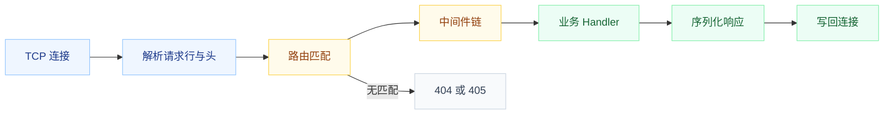
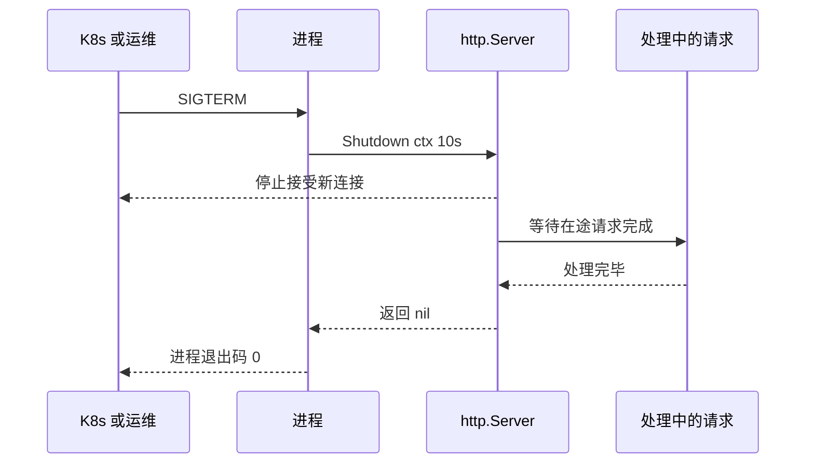

# GoWeb框架与路由

> 这篇从 net/http 的 Handler 模型讲起，经过服务端超时、标准库路由、中间件组合、Gin 的路由树与分组、静态资源与内嵌前端、优雅退出，最后落到一个带健康检查、请求 ID、超时和排空的订单查询服务案例，并附路由排障手册。
>
> 学完能独立用标准库或 Gin 搭出可上线的 HTTP 服务：设计路由与分组、写可复用的中间件、控制超时与连接排空，并在 404、405、路由冲突、端口占用这些问题上快速定位。

> 版本基线（2026-11-13）：Go 1.24+（示例在 Go 1.27.x 验证），Gin 1.10+（当前稳定 v1.11.x），标准库 `net/http` 的增强路由从 Go 1.22 起可用。命令默认 Ubuntu 24.04。

## 一、HTTP 服务在 Go 里的形状

Go 的 HTTP 服务只有一个核心抽象：`http.Handler`。路由、中间件、框架，最终都归结为“实现了 `ServeHTTP` 的对象”。

```go
type Handler interface {
	ServeHTTP(w http.ResponseWriter, r *http.Request)
}
```

### 1.1 请求生命周期

一次请求从 `Accept` 到响应写出，经过连接复用、请求解析、路由匹配、中间件链、业务处理、响应序列化。



`net/http` 的服务器为每个连接起一个 goroutine，请求在独立 goroutine 中处理。这带来两个直接结果：handler 里可以直接写阻塞代码；handler 之间共享的状态必须自己做并发保护。

### 1.2 Handler 与 HandlerFunc

普通函数通过 `http.HandlerFunc` 适配成 Handler：

```go
func health(w http.ResponseWriter, r *http.Request) {
	w.Header().Set("Content-Type", "application/json; charset=utf-8")
	w.WriteHeader(http.StatusOK)
	// 先写头再写体，WriteHeader 之后再改头无效
	_, _ = w.Write([]byte(`{"status":"ok"}`))
}

mux.HandleFunc("GET /healthz", health)
```

`http.Error` 是返回纯文本错误的快捷方式，会设置 `Content-Type: text/plain; charset=utf-8` 并追加换行，不适合 JSON API。

> 边界：`WriteHeader` 只能调用一次，重复调用会被忽略并打日志。中间件里提前写了状态码，业务 handler 再写 200 无效，表现为“日志 500、客户端 200”这类错位。

### 1.3 http.Server 的超时字段

`http.Server` 的零值没有任何超时，慢客户端可以一直占着连接。生产服务必须显式设置：

```go
srv := &http.Server{
	Addr:              ":8080",
	Handler:           mux,
	ReadHeaderTimeout: 5 * time.Second,  // 防 Slowloris：只发头不发体
	ReadTimeout:       15 * time.Second, // 整个请求体的读取上限
	WriteTimeout:      30 * time.Second, // 从读完请求到写完响应
	IdleTimeout:       60 * time.Second, // keep-alive 空闲回收
	MaxHeaderBytes:    1 << 20,          // 默认 1MB，超大 cookie 会先撞这里
}
```

| 字段 | 覆盖范围 | 设置建议 |
|---|---|---|
| `ReadHeaderTimeout` | 请求头读完 | 3–5s |
| `ReadTimeout` | 头 + 体读完 | 10–30s |
| `WriteTimeout` | 请求读完到响应写完 | 30–60s |
| `IdleTimeout` | 两次请求之间 | 60–120s |

`WriteTimeout` 从读取请求体结束时开始计时，长轮询和 SSE（服务端推送）会被它切断，这类接口要单独用 `http.ResponseController` 延长或另起服务。

> 边界：`ReadTimeout` 太短会误伤大文件上传；`WriteTimeout` 太短会让导出报表类接口随机超时。按接口族拆服务或按路径调整，比全局调大更安全。

### 1.4 标准库路由：Go 1.22 起的模式语法

Go 1.22 的 `ServeMux` 支持方法、路径参数和精确匹配，标准库不再需要第三方路由才能表达 REST 路径：

```go
mux := http.NewServeMux()
mux.HandleFunc("GET /orders", listOrders)
mux.HandleFunc("POST /orders", createOrder)
mux.HandleFunc("GET /orders/{id}", getOrder)      // {id} 匹配单段
mux.HandleFunc("GET /orders/{id}/items/{item}", getItem)
mux.HandleFunc("GET /files/", serveFiles)          // 结尾斜杠匹配子树
mux.HandleFunc("GET /{$}", home)                   // {$} 精确匹配根路径

func getOrder(w http.ResponseWriter, r *http.Request) {
	id := r.PathValue("id") // 取路径参数，未匹配时为空串
	_ = id
}
```

匹配规则：

| 模式 | 匹配范围 | 说明 |
|---|---|---|
| `/orders/{id}` | 单段 | 不匹配 `/orders/1/items` |
| `/orders/{id...}` | 剩余全部 | 捕获含斜杠的尾部 |
| `/files/` | 子树 | 等价前缀匹配 |
| `/files/{$}` | 仅 `/files/` | 精确结尾 |
| `/` | 全部 | 兜底，优先级最低 |

最具体的模式优先，例如同时注册 `GET /orders/{id}` 和 `GET /orders/summary`，请求 `/orders/summary` 命中后者。两条模式互相冲突时，注册阶段直接 panic，不会等到请求期。

> 边界：标准库路由不支持正则约束和路由级中间件。`{id}` 拿到的是字符串，数字校验要在 handler 里做；需要按路由挂中间件时，用 `http.Handler` 包装子树或换框架。

### 1.5 并发与请求上下文

`r.Context()` 在客户端断开或服务端超时时取消，数据库查询、下游 HTTP 调用都应传递它：

```go
func getOrder(w http.ResponseWriter, r *http.Request) {
	ctx := r.Context()
	row, err := store.Find(ctx, r.PathValue("id")) // 查询能被取消，避免断开后继续占资源
	if err != nil {
		http.Error(w, "internal error", http.StatusInternalServerError)
		return
	}
	_ = row
}
```

请求作用域的传值走 `context.WithValue`，键必须是自定义类型，不能用字符串：

```go
type ctxKey struct{ name string }

var userKey = ctxKey{"user"}

// 中间件写入
ctx := context.WithValue(r.Context(), userKey, user)
next.ServeHTTP(w, r.WithContext(ctx))

// handler 读取，类型断言失败说明中间件没挂
user, _ := r.Context().Value(userKey).(*User)
```

> 边界：`context` 只用于请求元数据和取消信号，不用于传依赖（数据库、配置）。依赖从构造函数注入，context 传值会让调用链隐式耦合。

## 二、中间件

中间件是“包住 Handler 的 Handler”：签名固定为 `func(http.Handler) http.Handler`，职责是在业务前后插入横切逻辑。

### 2.1 函数签名与组合

```go
type Middleware func(http.Handler) http.Handler

func Chain(h http.Handler, mws ...Middleware) http.Handler {
	// 逆序包装：mws[0] 在最外层，最先执行
	for i := len(mws) - 1; i >= 0; i-- {
		h = mws[i](h)
	}
	return h
}
```

```go
handler := Chain(mux, RequestID(), AccessLog(logger), Recover(logger))
```

执行顺序是“请求正序、响应逆序”：RequestID 最早写入，AccessLog 最后记录耗时。


### 2.2 顺序与短路

中间件不调用 `next.ServeHTTP` 就等于短路，后面的逻辑不会执行。认证失败、限流命中都靠这一点：

```go
func Auth(next http.Handler) http.Handler {
	return http.HandlerFunc(func(w http.ResponseWriter, r *http.Request) {
		if r.Header.Get("Authorization") == "" {
			http.Error(w, `{"code":"UNAUTHORIZED"}`, http.StatusUnauthorized)
			return // 不调用 next，请求到此结束
		}
		next.ServeHTTP(w, r)
	})
}
```

顺序决定语义：Recover 必须在最外层，才能兜住内层 panic；AccessLog 要在 Recover 外层，才能记录到 500；认证放在限流之后，可以避免无效请求消耗令牌桶。

| 顺序 | 中间件 | 理由 |
|---|---|---|
| 1 | RequestID | 后续日志都要用 |
| 2 | AccessLog | 记录最终状态与耗时 |
| 3 | Recover | 兜住内层 panic |
| 4 | Auth | 无效请求尽早短路 |
| 5 | 业务 | — |

### 2.3 标准库中间件实现

```go
func Recover(logger *slog.Logger) Middleware {
	return func(next http.Handler) http.Handler {
		return http.HandlerFunc(func(w http.ResponseWriter, r *http.Request) {
			defer func() {
				if v := recover(); v != nil {
					// 记录堆栈，否则线上只能看到一行 panic 值
					logger.Error("panic recovered",
						"panic", v, "path", r.URL.Path, "stack", string(debug.Stack()))
					http.Error(w, `{"code":"INTERNAL"}`, http.StatusInternalServerError)
				}
			}()
			next.ServeHTTP(w, r)
		})
	}
}
```

记录状态码需要包装 `ResponseWriter`：

```go
type statusWriter struct {
	http.ResponseWriter
	status int
	bytes  int
}

func (w *statusWriter) WriteHeader(code int) {
	w.status = code
	w.ResponseWriter.WriteHeader(code)
}

func (w *statusWriter) Write(b []byte) (int, error) {
	if w.status == 0 {
		w.status = http.StatusOK // 隐式 200：只写体不写头时状态码在这里产生
	}
	n, err := w.ResponseWriter.Write(b)
	w.bytes += n
	return n, err
}
```

> 边界：包装 `ResponseWriter` 会丢掉 `http.Flusher`、`http.Hijacker` 等可选接口，SSE 和 WebSocket 场景要在包装器上显式实现并转发，否则类型断言失败、流式响应失效。

### 2.4 Gin 的中间件形态

Gin 的中间件签名是 `func(*gin.Context)`，通过 `c.Next()` 决定是否继续：

```go
func AccessLog(logger *slog.Logger) gin.HandlerFunc {
	return func(c *gin.Context) {
		start := time.Now()
		c.Next() // 执行后续中间件和 handler
		logger.Info("access",
			"method", c.Request.Method,
			"path", c.Request.URL.Path,
			"status", c.Writer.Status(),
			"cost_ms", time.Since(start).Milliseconds(),
			"ip", c.ClientIP(),
		)
	}
}
```

`c.Next()` 之前的代码在请求进入时执行，之后的代码在响应阶段执行，等价于标准库中间件的前后两段。`c.Abort()` 对应短路，`c.AbortWithStatusJSON` 是“短路 + 返回 JSON”的组合。

## 三、Gin 的路由与工程结构

Gin 是目前使用最广的 Go Web 框架，核心能力是路由树（radix tree）、分组、参数绑定和中间件。它的 API 稳定，1.10 与 1.11 在本篇涉及的用法上没有差异。

### 3.1 安装与最小服务

```bash
mkdir -p orders-api && cd orders-api
go mod init example.com/orders-api
go get github.com/gin-gonic/gin@v1.10.0
```

```go
package main

import "github.com/gin-gonic/gin"

func main() {
	r := gin.New()          // New 不带默认中间件，装配更可控
	r.Use(gin.Recovery())   // 至少保留恢复，避免 panic 打挂进程
	r.GET("/ping", func(c *gin.Context) {
		c.JSON(200, gin.H{"message": "pong"})
	})
	_ = r.Run(":8080")      // Run 内部创建 http.Server，无法配置超时
}
```

```bash
go run .
curl -s localhost:8080/ping
```

预期输出：

```text
{"message":"pong"}
```

`gin.Default()` 等价于 `gin.New()` 加 Logger 和 Recovery。生产环境通常用 `gin.New()` 自己装配，因为默认 Logger 写 stdout 且格式固定，无法接入结构化日志。

> 边界：`r.Run` 不接受超时配置，等于放弃 1.3 节的保护。生产代码用 `http.Server{Handler: r}` 自己启动，Gin 引擎实现了 `http.Handler`，可以直接挂上去。

### 3.2 路由参数与优先级

```go
r.GET("/orders/:id", getOrder)              // :id 匹配单段
r.GET("/orders/:id/items/*rest", getItems)  // *rest 捕获剩余路径
r.GET("/orders/summary", summary)           // 静态段优先于参数段

id := c.Param("id")
rest := c.Param("rest")     // 以 / 开头
q := c.Query("page")        // 取不到返回空串
page := c.DefaultQuery("page", "1")
```

Gin 的路由树对静态段、参数段、通配段有固定优先级，`/orders/summary` 不会被 `/orders/:id` 抢走。同一位置注册两个不同名的参数（`:id` 与 `:orderID`）会在启动时 panic，这是最常见的路由冲突。

| 写法 | 匹配 | 取参 |
|---|---|---|
| `/orders/:id` | 单段 | `c.Param("id")` |
| `/orders/*path` | 剩余全部 | `c.Param("path")` |
| `/orders` | 精确 | — |
| `/orders/` | 重定向到 `/orders` | 默认开启 |

### 3.3 路由组与版本前缀

```go
api := r.Group("/api/v1")
{
	api.GET("/orders", listOrders)
	api.GET("/orders/:id", getOrder)
	admin := api.Group("/admin", RequireRole("admin")) // 组级中间件只作用于本组
	admin.DELETE("/orders/:id", deleteOrder)
}
```

组级中间件在 `Group` 时注册、在匹配时执行。组可以嵌套，中间件按注册顺序叠加，父组的先执行。

> 边界：`Group` 的中间件在创建组时确定，之后再往父组 `Use` 新中间件，已创建的子组不会继承。装配顺序必须“先 Use 全局中间件，再建组”。

### 3.4 gin.Context 的取值与生命周期

`*gin.Context` 由对象池复用，请求结束后会被重置，不能跨 goroutine 持有：

```go
func handler(c *gin.Context) {
	// 错误：把 c 传进 goroutine，请求结束后 c 已被复用
	go func() {
		_ = c.Param("id")
	}()

	// 正确：先把需要的值取出来
	id := c.Param("id")
	go func(id string) {
		_ = id
	}(id)
}
```

`c.Set`/`c.Get` 用于中间件传值，底层是 `map[string]any`，键是字符串，取出来必须断言：

```go
c.Set("request_id", id)
if v, ok := c.Get("request_id"); ok {
	reqID, _ := v.(string)
	_ = reqID
}
```

需要跨 handler 传递强类型值时，优先把依赖放进 handler 结构体，`c.Set` 只用于请求元数据。

### 3.5 路由集中注册与依赖注入

路由不写在 `main` 里，而是由构造函数接收依赖后返回引擎：

```go
type Handler struct {
	orders OrderService
	logger *slog.Logger
}

func NewRouter(h *Handler, logger *slog.Logger) *gin.Engine {
	r := gin.New()
	r.HandleMethodNotAllowed = true // 路径存在但方法不对时返回 405，而不是 404
	r.Use(RequestID(), AccessLog(logger), gin.Recovery())

	r.GET("/healthz", h.health)
	r.GET("/readyz", h.ready)

	v1 := r.Group("/api/v1")
	v1.GET("/orders/:id", h.getOrder)
	v1.POST("/orders", h.createOrder)

	r.NoMethod(func(c *gin.Context) {
		c.JSON(http.StatusMethodNotAllowed, gin.H{"code": "METHOD_NOT_ALLOWED"})
	})
	return r
}
```

这样 `main` 只负责创建依赖和启动服务器，路由可以独立测试：`httptest.NewServer(NewRouter(h, logger))` 即可跑集成测试。

## 四、静态资源与内嵌前端

Go 服务托管静态资源有两种方式：从磁盘读，或把构建产物编进二进制。后者适合容器部署，镜像只需一个文件。

### 4.1 磁盘目录

```go
r.Static("/assets", "./web/assets")          // 目录映射，自动处理 index.html
r.StaticFile("/favicon.ico", "./web/favicon.ico")
r.StaticFS("/download", http.Dir("./files")) // 需要自定义 http.FileSystem 时
```

`http.Dir` 会拒绝 `..` 目录穿越，但它跟随符号链接：指向 `/etc` 的软链可以被读出。Go 1.24 的 `os.Root` 可以把文件访问限制在根目录内：

```go
root, err := os.OpenRoot("./files")
if err != nil {
	return err
}
defer root.Close()
r.StaticFS("/download", http.FS(root.FS()))
```

> 边界：静态目录不要与代码目录同级暴露。把上传目录、配置目录放进静态根，等于把 `config.yaml` 和用户上传的脚本一起公开。

### 4.2 embed 内嵌

```go
import (
	"embed"
	"io/fs"
	"net/http"
)

//go:embed dist
var distFS embed.FS // 构建时把 dist 目录编进二进制

func mountSPA(r *gin.Engine) error {
	sub, err := fs.Sub(distFS, "dist") // 去掉 dist 前缀，URL 才能对上
	if err != nil {
		return err
	}
	r.StaticFS("/app", http.FS(sub))
	return nil
}
```

`//go:embed` 只能用于包级变量，且注释与变量之间不能有空行。`dist` 目录必须在构建时存在，否则编译失败——CI 里要先跑前端构建。

### 4.3 单页应用回退

SPA 的前端路由由浏览器接管，刷新 `/orders/42` 时服务端没有这个文件，需要回退到 `index.html`：

```go
r.NoRoute(func(c *gin.Context) {
	// API 前缀不参与回退，否则前端会收到 HTML 而不是 404 JSON
	if strings.HasPrefix(c.Request.URL.Path, "/api/") {
		c.JSON(http.StatusNotFound, gin.H{"code": "NOT_FOUND"})
		return
	}
	c.File("./web/dist/index.html")
})
```

标准库的实现同理，在 mux 外层包一个 `spaHandler`，先尝试 `FileServer`，未命中再写 `index.html`。

### 4.4 模板渲染的边界

Gin 的 `LoadHTMLGlob` 适合服务端渲染的管理后台；纯 API 服务不要引入模板，JSON 序列化已经够用。模板与 API 混在一个进程里时，注意错误页（404/500）也要用同一套模板，否则前端拿到的是半截 HTML。

## 五、优雅退出与超时控制

优雅退出保证“进程收到终止信号后，不再接新请求，等处理中的请求完成再退出”。没有它，滚动发布时每次都会有请求被硬断。

### 5.1 启动与信号

```go
func run(ctx context.Context, handler http.Handler, addr string, logger *slog.Logger) error {
	srv := &http.Server{
		Addr:              addr,
		Handler:           handler,
		ReadHeaderTimeout: 5 * time.Second,
		ReadTimeout:       15 * time.Second,
		WriteTimeout:      30 * time.Second,
		IdleTimeout:       60 * time.Second,
	}

	// NotifyContext 收到 SIGINT/SIGTERM 时取消 ctx，是退出的统一信号源
	ctx, stop := signal.NotifyContext(ctx, os.Interrupt, syscall.SIGTERM)
	defer stop()

	errCh := make(chan error, 1)
	go func() {
		logger.Info("server starting", "addr", addr)
		if err := srv.ListenAndServe(); err != nil && !errors.Is(err, http.ErrServerClosed) {
			errCh <- err
		}
	}()

	select {
	case err := <-errCh:
		return err
	case <-ctx.Done():
	}

	logger.Info("shutting down")
	// 给在途请求留出时间，超过则强制关闭
	shutdownCtx, cancel := context.WithTimeout(context.Background(), 10*time.Second)
	defer cancel()
	if err := srv.Shutdown(shutdownCtx); err != nil {
		return err
	}
	logger.Info("server stopped")
	return nil
}
```



### 5.2 Shutdown 的行为

`Shutdown` 做三件事：关闭监听套接字、关闭空闲连接、等待活跃连接变为空闲。它不等待 hijack 的连接（WebSocket），这类连接要在业务层自己登记并关闭。

```go
// 10 秒内没排空，Shutdown 返回 context.DeadlineExceeded
if err := srv.Shutdown(shutdownCtx); err != nil {
	logger.Error("shutdown incomplete", "err", err)
	_ = srv.Close() // 强制关闭，接受少量请求失败
}
```

> 边界：`Shutdown` 之后 `ListenAndServe` 返回 `http.ErrServerClosed`，这个错误必须忽略，否则每次正常退出都被记成启动失败。

### 5.3 Kubernetes 下的排空

进程收到 SIGTERM 时，Endpoints 摘除是异步的，仍会有新请求进来。标准做法是加 preStop 延迟：

```yaml
lifecycle:
  preStop:
    exec:
      command: ["sleep", "5"]
terminationGracePeriodSeconds: 30
```

`preStop` 在 SIGTERM 之前执行，5 秒足够让 Service 把该 Pod 从 Endpoints 摘掉；`terminationGracePeriodSeconds` 要大于 preStop 加 Shutdown 超时。

### 5.4 超时预算

一个请求的超时预算要自上而下收敛：网关 30s → 服务 WriteTimeout 30s → handler 内部下游调用 5s。

```go
func Timeout(d time.Duration) gin.HandlerFunc {
	return func(c *gin.Context) {
		ctx, cancel := context.WithTimeout(c.Request.Context(), d)
		defer cancel()
		c.Request = c.Request.WithContext(ctx) // 让下游查询和 HTTP 调用感知截止时间
		c.Next()
	}
}
```

这个中间件只传播取消信号，不会强制结束 handler；handler 必须使用 `c.Request.Context()` 才会生效。需要硬性截断时用 `http.TimeoutHandler` 包住整个引擎，它会在超时后直接写 503。

> 边界：`WriteTimeout` 与 handler 超时不是一回事。前者切断写响应，后者取消业务逻辑；两者都设，才能既释放资源又给客户端明确结果。

## 六、框架选型

选型的判断依据是“需要多少框架能力”，不是“哪个 benchmark 快”。

| 维度 | 标准库 | Gin | Chi | Echo |
|---|---|---|---|---|
| 路由参数 | Go 1.22 起支持 | 支持 | 支持 | 支持 |
| 中间件生态 | 自建 | 丰富 | 轻量 | 丰富 |
| 参数绑定校验 | 自建 | 内置 | 自建 | 内置 |
| 依赖体积 | 零 | 中 | 小 | 中 |
| 学习成本 | 低 | 低 | 低 | 中 |

判断规则：

- 接口数量少、依赖越少越好（内部工具、webhook）：标准库；
- 需要绑定、校验、分组、生态插件（大多数业务 API）：Gin；
- 想要标准库风格 + 路由分组（`net/http` 兼容）：Chi；
- 团队已有 Echo 经验：Echo，迁移收益不大。

> 边界：框架的 benchmark 差异在真实业务里通常被数据库和下游调用淹没。选型先看团队熟悉度和生态，再看性能；为了 5% 的吞吐换一套不熟的框架，维护成本远超收益。

## 七、排障现场手册

路由层故障几乎都能通过“请求方法 + 完整路径 + 注册模式”三件事定位。

| 现象 | 原因 | 第一条命令 |
|---|---|---|
| 404 但路径看着没错 | 方法不匹配、前缀重复 | `curl -i -X GET ...` |
| 405 且响应体为空 | 未启用方法不允许处理 | 检查 `HandleMethodNotAllowed` |
| 启动 panic 路由冲突 | 同一位置两个参数名 | 看 panic 里的两条模式 |
| `address already in use` | 端口被占 | `lsof -i :8080` |
| 请求偶发 `context canceled` | 客户端断开或超时 | 查网关超时与 `WriteTimeout` |
| 静态资源 404 | 工作目录不对 | `pwd` 与 `r.Static` 路径 |
| 响应被截断 | `WriteTimeout` 太短 | 查慢接口耗时分布 |

### 7.1 路由不匹配

```bash
curl -i http://localhost:8080/api/v1/orders/A1001
curl -i -X POST http://localhost:8080/api/v1/orders
```

Gin 默认把“路径存在、方法不对”也返回 404。设置 `r.HandleMethodNotAllowed = true` 后才是 405，两者对排障的意义完全不同：404 查路径，405 查方法。

标准库 `ServeMux` 在 Go 1.22 起会自动返回 405，并在 `Allow` 头里列出支持的方法。

### 7.2 路由冲突

启动即 panic 的两种典型：

```text
panic: wildcard route ':id' conflicts with existing children in path '/orders/:id'
panic: ':id' in new path '/orders/:id' conflicts with existing wildcard ':orderID'
```

同一个位置只能有一个参数名。改法是统一命名（都用 `:id`），或把静态路径提前注册。Gin 不允许 `:id` 与 `*path` 在同一段共存。

### 7.3 端口占用与监听地址

```bash
lsof -i :8080
ss -lntp | grep 8080
```

容器里监听 `127.0.0.1:8080` 会导致宿主机访问不到，必须监听 `0.0.0.0` 或 `:8080`。这是“本地 curl 通、容器外不通”的第一原因。

### 7.4 超时与取消

```bash
curl -i --max-time 2 http://localhost:8080/api/v1/reports/export
```

客户端 2 秒断开后，服务端日志出现 `context canceled` 是正常的；如果日志里是 `context deadline exceeded`，说明是服务端自己的超时先到，要检查 `WriteTimeout` 与下游超时。

### 7.5 Gin 的运行模式与代理头

```text
[GIN-debug] [WARNING] Running in "debug" mode. Switch to "release" mode in production.
[GIN-debug] [WARNING] You trusted all proxies, this is NOT safe.
```

生产启动前设置：

```go
gin.SetMode(gin.ReleaseMode)
_ = r.SetTrustedProxies([]string{"10.0.0.0/8"}) // 只信任内网代理，避免伪造 X-Forwarded-For
```

不设置可信代理时 `c.ClientIP()` 会取 `X-Forwarded-For` 的第一个值，攻击者可以伪造 IP 绕过限流。

## 八、最佳实践案例

### 8.1 案例背景

一个订单查询服务从单体拆出，接口只有四个，但要求可上 Kubernetes：滚动发布不能丢请求，要能接健康检查，前端静态资源随镜像发布，日志要能按请求串联。现状是一个 `main` 函数里写完所有路由，用 `r.Run` 启动，没有任何超时；每次发布都有几十条 502，排查时无法把一条错误日志和具体请求对上。

目标是用一个可运行的服务骨架替换现有代码：路由集中注册、请求 ID 贯穿日志、健康与就绪分离、静态资源内嵌、收到 SIGTERM 后 10 秒内排空。约束是不引入数据库，订单数据先用内存存储，方便验证。

### 8.2 案例实操

目录：

```text
orders-api/
├── cmd/api/main.go
├── internal/httpapi/router.go
├── internal/httpapi/middleware.go
├── internal/httpapi/order.go
├── internal/order/store.go
└── web/dist/index.html
```

`go.mod` 与依赖：

```bash
go mod init example.com/orders-api
go get github.com/gin-gonic/gin@v1.10.0
```

`internal/order/store.go`：

```go
package order

import (
	"context"
	"errors"
	"sync"
)

var ErrNotFound = errors.New("order not found")

type Order struct {
	ID          string `json:"id"`
	Customer    string `json:"customer"`
	AmountCents int64  `json:"amount_cents"`
	Status      string `json:"status"`
}

type Store struct {
	mu     sync.RWMutex // 内存存储，读写都要加锁
	items  map[string]Order
	closed bool
}

func NewStore() *Store {
	return &Store{items: map[string]Order{
		"A1001": {ID: "A1001", Customer: "alice", AmountCents: 12800, Status: "paid"},
		"A1002": {ID: "A1002", Customer: "bob", AmountCents: 9900, Status: "created"},
	}}
}

func (s *Store) Find(ctx context.Context, id string) (Order, error) {
	if err := ctx.Err(); err != nil { // 请求已取消时不必再查
		return Order{}, err
	}
	s.mu.RLock()
	defer s.mu.RUnlock()
	o, ok := s.items[id]
	if !ok {
		return Order{}, ErrNotFound
	}
	return o, nil
}

func (s *Store) Ready(ctx context.Context) error {
	if err := ctx.Err(); err != nil {
		return err
	}
	s.mu.RLock()
	defer s.mu.RUnlock()
	if s.closed {
		return errors.New("store closed")
	}
	return nil
}
```

`internal/httpapi/middleware.go`：

```go
package httpapi

import (
	"crypto/rand"
	"encoding/hex"
	"log/slog"
	"time"

	"github.com/gin-gonic/gin"
)

func RequestID() gin.HandlerFunc {
	return func(c *gin.Context) {
		id := c.GetHeader("X-Request-ID")
		if id == "" {
			b := make([]byte, 8)
			_, _ = rand.Read(b)
			id = hex.EncodeToString(b)
		}
		c.Set("request_id", id)
		c.Header("X-Request-ID", id) // 回写响应头，客户端报错时能直接给出 ID
		c.Next()
	}
}

func AccessLog(logger *slog.Logger) gin.HandlerFunc {
	return func(c *gin.Context) {
		start := time.Now()
		c.Next()
		logger.Info("access",
			"request_id", c.GetString("request_id"),
			"method", c.Request.Method,
			"path", c.Request.URL.Path,
			"status", c.Writer.Status(),
			"cost_ms", time.Since(start).Milliseconds(),
		)
	}
}
```

`internal/httpapi/router.go`：

```go
package httpapi

import (
	"log/slog"
	"net/http"

	"github.com/gin-gonic/gin"

	"example.com/orders-api/internal/order"
)

func NewRouter(store *order.Store, logger *slog.Logger) *gin.Engine {
	r := gin.New()
	r.HandleMethodNotAllowed = true // 路径对、方法错时给 405，便于排障
	r.Use(RequestID(), AccessLog(logger), gin.Recovery())

	r.GET("/healthz", func(c *gin.Context) {
		c.JSON(http.StatusOK, gin.H{"status": "ok"})
	})
	r.GET("/readyz", func(c *gin.Context) {
		if err := store.Ready(c.Request.Context()); err != nil {
			c.JSON(http.StatusServiceUnavailable, gin.H{"status": "not ready"})
			return
		}
		c.JSON(http.StatusOK, gin.H{"status": "ready"})
	})

	v1 := r.Group("/api/v1")
	v1.GET("/orders/:id", func(c *gin.Context) {
		o, err := store.Find(c.Request.Context(), c.Param("id"))
		if err != nil {
			c.JSON(http.StatusNotFound, gin.H{
				"code":       "ORDER_NOT_FOUND",
				"message":    "order not found",
				"request_id": c.GetString("request_id"),
			})
			return
		}
		c.JSON(http.StatusOK, o)
	})

	r.Static("/assets", "./web/dist") // 静态资源与前端构建产物同镜像
	r.NoRoute(func(c *gin.Context) {
		c.JSON(http.StatusNotFound, gin.H{
			"code":       "NOT_FOUND",
			"request_id": c.GetString("request_id"),
		})
	})
	r.NoMethod(func(c *gin.Context) {
		c.JSON(http.StatusMethodNotAllowed, gin.H{
			"code":       "METHOD_NOT_ALLOWED",
			"request_id": c.GetString("request_id"),
		})
	})
	return r
}
```

`cmd/api/main.go`：

```go
package main

import (
	"context"
	"errors"
	"log/slog"
	"net/http"
	"os"
	"os/signal"
	"syscall"
	"time"

	"example.com/orders-api/internal/httpapi"
	"example.com/orders-api/internal/order"
)

func main() {
	logger := slog.New(slog.NewTextHandler(os.Stdout, &slog.HandlerOptions{Level: slog.LevelInfo}))
	if err := run(logger); err != nil {
		logger.Error("exit", "err", err)
		os.Exit(1)
	}
}

func run(logger *slog.Logger) error {
	store := order.NewStore()
	engine := httpapi.NewRouter(store, logger)

	srv := &http.Server{
		Addr:              ":8080",
		Handler:           engine,
		ReadHeaderTimeout: 5 * time.Second,
		ReadTimeout:       15 * time.Second,
		WriteTimeout:      30 * time.Second,
		IdleTimeout:       60 * time.Second,
	}

	ctx, stop := signal.NotifyContext(context.Background(), os.Interrupt, syscall.SIGTERM)
	defer stop()

	errCh := make(chan error, 1)
	go func() {
		logger.Info("server starting", "addr", srv.Addr)
		if err := srv.ListenAndServe(); err != nil && !errors.Is(err, http.ErrServerClosed) {
			errCh <- err
		}
	}()

	select {
	case err := <-errCh:
		return err
	case <-ctx.Done():
	}

	logger.Info("shutting down")
	shutdownCtx, cancel := context.WithTimeout(context.Background(), 10*time.Second)
	defer cancel()
	if err := srv.Shutdown(shutdownCtx); err != nil {
		return err
	}
	logger.Info("server stopped")
	return nil
}
```

启动并验证：

```bash
go run ./cmd/api
```

```bash
curl -s localhost:8080/healthz
curl -s localhost:8080/readyz
curl -s localhost:8080/api/v1/orders/A1001
curl -si localhost:8080/api/v1/orders/A9999 | head -5
curl -si -X DELETE localhost:8080/api/v1/orders/A1001 | head -3
```

预期输出（依次）：

```text
{"status":"ok"}
{"status":"ready"}
{"id":"A1001","customer":"alice","amount_cents":12800,"status":"paid"}
HTTP/1.1 404 Not Found
Content-Type: application/json; charset=utf-8
X-Request-Id: 3f9c2a1b7d4e8f05
{"code":"ORDER_NOT_FOUND","message":"order not found","request_id":"3f9c2a1b7d4e8f05"}
HTTP/1.1 405 Method Not Allowed
{"code":"METHOD_NOT_ALLOWED","request_id":"..."}
```

验证优雅退出：另开终端按 Ctrl+C，或在另一个终端发信号：

```bash
kill -TERM $(pgrep -f 'orders-api|cmd/api')
```

预期日志：

```text
time=2026-11-13T10:15:02.101+08:00 level=INFO msg="server starting" addr=:8080
time=2026-11-13T10:15:10.442+08:00 level=INFO msg="shutting down"
time=2026-11-13T10:15:10.443+08:00 level=INFO msg="server stopped"
```

验证排空：用慢客户端同时发请求，再发 SIGTERM，请求应正常完成而不是连接被重置。

### 8.3 案例结果

服务从“一个 main 函数”变为可测试的路由装配，滚动发布零 502。

| 指标 | 改造前 | 改造后 |
|---|---|---|
| 发布期间 502 | 每次几十条 | 0（排空验证） |
| 错误定位 | 靠时间猜 | 响应头与日志同 request_id |
| 健康检查 | 无 | `/healthz` + `/readyz` |
| 服务端超时 | 无 | 四类超时全部设置 |
| 路由测试 | 手工 curl | `httptest` 直接测 router |

失败模式与复盘：

- 最初用 `r.Run(":8080")`，排空逻辑完全失效；换成 `http.Server` 后 `Shutdown` 才生效。Gin 引擎本身没问题，问题在启动方式；
- `AccessLog` 放在 `gin.Recovery()` 之后，panic 请求的日志缺失；调整到 Recover 外层，500 也能被记录；
- `c.Set("request_id")` 的键写成 `requestId`，中间件与 handler 不一致，日志里全是空串；键改为常量 `const keyRequestID = "request_id"` 后根除；
- 405 一开始被当成 404，前端把错误提示写成了“页面不存在”；开启 `HandleMethodNotAllowed` 并注册 `NoMethod` 后，前后端对错误码的理解统一；
- 静态资源目录用了相对路径 `./web/dist`，容器工作目录不是项目根，启动后 404；改为 `-web.root` 参数传入绝对路径，默认值指向镜像内固定路径。

骨架代码没有引入数据库和 ORM，替换 `Store` 实现即可接入真实存储；路由、中间件、超时和退出逻辑与存储无关，可以原样保留。
