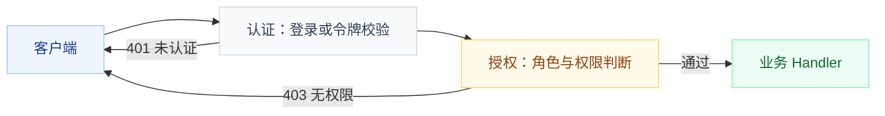

# Go认证与授权

> 这篇从认证与授权的边界讲起，经过密码存储、服务端会话、JWT 签发与校验、认证中间件、RBAC 授权模型，最后落到一个带注册登录、令牌刷新和角色管控的后台 API 完整案例，并附认证排障与上线检查清单。
>
> 学完能独立为 Gin 服务实现安全的用户体系：用 bcrypt 存密码、签发和校验 JWT、写认证与权限中间件、区分 401 与 403，并能处理时钟偏移、跨域 Cookie、密钥轮换这些线上问题。

> 版本基线（2026-11-13）：Go 1.24+（示例在 Go 1.27.x 验证），Gin 1.10+，`github.com/golang-jwt/jwt/v5` v5.2+，`golang.org/x/crypto`（bcrypt/argon2），会话扩展 `github.com/gin-contrib/sessions`。命令默认 Ubuntu 24.04。

## 一、认证、授权与会话模型

认证（authentication）回答"请求是谁发的"，授权（authorization）回答"这个身份能不能做这件事"。两步必须分开实现：认证失败返回 401，授权失败返回 403，混在一起的实现会让排障和审计都失去依据。

### 1.1 状态保持的三种方案

| 方案 | 状态存哪 | 扩容 | 撤销 | 适用 |
|---|---|---|---|---|
| 服务端会话 | 服务端内存/Redis | 需共享存储 | 立即 | 传统 Web、管理后台 |
| JWT 令牌 | 客户端 | 天然多实例 | 难（需黑名单） | API、微服务、移动端 |
| OIDC 单点登录 | 身份提供商 | 集中 | 集中管理 | 多系统、企业内 |

选择规则：浏览器访问的管理后台，服务端会话最省事；跨服务调用、移动端、开放 API，用 JWT；公司已有统一登录，接入 OIDC（OpenID Connect），不要自建身份体系。



> 边界：JWT 解决的是"无状态校验身份"，不是"安全的会话"。需要"改密码后所有旧令牌立即失效"这类强撤销语义时，服务端会话或带黑名单的 JWT 才能满足。

### 1.2 密码、凭证与令牌

密码永远不能明文传输之外的任何形式出现在日志、数据库和消息里。登录之后的一切交互都靠凭证：会话 ID 或令牌。凭证与密码的安全级别不同——密码泄漏要改密码并通知用户，凭证泄漏只需撤销该凭证。

| 凭证 | 生命周期 | 存放 | 泄漏处理 |
|---|---|---|---|
| 密码 | 长期 | 只存哈希 | 强制重置 |
| 会话 ID | 小时级 | HttpOnly Cookie | 删除会话 |
| Access Token | 分钟级 | 内存或 Cookie | 等待过期 + 撤销 |
| Refresh Token | 天级 | Cookie 或安全存储 | 撤销并轮换 |

### 1.3 信任边界

服务收到请求时，能信任的只有两类东西：自己签发的签名凭证、同信任域内网关转发的内部头。`X-User-Id` 这类明文头只在服务网格内部可用，且入口必须校验来源；对外接口直接信它等于把认证交给攻击者。

## 二、密码存储

密码存储只有一条正确路线：慢哈希（bcrypt 或 argon2id）加随机盐。快哈希（MD5、SHA-1、SHA-256 裸用）在 GPU 上每秒可算几十亿次，等同明文。

### 2.1 bcrypt

```go
import "golang.org/x/crypto/bcrypt"

// 注册时：DefaultCost=10，安全要求高的系统用 12
hash, err := bcrypt.GenerateFromPassword([]byte(password), 12)
if err != nil {
	return err
}
// hash 形如 $2a$12$N9qo8uLOickgx2ZMRZoMye...，盐已内含，整串存库

// 登录时：由库里的 hash 反推 cost 并比较，常数时间
err = bcrypt.CompareHashAndPassword(hash, []byte(password))
if err != nil {
	// 密码不匹配，返回统一的"用户名或密码错误"，不暴露哪个错了
}
```

| 参数 | 建议值 | 说明 |
|---|---|---|
| cost | 12（2026 年） | 10 已偏低，每次登录约 100ms 是合理目标 |
| 密码长度上限 | 72 字节 | bcrypt 只取前 72 字节，超长部分静默忽略 |
| 存储格式 | 整串哈希 | 盐和 cost 内含，不需要单独的盐字段 |

> 边界：bcrypt 的 72 字节截断是静默的。需要支持长密码（中文用户常见，UTF-8 每字 3 字节）时，先用 SHA-256 摘要再进 bcrypt，并把这一点写进文档；不要换回快哈希。

### 2.2 argon2id

argon2id 是抗 GPU 与侧信道的当前推荐，参数化内存使暴力破解成本更高。工程上直接用封装好的 `github.com/alexedwards/argon2id`：

```go
import "github.com/alexedwards/argon2id"

hash, err := argon2id.CreateHash(password, argon2id.DefaultParams())
// DefaultParams：内存 64 MiB、迭代 1、并行度 2，单次约 50–100ms

match, err := argon2id.ComparePasswordAndHash(password, hash)
```

哈希串自带参数（PHC 格式），调参后旧哈希仍可校验，迁移零成本。

| 维度 | bcrypt | argon2id |
|---|---|---|
| 实现依赖 | 广泛 | x/crypto |
| 内存用量 | 固定小 | 64 MiB 级 |
| 抗 GPU | 一般 | 强 |
| 生态存量 | 最大 | 新项目首选 |

### 2.3 高频错误清单

| 错误 | 后果 | 正确做法 |
|---|---|---|
| MD5/SHA 裸哈希 | 秒级破解 | bcrypt/argon2id |
| 固定盐 | 相同密码哈希相同 | 库内置随机盐 |
| 明文存日志 | 直接泄漏 | 密码不进日志 |
| `==` 比较哈希 | 时机攻击 | `CompareHashAndPassword` |
| 通用错误提示 | 枚举用户名 | "用户名或密码错误" |

错误提示的统一性属于安全设计：登录失败时无论"用户不存在"还是"密码错误"，响应都是同一个 401 `INVALID_CREDENTIALS`，否则攻击者可以枚举注册用户。

### 2.4 登录限流

密码哈希挡不住在线暴力破解，限流是第二道门。按账号加 IP 两个维度限制：

```go
import "golang.org/x/time/rate"

type loginLimiter struct {
	mu       sync.Mutex
	perKey   map[string]*rate.Limiter
	r        rate.Limit
	burst    int
}

func (l *loginLimiter) Allow(key string) bool {
	l.mu.Lock()
	defer l.mu.Unlock()
	lim, ok := l.perKey[key]
	if !ok {
		lim = rate.NewLimiter(l.r, l.burst) // 如每分钟 5 次、突发 5 次
		l.perKey[key] = lim
	}
	return lim.Allow()
}
```

单机限流只够演示；多实例部署时用 Redis 计数器（`INCR` + `EXPIRE`）实现同样的语义，或在网关层做全局限流。

## 三、服务端会话

会话把"已登录"这个状态存在服务端，客户端只持有一个不透明 ID。它天然支持"立即失效"，是浏览器后台的默认选择。

### 3.1 Cookie 属性

```go
http.SetCookie(w, &http.Cookie{
	Name:     "sid",
	Value:    sid,
	Path:     "/",
	MaxAge:   3600,
	HttpOnly: true,                          // 禁止 JS 读取，防 XSS 偷会话
	Secure:   true,                           // 仅 HTTPS 传输
	SameSite: http.SameSiteLaxMode,           // 防 CSRF 的第一道防线
})
```

| 属性 | 值 | 作用 |
|---|---|---|
| `HttpOnly` | true | XSS 拿不到会话 |
| `Secure` | true | 明文网络不传输 |
| `SameSite` | Lax 或 Strict | 跨站请求不带 Cookie |
| `Path` | 最小范围 | 避免无关请求携带 |

> 边界：`SameSite=None` 必须配 `Secure`，且只有真正的跨站前端才需要它。用了 `None` 就必须补 CSRF Token，否则 Lax 的防线等于拆掉。

### 3.2 gin-contrib/sessions

```bash
go get github.com/gin-contrib/sessions
```

```go
import (
	"github.com/gin-contrib/sessions"
	gsessions "github.com/gin-contrib/sessions/cookie"
)

store := gsessions.NewCookieStore([]byte(secret)) // 32 字节以上，加密并签名
store.Options(sessions.Options{
	Path:     "/",
	MaxAge:   3600,
	HttpOnly: true,
	Secure:   true,
	SameSite: http.SameSiteLaxMode,
})
r.Use(sessions.Sessions("sid", store))

// 登录：写会话
sess := sessions.Default(c)
sess.Set("uid", u.ID)
if err := sess.Save(); err != nil {
	c.JSON(500, gin.H{"code": "INTERNAL"})
	return
}

// 中间件：读会话
uid := sess.Get("uid")
if uid == nil {
	c.JSON(401, gin.H{"code": "UNAUTHORIZED"})
	c.Abort()
	return
}

// 登出：清会话
sess.Clear()
_ = sess.Save()
```

Cookie store 把数据加密后放客户端 Cookie，服务端无状态但受 4KB 限制；Redis store 把数据放服务端，Cookie 只存 ID，多实例共享。

| 存储 | 数据在哪 | 多实例 | 容量 |
|---|---|---|---|
| cookie store | 客户端 | 天然 | 4KB |
| redis store | Redis | 共享 | 无限制 |
| 内存 | 进程 | 不共享 | 重启丢失 |

> 边界：会话里只放 UID 和少量展示字段，不放权限全集。权限在中间件里按需查库，角色变更才能实时生效；放进会话的字段改起来要等会话过期。

## 四、JWT

JWT（JSON Web Token）把身份声明编码成三段：头、载荷、签名。签名保证载荷不可篡改，服务端凭密钥本地校验，不需要查库——这是它和会话的本质区别。

### 4.1 结构与算法

```text
eyJhbGciOiJIUzI1NiIsInR5cCI6IkpXVCJ9 . eyJzdWIiOiI0MiIsInJvbGUiOiJvcHMifQ . dBjftJeZ4CVP-mB92K27uhbUJU1p1r_wW1
头部 header                      载荷 payload                签名 signature
alg: HS256                      uid / role / exp ...
```

| 算法 | 密钥 | 适用 |
|---|---|---|
| HS256 | 共享密钥 ≥32 字节 | 单服务签发和校验 |
| RS256 / ES256 | 私钥签发、公钥校验 | 多服务：只有签发方持私钥 |
| none | 无 | 永远禁用 |

多服务场景用 RS256/ES256：网关或账号服务持私钥签发，业务服务只用公钥校验，业务方无法伪造令牌。

### 4.2 签发

```go
import "github.com/golang-jwt/jwt/v5"

type Claims struct {
	UserID int64  `json:"uid"`
	Role   string `json:"role"`
	jwt.RegisteredClaims // 标准声明：exp、iat、iss、sub、jti
}

func IssueToken(secret []byte, userID int64, role string, ttl time.Duration) (string, error) {
	now := time.Now()
	claims := Claims{
		UserID: userID,
		Role:   role,
		RegisteredClaims: jwt.RegisteredClaims{
			Subject:   strconv.FormatInt(userID, 10),
			Issuer:    "admin-api",
			IssuedAt:  jwt.NewNumericDate(now),
			ExpiresAt: jwt.NewNumericDate(now.Add(ttl)), // 短有效期是撤销能力的基础
		},
	}
	return jwt.NewWithClaims(jwt.SigningMethodHS256, claims).SignedString(secret)
}
```

声明里放的是"校验时必需"的字段：身份和角色。不要放用户名、手机号这类展示数据——令牌一旦签发，里面的数据到过期为止都有效，改不掉。

### 4.3 解析与校验

```go
func ParseToken(secret []byte, raw string) (*Claims, error) {
	var claims Claims
	_, err := jwt.ParseWithClaims(raw, &claims, func(t *jwt.Token) (any, error) {
		return secret, nil
	},
		jwt.WithValidMethods([]string{jwt.SigningMethodHS256.Name}), // 锁死算法，杜绝 alg 混淆攻击
		jwt.WithIssuer("admin-api"),       // 校验签发方
		jwt.WithExpirationRequired(),      // 没有 exp 的令牌直接拒绝
		jwt.WithLeeway(30*time.Second),    // 容忍多机小幅时钟偏差
	)
	if err != nil {
		return nil, err // 错误已区分：过期、签名错、算法错
	}
	return &claims, nil
}
```

`WithValidMethods` 是必选项：不指定时库会接受头部声明的任何算法，`alg: none` 与跨算法攻击都从这里进来。错误可以按类型分支处理：

```go
if errors.Is(err, jwt.ErrTokenExpired) {
	// 401 TOKEN_EXPIRED，前端引导刷新
}
if errors.Is(err, jwt.ErrSignatureInvalid) {
	// 401 TOKEN_INVALID
}
```

> 边界：JWT 库只验证签名和声明，不验证"令牌是否被撤销"。需要撤销时用短 access + 服务端 refresh 的组合，access 过期是撤销的上界。

### 4.4 刷新与撤销

access token 短（15 分钟）+ refresh token 长（7 天）是标准组合。刷新时轮换 refresh token，旧 refresh 作废：

```text
登录 → access(15m) + refresh(7d)
access 过期 → 用 refresh 换新 access + 新 refresh，旧的 refresh 失效
登出 / 改密 → 服务端删除 refresh 记录，access 最多再活 15 分钟
```

refresh token 存服务端（Redis，key 为 jti），撤销就是删除。对安全要求更高的系统加"refresh 复用检测"：已用过的 refresh 再次出现说明令牌被盗，立即作废该用户全部 refresh。

| 令牌 | 有效期 | 存储 | 撤销 |
|---|---|---|---|
| access | 10–30 分钟 | 内存/HttpOnly Cookie | 等待过期 |
| refresh | 7–30 天 | 服务端登记 | 删除记录 |

### 4.5 令牌放哪

| 位置 | XSS | CSRF | 适用 |
|---|---|---|---|
| HttpOnly Cookie | 安全 | 需防（SameSite） | 浏览器 |
| localStorage | 可被偷 | 天然免疫 | 不推荐 |
| 内存变量 | 刷新丢失 | 免疫 | SPA + 刷新流程 |

浏览器端的最优解是 HttpOnly Cookie 装 refresh、内存装 access；纯 API 和移动端用 `Authorization: Bearer` 头。

### 4.6 密钥管理与轮换

```bash
openssl rand -base64 48   # 生成 48 字节密钥，写入 KMS 或环境变量
```

规则：密钥不进代码库、不进镜像层、不写日志。轮换用双密钥过渡：新令牌用新密钥签，校验时先试新再试旧，观察一个 access 生命周期后删旧密钥。

## 五、认证中间件

认证中间件做四件事：取令牌、验签名、注入用户、失败短路。它不判断权限，权限是下一步。

### 5.1 完整实现

```go
type AuthUser struct {
	ID   int64
	Role string
}

const ctxAuthUser = "auth_user"

func Auth(secret []byte) gin.HandlerFunc {
	return func(c *gin.Context) {
		h := c.GetHeader("Authorization")
		const prefix = "Bearer "
		if !strings.HasPrefix(h, prefix) {
			fail(c, http.StatusUnauthorized, "UNAUTHORIZED", "缺少 Bearer 令牌")
			return
		}
		claims, err := ParseToken(secret, strings.TrimPrefix(h, prefix))
		if err != nil {
			// 认证失败统一 401；具体原因只进日志，不返回给客户端
			slog.Warn("token rejected", "err", err, "request_id", c.GetString("request_id"))
			fail(c, http.StatusUnauthorized, "UNAUTHORIZED", "令牌无效或已过期")
			return
		}
		// 注入强类型用户，后续中间件和 handler 不再接触原始令牌
		c.Set(ctxAuthUser, AuthUser{ID: claims.UserID, Role: claims.Role})
		c.Next()
	}
}

func CurrentUser(c *gin.Context) (AuthUser, bool) {
	v, ok := c.Get(ctxAuthUser)
	if !ok {
		return AuthUser{}, false
	}
	u, ok := v.(AuthUser)
	return u, ok
}
```

`CurrentUser` 返回布尔而不是 `MustGet`：装配错误（忘挂 Auth）会 panic 成 500，布尔版本让缺中间件表现为 500 且日志可查。

> 边界：认证中间件只挂需要登录的分组，健康检查、静态资源绝对不要挂。全站挂认证会把探活流量也变成 401，监控失真。

### 5.2 多因素与外部身份

企业接入 OIDC 后，认证中间件改为校验 ID 令牌：验证签发方 JWKS 公钥、`iss`、`aud`、`exp`。流程是重定向到身份提供商登录，回调后换取 ID Token，再换取本服务的 access token。自建令牌和外部令牌不要混用同一个中间件，`aud` 不同就是两套凭证。

## 六、RBAC 授权

基于角色的访问控制（RBAC，Role-Based Access Control）用三张表表达"用户—角色—权限"，权限挂在角色上，用户通过角色获得权限。它比"每个接口一个角色字符串"多一层复用，比 ABAC 简单得多，覆盖九成后台场景。

### 6.1 模型与表结构

```sql
CREATE TABLE roles (
  id   BIGINT UNSIGNED AUTO_INCREMENT PRIMARY KEY,
  code VARCHAR(32) NOT NULL UNIQUE,   -- admin / ops / viewer
  name VARCHAR(64) NOT NULL
);

CREATE TABLE permissions (
  id   BIGINT UNSIGNED AUTO_INCREMENT PRIMARY KEY,
  code VARCHAR(64) NOT NULL UNIQUE    -- user:delete / product:publish
);

CREATE TABLE role_permissions (
  role_id       BIGINT UNSIGNED NOT NULL,
  permission_id BIGINT UNSIGNED NOT NULL,
  PRIMARY KEY (role_id, permission_id)
);

CREATE TABLE users (
  id           BIGINT UNSIGNED AUTO_INCREMENT PRIMARY KEY,
  username     VARCHAR(64) NOT NULL UNIQUE,
  password_hash VARCHAR(255) NOT NULL,
  role_id      BIGINT UNSIGNED NOT NULL
);
```

权限命名用 `资源:动作`（`user:delete`），一眼可读，也方便按资源批量授权。

### 6.2 权限加载

```sql
SELECT DISTINCT p.code
FROM users u
JOIN roles r            ON r.id = u.role_id
JOIN role_permissions rp ON rp.role_id = r.id
JOIN permissions p       ON p.id = rp.permission_id
WHERE u.id = ?;
```

权限集在登录或首次请求时加载并缓存，角色变更靠缓存过期或主动刷新生效。缓存时间是"权限变更到生效"的上界，管理后台 1–5 分钟可接受，资金类系统不缓存。

### 6.3 权限中间件

```go
func RequirePermission(perms map[string]map[string]bool, code string) gin.HandlerFunc {
	return func(c *gin.Context) {
		u, ok := CurrentUser(c)
		if !ok {
			fail(c, http.StatusInternalServerError, "MISCONFIGURED", "认证中间件装配错误")
			return
		}
		// 第一层键是角色，第二层键是权限；命中即放行
		if !perms[u.Role][code] {
			slog.Warn("forbidden", "uid", u.ID, "role", u.Role, "perm", code)
			fail(c, http.StatusForbidden, "FORBIDDEN", "没有执行该操作的权限")
			return
		}
		c.Next()
	}
}
```

路由装配：

```go
v1 := r.Group("/api/v1", Auth(secret))
v1.GET("/me", h.me)

admin := v1.Group("/admin", RequirePermission(permTable, "user:manage"))
admin.DELETE("/users/:id", h.deleteUser)
```

> 边界：权限中间件判断"能不能调这个接口"，不判断"能不能动这条数据"。资源归属检查在 handler 里做，见 6.4。

### 6.4 数据权限

"能不能删订单"是接口权限，"能不能删别人的订单"是数据权限。后者必须按当前用户过滤数据：

```go
func (h *Handler) deleteOrder(c *gin.Context) {
	u, _ := CurrentUser(c)
	var owner int64
	err := h.db.QueryRowContext(c.Request.Context(),
		`SELECT owner_id FROM orders WHERE id = ?`, c.Param("id")).Scan(&owner)
	if errors.Is(err, sql.ErrNoRows) {
		fail(c, 404, "ORDER_NOT_FOUND", "订单不存在")
		return
	}
	if owner != u.ID && u.Role != "admin" {
		fail(c, 403, "FORBIDDEN", "只能操作自己的订单")
		return
	}
	// 执行删除
}
```

把归属条件写进 SQL（`WHERE id=? AND owner_id=?`）比先查后改更稳，两步之间没有并发窗口。

### 6.5 Casbin 的边界

策略多于两级（部门继承、字段级授权）时再上 Casbin 这类策略引擎，用模型文件表达 `sub, obj, act` 三元组。两级以内的角色—权限，手写中间件加两张表更透明；策略引擎的灵活性的代价是排障要学它的模型语法。

## 七、排障与上线检查

认证问题的排障口诀：先分 401 与 403，再看签名，再看时间。

| 现象 | 原因 | 第一条检查 |
|---|---|---|
| 全部请求 401 | 中间件挂错分组、令牌没带 | `curl -i -H 'Authorization: ...'` |
| 偶发 401 | 多机时钟偏差 | 比对两台机器 `date` |
| 403 但角色正确 | 权限码拼写不一致 | 比对路由和表里的权限码 |
| 登录后仍 401 | Cookie 未随请求发送 | 检查 `SameSite` 与跨域 |
| 跨域预检失败 | CORS 未放行头 | 看 OPTIONS 响应 |
| 令牌校验 panic | 未锁算法或密钥为空 | 日志里找 alg 报错 |

### 7.1 时钟偏移

JWT 的 `exp`/`iat` 校验依赖本机时间。集群内机器偏差超过 leeway 时，部分实例拒绝、部分通过，表现为"偶发 401"。部署 NTP 或 chrony 是前提，`jwt.WithLeeway(30*time.Second)` 只兜小幅偏差。

```bash
timedatectl status    # 看本机时间与 NTP 同步状态
chronyc tracking      # chrony 的偏差详情
```

### 7.2 跨域与 Cookie

浏览器跨域携带 Cookie 需要三个条件同时满足：响应头 `Access-Control-Allow-Credentials: true`、`Access-Control-Allow-Origin` 为具体域名（不能是 `*`）、请求带 `credentials: 'include'`。`SameSite=Lax` 会拦截跨站 Cookie，跨域前端场景要么改 `SameSite=None; Secure`，要么改用 Bearer 头方案。

```bash
curl -i -X OPTIONS localhost:8080/api/v1/me \
  -H 'Origin: https://admin.example.com' \
  -H 'Access-Control-Request-Method: GET'
```

预期输出必须包含：

```text
Access-Control-Allow-Origin: https://admin.example.com
Access-Control-Allow-Credentials: true
```

### 7.3 密钥与泄漏响应

密钥泄漏的处置顺序：换密钥（双密钥过渡）→ 作废全部 refresh token → 强制重新登录 → 检查访问日志里该时段的异常令牌。把"密钥从哪查、谁有权换、换完通知谁"写进上线文档，事故时才有章可循。

### 7.4 上线检查清单

| 检查项 | 通过标准 |
|---|---|
| 密码哈希 | bcrypt cost ≥12 或 argon2id |
| 登录失败提示 | 统一文案，不暴露用户存在性 |
| 登录限流 | 账号+IP 双维度 |
| 令牌算法 | `WithValidMethods` 锁定 |
| 令牌有效期 | access ≤30 分钟 |
| Cookie | HttpOnly + Secure + SameSite |
| 401/403 | 全站语义一致 |
| 健康检查 | 不在认证分组内 |
| 密钥存储 | KMS/环境变量，不在代码库 |
| 日志 | 无密码、无完整令牌 |

## 八、最佳实践案例

### 8.1 案例背景

一个 SaaS 产品的运营后台需要开放给两类人员：管理员（全权）和运营（只读用户）。现状系统没有登录，靠 Nginx basic auth 挡在整站前面，密码明文存在配置文件里；操作审计只有一份没人看的访问日志，出过一次误删用户无法追责。

目标是给 Gin 服务实现完整的认证授权：注册与登录（bcrypt）、JWT 签发与刷新、认证中间件、按角色控制用户管理接口，并给所有受保护接口加上操作日志。约束是先不接数据库（用户存内存，结构可平移到 MySQL），单机部署，HTTPS 由网关终结。

### 8.2 案例实操

```bash
mkdir -p admin-api && cd admin-api
go mod init example.com/admin-api
go get github.com/gin-gonic/gin@v1.10.0
go get github.com/golang-jwt/jwt/v5@v5.2.2
go get golang.org/x/crypto/bcrypt
```

目录：

```text
admin-api/
├── cmd/api/main.go
├── internal/auth/token.go     # 签发与校验
├── internal/auth/store.go    # 用户与刷新令牌
├── internal/httpapi/middleware.go
└── internal/httpapi/handler.go
```

`internal/auth/token.go`：

```go
package auth

import (
	"errors"
	"strconv"
	"time"

	"github.com/golang-jwt/jwt/v5"
)

var (
	ErrTokenExpired   = jwt.ErrTokenExpired
	ErrTokenInvalid   = errors.New("token invalid")
)

type Claims struct {
	UserID int64  `json:"uid"`
	Role   string `json:"role"`
	jwt.RegisteredClaims
}

// Issue 签发短有效期 access token；撤销依赖"过期"，有效期必须够短
func Issue(secret []byte, userID int64, role string, ttl time.Duration) (string, error) {
	now := time.Now()
	claims := Claims{
		UserID: userID,
		Role:   role,
		RegisteredClaims: jwt.RegisteredClaims{
			Subject:   strconv.FormatInt(userID, 10),
			Issuer:    "admin-api",
			IssuedAt:  jwt.NewNumericDate(now),
			ExpiresAt: jwt.NewNumericDate(now.Add(ttl)),
			ID:        strconv.FormatInt(now.UnixNano(), 36), // jti，审计与撤销用
		},
	}
	return jwt.NewWithClaims(jwt.SigningMethodHS256, claims).SignedString(secret)
}

// Parse 校验签名与声明；算法白名单是防混淆攻击的必选项
func Parse(secret []byte, raw string) (*Claims, error) {
	var claims Claims
	_, err := jwt.ParseWithClaims(raw, &claims, func(t *jwt.Token) (any, error) {
		return secret, nil
	},
		jwt.WithValidMethods([]string{jwt.SigningMethodHS256.Name}),
		jwt.WithIssuer("admin-api"),
		jwt.WithExpirationRequired(),
		jwt.WithLeeway(30*time.Second),
	)
	if err != nil {
		return nil, err
	}
	return &claims, nil
}
```

`internal/auth/store.go`：

```go
package auth

import (
	"crypto/rand"
	"encoding/hex"
	"errors"
	"sync"
	"time"

	"golang.org/x/crypto/bcrypt"
)

var (
	ErrInvalidCredentials = errors.New("username or password incorrect")
	ErrUsernameTaken       = errors.New("username already taken")
)

type User struct {
	ID           int64
	Username     string
	PasswordHash string
	Role         string
}

type Store struct {
	mu        sync.RWMutex
	nextID    int64
	users     map[string]User   // 键：username
	byID      map[int64]User
	refresh   map[string]int64 // 键：refresh token，值：用户 ID
	ttl       time.Duration
	dummyHash []byte // 用户不存在时也跑一次比较，消除响应时间差
}

func NewStore() *Store {
	s := &Store{
		users: map[string]User{}, byID: map[int64]User{},
		refresh: map[string]int64{}, ttl: 7 * 24 * time.Hour,
	}
	// 启动时算一次假哈希，登录失败路径复用它
	s.dummyHash, _ = bcrypt.GenerateFromPassword([]byte("not-a-real-password"), 12)
	return s
}

func (s *Store) Register(username, password, role string) (User, error) {
	s.mu.Lock()
	defer s.mu.Unlock()
	if _, ok := s.users[username]; ok {
		return User{}, ErrUsernameTaken
	}
	// cost 12：单次约 250ms，对登录接口可接受，对离线破解足够贵
	hash, err := bcrypt.GenerateFromPassword([]byte(password), 12)
	if err != nil {
		return User{}, err
	}
	s.nextID++
	u := User{ID: s.nextID, Username: username, PasswordHash: string(hash), Role: role}
	s.users[username] = u
	s.byID[u.ID] = u
	return u, nil
}

func (s *Store) Login(username, password string) (User, error) {
	s.mu.RLock()
	u, ok := s.users[username]
	dummy := s.dummyHash
	s.mu.RUnlock()

	target := dummy
	if ok {
		target = []byte(u.PasswordHash)
	}
	// 无论用户是否存在都执行一次 bcrypt 比较，两条路径耗时接近
	if bcrypt.CompareHashAndPassword(target, []byte(password)) != nil || !ok {
		return User{}, ErrInvalidCredentials
	}
	return u, nil
}

func (s *Store) Delete(id int64) {
	s.mu.Lock()
	defer s.mu.Unlock()
	if u, ok := s.byID[id]; ok {
		delete(s.users, u.Username)
		delete(s.byID, id)
	}
}

// NewRefresh 生成并登记刷新令牌；撤销即删除
func (s *Store) NewRefresh(userID int64) string {
	b := make([]byte, 32)
	_, _ = rand.Read(b)
	token := hex.EncodeToString(b)
	s.mu.Lock()
	s.refresh[token] = userID
	s.mu.Unlock()
	return token
}

func (s *Store) ConsumeRefresh(token string) (int64, bool) {
	s.mu.Lock()
	defer s.mu.Unlock()
	id, ok := s.refresh[token]
	if ok {
		delete(s.refresh, token) // 刷新即轮换：旧 refresh 立即作废
	}
	return id, ok
}

func (s *Store) RevokeAllRefresh(userID int64) {
	s.mu.Lock()
	for t, id := range s.refresh {
		if id == userID {
			delete(s.refresh, t)
		}
	}
	s.mu.Unlock()
}

func (s *Store) FindByID(id int64) (User, bool) {
	s.mu.RLock()
	defer s.mu.RUnlock()
	u, ok := s.byID[id]
	return u, ok
}
```

`internal/httpapi/middleware.go`：

```go
package httpapi

import (
	"log/slog"
	"net/http"
	"strings"
	"time"

	"github.com/gin-gonic/gin"

	"example.com/admin-api/internal/auth"
)

func AccessLog(logger *slog.Logger) gin.HandlerFunc {
	return func(c *gin.Context) {
		start := time.Now()
		c.Next()
		// 拒绝原因只进日志，客户端只见统一 401
		logger.Info("http_access",
			"method", c.Request.Method,
			"path", c.Request.URL.Path,
			"status", c.Writer.Status(),
			"cost_ms", time.Since(start).Milliseconds(),
			"error_code", c.GetString("error_code"),
			"ip", c.ClientIP(),
		)
	}
}

type AuthUser struct {
	ID   int64
	Role string
}

const ctxAuthUser = "auth_user"

func Auth(secret []byte) gin.HandlerFunc {
	return func(c *gin.Context) {
		h := c.GetHeader("Authorization")
		const prefix = "Bearer "
		if !strings.HasPrefix(h, prefix) {
			fail(c, http.StatusUnauthorized, "UNAUTHORIZED", "缺少 Bearer 令牌")
			return
		}
		claims, err := auth.Parse(secret, strings.TrimPrefix(h, prefix))
		if err != nil {
			// 具体拒绝原因只进日志；对客户端统一"无效"，不给攻击者探针
			slog.Warn("token rejected", "err", err, "ip", c.ClientIP())
			fail(c, http.StatusUnauthorized, "UNAUTHORIZED", "令牌无效或已过期")
			return
		}
		c.Set(ctxAuthUser, AuthUser{ID: claims.UserID, Role: claims.Role})
		c.Next()
	}
}

func CurrentUser(c *gin.Context) (AuthUser, bool) {
	v, ok := c.Get(ctxAuthUser)
	if !ok {
		return AuthUser{}, false
	}
	u, ok := v.(AuthUser)
	return u, ok
}

// RequireRole 按角色粗粒度控制；细粒度动作用权限码，模型相同
func RequireRole(role string) gin.HandlerFunc {
	return func(c *gin.Context) {
		u, ok := CurrentUser(c)
		if !ok {
			fail(c, http.StatusInternalServerError, "MISCONFIGURED", "认证中间件装配错误")
			return
		}
		if u.Role != role && u.Role != "admin" {
			slog.Warn("forbidden", "uid", u.ID, "role", u.Role, "want", role)
			fail(c, http.StatusForbidden, "FORBIDDEN", "没有执行该操作的权限")
			return
		}
		c.Next()
	}
}

func fail(c *gin.Context, status int, code, msg string) {
	c.Set("error_code", code)
	c.JSON(status, gin.H{"code": code, "message": msg})
}
```

`internal/httpapi/handler.go`：

```go
package httpapi

import (
	"log/slog"
	"net/http"
	"strconv"
	"time"

	"github.com/gin-gonic/gin"

	"example.com/admin-api/internal/auth"
)

type Handler struct {
	store     *auth.Store
	secret    []byte
	accessTTL time.Duration
}

func NewHandler(store *auth.Store, secret []byte) *Handler {
	return &Handler{store: store, secret: secret, accessTTL: 15 * time.Minute}
}

type registerReq struct {
	Username string `json:"username" binding:"required,min=3,max=32"`
	Password string `json:"password" binding:"required,min=8,max=72"`
	Role     string `json:"role" binding:"omitempty,oneof=ops viewer"`
}

func (h *Handler) Register(c *gin.Context) {
	var req registerReq
	if err := c.ShouldBindJSON(&req); err != nil {
		fail(c, http.StatusUnprocessableEntity, "VALIDATION_FAILED", err.Error())
		return
	}
	// 角色只能指定受限集合：admin 只能由种子数据或已有 admin 创建
	if req.Role == "" {
		req.Role = "viewer"
	}
	u, err := h.store.Register(req.Username, req.Password, req.Role)
	if err != nil {
		fail(c, http.StatusConflict, "USERNAME_TAKEN", "用户名已存在")
		return
	}
	c.JSON(http.StatusCreated, gin.H{"id": u.ID, "username": u.Username, "role": u.Role})
}

type loginReq struct {
	Username string `json:"username" binding:"required"`
	Password string `json:"password" binding:"required"`
}

func (h *Handler) Login(c *gin.Context) {
	var req loginReq
	if err := c.ShouldBindJSON(&req); err != nil {
		fail(c, http.StatusUnprocessableEntity, "VALIDATION_FAILED", err.Error())
		return
	}
	u, err := h.store.Login(req.Username, req.Password)
	if err != nil {
		// 统一 401：不区分"用户不存在"与"密码错误"
		fail(c, http.StatusUnauthorized, "INVALID_CREDENTIALS", "用户名或密码错误")
		return
	}
	access, err := auth.Issue(h.secret, u.ID, u.Role, h.accessTTL)
	if err != nil {
		fail(c, 500, "INTERNAL", "签发令牌失败")
		return
	}
	slog.Info("login", "uid", u.ID, "ip", c.ClientIP())
	c.JSON(http.StatusOK, gin.H{
		"access_token":  access,
		"refresh_token": h.store.NewRefresh(u.ID),
		"token_type":    "Bearer",
		"expires_in":    int(h.accessTTL.Seconds()),
	})
}

func (h *Handler) Refresh(c *gin.Context) {
	var req struct {
		RefreshToken string `json:"refresh_token" binding:"required"`
	}
	if err := c.ShouldBindJSON(&req); err != nil {
		fail(c, http.StatusUnprocessableEntity, "VALIDATION_FAILED", err.Error())
		return
	}
	uid, ok := h.store.ConsumeRefresh(req.RefreshToken)
	if !ok {
		fail(c, http.StatusUnauthorized, "INVALID_REFRESH", "刷新令牌无效")
		return
	}
	u, found := h.store.FindByID(uid)
	if !found {
		fail(c, http.StatusUnauthorized, "USER_DISABLED", "用户已禁用")
		return
	}
	access, err := auth.Issue(h.secret, u.ID, u.Role, h.accessTTL)
	if err != nil {
		fail(c, 500, "INTERNAL", "签发令牌失败")
		return
	}
	c.JSON(http.StatusOK, gin.H{
		"access_token":  access,
		"refresh_token": h.store.NewRefresh(u.ID), // 轮换：旧 refresh 已被消费作废
		"expires_in":    int(h.accessTTL.Seconds()),
	})
}

func (h *Handler) Me(c *gin.Context) {
	u, _ := CurrentUser(c)
	c.JSON(http.StatusOK, gin.H{"id": u.ID, "role": u.Role})
}

func (h *Handler) DeleteUser(c *gin.Context) {
	u, _ := CurrentUser(c)
	id, err := strconv.ParseInt(c.Param("id"), 10, 64)
	if err != nil {
		fail(c, http.StatusBadRequest, "INVALID_ID", "用户 ID 不合法")
		return
	}
	// 审计日志：谁删了谁，账号体系里最常被追责的动作
	slog.Info("user deleted", "by_uid", u.ID, "target_uid", id)
	h.store.RevokeAllRefresh(id) // 删除用户前先作废其全部刷新令牌
	h.store.Delete(id)
	c.Status(http.StatusNoContent)
}

func (h *Handler) Healthz(c *gin.Context) {
	c.JSON(http.StatusOK, gin.H{"status": "ok"})
}
```

`cmd/api/main.go`：

```go
package main

import (
	"crypto/rand"
	"log/slog"
	"os"

	"github.com/gin-gonic/gin"

	"example.com/admin-api/internal/auth"
	"example.com/admin-api/internal/httpapi"
)

func main() {
	logger := slog.New(slog.NewJSONHandler(os.Stdout, nil))
	slog.SetDefault(logger)
	gin.SetMode(gin.ReleaseMode)

	// 生产从 KMS/环境变量读；这里演示用随机密钥，重启后所有令牌失效
	secret := make([]byte, 32)
	_, _ = rand.Read(secret)

	store := auth.NewStore()
	if _, err := store.Register("admin", "Admin#2026pwd", "admin"); err != nil {
		logger.Error("seed admin", "err", err)
		os.Exit(1)
	}
	logger.Info("seeded", "username", "admin", "role", "admin")

	h := httpapi.NewHandler(store, secret)

	r := gin.New()
	r.Use(httpapi.AccessLog(logger))
	r.GET("/healthz", h.Healthz)
	r.POST("/api/v1/auth/register", h.Register)
	r.POST("/api/v1/auth/login", h.Login)
	r.POST("/api/v1/auth/refresh", h.Refresh)

	v1 := r.Group("/api/v1", httpapi.Auth(secret))
	v1.GET("/me", h.Me)
	v1.DELETE("/admin/users/:id", httpapi.RequireRole("admin"), h.DeleteUser)

	logger.Info("listening", "addr", ":8080")
	if err := r.Run(":8080"); err != nil {
		logger.Error("exit", "err", err)
		os.Exit(1)
	}
}
```

编译并启动：

```bash
go mod tidy
go run ./cmd/api
```

登录管理员：

```bash
curl -s -X POST localhost:8080/api/v1/auth/login \
  -H 'Content-Type: application/json' \
  -d '{"username":"admin","password":"Admin#2026pwd"}'
```

预期输出：

```json
{"access_token":"eyJhbGciOiJIUzI1NiIsInR5cCI6IkpXVCJ9.eyJ1aWQiOjEsInJvbGUiOiJhZG1pbiIsImlzcyI6ImFkbWluLWFwaSIsImV4cCI6MTc2ODMwMjQwMH0.7Yc2...","expires_in":900,"refresh_token":"8f3a1c...","token_type":"Bearer"}
```

错误密码：

```bash
curl -s -w '\nHTTP %{http_code}\n' -X POST localhost:8080/api/v1/auth/login \
  -H 'Content-Type: application/json' -d '{"username":"admin","password":"wrong"}'
```

预期输出：

```text
{"code":"INVALID_CREDENTIALS","message":"用户名或密码错误"}
HTTP 401
```

带令牌访问：

```bash
TOKEN='eyJhbGciOiJIUzI1NiIs...'   # 换成上一步返回的 access_token
curl -s localhost:8080/api/v1/me -H "Authorization: Bearer $TOKEN"
```

预期输出：

```text
{"id":1,"role":"admin"}
```

不带令牌：

```bash
curl -s -w '\nHTTP %{http_code}\n' localhost:8080/api/v1/me
```

预期输出：

```text
{"code":"UNAUTHORIZED","message":"缺少 Bearer 令牌"}
HTTP 401
```

注册运营账号并用它删用户，验证 403：

```bash
curl -s -X POST localhost:8080/api/v1/auth/register \
  -H 'Content-Type: application/json' \
  -d '{"username":"ops1","password":"Ops#2026pwd","role":"ops"}'

OPS_TOKEN=$(curl -s -X POST localhost:8080/api/v1/auth/login \
  -H 'Content-Type: application/json' \
  -d '{"username":"ops1","password":"Ops#2026pwd"}' | sed -E 's/.*"access_token":"([^"]+)".*/\1/')

curl -s -w '\nHTTP %{http_code}\n' -X DELETE localhost:8080/api/v1/admin/users/2 \
  -H "Authorization: Bearer $OPS_TOKEN"
```

预期输出：

```text
{"id":2,"role":"ops","username":"ops1"}
{"code":"FORBIDDEN","message":"没有执行该操作的权限"}
HTTP 403
```

管理员删除运营账号（204）并刷新令牌轮换：

```bash
curl -s -o /dev/null -w 'HTTP %{http_code}\n' -X DELETE localhost:8080/api/v1/admin/users/2 \
  -H "Authorization: Bearer $TOKEN"

curl -s -X POST localhost:8080/api/v1/auth/refresh \
  -H 'Content-Type: application/json' -d '{"refresh_token":"8f3a1c..."}'
```

预期输出：

```text
HTTP 204
{"access_token":"eyJhbGciOi...","expires_in":900,"refresh_token":"2b7e0d..."}
```

刷新后用旧 refresh 再请求，必须失败：

```bash
curl -s -w '\nHTTP %{http_code}\n' -X POST localhost:8080/api/v1/auth/refresh \
  -H 'Content-Type: application/json' -d '{"refresh_token":"8f3a1c..."}'
```

预期输出：

```text
{"code":"INVALID_REFRESH","message":"刷新令牌无效"}
HTTP 401
```

### 8.3 案例结果

后台从 Nginx basic auth 换成完整的用户体系，认证授权与审计三件事都有了可查的实现。

| 指标 | 改造前 | 改造后 |
|---|---|---|
| 密码存储 | 配置文件明文 | bcrypt cost 12 |
| 身份保持 | basic auth 每次传明文 | access 15 分钟 + refresh 轮换 |
| 权限区分 | 无 | admin / ops / viewer 三级 |
| 误删追责 | 无日志 | 删除操作记录操作者与目标 |
| 令牌撤销 | 不适用 | refresh 一次性，删用户即失效 |
| 用户枚举 | Nginx 层可探测 | 统一 401 文案 |

失败模式与复盘：

- 第一版登录在"用户不存在"时直接返回，响应时间比"密码错误"快 200ms，形成枚举侧信道；补上 dummy 哈希比较后两类路径耗时一致；
- `RequireRole` 最初只判断 `u.Role != role`，admin 自己也被 403；改成"目标角色或 admin 放行"后符合后台语义，并把这个例外写进了权限表文档；
- 令牌没设 `WithExpirationRequired`，手工构造的无 exp 令牌通过了校验；补上后测试用例里专门加了这条；
- 密钥演示版用进程内随机生成，重启即全员下线，被当成 bug 报过一次；生产从 KMS 读并做了双密钥过渡方案后才上线；
- refresh 轮换上线后，出现"用户开两个标签页，一边刷新导致另一边失效"的投诉；把轮换改为"旧 refresh 10 秒宽限内仍可用"，才平衡了安全与体验；
- 健康检查最初挂在认证分组之后，探活全 401，发布时被网关判定不健康而回滚；调整到公开分组后恢复。

迁移到 MySQL 时只需要替换 `auth.Store` 的实现（加 `users`/`refresh_tokens` 两张表），令牌签发与校验、中间件、路由装配全部不变——这正是把认证逻辑与存储分开的价值。
