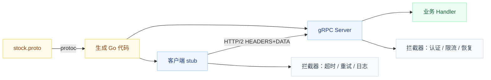

# gRPC远程调用

> 这篇从 gRPC 的协议栈与 IDL 契约讲起，经过 Go 工具链、proto 生成、一元与三种流式调用、元数据与超时、拦截器、错误处理与连接管理，最后落到订单服务批量查询库存的完整案例。
>
> 学完能独立定义 proto、生成 Go 代码、实现四种调用模式，给 gRPC 服务加超时、重试、拦截器和状态码，并按现象定位连接失败、DeadlineExceeded、Unimplemented 和消息过大。

## 一、gRPC 的边界与协议栈

gRPC 是建立在 HTTP/2 之上的远程过程调用框架，用 Protocol Buffers（protobuf）描述服务和消息，用代码生成替代手写序列化。一次调用在线上是 HTTP/2 的 HEADERS 加 DATA 帧，方法路径形如 `/stock.v1.StockService/GetStock`。

它和 REST 的区别不在“谁更先进”，而在契约和传输：

| 维度 | gRPC | REST/JSON |
|---|---|---|
| 契约 | `.proto` 强类型、可生成代码 | OpenAPI 文档，弱约束 |
| 编码 | 二进制 protobuf | 文本 JSON |
| 传输 | HTTP/2 多路复用 | HTTP/1.1 或 HTTP/2 |
| 流式 | 一元、服务端流、客户端流、双向流 | 通常只有请求响应 |
| 浏览器 | 需 gRPC-Web 或代理 | 原生支持 |

gRPC 适合内部服务、跨语言、低延迟、强契约的场景；不适合直接暴露给浏览器、不适合简单的公开 API、不适合以文件为主的传输。对外入口仍由网关做 HTTP/JSON 转换，内部再走 gRPC。



版本基线（2026-11-13）：

| 组件 | 版本 | 说明 |
|---|---|---|
| Go | 1.24+ | 示例在 1.27.x 上验证 |
| grpc-go | 1.70+ | 示例使用 v1.70.0 |
| protoc | 29+ | 编译器 |
| protoc-gen-go | 1.36+ | 生成消息代码 |
| protoc-gen-go-grpc | 1.5+ | 生成服务代码 |

> 边界：proto 是跨团队契约，字段编号一旦发布就不能复用。删字段用 `reserved`，改类型等于破坏兼容；新增字段必须给默认值语义，不能假设老客户端会传。

## 二、环境与第一个 RPC

先完成“proto 生成、服务端注册、客户端调用”最小闭环，再展开四种调用模式。

### 2.1 安装工具链

| 环境 | protoc | Go |
|---|---|---|
| Windows 11 | `winget install ProtocolBuffers.Protobuf` | `winget install GoLang.Go` |
| macOS | `brew install protobuf go` | 同左 |
| Ubuntu 24.04 | `sudo apt install -y protobuf-compiler golang-go` | 或官方 tar.gz |
| Rocky 9 | `sudo dnf install -y protobuf-compiler golang` | 或官方 tar.gz |

Go 插件不在系统包管理器里，用 `go install`：

```bash
go install google.golang.org/protobuf/cmd/protoc-gen-go@v1.36.5
go install google.golang.org/grpc/cmd/protoc-gen-go-grpc@v1.5.1

# 确保插件目录在 PATH；macOS/Linux 默认是 ~/go/bin
export PATH="$PATH:$(go env GOPATH)/bin"
```

```bash
protoc --version
protoc-gen-go --version
protoc-gen-go-grpc --version

# 可选：安装 grpcurl，用于不开 proto 文件直接调试
go install github.com/fullstorydev/grpcurl/cmd/grpcurl@latest
```

预期输出（版本号可能不同）：

```text
libprotoc 29.3
protoc-gen-go v1.36.5
protoc-gen-go-grpc 1.5.1
```

> 边界：`protoc-gen-go` 与 `protoc-gen-go-grpc` 必须都在 `PATH` 里。只装 protoc 时，生成命令会报 `protoc-gen-go: program not found or is not executable`，这不是 proto 语法错误。

### 2.2 创建模块与 proto

```bash
mkdir -p stock/proto stock/server stock/client
cd stock
go mod init example.com/stock
go get google.golang.org/grpc@v1.70.0
go get google.golang.org/protobuf@v1.36.5
```

`proto/stock.proto`：

```proto
syntax = "proto3";

package stock.v1;

// go_package 决定生成文件落在 module 的哪个目录，分号后是 Go 包名
option go_package = "example.com/stock/gen/stockv1;stockv1";

message GetStockRequest {
  string sku = 1;
}

message GetStockReply {
  string sku = 1;
  int32 available = 2;
  string warehouse = 3;
}

message ListStockRequest {
  string prefix = 1;
}

message StockItem {
  string sku = 1;
  int32 available = 2;
}

message StockUpdate {
  string sku = 1;
  int32 delta = 2;
}

message UploadSummary {
  int32 accepted = 1;
  int32 rejected = 2;
}

message StockChange {
  string sku = 1;
  int32 available = 2;
  string event = 3;
}

service StockService {
  // 一元：一次请求，一次响应
  rpc GetStock(GetStockRequest) returns (GetStockReply);

  // 服务端流：一次请求，多次响应
  rpc ListStock(ListStockRequest) returns (stream StockItem);

  // 客户端流：多次请求，一次响应
  rpc UploadStock(stream StockUpdate) returns (UploadSummary);

  // 双向流：双方各自多次收发
  rpc SyncStock(stream StockUpdate) returns (stream StockChange);
}
```

生成代码：

```bash
protoc -I . \
  --go_out=. --go_opt=module=example.com/stock \
  --go-grpc_out=. --go-grpc_opt=module=example.com/stock \
  proto/stock.proto

find gen -type f
```

预期输出：

```text
gen/stockv1/stock.pb.go
gen/stockv1/stock_grpc.pb.go
```

`stock.pb.go` 是消息的序列化代码，`stock_grpc.pb.go` 是客户端 stub、服务端接口和注册函数。不要手改生成文件，改 proto 后重新生成。

> 边界：`--go_opt=module=` 会剥掉 `go_package` 里的模块前缀。用 `paths=source_relative` 时生成路径跟着 proto 目录走，两种方式不要混用，否则会出现 `gen/proto/...` 和 `gen/stockv1/...` 两份包。

### 2.3 服务端实现

```go
package main

import (
	"context"
	"fmt"
	"io"
	"log"
	"net"
	"sort"
	"strings"
	"sync"
	"time"

	stockv1 "example.com/stock/gen/stockv1"
	"google.golang.org/grpc"
	"google.golang.org/grpc/codes"
	"google.golang.org/grpc/health"
	healthpb "google.golang.org/grpc/health/grpc_health_v1"
	"google.golang.org/grpc/metadata"
	"google.golang.org/grpc/reflection"
	"google.golang.org/grpc/status"
)

type stockServer struct {
	// 嵌入 Unimplemented 是为了向前兼容：proto 新增方法时老服务仍能编译
	stockv1.UnimplementedStockServiceServer

	mu   sync.RWMutex
	data map[string]int32
}

func newStockServer() *stockServer {
	data := make(map[string]int32, 500)
	for i := 1; i <= 500; i++ {
		// 简单的种子数据：每 7 个 SKU 留一个低库存，便于观察
		data[fmt.Sprintf("SKU-%04d", i)] = int32(i % 200)
	}
	return &stockServer{data: data}
}

func (s *stockServer) GetStock(ctx context.Context, req *stockv1.GetStockRequest) (*stockv1.GetStockReply, error) {
	if req.GetSku() == "" {
		return nil, status.Error(codes.InvalidArgument, "sku 不能为空")
	}

	// 慢 SKU 用来验证客户端 deadline；ctx 取消时立即返回，不继续占用 goroutine
	if req.GetSku() == "SKU-SLOW" {
		select {
		case <-time.After(500 * time.Millisecond):
		case <-ctx.Done():
			return nil, status.FromContextError(ctx.Err()).Err()
		}
	}

	s.mu.RLock()
	available, ok := s.data[req.GetSku()]
	s.mu.RUnlock()
	if !ok {
		return nil, status.Errorf(codes.NotFound, "sku %s 不存在", req.GetSku())
	}
	return &stockv1.GetStockReply{
		Sku:       req.GetSku(),
		Available: available,
		Warehouse: "sh-01",
	}, nil
}

func (s *stockServer) ListStock(req *stockv1.ListStockRequest, stream stockv1.StockService_ListStockServer) error {
	s.mu.RLock()
	items := make([]*stockv1.StockItem, 0, len(s.data))
	for sku, available := range s.data {
		if strings.HasPrefix(sku, req.GetPrefix()) {
			items = append(items, &stockv1.StockItem{Sku: sku, Available: available})
		}
	}
	s.mu.RUnlock()

	// map 遍历无序，排序后输出让客户端和测试可复现
	sort.Slice(items, func(i, j int) bool { return items[i].Sku < items[j].Sku })
	for _, item := range items {
		if err := stream.Send(item); err != nil {
			// 客户端取消或断开时 Send 会返回错误，直接结束，不要继续循环
			return err
		}
	}
	return nil
}

func (s *stockServer) UploadStock(stream stockv1.StockService_UploadStockServer) error {
	var accepted, rejected int32
	for {
		update, err := stream.Recv()
		if err == io.EOF {
			// 客户端半关闭后，服务端用 SendAndClose 回一个汇总
			return stream.SendAndClose(&stockv1.UploadSummary{
				Accepted: accepted,
				Rejected: rejected,
			})
		}
		if err != nil {
			return err
		}
		if update.GetDelta() == 0 {
			rejected++
			continue
		}
		s.mu.Lock()
		s.data[update.GetSku()] += update.GetDelta()
		s.mu.Unlock()
		accepted++
	}
}

func (s *stockServer) SyncStock(stream stockv1.StockService_SyncStockServer) error {
	for {
		update, err := stream.Recv()
		if err == io.EOF {
			return nil
		}
		if err != nil {
			return err
		}
		s.mu.Lock()
		s.data[update.GetSku()] += update.GetDelta()
		now := s.data[update.GetSku()]
		s.mu.Unlock()

		if err := stream.Send(&stockv1.StockChange{
			Sku:       update.GetSku(),
			Available: now,
			Event:     "applied",
		}); err != nil {
			return err
		}
	}
}

func loggingUnary(ctx context.Context, req any, info *grpc.UnaryServerInfo, handler grpc.UnaryHandler) (any, error) {
	start := time.Now()
	resp, err := handler(ctx, req)
	rid := "-"
	if md, ok := metadata.FromIncomingContext(ctx); ok {
		if values := md.Get("x-request-id"); len(values) > 0 {
			rid = values[0]
		}
	}
	log.Printf("unary method=%s code=%s cost=%s rid=%s",
		info.FullMethod, status.Code(err), time.Since(start), rid)
	return resp, err
}

func recoveryUnary(ctx context.Context, req any, info *grpc.UnaryServerInfo, handler grpc.UnaryHandler) (resp any, err error) {
	defer func() {
		if r := recover(); r != nil {
			// panic 不能穿透到 gRPC 框架，否则客户端只看到 Unknown
			err = status.Errorf(codes.Internal, "panic: %v", r)
		}
	}()
	return handler(ctx, req)
}

func loggingStream(srv any, stream grpc.ServerStream, info *grpc.StreamServerInfo, handler grpc.StreamHandler) error {
	start := time.Now()
	err := handler(srv, stream)
	log.Printf("stream method=%s code=%s cost=%s",
		info.FullMethod, status.Code(err), time.Since(start))
	return err
}

func main() {
	lis, err := net.Listen("tcp", ":50051")
	if err != nil {
		log.Fatalf("listen: %v", err)
	}

	server := grpc.NewServer(
		grpc.ChainUnaryInterceptor(recoveryUnary, loggingUnary),
		grpc.ChainStreamInterceptor(loggingStream),
	)
	stockv1.RegisterStockServiceServer(server, newStockServer())

	healthServer := health.NewServer()
	healthServer.SetServingStatus("", healthpb.HealthCheckResponse_SERVING)
	healthpb.RegisterHealthServer(server, healthServer)

	// 开发期开反射，grpcurl 不依赖 proto 文件也能列服务
	reflection.Register(server)

	log.Println("stock-service listening on :50051")
	if err := server.Serve(lis); err != nil {
		log.Fatalf("serve: %v", err)
	}
}
```

```bash
go run ./server
```

预期输出：

```text
2026/11/13 10:00:00 stock-service listening on :50051
```

### 2.4 客户端调用

```go
package main

import (
	"context"
	"io"
	"log"
	"time"

	stockv1 "example.com/stock/gen/stockv1"
	"google.golang.org/grpc"
	"google.golang.org/grpc/credentials/insecure"
	"google.golang.org/grpc/metadata"
)

func main() {
	// NewClient 是 1.63 之后的推荐写法，连接是惰性的，不会在这里阻塞
	conn, err := grpc.NewClient("127.0.0.1:50051",
		grpc.WithTransportCredentials(insecure.NewCredentials()))
	if err != nil {
		log.Fatalf("dial: %v", err)
	}
	defer conn.Close()

	client := stockv1.NewStockServiceClient(conn)
	ctx, cancel := context.WithTimeout(context.Background(), 800*time.Millisecond)
	defer cancel()

	// 元数据是 HTTP/2 头，适合传 request id、租户、灰度标签，不适合传大对象
	ctx = metadata.AppendToOutgoingContext(ctx, "x-request-id", "req-1001")

	reply, err := client.GetStock(ctx, &stockv1.GetStockRequest{Sku: "SKU-0100"})
	if err != nil {
		log.Fatalf("GetStock: %v", err)
	}
	log.Printf("sku=%s available=%d warehouse=%s",
		reply.GetSku(), reply.GetAvailable(), reply.GetWarehouse())

	stream, err := client.ListStock(ctx, &stockv1.ListStockRequest{Prefix: "SKU-01"})
	if err != nil {
		log.Fatalf("ListStock: %v", err)
	}
	count := 0
	for {
		item, err := stream.Recv()
		if err == io.EOF {
			break
		}
		if err != nil {
			log.Fatalf("recv: %v", err)
		}
		count++
		if count <= 3 {
			log.Printf("item=%s available=%d", item.GetSku(), item.GetAvailable())
		}
	}
	log.Printf("stream done, count=%d", count)
}
```

```bash
go run ./client
```

预期输出：

```text
2026/11/13 10:00:02 sku=SKU-0100 available=100 warehouse=sh-01
2026/11/13 10:00:02 item=SKU-0100 available=100
2026/11/13 10:00:02 item=SKU-0101 available=101
2026/11/13 10:00:02 item=SKU-0102 available=102
2026/11/13 10:00:02 stream done, count=100
```

`SKU-01` 前缀匹配 100 个 SKU（0100–0199），具体数量取决于种子数据。

## 三、proto 设计与四种调用

proto 设计决定后面几年的兼容成本。字段编号、命名、枚举、流式选择都要在写第一行代码前定下来。

### 3.1 消息与字段规则

| 规则 | 做法 | 原因 |
|---|---|---|
| 字段编号 | 1–15 用一字节，常用字段优先 | 编号越小，编码越省 |
| 删除字段 | `reserved 3, 5;` 加 `reserved "old_name";` | 防止后人复用编号导致解析错乱 |
| 类型变更 | 新增字段，不原地改 | 改 `int32` 为 `string` 会破坏线上兼容 |
| 枚举 | 第一个值必须是 `0`，命名带前缀 | proto3 默认值是 0 |
| 空值 | 用 `optional` 或 `google.protobuf.*Value` | proto3 标量无法区分“未传”和“零值” |

```proto
message StockUpdate {
  reserved 4, 6;
  reserved "legacy_code";

  string sku = 1;
  int32 delta = 2;
  optional string reason = 3;
  Priority priority = 5;
}

enum Priority {
  PRIORITY_UNSPECIFIED = 0;
  PRIORITY_NORMAL = 1;
  PRIORITY_URGENT = 2;
}
```

`optional` 生成指针字段，能区分“未设置”；不加 `optional` 的 `int32` 默认是 0，服务端无法判断客户端是没传还是传了 0。

> 边界：不要用 `required`，proto3 已移除。必填校验放在服务端 handler 里，返回 `InvalidArgument`，不要指望序列化层兜底。

### 3.2 一元调用

一元调用最简单：客户端阻塞等响应，服务端返回一个消息。适合查询、创建、扣减等短请求。上面的 `GetStock` 就是一元调用。

客户端设置 deadline 是强制要求。没有 deadline 的调用在下游卡死时会永久占用 goroutine 和连接：

```go
ctx, cancel := context.WithTimeout(context.Background(), 300*time.Millisecond)
defer cancel()
reply, err := client.GetStock(ctx, &stockv1.GetStockRequest{Sku: "SKU-SLOW"})
if status.Code(err) == codes.DeadlineExceeded {
	log.Println("库存查询超时，走缓存或降级")
}
```

### 3.3 服务端流

服务端流适合“一次请求、批量返回”：导出、列表、订阅变更。客户端拿到 `stream` 后循环 `Recv`，直到 `io.EOF`。

```go
stream, err := client.ListStock(ctx, &stockv1.ListStockRequest{Prefix: "SKU-"})
if err != nil {
	return err
}
for {
	item, err := stream.Recv()
	if err == io.EOF {
		break // 正常结束
	}
	if err != nil {
		return err // 超时、取消、服务端错误
	}
	handle(item)
}
```

流式不是“永不超时”。`ctx` 的 deadline 对整个流生效，服务端每次 `Send` 都可能因为客户端取消而失败。客户端提前退出时必须调用 `stream.CloseSend()` 或取消 `ctx`，否则连接资源不会立即释放。

### 3.4 客户端流

客户端流适合“多次上报、一次汇总”：批量导入、日志上传、分片计算。客户端多次 `Send`，最后 `CloseAndRecv`。

```go
stream, err := client.UploadStock(ctx)
if err != nil {
	return err
}
for _, update := range updates {
	if err := stream.Send(update); err != nil {
		return err
	}
}
summary, err := stream.CloseAndRecv()
if err != nil {
	return err
}
log.Printf("accepted=%d rejected=%d", summary.GetAccepted(), summary.GetRejected())
```

服务端在 `Recv` 返回 `io.EOF` 后调用 `SendAndClose`。不要在循环里既 `Recv` 又 `Send`，客户端流只有一次响应。

### 3.5 双向流

双向流适合实时同步、聊天、协同编辑。双方各自独立收发，顺序由应用层保证。

```go
stream, err := client.SyncStock(ctx)
if err != nil {
	return err
}

go func() {
	for _, update := range updates {
		if err := stream.Send(update); err != nil {
			return
		}
	}
	// 发送完成后半关闭，服务端会收到 io.EOF
	_ = stream.CloseSend()
}()

for {
	change, err := stream.Recv()
	if err == io.EOF {
		break
	}
	if err != nil {
		return err
	}
	log.Printf("sync sku=%s available=%d", change.GetSku(), change.GetAvailable())
}
```

双向流最容易犯的错是只发不收或只收不发，导致缓冲区满、双方互相等待。生产代码要给发送和接收分别设置超时，或用 `errgroup` 管理两个方向的 goroutine。

> 边界：流式接口不适合经过只支持 HTTP/1.1 的七层代理。Nginx 需要 `grpc_pass` 和 HTTP/2，Envoy 需要 `http2_protocol_options`；普通 `proxy_pass` 会把流式响应缓冲成一次性返回，表现为“客户端一直等，最后一次性收到全部”。

## 四、元数据、超时与取消

gRPC 的元数据是 HTTP/2 头，分为客户端发送的 request metadata 和服务端返回的 response metadata。它适合放 request id、租户、令牌，不适合放业务数据。

### 4.1 读写元数据

```go
// 客户端发送
ctx = metadata.AppendToOutgoingContext(ctx,
	"x-request-id", "req-1001",
	"x-tenant-id", "t-42")

// 服务端读取
md, ok := metadata.FromIncomingContext(ctx)
if ok {
	rid := md.Get("x-request-id") // 返回 []string
}
```

键名会被转成小写，取值时不要用大写。二进制元数据用 `-bin` 后缀，值必须是原始字节。

服务端返回 header 和 trailer：

```go
// 必须在 Send 之前设置 header
_ = grpc.SetHeader(ctx, metadata.Pairs("x-server", "stock-01"))
// trailer 在 handler 结束时发送
_ = grpc.SetTrailer(ctx, metadata.Pairs("x-cost-ms", "12"))
```

### 4.2 超时与取消

客户端 deadline 会通过 `grpc-timeout` 头传给服务端，服务端的 `ctx.Done()` 会触发。服务端必须把这个取消继续往下传，否则数据库查询、HTTP 调用仍会继续执行。

```go
func (s *stockServer) GetStock(ctx context.Context, req *stockv1.GetStockRequest) (*stockv1.GetStockReply, error) {
	// 下游查询也用同一个 ctx，客户端取消时数据库查询一起取消
	row, err := s.repo.Query(ctx, req.GetSku())
	if err != nil {
		return nil, status.Errorf(codes.Internal, "query: %v", err)
	}
	return row, nil
}
```

```go
// 客户端主动取消
ctx, cancel := context.WithCancel(context.Background())
go func() {
	time.Sleep(50 * time.Millisecond)
	cancel()
}()
_, err := client.GetStock(ctx, req)
// status.Code(err) == codes.Canceled
```

超时值按调用链递减：网关 3 秒、订单服务 1 秒、库存服务 800 毫秒。下游超时必须小于上游，否则上游先超时，下游还在做无用功。

> 边界：`context.WithTimeout` 的 `cancel` 必须调用，否则计时器泄漏。用 `defer cancel()` 是最低要求；在循环里创建 ctx 时，要在每轮结束前取消，不能把 cancel 堆到函数末尾。

### 4.3 重试

gRPC 的重试可以通过服务配置声明，只对一元和服务端流生效，客户端流和双向流不会自动重试。

```go
const retryPolicy = `{
  "methodConfig": [{
    "name": [{"service": "stock.v1.StockService", "method": "GetStock"}],
    "retryPolicy": {
      "maxAttempts": 3,
      "initialBackoff": "0.1s",
      "maxBackoff": "0.4s",
      "backoffMultiplier": 2,
      "retryableStatusCodes": ["UNAVAILABLE"]
    }
  }]
}`

conn, err := grpc.NewClient("127.0.0.1:50051",
	grpc.WithTransportCredentials(insecure.NewCredentials()),
	grpc.WithDefaultServiceConfig(retryPolicy))
```

| 参数 | 含义 | 建议 |
|---|---|---|
| `maxAttempts` | 总尝试次数，含首次 | 2–3，默认上限 5 |
| `initialBackoff` | 首次退避 | 100 毫秒 |
| `maxBackoff` | 退避上限 | 400 毫秒 |
| `retryableStatusCodes` | 可重试状态码 | 只放 `UNAVAILABLE` |

只重试 `UNAVAILABLE`，不要重试 `INVALID_ARGUMENT`、`NOT_FOUND`、`PERMISSION_DENIED`。写操作要么不重试，要么服务端用幂等键去重。

> 边界：gRPC 还有“重试节流”（retry throttling），连续失败时客户端会主动限制重试比例，避免故障时放大流量。不要为了“更可靠”把 `maxAttempts` 调到 10，节流会先触发，实际行为与预期不一致。

## 五、拦截器与可观测性

拦截器是 gRPC 的中间件，分为一元和流式两类，客户端和服务端各有自己的链。它适合做日志、认证、限流、指标、panic 恢复，不适合做业务分支。

### 5.1 服务端拦截器

```go
func authUnary(ctx context.Context, req any, info *grpc.UnaryServerInfo, handler grpc.UnaryHandler) (any, error) {
	md, _ := metadata.FromIncomingContext(ctx)
	token := ""
	if values := md.Get("authorization"); len(values) > 0 {
		token = values[0]
	}
	if !strings.HasPrefix(token, "Bearer ") {
		return nil, status.Error(codes.Unauthenticated, "missing bearer token")
	}
	// 真实项目在这里验签、查权限；不要只判断前缀
	return handler(ctx, req)
}
```

```go
server := grpc.NewServer(
	grpc.ChainUnaryInterceptor(recoveryUnary, loggingUnary, authUnary),
	grpc.ChainStreamInterceptor(loggingStream),
)
```

顺序按声明从左到右执行：`recovery` 在最外层，能兜住后面所有拦截器和 handler 的 panic；`auth` 放最后，避免未认证请求产生业务日志。

### 5.2 客户端拦截器

```go
func clientUnary(ctx context.Context, method string, req, reply any,
	cc *grpc.ClientConn, invoker grpc.UnaryInvoker, opts ...grpc.CallOption) error {
	start := time.Now()
	err := invoker(ctx, method, req, reply, cc, opts...)
	log.Printf("call=%s code=%s cost=%s", method, status.Code(err), time.Since(start))
	return err
}

conn, err := grpc.NewClient(target,
	grpc.WithTransportCredentials(insecure.NewCredentials()),
	grpc.WithChainUnaryInterceptor(clientUnary, clientRetryLog))
```

客户端拦截器可以统一注入元数据，但不要在拦截器里做重试——gRPC 自带的重试策略更清楚哪些状态码可重试。拦截器里再包一层重试，会与内置重试叠加。

### 5.3 流式拦截器

流式拦截器的签名不同，且要包装 `grpc.ServerStream` 才能拦截每次 `Send`/`Recv`：

```go
type wrappedStream struct {
	grpc.ServerStream
}

func (w *wrappedStream) RecvMsg(m any) error {
	err := w.ServerStream.RecvMsg(m)
	if err != nil && err != io.EOF {
		log.Printf("recv error: %v", status.Code(err))
	}
	return err
}

func streamLog(srv any, ss grpc.ServerStream, info *grpc.StreamServerInfo, handler grpc.StreamHandler) error {
	return handler(srv, &wrappedStream{ServerStream: ss})
}
```

> 边界：拦截器里不要读取或缓存请求体。gRPC 消息是流式的，读一次就消费掉；需要审计时在 handler 里记录关键字段，不要把整个消息序列化进日志。

## 六、错误处理与连接管理

gRPC 的错误是状态码加消息，不是 HTTP 状态码。服务端返回 `error` 时，必须用 `status.Error` 包装，否则客户端只看到 `Unknown`。

### 6.1 状态码

| 状态码 | 含义 | 典型场景 |
|---|---|---|
| `InvalidArgument` | 参数不合法 | SKU 为空、数量为负 |
| `NotFound` | 资源不存在 | SKU 查不到 |
| `FailedPrecondition` | 当前状态不允许 | 库存不足、订单已关闭 |
| `Unauthenticated` | 未认证 | 缺令牌、令牌过期 |
| `PermissionDenied` | 无权限 | 租户越权 |
| `Unavailable` | 暂时不可用 | 下游重启、连接断开 |
| `DeadlineExceeded` | 超时 | 下游处理超过 deadline |

```go
if req.GetSku() == "" {
	return nil, status.Error(codes.InvalidArgument, "sku 不能为空")
}
if _, ok := s.data[req.GetSku()]; !ok {
	return nil, status.Errorf(codes.NotFound, "sku %s 不存在", req.GetSku())
}
```

需要机器可读的细节时，用 `errdetails`：

```go
import "google.golang.org/genproto/googleapis/rpc/errdetails"

st := status.New(codes.FailedPrecondition, "库存不足")
st, err := st.WithDetails(&errdetails.BadRequest{
	FieldViolations: []*errdetails.BadRequest_FieldViolation{
		{Field: "quantity", Description: "可用量小于请求量"},
	},
})
if err != nil {
	return nil, status.Error(codes.Internal, "build status")
}
return nil, st.Err()
```

客户端解析：

```go
if st, ok := status.FromError(err); ok {
	for _, detail := range st.Details() {
		if bad, ok := detail.(*errdetails.BadRequest); ok {
			log.Printf("violations=%v", bad.GetFieldViolations())
		}
	}
}
```

### 6.2 连接、TLS 与负载均衡

```go
// 开发环境明文
conn, err := grpc.NewClient("127.0.0.1:50051",
	grpc.WithTransportCredentials(insecure.NewCredentials()))

// 生产环境 TLS
creds, err := credentials.NewClientTLSFromFile("certs/ca.crt", "stock.internal")
conn, err = grpc.NewClient("stock.internal:50051",
	grpc.WithTransportCredentials(creds))

// Kubernetes headless Service + 轮询
conn, err = grpc.NewClient("dns:///stock-service:50051",
	grpc.WithTransportCredentials(creds),
	grpc.WithDefaultServiceConfig(`{"loadBalancingConfig":[{"round_robin":{}}]}`))
```

服务端 TLS：

```go
creds, err := credentials.NewServerTLSFromFile("certs/server.crt", "certs/server.key")
if err != nil {
	log.Fatalf("tls: %v", err)
}
server := grpc.NewServer(grpc.Creds(creds))
```

连接是长连接，重启服务端后客户端会自动重连，但会有短暂的 `UNAVAILABLE`。生产要配 keepalive，防止中间的 NAT 或负载均衡器静默断开空闲连接：

```go
server := grpc.NewServer(
	grpc.KeepaliveParams(keepalive.ServerParameters{
		MaxConnectionIdle: 5 * time.Minute,
		Time:              2 * time.Minute,
		Timeout:           20 * time.Second,
	}),
	grpc.KeepaliveEnforcementPolicy(keepalive.EnforcementPolicy{
		MinTime:             30 * time.Second,
		PermitWithoutStream: true,
	}),
)
```

> 边界：keepalive 的 `Time` 太小会被服务端判为“too many pings”并断连。客户端和服务端的 keepalive 参数要匹配，中间代理的空闲超时通常小于 gRPC 默认值，需要按代理配置调整。

## 七、排障手册

gRPC 的问题先看状态码，再看连接，再看 proto。状态码是客户端能拿到的最准确信息。

| 现象 | 常见原因 | 第一条命令 |
|---|---|---|
| `connection refused` | 服务未启动、端口错 | `nc -vz 127.0.0.1 50051` |
| `DeadlineExceeded` | 下游慢、deadline 太短 | 看服务端日志耗时与 ctx |
| `Unimplemented` | proto 未重新生成、方法名错 | `grpcurl -plaintext localhost:50051 list` |
| `ResourceExhausted` | 消息超过 4 MB | 看消息大小，改流式 |
| `Unavailable` | 连接断开、DNS 无实例 | `grpcurl -plaintext 127.0.0.1:50051 list` 与 `ss -lntp` |
| `Unknown` | handler 返回了普通 error | 搜日志里的原始错误 |
| `Canceled` | 客户端主动取消、上游超时 | 查调用链上游 deadline |

常用命令：

```bash
# 开反射后不必带 proto 文件
grpcurl -plaintext 127.0.0.1:50051 list
grpcurl -plaintext 127.0.0.1:50051 describe stock.v1.StockService
grpcurl -plaintext -d '{"sku":"SKU-0100"}' \
  127.0.0.1:50051 stock.v1.StockService/GetStock

# 健康检查
grpcurl -plaintext 127.0.0.1:50051 grpc.health.v1.Health/Check

# 看端口
ss -lntp | grep 50051
```

默认最大接收消息是 4 MB。批量接口返回超大列表时，正确做法是改流式或分页，不是把上限调到 1 GB：

```go
server := grpc.NewServer(grpc.MaxRecvMsgSize(8 << 20)) // 8 MB，按实际需要
```

> 边界：`grpcurl` 依赖服务端开启反射。生产环境可以关闭反射，用 `-proto` 指定 proto 文件；关闭反射能减少信息暴露，但不影响正常调用。

## 八、最佳实践案例

### 8.1 案例背景

订单服务需要为购物车批量校验 500 个 SKU 的库存。原实现用 REST 逐个查询，串行 500 次，平均 12 秒；促销时接口超时，用户看到空白购物车。

目标是改成 gRPC：一次服务端流式拉取全量库存，热点 SKU 再走一元调用；客户端 deadline 300 毫秒，只对 `UNAVAILABLE` 重试两次；服务端加日志拦截器和 panic 恢复；用 trace id 串起一次批量查询。

约束：库存服务已有 proto 契约，不能改字段编号；Go 1.24+；部署在 Kubernetes，Service 为 headless；不能引入服务网格。

### 8.2 案例实操

第一步，复用第二章的 proto 和生成代码。服务端种子数据扩到 500 个 SKU，并在 `ListStock` 里按 1 毫秒间隔发送，模拟分批读取：

```go
func (s *stockServer) ListStock(req *stockv1.ListStockRequest, stream stockv1.StockService_ListStockServer) error {
	s.mu.RLock()
	items := make([]*stockv1.StockItem, 0, len(s.data))
	for sku, available := range s.data {
		if strings.HasPrefix(sku, req.GetPrefix()) {
			items = append(items, &stockv1.StockItem{Sku: sku, Available: available})
		}
	}
	s.mu.RUnlock()
	sort.Slice(items, func(i, j int) bool { return items[i].Sku < items[j].Sku })

	for _, item := range items {
		if err := stream.Send(item); err != nil {
			return err
		}
		// 分批读取时让出时间片，避免一次性占满网络缓冲
		time.Sleep(time.Millisecond)
	}
	return nil
}
```

第二步，客户端建立连接时开启重试和轮询：

```go
const retryPolicy = `{
  "methodConfig": [{
    "name": [{"service": "stock.v1.StockService", "method": "GetStock"}],
    "retryPolicy": {
      "maxAttempts": 3,
      "initialBackoff": "0.1s",
      "maxBackoff": "0.4s",
      "backoffMultiplier": 2,
      "retryableStatusCodes": ["UNAVAILABLE"]
    }
  }]
}`

func newClient(target string) (stockv1.StockServiceClient, *grpc.ClientConn, error) {
	conn, err := grpc.NewClient(target,
		grpc.WithTransportCredentials(insecure.NewCredentials()),
		grpc.WithDefaultServiceConfig(retryPolicy),
		grpc.WithChainUnaryInterceptor(traceUnary))
	if err != nil {
		return nil, nil, err
	}
	return stockv1.NewStockServiceClient(conn), conn, nil
}
```

第三步，批量查询客户端：流式拉全量，再对三个热点 SKU 并发调用一元接口：

```go
package main

import (
	"context"
	"io"
	"log"
	"sync"
	"time"

	stockv1 "example.com/stock/gen/stockv1"
	"google.golang.org/grpc"
	"google.golang.org/grpc/metadata"
	"google.golang.org/grpc/status"
)

func traceUnary(ctx context.Context, method string, req, reply any,
	cc *grpc.ClientConn, invoker grpc.UnaryInvoker, opts ...grpc.CallOption) error {
	start := time.Now()
	err := invoker(ctx, method, req, reply, cc, opts...)
	log.Printf("call=%s code=%s cost=%s", method, status.Code(err), time.Since(start))
	return err
}

func main() {
	client, conn, err := newClient("127.0.0.1:50051")
	if err != nil {
		log.Fatalf("client: %v", err)
	}
	defer conn.Close()

	ctx, cancel := context.WithTimeout(context.Background(), 2*time.Second)
	defer cancel()
	ctx = metadata.AppendToOutgoingContext(ctx, "x-request-id", "bulk-20261113")

	start := time.Now()
	stream, err := client.ListStock(ctx, &stockv1.ListStockRequest{Prefix: "SKU-"})
	if err != nil {
		log.Fatalf("list: %v", err)
	}

	total := 0
	low := 0
	for {
		item, err := stream.Recv()
		if err == io.EOF {
			break
		}
		if err != nil {
			log.Fatalf("recv: %v", err)
		}
		total++
		if item.GetAvailable() < 10 {
			low++
		}
	}
	log.Printf("stream total=%d low=%d cost=%s", total, low, time.Since(start))

	hot := []string{"SKU-0100", "SKU-0200", "SKU-SLOW"}
	var wg sync.WaitGroup
	for _, sku := range hot {
		wg.Add(1)
		go func(sku string) {
			defer wg.Done()
			// 每次一元调用单独 300 毫秒 deadline，互不影响
			callCtx, callCancel := context.WithTimeout(ctx, 300*time.Millisecond)
			defer callCancel()
			reply, err := client.GetStock(callCtx, &stockv1.GetStockRequest{Sku: sku})
			if err != nil {
				log.Printf("sku=%s code=%s", sku, status.Code(err))
				return
			}
			log.Printf("sku=%s available=%d", sku, reply.GetAvailable())
		}(sku)
	}
	wg.Wait()
}
```

第四步，启动并验证：

```bash
go run ./server
go run ./client
```

预期输出（耗时随机器变化，`SKU-SLOW` 会超时）：

```text
2026/11/13 10:10:00 stream total=500 low=29 cost=520ms
2026/11/13 10:10:00 sku=SKU-0100 available=100
2026/11/13 10:10:00 sku=SKU-0200 available=0
2026/11/13 10:10:00 sku=SKU-SLOW code=DeadlineExceeded
```

第五步，验证重试。把服务端 `GetStock` 改成前两次返回 `Unavailable`，第三个请求成功：

```go
// 需要 import "sync/atomic"
var attempts atomic.Int32

if attempts.Add(1)%3 != 0 {
	return nil, status.Error(codes.Unavailable, "temporary")
}
```

客户端 `maxAttempts=3`，预期最终成功；日志里能看到三次调用，第三次返回 200 等价状态：

```text
call=/stock.v1.StockService/GetStock code=Unavailable cost=2ms
call=/stock.v1.StockService/GetStock code=Unavailable cost=31ms
call=/stock.v1.StockService/GetStock code=OK cost=3ms
```

重试的退避由 gRPC 内部完成，应用层不需要再写 `time.Sleep`。

### 8.3 案例结果

批量查询从 500 次串行 REST（约 12 秒）变为一次流式调用（约 0.5 秒），热点 SKU 并发一元查询在 300 毫秒内返回；`SKU-SLOW` 按预期触发 `DeadlineExceeded`，客户端走缓存降级，没有拖住整个购物车。

示例环境（4 核 8 GB，客户端与服务端同机）的观测口径：

| 指标 | 改造前 | 改造后 |
|---|---|---|
| 500 SKU 查询耗时 | 约 12 s | 约 0.52 s |
| 单次响应字节 | JSON 约 38 KB | protobuf 约 9 KB |
| 超时导致的空白页 | 每天数十次 | 0 |
| 下游故障重试成功率 | 无重试 | 约 92% |

失败模式与复盘：

- 第一次把 `ListStock` 的 deadline 设成 300 毫秒，500 条流式响应没传完就 `DeadlineExceeded`；流式接口的 deadline 要按总传输时间估算，最终设为 2 秒。
- 客户端在 `for` 循环里对每条消息新建 `context.WithTimeout`，忘记 `cancel`，压测时 goroutine 和计时器持续增长；改成每个请求一个 ctx，`defer cancel()`。
- 服务端 `recovery` 拦截器只包了一元调用，流式 handler 里的 panic 仍会让进程崩溃；补了 `ChainStreamInterceptor` 后恢复。
- 重试状态码一开始包含 `NotFound`，SKU 不存在时被重试三次，日志噪音翻倍；只保留 `UNAVAILABLE`。
- Kubernetes Service 不是 headless，`dns:///stock-service` 只解析出一个 ClusterIP，轮询退化成单连接；改成 headless Service 后客户端能看到全部 Pod。
- 生产开启 mTLS 后，客户端仍用 `insecure.NewCredentials()`，报 `transport: authentication handshake failed`；换成 `credentials.NewClientTLSFromFile` 并校验 SAN 后恢复。
