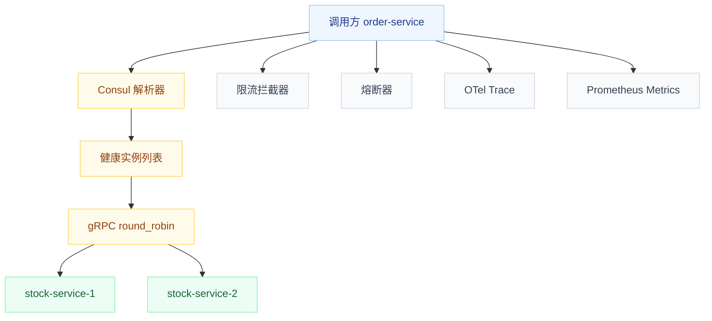

# Go服务治理

> 这篇从 Go 微服务治理的职责分层讲起，经过 Consul 注册发现、gRPC 自定义解析器与负载均衡、限流熔断、OpenTelemetry 链路、Prometheus 指标，最后落到订单服务调用库存服务的治理闭环案例。
>
> 学完能独立把 Go gRPC 服务注册到 Consul、实现按健康实例轮询、给接口加限流和熔断、接入链路与指标，并按现象定位实例不健康、流量打偏、熔断误开和指标缺失。

## 一、服务治理的职责分层

服务治理解决四个问题：实例在哪里、请求发给谁、坏了怎么办、出了问题怎么看见。对应注册发现、负载均衡、限流熔断、可观测性四层，每层只做自己的事。

注册发现保存“活着的实例列表”，负载均衡决定“这一次选哪台”，限流熔断保护“调用方和下游不被拖垮”，链路与指标回答“这一次为什么慢、错在哪”。把四层混在一个中间件里，排障时就分不清是注册数据过期、选错实例，还是下游真的慢。



各层的选型边界：

| 能力 | 常见方案 | 什么时候需要 | 什么时候不需要 |
|---|---|---|---|
| 注册发现 | Consul、etcd、Nacos | 多实例、动态扩缩容 | 单实例、固定 DNS |
| 负载均衡 | gRPC 内置、Envoy、K8s Service | 多实例分流 | 只有一个后端 |
| 限流 | 本地令牌桶、Redis、网关 | 保护下游容量 | 内部低流量接口 |
| 熔断 | gobreaker、Envoy | 下游故障会拖垮调用方 | 调用链短且可快速失败 |
| 链路 | OpenTelemetry、Jaeger | 跨服务排障 | 单进程应用 |
| 指标 | Prometheus、OTel Metrics | 需要容量规划和告警 | 一次性脚本 |

Kubernetes 里已经有 Service 和 DNS，是否还需要 Consul？如果只用 K8s Service 做四层负载、没有跨集群、没有 VM 混合部署，可以不加注册中心；需要跨集群、多语言、按元数据路由、服务健康状态可见时，Consul 仍有价值。不要为了“架构完整”在单集群里同时维护两套注册数据。

> 边界：注册中心只保证“实例列表”，不保证“请求一定成功”。健康检查有间隔，实例刚挂时仍可能被选中；调用方必须有超时、重试预算和熔断。注册发现不能替代可观测性，也不能替代容量规划。

版本基线（2026-11-13）：

| 组件 | 版本 | 说明 |
|---|---|---|
| Go | 1.24+ | 示例在 1.27.x 验证 |
| grpc-go | 1.70+ | 一元与流式拦截器 |
| Consul | 1.20.x | 服务注册与健康检查 |
| OpenTelemetry Go | 1.34.x | Trace SDK |
| Prometheus | 3.x | 指标存储与查询 |

## 二、环境与最小治理闭环

先做到“服务注册、健康检查通过、客户端按服务名发现并调用”，再叠加限流、熔断和观测。

### 2.1 启动 Consul

开发环境用单节点 dev 模式，数据在内存，重启即丢；生产至少三节点，数据落盘。

```bash
# Docker，三端通用
docker run -d --name consul \
  -p 8500:8500 -p 8600:8600/udp \
  hashicorp/consul:1.20

# 或者本机二进制
consul agent -dev -client=0.0.0.0
```

| 环境 | 安装 |
|---|---|
| Windows 11 | `winget install Hashicorp.Consul` 或 Docker Desktop |
| macOS | `brew install consul` |
| Ubuntu 24.04 | HashiCorp apt 源后 `sudo apt install consul` |
| Rocky 9 | HashiCorp dnf 源后 `sudo dnf install consul` |

验证：

```bash
consul members
curl -s http://127.0.0.1:8500/v1/status/leader
```

预期输出：

```text
Node     Address         Status  Type    Build   Protocol  DC   Partition  Segment
consul   127.0.0.1:8301  alive   server  1.20.1  2         dc1  default    <all>

"127.0.0.1:8300"
```

控制台地址 `http://127.0.0.1:8500`，可以看到 Services 和 Health Checks。

### 2.2 项目依赖

```bash
mkdir -p govdemo && cd govdemo
go mod init example.com/govdemo

go get google.golang.org/grpc@v1.70.0
go get github.com/hashicorp/consul/api@v1.30.0
go get github.com/sony/gobreaker/v2@v2.1.0
go get golang.org/x/time@v0.10.0
go get github.com/prometheus/client_golang@v1.20.5
go get go.opentelemetry.io/otel@v1.34.0
go get go.opentelemetry.io/otel/sdk@v1.34.0
go get go.opentelemetry.io/otel/exporters/otlp/otlptrace/otlptracegrpc@v1.34.0
go get go.opentelemetry.io/contrib/instrumentation/google.golang.org/grpc/otelgrpc@v0.59.0
```

本文的 proto 与服务实现复用同目录 `01-gRPC远程调用.md` 的 `stock.proto`，只增加治理相关代码。目录结构：

```text
govdemo/
├── go.mod
├── proto/stock.proto
├── gen/stockv1/
├── server/main.go
└── client/main.go
```

> 边界：`consul/api` 的版本要跟 Consul Server 的大版本匹配。客户端 1.30 可以访问 1.20 服务端，但不要用 1.15 的客户端访问 1.20 的新 API。升级前先看 release notes 的兼容说明。

### 2.3 注册服务

注册信息包含服务名、地址、端口、标签和健康检查。健康检查用 gRPC 标准健康协议，Consul 直接调 `grpc.health.v1.Health/Check`，不需要额外写 HTTP 探针。

```go
package registry

import (
	"fmt"

	"github.com/hashicorp/consul/api"
)

type Registration struct {
	ID      string
	Name    string
	Address string
	Port    int
	Tags    []string
}

func Register(client *api.Client, reg Registration) error {
	entry := &api.AgentServiceRegistration{
		ID:      reg.ID,
		Name:    reg.Name,
		Address: reg.Address,
		Port:    reg.Port,
		Tags:    reg.Tags,
		Check: &api.AgentServiceCheck{
			// 服务端必须注册 grpc.health.v1.Health，否则检查永远是 critical
			GRPC:                           fmt.Sprintf("%s:%d/grpc.health.v1.Health/Check", reg.Address, reg.Port),
			Interval:                       "5s",
			Timeout:                        "3s",
			DeregisterCriticalServiceAfter: "1m",
		},
	}
	return client.Agent().ServiceRegister(entry)
}
```

```go
client, err := api.NewClient(&api.Config{Address: "127.0.0.1:8500"})
if err != nil {
	log.Fatalf("consul: %v", err)
}
if err := registry.Register(client, registry.Registration{
	ID:      "stock-1",
	Name:    "stock-service",
	Address: "127.0.0.1",
	Port:    50051,
	Tags:    []string{"grpc", "v1"},
}); err != nil {
	log.Fatalf("register: %v", err)
}
```

验证注册与健康状态：

```bash
curl -s http://127.0.0.1:8500/v1/catalog/service/stock-service | python3 -m json.tool
curl -s http://127.0.0.1:8500/v1/health/service/stock-service | python3 -m json.tool
```

预期健康实例包含：

```json
[
  {
    "Node": {"Node": "consul", "Address": "127.0.0.1"},
    "Service": {
      "ID": "stock-1",
      "Service": "stock-service",
      "Address": "127.0.0.1",
      "Port": 50051,
      "Tags": ["grpc", "v1"]
    },
    "Checks": [
      {"Status": "passing", "CheckID": "service:stock-1"}
    ]
  }
]
```

### 2.4 优雅下线

进程被 `kill -9` 时无法注销，只能等健康检查失败后由 Consul 剔除；正常关闭必须先摘注册，再停止 gRPC：

```go
func main() {
	// 前置代码：创建 listener、注册 stock 服务并启动 Serve

	sig := make(chan os.Signal, 1)
	signal.Notify(sig, syscall.SIGINT, syscall.SIGTERM)
	<-sig

	// 先摘注册，避免新请求继续打到正在关闭的实例
	_ = consulClient.Agent().ServiceDeregister("stock-1")

	done := make(chan struct{})
	go func() {
		server.GracefulStop()
		close(done)
	}()
	select {
	case <-done:
	case <-time.After(10 * time.Second):
		// 有长流未结束时，GracefulStop 会一直等，超时后强制停止
		server.Stop()
	}
}
```

Kubernetes 里还要配 `preStop` 钩子，先 sleep 几秒让 Endpoints 刷新，再发 SIGTERM；否则流量摘除和进程退出之间有时间差，仍会有少量 503。

> 边界：健康检查的 `DeregisterCriticalServiceAfter` 是“ critical 持续多久后删除”，不是“立刻删除”。默认最小 1 分钟，设得太短会因网络抖动误删健康实例；设得太长，故障实例会长时间留在列表里。按健康检查间隔的 3–6 倍设置。

## 三、发现与负载均衡

服务发现不是每次调用都查 Consul。正确做法是解析器定时刷新地址列表，gRPC 在地址列表上做轮询或最少连接，调用路径上没有 Consul 请求。

### 3.1 自定义 gRPC 解析器

gRPC 的 `resolver` 负责把目标字符串解析成地址列表。下面实现 `consul:///stock-service`：

```go
package discovery

import (
	"context"
	"fmt"
	"net"
	"strconv"
	"time"

	"github.com/hashicorp/consul/api"
	"google.golang.org/grpc/resolver"
)

type consulBuilder struct {
	client *api.Client
}

func NewBuilder(client *api.Client) resolver.Builder {
	return &consulBuilder{client: client}
}

func (b *consulBuilder) Scheme() string { return "consul" }

func (b *consulBuilder) Build(target resolver.Target, cc resolver.ClientConn,
	opts resolver.BuildOptions) (resolver.Resolver, error) {

	service := target.Endpoint()
	if service == "" {
		return nil, fmt.Errorf("consul resolver: empty service name")
	}
	ctx, cancel := context.WithCancel(context.Background())
	r := &consulResolver{
		client:  b.client,
		service: service,
		cc:      cc,
		cancel:  cancel,
	}
	go r.watch(ctx)
	return r, nil
}

type consulResolver struct {
	client  *api.Client
	service string
	cc      resolver.ClientConn
	cancel  context.CancelFunc
}

func (r *consulResolver) ResolveNow(resolver.ResolveNowOptions) {
	// gRPC 在连接失败时会主动触发，立即刷新一次
	r.update()
}

func (r *consulResolver) Close() {
	r.cancel()
}

func (r *consulResolver) watch(ctx context.Context) {
	ticker := time.NewTicker(5 * time.Second)
	defer ticker.Stop()
	r.update()
	for {
		select {
		case <-ctx.Done():
			return
		case <-ticker.C:
			r.update()
		}
	}
}

func (r *consulResolver) update() {
	// passingOnly=true 只返回健康检查通过的实例，避免把流量打到 critical 节点
	entries, _, err := r.client.Health().Service(r.service, "", true, nil)
	if err != nil {
		r.cc.ReportError(err)
		return
	}
	addrs := make([]resolver.Address, 0, len(entries))
	for _, entry := range entries {
		host := entry.Service.Address
		if host == "" {
			host = entry.Node.Address
		}
		addrs = append(addrs, resolver.Address{
			Addr: net.JoinHostPort(host, strconv.Itoa(entry.Service.Port)),
		})
	}
	if len(addrs) == 0 {
		// 保留上一次地址，交给 gRPC 的连接状态处理；直接清空会让调用瞬间全部失败
		r.cc.ReportError(fmt.Errorf("no passing instance for %s", r.service))
		return
	}
	_ = r.cc.UpdateState(resolver.State{Addresses: addrs})
}
```

```go
consulClient, err := api.NewClient(&api.Config{Address: "127.0.0.1:8500"})
if err != nil {
	log.Fatalf("consul: %v", err)
}
resolver.Register(discovery.NewBuilder(consulClient))

conn, err := grpc.NewClient("consul:///stock-service",
	grpc.WithTransportCredentials(insecure.NewCredentials()),
	grpc.WithDefaultServiceConfig(`{"loadBalancingConfig":[{"round_robin":{}}]}`))
```

解析器每 5 秒刷新一次，gRPC 在地址变化时重建子连接。`round_robin` 只把请求发给 `READY` 的子连接，所以不健康实例即使还在列表里，也不会被选中。

### 3.2 负载均衡策略

| 策略 | 行为 | 适用 |
|---|---|---|
| `pick_first` | 选第一个可用地址 | 单实例、调试 |
| `round_robin` | 按顺序轮询 READY 子连接 | 无状态服务，默认选择 |
| `least_request` | 选进行中请求最少的 | 长请求、负载不均 |
| `weighted_round_robin` | 按权重轮询 | 机器配置不同 |

```yaml
# 通过服务配置指定策略，客户端不用改代码
{
  "loadBalancingConfig": [
    {"round_robin": {}}
  ]
}
```

`pick_first` 是 gRPC 的默认策略。忘记配置时，多个实例只会用第一台，扩容后流量不增长，这是“服务注册了但 QPS 没分摊”的最常见原因。

> 边界：`round_robin` 是连接级轮询，不是请求级严格均分。HTTP/2 多路复用下，每个子连接可以并发多个流，短请求下分布接近均匀，长流会集中在少数连接。需要严格按请求分流时，用服务网格或代理层做。

### 3.3 多数据中心与标签

Consul 的 `Health().Service` 可以按 tag 过滤，实现简单的版本路由：

```go
entries, _, err := client.Health().Service("stock-service", "v2", true, nil)
```

```text
consul:///stock-service?tag=v2
```

在 `Build` 里用 `target.URL.Query().Get("tag")` 取标签，存进 `consulResolver`，`update` 时调用 `Health().Service(service, tag, true, nil)`，把标签传给 Consul 做服务端过滤。

不要把版本拼进服务名（例如 `stock-service-v2`），否则每加一个版本都要改注册、鉴权和监控配置；也不要让查询串停留在调用方的字符串拼接里，统一由解析器解析。

> 边界：按标签灰度只改变“选哪些实例”，不保证同一用户粘在同一版本。需要用户级粘性时，在调用方按用户 ID 哈希选择版本，或使用网关的灰度规则。

## 四、限流与熔断

限流保护下游容量，熔断防止调用方被下游拖死。两者都在调用方或服务端入口做，不能互相替代。

### 4.1 本地令牌桶限流

```go
package middleware

import (
	"context"
	"sync"

	"golang.org/x/time/rate"
	"google.golang.org/grpc"
	"google.golang.org/grpc/codes"
	"google.golang.org/grpc/status"
)

type Limiter struct {
	mu       sync.Mutex
	limiters map[string]*rate.Limiter
	rps      rate.Limit
	burst    int
}

func NewLimiter(rps float64, burst int) *Limiter {
	return &Limiter{
		limiters: make(map[string]*rate.Limiter),
		rps:      rate.Limit(rps),
		burst:    burst,
	}
}

func (l *Limiter) allow(method string) bool {
	l.mu.Lock()
	limiter, ok := l.limiters[method]
	if !ok {
		// 每个方法独立桶，避免慢方法吃掉快方法的配额
		limiter = rate.NewLimiter(l.rps, l.burst)
		l.limiters[method] = limiter
	}
	l.mu.Unlock()
	return limiter.Allow()
}

func (l *Limiter) Unary() grpc.UnaryServerInterceptor {
	return func(ctx context.Context, req any, info *grpc.UnaryServerInfo,
		handler grpc.UnaryHandler) (any, error) {
		if !l.allow(info.FullMethod) {
			// ResourceExhausted 是 gRPC 的标准限流状态码，客户端可据此退避
			return nil, status.Error(codes.ResourceExhausted, "rate limit exceeded")
		}
		return handler(ctx, req)
	}
}
```

```go
limiter := middleware.NewLimiter(200, 400) // 每秒 200 个，允许 400 个突发
server := grpc.NewServer(
	grpc.ChainUnaryInterceptor(limiter.Unary()),
)
```

本地限流只作用于单实例。3 个实例各 200 rps，总容量是 600 rps；要全局限流，需要 Redis 令牌桶、网关限流或服务网格。本地限流的价值是“防止单实例被瞬时流量打穿”，不是“精确控制总 QPS”。

> 边界：`rate.Limiter` 的 `burst` 是桶容量，不是“每秒允许的突发次数”。`burst=400` 表示空闲后可以瞬间放行 400 个请求，超过后按 200/s 补充。把 `burst` 设得过大，限流会形同虚设。

### 4.2 熔断

```go
package breaker

import (
	"context"
	"time"

	"github.com/sony/gobreaker/v2"
	"google.golang.org/grpc/codes"
	"google.golang.org/grpc/status"
)

func New(name string) *gobreaker.CircuitBreaker[any] {
	return gobreaker.NewCircuitBreaker[any](gobreaker.Settings{
		Name:        name,
		MaxRequests: 3,               // 半开状态最多放 3 个探测请求
		Interval:    10 * time.Second, // 统计窗口
		Timeout:     5 * time.Second,  // 打开后 5 秒进入半开
		ReadyToTrip: func(counts gobreaker.Counts) bool {
			return counts.ConsecutiveFailures >= 5
		},
	})
}
```

调用：

```go
_, err := cb.Execute(func() (any, error) {
	reply, err := client.GetStock(ctx, req)
	if err != nil {
		code := status.Code(err)
		// 业务错误不算下游故障，避免参数错误把熔断器打开
		if code == codes.InvalidArgument || code == codes.NotFound {
			return reply, nil
		}
		return nil, err
	}
	return reply, nil
})
```

上面的写法把业务错误吞掉了。更稳妥的是让 breaker 只包传输层，业务错误在 breaker 外处理：

```go
reply, err := client.GetStock(ctx, req)
if status.Code(err) == codes.InvalidArgument || status.Code(err) == codes.NotFound {
	return nil, err // 直接返回，不进入熔断统计
}
```

需要统一封装时，定义一个只包含可熔断错误的包装类型，在 `ReadyToTrip` 前转换。不要为了“代码短”把 404 当成故障，熔断器打开后正常请求也会被拒绝。

| 参数 | 含义 | 建议 |
|---|---|---|
| `MaxRequests` | 半开状态探测数 | 1–5 |
| `Interval` | 关闭状态的统计窗口 | 10 秒 |
| `Timeout` | 打开后多久进入半开 | 5–30 秒 |
| `ConsecutiveFailures` | 连续失败阈值 | 5 |

> 边界：熔断器是进程内的，多实例各自统计。一个实例打开不代表其他实例也打开；需要全局一致性时，用服务网格或集中式熔断。熔断打开后必须有过载响应，不能无限排队。

## 五、链路追踪

链路追踪回答“一次请求经过哪些服务、每一段耗时多少”。Go 生态用 OpenTelemetry，gRPC 用 `otelgrpc` 自动埋点，业务代码只在关键分支加属性。

### 5.1 初始化 TracerProvider

```go
package tracing

import (
	"context"

	"go.opentelemetry.io/otel"
	"go.opentelemetry.io/otel/attribute"
	"go.opentelemetry.io/otel/exporters/otlp/otlptrace/otlptracegrpc"
	"go.opentelemetry.io/otel/propagation"
	"go.opentelemetry.io/otel/sdk/resource"
	sdktrace "go.opentelemetry.io/otel/sdk/trace"
)

func Init(ctx context.Context, endpoint, serviceName string) (func(context.Context) error, error) {
	exporter, err := otlptracegrpc.New(ctx,
		otlptracegrpc.WithEndpoint(endpoint),
		otlptracegrpc.WithInsecure(),
	)
	if err != nil {
		return nil, err
	}
	provider := sdktrace.NewTracerProvider(
		sdktrace.WithBatcher(exporter),
		sdktrace.WithResource(resource.NewSchemaless(
			attribute.String("service.name", serviceName),
			attribute.String("deployment.environment", "dev"),
		)),
	)
	otel.SetTracerProvider(provider)
	// gRPC 的 traceparent 通过这个传播器跨进程传递
	otel.SetTextMapPropagator(propagation.TraceContext{})
	return provider.Shutdown, nil
}
```

```go
shutdown, err := tracing.Init(ctx, "127.0.0.1:4317", "stock-service")
if err != nil {
	log.Fatalf("tracing: %v", err)
}
defer shutdown(context.Background())
```

`4317` 是 OTLP gRPC 默认端口。开发环境可以直接发到 Jaeger 的 OTLP 接收端，生产发到 Collector，由 Collector 决定采样和导出。

### 5.2 gRPC 自动埋点

```go
server := grpc.NewServer(
	grpc.StatsHandler(otelgrpc.NewServerHandler()),
	grpc.ChainUnaryInterceptor(metrics.Unary()),
)

conn, err := grpc.NewClient(target,
	grpc.WithTransportCredentials(insecure.NewCredentials()),
	grpc.WithStatsHandler(otelgrpc.NewClientHandler()),
	grpc.WithDefaultServiceConfig(`{"loadBalancingConfig":[{"round_robin":{}}]}`))
```

`StatsHandler` 会自动创建 span，记录方法名、状态码、对端地址。客户端和服务端各生成一个 span，通过 `traceparent` 关联成一条链路。不要同时用旧的 `otelgrpc.UnaryClientInterceptor`，两套埋点会重复生成 span。

### 5.3 业务属性与事件

```go
ctx, span := otel.Tracer("stock").Start(ctx, "reserve-stock")
defer span.End()

span.SetAttributes(
	attribute.String("stock.sku", req.GetSku()),
	attribute.Int("stock.quantity", int(req.GetQuantity())),
)
if err != nil {
	span.RecordError(err)
	span.SetStatus(codes.Error, err.Error())
}
```

只加能用于排障的属性：SKU、租户、订单号、重试次数。不要把整个请求体、令牌、手机号写进 span，属性会进入后端存储，泄漏后很难清理。

> 边界：采样率不是越高越好。开发环境全采样，生产按 1%–10% 头部采样；出错请求可以用尾部采样保留。全采样在高 QPS 下会产生大量 span，先压垮 Collector，再拖慢业务。

## 六、指标与告警

指标回答“整体健康度”，链路回答“单次请求”。两者配合：指标发现异常，链路定位异常。

### 6.1 定义指标

```go
package metrics

import (
	"context"
	"time"

	"github.com/prometheus/client_golang/prometheus"
	"github.com/prometheus/client_golang/prometheus/promauto"
	"google.golang.org/grpc"
	"google.golang.org/grpc/status"
)

var (
	requests = promauto.NewCounterVec(prometheus.CounterOpts{
		Namespace: "demo",
		Subsystem: "grpc",
		Name:      "server_requests_total",
		Help:      "Total gRPC requests by method and code.",
	}, []string{"method", "code"})

	latency = promauto.NewHistogramVec(prometheus.HistogramOpts{
		Namespace: "demo",
		Subsystem: "grpc",
		Name:      "server_latency_seconds",
		Help:      "gRPC server latency by method.",
		Buckets:   []float64{0.005, 0.01, 0.025, 0.05, 0.1, 0.25, 0.5, 1, 2.5},
	}, []string{"method"})

	inflight = promauto.NewGauge(prometheus.GaugeOpts{
		Namespace: "demo",
		Subsystem: "grpc",
		Name:      "server_inflight_requests",
		Help:      "Current in-flight gRPC requests.",
	})
)

func Unary() grpc.UnaryServerInterceptor {
	return func(ctx context.Context, req any, info *grpc.UnaryServerInfo,
		handler grpc.UnaryHandler) (any, error) {
		start := time.Now()
		inflight.Inc()
		resp, err := handler(ctx, req)
		inflight.Dec()

		// code 用字符串，避免仪表盘把未知状态码丢掉
		requests.WithLabelValues(info.FullMethod, status.Code(err).String()).Inc()
		latency.WithLabelValues(info.FullMethod).Observe(time.Since(start).Seconds())
		return resp, err
	}
}
```

```go
go func() {
	mux := http.NewServeMux()
	mux.Handle("/metrics", promhttp.Handler())
	// 指标端口不要和业务端口混用，避免公网暴露
	log.Fatal(http.ListenAndServe(":9090", mux))
}()
```

### 6.2 关键指标

| 指标 | 类型 | 用途 |
|---|---|---|
| `server_requests_total` | Counter | QPS、错误率 |
| `server_latency_seconds` | Histogram | p50/p95/p99 |
| `server_inflight_requests` | Gauge | 并发与容量 |
| `process_resident_memory_bytes` | Gauge | 内存泄漏 |
| `go_goroutines` | Gauge | goroutine 泄漏 |

常用 PromQL：

```promql
# 每秒请求数
sum(rate(demo_grpc_server_requests_total[5m])) by (method)

# 错误率，排除业务上正常的 NotFound
sum(rate(demo_grpc_server_requests_total{code!="OK",code!="NotFound"}[5m])) by (method)
/
sum(rate(demo_grpc_server_requests_total[5m])) by (method)

# p99 延迟
histogram_quantile(0.99,
  sum(rate(demo_grpc_server_latency_seconds_bucket[5m])) by (le, method))

# 进行中请求
sum(demo_grpc_server_inflight_requests)
```

### 6.3 告警规则

```yaml
groups:
  - name: grpc-slo
    rules:
      - alert: GrpcHighErrorRate
        expr: |
          sum(rate(demo_grpc_server_requests_total{code!="OK"}[5m]))
          /
          sum(rate(demo_grpc_server_requests_total[5m])) > 0.05
        for: 5m
        labels:
          severity: warning
        annotations:
          summary: "gRPC 错误率超过 5%"

      - alert: GrpcHighLatency
        expr: |
          histogram_quantile(0.99,
            sum(rate(demo_grpc_server_latency_seconds_bucket[5m])) by (le)) > 1
        for: 10m
        labels:
          severity: warning
```

告警阈值必须按 SLO 定，不要照抄。错误率 5% 对支付接口已经不可接受，对日志上报可能无所谓。告警要能指向第一条排查命令：看哪个 method、哪个 code、哪个实例。

> 边界：Prometheus 拉取间隔通常是 15 秒，`rate` 窗口至少是间隔的 4 倍。用 `[1m]` 计算低频接口的 rate，会得到锯齿甚至 0；低频接口用 `increase` 或更长窗口。

## 七、排障与上线检查

治理问题先分四段：实例是否注册、健康检查是否通过、客户端是否解析到、请求是否被限流或熔断。按段查比看日志快。

| 现象 | 常见原因 | 第一条检查 |
|---|---|---|
| 客户端报无可用实例 | 服务名、DC、tag 不一致 | `curl /v1/health/service/名字` |
| 实例存在但流量为 0 | 健康检查 critical | Consul 控制台 Checks |
| 只有一台实例有流量 | 用了 `pick_first` | 看 `loadBalancingConfig` |
| 大量 `ResourceExhausted` | 限流阈值过低 | 看 `rate` 与 `burst` |
| 熔断频繁打开 | 业务错误计入失败 | 看 `code` 分布 |
| 链路断开 | 传播器未设置 | 查 `traceparent` 头 |
| `/metrics` 404 | 端口或路径错 | `curl :9090/metrics` |
| 注册后立刻消失 | 健康检查地址不可达 | `grpc_health_probe` |

常用命令：

```bash
# 看服务与健康
curl -s http://127.0.0.1:8500/v1/health/service/stock-service?passing=true | python3 -m json.tool

# 看 agent 日志
consul monitor

# 看 gRPC 健康
grpcurl -plaintext 127.0.0.1:50051 grpc.health.v1.Health/Check

# 看指标
curl -s http://127.0.0.1:9090/metrics | grep demo_grpc

# 看端口
ss -lntp | grep -E '50051|8500|9090'
```

上线检查清单：

- 每个实例有唯一 ID，服务名、环境、版本写进 tag 或 meta；
- 健康检查用 gRPC 标准协议，`DeregisterCriticalServiceAfter` 不小于 1 分钟；
- 客户端显式配置 `round_robin`，不使用默认 `pick_first`；
- 解析器刷新间隔小于健康检查的故障发现时间；
- 限流按方法或租户分桶，`burst` 不超过容量的 2 倍；
- 熔断只统计传输错误和 5xx，不把 4xx 业务错误算进去；
- 所有入站和出站 gRPC 都挂 `otelgrpc`，传播器为 `TraceContext`；
- 指标端口只对内网开放，关键 method 配错误率和 p99 告警；
- 优雅下线先摘注册，再 `GracefulStop`，K8s 配 `preStop`；
- Consul 三节点、开 ACL、开 TLS，客户端 token 从密钥管理注入。

## 八、最佳实践案例

### 8.1 案例背景

一个订单服务调用库存服务，库存有 3 个实例。上线后发现两个问题：扩容到 3 个实例后 QPS 仍集中在 1 台；库存服务偶发超时，订单服务的 goroutine 持续增长，最后整个订单服务不可用。

目标是补齐治理闭环：Consul 注册发现、客户端轮询、每方法 200 rps 限流、连续 5 次失败熔断、OTel 链路、Prometheus 指标。约束是 Go 1.24+、库存服务不能改 proto、K8s 集群内没有服务网格、切换期间不能停机。

### 8.2 案例实操

第一步，库存服务注册并暴露健康检查：

```go
func main() {
	lis, err := net.Listen("tcp", ":50051")
	if err != nil {
		log.Fatalf("listen: %v", err)
	}

	healthServer := health.NewServer()
	healthServer.SetServingStatus("", healthpb.HealthCheckResponse_SERVING)

	server := grpc.NewServer(
		grpc.StatsHandler(otelgrpc.NewServerHandler()),
		grpc.ChainUnaryInterceptor(
			metrics.Unary(),
			middleware.NewLimiter(500, 1000).Unary(),
		),
	)
	stockv1.RegisterStockServiceServer(server, newStockServer())
	healthpb.RegisterHealthServer(server, healthServer)

	consulClient, err := api.NewClient(&api.Config{Address: "127.0.0.1:8500"})
	if err != nil {
		log.Fatalf("consul: %v", err)
	}
	if err := registry.Register(consulClient, registry.Registration{
		ID:      "stock-1",
		Name:    "stock-service",
		Address: "127.0.0.1",
		Port:    50051,
		Tags:    []string{"grpc", "v1"},
	}); err != nil {
		log.Fatalf("register: %v", err)
	}

	shutdown, err := tracing.Init(context.Background(), "127.0.0.1:4317", "stock-service")
	if err != nil {
		log.Fatalf("tracing: %v", err)
	}
	defer shutdown(context.Background())

	go func() {
		mux := http.NewServeMux()
		mux.Handle("/metrics", promhttp.Handler())
		log.Fatal(http.ListenAndServe(":9090", mux))
	}()

	log.Println("stock-service listening on :50051")
	if err := server.Serve(lis); err != nil {
		log.Fatalf("serve: %v", err)
	}
}
```

三个实例用不同 ID 和端口启动：

```bash
go run ./server --id stock-1 --port 50051
go run ./server --id stock-2 --port 50052
go run ./server --id stock-3 --port 50053
```

实际代码用 `flag` 接收参数，`Address` 写 Pod IP 或宿主机 IP，不能写 `127.0.0.1`（跨主机时调用方访问不到）。

第二步，订单服务注册解析器并配置轮询：

```go
consulClient, err := api.NewClient(&api.Config{Address: "127.0.0.1:8500"})
if err != nil {
	log.Fatalf("consul: %v", err)
}
resolver.Register(discovery.NewBuilder(consulClient))

conn, err := grpc.NewClient("consul:///stock-service",
	grpc.WithTransportCredentials(insecure.NewCredentials()),
	grpc.WithStatsHandler(otelgrpc.NewClientHandler()),
	grpc.WithDefaultServiceConfig(`{"loadBalancingConfig":[{"round_robin":{}}]}`),
)
if err != nil {
	log.Fatalf("client: %v", err)
}
defer conn.Close()
```

第三步，调用端加熔断和限流：

```go
var getStockBreaker = gobreaker.NewCircuitBreaker[any](gobreaker.Settings{
	Name:        "stock-get",
	MaxRequests: 3,
	Interval:    10 * time.Second,
	Timeout:     5 * time.Second,
	ReadyToTrip: func(counts gobreaker.Counts) bool {
		return counts.ConsecutiveFailures >= 5
	},
})

func getStock(ctx context.Context, client stockv1.StockServiceClient, sku string) (*stockv1.GetStockReply, error) {
	result, err := getStockBreaker.Execute(func() (any, error) {
		callCtx, cancel := context.WithTimeout(ctx, 300*time.Millisecond)
		defer cancel()

		reply, err := client.GetStock(callCtx, &stockv1.GetStockRequest{Sku: sku})
		if err != nil {
			code := status.Code(err)
			// 业务错误直接返回，不计入熔断失败
			if code == codes.InvalidArgument || code == codes.NotFound {
				return reply, nil
			}
			return nil, err
		}
		return reply, nil
	})
	if err != nil {
		return nil, err
	}
	return result.(*stockv1.GetStockReply), nil
}
```

第四步，启动并验证轮询。订单服务的客户端走 `consul:///stock-service` 转发 9 次调用（示例代码用 `flag` 接收次数），库存服务的三个实例日志应各出现 3 次左右：

```bash
go run ./client -calls 9
```

三台服务端日志示例：

```text
stock-1 unary method=/stock.v1.StockService/GetStock code=OK
stock-2 unary method=/stock.v1.StockService/GetStock code=OK
stock-3 unary method=/stock.v1.StockService/GetStock code=OK
```

验证实例健康状态的变化：

```bash
# 停掉 stock-3（Ctrl+C，正常退出会先摘注册）
curl -s http://127.0.0.1:8500/v1/health/service/stock-service?passing=true \
  | python3 -c 'import sys,json;print(len(json.load(sys.stdin)))'
```

预期输出从 3 变为 2；解析器下一次刷新后，新请求只打在 stock-1 和 stock-2 上。

第五步，验证限流。把库存服务限流改为 5 rps、burst 5，压测 20 个并发：

```bash
seq 1 20 | xargs -P 20 -I{} grpcurl -plaintext \
  -d '{"sku":"SKU-0100"}' 127.0.0.1:50051 \
  stock.v1.StockService/GetStock
```

预期部分请求返回：

```text
ERROR:
  Code: ResourceExhausted
  Message: rate limit exceeded
```

第六步，验证熔断。停掉全部三个库存实例（或断开订单服务到 50051 的网络），连续调用 10 次，前 5 次失败后熔断打开：

```bash
go run ./client -calls 10
```

客户端日志中，前 5 次出现 `Unavailable` 或连接错误，第 6 次开始不再发起真实调用，而是：

```text
circuit breaker is open
```

恢复全部库存实例后，5 秒进入半开，3 个探测请求成功则关闭。

第七步，验证指标与链路：

```bash
curl -s http://127.0.0.1:9090/metrics | grep demo_grpc_server_requests_total
```

```text
demo_grpc_server_requests_total{code="OK",method="/stock.v1.StockService/GetStock"} 18
demo_grpc_server_requests_total{code="ResourceExhausted",method="/stock.v1.StockService/GetStock"} 2
```

Jaeger 里按 `service.name=stock-service` 查询，能看到一次订单请求下的 `StockService/GetStock` span，包含 `rpc.grpc.status_code` 和对端地址。

### 8.3 案例结果

改造后，3 个实例的流量按连接轮询分散，单实例 CPU 从 85% 降到 35%；库存服务故障时，熔断在 5 次连续失败后打开，订单服务的 goroutine 数不再持续上涨；限流把突发流量挡在库存服务之外，`ResourceExhausted` 可被客户端识别并退避。

示例环境（3 个库存实例、1 个订单实例、4 核 8 GB）的观测口径：

| 指标 | 改造前 | 改造后 |
|---|---|---|
| 实例 QPS 分布 | 90% / 5% / 5% | 约 34% / 33% / 33% |
| 库存故障时订单 p99 | 12 s | 320 ms |
| 订单 goroutine 峰值 | 1.8 万 | 2 千 |
| 限流触发比例 | 无限制 | 峰值 4.2% |

失败模式与复盘：

- 第一版没有配 `round_robin`，gRPC 默认 `pick_first`，扩容后流量仍打在第一台；加上服务配置后分散。
- 解析器在 Consul 返回空列表时直接 `UpdateState` 空地址，导致瞬间全部请求失败；改成保留上一次地址并 `ReportError`，等 gRPC 重连。
- 健康检查地址写了 `127.0.0.1`，Consul 在另一台机器上探测不到，实例一直 critical；改成 Pod IP，并确认安全组放行 50051。
- 限流器用全局单桶，慢方法把快方法的令牌吃光；改成按 `FullMethod` 分桶，慢方法单独配额。
- 熔断把 `NotFound` 算作失败，商品下架时熔断器被打开，正常查询也被拒绝；业务错误改为不计入。
- 指标只记了总数，没有按 `code` 和 `method` 拆分，错误率告警无法定位；补标签后，告警能直接跳到具体方法。
- OTel 只配了服务端，客户端没有 `StatsHandler`，链路在订单服务断掉；两端都挂 `otelgrpc` 后才连成一条。
- Consul 开 ACL 后客户端没带 token，注册返回 403；token 从 Kubernetes Secret 注入，代码里不写死。
