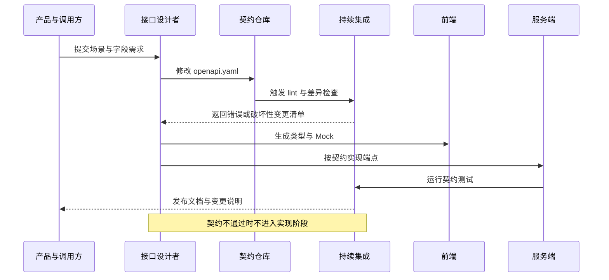
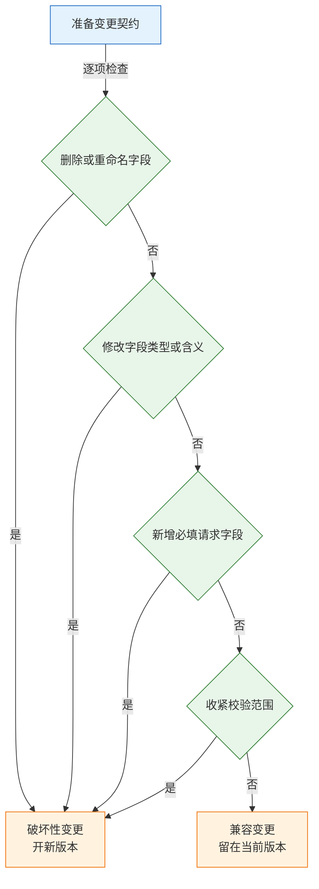
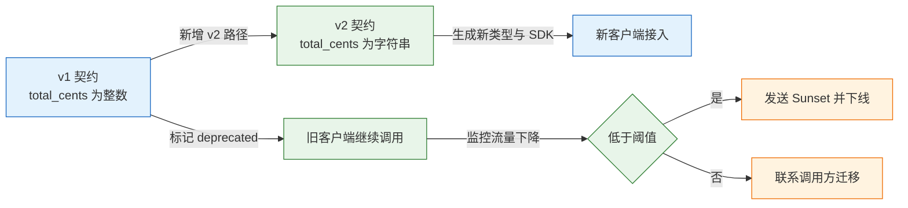
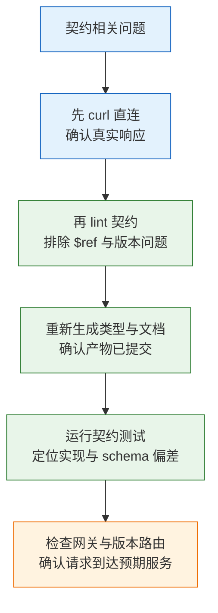

# API 设计与 OpenAPI

接口不是“能返回 JSON 的函数”，而是调用方与服务方之间的契约。契约写不清，前端只能猜字段，第三方只能试错误码，半年后维护者也不敢改字段。OpenAPI 把这份契约变成机器可读的文档，让类型、Mock、文档和测试从同一份定义长出来。

---

## 一、API 契约是什么

### 1.1 核心概念

API 契约是对“请求长什么样、响应长什么样、失败如何表达”的正式约定。它不描述业务内部如何实现，只固定调用方可以依赖的外部行为。一份可执行的契约至少包含端点、参数位置、请求与响应模式、错误模型、认证方式、分页规则、幂等约定和版本策略。

OpenAPI 是描述 HTTP 接口的规范格式，用 YAML 或 JSON 书写。它把接口拆成路径、操作、参数、请求体、响应和可复用组件，工具可以读取这些结构生成文档、类型、客户端和测试用例。契约本身不执行鉴权，也不保证实现符合描述，必须靠校验与测试闭环。

| 概念 | 含义 | 落地物 |
|---|---|---|
| 契约 | 调用方与服务方共同遵守的外部行为 | `openapi.yaml` |
| 操作 | 一个路径加一个 HTTP 方法 | `paths./orders.get` |
| 模式 | 请求体或响应体的数据结构 | `components.schemas` |
| 组件 | 可被多处引用的定义 | `$ref` 指向的对象 |
| 兼容性 | 旧调用方能否继续工作 | CI 中的差异报告 |
| 契约测试 | 用契约生成请求并校验真实响应 | 测试报告 |

契约与实现是双向约束：实现不能返回契约之外的结构，契约也不能承诺实现做不到的行为。只写文档不做校验，文档很快会退化成代码的倒影；只做校验不写清语义，调用方仍然不知道字段的业务含义。

### 1.2 在技术栈中的位置

OpenAPI 位于 HTTP 接口的设计层，向上服务于文档站、调试台和 SDK，向下约束网关、服务实现和测试。它描述的是请求—响应型 HTTP API，不描述事件流、二进制 RPC 或图查询。

| 技术 | 描述对象 | 与 OpenAPI 的分工 |
|---|---|---|
| OpenAPI | HTTP 请求与响应 | 本文主线 |
| JSON Schema | JSON 数据结构 | OpenAPI 3.1 直接对齐其 2020-12 版本 |
| AsyncAPI | 消息频道与事件 | 描述 Kafka、MQTT 等异步通信 |
| Protocol Buffers | gRPC 方法与消息 | 强类型二进制 RPC |
| GraphQL SDL | 类型、查询与变更 | 由客户端声明字段的图接口 |

API 网关可以直接导入 OpenAPI，生成路由、鉴权规则和限流策略；文档站用它渲染调试台；前端用它生成 TypeScript 类型；测试工具用它生成请求。同一份定义被多处消费，任何歧义都会被放大，因此契约里的命名、必填和错误码必须比普通文档更严格。

> **注意**：OpenAPI 不是运行时协议。它不会自动拒绝多传的字段，也不会自动把响应裁剪成 schema 声明的样子。运行时校验要由框架、网关或测试补齐。

### 1.3 契约的组成与交互流程

契约先行的工作流把“改契约”放在“写代码”之前。下图是一次完整的设计、校验、实现与发布循环：



| 阶段 | 产出 | 缺失后的后果 |
|---|---|---|
| 需求澄清 | 场景、字段、错误分支 | 实现反复返工 |
| 契约编写 | `openapi.yaml` | 前后端各自猜结构 |
| 规范校验 | lint 报告 | `$ref` 错误、版本不兼容 |
| 兼容性评审 | 破坏性变更清单 | 老客户端突然失败 |
| 代码生成 | 类型、客户端、Mock | 手写类型与实现漂移 |
| 契约测试 | 请求与响应校验报告 | 文档与线上行为不一致 |

生命周期的关键不是“先写文档”，而是“契约进入版本控制并参与构建”。契约文件与代码同仓、同评审、同发布，才能避免它变成一份过期附件。

---

## 二、契约的结构

### 2.1 端点与操作

OpenAPI 的顶层由 `openapi`、`info`、`servers`、`paths`、`components` 构成。`paths` 下每个路径对应若干操作，操作里写参数、请求体、响应和元数据。

| 字段 | 作用 | 约束 |
|---|---|---|
| `paths` | 声明端点路径 | 必须以 `/` 开头 |
| `operationId` | 操作的唯一标识 | 生成客户端方法名时使用，需稳定 |
| `parameters` | 路径、查询、头、Cookie 参数 | `in` 指定位置，路径参数必须 `required: true` |
| `requestBody` | 请求体结构与媒体类型 | 写操作通常必填 |
| `responses` | 各状态码的响应定义 | 至少包含一个成功响应 |
| `tags` | 文档分组 | 只影响展示，不影响协议 |
| `deprecated` | 标记操作弃用 | 仍需保留实现与文档 |

```yaml
paths:
  /orders/{id}:
    get:
      operationId: getOrder
      parameters:
        - name: id
          in: path
          required: true
          schema: { type: string }
      responses:
        "200":
          description: 订单详情
          content:
            application/json:
              schema: { $ref: "#/components/schemas/Order" }
        "404":
          description: 订单不存在
```

`operationId` 一旦被客户端生成器使用就成为公开标识，改名等同于破坏性变更。路径参数必须声明 `required: true`，否则工具无法生成正确的方法签名。查询参数要写清默认值、上下限和是否可重复，不能只在描述里用自然语言补充。

### 2.2 请求与响应模式

模式定义数据结构，常用关键字分为四类：类型与格式、必填与可空、取值范围、对象与数组约束。

| 关键字 | 作用 | 常见误区 |
|---|---|---|
| `type` | 基础类型 | 3.1 可用数组表示联合类型 |
| `format` | 语义格式，如 `date-time`、`uuid` | 多数工具只做提示，不强制校验 |
| `required` | 对象中必须出现的字段 | 与“值不能为空”是两件事 |
| `enum` | 限定取值集合 | 新增枚举值可能破坏老客户端 |
| `minimum` / `maximum` | 数值边界 | 浮点边界要说明精度 |
| `minLength` / `maxLength` | 字符串长度 | 按 Unicode 码点还是字节需明确 |
| `pattern` | 正则约束 | 不同正则引擎语法有差异 |
| `items` | 数组元素模式 | 漏写时元素类型不受约束 |
| `additionalProperties` | 是否允许额外字段 | 设为 `false` 会拒绝前向兼容的新字段 |

`required` 与可空是两个维度。字段可以“必须出现但值可以为 null”，也可以“可以缺失但不允许 null”。OpenAPI 3.1 用 `type: [string, "null"]` 表达可空，3.0 用 `nullable: true`。如果把两者混为一谈，`PATCH` 请求就无法区分“不修改”和“清空”。

```yaml
Order:
  type: object
  required: [id, status, total_cents, created_at]
  properties:
    id:
      type: string
    status:
      type: string
      enum: [pending, paid, cancelled]
    total_cents:
      type: integer
      minimum: 0
    created_at:
      type: string
      format: date-time
    coupon_code:
      type: [string, "null"]
      maxLength: 32
```

时间统一用 RFC 3339 的 UTC 表示，例如 `2026-10-28T02:00:00Z`；金额用整数最小货币单位或字符串定点数，避免浮点误差；超过 JavaScript 安全整数范围的 ID 对外用字符串。这些约定写进 schema 的 `description` 和 `example`，比只在团队口头约定可靠。

OpenAPI 3.0 与 3.1 的差异集中在模式表达和事件描述：

| 维度 | OpenAPI 3.0 | OpenAPI 3.1 |
|---|---|---|
| 模式基础 | 自有子集 | 对齐 JSON Schema 2020-12 |
| 可空写法 | `nullable: true` | `type: [string, "null"]` |
| 事件描述 | 无 `webhooks` | 支持 `webhooks` |
| 工具支持 | 覆盖最广 | 新工具较好，老工具可能不认 |

3.1 还允许在 schema 里使用 `const`、`if/then` 等 JSON Schema 关键字，但生成器、网关和文档站的支持程度要逐个实测。新项目优先 3.1；链路里有老工具时锁 3.0 并接受 `nullable` 写法，比强行升级后生成失败更稳。

> **注意**：`example` 只用于展示，不参与校验。示例写得再漂亮，也不能证明响应符合 schema；契约测试必须基于 schema 生成请求与校验响应。

### 2.3 错误模型

错误响应要同时服务人、程序和运维。RFC 9457 的 `application/problem+json` 提供了稳定骨架，业务错误码放在扩展字段中。

```json
{
  "type": "https://example.com/problems/invalid-parameter",
  "title": "Invalid parameter",
  "status": 400,
  "detail": "cursor is not a valid base64 string",
  "instance": "/orders",
  "code": "INVALID_CURSOR",
  "request_id": "01J8Z9K3Q7"
}
```

| 字段 | 读者 | 设计要求 |
|---|---|---|
| `type` | 开发者 | 稳定 URI，能打开问题说明 |
| `title` | 人 | 简短描述错误类别，不随实例变化 |
| `status` | 程序 | 与 HTTP 状态码一致 |
| `detail` | 人 | 针对本次请求的具体原因 |
| `code` | 程序 | 稳定枚举，客户端按它分支 |
| `request_id` | 运维 | 能关联网关与应用日志 |

每个端点都应声明可能出现的 `4xx` 与 `5xx` 响应。`401` 表示未认证，`403` 表示已认证但无权限，`409` 表示状态冲突，`412` 表示条件请求失败，`429` 表示限流。错误码的含义一旦发布就不能随意调整，否则调用方的分支逻辑会错乱。

不要返回 `200` 加 `{"success": false}`。这会让监控、缓存、网关和客户端库都按成功处理，重试与告警全部失真。批量操作也要在顶层返回合适的 `2xx`，再在响应体中逐条给出成功与失败，不能因为第三条失败就把整个请求变成 `500`。

### 2.4 分页、排序与过滤

| 方案 | 写法 | 优点 | 缺点 |
|---|---|---|---|
| 偏移分页 | `?page=3&size=20` | 可跳页，实现简单 | 深翻页慢，插入删除会错位 |
| 游标分页 | `?cursor=eyJpZCI6MTIzfQ&limit=20` | 翻页稳定，适合大数据量 | 不能随机跳页 |
| 键集分页 | `?after_id=123&limit=20` | 查询高效，顺序稳定 | 需要唯一且可排序的键 |

游标对客户端应不透明，内部可以编码 `(created_at, id)` 复合排序键。只按时间排序时，同一毫秒的多条记录顺序不稳定，翻页会重复或遗漏；加上唯一键做次级排序才能保证全序。响应返回 `next_cursor`，为空表示没有下一页。

`limit` 必须有上限，默认值与最大值都写进 schema。过滤字段要白名单化，排序字段也要白名单化，不能把查询参数直接拼进 SQL。总数 `total` 很诱人，但大表上的 `COUNT(*)` 可能比查一页还贵；列表接口默认不返回总数，需要时单独提供计数端点并说明精度。

### 2.5 认证与授权

OpenAPI 用 `securitySchemes` 描述认证方式，用 `security` 声明作用范围。全局 `security` 表示默认所有端点都要认证，公开端点用空数组覆盖。

```yaml
components:
  securitySchemes:
    bearerAuth:
      type: http
      scheme: bearer
      bearerFormat: JWT
    sessionCookie:
      type: apiKey
      in: cookie
      name: __Host-session
security:
  - bearerAuth: []
```

| 方案 | 传输位置 | 适用场景 | 注意 |
|---|---|---|---|
| HTTP Bearer | `Authorization` 头 | 服务间调用、第三方 API | 令牌泄露即身份泄露，需短过期 |
| Cookie 会话 | `Cookie` 头 | 同源 Web 应用 | 需 `HttpOnly`、`Secure`、`SameSite` |
| API Key | 自定义头或查询参数 | 简单第三方接入 | 放 URL 会进日志，优先放头 |
| OAuth 2.0 | `Authorization` 头 | 委托授权、细粒度 scope | scope 要写进 `security`，不能只写正文 |

`401` 与 `403` 都要有响应定义，调用方才能区分“重新登录”和“申请权限”。令牌过期时间、刷新端点、注销行为写进描述，避免每个客户端自己猜。敏感端点还要在契约中标注所需 scope，生成器才能把权限要求带进 SDK。

> **安全警告**：契约里不要写真实密钥、示例令牌或内部管理端点。公开文档应只暴露外部可达路径，内部运维接口单独部署、单独鉴权，不能因为用了 OpenAPI 就一并发布。

### 2.6 版本与弃用

| 策略 | 示例 | 优点 | 缺点 |
|---|---|---|---|
| 路径版本 | `/v1/orders` | 直观，网关与日志易识别 | URL 变长，资源标识不稳定 |
| 请求头版本 | `Accept-Version: 1` | URL 干净 | 调试与缓存不便 |
| 媒体类型版本 | `Accept: application/vnd.example.v1+json` | 语义严谨 | 客户端与工具支持成本高 |

版本号解决的是“不兼容变更如何共存”，不是“每次改动都升版本”。兼容变更留在当前版本，破坏变更开新版本，并给旧版本明确的弃用窗口。弃用响应头可以携带 `Deprecation` 与 `Sunset`，分别表示“已弃用”和“停止支持”的时间；文档中同时写明迁移路径与联系人。

版本的生命周期要可观测：网关按版本统计调用量，确认旧版本流量降到可接受范围后再下线。没有流量数据就关版本，等于拿线上调用方做试验。

### 2.7 写操作、批量与异步任务

`PUT` 的语义是用请求体整体替换资源，未传字段应恢复默认值；`PATCH` 只修改传入字段。很多团队用 `PUT` 却只改传入字段，语义与实现不一致。部分更新可以约定 JSON Merge Patch（RFC 7386），其中 `null` 表示删除字段；也可以用 JSON Patch（RFC 6902）的 `op/path/value`，表达力强但客户端更难写。选一种写进契约，不要两种混用。

`null`、字段缺失、空字符串是三件事。`PATCH` 中“不传”表示不修改，“传 null”表示清空；如果把两者都当清空，客户端就无法只改一个字段。响应里尽量稳定返回字段，避免调用方区分“没有这个键”和“值为 null”。

| 场景 | 成功响应 | 后续动作 |
|---|---|---|
| 同步创建 | `201` 加 `Location` | 直接读取新资源 |
| 异步任务 | `202` 加 `Location: /jobs/{id}` | `GET /jobs/{id}` 查状态 |
| 批量操作 | `200` 加逐条结果 | 按 `index` 对应请求项 |
| 幂等重试 | 原状态码加原结果 | 客户端复用幂等键 |

异步任务不能让客户端在一个 HTTP 连接上等十分钟，网关和负载均衡会先超时。批量操作要把单批条数限制住，响应逐条返回 `index`、`status`、`id`、`error`，并写清是“全部成功才生效”还是“部分成功”。前者用事务，后者要允许重试时跳过已成功的条目。

限流返回 `429` 并带 `Retry-After`；状态冲突返回 `409` 并给出当前状态；乐观并发用 `412` 配合 `If-Match`。错误码是契约的一部分，不能今天 `409`、明天 `400`。

---

## 三、契约的编写与校验

### 3.1 环境与工具链

契约工具大多以 Node 或 Python 包发布，用 `npx` 或虚拟环境隔离，避免污染全局。

```bash
# ========== 检查运行时 ==========
# Node 20 及以上才能运行当前版本的 Redocly CLI 与 openapi-typescript
node --version
npx --version

# Python 3.10 及以上用于契约测试
python3 --version

# ========== 准备目录 ==========
# 契约、生成物和测试脚本放在同一目录，便于纳入版本控制
mkdir -p /tmp/api-contract && cd /tmp/api-contract
```

| 工具 | 用途 | 调用方式 |
|---|---|---|
| Redocly CLI 2 | 规范校验、文档生成 | `npx @redocly/cli@2` |
| openapi-typescript 7 | 生成 TypeScript 类型 | `npx openapi-typescript@7` |
| Schemathesis 4 | 基于契约生成请求并测试 | `st run` |
| Git | 版本与差异评审 | 与代码同仓 |

### 3.2 编写 openapi.yaml

下面的契约描述订单列表、创建和错误响应，使用 OpenAPI 3.1：

```yaml
openapi: 3.1.0
info:
  title: Orders API
  version: 1.0.0
servers:
  - url: http://127.0.0.1:8000
security: []
paths:
  /orders:
    get:
      summary: 列出订单
      operationId: listOrders
      parameters:
        - name: cursor
          in: query
          schema: { type: string }
        - name: limit
          in: query
          schema: { type: integer, minimum: 1, maximum: 100, default: 20 }
      responses:
        "200":
          description: 订单列表
          content:
            application/json:
              schema: { $ref: "#/components/schemas/OrderPage" }
        "400":
          description: 参数错误
          content:
            application/problem+json:
              schema: { $ref: "#/components/schemas/Problem" }
    post:
      summary: 创建订单
      operationId: createOrder
      parameters:
        - name: Idempotency-Key
          in: header
          required: true
          schema: { type: string, minLength: 16 }
      requestBody:
        required: true
        content:
          application/json:
            schema: { $ref: "#/components/schemas/OrderCreate" }
      responses:
        "201":
          description: 已创建
          content:
            application/json:
              schema: { $ref: "#/components/schemas/Order" }
        "400":
          description: 参数错误
          content:
            application/problem+json:
              schema: { $ref: "#/components/schemas/Problem" }
components:
  schemas:
    Order:
      type: object
      required: [id, status, total_cents, created_at]
      properties:
        id: { type: string }
        status: { type: string, enum: [pending, paid, cancelled] }
        total_cents: { type: integer, minimum: 0 }
        created_at: { type: string, format: date-time }
        coupon_code: { type: [string, "null"] }
    OrderCreate:
      type: object
      required: [items]
      additionalProperties: false
      properties:
        items:
          type: array
          minItems: 1
          items:
            type: object
            required: [sku, quantity]
            properties:
              sku: { type: string }
              quantity: { type: integer, minimum: 1 }
        coupon_code: { type: [string, "null"], maxLength: 32 }
    OrderPage:
      type: object
      required: [items]
      properties:
        items:
          type: array
          items: { $ref: "#/components/schemas/Order" }
        next_cursor: { type: [string, "null"] }
    Problem:
      type: object
      required: [type, title, status]
      properties:
        type: { type: string, format: uri }
        title: { type: string }
        status: { type: integer }
        detail: { type: string }
        code: { type: string }
        request_id: { type: string }
```

契约中 `servers` 只写基础地址，不写具体业务路径；`security: []` 表示示例默认公开，真实项目应改成全局认证并逐个覆盖公开端点。`OrderCreate` 的 `additionalProperties: false` 能拒绝拼写错误的字段，但也会拒绝未来新增的可选字段，是否启用要按演进策略决定。

### 3.3 规范校验与文档生成

```bash
# ========== 校验规范 ==========
# lint 检查 $ref、字段拼写、示例与 schema 的一致性
npx --yes @redocly/cli@2 lint openapi.yaml

# ========== 生成静态文档 ==========
# 输出单文件 HTML，便于分发和内网部署
npx --yes @redocly/cli@2 build-docs openapi.yaml -o docs.html

# ========== 查看参数与配置 ==========
# 需要调整规则时，先看 lint 的可用参数与配置文件位置
npx --yes @redocly/cli@2 lint --help

# ========== 生成 JSON 版本 ==========
# 有些网关只接受 JSON，用 bundle 合并外部引用
npx --yes @redocly/cli@2 bundle openapi.yaml -o openapi.json
```

`lint` 通过时输出类似：

```text
Woohoo! Your API description is valid. 🎉
You have 1 warning.
```

警告通常是缺少 `info.license`。补上 license 后重新执行即可消除。`build-docs` 输出 `docs.html`，用浏览器打开就能看到按 `tags` 分组的端点、参数表和调试表单。Redocly CLI 2 的 `build-docs` 使用 Redoc 3；需要旧渲染时按提示改用 `@redocly/cli@v1-archive`。

| 常见 lint 问题 | 含义 | 处理 |
|---|---|---|
| `no-unused-components` | 定义了未被引用的 schema | 删除或用 `$ref` 接入 |
| `operation-operationId` | 操作缺少 `operationId` | 补稳定标识，避免生成器用路径拼名 |
| `path-params` | 路径参数未声明或未标必填 | 在 `parameters` 中补齐 |
| `no-invalid-media-type` | 媒体类型拼写错误 | 改为 `application/json` 等标准值 |
| `info-license` | 缺少许可证信息 | 补 `info.license` 或按团队规则关闭 |

### 3.4 类型与客户端生成

```bash
# ========== 生成 TypeScript 类型 ==========
# 输出声明文件，前端用它约束请求与响应
npx --yes openapi-typescript@7 openapi.yaml -o api.d.ts
```

生成结果中可以直接访问 `paths["/orders"]["get"]` 和 `components["schemas"]["Order"]`。前端把接口返回值标注为 `components["schemas"]["Order"]`，字段改名或类型变化会在编译期报错，而不是等到线上出现 `undefined`。

| 生成物 | 来源 | 用途 |
|---|---|---|
| 请求参数类型 | `parameters` | 约束查询、路径、头参数 |
| 请求体类型 | `requestBody` | 约束表单与 JSON 提交 |
| 响应类型 | `responses` | 约束返回值与错误分支 |
| 枚举联合类型 | `enum` | 编译期检查状态取值 |
| 客户端方法 | `operationId` | 生成 SDK 方法名 |

类型生成只能保证编译期结构一致，不能保证运行时数据真的符合契约。服务端仍要在边界做校验，前端仍要处理未知字段与缺省值。

### 3.5 契约测试

契约测试用 schema 生成请求，打到真实服务上，再校验状态码、响应头和响应体。以 Schemathesis 为例：

```bash
# ========== 安装 ==========
# 固定主版本，避免 CLI 参数随大版本变化
pip install "schemathesis>=4,<5"

# ========== 运行 ==========
# 先启动监听 8000 的服务，再执行；--checks all 启用全部内置检查
st run openapi.yaml --base-url http://127.0.0.1:8000 --checks all
```

通过时结尾类似 `1 passed, 0 failed`。失败信息会给出具体请求、响应与违反的 schema 路径，比人工 review 更容易发现“文档写了必填、实现却接受空值”这类偏差。

| 检查项 | 验证内容 | 典型失败原因 |
|---|---|---|
| 状态码 | 响应状态是否在契约声明范围内 | 实现返回了未声明的 `500` |
| 响应模式 | 字段、类型、必填是否匹配 | 实现多返回或少返回字段 |
| 响应头 | `Content-Type` 等是否一致 | 错误响应写成 `application/json` |
| 请求接受度 | 契约允许的请求是否被接受 | 实现比契约更严格 |
| 边界值 | 最小值、最大值、长度边界 | 校验逻辑与 schema 不一致 |

---

## 四、关键机制

### 4.1 引用与组合

`$ref` 把重复结构抽成组件，`allOf`、`oneOf`、`anyOf` 负责组合。组合能力越强，工具支持差异越大，契约也越难读。

| 关键字 | 语义 | 使用注意 |
|---|---|---|
| `$ref` | 引用另一个 schema | 路径必须相对于当前文档或配置的基地址 |
| `allOf` | 同时满足所有子模式 | 适合叠加基础字段与扩展字段 |
| `oneOf` | 恰好满足一个子模式 | 子模式重叠时校验会歧义 |
| `anyOf` | 至少满足一个子模式 | 通过后无法判断具体类型 |
| `discriminator` | 按字段值选择子模式 | 需要稳定的类型字段与映射 |

`allOf` 常用来表达“基础订单 + 支付订单”的继承关系，但字段冲突时校验结果依赖工具实现。`oneOf` 适合互斥的支付方式，子模式必须有可区分的必填字段，否则一个对象可能同时满足多个分支。`discriminator` 能把这个区分字段显式化，生成器也能据此生成联合类型。

> **注意**：OpenAPI 3.0 的 Reference Object 不支持在 `$ref` 旁追加其他关键字，写了也会被忽略；3.1 对齐 JSON Schema 2020-12 后，`$ref` 可以与描述等关键字并列。跨版本迁移时要逐个工具验证，不能假设行为一致。

### 4.2 兼容性判定

兼容性只问一件事：旧调用方不修改代码，能否继续正常工作。能，就是兼容变更；不能，就是破坏性变更。



| 变更 | 是否破坏 | 说明 |
|---|---|---|
| 响应新增可选字段 | 否 | 客户端应忽略未知字段 |
| 请求新增可选字段 | 否 | 老客户端不传也能工作 |
| 请求新增必填字段 | 是 | 老客户端立刻收到 `400` |
| 删除响应字段 | 是 | 依赖该字段的调用方会坏 |
| 字段类型 `integer` 改 `string` | 是 | 反序列化失败 |
| 枚举新增值 | 可能 | 老客户端可能没有默认分支 |
| 收紧长度或范围校验 | 是 | 原本合法的请求被拒 |
| 修改错误码含义 | 是 | 调用方分支逻辑错乱 |
| 新增端点 | 否 | 不影响老调用方 |

枚举新增值是否兼容取决于客户端写法。若客户端用 `switch` 且没有 `default`，新值会导致未处理分支；若客户端只做透传，则不受影响。契约评审要结合已知调用方判断，不能只看 schema 差异。

### 4.3 幂等与并发控制

`POST` 默认不幂等，但网络超时、网关重试、用户连点都会造成重复提交。幂等键把“同一业务操作”从多次请求中识别出来。

| 机制 | 头字段 | 服务端动作 | 客户端动作 |
|---|---|---|---|
| 幂等创建 | `Idempotency-Key` | 以 `(调用方, key)` 唯一约束保存结果 | 每次重试复用同一个键 |
| 乐观并发 | `If-Match` + `ETag` | 比对版本，不一致返回 `412` | 读取时保存 ETag，提交时带回 |
| 状态冲突 | 无 | 当前状态不允许操作时返回 `409` | 读取最新状态后决定 |
| 去重窗口 | `Idempotency-Key` + TTL | 键过期后允许重新执行 | 在 TTL 内重试 |

幂等键要有有效期，例如 24 小时；只在业务成功后标记完成，避免把临时失败永久缓存。服务端保存的应是“首次执行的响应”，包括状态码和关键头字段，重放时原样返回。并发下要用数据库唯一索引或分布式锁保证同一键只有一个请求真正执行。

> **注意**：幂等键由客户端生成，服务端不能信任其全局唯一性。必须以调用方身份加键做联合唯一约束，否则不同租户使用相同键会互相覆盖。

### 4.4 契约漂移与持续集成

契约漂移指文档描述与实际行为逐渐分离。常见原因有四类：先写代码后补文档、线上热修绕过契约、生成物未提交、多个服务共用一份过期定义。

| 检查 | 工具 | 失败处理 |
|---|---|---|
| 规范合法性 | Redocly lint | 阻止合并 |
| 破坏性变更 | 契约差异比较 | 要求开新版本或补兼容层 |
| 响应符合性 | Schemathesis | 修复实现或修正契约 |
| 生成物同步 | CI 重生成并比对 | 提交重新生成的文件 |
| 文档可达性 | 构建文档并检查链接 | 修复 `$ref` 与外部链接 |

把 lint、差异检查和契约测试放进持续集成，契约才成为构建产物而不是附件。合并请求里同时展示契约 diff 和代码 diff，评审者才能判断字段变化是否会影响调用方。

契约评审按七项检查：命名是否统一；必填是否真的必需；空值能否区分缺失与 `null`；错误码是否稳定且可判别；分页游标是否不透明；公开端点与 scope 是否正确；示例能否通过 schema 校验。评审的目标不是文档漂亮，而是调用方能只靠这份契约正确实现。

---

## 五、设计取舍

### 5.1 设计先行与实现先行

| 方式 | 优点 | 缺点 | 适用场景 |
|---|---|---|---|
| 设计先行 | 前后端可并行，契约稳定 | 前期沟通成本高 | 多调用方、长期维护 |
| 实现先行 | 上手快，代码即事实 | 文档易滞后，联调靠猜 | 单前端、快速原型 |
| 注解生成 | 与代码同步，维护成本低 | 注解污染代码，跨语言难 | 框架生态成熟的项目 |
| 双向同步 | 文档与代码互相校验 | 工具链复杂 | 大型团队、强治理 |

设计先行不是要求一次写完全部细节，而是先把调用方依赖的外部行为定下来：路径、字段、错误码、分页和认证。内部实现可以边写边调整，只要不改变契约承诺。

### 5.2 REST 与 RPC、GraphQL 的边界

| 形态 | 契约格式 | 优势 | 适用边界 |
|---|---|---|---|
| REST + OpenAPI | YAML/JSON | 通用、可缓存、工具丰富 | 资源型接口、开放平台 |
| gRPC | `.proto` | 强类型、二进制、高吞吐 | 内部服务、流式调用 |
| GraphQL | SDL | 客户端选字段、减少往返 | 多端字段差异大、聚合查询 |
| 事件驱动 | AsyncAPI | 描述频道与消息 | Kafka、MQTT 等异步系统 |

OpenAPI 只描述请求—响应，不描述长连接帧、消息主题或图查询。把 gRPC 硬套进 OpenAPI 会丢失流式语义，把事件塞进 `POST` 端点会让重试与顺序问题变得不可控。选型应先看通信形态，再看工具生态。

### 5.3 命名、空值与数值约定

| 对象 | 约定 | 反例 |
|---|---|---|
| 资源路径 | 小写复数名词，短横线分隔 | `/getOrderList` |
| 字段名 | 全库统一 `snake_case` 或 `camelCase` | 同一响应混用两种 |
| 枚举值 | 小写或大写下划线，全库统一 | `Paid` 与 `PAID` 并存 |
| 时间 | RFC 3339 UTC，带时区 | `2026-10-28 10:00:00` |
| 金额 | 整数最小单位或字符串定点数 | 浮点数 `19.9` |
| 大整数 ID | 字符串 | 超过 `2^53-1` 的 JSON number |
| 可扩展状态 | 枚举 | 布尔字段 `is_paid` |

命名一旦发布就成为调用方代码的一部分，改名的成本远高于一次评审。团队应在第一版契约中定好风格，并用 lint 规则约束，而不是靠记忆。

### 5.4 版本策略与迁移成本

| 策略 | 迁移成本 | 观测方式 | 适用规模 |
|---|---|---|---|
| 路径版本 | 中，调用方改 base URL | 网关按路径统计 | 大多数公开 API |
| 请求头版本 | 高，调试与缓存复杂 | 网关按头统计 | 内部服务、强治理团队 |
| 媒体类型版本 | 高，客户端支持要求高 | 按 `Accept` 统计 | 语义要求严格的场景 |
| 无版本，只做兼容变更 | 低，但约束强 | 契约差异检查 | 单一下游、快速迭代 |

破坏性变更开新版本后，旧版本要有明确的下线时间。迁移期同时保留两版，监控旧版调用量与错误率，提供字段映射说明和迁移示例。只发公告不看流量，旧版本往往会在下线当天才暴露隐藏调用方。

---

## 六、完整示例：订单契约的演进

### 6.1 初始契约

初始版本包含四个操作：

| 操作 | 方法与路径 | 说明 |
|---|---|---|
| 列出订单 | `GET /orders` | 游标分页，返回 `next_cursor` |
| 创建订单 | `POST /orders` | 要求 `Idempotency-Key` |
| 查看订单 | `GET /orders/{id}` | 返回单笔订单 |
| 取消订单 | `POST /orders/{id}/cancel` | 独立动作，便于鉴权与审计 |

契约使用 3.2 节的 `openapi.yaml`，服务端按 schema 实现。此时 `Order` 没有优惠券字段，前端生成的类型里也没有 `coupon_code`。

### 6.2 增加可选字段

需求是响应增加 `coupon_code`，允许为 null，创建订单时可传。改动分三步：

```yaml
# ========== 响应模式 ==========
# 只新增字段，不加入 required，保证老客户端不受影响
Order:
  type: object
  properties:
    coupon_code:
      type: [string, "null"]
      maxLength: 32

# ========== 创建模式 ==========
# 同样保持可选；不传表示不使用优惠券
OrderCreate:
  type: object
  properties:
    coupon_code:
      type: [string, "null"]
      maxLength: 32
```

```bash
# ========== 校验与生成 ==========
# 先确认契约本身合法
npx --yes @redocly/cli@2 lint openapi.yaml

# 重新生成类型，前端编译会检查字段使用
npx --yes openapi-typescript@7 openapi.yaml -o api.d.ts

# 构建文档，确认字段说明与示例已更新
npx --yes @redocly/cli@2 build-docs openapi.yaml -o docs.html
```

字段加入 `properties` 但不加入 `required`，属于兼容变更。老客户端忽略新字段，新客户端按需读取。若把 `coupon_code` 误写成必填，lint 不一定报错，但契约测试会用“不传该字段”的请求打服务端，立刻暴露问题。

### 6.3 兼容性检查与契约测试

```bash
# ========== 启动服务 ==========
# 服务端需监听 8000，并提供契约中的端点
# 具体启动命令按项目而定

# ========== 运行契约测试 ==========
# 生成合法与边界请求，校验状态码、响应头和响应体
st run openapi.yaml --base-url http://127.0.0.1:8000 --checks all

# ========== 查看失败样本 ==========
# 失败时会打印请求、响应和 schema 路径，按样本复现
```

通过时结尾类似 `1 passed, 0 failed`。测试覆盖的不只是“正常请求能通”，还包括契约允许的边界值是否被接受、错误响应是否符合 `Problem` 结构、未声明字段是否被拒绝。

### 6.4 破坏性变更与 v2

假设业务要求把 `total_cents` 从整数改为字符串，以支持超大金额。这属于类型变更，必须开新版本。

| 变更 | 处理 | 迁移期观察 |
|---|---|---|
| `total_cents` 类型改变 | 新增 `/v2/orders`，v1 保留 | 统计 v1 调用量与错误率 |
| v1 停止新增功能 | 标记 `deprecated: true` | 文档显著提示 |
| v1 下线 | 返回 `Deprecation` 与 `Sunset` | 到期前逐一下发通知 |
| 新客户端接入 | 只允许使用 v2 | SDK 默认指向 v2 |



迁移期两版并行，契约文件可以放在同一仓库的不同目录，也可以用 `servers` 区分环境。关键是网关路由、鉴权、限流和日志都按版本隔离，避免 v2 的流量影响 v1 的容量判断。

> **注意**：不要在同一路径上通过 `Accept` 头偷偷改变字段类型。调用方很难发现，缓存也可能把两种表示混在一起。破坏性变更用显式的新路径最稳妥。

---

## 七、常见故障与排查

| 现象 | 最可能原因 | 处理 |
|---|---|---|
| 文档能打开，调试请求 404 | `servers.url` 少了路径前缀，或网关有 rewrite | `curl -i` 直连服务确认实际路径 |
| 生成的类型全是 `never` | `$ref` 路径错，或工具不支持当前 OpenAPI 版本 | 先 lint，再确认工具版本与 3.1 支持情况 |
| 前端说字段不存在 | 契约没更新，或生成物没进构建 | 检查 `api.d.ts` 是否重新生成并提交 |
| 契约测试大量 `400` | schema 比实现严格，或必填标错 | 对照请求样本逐字段核对 `required` |
| 3.1 的联合类型报错 | 工具只支持 3.0 | 升级工具，或退回 `nullable` 并锁 3.0 |
| 线上出现未文档化字段 | 实现绕过契约 | 在 CI 做响应校验，禁止未定义字段 |
| 老客户端突然失败 | 同一版本里做了破坏性变更 | 回滚变更，或开新版本并保留旧版 |
| 文档和实现长期不一致 | 契约不是构建产物 | 把 lint、生成、契约测试放进 CI |
| 枚举新增值导致客户端崩溃 | 客户端没有默认分支 | 发布前排查调用方，契约中注明扩展规则 |
| 幂等键重复导致结果被覆盖 | 唯一约束只用了 key，没带调用方 | 改为 `(caller_id, key)` 联合唯一 |



排查顺序按“先看真实行为、再看契约、最后看工具链”推进：

1. 用 `curl -i` 直连服务，确认状态码、响应头和响应体，不把文档当事实。
2. 运行 lint，排除 `$ref` 断链、路径参数缺失和版本不兼容。
3. 对比生成的 `api.d.ts` 与实际响应，确认字段名、类型和可空性一致。
4. 运行契约测试，按失败样本定位是契约太严还是实现不合规。
5. 检查网关的路径重写、版本路由和请求体限制，确认请求到达正确服务。
6. 最后检查构建流水线是否真的执行了生成与校验，避免“配置了但没跑”。

> **注意**：契约测试失败时不要先改契约迁就实现。先判断哪一方是错的：如果实现漏了字段，修实现；如果契约承诺了不该有的行为，修契约。每次放宽校验都要记录原因，否则契约会逐渐失去约束力。
