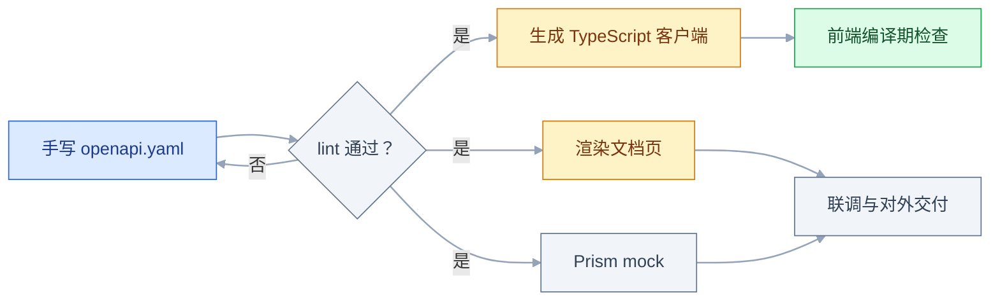
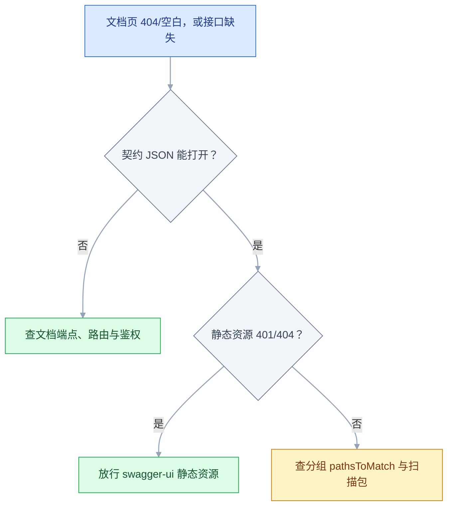
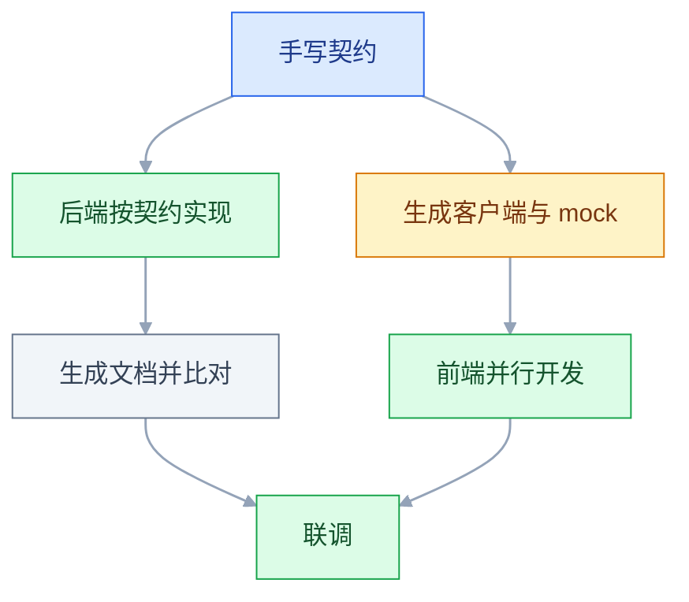

# OpenAPI 与 Swagger

## 一、工程案例：给一组接口写 OpenAPI 3 描述并生成客户端与文档

**场景**：任务管理系统要对外开放 5 个接口（登录、任务列表、创建任务、任务详情、局部更新）。前端要用 TypeScript，测试要用 mock，合作方要一份能导入工具的契约。手工维护 Word 文档已经出现「字段名对不上」的问题。

**产出**：一份进 Git 的 `api/openapi.yaml`，加上由它生成的 TypeScript 客户端、可交互文档页、mock 服务，以及一条防止文档漂移的 CI 门禁。

**目录**：

```text
taskhub/
├── api/
│   ├── openapi.yaml          # 唯一事实来源
│   ├── openapi.json          # bundle 产物，给只认 JSON 的工具
│   └── CHANGELOG.md
├── src/api/                  # 生成物，不手改
│   ├── taskhub.ts
│   └── taskhub.schemas.ts
├── tsconfig.json             # lib 含 DOM，供 tsc 检查生成物
└── orval.config.ts
```

依赖一次性装好（版本会变，以官方当前稳定版为准）：

```bash
npm init -y
npm i -D orval @redocly/cli @stoplight/prism-cli typescript
```

### 1.1 整条链路



### 1.2 顶层与安全方案

```yaml
openapi: 3.0.3

info:
  title: 任务管理系统 API
  version: 1.4.0
  description: |
    除登录外，所有接口都需要 `Authorization: Bearer <token>`。
    列表统一返回 `{list,total,page,size,pages}`，`page` 从 1 开始。

servers:
  - { url: https://api.taskhub.example.com/v1, description: 生产 }
  - { url: http://localhost:8080/v1, description: 本地 }
  - { url: http://localhost:4010, description: mock（Prism） }

tags:
  - { name: 认证, description: 登录 }
  - { name: 任务, description: 任务的查询、创建与更新 }

security: [{ bearerAuth: [] }]
```

`servers` 里的地址是**所有路径的前缀**：`servers` 写到 `/v1`，`paths` 里只写 `/tasks`，最终地址就是 `/v1/tasks`。

mock 这一项故意不写 `/v1`：Prism 按 `paths` 原样挂载，默认不会加 `servers` 的路径前缀，写了反而 404。文档页的 Try it out 选中 mock，并在 Authorize 里填好 token，就能在不启动后端时跑通验收表第 5 项。

`security` 写在根上是全局默认，登录接口用 `security: []` 覆盖成「不需要认证」。这一条漏了，文档页上的登录按钮自己就要求 token，形成死循环。

### 1.3 五个操作

```yaml
paths:
  /auth/login:
    post:
      tags: [认证]
      summary: 登录
      operationId: login
      security: []
      requestBody:
        required: true
        content: { application/json: { schema: { $ref: '#/components/schemas/LoginRequest' } } }
      responses:
        '200':
          description: 登录成功
          content: { application/json: { schema: { $ref: '#/components/schemas/LoginResponse' } } }
        '401': { $ref: '#/components/responses/Unauthorized' }

  /tasks:
    get:
      tags: [任务]
      summary: 查询任务列表
      operationId: listTasks
      parameters:
        - { $ref: '#/components/parameters/Page' }
        - { $ref: '#/components/parameters/Size' }
        - name: status
          in: query
          description: 按状态筛选，可多值
          schema: { type: array, items: { type: string, enum: [todo, doing, done] } }
          explode: true
      responses:
        '200':
          description: 查询成功
          content: { application/json: { schema: { $ref: '#/components/schemas/TaskPage' } } }
        '401': { $ref: '#/components/responses/Unauthorized' }
    post:
      tags: [任务]
      summary: 创建任务
      operationId: createTask
      requestBody:
        required: true
        content: { application/json: { schema: { $ref: '#/components/schemas/TaskCreate' } } }
      responses:
        '201':
          description: 创建成功
          headers:
            Location: { description: 新资源地址, schema: { type: string } }
          content: { application/json: { schema: { $ref: '#/components/schemas/Task' } } }
        '422': { $ref: '#/components/responses/ValidationFailed' }

  /tasks/{taskId}:
    parameters:
      - { $ref: '#/components/parameters/TaskId' }
    get:
      tags: [任务]
      summary: 任务详情
      operationId: getTask
      responses:
        '200':
          description: 成功
          content: { application/json: { schema: { $ref: '#/components/schemas/Task' } } }
        '404': { $ref: '#/components/responses/NotFound' }
    patch:
      tags: [任务]
      summary: 局部更新
      operationId: patchTask
      requestBody:
        required: true
        content: { application/json: { schema: { $ref: '#/components/schemas/TaskPatch' } } }
      responses:
        '200':
          description: 更新成功
          content: { application/json: { schema: { $ref: '#/components/schemas/Task' } } }
```

三个必须写对的细节：

- **`operationId` 全局唯一**，代码生成器直接拿它当函数名。不写就会得到 `tasksGet`、`tasksPost` 这种没法读的名字。
- **路径参数在 `parameters` 里统一声明**，`required: true` 不能省，否则校验器直接报错。
- **响应键是字符串**，`'200'` 要加引号，`200` 会被 YAML 解析成整数。

### 1.4 复用组件

```yaml
components:
  securitySchemes:
    bearerAuth:
      type: http
      scheme: bearer
      bearerFormat: JWT

  parameters:
    Page: { name: page, in: query, schema: { type: integer, minimum: 1, default: 1 } }
    Size: { name: size, in: query, schema: { type: integer, minimum: 1, maximum: 100, default: 20 } }
    TaskId: { name: taskId, in: path, required: true, schema: { type: integer, format: int64 } }

  responses:
    Unauthorized: { description: 未登录或 token 过期 }
    NotFound: { description: 任务不存在 }
    ValidationFailed: { description: 字段校验失败 }

  schemas:
    LoginRequest: { type: object, required: [username, password],
      properties: { username: { type: string, example: zhangsan },
                    password: { type: string, format: password, writeOnly: true } } }
    LoginResponse: { type: object, required: [accessToken, expiresIn],
      properties: { accessToken: { type: string }, tokenType: { type: string, example: Bearer },
                    expiresIn: { type: integer, example: 7200 } } }
    TaskCreate:
      type: object
      required: [title]
      properties:
        title: { type: string, minLength: 1, maxLength: 100 }
        priority: { type: string, enum: [low, medium, high], default: medium }
    TaskPatch:
      type: object
      description: 只传要改的字段
      properties:
        title: { type: string, maxLength: 100 }
        status: { type: string, enum: [todo, doing, done] }
    Task:
      type: object
      required: [id, title, status, createdAt]
      properties:
        id: { type: integer, format: int64, readOnly: true, example: 1001 }
        title: { type: string }
        status: { type: string, enum: [todo, doing, done] }
        priority: { type: string, enum: [low, medium, high] }
        createdAt: { type: string, format: date-time, readOnly: true }
    TaskPage:
      type: object
      required: [list, total, page, size, pages]
      properties:
        list: { type: array, items: { $ref: '#/components/schemas/Task' } }
        total: { type: integer }
        page: { type: integer }
        size: { type: integer }
        pages: { type: integer }
```

**请求模型与响应模型分开**（`TaskCreate` / `TaskPatch` / `Task`）比用一个模型加 `readOnly` 更清楚：生成的客户端会给出「创建时必填 title、更新时全可选、响应里一定有 id」三种不同的类型。

### 1.5 校验

```bash
npx @redocly/cli lint api/openapi.yaml
```

```text
# 节选：实际还可能有 servers、4xx 等 warning

api/openapi.yaml  warning  info-license  missing license

Woohoo! Your API description is valid. 🎉
```

警告可以留，错误必须清零。不同版本的 Redocly 文案会变，验收标准是 **0 error**，不是某一句 warning 是否出现。最常见的四类报错：

| 报错关键字 | 原因 | 修法 |
|---|---|---|
| `must have required property 'responses'` | 操作没写 `responses` | 至少写一个状态码 |
| `Expected type string but received integer` | 状态码没加引号 | `'200'` |
| `Path parameter taskId must have required: true` | 路径参数漏必填 | 补 `required: true` |
| `Could not resolve reference` | `$ref` 路径拼错或组件不存在 | 对着 `components` 逐级核对 |

导出成单文件 JSON，给只认 JSON 的工具：

```bash
npx @redocly/cli bundle api/openapi.yaml -o api/openapi.json
# 生成单文件 api/openapi.json，$ref 已内联
```

### 1.6 生成 TypeScript 客户端

```ts
// orval.config.ts
import { defineConfig } from 'orval';

export default defineConfig({
  taskhub: {
    input: './api/openapi.yaml',
    output: {
      target: './src/api/taskhub.ts',
      client: 'fetch',
      mode: 'split',
      override: {
        fetch: { includeHttpResponseReturnType: false },
      },
    },
  },
});
```

```bash
npx orval --config orval.config.ts
# 生成成功；不同版本的日志文案不同
# → src/api/taskhub.ts + src/api/taskhub.schemas.ts
```

CLI 输出版本号会变，以官方当前稳定版为准；CI 用 lockfile 固定版本，避免工具升级带来无关 diff。

生成物里每个 `operationId` 变成一个同名函数，参数与返回类型都来自 Schema：

```ts
import { listTasks, createTask } from './api/taskhub';
import type { Task } from './api/taskhub.schemas';

const page = await listTasks({ page: 1, size: 20, status: ['todo'] });
// TaskPage 的五个字段都必填：page.list 是 Task[]，page.total 是 number

const created: Task = await createTask({ title: '完成契约', priority: 'high' });
// 少传 title 编译不过；多传一个不存在的字段也编译不过
```

`includeHttpResponseReturnType: false` 把 fetch 客户端默认的 `{ data, status }` 包装去掉，样例才能直接取 `page.list`；需要读状态码时保留默认包装，改成 `page.data.list`。生成的函数只负责拼 URL 和类型，鉴权头要由调用方或 mutator 注入。

`tsconfig.json` 的最小配置（与生成物配套）：

```json
{
  "compilerOptions": {
    "target": "ES2022",
    "module": "ESNext",
    "moduleResolution": "Bundler",
    "lib": ["ES2022", "DOM"],
    "strict": true,
    "noEmit": true
  },
  "include": ["src/**/*.ts"]
}
```

`lib` 漏了 `DOM`，`tsc` 会报找不到 `fetch` 与 `URLSearchParams`。

这就是契约的收益：**字段改名、类型变化、枚举增删，都会在前端编译期暴露**，而不是等到联调时返回 422。

### 1.7 起一个文档页

```bash
docker run --rm -p 8081:8080 \
  -e SWAGGER_JSON=/spec/openapi.yaml \
  -v "$PWD/api:/spec:ro" \
  swaggerapi/swagger-ui
```

需要本机有 Docker。打开 `http://localhost:8081`，预期看到：

- 顶部标题「任务管理系统 API」、版本 `1.4.0`；
- 「认证」「任务」两个分组，共 5 个操作；
- 右上角 **Authorize** 按钮（因为定义了 `bearerAuth`）；
- Servers 下拉里有「mock（Prism）」，选中后 Try it out 打到 `http://localhost:4010`；
- 展开 `POST /tasks` → **Try it out** 会按 `example` 与默认值生成请求体。

没有 `example` 的字段会被填成类型默认值（如 `string`、`0`），不是空输入框；这些值能发出去，但没有业务含义。联调时仍要自己改成可用数据，这正是 `example` 的价值。如果浏览器报 CORS，见 2.12。

### 1.8 用 mock 验收契约

```bash
npx @stoplight/prism-cli mock api/openapi.yaml -p 4010
# Prism is listening on http://127.0.0.1:4010
```

```bash
curl -s 'http://127.0.0.1:4010/tasks?page=1&size=20' | jq -c 'keys'
# ["list","page","pages","size","total"]

curl -s 'http://127.0.0.1:4010/tasks?page=1&size=20' \
  | jq -c '.list[0] | {id,title,status}'
# {"id":1001,"title":"string","status":"todo"}
```

mock 的响应结构由 Schema 推导，具体数值是占位值，不要拿 `total` 断言业务分页；五个键齐全、元素形状对，就说明契约能被 mock 消费。请求不符合契约时（少必填字段、枚举值非法），Prism 直接返回 422；本项目在契约里给 422 只写了 `description`，所以响应体为空，别指望 problem+json 详情。

Prism 默认会校验安全方案，任务接口不带 Bearer 会返回 401。先执行登录，把返回的 `accessToken` 填进 Authorize（Prism 通常只要求 Bearer 头存在，不校验签名，任意非空值也能过），再调任务接口。需要 `jq` 来跑上面的命令。

### 1.9 验收表

| # | 检查项 | 命令或检查 | 通过标准 |
|---|---|---|---|
| 1 | 语法与语义 | `npx @redocly/cli lint api/openapi.yaml` | 0 error |
| 2 | 操作齐全 | 文档页分组计数 | 5 个操作，分组正确 |
| 3 | 认证可调试 | 页面右上角 Authorize | 输入 token 后请求头自动带 Bearer |
| 4 | 登录免认证 | 展开 `POST /auth/login` | 无锁图标，可直接执行 |
| 5 | 示例可用 | Servers 选 mock，先 Authorize 再 Try it out | 带 Bearer 后请求返回 2xx |
| 6 | 类型生成 | `npx orval --config orval.config.ts && npx tsc --noEmit` | 生成 5 个函数，类型检查通过 |
| 7 | 契约可 mock | Prism 起服务后 `curl` 再用 `jq -c 'keys'` | 五个键齐全，元素形状与 Schema 一致 |
| 8 | 交付物完整 | `git ls-files api/openapi.yaml api/openapi.json api/CHANGELOG.md` | 输出 3 行 |
| 9 | 防漂移门禁 | CI 重新 bundle 与生成后 `git diff --exit-code` | 无差异 |

### 1.10 防止文档漂移的门禁

契约最大的敌人不是写不出来，而是**写完就不管**。CI 里加一条「重新生成后必须没有差异」：

```yaml
# .github/workflows/api.yml（节选）
- run: npm ci
- run: npx @redocly/cli lint api/openapi.yaml
- run: npx @redocly/cli bundle api/openapi.yaml -o api/openapi.json
- run: npx orval --config orval.config.ts
- run: npx tsc --noEmit
- run: git diff --exit-code api/openapi.json src/api
```

`git diff` 这一行是关键：有人改了接口却没重新生成 JSON 或客户端，CI 直接红。生成物进 Git 时，CI 必须用 lockfile 固定工具版本，否则工具升级也会制造无关 diff。这比口头约定「记得更新文档」可靠得多。

---

## 二、高频问答：会卡住你的地方，也是面试最常问的



下面 2.1、2.2、2.5 的 `/v3/api-docs` 以 Spring Boot + springdoc 为例；用静态 YAML 时，换成你实际挂载的契约地址。

### 2.1 Swagger UI 打开是 404 或空白页

**现场**

直接访问契约地址 `/v3/api-docs`，能出 JSON 说明后端正常，问题只在页面与拦截。

**要点**

- 空白页与"文档生成失败"是两件事，先分清再动手。
- 页面 404 有三个来源：路径被改过（`springdoc.swagger-ui.path`、`server.servlet.context-path`）、反向代理把 `/swagger-ui.html` 的 302 目标改错、安全框架拦了静态资源。
- springdoc 默认把 `/swagger-ui.html` 302 到 `/swagger-ui/index.html`，直接访问后者可以排除页面入口问题。

**追问**

- 换个依赖版本为什么没用？→ 问题在路径和拦截，不在版本。
- 浏览器 Network 里该看什么？→ `swagger-ui` 的静态资源是不是 401/404。
- 生产环境该暴露文档页吗？→ 一般关闭或只在内网暴露（见 3.15）。

### 2.2 页面上少了整个模块的接口

**现场**

访问 `/v3/api-docs/<分组名>`，对比完整文档与分组文档的 `paths` 数量。

**要点**

- 少一整个模块先查分组配置，不是注解没生效。
- `GroupedOpenApi` 按路径前缀过滤，写 `/v1/tasks/**` 就永远收不到 `/v1/tags/**`；`springdoc.packages-to-scan` 只扫一个包也会漏。
- 先看未分组的 `/v3/api-docs` 是否齐全，齐全就是分组配置的问题。

**追问**

- 分组和 `tags` 是一回事吗？→ 不是，分组产出不同文档，`tags` 只是页面上的分类。
- 多个分组怎么组织？→ 按业务域或版本切，一个分组一套 `pathsToMatch`。
- 扫描包漏了有什么症状？→ 整个包的 Controller 都不出现，但页面本身正常。

### 2.3 `$ref` 报 Could not resolve reference

**现场**

把 `$ref` 的值原样当路径在文件里逐级找一遍。

**要点**

- `$ref` 是纯字符串匹配，工具不做模糊纠正，报错就是路径真的对不上。
- 常见错法：`#/components/schema/Task` 少了个 `s`、大小写不一致、跨文件却没写相对路径。
- 跨文件引用写成 `./schemas/task.yaml#/Task` 这种带文件名的形式。

**追问**

- 为什么编辑器里能跳转、校验器却报错？→ 编辑器容错，校验器按规范严格匹配。
- 循环引用会怎样？→ 规范上合法，但部分生成器会栈溢出（见 3.8）。
- bundle 之后还报错说明什么？→ 改的是源文件，跑的还是旧副本。

### 2.4 3.0 与 3.1 的写法混用

**现场**

看文件头 `openapi:` 的次版本号，再用对应版本的校验器。

**要点**

- `3.0.3` 与 `3.1.0` 是两个规范，写法不通用。
- 3.1 对齐 JSON Schema：`nullable: true` 不再生效，要写 `type: [string, 'null']`；`exclusiveMinimum` 从布尔变成数值；Schema 里的 `$ref` 可以带同级关键字。
- 先定版本再写，不要从网上东拼西凑片段；升级时用校验器全量过一遍。

**追问**

- 3.0 的 `nullable` 在 3.1 里怎么写？→ `type` 数组加 `'null'`。
- 为什么升级后响应模型全变宽了？→ 关键字语义变了，得逐条对齐（见 3.7）。
- 团队该选哪个版本？→ 看校验器、生成器、网关的支持，以官方当前稳定版为准（见 3.1）。

### 2.5 手写 YAML 与代码长期不一致

**现场**

把 `/v3/api-docs` 导出 JSON，与 bundle 后的 `api/openapi.json` 按 `paths`、`parameters`、`schemas` 三处对比。

**要点**

- 两份独立维护的东西必然分叉，靠自觉维护的契约等于没有契约。
- 要么让代码生成文档（单一来源），要么在 CI 里做"生成后无 diff"的门禁，两者选一个。
- 赶工期时最先被放弃的就是"顺便更新一下文档"。

**追问**

- 门禁具体怎么写？→ 重新 bundle 和生成后 `git diff --exit-code`（见 1.10）。
- 混合模式下以谁为准？→ 以 YAML 为准，外部客户端是按它生成的。
- 生成物要不要进 Git？→ 进了就必须有门禁，否则会悄悄过期。

### 2.6 状态码键没加引号

**现场**

`python3 -c "import yaml;print(list(yaml.safe_load(open('api/openapi.yaml'))['paths']['/tasks']['get']['responses']))"`

**要点**

- 不是风格问题，是类型问题：YAML 把 `200:` 解析成整数键，而规范要求响应键是字符串。
- 部分工具会静默丢弃这个响应，页面上看起来就是"少了一个状态码"。
- 数字状态码和 `'2XX'`/`'4XX'` 这类范围键都要加引号；`default` 本身是字符串，不需要。

**追问**

- 为什么有的工具不报错？→ 容错实现会强转，换个工具就现原形。
- 怎么一眼看出来？→ 用 `yaml.safe_load` 打印 `responses` 的键类型。
- 3.1 有变化吗？→ 响应键仍是字符串，规则不变。

### 2.7 路径参数漏了 `required: true`

**现场**

校验器报 `must have required property 'required'` 或类似信息。

**要点**

- 路径里写了 `{taskId}` 不代表声明了必填，规范要求显式 `required: true` 且 `in: path`。
- 缺了就是校验错误；有的生成器会把它当成可选参数，函数签名跟着变形。
- 把路径级 `parameters` 抽到 `components` 里统一写一次。

**追问**

- 路径参数和查询参数的规则哪里不同？→ 前者必须 `required`，后者可以省略。
- `name` 必须和模板逐字一致吗？→ 是，写错多数校验器报错，少数生成器静默丢掉。
- 为什么函数签名会少一项？→ 生成器按 `required` 决定参数是否可选（见 3.3）。

### 2.8 登录接口也被要求带 token

**现场**

看登录操作的 YAML 有没有 `security: []`；页面上的锁图标是否亮着。

**要点**

- 根级 `security` 是全局默认，会作用到每个操作，包括"获取 token 的那个"。
- 登录接口没有用 `security: []` 覆盖，文档页上的登录按钮自己就要求 token，形成死循环。
- 用 curl 不带 token 调登录，通过就说明是文档声明错了而不是接口错了。

**追问**

- `security` 数组的"与/或"怎么算？→ 数组内是或，同一个对象里多个键是与（见 3.10）。
- 全局关掉会怎样？→ 每个操作都要单独写，漏一个就多一个裸接口。
- 生产文档页还要注意什么？→ 关掉 Try it out，或用只读账号（见 3.15）。

### 2.9 生成的客户端方法名一坨

**现场**

看生成文件里的函数名是否与 `operationId` 一致。

**要点**

- 方法名一坨是没写 `operationId`，生成器只能用"路径 + 方法"拼名字，得到 `tasksTaskIdPatch` 之类。
- `operationId` 规范上不是必填，但一旦用代码生成器，它就是契约的一部分。
- 命名用"动词 + 资源"，如 `listTasks`、`patchTask`，全局唯一。

**追问**

- 为什么必须全局唯一？→ 它直接当函数名，重名会互相覆盖。
- 改 `operationId` 算破坏性变更吗？→ 对生成客户端算，方法名会变（见 3.14）。
- 不写会怎样？→ 名字随路径调整而变，可读性差且不稳定。

### 2.10 文件上传在文档里变成了 JSON

**现场**

看 `requestBody.content` 的键是不是 `multipart/form-data`。

**要点**

- 文件不是查询参数，必须走请求体，并声明 `multipart/form-data` + `format: binary`。
- 写成 `parameters` 或 `application/json`，生成的客户端就没有文件参数。
- 用页面上的 Try it out 选一个文件发一次，能通再去看生成代码。

**追问**

- 3.1 里 `format: binary` 还能用吗？→ 改用 `contentMediaType`，以官方当前稳定版为准（见 3.5）。
- 多文件怎么描述？→ `items` 指向 binary，或用 array。
- 文件大小限制写在哪？→ Schema 表达不了，写进 `description`，由服务端校验。

### 2.11 把 Authorization 写成 header 参数，页面不生效

**现场**

搜 YAML 里有没有 `name: Authorization`，再看 `components.securitySchemes` 是否为空。

**要点**

- 规范规定 `in: header` 且 `name` 为 `Accept`、`Content-Type`、`Authorization` 的参数会被忽略。
- 鉴权必须走 `securitySchemes`：`type: http`、`scheme: bearer`，在操作上引用 `security`。
- 页面里的 Authorize 会统一注入请求头。

**追问**

- 为什么这三个头特殊？→ 它们由 HTTP 语义与安全方案接管，不能当普通业务参数。
- `apiKey` 放 header 可以吗？→ 可以，只要不叫 `Authorization` 这个名字。
- 页面不生效怎么排查？→ 先看 `securitySchemes` 是否为空，再看操作有没有引用。

### 2.12 Try it out 打到了生产，或被 CORS 拦住

**现场**

Network 里看请求 URL 是不是生产域名；看 `OPTIONS` 是否 4xx、响应有没有 `Access-Control-Allow-Origin`。

**要点**

- 页面能打开只说明静态资源正常，请求发去哪由 `servers` 决定。
- `servers` 第一项是生产地址，页面默认选它，Try it out 会直接打到生产。
- 跨域由 API 侧放行文档页的 Origin，别用关闭浏览器安全策略来绕过；生产文档页应关闭 Try it out，或只给只读账号。

**追问**

- 为什么 mock 的 `servers` 不写 `/v1`？→ Prism 按 `paths` 原样挂载，不会加前缀（见 1.2）。
- 怎么避免误打生产？→ 文档页默认选本地或 mock，生产关掉调试入口。
- CORS 报错但请求其实成功了怎么办？→ 响应被浏览器丢弃，查 `Allow-Origin` 与凭据设置。

---

## 三、核心知识：从零开始要建立的东西

### 3.1 规范与工具集的分工

| 名字 | 指什么 | 现在的位置 |
|---|---|---|
| OpenAPI Specification | 描述接口的**规范** | `openapi: 3.0.3` 里的那个 |
| Swagger | **工具集**品牌 | Swagger UI、Swagger Editor、Swagger Codegen |
| Swagger 2.0 | 旧版规范名 | 等价于 OpenAPI 2.0，新项目不用 |

2015 年 Swagger 规范捐给 Linux 基金会并成立 OpenAPI Initiative，2017 年发布 3.0；Swagger 这个名字留给了工具。所以「写 Swagger 文档」实际是「写 OpenAPI 描述 + 用 Swagger UI 展示」。

版本选择：`3.0.3` 的工具兼容性通常最好；`3.1` 起与 JSON Schema 对齐，表达力更强；更新的 3.x 版本继续沿这条路线。采用前先确认自己的校验器、生成器、网关都支持，**以官方当前稳定版为准**，不要盲追最新。

### 3.2 文档的顶层骨架

| 字段 | 必填 | 作用 |
|---|---|---|
| `openapi` | 是 | 规范版本 |
| `info` | 是 | 标题、版本、描述、联系人 |
| `paths` | 3.0 是；3.1 三选一 | 接口定义主体 |
| `servers` | 否 | 环境地址，作为路径前缀 |
| `components` | 否 | 可复用组件的仓库 |
| `security` | 否 | 全局认证要求 |
| `tags` | 否 | 分组，多数文档页按数组顺序排列 |
| `externalDocs` | 否 | 外部文档链接 |

一个能过 `lint` 的 3.0 骨架：

```yaml
openapi: 3.0.3
info: { title: 示例 API, version: 0.1.0 }
servers: [{ url: / }]
security: []
paths:
  /health:
    get:
      summary: 健康检查
      operationId: health
      responses:
        '200': { description: OK }
```

3.1 的合法文档至少要有一个 `paths`、`components` 或 `webhooks`；只写组件库也算合法。

`info.version` 是**接口版本**（自己维护，如 `1.4.0`），与 `openapi` 的规范版本无关。这两个数字经常被写反。

### 3.3 路径、操作与 operationId

`paths` 的结构是「路径 → 方法 → 操作对象」。一个路径下可以挂多个方法，共享的路径参数写在路径级的 `parameters` 里。

| 字段 | 作用 | 注意 |
|---|---|---|
| `summary` | 列表里显示的一行 | 动词开头，说清做什么 |
| `description` | 展开后的详细说明 | 支持 Markdown，写权限与边界 |
| `operationId` | 操作的唯一标识 | 代码生成的方法名；规范可选，用生成器就必写 |
| `deprecated` | 标记废弃 | 页面显示删除线 |
| `tags` | 分组 | 可多个，会出现在多个分组里 |

路径模板用 `{name}`，与 `parameters` 里 `in: path` 的 `name` 必须逐字一致。写错时多数校验器会报「路径参数未在路径中定义」，少数生成器则静默丢掉这个参数，函数签名跟着少一项。

### 3.4 参数的四个位置

| `in` | 位置 | 典型用途 | 序列化要点 |
|---|---|---|---|
| `path` | 路径段 | 资源标识 | 必须 `required: true` |
| `query` | 查询串 | 筛选、分页、排序 | 数组用 `explode` 控制展开形式 |
| `header` | 请求头 | 追踪 ID、版本 | 名字大小写不敏感；`Authorization`/`Accept`/`Content-Type` 不能当普通参数 |
| `cookie` | Cookie | 会话标识 | 浏览器自动带；Try it out 通常不能手填 `Cookie` |

数组的两种写法差别很大：

```yaml
# explode: true（form 风格的默认值）→ status=todo&status=doing
schema: { type: array, items: { type: string } }
explode: true

# explode: false → status=todo,doing
explode: false
```

复杂对象用 `style: deepObject` 表达成 `filter[status]=todo`，常见写法配 `explode: true`；不同工具对嵌套数组的支持不一致，先用生成客户端验证。这些细节不写，生成的客户端就会按默认规则拼参数，服务端收到的形状可能与预期不同。

`style` 与 `explode` 是参数对象的字段，不要塞进 `schema` 里；塞错了校验器不一定报错，但生成器会按默认规则拼参数。

> **面试**：常问「query 数组怎么序列化？Authorization 为什么不能当普通参数？」答：`explode` 控制重复键还是逗号分隔；Authorization 由 `securitySchemes` 接管，写成 header 参数会被忽略。

### 3.5 请求体与媒体类型

```yaml
requestBody:
  required: true
  content:
    application/json:
      schema: { $ref: '#/components/schemas/TaskCreate' }
    multipart/form-data:
      schema:
        type: object
        properties:
          file: { type: string, format: binary }
          title: { type: string }
```

`content` 下的键是媒体类型，可以写多个。3.0 的文件上传必须是 `multipart/form-data` + `format: binary`；写成 `parameters` 或 `application/json`，生成的客户端就没有文件参数。3.1 的 Schema 对齐 JSON Schema，二进制字段改用 `contentMediaType`（如 `application/octet-stream`），`format: binary` 不再是标准写法，采用前以官方当前稳定版为准。

GET/HEAD/DELETE 通常没有请求体。给 GET 定义 `requestBody` 不属于常规用法：3.x 规范要求消费者忽略没有定义请求体语义的方法上的 `requestBody`，大量客户端与代理也不支持，别这么写。

### 3.6 响应与状态码键

```yaml
responses:
  '200':
    description: 成功
    content:
      application/json:
        schema: { $ref: '#/components/schemas/Task' }
  '4XX':
    description: 客户端错误
  default:
    description: 其他错误
```

三个规则：`description` 必填（哪怕只写「成功」）；数字状态码与 `'2XX'`/`'4XX'` 范围键要加引号；可以用 `default` 做兜底，它本身就是字符串，不需要引号。

`headers` 用来描述响应头，最常写的是 201 的 `Location` 与限流的 `Retry-After`。写了它，生成的客户端才有依据把响应头建模或暴露出来；具体是否解析仍取决于生成器配置。

### 3.7 Schema 与 JSON Schema 的关系

3.0 的 Schema 是 JSON Schema Draft 4 的子集加扩展；3.1 对齐 JSON Schema 2020-12。

| 关键字 | 含义 | 版本差异 |
|---|---|---|
| `type` | 类型 | 3.1 可写数组表达可空 |
| `nullable` | 是否可为 null | 仅 3.0；3.1 用 `type: [string, 'null']` |
| `required` | 必填字段名列表 | 两版一致 |
| `enum` | 枚举 | 两版一致 |
| `format` | 语义格式 | `date-time`、`email`、`uuid`、`int64` |
| `readOnly` / `writeOnly` | 只在响应/请求里出现 | 两版一致 |
| `example` | 单个示例 | 3.1 的 Schema 层改用 `examples` 数组；媒体类型层的 `example` 仍可用 |

`readOnly` 的字段出现在 `required` 里，表示「响应必有、请求不传」；`writeOnly` 的典型是密码。这两个标记能让一个模型同时服务两个方向，但拆成两个模型更直观，生成出来的类型也更准确。

> **面试**：常问「3.0 和 3.1 的可空字段怎么写？」答：3.0 用 `nullable: true`，3.1 用 `type: [string, 'null']`。

### 3.8 组件复用与引用解析

`components` 下可以放 `schemas`、`parameters`、`responses`、`requestBodies`、`headers`、`securitySchemes`、`examples`、`links`、`callbacks`；3.1 还多了 `pathItems`。

`$ref` 的值是一个 JSON Pointer：`#/components/schemas/Task` 表示「根文档 → components → schemas → Task」。跨文件写成 `./schemas/task.yaml#/Task`。

| 现象 | 原因 |
|---|---|
| 引用不到 | 路径拼错、大小写不符、层级少一层 |
| 循环引用 | A 引用 B、B 又引用 A；递归 Schema 合法，但部分生成器会栈溢出 |
| 改了组件没生效 | 用了 `bundle` 产出的副本，改的是源文件 |

递归引用（如评论树）在规范里合法，不是必须拆；先确认生成器与文档页支持，必要时再拆成「节点 + 子节点 ID 列表」或限制嵌套层级。

### 3.9 组合、多态与判别字段

| 关键字 | 语义 | 典型用法 |
|---|---|---|
| `allOf` | 合并所有约束 | 继承：基础字段 + 扩展字段 |
| `oneOf` | 必须且只能匹配一个 | 多态：按类型分支 |
| `anyOf` | 至少匹配一个 | 宽松的联合 |

多态配合 `discriminator`，支持得好的代码生成器会生成带标签的联合类型：

```yaml
schema:
  oneOf:
    - { $ref: '#/components/schemas/TextBlock' }
    - { $ref: '#/components/schemas/ImageBlock' }
  discriminator:
    propertyName: kind
    mapping:
      text: '#/components/schemas/TextBlock'
      image: '#/components/schemas/ImageBlock'
```

没有 `discriminator` 时，很多生成器只能给出「所有字段都可选」的宽类型，编译期检查形同虚设。

### 3.10 认证方案的描述

| 类型 | 写法 | 适用 |
|---|---|---|
| `http` + `bearer` | `scheme: bearer`、`bearerFormat: JWT` | 前后端分离、开放 API |
| `http` + `basic` | `scheme: basic` | 内部工具、老系统 |
| `apiKey` | `in: header/query/cookie` | 简单密钥、第三方合作 |
| `oauth2` | 声明 `flows` 与 `scopes` | 需要授权范围 |
| `openIdConnect` | 给 discovery 地址 | 接统一身份平台 |

`security` 是数组，数组内多个方案是「或」，同一个对象里多个键是「与」：

```yaml
security:
  - bearerAuth: []          # 只要 bearer
  - apiKeyAuth: []          # 或者 apiKey
  - oauth2Auth: [read:tasks]  # 或者 oauth2 且要有该 scope
```

页面上的 Authorize 按钮就是由 `securitySchemes` 渲染出来的。凭证保存在浏览器里，不会发给文档服务器；但 Try it out 会按方案把它放进请求，发往当前选中的 API 地址。给合作方演示时别把生产 token 填进公开文档页。

### 3.11 契约优先与代码优先



| | 代码优先 | 契约优先 |
|---|---|---|
| 起点 | 先写 Controller | 先写 YAML |
| 前端何时开工 | 等接口能跑 | 契约定完就能用 mock |
| 一致性来源 | 文档从代码生成 | 代码向契约对齐 |
| 适合 | 小团队、快速迭代 | 多团队、对外接口、长期维护 |

混合模式最常见：手写 YAML 定契约，后端写代码后开启文档生成，用 diff 比对两边。**不一致时以 YAML 为准**，因为外部客户端是按它生成的。

> **面试**：常问「契约优先和代码优先怎么选？」答：多团队、对外接口、长期维护用契约优先；小团队快速迭代用代码优先，混合模式以 YAML 为准。

### 3.12 代码生成的方向与产物

| 工具 | 方向 | 产物 |
|---|---|---|
| `openapi-typescript` | 契约 → 类型 | 类型声明（`.d.ts` 或 `.ts`），请求库自己选 |
| `orval` | 契约 → 客户端 | 请求函数 + 类型（可选 mock 与 hooks） |
| `openapi-generator` | 契约 → 代码 | 数十种语言的客户端与服务端骨架 |
| `springdoc` | 代码 → 契约 | `/v3/api-docs` 与文档页 |
| `tsoa` | 代码 → 契约 | TypeScript 注解式生成 |

选择标准不是「哪个流行」，而是「生成物要不要进 Git」。进了 Git 就要有「重新生成后无 diff」的门禁，否则生成物会悄悄过期。

生成的服务端骨架适合做脚手架，不适合长期演进：业务逻辑一多，重新生成就会覆盖手改的代码。客户端则相反，全量重新生成是最安全的用法。

### 3.13 校验与 CI 门禁

| 工具 | 检查什么 | 命令 |
|---|---|---|
| Redocly CLI | 规范合法性 + 团队规则 | `npx @redocly/cli lint api/openapi.yaml` |
| Spectral | 自定义风格规则 | `npx @stoplight/spectral-cli lint api/openapi.yaml` |
| Prism | 按契约 mock 与校验请求 | `npx @stoplight/prism-cli mock api/openapi.yaml` |
| Schemathesis | 按契约生成用例做属性测试 | `schemathesis run api/openapi.yaml --base-url ...` |

CLI 参数会随版本变化，以官方当前稳定版为准；CI 里用 lockfile 固定版本。

门禁有三种强度：只校验；校验加生成物无 diff；再加契约测试（拿真实服务跑）。越往后越可靠，也越慢。

### 3.14 版本演进与废弃

破坏性变更必须升大版本：删字段、改字段类型、改字段含义、可选改必填、删枚举值、收紧校验、改路径或方法。非破坏性变更可以直接加：新增可选字段、新增接口、放宽校验；但给响应枚举加值仍可能打破客户端的穷举分支，按对外承诺决定是否升版。

```yaml
deprecated: true
description: |
  已废弃，将在 2027-03-31 下线，请改用 `PATCH /tasks/{taskId}`。
```

`deprecated` 只是标记，不会阻止调用。配套要有：变更日志、公告期、双版本并行、下线日期。文档页上的删除线不能替代通知。

> **面试**：常问「哪些改动算破坏性变更？」答：删字段、改类型或含义、可选改必填、删枚举值、收紧校验、改路径或方法，都必须升大版本。

### 3.15 文档面的安全边界

| 风险 | 表现 | 处理 |
|---|---|---|
| 契约公开 | 内部接口与字段全部可见 | 生产关闭文档端点，或只在内网暴露 |
| 示例泄露 | `example` 里写了真实 token、手机号 | 示例一律用假数据 |
| 调试入口 | Try it out 能直接打生产 | 生产禁用，或只读账号 |
| 枚举暴露 | 状态机、内部错误码被完整列出 | 对外契约单独裁剪 |

对外交付的契约与内部使用的契约可以不是同一份。裁剪不是隐瞒，而是只暴露调用方需要知道的部分。

---

## 四、冷门知识汇总

| 知识点 | 为什么冷门 | 用到时的关键词 |
|---|---|---|
| `callbacks` | 只有异步回调才写，多数 CRUD 没有 | 异步回调、`{$request.body#/callbackUrl}` |
| `webhooks` | 3.1 才有的顶层字段，做事件订阅才用 | 入站回调、`webhooks:`、与 `callbacks` 的方向区别 |
| `links` | HATEOAS 风格在国内项目少见 | 响应之间的可调用关系、`operationRef` |
| `discriminator` | 多态模型少，写了也少人看 | 标签联合、代码生成更准 |
| `style` / `explode` | 默认值够用，出问题才查 | `deepObject`、`matrix`、数组序列化 |
| `allowReserved` | 查询值里带 `:/?#[]@` 才需要 | 保留字符、URL 编码 |
| `encoding` | 只在 multipart 或表单里控制单字段内容类型 | 文件字段、`contentType`、`headers` |
| `xml` | 对接 SOAP/遗留系统才用 | `xml.name`、`attribute`、`wrapped` |
| `servers` 变量 | 多环境用配置中心后很少写 | `{env}`、`default`、`enum` |
| `security` 的「与/或」 | 多方案组合的场景少 | 数组是或、对象内是与 |
| `pathItems` 组件 | 3.1 才支持复用整段路径 | `components.pathItems`、多路径共享 |
