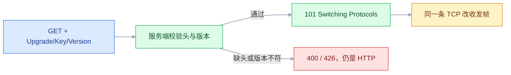
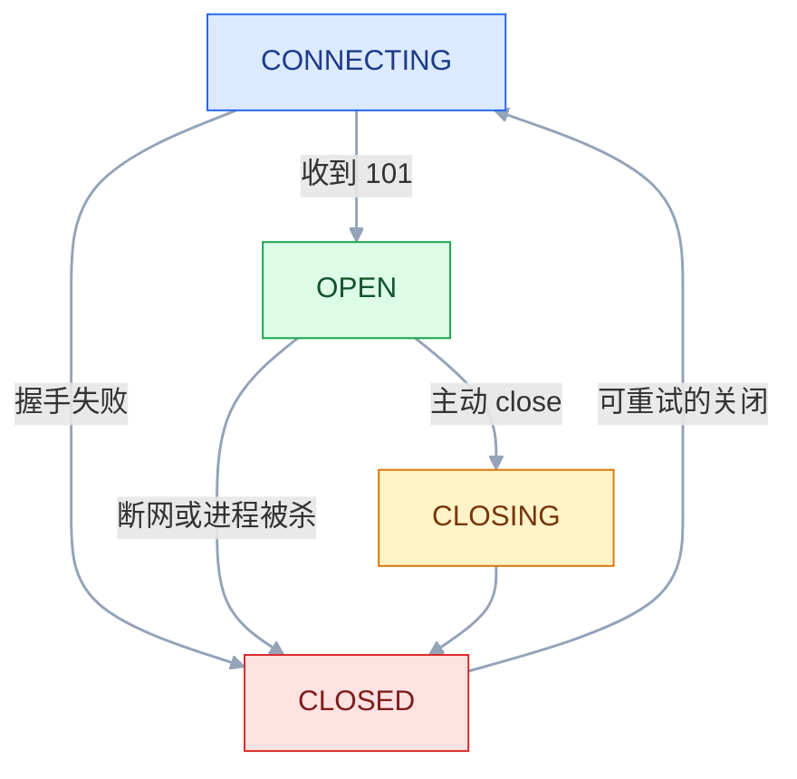
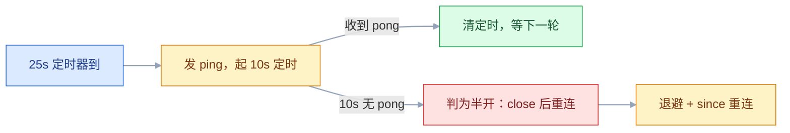

# WebSocket

## 一、工程案例：做一个房间内多人协作的在线状态与消息广播，含断线重连与心跳

**场景**：一个项目协作看板，每个项目是一个房间。成员进入页面要看到「当前谁在线」，发出的评论要广播给房间里所有人；手机锁屏、地铁断网、公司代理掐连接之后，回到页面要能自动接上，并补到断线期间漏掉的评论；服务端要能自己清掉那些「TCP 还开着、人早走了」的僵尸连接。

**交付物**：一个可运行的房间服务、一个带心跳与退避重连的前端封装、一份 Nginx 配置、一张能逐项打勾的验收表。

**技术栈**：Python 3.11 + FastAPI + uvicorn 单进程；前端原生 `WebSocket`；Nginx 反向代理；`wscat` 与 Node 的 `ws` 包做验证。单进程是故意的——多实例的坑留在 3.11 单独讲，先把一条链路做对。

### 1.1 服务端：房间表、序号、补发、僵尸清理

```python
# app.py —— 房间在线状态 + 消息广播 + 心跳 + 断线补发
import asyncio, json, os, time
from collections import defaultdict
from contextlib import asynccontextmanager
from fastapi import FastAPI, Query, WebSocket, WebSocketDisconnect

ROOMS = defaultdict(dict)          # room_id -> {user_id: Client}
SEQ = defaultdict(int)             # room_id -> 最后一条消息序号
HISTORY = defaultdict(list)        # room_id -> 最近 200 条消息
IDLE_TIMEOUT = int(os.getenv("IDLE_TIMEOUT", "90"))   # 秒：这么久没收到业务帧就踢

class Client:
    def __init__(self, ws, user_id, room_id):
        self.ws, self.user_id, self.room_id = ws, user_id, room_id
        self.last_seen = time.monotonic()
        self.send_lock = asyncio.Lock()      # 同一连接不允许并发写

    async def write(self, obj):
        await self.ws.send_json(obj)         # 只给已持锁的调用方用

    async def send(self, obj):
        async with self.send_lock:
            await self.write(obj)

async def broadcast(room_id, obj, skip=None):
    dead = []
    for uid, c in list(ROOMS.get(room_id, {}).items()):
        if uid == skip:
            continue
        try:
            await c.send(obj)
        except Exception:
            dead.append(uid)                 # 发送失败就地摘掉，别越积越多
    for uid in dead:
        ROOMS.get(room_id, {}).pop(uid, None)

async def reaper():
    while True:
        await asyncio.sleep(15)
        now = time.monotonic()
        for room_id, members in list(ROOMS.items()):
            for uid, c in list(members.items()):
                if now - c.last_seen > IDLE_TIMEOUT:
                    try:
                        await c.ws.close(code=4008, reason="idle timeout")
                    except Exception:
                        pass
                    members.pop(uid, None)   # 关不掉也要摘掉，别留在表里

@asynccontextmanager
async def lifespan(app):
    task = asyncio.create_task(reaper())
    yield
    task.cancel()

app = FastAPI(lifespan=lifespan)

@app.websocket("/ws/rooms/{room_id}")
async def room_ws(ws: WebSocket, room_id: str,
                  user_id: str = Query(...), since: int = Query(0)):
    await ws.accept()
    client = Client(ws, user_id, room_id)
    # 注册、welcome、补发在同一把发送锁里：实时广播会排队等补发写完，
    # 不会出现「新消息先到、旧消息后到」的乱序
    async with client.send_lock:
        ROOMS[room_id][user_id] = client     # 同一用户重连：新连接顶掉旧连接
        await client.write({"type": "welcome", "lastSeq": SEQ[room_id],
                            "online": sorted(ROOMS[room_id])})
        for m in [m for m in HISTORY[room_id] if m["seq"] > since]:
            await client.write(m)            # 补发断线期间漏掉的消息
    await broadcast(room_id, {"type": "presence", "event": "join",
                              "userId": user_id,
                              "online": sorted(ROOMS[room_id])}, skip=user_id)

    try:
        while True:
            raw = await ws.receive_text()
            client.last_seen = time.monotonic()
            msg = json.loads(raw)
            if msg.get("type") == "ping":
                await client.send({"type": "pong", "t": msg.get("t")})
            elif msg.get("type") == "chat":
                SEQ[room_id] += 1
                out = {"type": "chat", "seq": SEQ[room_id], "userId": user_id,
                       "text": str(msg.get("text", ""))[:2000],
                       "ts": int(time.time() * 1000)}
                HISTORY[room_id].append(out)
                del HISTORY[room_id][:-200]
                await broadcast(room_id, out)
    except WebSocketDisconnect:
        pass
    finally:
        if ROOMS[room_id].get(user_id) is client:    # 只清自己那条
            ROOMS[room_id].pop(user_id, None)
        if not ROOMS[room_id]:
            ROOMS.pop(room_id, None)
        await broadcast(room_id, {"type": "presence", "event": "leave",
                                  "userId": user_id,
                                  "online": sorted(ROOMS.get(room_id, {}))})
```

四件事各自解决一个问题：`ROOMS` 解决「发给谁」，`SEQ` 解决「断线后从哪补」，`send_lock` 既解决「并发写同一条连接」又保证「补发先于实时广播」，`reaper` 解决「连接看着还在、人已经走了」。

```bash
python -m venv .venv && source .venv/bin/activate
pip install "fastapi>=0.115" "uvicorn[standard]>=0.30"
uvicorn app:app --host 127.0.0.1 --port 8080
# INFO:     Uvicorn running on http://127.0.0.1:8080
# INFO:     Application startup complete.
```

### 1.2 前端：心跳、退避、带 since 重连

```javascript
// room-client.js —— 心跳 25s、pong 超时 10s、指数退避 + 抖动、重连带 since
export class RoomSocket {
  constructor(roomId, userId) {
    this.roomId = roomId;
    this.userId = userId;
    this.seq = 0;              // 已收到的最大序号，重连时带上
    this.attempt = 0;
    this.closedByUser = false;
    this.timers = {};
  }

  connect() {
    const proto = location.protocol === 'https:' ? 'wss' : 'ws';
    const url = `${proto}://${location.host}/ws/rooms/${this.roomId}`
      + `?user_id=${encodeURIComponent(this.userId)}&since=${this.seq}`;
    this.ws = new WebSocket(url);

    this.ws.onopen = () => {
      // 稳定 5 秒后再清零退避：连上就被踢的场景下，onopen 清零会让退避永远停在 1 秒
      setTimeout(() => {
        if (this.ws?.readyState === WebSocket.OPEN) this.attempt = 0;
      }, 5000);
      this.beat();
    };
    this.ws.onmessage = (e) => {
      const msg = JSON.parse(e.data);
      if (msg.type === 'pong') { clearTimeout(this.timers.pong); return; }
      if (msg.seq && msg.seq > this.seq) this.seq = msg.seq;   // 只前进，不回退
      this.onmessage?.(msg);
    };
    this.ws.onclose = (e) => {
      clearInterval(this.timers.beat);
      clearTimeout(this.timers.pong);
      console.warn('[ws] closed', e.code, e.reason);
      // 1008/4001 是凭据问题：退避再多次也只会拿旧 token 继续撞墙
      if (this.closedByUser || e.code === 1008 || e.code === 4001) return;
      this.retry();
    };
  }

  beat() {
    clearInterval(this.timers.beat);
    this.timers.beat = setInterval(() => {
      if (this.ws?.readyState !== WebSocket.OPEN) return;
      this.ws.send(JSON.stringify({ type: 'ping', t: Date.now() }));
      clearTimeout(this.timers.pong);
      // pong 超时必须短于心跳间隔，否则每轮都被下一轮重置，永远不触发
      this.timers.pong = setTimeout(() => this.ws.close(4000, 'pong timeout'), 10000);
    }, 25000);
  }

  retry() {
    const base = Math.min(1000 * 2 ** this.attempt++, 30000);
    // 抖动按基数比例取：到 30 秒上限时仍能摊开 15~30 秒，而不是挤在同一秒
    const delay = base * (0.5 + Math.random() * 0.5);
    setTimeout(() => this.connect(), delay);
  }

  chat(text) {
    if (this.ws?.readyState === WebSocket.OPEN) {
      this.ws.send(JSON.stringify({ type: 'chat', text }));
    }
  }
  close() { this.closedByUser = true; this.ws?.close(1000, 'bye'); }
}
```

```javascript
// 页面里这样用
import { RoomSocket } from './room-client.js';
const sock = new RoomSocket('p1', 'alice');
sock.onmessage = (m) => {
  if (m.type === 'welcome') renderOnline(m.online);
  if (m.type === 'presence') renderOnline(m.online);
  if (m.type === 'chat') appendMessage(m);
};
sock.connect();
document.querySelector('#send').onclick = () => {
  sock.chat(document.querySelector('#input').value);
};
```

### 1.3 Nginx：让 Upgrade 头活着到后端

```nginx
map $http_upgrade $connection_upgrade {
    default upgrade;
    ''      close;
}

server {
    listen 80;
    server_name collab.example.com;

    location /ws/ {
        proxy_pass http://127.0.0.1:8080;
        proxy_http_version 1.1;                          # 1.0 不支持 Upgrade
        proxy_set_header Upgrade $http_upgrade;           # 少了它后端收不到升级请求
        proxy_set_header Connection $connection_upgrade;  # 少了它同样 400
        proxy_set_header Host $host;
        proxy_set_header X-Real-IP $remote_addr;
        proxy_read_timeout 3600s;                         # 必须大于心跳间隔
        proxy_send_timeout 3600s;
        proxy_buffering off;                              # 长连接不需要攒响应
    }
}
```

把这段存成 `conf.d/ws.conf`（容器里挂载到 `/etc/nginx/conf.d/`）。`map` 只能放在 `http` 层，直接塞进 `server` 里会报 `"map" directive is not allowed here`。需要 `wss://` 时，再给这个 `server` 加 `listen 443 ssl;` 与证书路径。

```bash
docker exec nginx nginx -t
# nginx: configuration file /etc/nginx/nginx.conf test is successful
docker exec nginx nginx -s reload
```

### 1.4 验收：八项全过才算能用

| # | 检查项 | 命令或检查 | 通过标准 |
|---|---|---|---|
| 1 | 握手成功 | `npx wscat -c "ws://127.0.0.1:8080/ws/rooms/p1?user_id=alice"` | 显示 `Connected`，收到 `welcome` |
| 2 | 在线名单 | 另开一个 `wscat` 用 `user_id=bob` 连同一房间 | alice 侧收到 `presence join`，`online` 含两人 |
| 3 | 房间广播 | alice 发 `{"type":"chat","text":"hi"}` | bob 侧收到同一条，`seq` 递增为 1 |
| 4 | 跨房间隔离 | 再连一个 `room_id=p2` 的用户 | p1 的消息不会出现在 p2 |
| 5 | 心跳存活 | 每 25 秒发一次 `{"type":"ping","t":1}`，持续 2 分钟 | 每次都收到 `pong`，不被 `4008` 关闭 |
| 6 | 断线补发 | bob 断开 → alice 发 3 条 → bob 用 `since=1` 重连 | 立刻收到 `seq` 2、3、4，无重复 |
| 7 | 僵尸清理 | `IDLE_TIMEOUT=10 uvicorn app:app --port 8081`，连上后不再发任何帧 | 10~30 秒内被 `4008` 关闭（判活循环 15 秒一轮） |
| 8 | 代理链路 | 经 Nginx 用 `ws://域名/ws/rooms/p1` 连（配了 443 再试 `wss://`） | 与直连行为一致，`nginx -t` 无报错 |

```bash
# 第 3 步的两端输出（wscat 里 > 是发送，< 是接收）
# alice:
> {"type":"chat","text":"hi"}
< {"type":"chat","seq":1,"userId":"alice","text":"hi","ts":1760000000000}
# bob:
< {"type":"chat","seq":1,"userId":"alice","text":"hi","ts":1760000000000}
```

```javascript
// 第 6 步用脚本批量验证，比手点可靠：先按第 6 项发满 4 条，再 node resume-test.js
const WebSocket = require('ws');
const open = (since) => new Promise((resolve) => {
  const ws = new WebSocket(`ws://127.0.0.1:8080/ws/rooms/p1?user_id=bob&since=${since}`);
  const got = [];
  ws.on('message', (d) => { const m = JSON.parse(d); if (m.type === 'chat') got.push(m.seq); });
  setTimeout(() => { ws.close(); resolve(got); }, 800);
});
(async () => {
  console.log('since=0 →', await open(0));   // [1,2,3,4]
  console.log('since=3 →', await open(3));   // [4]
})();
```

> 第 7 项要单独起一个进程并改 `IDLE_TIMEOUT`，别在正在演示的实例上改环境变量——uvicorn 不重载环境变量，改了也不会生效。

---

## 二、高频问答：会卡住你的地方，也是面试最常问的

### 2.1 Nginx 后面握手直接 400

**现场**

`curl -i --max-time 5 -H "Upgrade: websocket" -H "Connection: Upgrade" -H "Sec-WebSocket-Key: dGhlIHNhbXBsZSBub25jZQ==" -H "Sec-WebSocket-Version: 13" http://域名/ws/rooms/p1?user_id=a`，看返回码与响应头。

```nginx
proxy_http_version 1.1;
proxy_set_header Upgrade $http_upgrade;
proxy_set_header Connection $connection_upgrade;
```

`$connection_upgrade` 不是 Nginx 内置变量，来自 1.3 的 `map`；漏了 `map` 会直接报 `unknown "connection_upgrade" variable`。

**要点**

- 过 Nginx 400 而直连 8080 能通，问题一定在中间层，不在业务代码。
- 代理没有转发 `Upgrade` 和 `Connection` 头，或者用了 HTTP/1.0，后端收到的就是一个普通 GET。
- 先绕过代理直连一次做对照，再用 `curl` 手工发带 Upgrade 头的请求，看 `101` 还是 `400`。

**追问**

- `101` 之后 `curl` 为什么一直挂着？→ 连接已切成帧协议，没有 HTTP 响应结束标志；挂到 `--max-time` 到期本身就是成功信号。
- `$connection_upgrade` 从哪来？→ 1.3 的 `map`，且 `map` 只能放在 `http` 层。
- 多层链路还要查什么？→ CDN 默认可能不开 WebSocket，要逐层确认 Upgrade 透传（见 3.10）。

### 2.2 连接大约 60 秒断一次，而且很规律

**现场**

断开时间是否固定；把心跳间隔改成 20s 后是否还断；`docker logs nginx` 里是否有 `upstream timed out`。

**要点**

- 很规律地断，是中间设备的空闲超时，不是代码里的定时任务。
- Nginx `proxy_read_timeout` 默认 60s；云 LB 的默认空闲超时各家不同，正好对上"很规律"。
- 把心跳间隔压到小于最短的那层超时，如果不断了，就是超时；再逐层把超时调到大于心跳。

**追问**

- 为什么"规律"反而说明是配置？→ 代码逻辑的断开不会这么整齐。
- 心跳该设多长？→ 小于最短代理超时，也要明显小于服务端判活（见 3.4）。
- 改了 Nginx 为什么还断？→ 还有一层没调，CDN、LB、Nginx 要逐层看。

### 2.3 服务重启后，所有客户端同时重连把服务打挂

**现场**

看服务端日志里连接建立的时间戳是否高度集中在同一秒；看 CPU 与 accept 队列是否在重启后 1 秒内打满。

```javascript
const base = Math.min(1000 * 2 ** this.attempt++, 30000);
const delay = base * (0.5 + Math.random() * 0.5);   // 抖动按比例，不可省
```

**要点**

- 不是容量不够，是**流量形状**问题：总量没变，全挤在一秒内。
- 没有退避和抖动，几千个客户端在 `onclose` 里立刻 `connect()`，空服务瞬间被压垮，然后又全断，形成循环。
- 统计 `onclose` 到下一次 `onopen` 的间隔分布，大量小于 100ms 就是没有退避。

**追问**

- 为什么抖动必须按基数比例取？→ 固定 0~1 秒的随机量只是把尖峰推迟（见 3.5）。
- 调 `ulimit` 有用吗？→ 瓶颈是瞬时 accept 速率，不是连接总数。
- 退避上限设多少？→ 30 秒左右，同时要有最大次数或最大时长。

### 2.4 `onclose` 只有 1006，拿不到任何原因

**现场**

服务端是否有对应的 `@OnClose` 记录；`ss -tn state established '( sport = :8080 )'` 看连接是否已消失。

**要点**

- `1006` 是"没有收到 close 帧就断了"，按协议只能由客户端本地合成，服务端根本没发出过关闭帧。
- 所以后端日志里通常什么都没有，去后端找堆栈是白费。
- 断网、进程被 kill、代理掐连接都会这样；对照两端时间戳，只有一端有记录就是链路问题。

**追问**

- 哪些码永远不会出现在 close 帧里？→ `1005`、`1006`、`1015`，都是本地合成（见 3.3）。
- 怎么区分 1006 和 1000？→ 1000 有正常的关闭握手，1006 没有。
- 想拿到关闭原因怎么办？→ 应用层主动 `close` 带自定义码，例如 4001。

### 2.5 多实例部署后，推送时有时无

**现场**

在推送处打日志"本实例在线数、是否命中"；把实例 IP 一起打出来，看命中的请求是否总落在同一台。

**要点**

- 不是消息丢了，是**路由**：用户连在实例 B，推送请求落到实例 A，A 的 `ROOMS` 里没有这个人，直接跳过。
- 消息压根没进那条连接，所以查 MQ 和网络都查不出问题。
- 每个实例启动时打唯一标识，推送日志带上它，观察"用户连在 B、推送落在 A"的比例。

**追问**

- 三种解法怎么选？→ 发布订阅中转最省事，粘性会话和网关路由表各有迁移成本（见 3.11）。
- 发布订阅能保证不丢吗？→ 不能，它不持久化，要可靠得换 Stream 或 MQ。
- 为什么粘性会话在扩缩容时麻烦？→ 连接要迁移，缩容就得踢人。

### 2.6 心跳一直在发，服务端还是把连接清了

**现场**

服务端把 `last_seen` 的更新点打日志，对比客户端发送时间；看标签页切到后台后 `setInterval` 是否被拉长到分钟级。

**要点**

- 心跳一直在发还被清，多半是计时口径不一致，不是间隔太短。
- 服务端判活看代码里更新的 `last_seen`，而它通常只在收到业务帧时更新；客户端可能只发协议层 ping 帧，多数框架不会把这个事件交给业务层。
- 浏览器后台节流会把定时器放宽到分钟级，也会造成"发了但没到"。

**追问**

- 缩到 5 秒有用吗？→ 口径错了就没用，反而更费。
- 怎么确认心跳帧到底到没到？→ 在服务端 `receive` 循环里打点。
- 统一用哪种心跳？→ 前端主导用应用层，纯服务间用协议层（见 3.4）。

### 2.7 并发发消息时报 `TEXT_FULL_WRITING`

**现场**

报错堆栈里是否出现两个业务线程同时进入发送方法；把发送处加计数打点，看是否重叠。

```java
synchronized (session) { session.getBasicRemote().sendText(text); }
```

**要点**

- 不是客户端发太快，是服务端多个线程/协程同时对**同一个 Session** 调 `sendText`。
- 协议实现要求一条连接同一时刻只能有一个写操作，重叠就会抛 `TEXT_FULL_WRITING`。
- 修法是给每条连接一把锁，或改成"单写线程 + 队列"。

**追问**

- 加前端节流为什么没用？→ 并发来自服务端多个广播路径，不是客户端频率。
- 加锁会不会拖慢广播？→ 会，所以生产里用每连接有界队列加独立写协程（见 3.13）。
- 换成无界队列行不行？→ 只是把"卡住"换成"内存涨到 OOM"。

### 2.8 token 过期后客户端无限重连

**现场**

看 `onclose` 的 `code`：稳定 `1006` 且服务端每次都在鉴权处拒绝，就是握手被拒；稳定 `4001/1008` 则是应用层主动踢人。两者都该停止重试。

**要点**

- 凭据失效时重试一万次也不会成功，退避不是万能解。
- 握手阶段回 401/403，浏览器只能给出 `1006`；`accept()` 之后用 4001 关闭，才能读到 4001。
- 网络类（1006）该退避重试，鉴权类（4001/1008）该先刷新凭据或跳登录。

**追问**

- 为什么前端读不到握手阶段的 401？→ 握手失败时 JS 拿不到 HTTP 状态码（见 3.1）。
- 没 `accept()` 就 `close(4001)` 行吗？→ 不行，框架只能回 403，码到不了客户端。
- 重连前该做什么？→ 先判断凭据是否还有效。

### 2.9 重连之后消息重复、顺序也乱了

**现场**

对比 `seq` 序列，看重复项是否正好落在断线时刻附近；看补发是否用了客户端时间戳排序。

**要点**

- 同一条连接上 TCP 本来就保证顺序；乱序来自"重连补发"与"实时推送"两条路径叠加，重复来自补发区间与已收区间的重叠。
- 怀疑协议是错的方向，换传输层解决不了。
- 把收到的 `seq` 打成数组找重复与空洞：重复在断点两侧是补发区间没对齐；空洞是 `since` 传错，或补发窗口已经滚过去了（见 3.8）。

**追问**

- 为什么序号必须服务端生成？→ 客户端时间戳会因改系统时间、时区、多端不一致而乱序。
- 怎么保证补发和实时之间没有缝？→ 先注册再补发，且补发期间不许实时消息插队（同一把发送锁）。
- 客户端还要做什么？→ 按序号去重。

### 2.10 手机锁屏、切后台后收不到消息

**现场**

回到前台时 `readyState` 是否为 `CLOSED`；`visibilitychange` 事件里打点看恢复时间。

**要点**

- 移动端切后台后系统会挂起页面甚至冻结进程，TCP 连接被回收；iOS/Android 都不会让网页在后台长期维持长连接。
- 这不是服务端推送坏了，服务端日志里往往一切正常。
- 正确做法是回前台立即探活（发 ping 等 pong，超时即重连），而不是假设连接还在。

**追问**

- 真机怎么验证？→ 切后台 1 分钟再回来，看 `visibilitychange` 之后的 `readyState`。
- 为什么桌面浏览器测不出来？→ 桌面不冻结标签页，连接一直活着。
- 后台也要收消息怎么办？→ 换系统推送，别指望长连接。

### 2.11 https 页面连 ws://，请求根本没发出去

**现场**

看 Console 的报错类型：出现 `SecurityError` / `Mixed Content` 就与后端无关；再确认 URL 是否由 `location.protocol` 推导。

**要点**

- 页面是 https 却写死 `ws://`，混合内容会被浏览器直接拦掉，服务端一条日志都不会有。
- 多数情况下 `new WebSocket()` 当场抛 `SecurityError`，不是正常的 `onclose` 流程，退避重连也救不回来。
- 修法只有一条：https 页面必须用 `wss://`，按 `location.protocol` 拼；只有本地 http 开发才允许 `ws://`。

**追问**

- 为什么查服务端查不到？→ 连接尝试压根没出浏览器。
- 本地开发怎么绕过？→ 用 http 起页面，或给本地配证书走 https。
- 反向代理后面要改什么？→ Nginx 配 `listen 443 ssl`，前端按协议推导。

---

## 三、核心知识：从零开始要建立的东西

### 3.1 协议升级与握手

WebSocket 没有另起一套端口和域名，它**寄生在一次 HTTP 请求上**：客户端发一个带 `Upgrade: websocket` 的 GET，服务端同意就回 `101 Switching Protocols`，这条 TCP 连接从此改说帧协议。



除 HTTP 必需的 `Host` 外，WebSocket 专有的必需头是四个：

| 头 | 值 | 作用 |
|---|---|---|
| `Upgrade` | `websocket` | 声明要升级 |
| `Connection` | `Upgrade` | HTTP/1.1 的固定搭配 |
| `Sec-WebSocket-Key` | 16 字节随机数的 Base64 | 证明对面真读懂了握手，不是鉴权 |
| `Sec-WebSocket-Version` | `13` | 对应 RFC 6455；版本不符回 426 |

`Sec-WebSocket-Key` 常被误解成密码。它只是个随机数，服务端把它和固定 GUID 拼起来做 SHA-1 再 Base64，回填到 `Sec-WebSocket-Accept`，用来证明「对面真的懂 WebSocket，而不是一个把请求原样返回的缓存或代理」。

**边界**：握手阶段仍然是 HTTP，所以 Cookie、`Origin`、反向代理、TLS 全都照旧生效；一旦回了 101，这些 HTTP 语义就都不存在了——没有状态码、没有重试、没有 `Content-Length`。也正因为如此，握手阶段回 401/403 时，浏览器 JS 读不到这个状态码，`onclose` 只会给你 1006（见 2.8）。

> **面试**：常问「WebSocket 握手怎么完成？Sec-WebSocket-Key 是鉴权吗？」答：带 Upgrade 头的 HTTP GET 换来 101；Key 只是个随机数，用来证明对面读懂了协议。

### 3.2 帧结构与传输开销

握手之后的数据以帧为单位，最小帧头 2 字节；客户端上行还要加 4 字节掩码键，遇上大载荷再按 2 或 8 字节扩展长度，上限 14 字节：

| 部分 | 长度 | 说明 |
|---|---|---|
| FIN + opcode | 1 字节 | 是否最后一帧、帧类型 |
| MASK + 长度 | 1 字节 | 客户端发必须掩码；长度 125 以内直接放这里 |
| 扩展长度 | 0/2/8 字节 | 126 表示后跟 2 字节，127 表示后跟 8 字节 |
| 掩码键 | 0/4 字节 | 仅客户端发往服务端时需要 |
| 载荷 | 变长 | 真正的数据 |

同样一条 30 字节的 JSON：服务端下发是 2 + 30 = 32 字节，客户端上行是 6 + 30 = 36 字节。HTTP/1.1 每条消息都要重新带上几百字节请求头；HTTP/2 有 HPACK 压头，差距会小一些，但仍要为每条消息建一次流。**省的是「每条消息都重复一遍的头」**，消息越小、频率越高，差距越大。

opcode 里至少要认识六个：continuation（0，分片的续帧）、text（1）、binary（2）、close（8）、ping（9）、pong（10）。浏览器 API 不能主动发 ping 帧，所以前端做心跳只能用**应用层 JSON**；服务端可以发协议层 ping，浏览器会自动回 pong，但 JS 拿不到这个 pong。

### 3.3 连接状态与关闭码



`readyState` 四个值：0 连接中、1 已打开、2 关闭中、3 已关闭。真正要记的是关闭码，因为它决定了「该不该重连」：

| 码 | 含义 | 处理 |
|---|---|---|
| 1000 | 正常关闭 | 自己主动关的不重连；服务端正常下线要看业务是否需要接回 |
| 1001 | 一方离开（页面关闭、服务重启） | 通常重连 |
| 1002 | 协议错误 | 不重连，是代码 bug |
| 1006 | 没收到 close 帧就断了 | 重连，最常见 |
| 1008 | 违反策略（如鉴权失败） | 不重连，先换凭据 |
| 1009 | 消息过大 | 不重连，先改上限或分包 |
| 1011 | 服务端内部错误 | 退避重连 |
| 1012 / 1013 | 服务重启 / 稍后重试 | 退避重连，这是服务端在明确让你回来 |
| 4000-4999 | 应用自定义 | 按约定处理 |

**边界**：`1005`（没带状态码）、`1006`、`1015`（TLS 握手失败）都是保留码，只在本机合成，永远不会出现在 close 帧里；所以看到 1006 时去服务端日志找原因是找不到的。自定义码方面，3000-3999 是先注册后使用（库和框架常用），4000-4999 可私有使用，1000-2999 不能占。close 帧载荷上限 125 字节，扣掉 2 字节状态码，reason 最多 123 字节 UTF-8，超长会被截断或直接报错。

### 3.4 心跳机制与超时预算

心跳不是为了「保持连接活着」这么简单，它是发现**半开连接**最可靠的手段：用户进电梯、切飞行模式，TCP 不会立刻收到 FIN，两端都以为连接还在，消息却永远到不了。



四个数字必须成对设计，不能各写各的：

| 参数 | 建议值 | 约束 |
|---|---|---|
| 前端心跳间隔 | 25s | 小于最短的代理/LB 空闲超时，也要明显小于服务端判活 |
| 前端 pong 超时 | 10s | **必须小于心跳间隔**，否则每轮被重置，永不触发 |
| 服务端判活超时 | 90s | 至少 2~3 倍心跳，容忍偶发丢包 |
| 代理 `proxy_read_timeout` | 3600s | 大于心跳即可，宁大勿小 |

服务端判活是单向兜底，不在客户端这条链上，但两边的口径必须对齐：如果服务端只在收到业务帧时更新 `last_seen`，客户端发的协议层 ping 就不算数，会出现「心跳一直在发、还是被 4008 踢掉」（见 2.6）。

协议层 ping/pong 与应用层心跳的取舍：前者不占业务带宽、不用写代码，但浏览器 JS 感知不到 pong，前端无法据此判断死活；后者多几字节，但跨语言、可携带业务状态、前端能自己判超时。**前端主导的场景用应用层心跳，纯服务间通信用协议层。**

> **面试**：常问「心跳间隔和 pong 超时怎么定？」答：心跳要小于最短的代理超时，pong 超时必须小于心跳，服务端判活取心跳的 2~3 倍。

### 3.5 退避重连与抖动

断线是常态，不是异常。重连策略要同时解决两个问题：不要立刻重连（服务端可能还没起来），也不要所有客户端同时重连。

| 策略 | 形状 | 问题 |
|---|---|---|
| 固定间隔 | 每 3 秒一次 | 服务端宕机时持续打，恢复瞬间仍会集中 |
| 线性退避 | 1s、2s、3s… | 收敛慢，大量客户端长时间高频 |
| 指数退避 | 1s、2s、4s、8s… | 收敛快，但上限要封顶 |
| 指数退避 + 抖动 | 在指数退避上加随机 | 把重连时刻摊开，**生产标准做法** |

抖动不是锦上添花。假设 5000 个客户端同时断开、都按 1、2、4、8 秒重连：如果只加一个固定 0~1 秒的随机量，第 4 次重试仍挤在 8~9 秒这一秒内，尖峰只是被推迟。抖动要按基数比例取，`base * (0.5 + random)` 能把 8 秒那轮摊到 4~8 秒、30 秒上限那轮摊到 15~30 秒，才真正变成斜坡。

**边界**：退避计数器要清零，但不能在 `onopen` 里立刻清零——「连上就被服务端踢」时会被无限重置成 1 秒。等连接稳定几秒（或收到第一条业务消息）再清，否则一次偶发断线又会让客户端此后一直等 30 秒；同时要有最大次数或最大时长，避免凭据失效时无限重试（见 2.8）。

### 3.6 会话表与路由模型

WebSocket 只提供「一条连接」，**「发给谁」完全是应用层的事**。三种基本模型：

| 模型 | 数据结构 | 发送成本 | 场景 |
|---|---|---|---|
| 点对点 | `userId -> 连接集合` | O(该用户端数) | 私聊、任务指派 |
| 广播 | 遍历全部连接 | O(在线人数) | 系统公告、行情 |
| 房间 | `roomId -> 成员集合` | O(房间人数) | 群聊、协同编辑 |

一个容易踩的细节：**键用 `userId` 而不是连接对象**。同一个用户可能手机和电脑同时在线，也可能断线重连换了新连接。两种模型都成立，但要选一个贯彻：

```python
ROOMS[room_id][user_id] = client      # 二选一：单连接模型，新连接顶掉旧连接
ROOMS[room_id][user_id] = {client}    # 二选一：多端模型，值是 Set
```

本文示例用单连接模型，好处是每个用户只有一份补发游标、逻辑简单；代价是手机上线会把电脑顶下线。要支持多端就换成 `Set`，并且每一端各自记 `seq`，否则一端的补发进度会被另一端覆盖。

无论哪种，替换时都要在 `finally` 里判断「当前表里的是不是我自己」，否则旧连接的清理逻辑会把新连接删掉——这是「重连之后反而收不到消息」的经典成因。

### 3.7 房间成员关系

一个连接只订阅一个房间时，`roomId -> userId` 一张表就够（示例就是这种）。一个连接同时进多个房间时，才必须再维护反向索引，否则「用户断线时该从哪些房间移除」只能全表扫：

| 索引 | 用途 |
|---|---|
| `roomId -> Set<userId>` | 广播时找成员 |
| `userId -> Set<roomId>` | 断线时一次性清理 |

两个必须处理的边界：**断线要 `leaveAll`**，否则房间留下幽灵成员，在线人数永远偏高；**空房间要删掉**，否则长期运行后 `ROOMS` 里堆满没人访问的空字典，内存只涨不降。

成员关系放内存只适合单实例。多实例时它必须外置（Redis 集合），或者干脆不做精确成员表，只做「广播给所有实例、各自查本地连接」。

### 3.8 消息序号与断线补发

TCP 只保证「这条连接上的字节不丢不乱」，**连接断了之后发的消息就永远丢了**。要补，就得有服务端生成的单调序号：

```text
服务端为每个房间维护 seq，每收一条消息 +1，随消息下发
客户端记录已收到的最大 seq，重连时作为 since 参数带上
服务端先注册连接，再在同一把发送锁里补发，最后转入实时推送
```

三个约束缺一不可：

| 约束 | 原因 |
|---|---|
| 序号由服务端生成 | 客户端时间戳会因改系统时间、时区、多端不一致而乱序 |
| 补发与实时之间不能有缝 | 先注册再补发，且补发期间不许实时消息插队（同一把发送锁），否则会乱序或丢消息 |
| 客户端按序号去重 | 补发区间与已收区间必然有重叠 |

补发窗口要有上限（示例里是最近 200 条）。超出窗口就只能提示「消息过旧，请刷新」——**没有任何内存结构能无限补发**，这是必须接受的边界。

> **面试**：常问「断线期间的消息怎么补？序号为什么必须服务端生成？」答：服务端按房间维护单调 `seq`，重连带 `since` 补发；客户端时间戳会因改时间、时区、多端不一致而乱序。

### 3.9 鉴权凭据的位置

浏览器原生的 `new WebSocket(url)` **不支持自定义请求头**，所以 `Authorization` 这条路在浏览器里走不通。四种替代：

| 位置 | 写法 | 代价 |
|---|---|---|
| URL 查询串 | `?token=xxx` | 会进 Nginx 访问日志、浏览器历史 |
| 子协议 | `new WebSocket(url, ['bearer', token])` | 值必须是合法 token（不能带空格），且会进请求头，长 token 受头部上限约束 |
| 首条消息 | 连上后先发 `{"type":"auth"}` | 建立到认证之间有一个未认证窗口 |
| Cookie | 同域自动携带 | 跨域受 SameSite 限制，非浏览器客户端不适用 |

**最佳时机是握手阶段**：还没升级就校验，不合法回 401/403，连接根本建立不起来，也不占着连接等超时。代价是前端读不到这个状态码——`onclose` 只会是 1006，和断网分不出来。如果一定要让前端读到原因，就只能先 `accept()` 再用 4001 关闭；反过来，未 `accept()` 就 `close(code=4001)`，框架只能回 403，码到不了客户端。已升级再校验，则要额外维护「未认证连接」表并加超时踢人。

还有一个常被忽略的面：握手会带 `Origin`，但服务端默认不校验。浏览器会自动带上同站 Cookie，所以「只靠 Cookie 鉴权 + 不校验 Origin」等于给跨站 WebSocket 劫持留门；至少要做 Origin 白名单。

用 URL 传 token 时，至少要在日志格式里把查询串去掉：Nginx 用 `$uri` 而不是 `$request`，否则 token 会明文躺在访问日志里。

### 3.10 反向代理与 TLS 终止

WebSocket 过代理要过三道关，任何一道没过都是 400、502 或 504：

| 关卡 | 要求 |
|---|---|
| 协议版本 | 必须是 HTTP/1.1 |
| 头部转发 | `Upgrade` 与 `Connection` 都要透传 |
| 超时 | 读超时大于心跳间隔，写超时同理 |

TLS 对 WebSocket 是透明的：`wss://` 在 Nginx 终止，Nginx 到后端仍是明文 `ws://`。所以证书配在 Nginx 上，后端不用管；但要在 `server` 块里确认 `listen 443 ssl` 的 `ssl` 在，`location` 只负责转发。

多层链路（CDN → LB → Nginx → 应用）要**逐层确认 Upgrade 透传**。最常见的事故是 CDN 默认不开 WebSocket，前面调了半天 Nginx 也没用。

### 3.11 多实例与跨进程广播

会话表在进程内存里，多实例就必然出现「用户连在 B、推送落在 A」。三种解法：

| 方案 | 做法 | 代价 |
|---|---|---|
| 发布订阅中转 | 每个实例订阅同一频道，收到后查本地表 | 多一次 Redis/MQ 往返 |
| 粘性会话 | 同一用户固定路由到同一实例 | 扩缩容时连接要迁移 |
| 网关路由表 | 网关记录「用户在哪个实例」 | 要维护路由表与心跳 |

中小项目用第一种最省事：发送方不查本地表，直接 `publish`；所有实例收到后各自尝试，本地没有就跳过。

```text
发送侧：publish ws:room:p1 {"type":"chat","seq":7,...}
每个实例：订阅 ws:room:* → 收到后 ROOMS["p1"] 里有就发，没有就忽略
```

注意这条路径**没有「恰好一次」保证**：发布订阅不持久化，实例在收到消息前重启就丢了。要可靠就得换 Stream 或 MQ，并且和 3.8 的补发机制配合。

> **面试**：常问「多实例下用户连在 B、推送落在 A 怎么办？」答：走发布订阅中转，所有实例收到后各自查本地会话表；要可靠再换 Stream 或 MQ。

### 3.12 连接容量与系统上限

单机能撑多少连接，卡在四个地方：

| 限制 | 量级 | 处理 |
|---|---|---|
| 文件描述符 | 默认常是 1024 | `ulimit -n`、systemd `LimitNOFILE` |
| 内存 | 内核缓冲每连接几 KB，应用对象另算 | 按连接数预留，别只算堆 |
| 端口 | 客户端源端口单机约 2.8 万（默认端口段） | 压测机要改 `ip_local_port_range` |
| 线程模型 | 每线程默认 8MB 虚拟栈（`ulimit -s`） | 万级连接必须事件驱动 |

实践量级：事件循环模型（Go、Node、Netty、asyncio）单机十万级；传统「一连接一线程」的模型到几千条就开始抖。压测时先看 `ls /proc/<pid>/fd | wc -l` 与 `ss -s`，别一上来就怀疑代码。上面这两个命令是 Linux 的；macOS 没有 `/proc`，用 `lsof -p <pid> | wc -l` 代替。

```bash
ulimit -n 1048576
ss -tn state established '( sport = :8080 )' | wc -l
ls /proc/<pid>/fd | wc -l
```

### 3.13 发送背压与缓冲区

`send()` 不是「发出去」，是「写进本地缓冲区」。对端读得慢，缓冲区就涨：

| 现象 | 含义 | 处理 |
|---|---|---|
| `bufferedAmount` 持续上涨 | 对端消费不过来 | 应用层限流、丢弃非关键消息 |
| 服务端发送队列无限增长 | 慢消费者拖垮内存 | 设队列上限，超限直接断开 |
| 广播时逐条 `await` | 一个慢连接拖住整个房间 | 并发发送 + 单连接超时 |

浏览器端可以读 `ws.bufferedAmount`，服务端一般看自己写的发送队列长度。**没有背压的广播系统，一定会被一个网络很差的用户拖垮**——它的连接还在，只是永远发不完。

1.1 的 `broadcast` 为了好读是串行 `await`，一个慢连接会拖住后面所有人；生产里改成 `gather` + 单连接超时，或者每连接一个有界队列加独立写协程，队列满就断开。注意别用无界队列换掉串行——那只是把「卡住」换成了「内存涨到 OOM」。

### 3.14 实时方案选型

| 维度 | 短轮询 | 长轮询 | SSE | WebSocket |
|---|---|---|---|---|
| 方向 | 单向拉 | 单向拉 | 服务端推 | 双向 |
| 重连 | 天然 | 天然 | 浏览器自带 | 自己实现 |
| 断线补发 | 靠参数 | 靠参数 | `Last-Event-ID` | 自己实现 |
| 二进制 | 麻烦 | 麻烦 | 不支持 | 原生 |
| 代理友好度 | 最好 | 好 | 好 | 需支持 Upgrade |

判断顺序：**只需要服务器往前端推**（通知、进度、流式输出）用 SSE，代码量明显更少，还自带重连；**需要双向、低延迟、带应答**（聊天、协同、游戏）才用 WebSocket；**能接受秒级延迟**就别上长连接。

WebSocket 不是「更快的 HTTP」。它的优势在服务器主动推和双向流，不在单次请求的往返速度；用它做普通的请求-响应，等于用长连接换更差的代理兼容性。

### 3.15 广播扇出与风暴

一次广播的成本是 O(房间人数)，而房间里每个人又可能触发下一次广播——这就是广播风暴的形状：

| 场景 | 放大倍数 | 后果 |
|---|---|---|
| 加入/离开都广播全量名单 | 每次进出 × 房间人数 | 大房间进出频繁时流量爆炸 |
| 输入框每次按键都广播 | 按键频率 × 房间人数 | 协同编辑卡死 |
| 广播里带全量成员列表 | 消息体 × 人数 | 带宽被打满 |

三条约束：**状态变更做节流/合并**（输入用 100ms 防抖）；**名单类消息只发增量或定期全量**；**大房间分层**（超过几百人就不要全员广播，改拉取或分片）。

---

## 四、冷门知识汇总

| 知识点 | 为什么冷门 | 用到时的关键词 |
|---|---|---|
| 子协议协商 | 多数项目不需要，只有 GraphQL over WS 等场景才用 | `Sec-WebSocket-Protocol`、`new WebSocket(url, ['graphql-ws'])` |
| 扩展协商与压缩 | 默认不开，开了又要评估 CPU 与压缩侧信道 | `Sec-WebSocket-Extensions`、`permessage-deflate` |
| HTTP/2 上的 WebSocket | 需要 RFC 8441 的 CONNECT，代理支持参差 | `Extended CONNECT`、`enable-connect` |
| 关闭握手 | 直接断 TCP，对端只能合成 1006 | close 帧、`wasClean` |
| 保留关闭码 | 1005/1006/1015 永远不会出现在 close 帧里，看到它们说明是本地合成 | `1005`、`1015`、close frame |
| `wasClean` 字段 | 只在排查「为什么是 1006」时看 | `event.wasClean === false` |
| 掩码键 | 协议强制客户端掩码、服务端不掩码，业务无感 | `MASK` 位、4 字节 masking key |
| 分片消息 | 分片是发送端的选择，多数库默认一条消息一帧 | `FIN=0`、continuation 帧 |
| 单帧/单消息上限 | 只在传大文件或大 JSON 时爆，报错还很难懂 | `maxMessageSize`、`maxFramePayloadLength`、1009 |
| 关闭原因长度 | close 帧载荷上限 125 字节，reason 最多 123 字节 | `close(code, reason)`、`Invalid close frame` |
| 抓包看帧 | 只在怀疑掩码/分片/压缩时用 | `tcp.port == 8080`、Follow TCP Stream |
| 连接数监控 | 常规监控只看 QPS，长连接要看存量 | `ss -s`、`/proc/<pid>/fd` |
| 消息大小与内存 | 单条消息上限乘以连接数才是真实内存风险 | `maxMessageSize`、发送队列上限 |
| 优雅下线 | 滚动发布时才需要，平时不会想到 | 先停止接收新连接、发 1001、等存量退出 |
