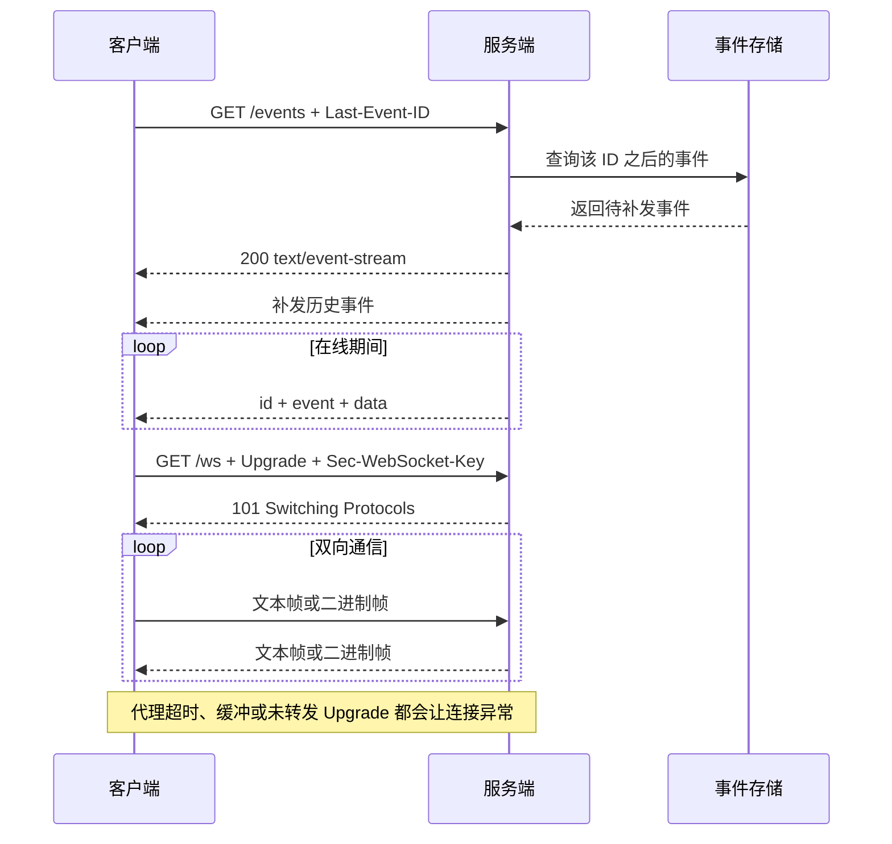
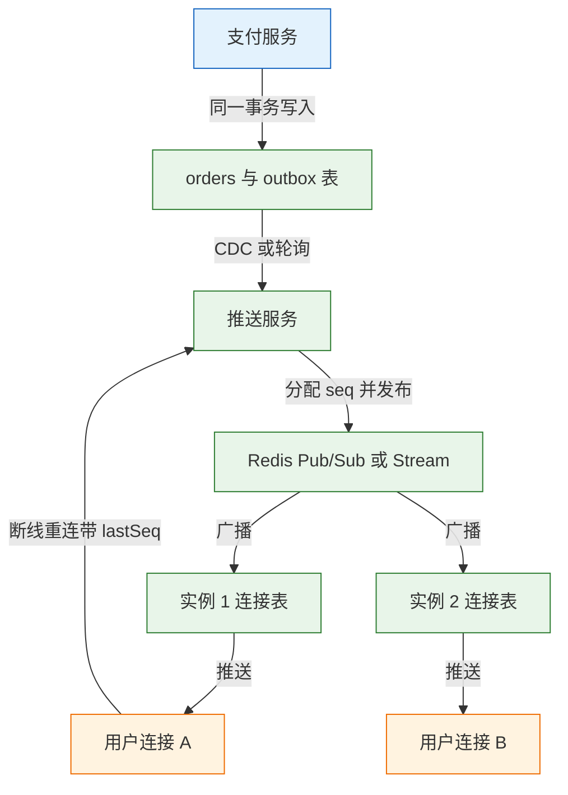
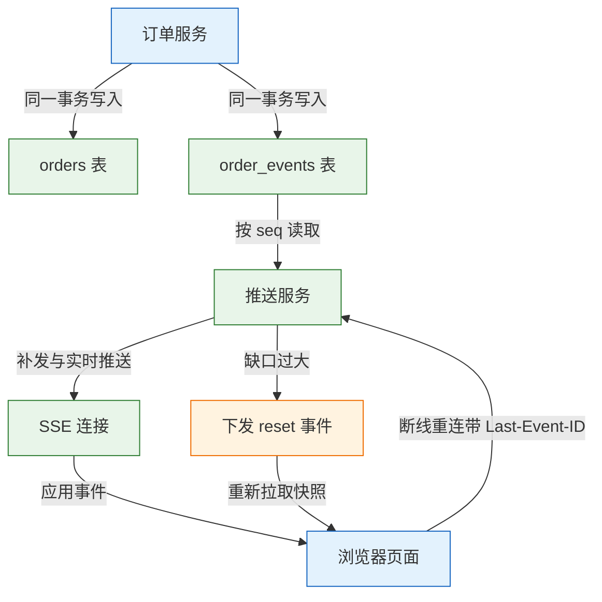
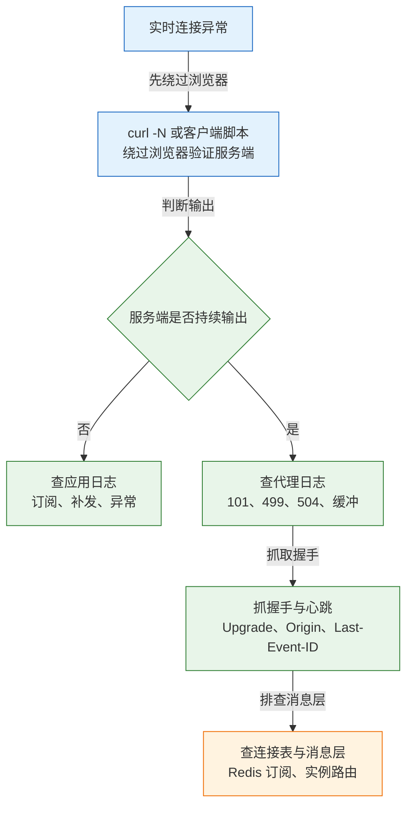

# 实时通信：WebSocket 与 SSE

轮询是客户端不停追问，SSE 是服务端持续输出，WebSocket 是双方随时互发。三种方式都能让页面“实时”变化，代价却完全不同：连接数、代理超时、重连补发和背压处理，任何一项缺失都会把实时功能变成偶发丢消息的黑洞。

---

## 一、实时通信是什么

### 1.1 核心概念

实时通信指服务端的状态变化能在可接受延迟内到达客户端。它不要求零延迟，而要求延迟有上限、断线可恢复、重复可识别。实现方式分为四类：短轮询、长轮询、SSE 和 WebSocket。

短轮询按固定间隔重复请求，逻辑最简单，但空请求多、延迟受间隔限制。长轮询让服务端挂起请求，直到有数据或超时才返回，减少了空请求，但仍需反复建立请求。SSE 用一条普通 HTTP 响应持续输出事件，浏览器内置重连。WebSocket 通过一次 HTTP 升级切换到独立帧协议，之后双向通信。

| 概念 | 含义 | 失效后的表现 |
|---|---|---|
| 连接 | 客户端与服务端之间的长存活通道 | 断线后收不到新事件 |
| 事件 | 服务端产生的一条状态变化 | 客户端状态停在旧值 |
| 订阅 | 客户端声明关心哪些主题或房间 | 收到无关消息或收不到消息 |
| 序号 | 事件的单调递增编号 | 无法判断丢失与重复 |
| 心跳 | 周期性探测连接是否存活 | 半开连接长期占用资源 |
| 背压 | 发送速度超过消费速度时的控制 | 内存上涨，最终连接被拖垮 |

长连接只保证“此刻连着”，不保证“消息一定送达”。断线期间产生的事件，必须靠持久化、序号和补发恢复；客户端重连后从哪个位置继续，也要由游标明确指定。

> **注意**：把“连接建立成功”当成“订阅成功”是常见错误。订阅消息可能因为权限、房间名或时序问题没有生效，服务端应返回确认，客户端收到确认后才能认为进入可接收状态。

### 1.2 在技术栈中的位置

SSE 完全复用 HTTP：请求是普通 `GET`，响应头声明 `text/event-stream`，响应体按事件格式持续写入。WebSocket 只在握手阶段借用 HTTP，服务端返回 `101 Switching Protocols` 后，双方改用帧协议，后续数据不再受 HTTP 头字段和状态码约束。

两者都依赖 TCP 与 TLS，也都会穿过反向代理、负载均衡和 CDN。消息扇出通常还要借助 Redis、Kafka 等中间件：连接层只负责维持会话，事件的生产、持久化和跨实例分发由消息层承担。

| 技术 | 所在层 | 职责 | 与实时连接的关系 |
|---|---|---|---|
| HTTP | 应用层 | 请求—响应、握手、SSE 承载 | SSE 的传输基础，WebSocket 的升级入口 |
| TCP / TLS | 传输层与安全层 | 可靠字节流、加密 | 长连接的实际承载 |
| 反向代理 | HTTP 层 | 转发、超时、缓冲、协议升级 | 配置不当会截断或缓冲连接 |
| Redis Pub/Sub | 消息层 | 在线广播，不持久化 | 多实例推送的常用扇出方式 |
| Redis Stream / Kafka | 消息层 | 持久化事件、按序号消费 | 断线补发与审计的事实来源 |

> **注意**：SSE 在 HTTP/1.1 下受浏览器同源连接数限制，常见上限是 6 条；同一站点开多个标签页会互相挤占。HTTP/2 多路复用后，多个 SSE 流可以共享一条连接，这个限制随之消失。WebSocket 不受该限制，但每条连接都占服务端文件描述符和内存。

### 1.3 一次完整交互

下图把 SSE 的建立、推送，以及 WebSocket 的握手、双向帧放在同一次交互视角中：



| 阶段 | SSE 的表现 | WebSocket 的表现 |
|---|---|---|
| 建立 | 普通 `GET`，服务端保持响应不结束 | `GET` 带 `Upgrade`，服务端返回 `101` |
| 传输 | 服务端单向写文本事件 | 双方按帧收发，可文本可二进制 |
| 保活 | 注释行心跳，或定期业务事件 | Ping/Pong 控制帧，或应用层心跳 |
| 重连 | 浏览器自动重连并带 `Last-Event-ID` | 客户端自行实现退避与恢复 |
| 关闭 | 结束 HTTP 响应或断开 TCP | 关闭帧加关闭码，再断开 TCP |

---

## 二、协议与报文结构

### 2.1 SSE 响应流格式

SSE 的响应头必须声明事件流类型，并禁用缓存与转换：

```http
HTTP/1.1 200 OK
Content-Type: text/event-stream; charset=utf-8
Cache-Control: no-cache, no-transform
Connection: keep-alive
X-Accel-Buffering: no
```

响应体是 UTF-8 文本，按行解析。每个字段写成 `名称: 值`，空行表示一个事件结束：

```text
id: 42
event: order.paid
retry: 3000
data: {"orderId":"A100","status":"paid"}

```

| 字段 | 作用 | 约束 |
|---|---|---|
| `data` | 事件内容 | 可多行，每行都以 `data:` 开头，客户端用换行拼接 |
| `event` | 事件类型 | 对应 `addEventListener` 的名称，缺省为 `message` |
| `id` | 事件标识 | 浏览器记录最后值，重连时放入 `Last-Event-ID` |
| `retry` | 重连间隔 | 整数毫秒，只影响浏览器自动重连 |
| `:` 开头 | 注释 | 不触发事件，常用于心跳 |

`data` 中出现换行时，必须拆成多个 `data:` 行，不能在一个字段值里直接写裸换行。事件之间必须有一个空行，缺少空行时客户端会继续等待后续行，表现为“服务端发了但前端不触发”。

```text
data: first line
data: second line

```

### 2.2 WebSocket 握手报文

WebSocket 握手是一个带升级头的 HTTP 请求：

```http
GET /ws HTTP/1.1
Host: example.com
Upgrade: websocket
Connection: Upgrade
Sec-WebSocket-Key: dGhlIHNhbXBsZSBub25jZQ==
Sec-WebSocket-Version: 13
Origin: https://app.example.com
```

服务端同意升级时返回 `101`，并带上由客户端 Key 计算出的 Accept 值：

```http
HTTP/1.1 101 Switching Protocols
Upgrade: websocket
Connection: Upgrade
Sec-WebSocket-Accept: s3pPLMBiTxaQ9kYGzzhZRbK+xOo=
```

| 头字段 | 作用 | 校验要点 |
|---|---|---|
| `Upgrade` | 声明希望升级到 WebSocket | 值必须是 `websocket`，大小写不敏感 |
| `Connection` | 声明连接需要升级 | 必须包含 `Upgrade` |
| `Sec-WebSocket-Key` | 客户端随机数，Base64 编码 | 解码后应为 16 字节 |
| `Sec-WebSocket-Version` | 协议版本 | 当前标准版本为 `13` |
| `Sec-WebSocket-Accept` | 服务端对 Key 的证明 | 计算错误会导致握手失败 |
| `Origin` | 浏览器来源 | 服务端应校验，防止跨站劫持 |

Accept 的计算方式是：把 Key 与固定 GUID `258EAFA5-E914-47DA-95CA-C5AB0DC85B11` 拼接，做 SHA-1，再 Base64。上面的示例 Key 对应 `s3pPLMBiTxaQ9kYGzzhZRbK+xOo=`，这是 RFC 6455 中的标准示例。

> **注意**：`Sec-WebSocket-Key` 不是认证凭据，也不能防止伪造。它只用于确认服务端真的理解 WebSocket 协议，防止普通 HTTP 缓存或代理误判。真正的身份校验依赖 Cookie、令牌与 `Origin` 检查。

### 2.3 WebSocket 帧结构

握手完成后，数据以帧为单位传输。一个帧由固定头和负载组成：

```text
 0                   1                   2                   3
 0 1 2 3 4 5 6 7 8 9 0 1 2 3 4 5 6 7 8 9 0 1 2 3 4 5 6 7 8 9 0 1
+-+-+-+-+-------+-+-------------+-------------------------------+
|F|R|R|R| opcode|M| Payload len |    Extended payload length    |
|I|S|S|S|  (4)  |A|     (7)     |             (16/64)           |
|N|V|V|V|       |S|             |                               |
+-+-+-+-+-------+-+-------------+ - - - - - - - - - - - - - - - +
|     Extended payload length continued, if payload len == 127  |
+ - - - - - - - - - - - - - - - +-------------------------------+
|                               |Masking-key, if MASK set to 1  |
+-------------------------------+-------------------------------+
| Masking-key (continued)       |          Payload Data         |
+-------------------------------- - - - - - - - - - - - - - - - +
```

| 字段 | 长度 | 作用 |
|---|---|---|
| `FIN` | 1 位 | 是否为消息的最后一帧 |
| `RSV1` 至 `RSV3` | 各 1 位 | 扩展用途，未协商时必须为 0 |
| `opcode` | 4 位 | 帧类型，文本、二进制、关闭、Ping、Pong |
| `MASK` | 1 位 | 负载是否使用掩码 |
| `Payload len` | 7 位 | 小于 126 时直接表示长度，否则进入扩展长度 |
| `Masking-key` | 4 字节 | 仅在 `MASK` 为 1 时存在 |
| `Payload Data` | 可变 | 实际数据 |

| 操作码 | 类型 | 说明 |
|---|---|---|
| `0x0` | 延续帧 | 承载被分片消息的后续部分 |
| `0x1` | 文本帧 | 负载必须是合法 UTF-8 |
| `0x2` | 二进制帧 | 任意字节 |
| `0x8` | 关闭帧 | 携带关闭码与原因 |
| `0x9` | Ping | 探测对端是否存活 |
| `0xA` | Pong | 回应 Ping，负载需与 Ping 一致 |

客户端发往服务端的帧必须掩码，服务端发往客户端的帧不得掩码。掩码只用于避免代理缓存污染，不提供加密能力。控制帧的负载不能超过 125 字节，也不能分片；Ping 的接收方应尽快回 Pong。

| 关闭码 | 含义 | 典型场景 |
|---|---|---|
| `1000` | 正常关闭 | 客户端主动离开、任务完成 |
| `1001` | 端点离开 | 页面关闭、服务重启 |
| `1002` | 协议错误 | 帧格式非法 |
| `1003` | 不支持的数据类型 | 只收文本却收到二进制 |
| `1006` | 异常关闭 | 不会出现在帧中，由本地推断 |
| `1008` | 策略违规 | 鉴权失败、权限被撤销 |
| `1011` | 服务端内部错误 | 未捕获异常 |
| `1013` | 稍后重试 | 服务端过载或维护 |

> **注意**：`1006` 是本地观察到的异常断开，任何一端都不能主动发送这个关闭码。收到 `1006` 通常意味着没有收到关闭帧，连接被网络、代理或进程直接中断。

### 2.4 消息信封

无论 SSE 还是 WebSocket，业务消息都建议使用统一信封，把传输层事件与业务数据分开：

```json
{
  "id": "evt_01J8Z9K3Q7",
  "type": "order.paid",
  "seq": 106,
  "ts": "2026-10-28T02:00:00Z",
  "data": {"orderId": "A100"}
}
```

| 字段 | 作用 | 设计要点 |
|---|---|---|
| `id` | 全局唯一事件标识 | 用于去重与审计，不要求连续 |
| `type` | 事件类型 | 客户端按它路由，不从 `data` 猜 |
| `seq` | 单调递增序号 | 用于排序、补发和缺口检测 |
| `ts` | 服务端时间 | 只用于展示与排查，不用于业务判断 |
| `data` | 业务负载 | 保持小而稳定，大对象传 ID 或 URL |

`id` 与 `seq` 不要混用。`id` 可以带业务前缀、随机后缀，适合幂等去重；`seq` 要求在同一主题内单调递增，适合“从 101 之后补发”。消息体控制在几十 KB 以内，大文件走对象存储，事件里只放引用。WebSocket 可以协商 `permessage-deflate` 压缩，但会增加 CPU 开销，对小消息可能反而更慢，启用前先压测。

---

## 三、协议的观察方法

### 3.1 SSE 服务与 curl

用一个不依赖框架的 Node 服务观察事件流：

```bash
# ========== 准备目录 ==========
mkdir -p /tmp/sse-demo && cd /tmp/sse-demo

# ========== 写入服务 ==========
cat > sse.js <<'JS'
const http = require("node:http");

http.createServer((req, res) => {
  if (req.url !== "/events") {
    res.writeHead(404).end("not found");
    return;
  }
  res.writeHead(200, {
    "Content-Type": "text/event-stream; charset=utf-8",
    "Cache-Control": "no-cache, no-transform",
    "Connection": "keep-alive",
    "X-Accel-Buffering": "no",
  });
  res.write("retry: 3000\n\n");

  // 从客户端带来的位置继续，模拟断线续传
  let current = Number(req.headers["last-event-id"]) || 0;

  const timer = setInterval(() => {
    current += 1;
    res.write(`id: ${current}\nevent: tick\ndata: ${JSON.stringify({ id: current, ts: Date.now() })}\n\n`);
  }, 1000);

  req.on("close", () => clearInterval(timer));
}).listen(8080, "127.0.0.1", () => console.log("http://127.0.0.1:8080/events"));
JS

# ========== 启动服务 ==========
node sse.js

# ========== 观察事件流 ==========
# -N 关闭 curl 输出缓冲，否则会攒一批才显示
curl -N http://127.0.0.1:8080/events

# ========== 观察响应头 ==========
# -i 同时打印状态行与头字段，确认 Content-Type
curl -i -N --max-time 5 http://127.0.0.1:8080/events

# ========== 模拟断线续传 ==========
# 带上 Last-Event-ID，观察服务端是否补发之后的事件
curl -N -H 'Last-Event-ID: 2' --max-time 5 http://127.0.0.1:8080/events
```

输出每秒增加一段，类似：

```text
retry: 3000

id: 1
event: tick
data: {"id":1,"ts":1760000000000}

id: 2
event: tick
data: {"id":2,"ts":1760000001000}
```

| curl 参数 | 作用 | 观察重点 |
|---|---|---|
| `-N` | 禁用输出缓冲 | 能否逐条看到事件 |
| `-i` | 打印响应头 | `Content-Type` 是否为 `text/event-stream` |
| `--max-time` | 限制总时长 | 避免流式响应一直占用终端 |
| `-H` | 附加请求头 | 模拟 `Last-Event-ID` 或认证头 |

`X-Accel-Buffering: no` 是给 Nginx 的提示。只在应用里写 `flush` 而 Nginx 仍然缓冲，浏览器会一次收到一大段；反过来，应用没有及时 flush，Nginx 配置再对也无济于事。

### 3.2 WebSocket 握手与帧

先准备 Python 环境与服务端：

```bash
# ========== 创建虚拟环境 ==========
python3 -m venv /tmp/ws-demo/.venv
source /tmp/ws-demo/.venv/bin/activate

# ========== 安装 websockets ==========
# 固定主版本，避免 API 随大版本变化
pip install "websockets>=13,<16"

# ========== 写入服务端 ==========
cat > /tmp/ws-demo/server.py <<'PY'
import asyncio
from websockets.asyncio.server import serve

async def echo(ws):
    async for message in ws:
        await ws.send(message)

async def main():
    async with serve(echo, "127.0.0.1", 8765):
        await asyncio.Future()

asyncio.run(main())
PY

# ========== 启动 ==========
python /tmp/ws-demo/server.py
```

另开终端，用 curl 只观察握手：

```bash
# ========== 手工发起握手 ==========
# -m 2 限制两秒，拿到 101 后 curl 不会处理后续帧
curl -i -N -m 2 \
  -H 'Connection: Upgrade' \
  -H 'Upgrade: websocket' \
  -H 'Sec-WebSocket-Version: 13' \
  -H 'Sec-WebSocket-Key: dGhlIHNhbXBsZSBub25jZQ==' \
  http://127.0.0.1:8765/

# ========== 用客户端收发帧 ==========
cat > /tmp/ws-demo/client.py <<'PY'
import asyncio
from websockets.asyncio.client import connect

async def main():
    async with connect("ws://127.0.0.1:8765") as ws:
        await ws.send("hello")
        print(await ws.recv())

asyncio.run(main())
PY

python /tmp/ws-demo/client.py
```

握手成功的响应类似：

```text
HTTP/1.1 101 Switching Protocols
Upgrade: websocket
Connection: Upgrade
Sec-WebSocket-Accept: s3pPLMBiTxaQ9kYGzzhZRbK+xOo=
```

客户端输出 `hello`。`websockets` 客户端在上下文结束时发送关闭帧，正常关闭码为 `1000`；服务端的连接日志会显示建立与关闭。curl 只能看到握手，不能替代帧级测试。

| 工具 | 能观察什么 | 局限 |
|---|---|---|
| `curl` | 握手状态、响应头、`101` | 不会解析或发送 WebSocket 帧 |
| Python `websockets` | 收发帧、关闭码、异常 | 需要写脚本 |
| 浏览器 Network 的 WS 面板 | 帧列表、方向、长度、时间 | 只对页面发起的连接可见 |
| `tcpdump` | TCP 层字节与重传 | 无法直接读出业务语义 |

### 3.3 代理日志与浏览器

Nginx 访问日志能区分握手与普通请求。关注 `status`、`upstream_status`、`request_time` 与 `content_type`：

```nginx
# ========== 记录长连接关键字段 ==========
log_format realtime '$remote_addr "$request" status=$status '
                    'upstream=$upstream_status rt=$request_time '
                    'ct=$sent_http_content_type';

access_log /var/log/nginx/realtime.log realtime;
```

| 日志字段 | 正常值 | 异常含义 |
|---|---|---|
| `status` | SSE 为 `200`，WS 为 `101` | `400`、`426` 多为 Upgrade 头未转发 |
| `upstream_status` | 与 `status` 一致 | 不一致说明网关改写或上游异常 |
| `request_time` | 长连接会持续增长 | 长时间不结束是正常现象 |
| `content_type` | `text/event-stream` | 变成 `text/html` 说明请求打到了错误路由 |

浏览器 Network 面板中，SSE 请求的 `Type` 为 `eventsource`，WebSocket 为 `websocket`。WS 面板按方向列出每一帧，文本帧可直接查看 JSON；SSE 只能在 `EventStream` 标签或响应预览中看到事件流。

---

## 四、关键机制

### 4.1 心跳与空闲超时

长连接最常见的中断不是代码异常，而是中间设备认为连接空闲。代理、负载均衡、NAT 网关和云防火墙都有空闲超时，常见默认值是 60 秒。心跳必须小于最短的那个超时。

| 方式 | 写法 | 适用 | 注意 |
|---|---|---|---|
| SSE 注释心跳 | `: ping\n\n` | 维持连接，不触发业务 | 不改变 `Last-Event-ID` |
| SSE 业务心跳 | `event: ping\ndata: {}\n\n` | 需要客户端感知 | 会增加事件处理开销 |
| WebSocket Ping/Pong | 控制帧 `0x9` / `0xA` | 协议层探活 | 部分代理可能不透传控制帧 |
| 应用层心跳 | `{"type":"ping"}` | 兜底与业务探活 | 需要服务端显式回应 |

心跳间隔通常取超时时间的二分之一到三分之一。例如代理空闲超时为 60 秒，心跳设为 20 至 25 秒。间隔太短会增加无效流量，十万连接每 10 秒一次心跳就是每秒一万个包。

服务端还应记录每个连接的最后活跃时间，超过两个心跳周期没有收到任何数据就主动关闭。只依赖 TCP 的 keepalive 不够，默认探测间隔通常以小时计，半开连接会长期占用文件描述符和内存。

### 4.2 重连与退避

浏览器 `EventSource` 会自动重连，间隔由服务端的 `retry` 字段控制，默认通常为几秒。WebSocket 没有自动重连，客户端必须自己实现。

```text
# ========== 指数退避与抖动的计算 ==========
第 1 次失败：等待 1 秒左右
第 2 次失败：等待 2 秒左右
第 3 次失败：等待 4 秒左右
第 4 次失败：等待 8 秒左右
上限：30 至 60 秒
每次等待加入随机抖动，避免所有客户端同时重连
```

| 参数 | 建议值 | 作用 |
|---|---|---|
| 初始间隔 | 1 秒 | 短暂抖动后快速恢复 |
| 增长因子 | 2 | 指数退避，降低服务端压力 |
| 最大间隔 | 30 至 60 秒 | 避免无限增长导致恢复过慢 |
| 抖动比例 | 20% 至 50% | 打散重连峰值 |
| 重置条件 | 连接稳定 30 秒 | 避免刚连上就断导致间隔归零 |

重连成功后不能立刻认为状态完整。客户端应携带最后收到的序号或事件 ID，服务端先补发缺口，再进入实时推送。若缺口超过保留窗口，服务端返回一个 `reset` 事件，客户端重新拉取全量快照。

> **注意**：重连风暴往往发生在服务端重启后。所有客户端在同一秒重连，连接数瞬间超过容量，服务端再次崩溃。抖动不是可选项，是生产环境的必需项。

### 4.3 断点续传与去重

SSE 用 `Last-Event-ID` 恢复：浏览器记录最后一个 `id` 字段，重连时自动放入请求头。服务端读取该头，从事件存储中取出之后的事件。

| 机制 | 适用协议 | 恢复依据 | 缺口处理 |
|---|---|---|---|
| `Last-Event-ID` | SSE | 最后一个事件 ID | 超过保留期时下发 `reset` |
| `seq` 游标 | WebSocket | 客户端确认的最大序号 | 从 `seq+1` 补发 |
| 快照加增量 | 两者皆可 | 快照版本加事件序号 | 缺口过大时重拉快照 |
| 幂等去重 | 两者皆可 | 事件 `id` 或业务唯一键 | 重复事件直接丢弃 |

业务上应保证事件 ID 单调且不重复。数据库自增、雪花 ID 或流系统偏移量都可以，但不要用“当前时间戳”做唯一标识，同一毫秒内会产生冲突。补发要按序号升序进行，客户端按序应用，避免旧状态覆盖新状态。

> **注意**：事件保留期必须大于客户端可能的最长离线时间。只保留 5 分钟，而移动端切后台半小时，恢复时必然缺口；此时应返回快照重置，而不是静默从 0 补发。

### 4.4 多实例广播

单机内存里的连接表在多实例部署下不共享。用户连接到实例 A，事件却由实例 B 产生，B 找不到 A 的连接，消息就丢了。



| 方案 | 优点 | 缺点 | 适用 |
|---|---|---|---|
| 单机内存连接表 | 实现最简单 | 无法跨实例，重启即丢 | 单实例、开发环境 |
| Redis Pub/Sub | 延迟低，接入简单 | 不持久化，离线收不到 | 在线广播 |
| Redis Stream | 可持久化、可按 ID 补发 | 需要管理长度与消费组 | 需要断点续传 |
| Kafka | 高吞吐、可回放 | 运维成本高，延迟略大 | 大规模事件流 |

常见组合是“Pub/Sub 负责在线通知，Stream 或数据库负责补发”。发布时同时写持久化存储和 Pub/Sub，在线实例收到通知后推送，离线客户端重连时从持久化存储补。不要用粘性会话作为唯一方案，实例挂掉后连接和状态一起消失。

### 4.5 背压与慢消费者

广播时，某个客户端网络很差，服务端的发送缓冲会持续增长。如果不加限制，慢客户端会把进程内存吃光，最后所有连接一起断开。

| 策略 | 实现 | 效果 |
|---|---|---|
| 检测缓冲 | Node `res.write()` 返回 `false`，WS 看 `bufferedAmount` | 知道对端消费不过来 |
| 等待 drain | `res.once("drain", ...)` 后再写 | 避免无限堆积 |
| 设置上限 | 单连接最大待发字节，超过即断开 | 保护进程内存 |
| 合并消息 | 高频行情只保留最新值 | 降低发送量 |
| 降级拉取 | 只发“有新数据”，客户端再拉详情 | 把压力转移到按需请求 |

`res.write()` 返回 `false` 表示缓冲已达到高水位，不是写入失败；继续写会继续占用内存。WebSocket 的 `bufferedAmount` 表示尚未发出的字节数，超过阈值应暂停或断开。广播前序列化一次，不要为每个连接重复 `JSON.stringify`，否则 CPU 会先于带宽成为瓶颈。

> **注意**：断开慢消费者不是冷漠，而是保护其他连接。断开前应发送一个关闭帧或注释，说明是“消费过慢”，让客户端知道该降级还是重连。

### 4.6 鉴权与授权

| 协议 | 鉴权时机 | 凭据位置 | 注意 |
|---|---|---|---|
| SSE | 建立 `GET` 时 | Cookie 或 `Authorization` | `EventSource` 不能自定义头，跨域需 `withCredentials` |
| WebSocket | HTTP 握手阶段 | Cookie 或 `Authorization` | 握手失败返回 `401`，不要先升级再发错误消息 |
| 两者 | 连接存续期间 | 服务端记录过期时间 | 到点主动关闭，不能等下次消息才检查 |

WebSocket 握手是 HTTP，可以携带 Cookie，服务端应在 `Upgrade` 之前完成校验。校验失败直接返回 `401` 或 `403`，客户端才能决定刷新令牌还是跳登录。不要用 `?token=` 传令牌，URL 会进入访问日志、代理日志、浏览器历史和 Referer。

> **安全警告**：WebSocket 不受同源策略的响应读取限制，服务端必须校验 `Origin`，否则任意站点都能用用户浏览器建立连接。SSE 跨域要返回具体来源并允许凭据，不能把 `Access-Control-Allow-Origin` 设为 `*` 后还期望携带 Cookie。

令牌过期后，已建立的连接不会自动失效。服务端要记录每个连接的认证有效期，到点发送关闭帧，关闭码可用 `1008` 表示策略违规，并在原因中写明需要重新认证。权限被撤销时，敏感房间应在每次推送前校验，或订阅权限变更事件主动断开。

### 4.7 代理与缓冲

长连接最常见的故障在反向代理：默认 60 秒空闲超时、缓冲响应、丢掉 `Upgrade` 头。

```nginx
# ========== SSE 反向代理 ==========
location /events {
    proxy_pass http://api_upstream;
    proxy_http_version 1.1;

    # SSE 不需要 Upgrade，清空 Connection 避免复用逻辑干扰
    proxy_set_header Connection "";

    # 关闭缓冲与缓存，事件才能逐条到达浏览器
    proxy_buffering off;
    proxy_cache off;
    proxy_read_timeout 3600s;

    # 同时把该头返回给客户端，便于确认链路配置
    add_header X-Accel-Buffering no;
}

# ========== WebSocket 反向代理 ==========
location /ws {
    proxy_pass http://api_upstream;
    proxy_http_version 1.1;

    # 转发升级头，缺少任意一个都会导致握手失败
    proxy_set_header Upgrade $http_upgrade;
    proxy_set_header Connection "upgrade";

    # 读写超时要大于心跳间隔
    proxy_read_timeout 3600s;
    proxy_send_timeout 3600s;
}
```

| 指令 | 作用 | 配置错误的后果 |
|---|---|---|
| `proxy_http_version 1.1` | 启用 HTTP/1.1 与 Upgrade | 默认 1.0 无法升级 |
| `proxy_set_header Upgrade` | 传递升级意图 | 握手返回 `400` 或 `426` |
| `proxy_set_header Connection "upgrade"` | 传递连接升级 | 上游认为只是普通请求 |
| `proxy_buffering off` | 关闭响应缓冲 | SSE 一次收到一大段 |
| `proxy_read_timeout` | 等待上游数据的超时 | 约 60 秒后连接被切断 |

云负载均衡还要调 idle timeout、开启 WebSocket 支持、确认不缓冲 `text/event-stream`。CDN 默认会缓存和缓冲，SSE 路径通常要单独绕过，WebSocket 则需要确认边缘节点支持协议升级。

---

## 五、设计取舍

### 5.1 选型维度

| 方式 | 传输与方向 | 重连与代理 | 典型场景 |
|---|---|---|---|
| 短轮询 | 多次 HTTP，客户端拉 | 无需重连，代理最友好 | 低频状态、兼容老环境 |
| 长轮询 | 挂起 HTTP，服务端借响应推 | 需自行重连，代理一般 | 无 SSE 支持的老客户端 |
| SSE | 单条 HTTP 响应流，服务端到客户端 | 浏览器内置重连，需关缓冲 | 通知、进度、行情 |
| WebSocket | 握手后帧协议，双向 | 需自行重连，需支持 Upgrade | 聊天、协作、交易 |

选型按顺序回答四个问题：

1. 客户端需要主动、低延迟地发消息吗？需要双向选 WebSocket，只需接收选 SSE。
2. 消息能丢吗？能丢可以轮询；不能丢则必须有序号、持久化和补发，两种协议都要做。
3. 部署链路支持长连接吗？有不可修改的 CDN 或老旧代理时，SSE 更容易穿过。
4. 需要二进制吗？音视频、文件块选 WebSocket；SSE 只支持 UTF-8 文本。

聊天并不一定需要 WebSocket。发送走普通 `POST /messages`，接收走 SSE，已经能覆盖大多数场景；只有“正在输入”、光标位置这类高频双向状态，才值得维护双向帧连接。

### 5.2 可靠性等级

| 等级 | 含义 | 实现手段 | 代价 |
|---|---|---|---|
| 至多一次 | 可能丢，不会重复 | 直接推送，不补发 | 最低 |
| 至少一次 | 不丢，可能重复 | 持久化、序号、重连补发 | 需要去重 |
| 恰好一次 | 不丢不重 | 至少一次加幂等消费 | 实现与存储成本最高 |

端到端的“恰好一次”很难靠传输协议保证。工程做法是至少一次投递加幂等消费：事件带唯一 `id`，消费者记录已处理的 ID，重复事件直接丢弃。对订单、支付这类写操作，幂等键还要落到数据库唯一约束上，不能只靠内存集合。

### 5.3 容量与成本

| 资源 | 估算方式 | 优化手段 |
|---|---|---|
| 文件描述符 | 每连接一个，另加日志与上游连接 | 提高 `ulimit -n`，避免每个连接开新上游连接 |
| 用户态内存 | 连接数乘以单连接缓冲 | 限制单连接待发字节，及时释放 |
| 内核缓冲 | 由 `net.ipv4.tcp_*` 与 socket 缓冲决定 | 压测后调参，不要照搬理论值 |
| 心跳流量 | 连接数除以间隔，乘以包大小 | 间隔取超时的二分之一到三分之一 |
| 广播 CPU | 事件数乘以连接数 | 序列化一次，房间维度限流 |

粗略估算：单机 10 万连接，每连接 20KB 用户态缓冲就是 2GB，还没算内核 socket 缓冲与 TLS 状态。实际容量要压测，按稳定值的 50% 至 70% 规划扩容，不要按“理论最大连接数”上线。

### 5.4 运维边界

| 场景 | 约束 | 选择 |
|---|---|---|
| 移动端切后台 | 系统会回收连接 | 接受断开，回前台重连并补状态 |
| 多标签页 | HTTP/1.1 同源连接数有限 | 用 HTTP/2，或合并标签页连接 |
| 多实例部署 | 连接表不共享 | Pub/Sub 广播加持久化补发 |
| CDN 前置 | 默认缓冲与缓存 | SSE 单独绕过，WS 确认支持升级 |
| 只读通知 | 无需双向 | SSE 优先，减少自定义协议成本 |

---

## 六、完整示例：订单状态推送

### 6.1 目标与架构

订单状态从“待支付”变为“已支付”，再变为“已发货”。页面要实时更新，断网恢复后不能停在旧状态。

| 组件 | 职责 | 关键点 |
|---|---|---|
| 订单服务 | 写入订单状态与事件 | 状态变更与事件写入同一事务 |
| 事件表 | 持久化事件与序号 | `seq` 单调递增，按主题查询 |
| 推送服务 | 读取事件、补发、广播 | 先补历史，再订阅实时 |
| 连接层 | 维护 SSE 或 WebSocket 连接 | 心跳、背压、鉴权 |
| 客户端 | 应用事件、去重、重连 | 记录最后序号，缺口时拉快照 |



### 6.2 服务端实现

下面的 Node 服务用内存数组模拟事件表，重点演示补发、心跳、`reset` 与背压保护：

```js
// /tmp/sse-demo/orders.js
const http = require("node:http");

// 模拟事件表，生产环境换成数据库或 Redis Stream
const events = [];
let seq = 0;

function appendEvent(type, data) {
  seq += 1;
  const event = { seq, type, data, ts: new Date().toISOString() };
  events.push(event);
  return event;
}

// 预置几条历史事件，便于观察补发
appendEvent("order.paid", { orderId: "A100", status: "paid" });
appendEvent("order.shipped", { orderId: "A100", status: "shipped" });

function writeEvent(res, event) {
  const payload = `id: ${event.seq}\nevent: ${event.type}\ndata: ${JSON.stringify(event)}\n\n`;
  // 返回 false 表示缓冲已满，演示环境直接断开慢消费者
  if (!res.write(payload)) {
    res.destroy();
  }
}

// 所有在线连接共享同一份事件源，避免每个连接各自生成事件
const clients = new Set();

function broadcast(event) {
  for (const client of clients) {
    writeEvent(client, event);
  }
}

setInterval(() => {
  const event = appendEvent("order.updated", {
    orderId: "A100",
    status: seq % 2 === 0 ? "paid" : "shipped",
  });
  broadcast(event);
}, 5000);

http.createServer((req, res) => {
  const url = new URL(req.url, "http://127.0.0.1");
  if (url.pathname !== "/events") {
    res.writeHead(404).end("not found");
    return;
  }

  res.writeHead(200, {
    "Content-Type": "text/event-stream; charset=utf-8",
    "Cache-Control": "no-cache, no-transform",
    "Connection": "keep-alive",
    "X-Accel-Buffering": "no",
  });

  const last = Number(req.headers["last-event-id"]) || 0;
  const oldest = events.length ? events[0].seq : 0;

  // 缺口超过保留范围时，要求客户端重新拉快照
  if (last > 0 && last < oldest - 1) {
    res.write(`event: reset\ndata: ${JSON.stringify({ reason: "history-expired" })}\n\n`);
  } else {
    for (const event of events.filter((item) => item.seq > last)) {
      writeEvent(res, event);
    }
  }

  // 历史补发完成后加入广播集合，避免补发与实时事件交错
  clients.add(res);

  // 注释心跳不触发客户端事件，只维持连接
  const heartbeat = setInterval(() => {
    res.write(": ping\n\n");
  }, 15000);

  req.on("close", () => {
    clients.delete(res);
    clearInterval(heartbeat);
  });
}).listen(8080, "127.0.0.1", () => console.log("http://127.0.0.1:8080/events"));
```

示例把事件存在内存里，重启即丢；生产环境要把 `order_events` 做成持久表，并按 `(topic, seq)` 建唯一索引。`reset` 是业务自定义事件，不属于 SSE 规范，客户端需要显式监听。

示例为了便于观察，先补发历史再加入广播集合。生产环境要消除这两步之间的窄窗口：在事件存储上按同一游标完成“读取历史并注册订阅”，或让客户端按 `seq` 检测缺口后主动补拉，否则恰好发生在补发结束与加入广播之间的那一条事件会漏掉。

### 6.3 客户端实现

```js
// 浏览器端：接收事件、处理重置、展示连接状态
const state = { lastSeq: 0, order: null };
const es = new EventSource("/events");

es.addEventListener("order.paid", (e) => {
  const event = JSON.parse(e.data);
  if (event.seq <= state.lastSeq) return; // 重复事件直接丢弃
  state.lastSeq = event.seq;
  state.order = event.data;
  render(state.order);
});

es.addEventListener("order.shipped", (e) => {
  const event = JSON.parse(e.data);
  if (event.seq <= state.lastSeq) return;
  state.lastSeq = event.seq;
  state.order = event.data;
  render(state.order);
});

es.addEventListener("order.updated", (e) => {
  const event = JSON.parse(e.data);
  if (event.seq <= state.lastSeq) return;
  state.lastSeq = event.seq;
  state.order = event.data;
  render(state.order);
});

es.addEventListener("reset", async () => {
  // 历史缺口过大，重新拉取快照，再从当前序号继续
  const snapshot = await fetch("/api/orders/A100").then((r) => r.json());
  state.order = snapshot;
  state.lastSeq = snapshot.seq;
  render(state.order);
});

es.onerror = () => {
  // 浏览器会自动重连，这里只更新界面状态
  setStatus("reconnecting");
};

es.onopen = () => setStatus("online");
```

`EventSource` 自动重连时会带上最后收到的 `id`，因此服务端不需要额外的恢复接口。`onerror` 触发后不要手动 `new EventSource`，否则会与浏览器内置重连叠加，造成连接翻倍。

### 6.4 验证与代理配置

```bash
# ========== 启动服务 ==========
node /tmp/sse-demo/orders.js

# ========== 观察完整事件流 ==========
# 先看到两条历史事件，之后每 5 秒一条新事件
curl -N http://127.0.0.1:8080/events

# ========== 模拟从第 1 条之后恢复 ==========
# 预期只补发 seq 大于 1 的事件
curl -N -H 'Last-Event-ID: 1' --max-time 12 http://127.0.0.1:8080/events

# ========== 观察心跳 ==========
# 15 秒内没有业务事件时，应看到 ": ping"
curl -N --max-time 20 http://127.0.0.1:8080/events
```

输出类似：

```text
id: 2
event: order.shipped
data: {"seq":2,"type":"order.shipped","data":{"orderId":"A100","status":"shipped"},"ts":"2026-10-28T02:00:00.000Z"}

: ping
```

代理配置按 4.7 节的 SSE 段落下发。额外注意 `proxy_read_timeout` 要大于心跳间隔，`gzip` 不应作用于事件流，CDN 要绕过 `/events`。若在前面还有一层云负载均衡，逐层确认 idle timeout，任何一层短于心跳都会导致周期性断线。

| 验证项 | 预期结果 | 失败含义 |
|---|---|---|
| 首次连接 | 先收到历史事件 | 补发查询条件错误 |
| 带 `Last-Event-ID` | 只收到之后的事件 | 服务端未读取请求头 |
| 空闲 20 秒 | 收到 `: ping` | 心跳定时器未启动或被代理缓冲 |
| 重复事件 | 客户端按 `seq` 丢弃 | 去重逻辑缺失 |
| 历史过期 | 收到 `reset` | 客户端应重拉快照 |

---

## 七、常见故障与排查

| 现象 | 最可能原因 | 处理 |
|---|---|---|
| SSE 一次收到一大段 | Nginx 或网关缓冲了响应 | 关 `proxy_buffering`，加 `X-Accel-Buffering: no`，应用及时 flush |
| 连接约 60 秒后断开 | 负载均衡或代理空闲超时 | 心跳间隔小于超时，调大 idle timeout |
| WebSocket 握手 `400` 或 `426` | 代理未转发 `Upgrade`，或版本不对 | 检查 `proxy_set_header Upgrade/Connection` |
| 浏览器报 CORS | SSE 跨域未返回具体来源，WS 未校验 `Origin` | 配 `Access-Control-Allow-Origin`，WS 服务端校验来源 |
| 重连后消息重复 | 没按 `seq` 去重 | 客户端记录最大 `seq`，服务端从 `seq+1` 补发 |
| 重连后消息丢失 | 只用 Pub/Sub，没有历史存储 | 事件落库或写 Stream，按游标补发 |
| 内存持续上涨 | 半开连接未清理、发送队列无上限 | 心跳踢死连接，限制单连接缓冲，断开慢消费者 |
| 广播打满 CPU | 每个连接单独序列化大对象 | 序列化一次，限制房间大小，必要时降级为拉取 |
| WS 正常但收不到消息 | 订阅在连接建立前发出，或房间键不一致 | 先订阅再确认，日志打印房间键 |
| 移动端切后台就断 | 系统回收连接 | 接受断开，回前台重连并补状态 |
| 事件有 `id` 但浏览器不带 | 事件之间缺少空行，或字段格式错误 | 检查 `id:` 行与空行分隔 |
| 握手成功但立即关闭 | 鉴权失败、`Origin` 被拒、令牌过期 | 查服务端握手日志与关闭码 |



排查顺序按“先绕过浏览器、再看代理、最后查消息层”推进：

1. 用 `curl -N` 或独立客户端脚本直连服务，确认服务端是否持续输出、事件格式是否正确。
2. 查看代理日志的 `status`、`upstream_status`、`request_time`，重点查 `101`、`499`、`504`。
3. 抓一次握手与心跳，确认 `Upgrade`、`Connection`、`Origin`、`Last-Event-ID` 是否完整。
4. 检查心跳间隔是否小于所有中间设备的空闲超时，缓冲是否关闭。
5. 查应用连接表与订阅关系，确认房间键、订阅时序和权限校验。
6. 最后查消息层的持久化与补发，区分“没收到”和“收到但被去重丢弃”。

> **注意**：不要用“连接还在”判断用户在线。半开连接在服务端看来仍然存在，实际对端已经断网。以最后活跃时间加心跳超时为准，超过两个周期就清理，并让客户端重连后补状态。
