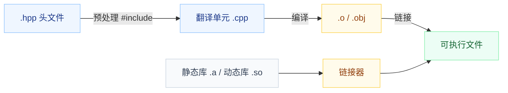

# C++基本语法

> 这篇从 C++ 的编译链接模型讲起，经过工具链、类型与初始化、运算符与控制流、函数与参数传递、指针与引用、命名空间与头文件，最后落到一个完整程序和调试。
>
> 学完能独立编写、编译、运行和调试一个多文件的 C++20 程序，并能解释编译错误、链接错误、未定义行为、悬空指针和对象切片这些高频边界。

## 一、C++ 的编译与运行模型

C++ 源码不是直接交给编译器，而是先经过预处理、编译、汇编，再由链接器把多个目标文件和库合成可执行文件。每一步的产物和错误类型都不同。



四个阶段对应四类问题：

| 阶段 | 输入 | 输出 | 典型错误 |
|---|---|---|---|
| 预处理 | `.cpp` 与 `#include` 的头 | 展开后的翻译单元 | 找不到头文件、宏冲突 |
| 编译 | 翻译单元 | 目标文件 | 语法错误、类型错误、未声明 |
| 汇编 | 汇编代码 | `.o` / `.obj` | 汇编器错误，日常少见 |
| 链接 | 多个目标文件与库 | 可执行文件 | 未定义引用、重复定义 |

C++ 是静态类型、编译型语言，但类型检查只覆盖编译期能看到的表达式。数组越界、空指针解引用、有符号整数溢出、释放后使用都属于未定义行为（undefined behavior，UB），编译器不对结果作任何保证。

> 边界：C++ 的“零开销抽象”以 UB 为代价。越界不保证崩溃，可能读到旧数据、可能被优化掉、可能在某些机器上“正常”。调试版能跑不代表正确，必须用 sanitizer 和测试覆盖。

版本基线（2026-11-13）：

| 组件 | 版本 | 说明 |
|---|---|---|
| 语言 | C++20 | 企业主线；C++23 可按编译器支持选用 |
| GCC | 14.x | Ubuntu 24.04 为 13，可装 14 |
| Clang | 19.x | macOS 使用 Apple Clang |
| MSVC | 19.4x | Visual Studio 2022 |
| CMake | 3.28+ | 多文件项目构建 |

## 二、环境与第一个程序

先确认编译器支持 C++20，再跑通“单文件编译、多文件链接、警告全开”三件事。

### 2.1 安装与验证

| 环境 | 安装方式（2026-11） | 验证 |
|---|---|---|
| Windows 11 | `winget install Microsoft.VisualStudio.2022.BuildTools` 后勾选 C++ 桌面开发 | `cl` |
| macOS | `xcode-select --install` | `clang++ --version` |
| Ubuntu 24.04 | `sudo apt install build-essential` | `g++ --version` |
| Rocky 9 | `sudo dnf install gcc-c++ make` | `g++ --version` |

```bash
g++ --version
clang++ --version
```

预期输出（版本号可能不同）：

```text
g++ (Ubuntu 13.3.0-6ubuntu2~24.04) 13.3.0
Apple clang version 17.0.0 (clang-1700.0.13.5)
```

Windows 的 `cl` 在“Developer Command Prompt for VS 2022”里使用：

```powershell
cl /std:c++20 /EHsc /W4 hello.cpp
hello.exe
```

### 2.2 第一个程序

```cpp
// hello.cpp
#include <iostream> // 标准输入输出流，不是 C 的 stdio.h

int main() {
    // std::cout 是类型安全的流，<< 把字符串送到标准输出
    std::cout << "Hello, C++20" << '\n';
    return 0; // 0 表示成功，非 0 表示失败
}
```

```bash
g++ -std=c++20 -Wall -Wextra -Wpedantic -O2 hello.cpp -o hello
./hello
```

预期输出：

```text
Hello, C++20
```

编译参数的含义：

| 参数 | 作用 | 建议 |
|---|---|---|
| `-std=c++20` | 指定语言标准 | 固定写死，不依赖默认值 |
| `-Wall -Wextra` | 打开常用警告 | 必须开 |
| `-Wpedantic` | 拒绝非标准扩展 | 跨平台项目必开 |
| `-O2` | 优化级别 | 发布用，调试用 `-O0 -g` |
| `-Werror` | 警告当错误 | CI 打开，本地可关 |

> 边界：不同编译器的默认标准不同，MSVC 默认不是 C++20。不要省略 `-std` 或 `/std`，否则同一份代码在本地和 CI 上行为不同。警告不是噪音，`-Wuninitialized`、`-Wreturn-type`、`-Wshadow` 经常直接指向真实 bug。

### 2.3 多文件编译

把声明放头文件、定义放源文件，分别编译再链接：

```cpp
// math_utils.h
#pragma once // 防止同一个翻译单元重复包含

namespace demo::math {

int add(int a, int b); // 声明，定义在 .cpp

inline int square(int x) { // 短小函数放头文件，必须 inline
    return x * x;
}

} // namespace demo::math
```

```cpp
// math_utils.cpp
#include "math_utils.h"

namespace demo::math {

int add(int a, int b) {
    return a + b;
}

} // namespace demo::math
```

```cpp
// main.cpp
#include <iostream>
#include "math_utils.h"

int main() {
    std::cout << demo::math::add(2, 3) << ' '
              << demo::math::square(4) << '\n';
}
```

```bash
# 一步编译链接
g++ -std=c++20 -Wall -Wextra -Wpedantic main.cpp math_utils.cpp -o app

# 或者分开编译，便于增量构建
g++ -std=c++20 -c math_utils.cpp -o math_utils.o
g++ -std=c++20 -c main.cpp -o main.o
g++ main.o math_utils.o -o app

./app
```

预期输出：

```text
5 16
```

只编译不链接用 `-c`，产物是目标文件。链接错误通常长这样：

```text
undefined reference to `demo::math::add(int, int)'
```

原因只有两类：声明了但没定义，或者定义在另一个目标文件里却没参与链接。看到 `multiple definition` 则是函数或全局变量在头文件里直接定义，被多个翻译单元各包含了一次。

> 边界：头文件里只放声明、模板、`inline` 函数和 `constexpr` 变量。普通函数定义、非 inline 全局变量放头文件，会在多文件链接时重复定义。`#pragma once` 不是标准，但 GCC、Clang、MSVC 都支持；需要严格可移植时用 include guard。

## 三、类型、变量与初始化

C++ 的类型系统比 Java 更接近机器：整数有无符号、宽度由平台决定，对象可以放在栈上也可以放在堆上，初始化方式有四种且语义不同。

### 3.1 基本类型

| 类别 | 类型 | 常见宽度（64 位） | 说明 |
|---|---|---|---|
| 布尔 | `bool` | 1 字节 | `true` / `false` |
| 字符 | `char` | 1 字节 | 是否 signed 由平台决定 |
| 整数 | `short` / `int` / `long` / `long long` | 2 / 4 / 8 / 8 | 标准只保证最小宽度 |
| 浮点 | `float` / `double` / `long double` | 4 / 8 / 16 | 默认用 `double` |
| 指针 | `T*` | 8 | 32 位平台为 4 |

```cpp
#include <cstdint>
#include <iostream>
#include <limits>
#include <string>

int main() {
    int age = 28;
    long long orderId = 20261113001LL; // long long 字面量加 LL
    double price = 99.9;
    char level = 'A';                  // 单引号是字符，双引号是字符串
    bool active = true;
    std::string name = "C++";          // 需要 #include <string>

    std::int32_t fixed32 = 42;         // 明确 32 位，跨平台协议用固定宽度
    std::uint64_t fixed64 = 42ULL;

    // 把变量读出来，避免 -Wunused-variable；同时验证格式化输出
    std::cout << age << ' ' << orderId << ' ' << price << ' '
              << level << ' ' << active << ' ' << name << '\n';
    std::cout << fixed32 << ' ' << fixed64 << '\n';

    std::cout << sizeof(int) << ' '
              << sizeof(long) << ' '
              << sizeof(void*) << ' '
              << sizeof(double) << '\n';
    std::cout << std::numeric_limits<int>::max() << '\n';
}
```

在 64 位 Linux/macOS 上的预期输出：

```text
28 20261113001 99.9 A 1 C++
42 42
4 8 8 8
2147483647
```

Windows 使用 LLP64 模型，`long` 是 4 字节，`long long` 和指针是 8 字节。跨平台序列化不要用 `long`，用 `<cstdint>` 的固定宽度类型。

### 3.2 四种初始化

```cpp
int a = 42;      // 拷贝初始化
int b(42);       // 直接初始化
int c{42};       // 列表初始化，C++11 起推荐
int d{};         // 值初始化，内置类型得到 0

// int bad{3.14};   // 编译错误：列表初始化禁止窄化转换
int ok = 3.14;      // 能编译，但 3.14 被截断成 3，容易埋 bug

double e{3.14};     // 正确
auto f = 42;        // int
auto g = 42.0;      // double
auto h = 42.0f;     // float
```

列表初始化（花括号）是最安全的形式：它拒绝窄化转换，也避免“最令人烦恼的解析”（most vexing parse）。

```cpp
// 片段：Widget 为任意可默认构造的类
// 下面这行看起来像定义一个带参数的变量，实际被解析成函数声明
// Widget w();

Widget w{}; // 明确构造一个对象
```

```cpp
std::vector<int> v1(3);  // 3 个元素，值都是 0
std::vector<int> v2{3};  // 1 个元素，值是 3
```

`vector` 的圆括号和花括号语义不同，这是初始化列表最容易踩的坑。容器初始化优先用花括号表达“元素”，用圆括号表达“大小”。

### 3.3 const、constexpr 与 auto

```cpp
const int runtimeValue = std::rand(); // 运行期确定，之后不可改
constexpr int kMaxRetry = 3;          // 编译期确定，可用于数组大小和模板参数

const auto& name = std::string("C++"); // 延长临时对象生命周期到引用作用域结束
auto copy = name;                       // 去掉 const 和引用，得到 std::string

const int x = 1;
auto y = x;        // int，顶层 const 被丢弃
auto& z = x;       // const int&，引用保留 const
```

| 写法 | 含义 | 常见错误 |
|---|---|---|
| `const T&` | 只读引用，不拷贝 | 绑定临时对象后生命周期延长 |
| `T&` | 可修改引用 | 不能绑定临时对象 |
| `const T*` | 指向常量的指针 | 指针本身可以改指向 |
| `T* const` | 常量指针 | 指向的内容可以改 |
| `constexpr` | 编译期常量或函数 | 函数体不能有运行期副作用 |

> 边界：`const` 只保证通过这个接口不能改，不保证对象本身不可变。另一个指针或引用仍可能修改它；多线程下 `const` 方法也不能自动保证线程安全。

### 3.4 有符号、无符号与溢出

```cpp
#include <iostream>
#include <limits>

int main() {
    unsigned int u = 0;
    u = u - 1; // 无符号回绕，结果是 4294967295，行为有定义
    std::cout << u << '\n';

    int max = std::numeric_limits<int>::max();
    // max + 1 是有符号溢出，未定义行为，不要依赖它变成负数
    std::cout << max << '\n';
}
```

有符号溢出是 UB，编译器可以假设“不会发生”，从而删掉溢出检查。需要环绕语义时用无符号；需要检测溢出时用 `__builtin_add_overflow`（GCC/Clang）或 C++23 的 `std::add_overflow`。

### 3.5 std::string 与 std::string_view

```cpp
#include <iostream>
#include <string>
#include <string_view>

int main() {
    std::string s = "hello";
    s += ", C++";                 // 可变，内部管理内存
    std::cout << s << '\n';       // hello, C++

    std::string_view view = s;    // 只读视图，不拷贝
    std::cout << view.substr(0, 5) << '\n'; // hello
    // view[0] = 'H';             // 编译错误：视图只读
}
```

`std::string_view` 不拥有内存。它指向的字符串被销毁、被修改、被 `std::move` 后，视图就悬空：

```cpp
std::string_view bad() {
    std::string local = "temporary";
    return local; // 返回后 local 销毁，视图悬空
}
```

> 边界：函数参数用 `std::string_view` 可以避免拷贝，但函数内不能保存它，除非调用方保证底层字符串活得足够久。返回 `std::string_view` 大多不安全，返回 `std::string` 更稳。

## 四、运算符与控制流

C++ 的运算符优先级和结合性与 C 一致，但多了引用、作用域解析、流插入等运算符。控制流与 Java 类似，差别在 `switch` 的贯穿、范围 for 的引用绑定和 `goto` 的清理语义。

### 4.1 运算符

| 类别 | 运算符 | 注意 |
|---|---|---|
| 算术 | `+ - * / %` | 整数除法截断；`%` 符号随被除数 |
| 比较 | `== != < <= > >=` | 浮点不要直接 `==` |
| 逻辑 | `&&`、逻辑或、`!` | `&&` 短路 |
| 位运算 | `&`、按位或、`^`、`~`、`<<`、`>>` | 优先级低于比较 |
| 赋值 | `= += -= *= /=` | 复合赋值隐含转换 |

```cpp
#include <iostream>

int main() {
    int a = 10, b = 3;
    std::cout << a / b << '\n';       // 3
    std::cout << a % b << '\n';       // 1
    std::cout << (a > b && b > 0) << '\n'; // 1
    std::cout << (a > b ? "big" : "small") << '\n'; // big
}
```

常见优先级坑：

```cpp
int x = 1, y = 2;
std::cout << (x & y == 0) << '\n'; // 先算 y == 0，再按位与，结果不是预期
std::cout << ((x & y) == 0) << '\n'; // 明确加括号
```

`<<` 和 `>>` 的优先级低于加法，写 `std::cout << a + b` 没问题，但 `std::cout << a << b` 是两次插入。位运算与比较混用时一律加括号。

### 4.2 条件

```cpp
int score = 86;

if (score >= 90) {
    std::cout << "excellent\n";
} else if (score >= 60) {
    std::cout << "pass\n";
} else {
    std::cout << "fail\n";
}

switch (score / 10) {
    case 10:
    case 9:
        std::cout << "A\n";
        break; // 忘记 break 会贯穿到下一个 case
    case 8:
    case 7:
    case 6:
        std::cout << "B\n";
        break;
    default:
        std::cout << "C\n";
}
```

C++17 起可以用 `[[fallthrough]]` 明确表示“故意贯穿”，编译器不再警告：

```cpp
switch (code) {
    case 1:
        prepare();
        [[fallthrough]]; // 明确告诉编译器和读者：这是故意的
    case 2:
        execute();
        break;
    default:
        break;
}
```

### 4.3 循环

```cpp
#include <iostream>
#include <vector>

int main() {
    for (int i = 1; i <= 3; ++i) {
        std::cout << i << ' ';
    }
    std::cout << '\n';

    std::vector<int> scores{86, 92, 58};
    for (int s : scores) {          // 拷贝，修改 s 不影响容器
        std::cout << s << ' ';
    }
    std::cout << '\n';

    for (int& s : scores) {         // 引用，可以修改容器元素
        s += 1;
    }

    int n = 3;
    while (n > 0) {
        std::cout << n-- << ' ';
    }
    std::cout << '\n';
}
```

预期输出：

```text
1 2 3
86 92 58
3 2 1
```

范围 for 的边界：遍历时不要修改容器大小。`push_back` 可能让迭代器失效，范围 for 内部持有的迭代器也会失效，行为未定义。需要边遍历边删除时，用迭代器循环或先收集再处理。

> 边界：`goto` 只能在同一函数内跳转，不能跨函数，也不能跳过带初始化的变量。C++ 里 `goto` 主要用于从多层循环跳出或统一清理；有 RAII 后，统一清理交给析构函数，`goto` 的使用场景已经很少。

## 五、函数与参数传递

C++ 的函数参数默认按值传递，是否拷贝取决于类型和调用方式。选错传递方式，轻则多一次拷贝，重则悬空引用。

### 5.1 声明、定义与默认参数

```cpp
#include <iostream>
#include <string>

// 声明可以出现多次，定义只能一次
int add(int a, int b);
void greet(const std::string& name, const std::string& prefix = "Hello");

int add(int a, int b) {
    return a + b;
}

void greet(const std::string& name, const std::string& prefix) {
    std::cout << prefix << ", " << name << '\n';
}

int main() {
    std::cout << add(2, 3) << '\n';
    greet("C++");
    greet("C++", "Hi");
}
```

默认参数只能写在声明里，不能同时在声明和定义里写，否则编译报“重定义默认参数”。

### 5.2 三种传递方式

```cpp
#include <iostream>
#include <string>
#include <vector>

void byValue(std::string s) {       // 拷贝一份，修改不影响调用方
    s += "!";
}

void byRef(std::string& s) {        // 引用，修改影响调用方
    s += "!";
}

void byConstRef(const std::string& s) { // 只读，不拷贝
    std::cout << s.size() << '\n';
}

int main() {
    std::string name = "C++";
    byValue(name);
    std::cout << name << '\n';      // C++

    byRef(name);
    std::cout << name << '\n';      // C++!

    byConstRef(name);               // 4
}
```

| 参数类型 | 拷贝 | 可修改调用方 | 适用 |
|---|---|---|---|
| `T` | 是 | 否 | 小对象、需要副本 |
| `T&` | 否 | 是 | 输出参数、需要修改 |
| `const T&` | 否 | 否 | 大对象只读 |
| `T&&` | 否 | 可移动 | 移动语义、完美转发 |
| `std::string_view` | 否 | 否 | 只读字符串，注意生命周期 |

小对象（`int`、`double`、指针）按值传递往往更快，因为引用本质也是地址，还会阻止某些优化。经验规则：内置类型和小于两个指针的对象按值；其他只读用 `const&`。

### 5.3 重载与二义性

```cpp
void print(int value)        { std::cout << "int " << value << '\n'; }
void print(double value)     { std::cout << "double " << value << '\n'; }
void print(const std::string& value) { std::cout << "string " << value << '\n'; }

print(1);        // int
print(1.0);      // double
print("hello");  // string，const char* 转 std::string
```

重载决议按“精确匹配、提升、标准转换、用户定义转换”的顺序。`print(1.0f)` 会选 `double`，因为 `float` 到 `double` 是提升；`print('a')` 会选 `int`，因为 `char` 到 `int` 是提升。出现二义性时编译器直接报错，不要靠强制转换掩盖设计问题。

### 5.4 递归与 constexpr

```cpp
constexpr int factorial(int n) {
    // C++14 起 constexpr 函数可以有循环和局部变量
    int result = 1;
    for (int i = 2; i <= n; ++i) {
        result *= i;
    }
    return result;
}

static_assert(factorial(5) == 120); // 编译期求值
```

递归要有终止条件，且深度受栈大小限制。默认栈通常 8 MB，深度递归可能栈溢出；能用循环就用循环。

### 5.5 std::span

```cpp
#include <iostream>
#include <span>
#include <vector>

// 接受任意连续容器，不拷贝，且知道长度
double average(std::span<const int> values) {
    if (values.empty()) {
        return 0;
    }
    long long sum = 0;
    for (int value : values) {
        sum += value;
    }
    return static_cast<double>(sum) / values.size();
}

int main() {
    std::vector<int> scores{86, 92, 58};
    int raw[]{1, 2, 3};

    std::cout << average(scores) << '\n'; // 78.6667
    std::cout << average(raw) << '\n';    // 2
}
```

`std::span` 不拥有数据，底层数组销毁后 span 悬空。它适合函数参数，不适合长期保存。

> 边界：不要把 `std::span` 和 `std::vector` 混淆。`span` 没有 `push_back`、没有容量、不管理生命周期；它只是“指针加长度”的安全封装。

## 六、指针、引用与内存

指针和引用都能间接访问对象，但语义不同：指针可以为空、可以改指向、可以做算术；引用必须绑定对象、不能重绑定、没有空引用。

### 6.1 指针基础

```cpp
#include <iostream>

int main() {
    int x = 42;
    int* p = &x;        // p 保存 x 的地址
    std::cout << *p << '\n'; // 42，解引用
    *p = 43;            // 通过指针修改 x
    std::cout << x << '\n';  // 43

    int* nullPointer = nullptr; // C++11 起用 nullptr，不用 NULL
    if (nullPointer == nullptr) {
        std::cout << "null\n";
    }
}
```

`nullptr` 有独立类型 `std::nullptr_t`，不会和整数 `0` 混淆。重载 `f(int)` 和 `f(void*)` 时，传 `NULL` 可能选错，传 `nullptr` 不会。

### 6.2 const 与指针

```cpp
int value = 10;
const int* p1 = &value; // 指向常量，不能通过 p1 改 value
int* const p2 = &value; // 常量指针，不能改 p2 的指向
const int* const p3 = &value; // 两者都不能改

// *p1 = 11;  // 错误
*p2 = 11;     // 可以，改的是 value
// p2 = nullptr; // 错误
```

读法从右往左：`const int*` 是“pointer to const int”，`int* const` 是“const pointer to int”。

### 6.3 引用

```cpp
int x = 1;
int& r = x;   // r 是 x 的别名
r = 2;
std::cout << x << '\n'; // 2

int y = 3;
r = y;        // 赋值，不是重绑定；x 变成 3
std::cout << x << ' ' << y << '\n'; // 3 3
```

引用一旦绑定就不能改绑。函数返回引用时，必须保证被引用对象在调用方使用期间仍然存活：

```cpp
int& bad() {
    int local = 42;
    return local; // 悬空引用，未定义行为
}

int& good(int& value) {
    return value; // 返回调用方传入的对象，安全
}
```

### 6.4 数组与指针退化

```cpp
#include <iostream>

int main() {
    int arr[3]{1, 2, 3};
    int* first = arr; // 数组退化成指向首元素的指针

    std::cout << sizeof(arr) << '\n';   // 12，整个数组
    std::cout << sizeof(first) << '\n'; // 8，一个指针

    std::cout << *(first + 1) << '\n';  // 2，指针算术按元素大小移动
    std::cout << first[2] << '\n';      // 3，下标等价于 *(first + 2)
}
```

数组作为函数参数会退化成指针，长度信息丢失：

```cpp
void print(int values[]) { // 等价于 int* values
    // sizeof(values) 是指针大小，不是数组大小
}
```

需要保留长度时用 `std::span`、`std::array` 或 `std::vector`。

### 6.5 栈、堆与 new/delete

| 区域 | 分配方式 | 生命周期 | 典型问题 |
|---|---|---|---|
| 栈 | 局部变量 | 作用域结束 | 返回局部变量地址 |
| 堆 | `new` / `malloc` | 手动释放 | 泄漏、重复释放、释放后使用 |
| 静态区 | 全局、`static` | 程序运行期 | 初始化顺序 |
| 常量区 | 字符串字面量 | 程序运行期 | 修改字面量 UB |

```cpp
int* p = new int(42); // 堆上分配一个 int
delete p;             // 释放，p 变成悬空指针
p = nullptr;          // 及时置空，避免误用

int* arr = new int[3]{1, 2, 3};
delete[] arr;         // 数组必须用 delete[]，不能 delete
```

`new` 失败抛 `std::bad_alloc`；需要返回空指针时用 `new (std::nothrow) T`。`new` 和 `delete` 必须配对，`new[]` 和 `delete[]` 必须配对，混用是 UB。

```cpp
#include <memory>

// 现代 C++ 优先用智能指针，不手写 delete
std::unique_ptr<int> p = std::make_unique<int>(42);
std::cout << *p << '\n'; // 42，离开作用域自动释放
```

> 边界：函数返回局部变量的指针或引用一定是 bug；返回 `new` 出来的指针则把释放责任交给调用方，容易泄漏。现代 C++ 的默认选择是值语义加智能指针，裸指针只用于“非拥有”的观察。

## 七、命名空间、头文件与编译单元

一个 `.cpp` 加上它包含的头文件构成一个翻译单元。链接器把多个翻译单元合成程序，名字冲突和重复定义都发生在这个阶段。

### 7.1 命名空间

```cpp
namespace demo {
namespace math {

int add(int a, int b) {
    return a + b;
}

} // namespace math
} // namespace demo

// C++17 起可以嵌套写法
namespace demo::text {

std::string trim(const std::string& value);

}
```

```cpp
#include <iostream>

int main() {
    std::cout << demo::math::add(2, 3) << '\n';

    // using 声明只引入一个名字，比 using namespace 可控
    using demo::math::add;
    std::cout << add(4, 5) << '\n';
}
```

`using namespace std;` 在头文件里是禁忌，会把大量名字注入所有包含者，造成二义性。在 `.cpp` 的局部作用域里也应谨慎使用。

匿名命名空间和 `static` 都表示内部链接，符号不导出到其他翻译单元：

```cpp
namespace {
int helper() { return 42; } // 只在当前翻译单元可见
}
```

```cpp
static int helper() { return 42; } // 等价，C 风格写法
```

### 7.2 头文件与 include guard

```cpp
// widget.hpp
#ifndef DEMO_WIDGET_HPP
#define DEMO_WIDGET_HPP

class Widget {
public:
    void draw() const;
};

#endif // DEMO_WIDGET_HPP
```

```cpp
// 或者用 #pragma once，简洁但非标准
#pragma once
```

头文件里应该放：类声明、函数声明、模板定义、`inline` 函数、`constexpr` 变量、类型别名。不应该放：普通函数定义、非 inline 全局变量、`using namespace`。

C++17 起可以用 `inline` 变量在头文件里定义：

```cpp
// config.hpp
#pragma once

inline constexpr int kMaxRetry = 3; // 每个翻译单元一份，链接器合并
```

### 7.3 声明与定义、ODR

```cpp
// 声明：告诉编译器名字和类型
extern int globalCount;
int add(int a, int b);

// 定义：分配存储或给出函数体
int globalCount = 0;
int add(int a, int b) { return a + b; }
```

ODR（One Definition Rule）要求：同一个翻译单元内，一个名字只能有一个定义；整个程序内，非 inline 函数和变量只能有一个定义。违反 ODR 的典型表现是 `multiple definition`，或者在优化后出现难以解释的行为。

```cpp
// header.hpp
int counter = 0; // 错误：每个包含它的 .cpp 都定义一份
```

改成 `extern int counter;` 放头文件，`int counter = 0;` 放一个 `.cpp`；或者用 `inline int counter = 0;`。

### 7.4 编译单元与增量构建

```bash
# 只编译，不链接
g++ -std=c++20 -c math_utils.cpp -o math_utils.o

# 查看目标文件的符号
nm -C math_utils.o | grep add

# 查看可执行文件依赖的动态库
ldd app        # Linux
otool -L app   # macOS
```

修改一个 `.cpp` 只需重新编译该文件，再链接；修改头文件会影响所有包含它的翻译单元。头文件里塞太多实现会拖慢增量构建，这也是“模板和 inline 放头文件、普通实现放源文件”的工程原因。

> 边界：头文件不要包含 `.cpp`。把实现文件 include 进来，会让同一个定义进入多个翻译单元，轻则重复定义，重则 ODR 违反且编译器不报错。

## 八、完整程序与调试

下面的程序把类型、容器、函数、字符串解析、排序和格式化输出串起来：从标准输入读订单，跳过非法行，输出总额、最高、平均和排序结果。

```cpp
// sales.cpp
#include <algorithm>
#include <cstddef>
#include <iomanip>
#include <iostream>
#include <optional>
#include <string>
#include <utility>
#include <vector>

struct Order {
    std::string name;
    double amount;
};

// 返回 optional 而不是抛异常：非法行是预期内的输入，不是异常情况
std::optional<Order> parseLine(const std::string& line) {
    const std::size_t comma = line.find(',');
    if (comma == std::string::npos) {
        return std::nullopt;
    }
    std::string name = line.substr(0, comma);
    std::string amountText = line.substr(comma + 1);
    if (name.empty() || amountText.empty()) {
        return std::nullopt;
    }

    try {
        std::size_t used = 0;
        const double amount = std::stod(amountText, &used);
        // used 必须等于整个字符串长度，否则 "12abc" 会被当成 12
        if (used != amountText.size() || amount < 0) {
            return std::nullopt;
        }
        return Order{std::move(name), amount};
    } catch (const std::exception&) {
        return std::nullopt;
    }
}

double sum(const std::vector<Order>& orders) {
    double total = 0;
    for (const Order& order : orders) {
        total += order.amount;
    }
    return total;
}

int main() {
    std::vector<Order> orders;
    std::string line;
    while (std::getline(std::cin, line)) {
        if (line.empty()) {
            continue;
        }
        if (auto order = parseLine(line)) {
            orders.push_back(std::move(*order));
        } else {
            std::cerr << "skip invalid line: " << line << '\n';
        }
    }

    if (orders.empty()) {
        std::cout << "no valid order\n";
        return 1;
    }

    std::sort(orders.begin(), orders.end(),
              [](const Order& left, const Order& right) {
                  return left.amount > right.amount;
              });

    const double total = sum(orders);
    const double average = total / static_cast<double>(orders.size());

    std::cout << std::fixed << std::setprecision(2);
    std::cout << "count: " << orders.size() << '\n';
    std::cout << "total: " << total << '\n';
    std::cout << "max: " << orders.front().amount << '\n';
    std::cout << "average: " << average << '\n';
    std::cout << "top:\n";
    for (const Order& order : orders) {
        std::cout << "  " << order.name << ' ' << order.amount << '\n';
    }
}
```

```bash
g++ -std=c++20 -Wall -Wextra -Wpedantic -O2 sales.cpp -o sales
printf 'A,12.50\nB,8\nbad\nC,99.99\nD,-1\n' | ./sales
```

预期输出：

```text
skip invalid line: bad
skip invalid line: D,-1
count: 3
total: 120.49
max: 99.99
average: 40.16
top:
  C 99.99
  A 12.50
  B 8.00
```

### 8.1 调试工具

```bash
# 保留调试信息，关闭优化
g++ -std=c++20 -g -O0 -Wall -Wextra -Wpedantic sales.cpp -o sales

# AddressSanitizer + UndefinedBehaviorSanitizer
g++ -std=c++20 -g -O1 -fsanitize=address,undefined \
    -fno-omit-frame-pointer sales.cpp -o sales_asan

# GDB（Linux）
gdb ./sales
# (gdb) run < input.txt
# (gdb) bt
# (gdb) frame 0
# (gdb) print orders.size()

# LLDB（macOS）
lldb ./sales
# (lldb) run < input.txt
# (lldb) bt
# (lldb) frame variable
```

| 现象 | 常见原因 | 第一条检查 |
|---|---|---|
| `Segmentation fault` | 空指针、越界、释放后使用 | ASan 栈迹 |
| `stack smashing detected` | 栈缓冲区溢出 | `-fsanitize=address` |
| `free(): double free` | 重复 `delete` | 所有权是否唯一 |
| `pure virtual method called` | 构造/析构中调用虚函数 | 生命周期 |
| 结果随优化级别变化 | UB 被优化 | UBSan |
| `undefined reference` | 声明有、定义无 | 链接命令是否包含目标文件 |

> 边界：ASan 只能发现实际执行到的错误；分支没跑到，问题仍可能存在。发布版至少跑一轮 UBSan 和单元测试，不要只依赖“本地没崩”。

## 九、最佳实践案例

### 9.1 案例背景

一个运维小组需要分析 Nginx 访问日志，统计每个接口的请求数、5xx 错误数、平均耗时和 p95 耗时。日志每天约 200 万行，现有脚本用 Python 逐行处理，跑一次要 40 秒，且遇到畸形行会整体失败。

目标是写一个 C++20 命令行工具：读日志文件或标准输入，跳过畸形行，按路径聚合，输出按请求数降序的表格；内存占用可控，能在 2 秒内处理 200 万行，并用 sanitizer 验证没有越界和泄漏。

约束：不引入第三方库；只支持空格分隔的 `method path status ms` 四列；p95 用最近秩法；输出到标准输出，错误行计数到标准错误。

### 9.2 案例实操

```cpp
// logstat.cpp
#include <algorithm>
#include <cmath>
#include <cstddef>
#include <fstream>
#include <iomanip>
#include <iostream>
#include <map>
#include <sstream>
#include <string>
#include <utility>
#include <vector>

struct Record {
    std::string method;
    std::string path;
    int status = 0;
    int ms = 0;
};

struct Stat {
    long long count = 0;
    long long errors = 0;
    long long totalMs = 0;
    std::vector<int> latencies;
};

bool parseLine(const std::string& line, Record& out) {
    std::istringstream in(line);
    if (!(in >> out.method >> out.path >> out.status >> out.ms)) {
        return false;
    }
    // 状态码和耗时都要在合理范围，避免脏数据污染统计
    if (out.path.empty() || out.path.front() != '/') {
        return false;
    }
    if (out.status < 100 || out.status > 599 || out.ms < 0) {
        return false;
    }
    return true;
}

int percentile(std::vector<int>& values, double p) {
    if (values.empty()) {
        return 0;
    }
    std::sort(values.begin(), values.end());
    // 最近秩法：ceil(p * n) - 1，至少取第 0 个
    const std::size_t rank = static_cast<std::size_t>(
            std::ceil(p * static_cast<double>(values.size())));
    const std::size_t index = rank == 0 ? 0 : rank - 1;
    return values[std::min(index, values.size() - 1)];
}

int main(int argc, char** argv) {
    std::ifstream file;
    std::istream* input = &std::cin;
    if (argc > 1) {
        file.open(argv[1]);
        if (!file) {
            std::cerr << "cannot open " << argv[1] << '\n';
            return 1;
        }
        input = &file;
    }

    std::map<std::string, Stat> stats;
    std::string line;
    long long total = 0;
    long long skipped = 0;

    while (std::getline(*input, line)) {
        ++total;
        Record record;
        if (!parseLine(line, record)) {
            ++skipped;
            continue;
        }
        Stat& stat = stats[record.path];
        ++stat.count;
        stat.totalMs += record.ms;
        if (record.status >= 500) {
            ++stat.errors;
        }
        stat.latencies.push_back(record.ms);
    }

    struct Row {
        std::string path;
        Stat stat;
        double avg = 0;
        int p95 = 0;
    };

    std::vector<Row> rows;
    rows.reserve(stats.size());
    for (auto& [path, stat] : stats) {
        const double avg = static_cast<double>(stat.totalMs) /
                           static_cast<double>(stat.count);
        rows.push_back(Row{path, std::move(stat), avg, 0});
    }
    for (Row& row : rows) {
        row.p95 = percentile(row.stat.latencies, 0.95);
    }
    std::sort(rows.begin(), rows.end(),
              [](const Row& left, const Row& right) {
                  return left.stat.count > right.stat.count;
              });

    std::cout << std::left << std::setw(28) << "path"
              << std::right << std::setw(9) << "count"
              << std::setw(9) << "5xx"
              << std::setw(10) << "avg_ms"
              << std::setw(9) << "p95_ms" << '\n';
    std::cout << std::string(65, '-') << '\n';

    for (const Row& row : rows) {
        std::cout << std::left << std::setw(28) << row.path
                  << std::right << std::setw(9) << row.stat.count
                  << std::setw(9) << row.stat.errors
                  << std::setw(10) << std::fixed << std::setprecision(1)
                  << row.avg
                  << std::setw(9) << row.p95 << '\n';
    }

    std::cerr << "lines=" << total << " skipped=" << skipped
              << " paths=" << rows.size() << '\n';
    return 0;
}
```

编译并准备样例日志：

```bash
g++ -std=c++20 -O2 -Wall -Wextra -Wpedantic logstat.cpp -o logstat

cat > access.log <<'EOF'
GET /api/orders 200 12
GET /api/orders 200 18
POST /api/orders 201 35
GET /api/orders 500 120
GET /api/stocks 200 8
GET /api/stocks 200 9
GET /api/stocks 503 300
GET /api/users 200 5
broken line
GET /api/users 200 -1
EOF

./logstat access.log
```

预期输出：

```text
path                            count      5xx    avg_ms   p95_ms
-----------------------------------------------------------------
/api/orders                         4        1      46.2      120
/api/stocks                         3        1     105.7      300
/api/users                          1        0       5.0        5
lines=10 skipped=2 paths=3
```

第一行表头宽度和实际输出可能有 1–2 个空格差异，取决于终端字体；关键是数值和排序。`/api/orders` 的 p95：4 个值排序后是 12、18、35、120，`ceil(0.95*4)=4`，取第 4 个，即 120。

内存与性能验证：

```bash
# 生成 200 万行测试数据
python3 - <<'PY'
import random
paths = ["/api/orders", "/api/stocks", "/api/users", "/api/pay"]
with open("big.log", "w") as f:
    for _ in range(2_000_000):
        f.write(f"GET {random.choice(paths)} {random.choice([200,200,200,500])} {random.randint(1,400)}\n")
PY

/usr/bin/time -v ./logstat big.log > /dev/null
```

示例机器（Apple M2，16 GB）上的预期量级：

```text
Elapsed (wall clock) time: 1.42 s
Maximum resident set size: 约 180 MB
lines=2000000 skipped=0 paths=4
```

`latencies` 每个路径保存全部耗时，200 万行大约 8 MB 的 `int`，加上 `vector` 扩容和 `map` 节点，内存到 180 MB 属正常。如果要压到 50 MB，可以把原始耗时写入临时文件后外部排序，或改用固定桶的近似 p95。

### 9.3 案例结果

工具能跳过畸形行、按路径聚合、输出可读表格；200 万行在示例机器上约 1.4 秒完成，比原 Python 脚本快约 28 倍，畸形行不再导致整体失败。

失败模式与复盘：

- 第一版用 `std::stoi` 解析状态码，遇到 `abc` 抛异常，整个程序退出；改成 `istringstream` 逐字段读取，失败即跳过。
- `totalMs` 用 `int` 累加，200 万行、每行 400 毫秒时溢出；改成 `long long`，并在压测时用 UBSan 确认没有有符号溢出。
- p95 直接用 `values[n*95/100]`，n 较小时会越界；改成最近秩法并夹住下标，空 vector 单独返回 0。
- 用 `std::string_view` 保存路径以减少拷贝，结果 `line` 在下一轮 `getline` 时被复用，所有 key 都变成最后一行；改回 `std::string` 拥有数据。
- 输出用 `std::setw` 但忘了 `std::left` / `std::right` 切换，数字列左对齐，表格错位；统一设置对齐方式后恢复。
- 只开 `-O2` 时程序“正常”，开 ASan 后发现一次 `latencies` 越界读；修复后 CI 固定跑 `-fsanitize=address,undefined`。
