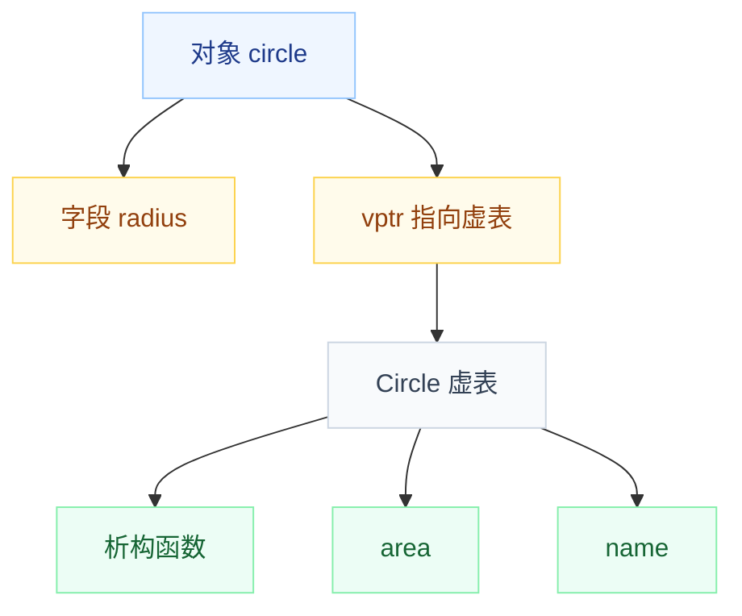
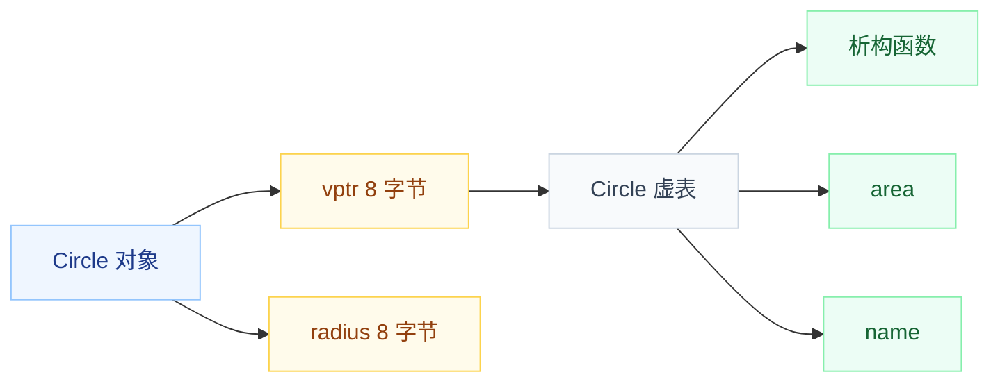

# C++面向对象与内存模型

> 这篇从 C++ 的对象模型讲起，经过类与封装、构造析构与 RAII、拷贝移动与值语义、继承多态与虚表、智能指针与所有权、内存布局与性能，最后落到一个带审计日志的定价引擎案例。
>
> 学完能独立设计值语义与多态对象、写 Rule of Five、用 RAII 管理资源、用智能指针表达所有权，并能解释对象切片、虚析构缺失、循环引用和悬空指针这些高频故障。

## 一、对象模型与类的边界

C++ 的类既是数据布局，也是行为契约。对象在内存里就是字段按声明顺序排列的一段字节，成员函数不占对象空间，虚函数通过虚表指针间接调用。

`class` 与 `struct` 的唯一语法差别是默认访问权限：`class` 默认 `private`，`struct` 默认 `public`。工程上通常用 `struct` 表示“公开的数据聚合”，用 `class` 表示“有不变式、需要封装的对象”。



类的四个边界：

| 能力 | 放在类里 | 不放在类里 |
|---|---|---|
| 不变式 | 字段范围、状态转换 | 跨对象业务规则 |
| 资源 | 构造获取、析构释放 | 全局单例、连接池 |
| 行为 | 只依赖自身状态的操作 | 需要多个服务协作的流程 |
| 布局 | 需要稳定 ABI 的数据 | 频繁变化的内部实现 |

封装不是“所有字段都写 getter/setter”。getter/setter 只是把 public 字段换成 public 方法，没有保护任何不变式。真正需要的是：构造时校验、修改时走有语义的方法、不暴露内部容器的可变引用。

```cpp
class Temperature {
public:
    explicit Temperature(double celsius) : celsius_(celsius) {
        // 构造时校验，保证对象一生都在合法范围
        if (celsius < -273.15) {
            throw std::invalid_argument("below absolute zero");
        }
    }

    double celsius() const { return celsius_; }
    double fahrenheit() const { return celsius_ * 9.0 / 5.0 + 32.0; }

private:
    double celsius_;
};
```

> 边界：C++ 的封装是编译期检查，不是安全边界。`reinterpret_cast`、`const_cast`、直接访问内存都能绕过 private；它防的是误用，不是恶意代码。

## 二、环境与最小类

沿用 C++ 语法篇的工具链。先写一个带构造、成员函数和 `const` 正确性的类，确认编译、运行、警告都正常。

### 2.1 编译器基线

版本基线（2026-11-13）：

| 组件 | 版本 | 说明 |
|---|---|---|
| 语言 | C++20 | 企业主线 |
| GCC | 14.x | Ubuntu 24.04 可装 14 |
| Clang | 19.x | macOS 使用 Apple Clang |
| MSVC | 19.4x | Visual Studio 2022 |

```bash
g++ --version
clang++ --version
```

预期输出：

```text
g++ (Ubuntu 13.3.0-6ubuntu2~24.04) 13.3.0
Apple clang version 17.0.0 (clang-1700.0.13.5)
```

### 2.2 第一个类

```cpp
// account.cpp
#include <iostream>
#include <stdexcept>
#include <string>
#include <utility>

class Account {
public:
    // 成员初始化列表直接构造字段，比函数体赋值少一次默认构造
    Account(std::string owner, double balance)
        : owner_(std::move(owner)), balance_(balance) {
        if (balance_ < 0) {
            throw std::invalid_argument("balance must be >= 0");
        }
    }

    void deposit(double amount) {
        if (amount <= 0) {
            throw std::invalid_argument("amount must be > 0");
        }
        balance_ += amount;
    }

    bool withdraw(double amount) {
        if (amount <= 0 || amount > balance_) {
            return false; // 业务失败用返回值，不用异常
        }
        balance_ -= amount;
        return true;
    }

    // const 成员函数承诺不修改对象，const 对象才能调用
    double balance() const { return balance_; }
    const std::string& owner() const { return owner_; }

private:
    std::string owner_;
    double balance_ = 0;
};

int main() {
    Account account{"alice", 100.0};
    account.deposit(50.0);
    std::cout << account.owner() << ' ' << account.balance() << '\n';

    if (!account.withdraw(500.0)) {
        std::cout << "insufficient\n";
    }
}
```

```bash
g++ -std=c++20 -Wall -Wextra -Wpedantic -O2 account.cpp -o account
./account
```

预期输出：

```text
alice 150
insufficient
```

`const` 正确性从第一天就要做：成员函数不修改对象就标 `const`，否则 const 对象、const 引用都无法调用。后补 `const` 会沿着调用链传染，成本很高。

> 边界：构造函数抛异常时，已构造完成的成员会按逆序析构，未完成构造的对象不会调用析构函数。构造函数里获取多个资源时，用 RAII 成员分别管理，异常时自动释放，不要手写 `try/catch` 清理。

## 三、构造、析构与 RAII

RAII（Resource Acquisition Is Initialization）是 C++ 管理资源的核心：构造函数获取资源，析构函数释放资源，对象的生命周期就是资源的生命周期。

### 3.1 构造函数的种类

```cpp
class Connection {
public:
    Connection() = default;                       // 默认构造
    explicit Connection(std::string host)          // 单参构造加 explicit，防止隐式转换
        : host_(std::move(host)) {}

    Connection(const Connection&) = delete;       // 禁止拷贝
    Connection& operator=(const Connection&) = delete;

    Connection(Connection&&) noexcept = default;  // 允许移动
    Connection& operator=(Connection&&) noexcept = default;

private:
    std::string host_;
};
```

| 写法 | 作用 | 常见错误 |
|---|---|---|
| `= default` | 让编译器生成 | 手写空实现会抑制优化 |
| `= delete` | 明确禁用 | 禁拷贝后忘记提供移动 |
| `explicit` | 禁止隐式转换 | 单参构造漏写，`f(42)` 意外构造 |
| 委托构造 | 一个构造调用另一个 | 循环委托 |
| 初始化列表 | 直接初始化成员 | 在函数体里赋值，多一次默认构造 |

### 3.2 析构顺序

```cpp
#include <iostream>

struct Member {
    explicit Member(std::string name) : name_(std::move(name)) {
        std::cout << "ctor " << name_ << '\n';
    }
    ~Member() { std::cout << "dtor " << name_ << '\n'; }
    std::string name_;
};

struct Owner {
    Member first{"first"};
    Member second{"second"};

    Owner() { std::cout << "Owner ctor\n"; }
    ~Owner() { std::cout << "Owner dtor\n"; }
};

int main() {
    Owner owner;
}
```

预期输出：

```text
ctor first
ctor second
Owner ctor
Owner dtor
dtor second
dtor first
```

构造顺序：基类 → 成员（按声明顺序）→ 构造函数体。析构顺序完全相反：析构函数体 → 成员逆序 → 基类。成员初始化列表的顺序不影响实际构造顺序，按声明顺序执行。

### 3.3 RAII 封装文件

```cpp
#include <cstdio>
#include <stdexcept>
#include <string>

class FileHandle {
public:
    explicit FileHandle(const std::string& path)
        : file_(std::fopen(path.c_str(), "r")) {
        if (file_ == nullptr) {
            // 构造失败就抛异常，对象不会被创建，析构也不会执行
            throw std::runtime_error("cannot open " + path);
        }
    }

    ~FileHandle() {
        if (file_ != nullptr) {
            std::fclose(file_);
        }
    }

    // 资源所有权唯一，禁止拷贝，避免两个对象析构同一文件
    FileHandle(const FileHandle&) = delete;
    FileHandle& operator=(const FileHandle&) = delete;

    // 移动把所有权转走，源对象置空，析构时不会重复关闭
    FileHandle(FileHandle&& other) noexcept : file_(other.file_) {
        other.file_ = nullptr;
    }

    FileHandle& operator=(FileHandle&& other) noexcept {
        if (this != &other) {
            if (file_ != nullptr) {
                std::fclose(file_);
            }
            file_ = other.file_;
            other.file_ = nullptr;
        }
        return *this;
    }

    std::FILE* get() const { return file_; }

private:
    std::FILE* file_ = nullptr;
};
```

```cpp
{
    FileHandle file("data.txt");
    // 使用 file.get()
} // 离开作用域自动 fclose，即使中间抛异常也会执行
```

> 边界：析构函数不能抛异常。析构在栈展开时执行，再抛异常会直接 `std::terminate`。需要记录错误时，在析构里捕获并写日志，或者提供显式的 `close()` 让调用方处理错误。

### 3.4 Rule of Zero 与 Rule of Five

如果一个类不需要手动管理资源，就不要写析构、拷贝、移动——编译器生成的版本是正确的，这叫 Rule of Zero。

如果类直接管理资源（裸指针、文件描述符、锁），需要显式定义五个特殊成员函数：

1. 析构函数；
2. 拷贝构造函数；
3. 拷贝赋值运算符；
4. 移动构造函数；
5. 移动赋值运算符。

只写析构不写拷贝，编译器仍会生成拷贝，导致两次释放；只禁拷贝不提供移动，容器里只能存指针。Rule of Five 不是“必须写五个”，而是“要么全管，要么全不管”。

## 四、拷贝、移动与值语义

C++ 的值语义意味着对象可以被拷贝、赋值、移动。理解这三件事，才能写出不泄漏、不重复释放、不意外共享的类。

### 4.1 拷贝与移动的时机

```cpp
Buffer a(3);          // 构造
Buffer b = a;         // 拷贝构造
Buffer c;
c = a;                // 拷贝赋值
Buffer d = std::move(a); // 移动构造，a 进入“有效但未指定”状态
c = std::move(d);     // 移动赋值
```

移动不是“移动内存”，而是“把资源所有权转走”。`std::move` 本身不移动任何东西，它只是一个强制转换，把左值转成右值引用，让编译器选择移动构造/移动赋值。

```cpp
std::string a = "hello";
std::string b = std::move(a);
// a 仍然有效，但内容未指定；不要假设它是空串
std::cout << a.size() << '\n'; // 可能是 0，也可能是其他值
```

### 4.2 Rule of Five 示例

```cpp
#include <algorithm>
#include <cstddef>
#include <iostream>
#include <utility>

class Buffer {
public:
    explicit Buffer(std::size_t size)
        : size_(size), data_(size_ ? new int[size_]{} : nullptr) {
        std::cout << "ctor " << size_ << '\n';
    }

    ~Buffer() {
        delete[] data_;
        std::cout << "dtor " << size_ << '\n';
    }

    Buffer(const Buffer& other)
        : size_(other.size_), data_(size_ ? new int[size_] : nullptr) {
        if (size_ != 0) {
            std::copy(other.data_, other.data_ + size_, data_);
        }
        std::cout << "copy " << size_ << '\n';
    }

    Buffer& operator=(const Buffer& other) {
        if (this == &other) {
            return *this; // 自赋值保护，否则先 delete 再读 other 会读已释放内存
        }
        Buffer copy(other);   // 先拷贝，成功后再交换，异常安全
        swap(copy);
        std::cout << "copy assign " << size_ << '\n';
        return *this;
    }

    Buffer(Buffer&& other) noexcept
        : size_(other.size_), data_(other.data_) {
        other.size_ = 0;
        other.data_ = nullptr;
        std::cout << "move " << size_ << '\n';
    }

    Buffer& operator=(Buffer&& other) noexcept {
        if (this == &other) {
            return *this;
        }
        delete[] data_;       // 先释放自己的资源
        size_ = other.size_;
        data_ = other.data_;
        other.size_ = 0;
        other.data_ = nullptr;
        std::cout << "move assign " << size_ << '\n';
        return *this;
    }

    void swap(Buffer& other) noexcept {
        std::swap(size_, other.size_);
        std::swap(data_, other.data_);
    }

    std::size_t size() const { return size_; }

    int& operator[](std::size_t index) { return data_[index]; }
    const int& operator[](std::size_t index) const { return data_[index]; }

private:
    std::size_t size_ = 0;
    int* data_ = nullptr;
};

Buffer makeBuffer() {
    Buffer buffer(2);
    buffer[0] = 7;
    buffer[1] = 8;
    return buffer; // C++17 起保证复制消除，直接构造在调用方
}

int main() {
    Buffer a(2);
    a[0] = 1;
    a[1] = 2;

    Buffer b = a;              // copy
    Buffer c = std::move(a);   // move
    Buffer d(1);
    d = c;                     // copy assign
    d = makeBuffer();          // makeBuffer 内部构造 + move assign
    std::cout << "d[0]=" << d[0] << '\n';
}
```

编译运行：

```bash
g++ -std=c++20 -Wall -Wextra -Wpedantic -O2 buffer.cpp -o buffer
./buffer
```

预期输出（`-O2`、Apple Clang 实测；复制消除的实现差异可能让 `makeBuffer` 的构造位置略有不同）：

```text
ctor 2
copy 2
move 2
ctor 1
copy 2
copy assign 2
dtor 1
ctor 2
move assign 2
dtor 0
d[0]=7
dtor 2
dtor 2
dtor 2
dtor 0
```

`makeBuffer` 返回时没有额外的 `move 2`，这是 C++17 的保证复制消除：返回值直接构造在目标位置。移动构造/赋值后，源对象的 `size_` 为 0、`data_` 为 `nullptr`，析构不会重复释放。

### 4.3 拷贝赋值与异常安全

上面的拷贝赋值用“拷贝并交换”（copy-and-swap）：

1. 先构造副本，失败时原对象不变；
2. 用 `swap` 交换，`noexcept` 不抛；
3. 副本析构时释放旧资源。

如果直接 `delete[] data_; data_ = new int[other.size_];`，`new` 抛 `bad_alloc` 时对象已经被破坏，处于不一致状态。copy-and-swap 用一次拷贝换异常安全。

### 4.4 移动后的对象状态

标准只保证移动后的对象“有效但未指定”，可以析构、可以赋值，不能假设内容。上面的 `Buffer` 主动把源对象置空，这是常见做法；`std::string`、`std::vector` 的移动后状态由标准库实现决定，不要依赖。

```cpp
std::vector<int> a{1, 2, 3};
std::vector<int> b = std::move(a);
// a 仍然可以 clear()、可以重新赋值，但不要读 a[0]
a = {4, 5}; // 合法
```

> 边界：移动构造/赋值尽量标 `noexcept`。`std::vector` 扩容时，如果元素移动构造不是 `noexcept`，会退化成拷贝，性能下降；某些标准库容器在异常安全上也会选择拷贝。

### 4.5 返回值优化与复制消除

```cpp
// 片段：Widget 为任意可默认构造的类
Widget make() {
    return Widget{}; // C++17 起保证不调用拷贝/移动
}

Widget w = make(); // 直接构造 w，没有临时对象
```

C++17 之前，编译器可以省略拷贝但不保证；C++17 起，纯右值直接初始化是“保证复制消除”。不要为了“优化”写 `return std::move(local);`，这会阻止 NRVO（具名返回值优化），反而多一次移动。

## 五、继承、多态与虚表

继承表达“is-a”关系，多态让基类指针调用派生类实现。C++ 的多态是运行期通过虚表实现的，理解虚表才能解释对象大小、切片和虚析构。

### 5.1 抽象基类与 override

```cpp
#include <cmath>
#include <iostream>
#include <memory>
#include <string>
#include <vector>

class Shape {
public:
    // 基类析构必须是 virtual，否则 delete 基类指针不会调用派生析构
    virtual ~Shape() = default;

    virtual double area() const = 0;          // 纯虚函数，Shape 不能实例化
    virtual std::string name() const = 0;
};

class Circle : public Shape {
public:
    explicit Circle(double radius) : radius_(radius) {}

    double area() const override {            // override 让编译器检查签名
        return 3.141592653589793 * radius_ * radius_;
    }
    std::string name() const override { return "circle"; }

private:
    double radius_;
};

class Rectangle final : public Shape {        // final 禁止再派生
public:
    Rectangle(double width, double height)
        : width_(width), height_(height) {}

    double area() const override { return width_ * height_; }
    std::string name() const override { return "rectangle"; }

private:
    double width_;
    double height_;
};

int main() {
    std::vector<std::unique_ptr<Shape>> shapes;
    shapes.push_back(std::make_unique<Circle>(2.0));
    shapes.push_back(std::make_unique<Rectangle>(3.0, 4.0));

    double total = 0;
    for (const auto& shape : shapes) {
        std::cout << shape->name() << ' ' << shape->area() << '\n';
        total += shape->area();
    }
    std::cout << "total " << total << '\n';
}
```

预期输出：

```text
circle 12.5664
rectangle 12
total 24.5664
```

`override` 不是装饰：基类签名改了而派生类没改，编译器会报错；没有 `override` 时，派生类只是新增了一个同名函数，多态静默失效。

### 5.2 虚表与对象布局

每个含虚函数的类有一张虚表（vtable），每个对象有一个虚表指针（vptr），通常放在对象起始位置。调用 `shape->area()` 时，编译器生成“取 vptr → 查虚表对应槽位 → 间接调用”。



```cpp
#include <iostream>

struct Empty {};
struct WithInt { int value; };
struct WithVirtual {
    virtual void run() {}
    int value;
};

int main() {
    std::cout << sizeof(Empty) << ' '
              << sizeof(WithInt) << ' '
              << sizeof(WithVirtual) << '\n';
}
```

64 位平台预期输出：

```text
1 4 16
```

`WithVirtual` 是 8 字节 vptr 加 4 字节 `int`，再补齐到 8 的倍数，共 16 字节。空类至少 1 字节，保证不同对象地址不同。

### 5.3 虚析构与对象切片

```cpp
class Base {
public:
    virtual ~Base() = default;
    virtual std::string name() const { return "base"; }
};

class Derived : public Base {
public:
    std::string name() const override { return "derived"; }
};

void printByValue(Base base) {   // 按值传递，发生切片
    std::cout << base.name() << '\n'; // base，不是 derived
}

int main() {
    Derived derived;
    Base& ref = derived;
    std::cout << ref.name() << '\n'; // derived，多态生效

    printByValue(derived);           // base，派生部分被切掉
}
```

对象切片发生在按值传递、按值返回、容器存基类对象时。基类部分被拷贝，派生类的字段和虚表指针都丢失。多态对象一律用引用或指针传递，容器存 `unique_ptr<Base>`。

```cpp
Base* p = new Derived();
delete p; // 基类析构不是 virtual 时，Derived 的析构不会执行
```

> 边界：只要类可能被继承并通过基类指针删除，析构就必须是 `virtual`。给基类加虚析构会增加一个 vptr，但这是多态对象的必要成本；不需要多态的值类型不要加虚函数。

### 5.4 dynamic_cast 与 RTTI

```cpp
void inspect(Shape* shape) {
    if (auto* circle = dynamic_cast<Circle*>(shape)) {
        std::cout << "circle radius=" << circle->area() << '\n';
    } else {
        std::cout << "other shape\n";
    }
}
```

`dynamic_cast` 需要 RTTI，运行期检查类型，失败返回 `nullptr`（指针）或抛 `std::bad_cast`（引用）。频繁使用 `dynamic_cast` 通常说明基类接口设计不足；能用虚函数分派就不要向下转型。

## 六、智能指针与所有权

裸指针不表达所有权。现代 C++ 用 `std::unique_ptr` 表达独占，用 `std::shared_ptr` 表达共享，用 `std::weak_ptr` 打破循环。

### 6.1 unique_ptr

```cpp
#include <iostream>
#include <memory>

class Circle {
public:
    explicit Circle(double radius) : radius_(radius) {}
    double area() const { return 3.14159 * radius_ * radius_; }
private:
    double radius_;
};

int main() {
    // 独占所有权，离开作用域自动 delete
    auto circle = std::make_unique<Circle>(2.0);
    std::cout << circle->area() << '\n';

    // 转移所有权，源指针变为空
    std::unique_ptr<Circle> moved = std::move(circle);
    std::cout << (circle == nullptr) << '\n'; // 1

    // 多态：基类指针管理派生对象，基类必须有虚析构
    std::unique_ptr<Shape> shape = std::make_unique<Circle>(1.0);
}
```

`unique_ptr` 不能拷贝，只能移动。函数返回 `unique_ptr` 表示“把所有权交出去”，参数用 `unique_ptr` 表示“接管所有权”，参数用 `T*` 或 `T&` 表示“只借用，不负责释放”。

```cpp
// 工厂：调用方获得所有权
std::unique_ptr<Shape> createShape(const std::string& kind);

// 使用方：不接管所有权
void render(const Shape& shape);

// 需要延长生命周期时才传 unique_ptr
void takeOwnership(std::unique_ptr<Shape> shape);
```

### 6.2 shared_ptr 与 weak_ptr

```cpp
#include <iostream>
#include <memory>
#include <string>
#include <vector>

struct Node {
    std::string name;
    std::vector<std::shared_ptr<Node>> children;
    // 父指针用 weak_ptr：父持有子，子不增加父的引用计数，避免循环
    std::weak_ptr<Node> parent;
};

int main() {
    auto root = std::make_shared<Node>();
    root->name = "root";

    auto child = std::make_shared<Node>();
    child->name = "child";
    child->parent = root;          // weak，不增加 root 的计数
    root->children.push_back(child); // shared，增加 child 的计数

    std::cout << "root use_count=" << root.use_count() << '\n';   // 1
    std::cout << "child use_count=" << child.use_count() << '\n'; // 2

    if (auto parent = child->parent.lock()) {
        std::cout << "parent=" << parent->name << '\n'; // root
    }
}
```

`shared_ptr` 的引用计数是原子操作，拷贝有成本；`make_shared` 一次分配对象和控制块，比 `shared_ptr<T>(new T)` 少一次分配。不要用同一个裸指针构造两个 `shared_ptr`，会形成两个独立控制块，导致重复释放。

```cpp
int* raw = new int(42);
std::shared_ptr<int> a(raw);
std::shared_ptr<int> b(raw); // 错误：两个控制块，两次 delete
```

### 6.3 自定义删除器

```cpp
#include <cstdio>
#include <memory>

struct FileCloser {
    void operator()(std::FILE* file) const {
        if (file != nullptr) {
            std::fclose(file);
        }
    }
};

int main() {
    std::unique_ptr<std::FILE, FileCloser> file(
            std::fopen("data.txt", "r"));
    if (!file) {
        return 1;
    }
    // 离开作用域自动 fclose
}
```

`unique_ptr` 的删除器是类型的一部分，零开销；`shared_ptr` 的删除器存在控制块里，类型擦除。管理 C 资源、GPU 内存、数据库句柄时，用智能指针加删除器，不要手写 `goto cleanup`。

### 6.4 enable_shared_from_this

```cpp
class Session : public std::enable_shared_from_this<Session> {
public:
    std::shared_ptr<Session> self() {
        // 必须由 shared_ptr 管理，否则 shared_from_this 抛 bad_weak_ptr
        return shared_from_this();
    }
};

auto session = std::make_shared<Session>();
auto same = session->self();
```

在异步回调里需要延长对象生命周期时，捕获 `shared_from_this()`，不要捕获 `this`。捕获 `this` 的回调在对象销毁后执行，就是释放后使用。

> 边界：`shared_ptr` 不是万能的。它表达“共享所有权”，不是“随便传”。默认用 `unique_ptr` 和值语义；确实需要多个所有者时才用 `shared_ptr`，并用 `weak_ptr` 打破环。滥用 `shared_ptr` 会让生命周期难以推理，引用计数也会成为热点。

## 七、内存布局与性能

对象布局由字段顺序、对齐和虚表指针共同决定。理解布局能解释 `sizeof`、缓存未命中和 ABI 兼容问题。

### 7.1 对齐与填充

```cpp
#include <cstddef>
#include <iostream>

struct A {
    char c;
    int i;
};

struct B {
    int i;
    char c;
};

struct C {
    char c;
    double d;
};

struct D {
    char c;
    int i;
    double d;
};

int main() {
    std::cout << sizeof(A) << ' ' << offsetof(A, i) << '\n';
    std::cout << sizeof(B) << ' ' << offsetof(B, c) << '\n';
    std::cout << sizeof(C) << ' ' << offsetof(C, d) << '\n';
    std::cout << sizeof(D) << ' ' << offsetof(D, d) << '\n';
}
```

64 位平台预期输出：

```text
8 4
8 4
16 8
16 8
```

`char` 后面要填充到 `int` 的 4 字节对齐，`double` 要 8 字节对齐。字段按“从大到小”排列通常能减少填充，但会改变可读性和 ABI，不要为了几个字节随意重排公开结构体。

| 类型 | `sizeof` | `alignof` |
|---|---|---|
| `char` | 1 | 1 |
| `int` | 4 | 4 |
| `double` | 8 | 8 |
| 指针 | 8 | 8 |
| 含虚函数对象 | 8 加字段 | 8 |

### 7.2 缓存与数据布局

```cpp
struct SoA {
    std::vector<double> x;
    std::vector<double> y;
    std::vector<double> z;
};

struct AoS {
    struct Point { double x, y, z; };
    std::vector<Point> points;
};
```

只遍历 `x` 时，SoA（structure of arrays）连续访问，缓存命中率高；AoS（array of structures）每次跳过一个点的 `y`、`z`，浪费缓存行。数据量大、只访问部分字段时，SoA 更快；需要整体传递一个对象时，AoS 更自然。

### 7.3 placement new 与自定义分配

```cpp
// 片段：Widget 为任意可默认构造的类
#include <new>

alignas(Widget) unsigned char storage[sizeof(Widget)];

Widget* widget = new (storage) Widget(); // 在指定内存上构造
widget->~Widget();                       // 必须显式析构
```

placement new 只构造，不分配；对象池、共享内存、嵌入式场景使用。普通业务代码不要手写，用容器和智能指针。

> 边界：`offsetof` 只对标准布局类型有定义；有虚函数、私有成员、非标准布局基类的类型不要用。跨编译器传递结构体时，字段顺序、对齐、`#pragma pack` 都要一致，否则二进制不兼容。

## 八、排障与调试

面向对象和内存问题最难的是“症状离原因很远”。先用 sanitizer 定位，再看生命周期。

```bash
# AddressSanitizer：越界、释放后使用、重复释放、泄漏
g++ -std=c++20 -g -O1 -fsanitize=address \
    -fno-omit-frame-pointer app.cpp -o app_asan

# UndefinedBehaviorSanitizer：有符号溢出、空指针、对齐错误
g++ -std=c++20 -g -O1 -fsanitize=undefined app.cpp -o app_ubsan

# 两者一起
g++ -std=c++20 -g -O1 -fsanitize=address,undefined app.cpp -o app_san

# Valgrind（Linux，较慢）
valgrind --leak-check=full ./app
```

| 现象 | 常见原因 | 第一条检查 |
|---|---|---|
| `double free or corruption` | 拷贝后两次析构、Rule of Five 缺失 | ASan 栈迹 |
| `heap-use-after-free` | 悬空指针、回调捕获 `this` | 谁拥有对象 |
| `pure virtual method called` | 构造/析构中调用虚函数 | 对象生命周期 |
| 派生析构未执行 | 基类析构不是 virtual | `virtual ~Base()` |
| 多态调用走基类 | 按值传递、切片 | 参数是否引用 |
| `shared_ptr` 不释放 | 循环引用 | 用 `weak_ptr` 打断 |
| `bad_weak_ptr` | 对象不由 `shared_ptr` 管理 | `make_shared` |
| `sizeof` 与预期不符 | 对齐、虚表指针 | `offsetof` 与 `alignof` |

GDB/LLDB 常用命令：

```bash
gdb ./app
# (gdb) run
# (gdb) bt
# (gdb) frame 2
# (gdb) info locals
# (gdb) p *shape
# (gdb) p sizeof(Circle)

lldb ./app
# (lldb) run
# (lldb) bt
# (lldb) frame variable
# (lldb) expression -- *shape
```

> 边界：sanitizer 会改变内存布局和时序，某些竞态在 sanitizer 下不复现。并发问题用 ThreadSanitizer（`-fsanitize=thread`），但 TSan 与 ASan 不能同时开；按问题类型分开跑。

## 九、最佳实践案例

### 9.1 案例背景

一个订单服务需要计算不同促销规则下的最终价。现状是 `if/else` 越堆越多，新增“满减”“批量折扣”都要改主流程；审计日志用裸 `FILE*`，异常路径漏关闭；订单对象在多处按值传递，派生字段被切片。

目标是做一个可扩展的定价引擎：规则用抽象基类加 `unique_ptr` 管理，按顺序叠加；审计日志用 RAII 封装，禁止拷贝、允许移动；所有多态对象通过引用或智能指针传递；用 ASan/UBSan 验证没有泄漏和越界。

约束：C++20；不引入第三方库；规则数量在运行期决定；审计日志写文件失败要抛异常，不能静默丢日志。

### 9.2 案例实操

第一步，定义订单和规则接口：

```cpp
// pricing.cpp
#include <algorithm>
#include <fstream>
#include <iomanip>
#include <iostream>
#include <memory>
#include <sstream>
#include <stdexcept>
#include <string>
#include <utility>
#include <vector>

struct Order {
    std::string id;
    double subtotal = 0;
    int quantity = 0;
};

class PricingRule {
public:
    virtual ~PricingRule() = default;
    virtual std::string name() const = 0;
    // 返回折后金额，不修改原订单，规则可以任意组合
    virtual double apply(const Order& order) const = 0;
};
```

第二步，实现三条规则：

```cpp
class PercentageRule : public PricingRule {
public:
    PercentageRule(std::string name, double rate)
        : name_(std::move(name)), rate_(rate) {
        if (rate_ < 0 || rate_ > 1) {
            throw std::invalid_argument("rate must be in [0,1]");
        }
    }

    std::string name() const override { return name_; }

    double apply(const Order& order) const override {
        return order.subtotal * (1.0 - rate_);
    }

private:
    std::string name_;
    double rate_;
};

class ThresholdRule : public PricingRule {
public:
    ThresholdRule(std::string name, double threshold, double off)
        : name_(std::move(name)), threshold_(threshold), off_(off) {}

    std::string name() const override { return name_; }

    double apply(const Order& order) const override {
        if (order.subtotal < threshold_) {
            return order.subtotal;
        }
        return std::max(0.0, order.subtotal - off_);
    }

private:
    std::string name_;
    double threshold_;
    double off_;
};

class BulkRule : public PricingRule {
public:
    BulkRule(std::string name, int minQuantity, double rate)
        : name_(std::move(name)), minQuantity_(minQuantity), rate_(rate) {}

    std::string name() const override { return name_; }

    double apply(const Order& order) const override {
        if (order.quantity < minQuantity_) {
            return order.subtotal;
        }
        return order.subtotal * (1.0 - rate_);
    }

private:
    std::string name_;
    int minQuantity_;
    double rate_;
};
```

第三步，引擎按顺序应用规则，并记录每一步：

```cpp
class PricingEngine {
public:
    void add(std::unique_ptr<PricingRule> rule) {
        // 接管所有权，调用方不再负责释放
        rules_.push_back(std::move(rule));
    }

    double total(const Order& order, std::vector<std::string>& trace) const {
        double value = order.subtotal;
        for (const auto& rule : rules_) {
            Order current = order;
            current.subtotal = value; // 下一条规则基于上一条的结果
            value = rule->apply(current);
            // to_string 不受流格式影响，固定 6 位小数；表格输出用 ostringstream 控制 2 位
            std::ostringstream formatted;
            formatted << std::fixed << std::setprecision(2) << value;
            trace.push_back(rule->name() + "=" + formatted.str());
        }
        return value;
    }

    std::size_t size() const { return rules_.size(); }

private:
    std::vector<std::unique_ptr<PricingRule>> rules_;
};
```

第四步，RAII 审计日志：

```cpp
class AuditLog {
public:
    explicit AuditLog(std::string path)
        : path_(std::move(path)), out_(path_) {
        if (!out_) {
            throw std::runtime_error("cannot open audit log: " + path_);
        }
    }

    ~AuditLog() = default; // ofstream 析构自动关闭文件

    AuditLog(const AuditLog&) = delete;
    AuditLog& operator=(const AuditLog&) = delete;

    AuditLog(AuditLog&&) noexcept = default;
    AuditLog& operator=(AuditLog&&) noexcept = default;

    void write(const std::string& line) {
        out_ << line << '\n';
        if (!out_) {
            throw std::runtime_error("write audit log failed");
        }
    }

private:
    std::string path_;
    std::ofstream out_;
};

// 按值接收 unique_ptr 表示接管所有权；调用方必须 std::move
void installRule(PricingEngine& engine, std::unique_ptr<PricingRule> rule) {
    engine.add(std::move(rule));
}
```

第五步，主程序：

```cpp
int main() {
    try {
        PricingEngine engine;
        installRule(engine, std::make_unique<ThresholdRule>("满300减50", 300.0, 50.0));
        installRule(engine, std::make_unique<PercentageRule>("seasonal-10", 0.10));
        installRule(engine, std::make_unique<BulkRule>("bulk-5", 10, 0.05));

        std::vector<Order> orders{
            {"A-1001", 260.0, 2},
            {"A-1002", 320.0, 12},
        };

        AuditLog log("audit.log");
        std::cout << std::fixed << std::setprecision(2);

        for (const auto& order : orders) {
            std::vector<std::string> trace;
            const double total = engine.total(order, trace);
            std::cout << order.id << " subtotal=" << order.subtotal
                      << " total=" << total << '\n';
            for (const auto& step : trace) {
                std::cout << "  " << step << '\n';
            }
            log.write(order.id + " total=" + std::to_string(total));
        }
    } catch (const std::exception& error) {
        std::cerr << "fatal: " << error.what() << '\n';
        return 1;
    }
}
```

编译并运行，同时跑 sanitizer：

```bash
g++ -std=c++20 -Wall -Wextra -Wpedantic -O2 pricing.cpp -o pricing
./pricing

g++ -std=c++20 -g -O1 -fsanitize=address,undefined \
    -fno-omit-frame-pointer pricing.cpp -o pricing_san
./pricing_san > /dev/null
```

预期输出：

```text
A-1001 subtotal=260.00 total=234.00
  满300减50=260.00
  seasonal-10=234.00
  bulk-5=234.00
A-1002 subtotal=320.00 total=230.85
  满300减50=270.00
  seasonal-10=243.00
  bulk-5=230.85
```

`audit.log` 内容：

```text
A-1001 total=234.000000
A-1002 total=230.850000
```

sanitizer 版本没有输出错误，说明没有越界、释放后使用和泄漏。`AuditLog` 离开作用域时 `ofstream` 自动关闭文件，异常路径也不会漏。

### 9.3 案例结果

规则从 `if/else` 变成可插拔对象，新增规则只需实现 `PricingRule` 并 `add`，主流程不变；审计日志用 RAII 管理，异常和提前返回都不会漏关闭；所有多态对象通过 `unique_ptr` 持有，容器销毁时自动释放。

示例环境（Apple M2，16 GB，`-O2`）的观测口径：

| 指标 | 改造前 | 改造后 |
|---|---|---|
| 新增一条规则改动文件 | 3 个 | 1 个 |
| 规则组合的单元测试 | 难以隔离 | 每条规则独立 |
| 异常路径日志丢失 | 偶发 | 0 |
| ASan 报告 | 2 处泄漏 | 0 |

失败模式与复盘：

- 第一版 `PricingEngine` 存 `std::vector<PricingRule*>`，规则对象在栈上，离开作用域后引擎仍持有悬空指针；改成 `unique_ptr` 后所有权清晰。
- `AuditLog` 一开始允许拷贝，两个对象析构同一个 `ofstream`，偶发重复关闭；删掉拷贝构造和拷贝赋值后解决。
- 规则按值传给 `apply(Order order)`，派生字段被切片；改成 `const Order&`，多态和性能都正确。
- `BulkRule` 的 `minQuantity` 写成 `unsigned`，调用方传 `-1` 后变成巨大值，批量折扣被误触发；改成 `int` 并在构造时校验。
- 审计日志写失败被 `ofstream` 静默吞掉，月末对账少数据；`write` 后检查流状态并抛异常。
- 用 `shared_ptr<PricingRule>` 共享规则，规则本身无可变状态，引用计数纯属开销；改回 `unique_ptr`，需要共享时再升级。
- 压测时发现虚函数调用不是瓶颈，瓶颈在每条规则都复制一次 `Order`；改成传 `subtotal` 和 `quantity` 两个参数，减少临时对象。
