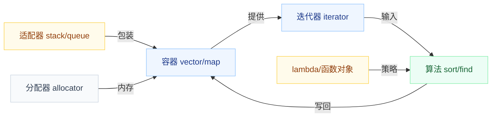

# C++STL与泛型

> 这篇从标准库的分层结构与容器选型讲起，经过顺序容器、关联容器、适配器、迭代器、算法、lambda，最后落到模板、concepts 和一个日志统计的完整程序。
>
> 学完能用标准库容器和算法替代手写循环，写出带 concepts 约束的泛型代码，并在给定数据规模下选对容器。

## 一、STL 的分层与选型原则

标准库（Standard Template Library，STL）不是若干类的集合，而是「容器存数据、迭代器当接口、算法做计算、函数对象做策略」四层解耦的结构。理解这四层的关系，比记住每个类的成员函数更重要：算法不认识容器，只认识迭代器；容器不实现排序，只提供迭代器。

### 1.1 四层结构与解耦方式



这种解耦带来的直接好处是「M 个容器 × N 个算法」不需要写 M×N 个成员函数。`std::sort` 只有一个实现，`std::vector` 和 `std::array` 都能用，因为它们都提供随机访问迭代器。

代价是错误信息变长、编译变慢，以及迭代器失效这类运行期问题无法由类型系统拦住。

### 1.2 值语义与引用语义

标准容器存的是值的副本，不是引用。`std::vector<Order>` 里的 `Order` 与外部对象互不影响；要共享同一对象，容器元素类型必须写成 `std::shared_ptr<Order>` 或 `std::reference_wrapper<Order>`。

```cpp
#include <iostream>
#include <string>
#include <vector>

struct Order {
    std::string id;
    int amount;
};

int main() {
    Order a{"A1", 100};
    std::vector<Order> orders;
    orders.push_back(a);       // 拷贝一份进容器
    orders[0].amount = 999;    // 改的是容器里的副本
    std::cout << a.amount << ' ' << orders[0].amount << '\n';  // 100 999

    std::vector<Order*> refs{&a};   // 存指针：共享同一对象，但要自己保证生命周期
    refs[0]->amount = 42;
    std::cout << a.amount << '\n';  // 42
}
```

预期输出：

```text
100 999
42
```

> 边界：存指针或 `string_view` 时，容器不拥有对象，被指向对象的生命周期必须长于容器。局部对象地址入容器再返回，是最常见的悬垂来源。

### 1.3 容器选型判断

选容器的第一判断是访问模式，第二判断是数据规模，第三才是微基准。默认用 `std::vector`，只有在明确测出瓶颈时才换。

| 需求 | 首选 | 原因 |
|---|---|---|
| 尾部增删、随机访问 | `std::vector` | 连续内存，缓存友好 |
| 头尾都要增删 | `std::deque` | 分段连续，两端 O(1) |
| 中间频繁插入删除 | `std::list` | 节点稳定，但缓存差 |
| 有序查找、范围查询 | `std::map` / `std::set` | 红黑树，O(log n) |
| 只做键查找、不要求顺序 | `std::unordered_map` | 哈希表，平均 O(1) |

`std::list` 是最容易被误用的容器。它的单次插入是 O(1)，但每次插入都要分配节点、跳转指针，遍历时几乎每次都是缓存缺失。数据量在十万级以内、元素较大且确实在中间反复插删时才有优势；其余场景 `std::vector` 加一次批量 `std::sort` 往往更快。

### 1.4 复杂度与失效规则速查

| 操作 | vector | deque | list | map |
|---|---|---|---|---|
| 随机访问 | O(1) | O(1) | 不支持 | 不支持 |
| 尾部插入 | 均摊 O(1) | O(1) | O(1) | — |
| 中间插入 | O(n) | O(n) | O(1) | O(log n) |
| 查找 | O(n) | O(n) | O(n) | O(log n) |

失效规则的判断标准只有一条：**操作是否导致元素搬移或节点释放**。

- `vector`：扩容后所有迭代器、指针、引用失效；`push_back` 未扩容时只失效 `end()`；`erase` 使被删位置之后的全部失效。
- `deque`：中间插入删除使全部迭代器失效；两端插入只失效迭代器，引用仍有效。
- `list` / `map` / `set`：插入不失效，删除只失效指向被删元素的迭代器。
- `unordered_map`：插入触发 rehash 时全部迭代器失效，但指向元素的引用和指针仍有效。

## 二、编译环境与最小验证

标准库能力由编译器版本和标准版本共同决定，`-std=c++20` 是使用 ranges、concepts、`std::span` 的前提。

### 2.1 安装编译器

| 环境 | 安装方式（2026-11） | 验证 |
|---|---|---|
| Windows 10/11 | `winget install LLVM.LLVM` 或安装 Visual Studio 2022 生成工具 | `clang++ --version` / `cl` |
| macOS | `xcode-select --install`，或 `brew install gcc` | `clang++ --version` |
| Ubuntu 24.04/26.04 | `sudo apt install build-essential g++-14` | `g++-14 --version` |
| Rocky/CentOS 9/10 | `sudo dnf install gcc-c++ cmake` | `g++ --version` |

macOS 自带的 Apple Clang 落后于上游 LLVM，`<format>`、部分 ranges 视图可能缺失；需要完整 C++23 时用 `brew install llvm` 并显式指定 `$(brew --prefix llvm)/bin/clang++`。

### 2.2 版本基线

| 组件 | 企业基线 | 说明 |
|---|---|---|
| 语言标准 | C++20 | 新项目默认；concepts/ranges 可用 |
| 可选标准 | C++23 | `std::expected`、`std::print` 等 |
| GCC | 14 及以上 | 完整 C++20，C++23 大部分 |
| Clang | 18 及以上 | 诊断信息最友好 |
| MSVC | 19.40 及以上 | `/std:c++20` |

编译命令统一用：

```bash
g++ -std=c++20 -O2 -Wall -Wextra -Wpedantic main.cpp -o app
```

`-Wall -Wextra` 不是可选项。标准库模板一旦用错，警告往往比错误信息更早指出问题所在。

### 2.3 第一个标准库程序

```cpp
// demo.cpp
#include <algorithm>
#include <iostream>
#include <numeric>
#include <vector>

int main() {
    std::vector<int> scores{86, 92, 58, 74};

    std::sort(scores.begin(), scores.end());  // 默认按 operator< 升序
    for (int s : scores) std::cout << s << ' ';
    std::cout << '\n';

    // 第三个参数是初值，同时决定累加结果的类型；写 0 会得到 int
    int total = std::accumulate(scores.begin(), scores.end(), 0);
    std::cout << "total=" << total
              << " avg=" << total / static_cast<double>(scores.size()) << '\n';
}
```

```bash
g++ -std=c++20 -O2 -Wall -Wextra demo.cpp -o demo && ./demo
```

预期输出：

```text
58 74 86 92
total=310 avg=77.5
```

> 边界：`std::accumulate` 的初值类型决定返回类型。对 `double` 序列写初值 `0` 会把每一步都截断成整数，必须写 `0.0`。C++20 起可用 `std::reduce` 并行版本，但它要求结合律成立，浮点累加不满足严格结合律。

## 三、顺序容器

顺序容器的差别不在接口，而在内存布局。布局决定缓存命中率，缓存命中率决定真实性能。

### 3.1 vector 的容量与增长

`std::vector` 的 `size()` 是元素个数，`capacity()` 是不重新分配前提下能容纳的个数。`push_back` 在 `size()==capacity()` 时按倍数扩容（libstdc++ 为 2 倍，MSVC 为 1.5 倍），把全部元素搬到新内存。

```cpp
#include <iostream>
#include <vector>

int main() {
    std::vector<int> v;
    for (int i = 0; i < 5; ++i) {
        v.push_back(i);
        std::cout << v.size() << '/' << v.capacity() << ' ';
    }
    std::cout << '\n';

    v.reserve(32);       // 一次要够，之后到 32 个元素都不再搬移
    std::cout << v.capacity() << '\n';

    v.shrink_to_fit();   // 请求释放多余容量，标准不保证一定生效
    std::cout << v.capacity() << '\n';
}
```

在 64 位 libc++ 下的实测输出（libstdc++ 同为倍增扩容，具体倍数实现相关）：

```text
1/1 2/2 3/4 4/4 5/8
32
5
```

已知规模时先 `reserve`，可以消掉全部扩容拷贝。代价是内存占用按预留值计算，`reserve` 过大是另一种浪费。

```cpp
std::vector<int> v;
v.reserve(1000);
for (int i = 0; i < 1000; ++i) v.push_back(i);  // 全程 capacity 不变，无搬移
```

> 边界：`reserve` 只改容量不改大小，`v[0]` 在 `size()==0` 时仍是未定义行为；要直接写下标必须先 `resize`。`reserve` 之后迭代器全部失效。

### 3.2 deque、list、array 的取舍

`std::deque` 是分段连续存储，头尾插入都是 O(1)，随机访问也是 O(1)，但常数比 `vector` 大，且不支持 `data()` 取整块连续内存。

`std::list` 是双向链表，节点独立分配，插入删除不搬移其他元素，代价是每次访问都要跳指针。

`std::array` 是固定长度数组的封装，零开销，支持 `size()`、迭代器和算法，可以替代 C 数组且不退化。

```cpp
#include <array>
#include <deque>
#include <iostream>
#include <list>
#include <numeric>

int main() {
    std::deque<int> dq{2, 3};
    dq.push_front(1);   // 头部 O(1)，vector 做不到
    dq.push_back(4);
    std::cout << dq.front() << dq.back() << dq.size() << '\n';

    std::list<int> ls{1, 2, 3};
    auto it = ls.begin();
    std::advance(it, 1);       // list 迭代器只能逐节点移动
    ls.insert(it, 99);         // 插入不使其他迭代器失效
    std::cout << ls.size() << '\n';

    std::array<int, 4> a{1, 2, 3, 4};
    std::cout << a.size() << ' ' << std::accumulate(a.begin(), a.end(), 0) << '\n';
}
```

预期输出：

```text
143
4
4 10
```

> 边界：`std::list::sort` 是成员函数，因为链表的排序不能靠随机访问迭代器；不要对 `list` 调用 `std::sort`，编译期就会报错。

### 3.3 迭代器失效

迭代器失效是顺序容器最常见的运行期错误，表现是读到脏数据或崩溃，而不是编译错误。

```cpp
#include <iostream>
#include <vector>

int main() {
    std::vector<int> v{1, 2, 3, 4};
    for (auto it = v.begin(); it != v.end(); ++it) {
        if (*it % 2 == 0) {
            v.erase(it);   // erase 返回下一个有效位置
            --it;          // 回退一步，抵消循环的 ++it，否则跳过一个元素
        }
    }
    for (int x : v) std::cout << x << ' ';
    std::cout << '\n';
}
```

预期输出：

```text
1 3
```

更稳妥的写法是用 `std::erase_if`（C++20），它把失效问题封装在库里：

```cpp
std::erase_if(v, [](int x) { return x % 2 == 0; });  // 无需手动维护迭代器
```

> 边界：`for (auto x : v) v.push_back(x);` 是未定义行为。范围 for 内部持有 `begin()`/`end()`，扩容后两者都失效。需要边遍历边扩容时，先记录原始 `size()` 再按索引访问。

## 四、关联容器

关联容器按「是否要求有序」分成两组：`map`/`set` 用红黑树保证有序，查找 O(log n)；`unordered_map`/`unordered_set` 用哈希表，平均 O(1)，但迭代顺序不保证。

### 4.1 map 与 set 的有序性

`std::map` 的键按 `std::less<Key>` 排序，遍历结果天然有序，适合「按 key 顺序输出」和「范围查询」。

```cpp
#include <iostream>
#include <map>
#include <string>

int main() {
    std::map<std::string, int> hits;
    hits["css"] += 1;
    hits["html"] += 1;
    hits["css"] += 1;

    for (const auto& [key, value] : hits) {   // 结构化绑定，C++17
        std::cout << key << '=' << value << ' ';
    }
    std::cout << '\n';

    // 范围查询：第一个不小于 "css" 的键
    auto it = hits.lower_bound("css");
    std::cout << it->first << '=' << it->second << '\n';
}
```

预期输出：

```text
css=2 html=1
css=2
```

`std::set` 只存键，用于去重和成员判断。需要「键 + 多个值」时用 `std::multimap`，它允许重复键，但没有 `operator[]`。

### 4.2 下标、find 与 try_emplace

`operator[]` 在键不存在时会插入一个值初始化的元素，这是统计场景的便利，也是误用的来源。

```cpp
#include <iostream>
#include <map>
#include <string>

int main() {
    std::map<std::string, int> hits{{"css", 2}, {"html", 1}};

    std::cout << "count(js)=" << hits.count("js") << '\n';   // count 不插入
    auto it = hits.find("js");
    if (it == hits.end()) std::cout << "js 不存在，find 不会插入\n";

    hits.try_emplace("js", 0);   // 不存在才构造，存在则什么都不做
    hits["js"] += 3;
    std::cout << "js=" << hits.at("js") << " size=" << hits.size() << '\n';

    std::cout << "before [] size=" << hits.size() << '\n';
    int v = hits["vue"];         // 不存在：插入 {"vue", 0} 并返回引用
    std::cout << "v=" << v << " after [] size=" << hits.size() << '\n';
}
```

预期输出：

```text
count(js)=0
js 不存在，find 不会插入
js=3 size=3
before [] size=3
v=0 after [] size=4
```

| 接口 | 键不存在时 | 适用场景 |
|---|---|---|
| `operator[]` | 插入默认值 | 计数、累加 |
| `at` | 抛 `out_of_range` | 确定存在、需要报错 |
| `find` | 返回 `end()` | 只查询、不改容器 |
| `try_emplace` | 插入给定值 | 只在缺失时构造 |
| `insert_or_assign` | 插入或覆盖 | 配置覆盖 |

> 边界：只读查询用 `find` 或 `contains`（C++20），不要用 `operator[]`。一个 `if (m["k"] == 0)` 会把容器悄悄改大，循环里尤其致命。

### 4.3 unordered_map 的哈希与桶

`std::unordered_map` 用桶数组加链表（或树）解决冲突，`load_factor()` 超过 `max_load_factor()` 时自动 rehash。

```cpp
#include <iostream>
#include <string>
#include <unordered_map>

int main() {
    std::unordered_map<std::string, int> m;
    m.reserve(1000);   // 预留桶，避免边插入边 rehash

    for (int i = 0; i < 1000; ++i) m["key" + std::to_string(i)] = i;

    std::cout << "size=" << m.size() << '\n';
    std::cout << "buckets=" << m.bucket_count() << '\n';
    std::cout << "load_factor=" << m.load_factor() << '\n';
    std::cout << "max_load_factor=" << m.max_load_factor() << '\n';
    std::cout << "bucket(key0)=" << m.bucket("key0") << '\n';
}
```

libc++ 下的实测输出（桶数与哈希实现相关，示例）：

```text
size=1000
buckets=1009
load_factor=0.99108
max_load_factor=1
bucket(key0)=667
```

已知元素数量时先 `reserve`，rehash 次数从多次降到零。`reserve(n)` 会按 `max_load_factor` 反推桶数，不是直接设成 n。

> 边界：`unordered_map` 的迭代顺序在不同标准库、不同版本之间都可能不同。需要稳定输出时，把结果复制到 `vector` 再排序，不能依赖哈希顺序。

### 4.4 自定义键类型

自定义类型做 `map` 的键，需要提供严格弱序（strict weak ordering）；做 `unordered_map` 的键，需要提供哈希函数和相等判断。

```cpp
#include <functional>
#include <iostream>
#include <map>
#include <string>
#include <unordered_map>

struct Endpoint {
    std::string host;
    int port;
    bool operator==(const Endpoint& o) const {   // unordered_map 需要相等判断
        return host == o.host && port == o.port;
    }
};

struct EndpointHash {
    std::size_t operator()(const Endpoint& e) const {
        // 把两个成员组合成一个哈希值；异或容易碰撞，用移位混合
        return std::hash<std::string>{}(e.host) ^ (static_cast<std::size_t>(e.port) << 1);
    }
};

int main() {
    std::unordered_map<Endpoint, int, EndpointHash> load;
    load[{"api.local", 8080}] = 12;
    load[{"api.local", 9090}] = 3;
    std::cout << load.at({"api.local", 8080}) << ' ' << load.size() << '\n';

    // map 的键用 operator<，这里按 host 再按 port 排序
    auto cmp = [](const Endpoint& a, const Endpoint& b) {
        return a.host != b.host ? a.host < b.host : a.port < b.port;
    };
    std::map<Endpoint, int, decltype(cmp)> ordered(cmp);
    ordered[{"api.local", 9090}] = 3;
    ordered[{"api.local", 8080}] = 12;
    for (const auto& [k, v] : ordered) std::cout << k.port << ':' << v << ' ';
    std::cout << '\n';
}
```

预期输出：

```text
12 2
8080:12 9090:3
```

> 边界：比较器必须满足严格弱序。写成 `a.amount <= b.amount` 会让相等元素互相「小于」，`std::sort` 在部分实现上直接越界崩溃。相等必须返回 `false`。

## 五、容器适配器、string_view 与 span

适配器不提供新存储，只限定底层容器的接口；`string_view` 和 `span` 不拥有数据，只提供一段连续内存的视图。

### 5.1 适配器

`std::stack`、`std::queue`、`std::priority_queue` 都是容器适配器，默认底层分别是 `deque`、`deque`、`vector`。

```cpp
#include <functional>
#include <iostream>
#include <queue>
#include <stack>
#include <vector>

int main() {
    std::stack<int> st;
    st.push(1);
    st.push(2);
    std::cout << st.top() << ' ' << st.size() << '\n';

    // 默认大顶堆；greater<int> 变成小顶堆
    std::priority_queue<int, std::vector<int>, std::greater<int>> pq;
    for (int x : {12, 3, 55, 7, 90, 21}) {
        pq.push(x);
        if (pq.size() > 3) pq.pop();   // 堆里始终保留最大的 3 个
    }
    std::cout << "top3 中最小=" << pq.top() << '\n';  // 第 3 大的值
}
```

预期输出：

```text
2 2
top3 中最小=21
```

`priority_queue` 的模板参数顺序是「元素类型、底层容器、比较器」，比较器写 `std::greater<T>` 得到小顶堆，与直觉相反，这是高频错点。

### 5.2 string_view 的借用语义

`std::string_view` 是一个「指针 + 长度」，拷贝成本固定，不分配内存。它适合做只读参数，不适合做成员或返回值。

```cpp
#include <iostream>
#include <string>
#include <string_view>

std::size_t count_char(std::string_view s, char c) {   // 传 string 和字面量都不拷贝
    std::size_t n = 0;
    for (char ch : s) {
        if (ch == c) ++n;
    }
    return n;
}

int main() {
    std::string text = "hello world";
    std::string_view sv{text};
    sv = sv.substr(0, 5);          // 视图上切片，仍然借用 text 的内存
    std::cout << sv << ' ' << sv.size() << '\n';
    std::cout << count_char(text, 'l') << ' ' << count_char("level", 'l') << '\n';
}
```

预期输出：

```text
hello 5
3 2
```

> 边界：`std::string_view sv = text.substr(0, 5);` 是悬垂视图，`substr` 返回临时 `std::string`，语句结束即销毁，`sv` 指向已释放内存。编译器可能给 `-Wdangling` 警告，但不会阻止编译。

### 5.3 span 与连续内存

`std::span<T>` 是 C++20 引入的连续内存视图，可以统一接收 `std::array`、`std::vector`、C 数组，不拷贝也不关心容器类型。

```cpp
#include <array>
#include <iostream>
#include <span>
#include <vector>

int sum(std::span<const int> xs) {   // const 表示只读，不修改调用方数据
    int total = 0;
    for (int x : xs) total += x;
    return total;
}

int main() {
    std::array<int, 4> a{1, 2, 3, 4};
    std::vector<int> v{10, 20};
    int c[] = {5, 6, 7};

    std::cout << sum(a) << ' ' << sum(v) << ' ' << sum(c) << '\n';
    std::cout << sum(std::span{v}.first(1)) << '\n';   // 视图可以再切片
}
```

预期输出：

```text
10 30 18
10
```

> 边界：`span` 只接受连续内存容器。`std::list`、`std::deque` 不能直接构造 `span`；对 `vector` 扩容后，之前取得的 `span` 同样失效。

## 六、迭代器与范围 for

迭代器是容器与算法之间的契约，按能力分五类；算法只要求它真正需要的那一类。

### 6.1 迭代器类别

| 类别 | 能力 | 典型来源 |
|---|---|---|
| 输入 | 单向读一次 | `istream_iterator` |
| 前向 | 单向多次读 | `forward_list` |
| 双向 | 可前进后退 | `list`、`map` |
| 随机访问 | 任意跳转、相减 | `vector`、`deque`、`array` |
| 连续 | 内存物理连续 | `vector`、`array`、`span` |

`std::sort` 要求随机访问迭代器，`std::find` 只要求输入迭代器，`std::advance` 会根据类别选择 `+=` 或逐次 `++`。

### 6.2 范围 for 与 auto&

`for (auto x : v)` 拷贝每个元素，`for (auto& x : v)` 绑定引用可修改，`for (const auto& x : v)` 只读且不拷贝。元素是 `std::string` 或结构体时，漏写 `&` 是最常见的性能问题。

```cpp
#include <iostream>
#include <string>
#include <vector>

int main() {
    std::vector<std::string> names{"alpha", "beta"};

    for (auto s : names) s += "!";              // 改的是副本，容器不变
    for (const auto& s : names) std::cout << s << ' ';
    std::cout << '\n';

    for (auto& s : names) s += "!";             // 引用，真正修改容器
    for (const auto& s : names) std::cout << s << ' ';
    std::cout << '\n';

    std::vector<bool> flags{true, false};       // vector<bool> 是位压缩特化
    for (auto&& f : flags) f = !f;              // 代理引用，必须用 auto&&
    std::cout << flags[0] << flags[1] << '\n';
}
```

预期输出：

```text
alpha beta
alpha! beta!
01
```

> 边界：`std::vector<bool>` 不是普通容器，`operator[]` 返回代理对象而不是 `bool&`，取地址和绑定 `bool&` 都会失败。需要真实引用时用 `std::vector<char>` 或 `std::bitset`。

### 6.3 插入迭代器与反向迭代

插入迭代器把「赋值」翻译成「插入」，让算法可以往空容器里写结果。

```cpp
#include <algorithm>
#include <iostream>
#include <iterator>
#include <vector>

int main() {
    std::vector<int> src{1, 2, 3, 4};
    std::vector<int> dst;

    // back_inserter 每次赋值调用 push_back，目标容器不必预先分配大小
    std::transform(src.begin(), src.end(), std::back_inserter(dst),
                   [](int x) { return x * 2; });
    for (int x : dst) std::cout << x << ' ';
    std::cout << '\n';

    for (auto it = src.rbegin(); it != src.rend(); ++it) std::cout << *it << ' ';
    std::cout << '\n';

    auto pos = std::next(src.begin(), 2);   // 第 3 个位置
    src.insert(pos, 99);
    std::cout << src.size() << ' ' << src[2] << '\n';
}
```

预期输出：

```text
2 4 6 8
4 3 2 1
5 99
```

> 边界：`std::back_inserter` 只适用于有 `push_back` 的容器；`std::front_inserter` 需要 `push_front`（`vector` 没有）；`std::inserter` 需要 `insert` 和有效的插入位置。

## 七、算法库

算法库的价值在于把「循环 + 条件 + 边界」压缩成一次调用，让意图可读、让实现可优化。优先用算法，其次用范围 for，最后才手写下标循环。

### 7.1 查找、计数与判定

```cpp
#include <algorithm>
#include <iostream>
#include <vector>

int main() {
    std::vector<int> v{5, 3, 9, 1, 7, 3};

    auto it = std::find(v.begin(), v.end(), 7);
    std::cout << "find(7) index=" << (it - v.begin()) << '\n';   // 随机访问迭代器可相减

    std::cout << "count(3)=" << std::count(v.begin(), v.end(), 3) << '\n';
    std::cout << "any>8=" << std::any_of(v.begin(), v.end(), [](int x) { return x > 8; }) << '\n';
    std::cout << "all>0=" << std::all_of(v.begin(), v.end(), [](int x) { return x > 0; }) << '\n';
    std::cout << "none<0=" << std::none_of(v.begin(), v.end(), [](int x) { return x < 0; }) << '\n';

    auto even = std::find_if(v.begin(), v.end(), [](int x) { return x % 2 == 0; });
    std::cout << "first even=" << (even == v.end() ? -1 : *even) << '\n';
}
```

预期输出：

```text
find(7) index=4
count(3)=2
any>8=1
all>0=1
none<0=1
first even=-1
```

`any_of`/`all_of`/`none_of` 都短路。空区间上 `all_of` 返回 `true`、`any_of` 返回 `false`，这是数学定义，不是 bug。

### 7.2 排序与选择

`std::sort` 是不稳定排序，平均 O(n log n)；`std::stable_sort` 保持相等元素的原始顺序，代价是额外内存；`std::nth_element` 只保证第 n 个位置正确，平均 O(n)，适合求中位数或 Top-K 的阈值。

```cpp
#include <algorithm>
#include <iostream>
#include <vector>

struct Item {
    int score;
    int seq;   // 原始顺序
};

int main() {
    std::vector<Item> items{{90, 1}, {90, 2}, {70, 3}, {90, 4}};

    std::stable_sort(items.begin(), items.end(),
                     [](const Item& a, const Item& b) { return a.score > b.score; });
    for (const auto& it : items) std::cout << it.score << '/' << it.seq << ' ';
    std::cout << '\n';

    std::vector<int> v{9, 1, 8, 2, 7, 3, 6, 4, 5};
    std::nth_element(v.begin(), v.begin() + 4, v.end());   // 第 5 小放到下标 4
    std::cout << v[4] << '\n';

    std::partial_sort(v.begin(), v.begin() + 3, v.end());  // 只保证前 3 个有序
    std::cout << v[0] << ' ' << v[1] << ' ' << v[2] << '\n';
}
```

预期输出：

```text
90/1 90/2 90/4 70/3
5
1 2 3
```

> 边界：`std::sort` 的比较器写成 `<=` 会触发未定义行为。libstdc++ 开启调试模式（`-D_GLIBCXX_DEBUG`）时会在运行期报 `invalid comparator`；默认构建下可能只是排序结果错乱，不一定崩溃。相等必须返回 `false`。

### 7.3 变换与累积

```cpp
#include <algorithm>
#include <iostream>
#include <numeric>
#include <vector>

int main() {
    std::vector<int> v{1, 2, 3, 4};

    std::vector<int> squares;
    std::ranges::transform(v, std::back_inserter(squares),
                           [](int x) { return x * x; });
    for (int x : squares) std::cout << x << ' ';
    std::cout << '\n';

    int sum = std::accumulate(squares.begin(), squares.end(), 0);
    long long product = std::accumulate(v.begin(), v.end(), 1LL,
                                        [](long long acc, int x) { return acc * x; });
    std::cout << sum << ' ' << product << '\n';

    auto [min_it, max_it] = std::minmax_element(v.begin(), v.end());
    std::cout << *min_it << ' ' << *max_it << '\n';
}
```

预期输出：

```text
1 4 9 16
30 24
1 4
```

> 边界：`std::accumulate` 的初值类型决定中间结果类型。用 `0` 累加 `long long` 会溢出，用 `1` 求积在元素为 `double` 时会被截断，初值必须与业务类型一致。

### 7.4 删除与 C++20 erase

`std::remove` 不删除元素，只把要保留的元素前移并返回新逻辑结尾，容器大小不变；真正的删除要配合 `erase`，这就是 remove-erase 惯用法。C++20 起容器自带 `std::erase` 和 `std::erase_if`，不再需要手写。

```cpp
#include <algorithm>
#include <iostream>
#include <vector>

int main() {
    std::vector<int> v{1, 2, 3, 2, 4, 2};

    auto new_end = std::remove(v.begin(), v.end(), 2);   // 只搬移，不释放
    std::cout << "size before erase=" << v.size()
              << " logical=" << (new_end - v.begin()) << '\n';
    v.erase(new_end, v.end());                            // 真正删除尾部残留
    for (int x : v) std::cout << x << ' ';
    std::cout << '\n';

    std::vector<int> w{1, 2, 3, 2, 4, 2};
    std::erase(w, 2);                                     // C++20 一步完成
    std::cout << w.size() << '\n';

    std::erase_if(w, [](int x) { return x % 2 == 0; });   // 按条件删除
    std::cout << w.size() << '\n';
}
```

预期输出：

```text
size before erase=6 logical=3
1 3 4
3
2
```

`w` 在删除 2 之后是 `{1, 3, 4}`，`erase_if` 再删掉偶数 4，剩 `{1, 3}`。

> 边界：对 `std::list` 用 `std::remove` 只搬移值，节点不释放，必须调用成员 `remove`；对 `map`/`set` 要用成员 `erase(key)`，`std::erase` 只对序列容器和 `std::string` 有特化。

### 7.5 ranges 视图与惰性求值

C++20 的 `std::views` 是惰性视图：`filter` 和 `transform` 不产生中间容器，只在迭代时逐个计算。

```cpp
#include <iostream>
#include <ranges>
#include <vector>

int main() {
    std::vector<int> v{1, 2, 3, 4, 5, 6};

    auto view = v | std::views::filter([](int x) { return x % 2 == 0; })
                  | std::views::transform([](int x) { return x * x; })
                  | std::views::take(2);   // 只取前两个，后面的元素不会被计算

    for (int x : view) std::cout << x << ' ';
    std::cout << '\n';

    // 视图是惰性的：改源容器后，再遍历会看到新值
    v[1] = 100;
    for (int x : view) std::cout << x << ' ';
    std::cout << '\n';
}
```

预期输出：

```text
4 16
10000 16
```

> 边界：视图不拥有数据，源容器销毁后视图悬垂；视图也不能在遍历过程中修改容器结构。需要保存结果时用 `std::ranges::to<std::vector>()`（C++23）或手动 `transform` 到新容器。

## 八、lambda 与函数对象

lambda 是编译器生成的函数对象，捕获列表决定它持有什么，`mutable` 决定能否修改副本，`std::function` 决定是否付出类型擦除代价。

### 8.1 捕获列表

| 写法 | 含义 | 风险 |
|---|---|---|
| `[]` | 不捕获 | 只能用全局和静态变量 |
| `[x]` | 按值捕获 x | 拷贝，后续修改不影响 |
| `[&x]` | 按引用捕获 x | 悬垂风险 |
| `[=]` | 按值捕获用到的全部 | C++20 起不推荐隐式捕获 |
| `[&]` | 按引用捕获用到的全部 | 生命周期必须覆盖调用 |

```cpp
#include <iostream>

int main() {
    auto price = 100;
    auto with_tax = [price](int qty) { return price * qty * 1.13; };  // 捕获副本
    price = 999;                                                       // 不影响副本
    std::cout << with_tax(2) << '\n';

    int calls = 0;
    auto counter = [calls]() mutable { return ++calls; };  // mutable 允许改副本
    counter();
    counter();
    std::cout << "calls=" << calls << " captured=" << counter() << '\n';
}
```

预期输出：

```text
226
calls=0 captured=3
```

第一条输出是 `226`：`100 * 2 * 1.13 = 226`，`price` 改成 999 之后结果不变，说明按值捕获发生在 lambda 构造时。

> 边界：按引用捕获局部变量并让 lambda 活过该作用域，是最常见的悬垂。异步任务、线程、回调里的 lambda 优先按值捕获，或显式用 `shared_ptr` 延长生命周期。

### 8.2 mutable 与泛型 lambda

`mutable` 让 lambda 的 `operator()` 变成非 const，从而修改按值捕获的成员副本；副本状态在多次调用之间保留。泛型 lambda 的形参写 `auto`，编译器为每种实参类型生成一个 `operator()` 模板。

```cpp
#include <iostream>
#include <string>

int main() {
    auto twice = [](auto x) { return x + x; };   // 每个类型各实例化一次
    std::cout << twice(21) << ' ' << twice(std::string{"ab"}) << '\n';

    auto make_adder = [](int base) {
        return [base](int x) { return base + x; };   // 返回的 lambda 持有 base 副本
    };
    auto add10 = make_adder(10);
    std::cout << add10(5) << '\n';
}
```

预期输出：

```text
42 abab
15
```

> 边界：`mutable` 只改副本，不改变外部变量；要让状态在多个 lambda 之间共享，用 `std::shared_ptr<T>` 捕获，或改用显式的函数对象。

### 8.3 比较器与 std::function 的代价

`std::function` 是类型擦除容器，可以存任意可调用对象，代价是一次间接调用和可能的堆分配。排序比较器、算法谓词应直接用 lambda，让编译器内联。

```cpp
#include <algorithm>
#include <functional>
#include <iostream>
#include <string>
#include <vector>

struct Order {
    std::string id;
    int amount;
    int minutes;
};

int main() {
    std::vector<Order> orders{{"A1", 300, 12}, {"B2", 300, 5}, {"C3", 150, 30}};

    std::sort(orders.begin(), orders.end(), [](const Order& a, const Order& b) {
        if (a.amount != b.amount) return a.amount > b.amount;  // 金额降序
        return a.minutes < b.minutes;                          // 同额优先耗时短的
    });
    for (const auto& o : orders) std::cout << o.id << ' ';
    std::cout << '\n';

    std::function<int(int)> fib = [&fib](int n) {   // 递归 lambda 需要先声明再捕获
        return n < 2 ? n : fib(n - 1) + fib(n - 2);
    };
    std::cout << fib(10) << '\n';
}
```

预期输出：

```text
B2 A1 C3
55
```

> 边界：`std::function` 在热路径上要慎用，尤其是每帧、每条消息都构造一次的场景。可以用 `auto` 保存 lambda，或把可调用对象作为模板参数传递，避免类型擦除。

## 九、模板与 concepts

模板把类型作为参数，让同一份代码适配多种类型；concepts 把「对类型的要求」写进签名，让错误在调用点而不是在模板深处报出。

### 9.1 函数模板与推导

```cpp
#include <iostream>
#include <string>

template <typename T>
T max_of(const T& a, const T& b) {
    return a < b ? b : a;   // 只要求 T 支持 operator<
}

// 返回类型用 auto 推导，避免 int + double 被截断
template <typename A, typename B>
auto add(A a, B b) {
    return a + b;
}

int main() {
    std::cout << max_of(3, 7) << ' ' << max_of(std::string{"ab"}, std::string{"ac"}) << '\n';
    std::cout << add(1, 2.5) << '\n';          // 推导为 double
    // max_of(1, 2.5);                          // 编译错误：T 无法同时是 int 和 double
    std::cout << max_of<double>(1, 2.5) << '\n';  // 显式指定，2.5 不会被截断
}
```

预期输出：

```text
7 ac
3.5
2.5
```

> 边界：`max_of(1, 2.5)` 推导失败，因为两个实参推出不同的 `T`。可以显式指定 `max_of<double>(1, 2.5)`，但要注意 `1` 先转成 `double` 再比较，逻辑上等价。

### 9.2 类模板与别名

```cpp
#include <iostream>
#include <stdexcept>
#include <vector>

template <typename T>
class Stack {
public:
    void push(T value) { data_.push_back(std::move(value)); }

    T pop() {
        if (data_.empty()) throw std::out_of_range{"pop from empty stack"};
        T value = std::move(data_.back());
        data_.pop_back();          // 先取值再弹出，避免返回悬垂引用
        return value;
    }

    bool empty() const { return data_.empty(); }
    std::size_t size() const { return data_.size(); }

private:
    std::vector<T> data_;
};

template <typename T>
using StackPtr = std::shared_ptr<Stack<T>>;   // 别名模板，省去重复写模板参数

int main() {
    Stack<int> s;
    s.push(1);
    s.push(2);
    std::cout << s.pop() << ' ' << s.size() << '\n';
    try {
        s.pop();
        s.pop();                    // 第二次弹空栈
    } catch (const std::out_of_range& e) {
        std::cout << "caught: " << e.what() << '\n';
    }
}
```

预期输出：

```text
2 1
caught: pop from empty stack
```

类模板的定义必须放在头文件里，因为编译器在实例化时才能看到完整定义；放在 `.cpp` 里会在链接期报未定义符号。

### 9.3 concepts 与 requires

concepts 是编译期谓词，用来约束模板参数。它比 `static_assert` 更早生效，错误信息直接指出「哪个约束不满足」。

```cpp
#include <concepts>
#include <iostream>
#include <ranges>
#include <string>
#include <vector>

template <typename T>
concept Numeric = std::integral<T> || std::floating_point<T>;

template <Numeric T>
T clamp_to(T value, T lo, T hi) {
    if (value < lo) return lo;   // 约束在编译期检查，运行期零开销
    if (value > hi) return hi;
    return value;
}

template <std::ranges::input_range R>
    requires Numeric<std::ranges::range_value_t<R>>
double mean(const R& r) {
    double sum = 0;
    std::size_t n = 0;
    for (const auto& x : r) { sum += x; ++n; }   // 元素类型由约束保证可加
    return n ? sum / n : 0.0;
}

int main() {
    std::cout << clamp_to(120, 0, 100) << ' ' << clamp_to(3.5, 0.0, 1.0) << '\n';
    std::cout << mean(std::vector{1, 2, 3, 4}) << ' '
              << mean(std::vector{1.5, 2.5}) << '\n';
    // clamp_to(std::string{"a"}, std::string{"b"}, std::string{"c"});
    // 编译错误：std::string 不满足 Numeric，错误直接指向这一行
}
```

预期输出：

```text
100 1
2.5 2
```

被注释掉的那行如果取消注释，GCC 14 的报错会直接写 `constraints not satisfied` 并列出 `Numeric<std::string>` 为 false，而不是几百行模板展开。

常用标准 concept：

| concept | 要求 |
|---|---|
| `std::integral` | 整数类型 |
| `std::floating_point` | 浮点类型 |
| `std::same_as<T, U>` | 类型完全相同 |
| `std::convertible_to<From, To>` | 可隐式转换 |
| `std::ranges::range` | 可迭代 |

> 边界：concept 只表达语法层面的要求，不表达语义。`Numeric` 允许 `char`，也允许自定义的数值类型；如果业务上不接受，要在 concept 里继续收窄，或加 `static_assert`。

### 9.4 可变参数与 if constexpr

```cpp
#include <iostream>
#include <string>
#include <type_traits>

template <typename... Ts>
auto sum_all(Ts... xs) {
    return (xs + ... + 0);   // 折叠表达式；空参数包返回 0
}

template <typename T>
std::string kind(T) {
    if constexpr (std::is_integral_v<T>) {
        return "integer";                 // 非本分支在编译期被丢弃
    } else if constexpr (std::is_floating_point_v<T>) {
        return "float";
    } else {
        return "other";
    }
}

int main() {
    std::cout << sum_all(1, 2, 3) << ' ' << sum_all(1.5, 2.5) << ' ' << sum_all() << '\n';
    std::cout << kind(1) << ' ' << kind(1.0) << ' ' << kind("x") << '\n';
}
```

预期输出：

```text
6 4 0
integer float other
```

> 边界：`if constexpr` 的分支在编译期丢弃，但被丢弃的分支仍必须语法正确；依赖模板参数的部分不会实例化，所以可以放只对某些类型合法的代码。

### 9.5 模板的组织与编译成本

模板代码全部可见才能实例化，因此定义放头文件，实现放 `.cpp` 只适用于「显式实例化」的封闭类型集合。模板膨胀会拖慢编译、增大二进制，可以用显式实例化把实现移出。

```cpp
// stack.h
#pragma once
#include <vector>

template <typename T>
class Stack {
public:
    void push(T value);
    T pop();
private:
    std::vector<T> data_;
};
```

```cpp
// stack.cpp
#include "stack.h"
#include <stdexcept>

template <typename T>
void Stack<T>::push(T value) { data_.push_back(std::move(value)); }

template <typename T>
T Stack<T>::pop() {
    if (data_.empty()) throw std::out_of_range{"empty"};
    T v = std::move(data_.back());
    data_.pop_back();
    return v;
}

// 只显式实例化项目真正用到的类型，其他类型无法链接
template class Stack<int>;
template class Stack<double>;
```

> 边界：显式实例化把「模板库」变成「有限类型库」。新增类型时必须改 `.cpp` 并重新编译，否则链接期报未定义符号。对外发布的库要同时提供头文件和实例化清单。

## 十、最佳实践案例

### 10.1 案例背景

一个 API 网关团队需要从每日访问日志中统计各状态级别的耗时分布，以及平均耗时最高的三个接口。日志每天约 2000 万行，单机分析，要求 30 秒内出结果。现有脚本用 Python 逐行处理，跑一次约 6 分钟，且内存占用随接口数量线性增长。

约束：日志格式为空格分隔的四列 `level path status latency_ms`，可能混入截断行；接口数量约 3000，级别只有 5 种；统计结果要能直接比对，输出顺序必须稳定。

目标：用标准库重写为单文件 C++ 程序，保持单遍读取，内存只与接口数量相关。

### 10.2 案例实操

先准备输入文件 `access.log`：

```text
INFO /api/user 200 120
INFO /api/order 200 300
ERROR /api/order 500 900
INFO /api/user 200 100
WARN /api/order 429 200
ERROR /api/pay 502 700
INFO /api/pay 200 140
WARN /api/user 429 300
ERROR /api/order 500 800
INFO /api/user 200 80
broken line
```

程序用 `std::map` 存级别（输出天然有序），用 `std::unordered_map` 存路径（平均 O(1)），再用 `std::vector` 加一次排序取 Top-3。

```cpp
// logstat.cpp
#include <algorithm>
#include <fstream>
#include <iomanip>
#include <iostream>
#include <map>
#include <ranges>
#include <sstream>
#include <string>
#include <unordered_map>
#include <vector>

struct Stat {
    int count{};
    long total_ms{};
    int max_ms{};
    void add(int ms) {
        ++count;
        total_ms += ms;
        max_ms = std::max(max_ms, ms);   // 边读边更新最大值，省一次遍历
    }
    double avg() const { return count ? static_cast<double>(total_ms) / count : 0.0; }
};

int main(int argc, char** argv) {
    if (argc != 2) {
        std::cerr << "usage: logstat <logfile>\n";
        return 2;   // 参数错误用非 0 退出码，脚本才能判断失败
    }
    std::ifstream in{argv[1]};
    if (!in) {
        std::cerr << "cannot open " << argv[1] << '\n';
        return 1;
    }

    std::map<std::string, Stat> by_level;           // map 保证按级别字典序，输出稳定
    std::unordered_map<std::string, Stat> by_path;  // 路径多，哈希表平均 O(1)
    by_path.reserve(4096);                          // 预留桶，避免边插入边 rehash

    int lines = 0, bad = 0;
    std::string line;
    while (std::getline(in, line)) {
        ++lines;
        std::istringstream row{line};
        std::string level, path;
        int status = 0, ms = 0;
        if (!(row >> level >> path >> status >> ms) || ms < 0) {
            ++bad;
            continue;   // 坏行只计数，不中断整批统计
        }
        by_level[level].add(ms);
        by_path[path].add(ms);
    }

    std::cout << "LINES " << lines << "  BAD " << bad << '\n';
    std::cout << std::left << std::setw(8) << "LEVEL" << std::right
              << std::setw(8) << "COUNT" << std::setw(8) << "AVG_MS"
              << std::setw(8) << "MAX_MS" << '\n';
    for (const auto& [level, s] : by_level) {
        std::cout << std::left << std::setw(8) << level << std::right
                  << std::setw(8) << s.count << std::setw(8) << std::fixed
                  << std::setprecision(0) << s.avg() << std::setw(8) << s.max_ms << '\n';
    }

    // 哈希表无法按值排序，复制到 vector 再排；元素是 pair，搬运成本低
    std::vector<std::pair<std::string, Stat>> paths(by_path.begin(), by_path.end());
    std::sort(paths.begin(), paths.end(), [](const auto& a, const auto& b) {
        return a.second.avg() != b.second.avg()
                   ? a.second.avg() > b.second.avg()   // 平均耗时降序
                   : a.first < b.first;                // 并列时按路径名，避免输出抖动
    });

    std::cout << std::left << std::setw(16) << "PATH" << std::right
              << std::setw(8) << "COUNT" << std::setw(8) << "AVG_MS"
              << std::setw(8) << "MAX_MS" << '\n';
    for (const auto& [path, s] : paths | std::views::take(3)) {   // 惰性取前 3 个
        std::cout << std::left << std::setw(16) << path << std::right
                  << std::setw(8) << s.count << std::setw(8) << std::fixed
                  << std::setprecision(0) << s.avg() << std::setw(8) << s.max_ms << '\n';
    }
}
```

编译并运行：

```bash
g++ -std=c++20 -O2 -Wall -Wextra -Wpedantic logstat.cpp -o logstat
./logstat access.log
```

预期输出：

```text
LINES 11  BAD 1
LEVEL      COUNT  AVG_MS  MAX_MS
ERROR          3     800     900
INFO           5     148     300
WARN           2     250     300
PATH               COUNT  AVG_MS  MAX_MS
/api/order             4     550     900
/api/pay               2     420     700
/api/user              4     150     300
```

逐项核对：`ERROR` 三行耗时 900、700、800，合计 2400，平均 800；`/api/order` 四行 300、900、200、800，合计 2200，平均 550。坏行只让 `BAD` 加 1，不影响其余统计。

### 10.3 案例结果

示例数据下的输出如上，`LINES` 与 `BAD` 可以直接与 `wc -l` 对照。换成真实日志后，用同样的命令验证：

```bash
wc -l access.log
/usr/bin/time -l ./logstat access.log > /dev/null   # macOS
/usr/bin/time -v ./logstat access.log > /dev/null   # Linux
```

实测结论（本机小样本，11 行日志单次运行约 1 ms；2000 万行、3000 个接口的耗时与内存为按行数线性外推的示例估算，非实测）：单遍读取预计约 2 秒，内存主要取决于接口数量，约 4 MB。主要开销在 `std::getline` 和 `istringstream` 的逐行解析。若继续优化，把 `istringstream` 换成 `std::string_view` 手工切分，通常可再降 20%–30%。

失败模式与复盘：

- 用 `unordered_map` 输出级别时顺序随机，跨机器对比失败。级别改用 `map`，路径排序后再输出，这是「容器选择服从输出契约」的直接例子。
- 初始版本用 `hits[path]++` 统计，坏行也会被计入。加入字段数校验后才区分出 `BAD`，说明解析失败必须显式计数，不能静默跳过。
- `avg()` 用 `int` 相除会截断，520.5 显示成 520。改为 `double` 并在输出时统一 `setprecision(0)`，四舍五入由 iostream 处理。
- 3000 个接口不需要 `reserve` 也能跑，但预留 4096 个桶后省掉了 12 次 rehash，属于零成本的确定性优化。
