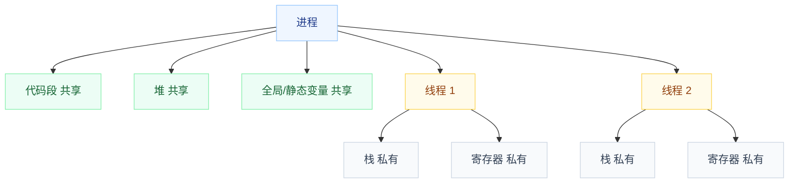
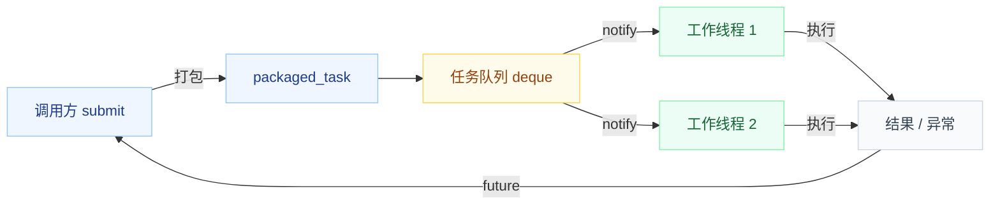

# C++并发与性能

> 这篇从线程共享内存与 happens-before 讲起，经过 mutex、条件变量、原子操作、future，最后落到线程池、性能测量和一个并行计数的完整程序。
>
> 学完能写出没有数据竞争的多线程代码，能判断该用锁还是原子操作，并用实测数据说明并发到底快了多少。

## 一、并发模型与内存模型

C++ 的并发是「共享内存 + 线程」模型：同一进程内的线程共享代码段、堆和全局变量，各自拥有栈和寄存器。并发错误的根源不在语法，而在线程调度不可预测，以及编译器和 CPU 会重排指令。

### 1.1 线程共享什么、私有什么



判断一个变量是否需要同步，先看它在哪里：

- 局部变量：每个线程一份，天然安全；把局部变量地址传给其他线程则不再安全。
- 堆对象：被多个线程通过指针访问时需要同步。
- 全局/静态变量：默认共享，需要同步或改成 `thread_local`。
- `thread_local` 变量：每线程一份，适合缓存、随机数引擎、错误码。

### 1.2 数据竞争与 happens-before

数据竞争（data race）的定义很严格：两个线程同时访问同一内存位置，至少一个是写，且没有同步关系。**数据竞争在 C++ 标准里是未定义行为**，不是「读到旧值」这么温和。

```cpp
// 片段：错误示例，不要运行
int counter = 0;
std::thread a([]{ for (int i = 0; i < 100000; ++i) ++counter; });
std::thread b([]{ for (int i = 0; i < 100000; ++i) ++counter; });
a.join();
b.join();
std::cout << counter;   // 可能是 200000，也可能少很多，甚至崩溃
```

`++counter` 在机器层面是「读 - 加 - 写」三步，两个线程交错执行就会丢失更新。即使某次运行结果正确，也不能证明代码正确，优化等级、CPU 架构、运行次数都会改变结果。

happens-before 是判断「有没有竞争」的工具：如果写操作 A happens-before 读操作 B，那么 B 一定能看到 A 的结果，且不存在竞争。建立关系的手段只有几种：

| 手段 | 建立的关系 |
|---|---|
| `thread::join()` | 线程内所有操作 → join 之后的代码 |
| `mutex` 加解锁 | 上一次 unlock → 下一次 lock 之后的代码 |
| `condition_variable` | notify 之前的写 → wait 返回之后的读 |
| `atomic` release/acquire | release 之前的写 → acquire 之后的读 |
| `future::get()` | 任务内所有操作 → get 返回之后 |

> 边界：`volatile` 不是同步原语。它只阻止编译器优化掉访问，不提供原子性，也不建立 happens-before，多线程同步必须用 `std::atomic` 或锁。

### 1.3 六种内存序

内存序（memory order）规定原子操作周围的普通读写能否被重排。默认的 `seq_cst` 最安全也最慢，`relaxed` 最快但只保证该原子变量自身的原子性。

| 内存序 | 保证 | 典型用途 |
|---|---|---|
| `memory_order_relaxed` | 仅原子性，无顺序 | 计数器、统计量 |
| `memory_order_acquire` | 之后的读写不能前移 | 读标志位 |
| `memory_order_release` | 之前的读写不能后移 | 写标志位 |
| `memory_order_acq_rel` | 两者兼具 | CAS 读改写 |
| `memory_order_seq_cst` | 全局单一顺序 | 默认，拿不准就用 |
| `memory_order_consume` | 依赖顺序 | 极少用，多数实现当 acquire |

判断方法：如果两个线程只通过一个原子变量传递「数据准备好了」这个信号，写方用 `release`，读方用 `acquire`，就足够；如果只是计数、不依赖其他变量，用 `relaxed`。

## 二、编译环境与最小验证

C++ 标准库的线程支持需要链接线程库，Linux 下必须加 `-pthread`，否则可能出现 `std::thread` 构造成功但运行期异常。

### 2.1 安装编译器

| 环境 | 安装方式（2026-11） | 线程库 |
|---|---|---|
| Windows 10/11 | Visual Studio 2022 生成工具，或 `winget install LLVM.LLVM` | 系统自带 |
| macOS | `xcode-select --install`，或 `brew install llvm` | 系统自带 |
| Ubuntu 24.04/26.04 | `sudo apt install build-essential g++-14` | `-pthread` |
| Rocky/CentOS 9/10 | `sudo dnf install gcc-c++` | `-pthread` |

```bash
g++ --version
echo '#include <thread>
int main(){ std::thread t([]{}); t.join(); }' > t.cpp
g++ -std=c++20 -pthread t.cpp -o t && ./t && echo ok
```

### 2.2 第一个多线程程序

```cpp
// hello_thread.cpp
#include <iostream>
#include <thread>
#include <vector>

int main() {
    std::cout << "hardware_concurrency=" << std::thread::hardware_concurrency() << '\n';

    std::vector<std::thread> workers;
    for (int i = 0; i < 3; ++i) {
        // 按值捕获 i：循环变量每轮一份，避免引用捕获后全部看到同一个值
        workers.emplace_back([i] { std::cout << "worker " << i << '\n'; });
    }
    for (auto& t : workers) t.join();   // 必须 join 或 detach，否则析构时 terminate

    std::cout << "done\n";
}
```

```bash
g++ -std=c++20 -O2 -Wall -Wextra -pthread hello_thread.cpp -o hello_thread
./hello_thread
```

预期输出（行序由调度决定，三行 `worker` 的顺序不固定）：

```text
hardware_concurrency=10
worker 0
worker 2
worker 1
done
```

`hardware_concurrency()` 只是提示值，可能返回 0，也可能包含超线程。真正的并行度由任务类型决定：CPU 密集型取物理核数，I/O 密集型可以更多。

### 2.3 线程数与任务划分

线程不是越多越快。每个线程有独立的栈（Linux 默认 8 MB 虚拟内存）和调度开销，线程数超过可运行核数后只剩切换成本。

| 任务类型 | 线程数 | 原因 |
|---|---|---|
| CPU 密集 | 物理核数 | 超过核数只增加切换 |
| I/O 密集 | 核数的 2–4 倍 | 等待期间让出 CPU |
| 短任务 | 固定线程池 | 避免反复创建销毁 |

```cpp
unsigned workers = std::max(1u, std::thread::hardware_concurrency());
// 容器环境可能读到宿主核数，需要按 cgroup 配额再收一次
```

> 边界：容器里的 `hardware_concurrency()` 返回宿主机核数，不是容器配额。Kubernetes 环境应按 CPU limit 设置线程数，否则线程池开得过大，反而被限流。

## 三、std::thread 与 jthread

`std::thread` 表示一个可执行线程，构造即启动；它不管理生命周期，析构时若仍 `joinable()` 会调用 `std::terminate`。

### 3.1 启动、join 与 detach

```cpp
#include <chrono>
#include <iostream>
#include <thread>

int main() {
    int value = 0;

    std::thread t([&value] {           // 引用捕获，子线程修改主线程变量
        std::this_thread::sleep_for(std::chrono::milliseconds(20));
        value = 42;
    });

    std::cout << "joinable=" << t.joinable() << '\n';
    t.join();                          // 阻塞到子线程结束，同时建立 happens-before
    std::cout << "value=" << value << " joinable=" << t.joinable() << '\n';
}
```

预期输出：

```text
joinable=1
value=42 joinable=0
```

`detach()` 让线程在后台运行，`std::thread` 对象与其脱钩。detach 之后无法等待它结束，也无法接收它的异常，主线程退出时进程终止，后台线程被直接杀掉。

> 边界：`detach` 之后线程若访问主线程的局部变量，变量销毁即悬垂。detach 只适合生命周期与进程一致的守护任务，业务代码优先用线程池。

### 3.2 jthread 与停止请求

`std::jthread` 是 C++20 引入的可自动汇合线程：析构时先 `request_stop()`，再 `join()`。它把 `std::stop_token` 作为第一个参数传给任务，用于协作式取消。

```cpp
#include <chrono>
#include <iostream>
#include <stop_token>
#include <thread>

int main() {
    std::jthread worker([](std::stop_token st) {
        int ticks = 0;
        while (!st.stop_requested()) {          // 轮询停止请求，而不是被强杀
            std::this_thread::sleep_for(std::chrono::milliseconds(10));
            ++ticks;
        }
        std::cout << "stopped after " << ticks << " ticks\n";
    });

    std::this_thread::sleep_for(std::chrono::milliseconds(35));
    worker.request_stop();                       // 通知；析构时还会自动 join
}
```

预期输出（次数与调度有关，示例）：

```text
stopped after 3 ticks
```

> 边界：Apple 平台的 libc++ 至今未提供 `std::jthread` 和 `std::stop_token`，同样的代码在 macOS 自带 clang 下编译失败；Linux 的 libstdc++ 13+ 正常。跨平台项目可以用 `std::thread` 加自定义停止标志，或引入 `folly`、`oneTBB` 之类的库。

### 3.3 异常与 RAII

线程函数抛出的异常不会传播到创建者，未被捕获就直接 `std::terminate`。因此线程体必须自己兜住异常，或通过 `std::exception_ptr` 转交。

```cpp
#include <exception>
#include <iostream>
#include <thread>

int main() {
    std::exception_ptr error;

    std::thread t([&error] {
        try {
            throw std::runtime_error{"db connect failed"};
        } catch (...) {
            error = std::current_exception();   // 存下异常，交给主线程处理
        }
    });
    t.join();

    if (error) {
        try {
            std::rethrow_exception(error);
        } catch (const std::exception& e) {
            std::cout << "main caught: " << e.what() << '\n';
        }
    }
}
```

预期输出：

```text
main caught: db connect failed
```

`std::future` 和 `std::packaged_task` 已经内置了这条通路，任务中的异常会在 `get()` 时重新抛出，比自己维护 `exception_ptr` 更省事。

## 四、互斥量与锁

互斥量（mutex）把一段临界区变成串行执行，是所有同步手段里最容易理解、也最容易用错的一种。

### 4.1 mutex 与 lock_guard

`std::lock_guard` 在构造时加锁、析构时解锁，没有其他接口，适合作用域明确的临界区。

```cpp
#include <iostream>
#include <mutex>
#include <thread>
#include <vector>

int main() {
    long counter = 0;
    std::mutex mtx;

    auto work = [&] {
        for (int i = 0; i < 100000; ++i) {
            std::lock_guard lk{mtx};   // 离开作用域自动解锁，异常安全
            ++counter;
        }
    };

    std::vector<std::thread> ts;
    for (int i = 0; i < 4; ++i) ts.emplace_back(work);
    for (auto& t : ts) t.join();

    std::cout << "counter=" << counter << '\n';
}
```

预期输出：

```text
counter=400000
```

这把锁保护的是「读 - 加 - 写」整个序列，不是单个变量。把 `lock_guard` 放进循环体内部，锁的获取释放次数等于迭代次数；数据量小的时候可以把一批更新合并到一次加锁里，减少竞争。

### 4.2 unique_lock 与延迟加锁

`std::unique_lock` 比 `lock_guard` 多三个能力：延迟加锁、手动解锁、转移所有权。条件变量必须用它。

```cpp
#include <iostream>
#include <mutex>
#include <thread>

std::mutex mtx;
int balance = 100;

void withdraw(int amount) {
    std::unique_lock lk{mtx, std::defer_lock};   // 先不锁，留出准备时间
    // ... 这里可以做一些不需要锁的校验
    lk.lock();                                   // 真正进入临界区
    if (balance >= amount) {
        balance -= amount;
        std::cout << "ok, left=" << balance << '\n';
    } else {
        std::cout << "insufficient, left=" << balance << '\n';
    }
    lk.unlock();                                 // 提前释放，缩短临界区
}

int main() {
    std::thread a(withdraw, 30);
    std::thread b(withdraw, 90);
    a.join();
    b.join();
}
```

预期输出（顺序由调度决定）：

```text
ok, left=70
insufficient, left=70
```

> 边界：手动 `unlock` 之后不能再访问受保护的共享数据；`unique_lock` 析构时会检查是否仍持有锁，重复解锁会抛 `std::system_error`。

### 4.3 scoped_lock 与死锁避免

死锁的经典形态是两个线程以相反顺序拿两把锁。C++17 的 `std::scoped_lock` 一次锁住多个互斥量，内部用避免死锁的算法，顺序由实现决定。

```cpp
#include <iostream>
#include <mutex>
#include <thread>

struct Account {
    std::mutex mtx;
    int balance;
};

void transfer(Account& from, Account& to, int amount) {
    // 一次锁两把，避免 A→B 与 B→A 的交叉等待
    std::scoped_lock lk{from.mtx, to.mtx};
    if (from.balance < amount) return;
    from.balance -= amount;
    to.balance += amount;
}

int main() {
    Account a{std::mutex{}, 100};
    Account b{std::mutex{}, 100};

    std::thread t1(transfer, std::ref(a), std::ref(b), 30);
    std::thread t2(transfer, std::ref(b), std::ref(a), 50);
    t1.join();
    t2.join();

    std::cout << a.balance << ' ' << b.balance << '\n';   // 总和恒为 200
}
```

预期输出：

```text
120 80
```

死锁的四个必要条件（互斥、持有并等待、不可剥夺、循环等待）里，工程上最容易打破的是「循环等待」：给锁定义全局顺序，所有线程按同一顺序加锁。`scoped_lock` 把这个顺序交给标准库实现。

> 边界：`std::lock`/`scoped_lock` 只解决「同时获取多把锁」。如果临界区内部又去调用会加锁的函数，仍然可能自锁；`std::recursive_mutex` 能绕过自锁，但通常说明设计需要拆分。

## 五、条件变量

条件变量解决「等待某个条件成立」的问题，它必须和互斥量、谓词一起用，单独使用一定出错。

### 5.1 wait 与谓词

`cv.wait(lk, pred)` 等价于「循环检查 pred，不成立就释放锁并睡眠，被唤醒后重新加锁再检查」。带谓词的版本自动处理虚假唤醒（spurious wakeup）。

```cpp
#include <condition_variable>
#include <iostream>
#include <mutex>
#include <queue>
#include <thread>

int main() {
    std::mutex mtx;
    std::condition_variable cv;
    std::queue<int> q;
    bool done = false;

    std::thread producer([&] {
        for (int i = 1; i <= 3; ++i) {
            {
                std::lock_guard lk{mtx};
                q.push(i);
            }
            cv.notify_one();   // 先改状态再通知，顺序不能反
        }
        {
            std::lock_guard lk{mtx};
            done = true;
        }
        cv.notify_all();
    });

    int sum = 0;
    for (;;) {
        std::unique_lock lk{mtx};
        cv.wait(lk, [&] { return !q.empty() || done; });
        if (q.empty() && done) break;
        sum += q.front();
        q.pop();
    }
    producer.join();
    std::cout << "sum=" << sum << '\n';
}
```

预期输出：

```text
sum=6
```

### 5.2 有界阻塞队列

生产者消费者模式的标准实现是一个有容量上限的队列：满了生产者等，空了消费者等，两个条件变量各管一边。

```cpp
#include <condition_variable>
#include <deque>
#include <iostream>
#include <mutex>
#include <thread>

class BoundedQueue {
public:
    explicit BoundedQueue(std::size_t cap) : cap_{cap} {}

    void push(int v) {
        std::unique_lock lk{mtx_};
        not_full_.wait(lk, [this] { return q_.size() < cap_; });
        q_.push_back(v);
        lk.unlock();                 // 先释放锁再通知，被唤醒的线程能立刻拿到锁
        not_empty_.notify_one();
    }

    int pop() {
        std::unique_lock lk{mtx_};
        not_empty_.wait(lk, [this] { return !q_.empty(); });
        int v = q_.front();
        q_.pop_front();
        lk.unlock();
        not_full_.notify_one();
        return v;
    }

private:
    std::size_t cap_;
    std::mutex mtx_;
    std::condition_variable not_full_, not_empty_;
    std::deque<int> q_;
};

int main() {
    BoundedQueue q{2};   // 容量 2，生产 6 个必然触发等待
    std::thread producer([&] { for (int i = 0; i < 6; ++i) q.push(i); });
    int sum = 0;
    std::thread consumer([&] { for (int i = 0; i < 6; ++i) sum += q.pop(); });
    producer.join();
    consumer.join();
    std::cout << "sum=" << sum << '\n';
}
```

预期输出：

```text
sum=15
```

### 5.3 丢失唤醒与虚假唤醒

三种典型错误：

- **没有谓词**：`cv.wait(lk)` 被虚假唤醒后直接继续，读到空队列。带谓词的 `wait` 会自动重新检查。
- **先通知后改状态**：通知发生在锁外且状态还没改，等待线程被唤醒后看到条件不成立又睡回去，而通知已经丢失。正确顺序是「持锁改状态 → 解锁 → 通知」。
- **用 if 而不是 while**：手动写 `while (!pred) cv.wait(lk);` 也可以，用 `if` 只检查一次就会出问题。

> 边界：`notify_one` 唤醒哪个线程由实现决定。多个消费者等待不同类型任务时，用多个条件变量或 `notify_all`，否则可能唤醒一个无法处理当前任务的线程，真正的消费者继续睡。

## 六、原子操作

原子操作把读改写变成一条不可分割的指令，适合单个变量的计数、标志位和无锁数据结构。它不解决多变量之间的一致性。

### 6.1 atomic 的类型与接口

`std::atomic<T>` 对整型、指针和满足平凡可复制（trivially copyable）的类型有特化。`std::atomic<bool>`、`std::atomic<int>`、`std::atomic<std::size_t>` 是无锁的；大的结构体可能内部用锁实现，可用 `is_lock_free()` 检查。

```cpp
#include <atomic>
#include <iostream>
#include <thread>
#include <vector>

int main() {
    std::atomic<long> counter{0};

    auto work = [&] {
        for (int i = 0; i < 100000; ++i) {
            counter.fetch_add(1, std::memory_order_relaxed);  // 只要求原子，不要求顺序
        }
    };

    std::vector<std::thread> ts;
    for (int i = 0; i < 4; ++i) ts.emplace_back(work);
    for (auto& t : ts) t.join();

    std::cout << "counter=" << counter.load() << '\n';
    std::cout << "lock_free=" << counter.is_lock_free() << '\n';
}
```

预期输出：

```text
counter=400000
lock_free=1
```

常用接口：

| 接口 | 作用 | 注意 |
|---|---|---|
| `load` / `store` | 读 / 写 | 可指定内存序 |
| `fetch_add` | 原子加并返回旧值 | 计数器首选 |
| `exchange` | 写入并返回旧值 | 交换标志 |
| `compare_exchange_weak` | CAS，可能伪失败 | 必须写在循环里 |
| `compare_exchange_strong` | CAS，不会伪失败 | 稍慢 |

### 6.2 内存序选择

release/acquire 用于「一个线程准备数据，另一个线程消费数据」。写方在 `release` 之前的普通写，对读到该值的 `acquire` 读方可见。

```cpp
#include <atomic>
#include <iostream>
#include <thread>

int payload = 0;
std::atomic<bool> ready{false};

int main() {
    std::thread writer([] {
        payload = 42;                                  // 普通写，先完成
        ready.store(true, std::memory_order_release);  // 之前的写不能后移
    });

    while (!ready.load(std::memory_order_acquire)) {   // 之后的读不能前移
        std::this_thread::yield();
    }
    std::cout << "payload=" << payload << '\n';        // 一定看到 42
    writer.join();
}
```

预期输出：

```text
payload=42
```

如果把 `release`/`acquire` 都换成 `relaxed`，`payload` 的读写之间没有任何顺序保证，输出可能是 0，这就是数据竞争。

> 边界：默认的 `seq_cst` 在 x86 上几乎不增加指令，在 ARM 上需要内存屏障。除非用性能测试证明内存序是瓶颈，否则不要主动降级；错误的 `relaxed` 是「能跑但偶尔出错」的典型来源。

### 6.3 CAS 与无锁的风险

比较并交换（compare-and-swap，CAS）是无锁编程的基础。`compare_exchange_weak` 允许伪失败（即使值相等也返回 false），必须放在循环里重试。

```cpp
#include <atomic>
#include <iostream>

int main() {
    std::atomic<int> value{10};
    int expected = 10;

    // 只有当前值等于 expected 才写入 20；失败时把实际值写回 expected
    bool ok = value.compare_exchange_strong(expected, 20);
    std::cout << ok << ' ' << value.load() << '\n';

    expected = 99;   // 故意给错
    ok = value.compare_exchange_strong(expected, 30);
    std::cout << ok << ' ' << value.load() << ' ' << expected << '\n';
}
```

预期输出：

```text
1 20
0 20 20
```

无锁栈、无锁队列要处理 ABA 问题、内存回收（hazard pointer、epoch）和伪失败重试，正确实现的难度远超一般业务需求。工程上优先用 `mutex` 保护的队列，或直接用成熟库。

> 边界：`std::atomic<T>` 只保证该对象的原子性，不保证多个原子变量之间的一致视图。需要「多个字段一起更新」时，仍然要用锁或版本号。

## 七、future 与任务

`std::future` 表示一个「未来会有值」的结果，`std::async`、`std::promise`、`std::packaged_task` 是三种产生 future 的方式。

### 7.1 async 的启动策略

```cpp
#include <chrono>
#include <future>
#include <iostream>
#include <thread>

int slow_add(int a, int b) {
    std::this_thread::sleep_for(std::chrono::milliseconds(50));
    return a + b;
}

int main() {
    auto fut = std::async(std::launch::async, slow_add, 2, 3);

    auto status = fut.wait_for(std::chrono::milliseconds(10));
    std::cout << "timeout=" << (status == std::future_status::timeout) << '\n';
    std::cout << "result=" << fut.get() << '\n';   // get 只能调用一次
}
```

预期输出：

```text
timeout=1
result=5
```

`std::launch::async` 强制新线程立即执行；`std::launch::deferred` 延迟到 `get()`/`wait()` 时才在当前线程执行；不指定策略时由实现选择，可能退化成同步执行。

> 边界：`std::async` 返回的 future 析构时会阻塞等待任务完成，等于隐式 join。把 future 存进容器再批量 `get()` 是正常用法，但忘记保存返回值会变成串行执行。

### 7.2 promise 与 packaged_task

`std::promise` 是 future 的写端，适合「一个线程算，另一个线程等」。`std::packaged_task` 把可调用对象包装成任务，可以放进队列、交给线程池。

```cpp
#include <future>
#include <iostream>
#include <stdexcept>
#include <thread>

int main() {
    std::promise<int> p;
    std::future<int> f = p.get_future();
    std::thread t([&p] { p.set_value(99); });
    std::cout << "promise=" << f.get() << '\n';
    t.join();

    std::packaged_task<int(int)> task([](int x) { return x * x; });
    auto tf = task.get_future();
    std::thread t2(std::move(task), 7);   // 任务对象不可拷贝，必须 move
    std::cout << "packaged=" << tf.get() << '\n';
    t2.join();
}
```

预期输出：

```text
promise=99
packaged=49
```

### 7.3 异常传递与超时

任务中的异常会被 future 捕获，在 `get()` 时重新抛出；`wait_for` 让人可以设置超时，而不是无限等待。

```cpp
#include <chrono>
#include <future>
#include <iostream>
#include <stdexcept>

int main() {
    auto bad = std::async(std::launch::async, []() -> int {
        throw std::runtime_error{"boom"};
    });

    try {
        bad.get();
    } catch (const std::exception& e) {
        std::cout << "caught=" << e.what() << '\n';
    }

    std::promise<int> never;
    auto f = never.get_future();
    if (f.wait_for(std::chrono::milliseconds(20)) == std::future_status::timeout) {
        std::cout << "still running\n";
    }
}
```

预期输出：

```text
caught=boom
still running
```

> 边界：`get()` 之后 future 失效，再次调用是未定义行为。超时后不要直接销毁 promise 的写端，否则等待方会收到 `broken_promise` 异常。

## 八、线程池

线程池把「创建线程」和「执行任务」分开：固定数量的工作线程循环取任务，任务通过队列提交，结果用 `std::future` 返回。

### 8.1 结构



关键设计点：

- 队列用 `std::deque<std::function<void()>>`，任务类型被擦除，提交接口可以是模板。
- 任务在锁外执行，否则整个池退化成串行。
- 关闭时置 `stop_` 并 `notify_all`，工作线程把剩余任务执行完再退出。
- `submit` 返回 `std::future`，异常通过 `packaged_task` 自动传递。

### 8.2 完整实现

```cpp
// thread_pool.h
#pragma once

#include <condition_variable>
#include <cstddef>
#include <deque>
#include <functional>
#include <future>
#include <mutex>
#include <stdexcept>
#include <thread>
#include <type_traits>
#include <utility>
#include <vector>

class ThreadPool {
public:
    explicit ThreadPool(std::size_t n) {
        for (std::size_t i = 0; i < n; ++i) {
            workers_.emplace_back([this] { worker_loop(); });
        }
    }

    ThreadPool(const ThreadPool&) = delete;             // 线程和锁不可拷贝
    ThreadPool& operator=(const ThreadPool&) = delete;

    template <class F>
    auto submit(F&& f) -> std::future<std::invoke_result_t<F>> {
        using R = std::invoke_result_t<F>;
        // packaged_task 负责把返回值和异常送进 future
        auto task = std::make_shared<std::packaged_task<R()>>(std::forward<F>(f));
        auto fut = task->get_future();
        {
            std::lock_guard lk{mtx_};
            if (stop_) throw std::runtime_error{"submit on stopped pool"};
            tasks_.emplace_back([task] { (*task)(); });  // 擦除类型，只留无参调用
        }
        cv_.notify_one();
        return fut;
    }

    ~ThreadPool() {
        {
            std::lock_guard lk{mtx_};
            stop_ = true;
        }
        cv_.notify_all();                                // 唤醒全部，避免漏掉等待者
        for (auto& t : workers_) {
            if (t.joinable()) t.join();
        }
    }

private:
    void worker_loop() {
        for (;;) {
            std::function<void()> job;
            {
                std::unique_lock lk{mtx_};
                cv_.wait(lk, [this] { return stop_ || !tasks_.empty(); });
                if (stop_ && tasks_.empty()) return;     // 关闭且已排空才退出
                job = std::move(tasks_.front());
                tasks_.pop_front();
            }
            job();                                        // 锁外执行，任务才能并行
        }
    }

    std::mutex mtx_;
    std::condition_variable cv_;
    std::deque<std::function<void()>> tasks_;
    std::vector<std::thread> workers_;
    bool stop_{false};
};
```

```cpp
// main.cpp
#include "thread_pool.h"
#include <iostream>

int main() {
    ThreadPool pool{4};
    auto a = pool.submit([] { return 6 * 7; });
    auto b = pool.submit([] { throw std::runtime_error{"task failed"}; });

    std::cout << "a=" << a.get() << '\n';
    try {
        b.get();
    } catch (const std::exception& e) {
        std::cout << "b threw: " << e.what() << '\n';
    }
}
```

```bash
g++ -std=c++20 -O2 -Wall -Wextra -pthread main.cpp -o pool_demo && ./pool_demo
```

预期输出：

```text
a=42
b threw: task failed
```

### 8.3 关闭语义

关闭顺序决定会不会丢任务：

1. 持锁置 `stop_ = true`，阻止新的 `submit`；
2. `notify_all` 唤醒所有工作线程；
3. 工作线程发现 `stop_ && tasks_.empty()` 才退出，队列里剩余任务继续执行；
4. 析构函数 `join` 全部线程，返回时保证没有任务在跑。

> 边界：`submit` 在关闭后抛异常是刻意设计。如果业务允许「关闭后静默丢弃」，改成返回空 future，但必须明确记录丢弃数量，否则任务丢失无法排查。

## 九、性能工程

并发性能由三件事决定：并行度、同步开销、内存访问模式。三者中内存访问的影响最大，也最容易被忽略。

### 9.1 缓存与伪共享

CPU 按缓存行（cache line，主流 64 字节）读写内存。两个线程分别修改同一缓存行里的不同变量，硬件仍要来回同步这一行，这叫伪共享（false sharing）。

```cpp
#include <atomic>
#include <chrono>
#include <iostream>
#include <thread>

struct Shared {                  // 两个计数器在同一缓存行
    std::atomic<long> a{0};
    std::atomic<long> b{0};
};

struct Padded {                  // 各自占满一行
    std::atomic<long> a{0};
    char pad1[64 - sizeof(std::atomic<long>)];
    std::atomic<long> b{0};
    char pad2[64 - sizeof(std::atomic<long>)];
};

template <class C>
void run(C& c, const char* name) {
    auto t0 = std::chrono::steady_clock::now();
    std::thread t1([&] { for (long i = 0; i < 20000000; ++i) c.a.fetch_add(1, std::memory_order_relaxed); });
    std::thread t2([&] { for (long i = 0; i < 20000000; ++i) c.b.fetch_add(1, std::memory_order_relaxed); });
    t1.join();
    t2.join();
    auto ms = std::chrono::duration_cast<std::chrono::milliseconds>(
                  std::chrono::steady_clock::now() - t0).count();
    std::cout << name << ms << " ms  a=" << c.a << " b=" << c.b << '\n';
}

int main() {
    Shared s;
    Padded p;
    run(s, "sharing: ");
    run(p, "padded:  ");
}
```

在一台 10 逻辑核开发机上的实测（示例，数字随机器变化，CPU 为 Apple Silicon；x86 上耗时相近但比例类似）：

```text
sharing: 61 ms  a=20000000 b=20000000
padded:  45 ms  a=20000000 b=20000000
```

C++17 起可以用 `alignas(std::hardware_destructive_interference_size)` 代替手写填充，但该常量在不同平台取值不同，跨平台二进制不要依赖它的具体数值。

> 边界：伪共享只在多线程写同一缓存行时出现。只读共享不触发同步；变量本来就由一个线程独占时，填充只是浪费内存。

### 9.2 测量工具

没有测量就没有优化。三件工具覆盖大部分场景：

| 工具 | 用途 | 命令 |
|---|---|---|
| `steady_clock` | 代码段计时 | 见上文示例 |
| `perf stat` | 指令数、缓存命中、上下文切换 | `perf stat -e cache-misses ./app` |
| `perf record` | 函数级热点 | `perf record -g ./app && perf report` |

```cpp
#include <chrono>
#include <iostream>

class Timer {
public:
    Timer() : start_{std::chrono::steady_clock::now()} {}
    ~Timer() {
        auto ms = std::chrono::duration_cast<std::chrono::microseconds>(
                      std::chrono::steady_clock::now() - start_).count();
        std::cout << ms << " us\n";
    }
private:
    std::chrono::steady_clock::time_point start_;
};

int main() {
    Timer t;
    volatile long sum = 0;                 // volatile 只阻止优化掉循环
    for (long i = 0; i < 100000000; ++i) sum += i;
}
```

实测输出（`-O2`，一台开发机，示例）：

```text
224751 us
```

`steady_clock` 单调递增，适合测间隔；`system_clock` 会受系统时间调整影响，不能用于计时。

> 边界：微基准必须开 `-O2`，且防止编译器把无副作用的循环优化掉。`volatile` 能挡住一部分优化，更可靠的是把结果输出或写入 `std::atomic`。测量前先确认 CPU 没有降频、机器没有其他负载。

### 9.3 优化顺序

按收益从大到小：

1. **减少共享**：线程私有累加，最后合并，比每步加锁快一个数量级。
2. **减少临界区**：锁内只留必要操作，把 I/O、日志、分配移出去。
3. **减少同步次数**：批量提交、批量取任务，而不是每条数据一次锁。
4. **调整线程数**：按 CPU 配额设置，避免超额订阅。
5. **换无锁结构**：只在 1–4 都做完、且有测量数据支撑时考虑。

## 十、最佳实践案例

### 10.1 案例背景

一个风控服务需要对 200 万以内的整数做一次全量质数统计，用于校验规则引擎的位图初始化结果。原实现单线程逐个试除，单次约 140 ms，服务启动时阻塞主流程；数据量随规则增长，预计一年后翻倍。

目标：用固定线程池并行分段计算，结果与单线程完全一致，启动耗时降到 30 ms 以内。

约束：不能引入第三方库；结果必须可复现（同一输入同一输出）；线程数按硬件并发自适应；任务异常不能导致进程退出。

### 10.2 案例实操

程序分三部分：试除函数、线程池、主流程分段提交并汇总。

```cpp
// prime_bench.cpp
#include <algorithm>
#include <chrono>
#include <condition_variable>
#include <cstdint>
#include <deque>
#include <functional>
#include <future>
#include <iostream>
#include <mutex>
#include <stdexcept>
#include <thread>
#include <vector>

class ThreadPool {
public:
    explicit ThreadPool(std::size_t n) {
        for (std::size_t i = 0; i < n; ++i) workers_.emplace_back([this] { worker_loop(); });
    }

    template <class F>
    auto submit(F&& f) -> std::future<std::invoke_result_t<F>> {
        using R = std::invoke_result_t<F>;
        auto task = std::make_shared<std::packaged_task<R()>>(std::forward<F>(f));
        auto fut = task->get_future();
        {
            std::lock_guard lk{mtx_};
            if (stop_) throw std::runtime_error{"pool stopped"};
            tasks_.emplace_back([task] { (*task)(); });
        }
        cv_.notify_one();
        return fut;
    }

    ~ThreadPool() {
        {
            std::lock_guard lk{mtx_};
            stop_ = true;
        }
        cv_.notify_all();
        for (auto& t : workers_) if (t.joinable()) t.join();
    }

private:
    void worker_loop() {
        for (;;) {
            std::function<void()> job;
            {
                std::unique_lock lk{mtx_};
                cv_.wait(lk, [this] { return stop_ || !tasks_.empty(); });
                if (stop_ && tasks_.empty()) return;
                job = std::move(tasks_.front());
                tasks_.pop_front();
            }
            job();
        }
    }

    std::mutex mtx_;
    std::condition_variable cv_;
    std::deque<std::function<void()>> tasks_;
    std::vector<std::thread> workers_;
    bool stop_{false};
};

bool is_prime(std::uint32_t n) {
    if (n < 2) return false;
    if (n % 2 == 0) return n == 2;
    for (std::uint32_t d = 3; d <= n / d; d += 2) {   // 用 n/d 防溢出，比 d*d<=n 安全
        if (n % d == 0) return false;
    }
    return true;
}

std::uint64_t count_primes(std::uint32_t lo, std::uint32_t hi) {
    std::uint64_t c = 0;
    for (std::uint32_t n = lo; n < hi; ++n) {
        if (is_prime(n)) ++c;                          // 纯函数，分段之间无共享状态
    }
    return c;
}

int main() {
    constexpr std::uint32_t N = 2'000'000;

    auto t0 = std::chrono::steady_clock::now();
    auto serial = count_primes(2, N);
    auto t1 = std::chrono::steady_clock::now();

    const unsigned hw = std::max(2u, std::thread::hardware_concurrency());
    ThreadPool pool(hw);
    const unsigned chunks = hw * 4;                    // 任务数多于线程数，便于负载均衡
    const std::uint32_t step = (N - 2) / chunks;

    std::vector<std::future<std::uint64_t>> results;
    for (unsigned i = 0; i < chunks; ++i) {
        std::uint32_t lo = 2 + i * step;
        std::uint32_t hi = (i + 1 == chunks) ? N : 2 + (i + 1) * step;
        results.push_back(pool.submit([lo, hi] { return count_primes(lo, hi); }));
    }

    std::uint64_t parallel = 0;
    for (auto& f : results) parallel += f.get();       // get 会重抛任务异常
    auto t2 = std::chrono::steady_clock::now();

    auto ms = [](auto a, auto b) {
        return std::chrono::duration_cast<std::chrono::milliseconds>(b - a).count();
    };

    std::cout << "hw=" << hw << " serial=" << serial << " parallel=" << parallel << '\n';
    std::cout << "serial_ms=" << ms(t0, t1) << " parallel_ms=" << ms(t1, t2) << '\n';
    if (serial != parallel) {
        std::cerr << "result mismatch\n";              // 分段边界算错时第一时间暴露
        return 1;
    }
}
```

```bash
g++ -std=c++20 -O2 -Wall -Wextra -pthread prime_bench.cpp -o prime_bench
./prime_bench
```

在一台 10 逻辑核开发机上的预期输出（示例，数字随机器变化）：

```text
hw=10 serial=148933 parallel=148933
serial_ms=141 parallel_ms=16
```

分段逻辑：`chunks = hw * 4 = 40`，每段 `step = 49999`，最后一段用 `N` 收尾，保证并集覆盖 `[2, N)` 且不重叠。`serial == parallel` 是正确性断言，不是提示信息。

### 10.3 案例结果

同一台机器多次运行，串行耗时 119–145 ms，并行耗时 16–18 ms，加速比约 7.5–9 倍；10 逻辑核上没到 10 倍，损耗来自任务提交、future 汇总和最后一段的负载不均。

失败模式与复盘：

- 最初按 `N / hw` 均分，最后一段边界写成闭区间，导致 `N` 被算两次，`serial != parallel`。边界统一用左闭右开 `[lo, hi)` 后解决，这也是标准库算法的通用约定。
- 线程池任务里直接 `std::cout`，输出行交错。改为只返回计数，主线程汇总后统一输出。
- 把 `is_prime` 写成 `d * d <= n`，`n` 接近 `UINT32_MAX` 时溢出成死循环。改用 `d <= n / d`，多一次除法但不会溢出。
- 任务粒度过细（每 1000 个数一个任务）时，并行耗时反而升到 40 ms，因为提交和唤醒的成本超过计算本身。粒度按「每段至少几毫秒」估算，经验值是任务数取线程数的 3–4 倍。
- 结论：这段代码的瓶颈是纯计算，扩展性接近线性；一旦任务里加入锁或共享计数器，加速比会迅速塌陷，所以并行任务应尽量设计成无共享的纯函数。
