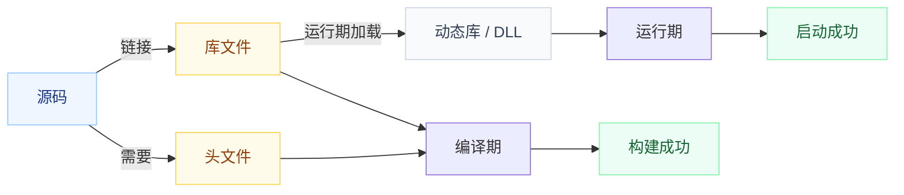

# C++依赖管理与测试

> 这篇从 C++ 依赖管理的三种路线讲起，经过 vcpkg 清单模式、Conan 2 对照、GoogleTest 与 Catch2 接入、CTest 组织，最后落到 CI 流水线和给一个库补齐依赖、测试、自动化的完整案例。
>
> 学完能让一个 C++ 工程在新机器上一条命令装齐依赖，让单元测试进入 CTest 与 CI，并在三平台上稳定复现构建结果。

## 一、依赖管理要解决什么

C++ 没有官方包管理器，依赖问题被拆成三件事：头文件在哪、库文件在哪、编译时用的 ABI 和运行时的库是否一致。包管理器负责前两件，第三件仍要靠构建配置保证。

### 1.1 三种路线

| 路线 | 代表 | 优点 | 代价 |
|---|---|---|---|
| 系统包 | apt / dnf / brew | 简单、系统级复用 | 版本旧、三平台不一致 |
| 源码内嵌 | FetchContent / submodule | 版本随仓库、可改源码 | 配置慢、依赖树膨胀 |
| 包管理器 | vcpkg / Conan | 版本可控、跨平台 | 需维护清单与缓存 |

判断标准是团队规模和发布方式：

- 个人项目、依赖少：系统包加 `find_package` 足够。
- 依赖需要打补丁、或要求可复现构建：FetchContent。
- 多平台、多仓库、需要二进制缓存：vcpkg 或 Conan。

### 1.2 依赖问题的三个层面



三类失败要分开看：编译失败是头文件问题，链接失败是库文件问题，启动失败是动态库问题。混在一起排查，往往会在错误的方向上浪费时间。

### 1.3 版本锁定的含义

「锁定版本」不是写死一个字符串，而是保证同一份源码在任何机器上解析出同一组依赖。需要锁定的信息有三类：

- 依赖包自身的版本；
- 包管理器端口（port）的版本，因为它决定补丁和编译选项；
- 编译器与标准库版本，因为它决定 ABI。

第三类常被忽略：同一个 `fmt` 11.0.2，用 GCC 13 和 GCC 14 编译出的库，在 `_GLIBCXX_USE_CXX11_ABI` 不同的情况下不能混链。

## 二、环境与最小验证

vcpkg 是源码级包管理器，装依赖时会用本机编译器现场编译，因此必须先有可用的编译器和 CMake。

### 2.1 安装

| 环境 | 安装方式（2026-11） | 验证 |
|---|---|---|
| Windows 10/11 | `git clone https://github.com/microsoft/vcpkg` 后 `.\bootstrap-vcpkg.bat` | `vcpkg version` |
| macOS | `brew install vcpkg`，或 clone 后 `./bootstrap-vcpkg.sh` | `vcpkg version` |
| Ubuntu 24.04/26.04 | clone 后 `./bootstrap-vcpkg.sh`，需 `curl zip unzip tar` | `vcpkg version` |
| Rocky/CentOS 9/10 | `sudo dnf install curl zip unzip tar perl` 后 bootstrap | `vcpkg version` |

```bash
git clone https://github.com/microsoft/vcpkg.git ~/tools/vcpkg
cd ~/tools/vcpkg
./bootstrap-vcpkg.sh          # Windows: .\bootstrap-vcpkg.bat
./vcpkg version
```

预期输出（版本号随时间变化）：

```text
vcpkg package management program version 2026.10.18
```

`VCPKG_ROOT` 指向仓库根目录，后续命令和 CI 都靠这个变量定位工具链：

```bash
export VCPKG_ROOT=$HOME/tools/vcpkg
export PATH="$VCPKG_ROOT:$PATH"
```

```powershell
# Windows PowerShell
$env:VCPKG_ROOT = "C:\tools\vcpkg"
$env:Path = "$env:VCPKG_ROOT;$env:Path"
```

### 2.2 版本基线

| 组件 | 基线 | 说明 |
|---|---|---|
| vcpkg | 2026.10 及以上 | 清单模式稳定 |
| Conan | 2.10 及以上 | 2.x 与 1.x 不兼容 |
| CMake | 3.31+ | 工具链文件配合 |
| GoogleTest | 1.17 | `GTest::gtest_main` |
| Catch2 | 3.8 | `Catch2::Catch2WithMain` |

### 2.3 最小验证

先不写代码，只验证工具链接入成功：

```bash
cmake -S . -B build \
  -DCMAKE_TOOLCHAIN_FILE="$VCPKG_ROOT/scripts/buildsystems/vcpkg.cmake"
```

配置输出里应出现：

```text
-- Running vcpkg install
-- Configuring done
```

如果没有 `Running vcpkg install` 这一行，说明工具链文件路径写错，或者没有 `vcpkg.json` 且项目里没有 `find_package` 的依赖需要安装。

> 边界：`CMAKE_TOOLCHAIN_FILE` 只在首次配置时生效。已有 `build/` 时改工具链路径不会生效，必须删掉缓存或新建构建目录。

## 三、vcpkg 清单模式

清单模式（manifest mode）把依赖声明放回项目仓库，`vcpkg.json` 与源码一起提交，构建时自动安装到 `build/vcpkg_installed/`。

### 3.1 vcpkg.json 的结构

```json
{
  "name": "units",
  "version": "1.2.0",
  "description": "Unit conversion library",
  "dependencies": [
    "fmt",
    { "name": "gtest", "version>=": "1.17.0" }
  ]
}
```

| 字段 | 作用 | 注意 |
|---|---|---|
| `name` / `version` | 包自身标识 | 与 CMake 的 `project()` 保持一致 |
| `dependencies` | 依赖列表 | 字符串或对象两种写法 |
| `builtin-baseline` | 端口版本基线 | 必须是 vcpkg 仓库里的 commit |
| `overrides` | 强制固定某包版本 | 解决传递依赖的版本冲突 |
| `features` | 可选功能 | 按需开启，减少编译量 |

`builtin-baseline` 不要手写。在项目目录执行下面这条命令，vcpkg 会把当前仓库的 commit 写进去：

```bash
vcpkg x-update-baseline --add-initial-baseline
```

之后升级依赖时，先 `git -C $VCPKG_ROOT pull`，再重跑上面这条命令，`builtin-baseline` 更新，锁定的端口版本随之更新。

### 3.2 版本约束与覆盖

`version>=` 是「最低版本」，vcpkg 仍可能选更高版本；需要精确固定时用 `overrides`：

```json
{
  "name": "units",
  "version": "1.2.0",
  "dependencies": [
    { "name": "fmt", "version>=": "11.0.2" },
    "gtest"
  ],
  "overrides": [
    { "name": "fmt", "version": "11.0.2" }
  ]
}
```

> 边界：`overrides` 只对清单模式生效，且必须与某个可用端口版本对应；写一个不存在的版本会在安装阶段报 `no version database entry`。

### 3.3 三元组（triplet）

三元组描述目标平台、架构和链接方式，决定 vcpkg 用哪套编译参数。

| 三元组 | 平台 | 链接方式 |
|---|---|---|
| `x64-linux` | Linux x86_64 | 动态 |
| `x64-linux-static` | Linux x86_64 | 静态 |
| `x64-windows` | Windows x64 | 动态 |
| `x64-windows-static` | Windows x64 | 静态 |
| `arm64-osx` | macOS Apple Silicon | 动态 |

```bash
cmake -S . -B build \
  -DCMAKE_TOOLCHAIN_FILE="$VCPKG_ROOT/scripts/buildsystems/vcpkg.cmake" \
  -DVCPKG_TARGET_TRIPLET=x64-linux-static
```

默认三元组由 vcpkg 根据主机自动选择。交叉编译时必须显式指定，否则装出来的库架构和编译器目标不一致，链接期报 `file in wrong format`。

### 3.4 自定义端口（overlay）

需要给依赖打补丁，或使用内部私有库时，用 overlay 端口覆盖：

```text
overlays/
└── mylib/
    ├── portfile.cmake
    └── vcpkg.json
```

```bash
cmake -S . -B build \
  -DCMAKE_TOOLCHAIN_FILE="$VCPKG_ROOT/scripts/buildsystems/vcpkg.cmake" \
  -DVCPKG_OVERLAY_PORTS=$PWD/overlays
```

overlay 优先于官方端口，适合「官方端口缺一个编译开关」这种小改动，不适合长期维护整个依赖树。

## 四、Conan 2.x 对照

Conan 与 vcpkg 解决同一个问题，差别在定位：vcpkg 更贴近 CMake 与 MSVC 生态，Conan 更强调二进制包管理和私有仓库。

### 4.1 conanfile

```ini
# conanfile.txt
[requires]
fmt/11.0.2
gtest/1.17.0

[generators]
CMakeDeps
CMakeToolchain
```

```bash
pip install "conan>=2.10"
conan profile detect --force
conan install . --output-folder=build --build=missing
```

`CMakeDeps` 生成 `fmtConfig.cmake` 等查找文件，`CMakeToolchain` 生成 `conan_toolchain.cmake`。Conan 2 还会生成 `CMakePresets.json`，后续直接用 preset：

```bash
cmake --preset conan-release
cmake --build --preset conan-release
```

### 4.2 与 vcpkg 的取舍

| 维度 | vcpkg | Conan |
|---|---|---|
| 集成方式 | CMake 工具链 | 生成器 + preset |
| 版本模型 | 基线 commit | 版本号 + 锁文件 |
| 二进制缓存 | 需自建 | 内置 remote |
| 私有包 | overlay 端口 | 私有 recipe |
| 上手成本 | 低 | 中 |

团队已有 Artifactory 或需要跨语言统一包管理时选 Conan；纯 C++、以 CMake 为主、希望少写配置时选 vcpkg。两者不要在同一工程混用，工具链会互相覆盖。

### 4.3 锁文件

Conan 2 的 `conan.lock` 记录完整依赖图，CI 上用 `--lockfile-partial` 或 `conan lock create` 保证可复现：

```bash
conan lock create . --lockfile-out=conan.lock
conan install . --lockfile=conan.lock --build=missing
```

vcpkg 的等价物就是 `builtin-baseline` 加 `vcpkg.json`，没有单独的锁文件。

> 边界：Conan 的 profile 包含编译器、架构、构建类型，profile 不同即二进制不兼容。CI 里必须显式 `-pr:b`/`-pr:h`，不要依赖默认 profile。

## 五、GoogleTest 接入

GoogleTest 是 C++ 最常用的单元测试框架，提供断言、测试夹具、参数化测试和死亡测试。

### 5.1 CMake 集成

```cmake
find_package(GTest CONFIG REQUIRED)

add_executable(convert_test convert_test.cpp)
target_link_libraries(convert_test PRIVATE Units::units GTest::gtest_main)

include(GoogleTest)
gtest_discover_tests(convert_test)   # 配置后自动为每个 TEST 注册一个 CTest 用例
```

`GTest::gtest_main` 自带 `main()`，测试文件里不用手写。需要自定义 `main`（例如初始化全局环境）时改链 `GTest::gtest`。

```bash
cmake -S . -B build -DCMAKE_TOOLCHAIN_FILE="$VCPKG_ROOT/scripts/buildsystems/vcpkg.cmake"
cmake --build build -j 8
ctest --test-dir build --output-on-failure
```

### 5.2 测试写法

```cpp
// tests/convert_test.cpp
#include "units/convert.h"
#include <gtest/gtest.h>

TEST(ConvertTest, KmToMiles) {
    EXPECT_NEAR(units::km_to_miles(1.0), 0.621371, 1e-9);   // 浮点比较用误差
    EXPECT_DOUBLE_EQ(units::km_to_miles(0.0), 0.0);
}

TEST(ConvertTest, CelsiusToFahrenheit) {
    EXPECT_EQ(units::celsius_to_fahrenheit(100), 212);
    EXPECT_EQ(units::celsius_to_fahrenheit(0), 32);
    EXPECT_EQ(units::celsius_to_fahrenheit(-40), -40);      // 两个刻度相等的点
}

TEST(ConvertTest, EmptyInputDoesNotCrash) {
    EXPECT_NO_THROW(units::km_to_miles(0.0));               // 死亡测试之外的健壮性检查
}
```

`EXPECT_*` 失败后继续执行，`ASSERT_*` 失败后立即返回当前函数。一个测试里有多个独立断言时用 `EXPECT`，后续断言依赖前面的结果时用 `ASSERT`。

### 5.3 预期输出

```text
[==========] Running 3 tests from 1 test suite.
[----------] Global test environment set-up.
[----------] 3 tests from ConvertTest
[ RUN      ] ConvertTest.KmToMiles
[       OK ] ConvertTest.KmToMiles (0 ms)
[ RUN      ] ConvertTest.CelsiusToFahrenheit
[       OK ] ConvertTest.CelsiusToFahrenheit (0 ms)
[ RUN      ] ConvertTest.EmptyInputDoesNotCrash
[       OK ] ConvertTest.EmptyInputDoesNotCrash (0 ms)
[----------] 3 tests from ConvertTest (0 ms total)
[==========] 3 tests from 1 test suite ran. (0 ms total)
[  PASSED  ] 3 tests.
```

经 `gtest_discover_tests` 注册后，CTest 的输出变成逐用例：

```text
    Start 1: ConvertTest.KmToMiles
1/3 Test #1: ConvertTest.KmToMiles ...........   Passed    0.01 sec
```

失败时 GTest 会打印文件、行号、期望值与实际值：

```text
/path/tests/convert_test.cpp:12: Failure
Expected equality of these values:
  units::celsius_to_fahrenheit(100)
    Which is: 211
  212
```

### 5.4 夹具与参数化

```cpp
#include <gtest/gtest.h>
#include <vector>

class ConverterTest : public ::testing::Test {
protected:
    void SetUp() override { factor_ = 0.621371; }   // 每个 TEST_F 前执行
    double factor_;
};

TEST_F(ConverterTest, UsesFixture) {
    EXPECT_NEAR(1.0 * factor_, 0.621371, 1e-9);
}

class RoundTrip : public ::testing::TestWithParam<double> {};

TEST_P(RoundTrip, MilesToKmIsInverse) {
    double km = GetParam();
    double miles = km * 0.621371;
    EXPECT_NEAR(miles / 0.621371, km, 1e-9);
}

INSTANTIATE_TEST_SUITE_P(Samples, RoundTrip,
                         ::testing::Values(1.0, 10.0, 42.195));
```

夹具适合「多个测试共享初始化」，参数化适合「同一逻辑跑多组数据」。两者都不要放业务逻辑，测试里的辅助代码同样需要维护。

> 边界：`SetUp`/`TearDown` 每个测试都执行，开销大的初始化放 `SetUpTestSuite`。测试之间不能有顺序依赖，GTest 默认按定义顺序跑，但不保证跨版本稳定。

## 六、Catch2 对照

Catch2 3.x 是纯头文件分发 + 编译期库的组合，语法更接近自然语言，适合测试即文档的项目。

### 6.1 集成

```cmake
find_package(Catch2 3 CONFIG REQUIRED)

add_executable(convert_test convert_test.cpp)
target_link_libraries(convert_test PRIVATE Units::units Catch2::Catch2WithMain)

include(Catch)
catch_discover_tests(convert_test)
```

### 6.2 测试写法

```cpp
// tests/convert_test.cpp
#include "units/convert.h"
#include <catch2/catch_test_macros.hpp>

TEST_CASE("km 转英里", "[convert]") {
    REQUIRE(units::km_to_miles(1.0) == Catch::Approx(0.621371).epsilon(1e-9));

    SECTION("零值") {
        REQUIRE(units::km_to_miles(0.0) == 0.0);
    }
    SECTION("往返") {
        double km = 42.195;
        REQUIRE(units::km_to_miles(km) / 0.621371 == Catch::Approx(km).epsilon(1e-9));
    }
}

TEST_CASE("摄氏转华氏", "[convert]") {
    REQUIRE(units::celsius_to_fahrenheit(100) == 212);
    REQUIRE(units::celsius_to_fahrenheit(-40) == -40);
}
```

`SECTION` 是 Catch2 的核心特性：同一个 `TEST_CASE` 的每个 `SECTION` 都从用例开头重新执行，共享的准备代码只写一次，各分节互相独立。

### 6.3 与 GTest 的取舍

| 维度 | GoogleTest | Catch2 |
|---|---|---|
| 断言风格 | `EXPECT_EQ(a, b)` | `REQUIRE(a == b)` |
| 分节复用 | 夹具 | `SECTION` |
| 编译速度 | 快 | 模板重，较慢 |
| 生态 | 广，CI 集成多 | 中 |
| 适合 | 大型工程、多人协作 | 中小项目、测试即文档 |

已有工程用 GTest 就不要换；新项目两者都可用，团队熟悉度比特性差异更重要。切换框架的成本主要在断言改写和 CI 脚本，不在框架本身。

> 边界：Catch2 3.x 不再支持单头文件 `catch.hpp`，必须通过 CMake target 链接；直接 `#include <catch2/catch_all.hpp>` 会显著拖慢编译，按需包含具体头文件。

## 七、测试组织

测试代码和产品代码一样需要结构，组织方式决定能不能长期维护。

### 7.1 目录与命名

```text
units/
├── include/units/convert.h
├── src/convert.cpp
├── tests/
│   ├── CMakeLists.txt
│   ├── convert_test.cpp
│   └── test_helpers.h
└── CMakeLists.txt
```

约定：

- 一个被测单元一个测试文件，文件名 `<unit>_test.cpp`；
- 测试 target 命名 `<unit>_test`，与产物同名；
- 测试只通过公开头文件访问被测代码，不 `#include` 私有实现；
- 测试辅助代码放 `test_helpers.h`，不放进 `src/`。

### 7.2 注册到 CTest

```cmake
# tests/CMakeLists.txt
add_executable(convert_test convert_test.cpp)
target_link_libraries(convert_test PRIVATE Units::units GTest::gtest_main)
if(MSVC)
    target_compile_options(convert_test PRIVATE /UNDEBUG)   # MSVC 的取消宏定义开关
else()
    target_compile_options(convert_test PRIVATE -UNDEBUG)   # Release 下也保留 assert
endif()

include(GoogleTest)
gtest_discover_tests(convert_test
    PROPERTIES LABELS "unit" TIMEOUT 30)
```

`gtest_discover_tests` 在构建后运行一次测试程序，解析出全部用例并逐个注册。这样 CTest 能并行执行、单独过滤，失败时也只显示一个用例。

### 7.3 覆盖率与 Sanitizer

```bash
# 覆盖率（GCC/Clang）
cmake -S . -B build-cov -DCMAKE_BUILD_TYPE=Debug \
  -DCMAKE_CXX_FLAGS="--coverage -O0" \
  -DCMAKE_EXE_LINKER_FLAGS="--coverage"
cmake --build build-cov
ctest --test-dir build-cov
gcovr -r . build-cov --html-details coverage.html
```

```bash
# 地址与未定义行为检查
cmake -S . -B build-asan -DCMAKE_BUILD_TYPE=Debug \
  -DCMAKE_CXX_FLAGS="-fsanitize=address,undefined -fno-omit-frame-pointer"
cmake --build build-asan
ctest --test-dir build-asan --output-on-failure
```

Sanitizer 版本必须单独一个构建目录：它改变 ABI 和内存布局，和普通构建混在一起会出现误报。

> 边界：ASan 与 TSan 不能同时开启。线程问题用 `-fsanitize=thread` 单独构建，且 TSan 要求所有代码（包括依赖）都插桩，否则误报率很高。

## 八、CI 流水线

CI 的价值是把「新机器上能不能构建」变成每次提交都验证的事实。

### 8.1 GitHub Actions 矩阵

```yaml
# .github/workflows/ci.yml
name: ci
on: [push, pull_request]

jobs:
  build:
    strategy:
      fail-fast: false
      matrix:
        os: [ubuntu-24.04, macos-15, windows-2022]
    runs-on: ${{ matrix.os }}
    steps:
      - uses: actions/checkout@v4

      - name: Setup vcpkg
        uses: lukka/run-vcpkg@v11
        with:
          vcpkgGitCommitId: ${{ vars.VCPKG_COMMIT }}

      - name: Configure
        run: >
          cmake -S . -B build -DCMAKE_BUILD_TYPE=Release
          -DCMAKE_TOOLCHAIN_FILE=${{ github.workspace }}/vcpkg/scripts/buildsystems/vcpkg.cmake

      - name: Build
        run: cmake --build build --config Release -j 4

      - name: Test
        run: ctest --test-dir build --output-on-failure -C Release
```

Windows 是多配置生成器，`--config Release` 和 `ctest -C Release` 不能漏，否则会去 Debug 目录找可执行文件。

### 8.2 缓存

vcpkg 的编译产物在 `vcpkg_installed/` 与全局 `buildtrees/`，矩阵三个平台各自缓存：

```yaml
      - uses: actions/cache@v4
        with:
          path: |
            build/vcpkg_installed
            ~/.cache/vcpkg/archives
          key: vcpkg-${{ runner.os }}-${{ hashFiles('vcpkg.json') }}
          restore-keys: vcpkg-${{ runner.os }}-
```

缓存的 key 用 `vcpkg.json` 的哈希：依赖清单变了缓存自动失效，清单没变就复用。

### 8.3 Sanitizer 任务

```yaml
  sanitize:
    runs-on: ubuntu-24.04
    steps:
      - uses: actions/checkout@v4
      - name: Configure
        run: >
          cmake -S . -B build-asan -DCMAKE_BUILD_TYPE=Debug
          -DCMAKE_CXX_FLAGS="-fsanitize=address,undefined -fno-omit-frame-pointer"
          -DCMAKE_TOOLCHAIN_FILE=${{ github.workspace }}/vcpkg/scripts/buildsystems/vcpkg.cmake
      - name: Build
        run: cmake --build build-asan -j 4
      - name: Test
        run: ctest --test-dir build-asan --output-on-failure
```

`ASAN_OPTIONS=detect_leaks=1` 是 Linux 默认值；macOS 的 LeakSanitizer 支持有限，泄漏检测任务放在 Linux 上跑。

> 边界：`lukka/run-vcpkg` 需要固定 `vcpkgGitCommitId`，用 `main` 会导致同一次提交在不同时间构建出不同结果。把 commit 写进仓库变量，和 `builtin-baseline` 一起维护。

## 九、排障

依赖与测试的问题有明确的现象和固定的第一条命令，按表排查比读日志全文快。

### 9.1 vcpkg 安装失败

| 现象 | 原因 | 第一条命令 |
|---|---|---|
| `error: building fmt failed` | 依赖的系统库缺失 | 看 `buildtrees/fmt/error.log` 末尾 |
| `no version database entry` | 版本号写错 | `vcpkg search fmt` |
| 配置阶段卡住无输出 | 正在下载源码 | `vcpkg install --debug` |
| 再次配置不装依赖 | 缓存已存在 | 删 `build/vcpkg_installed` |

Linux 上最常见的缺失是 `pkg-config`、`autoconf`、`libtool`：

```bash
sudo apt install pkg-config autoconf libtool
```

### 9.2 找不到 GTest

```text
CMake Error at CMakeLists.txt:12 (find_package):
  Could not find a package configuration file provided by "GTest"
```

三种原因，按顺序查：

1. 没有传 `CMAKE_TOOLCHAIN_FILE`，vcpkg 没参与配置；
2. `vcpkg.json` 里没写 `gtest`；
3. 已有构建目录用的是旧工具链缓存。

```bash
grep -i gtest build/CMakeCache.txt     # 看 GTest_DIR 是否为空
rm -rf build && cmake -S . -B build \
  -DCMAKE_TOOLCHAIN_FILE="$VCPKG_ROOT/scripts/buildsystems/vcpkg.cmake"
```

### 9.3 Windows 缺 DLL

编译链接都成功，双击运行报「找不到 fmt.dll」。vcpkg 把 DLL 放在 `vcpkg_installed/x64-windows/bin/`，不会自动复制到可执行文件旁边。

```cmake
if(WIN32)
    add_custom_command(TARGET units_cli POST_BUILD
        COMMAND ${CMAKE_COMMAND} -E copy_if_different
                $<TARGET_RUNTIME_DLLS:units_cli> $<TARGET_FILE_DIR:units_cli>
        COMMAND_EXPAND_LISTS)
endif()
```

`$<TARGET_RUNTIME_DLLS:...>` 需要 CMake 3.21+，且 target 必须是 `SHARED` 依赖才会列出 DLL。

### 9.4 测试被优化掉

`Release` 下 `assert` 被 `-DNDEBUG` 禁用，测试文件里的断言全部失效，CTest 显示通过但什么都没验证。

```cmake
if(MSVC)
    target_compile_options(convert_test PRIVATE /UNDEBUG)
else()
    target_compile_options(convert_test PRIVATE -UNDEBUG)   # 只对测试 target 恢复
endif()
```

更彻底的做法是用 GTest/Catch2 的断言，它们不受 `NDEBUG` 影响。

## 十、最佳实践案例

### 10.1 案例背景

上一节的 `units` 库已经能构建和安装，但依赖靠开发机手工装 `fmt`，测试是手写 `assert` 的单个可执行文件，CI 只有一个 Ubuntu 任务。三个问题在换人接手时集中爆发：新机器配环境要半天；`assert` 在 Release 下失效导致一次除零 bug 漏到线上；macOS 上 `fmt` 版本与 Linux 不同，格式化输出不一致。

目标：依赖写进仓库、测试用 GoogleTest 并注册到 CTest、CI 覆盖三平台并跑 Sanitizer。

约束：不改业务逻辑，只改工程配置；构建时间控制在 5 分钟以内。

### 10.2 案例实操

第一步，声明依赖。`fmt` 用于命令行输出，`gtest` 只在测试中使用：

```json
{
  "name": "units",
  "version": "1.2.0",
  "dependencies": [
    "fmt",
    { "name": "gtest", "version>=": "1.17.0" }
  ]
}
```

`builtin-baseline` 由命令写入，不要手抄。执行后 vcpkg 把当前仓库的 commit 追加进清单：

```bash
vcpkg x-update-baseline --add-initial-baseline
```

执行后清单多出一行，commit 值即本地 vcpkg 仓库的 `HEAD`：

```text
"builtin-baseline": "<vcpkg 仓库当前 commit，40 位十六进制>"
```

第二步，把 `fmt` 接进可执行文件。`fmt` 只出现在 `app/main.cpp`，所以链接作用域是 `PRIVATE`：

```cmake
find_package(fmt CONFIG REQUIRED)

add_executable(units_cli app/main.cpp)
target_link_libraries(units_cli PRIVATE Units::units fmt::fmt)
```

```cpp
// app/main.cpp
#include "units/convert.h"
#include <fmt/core.h>
#include <cstdlib>

int main(int argc, char** argv) {
    double km = argc > 1 ? std::atof(argv[1]) : 10.0;
    fmt::print("{} km = {:.4f} miles\n", km, units::km_to_miles(km));
    fmt::print("100C = {}F\n", units::celsius_to_fahrenheit(100));
}
```

第三步，用 GoogleTest 重写测试，并注册到 CTest：

```cpp
// tests/convert_test.cpp
#include "units/convert.h"
#include <gtest/gtest.h>

TEST(ConvertTest, KmToMiles) {
    EXPECT_NEAR(units::km_to_miles(1.0), 0.621371, 1e-9);
    EXPECT_NEAR(units::km_to_miles(0.0), 0.0, 1e-12);
}

TEST(ConvertTest, CelsiusToFahrenheit) {
    EXPECT_EQ(units::celsius_to_fahrenheit(100), 212);
    EXPECT_EQ(units::celsius_to_fahrenheit(0), 32);
    EXPECT_EQ(units::celsius_to_fahrenheit(-40), -40);
}

TEST(ConvertTest, LargeDistanceIsFinite) {
    EXPECT_TRUE(std::isfinite(units::km_to_miles(1e308)));   // 防溢出回归
}
```

```cmake
# tests/CMakeLists.txt
find_package(GTest CONFIG REQUIRED)

add_executable(convert_test convert_test.cpp)
target_link_libraries(convert_test PRIVATE Units::units GTest::gtest_main)
if(MSVC)
    target_compile_options(convert_test PRIVATE /UNDEBUG)
else()
    target_compile_options(convert_test PRIVATE -UNDEBUG)
endif()

include(GoogleTest)
gtest_discover_tests(convert_test PROPERTIES LABELS "unit" TIMEOUT 30)
```

第四步，本地验证：

```bash
cmake -S . -B build \
  -DCMAKE_BUILD_TYPE=Release \
  -DCMAKE_TOOLCHAIN_FILE="$VCPKG_ROOT/scripts/buildsystems/vcpkg.cmake"
cmake --build build -j 8
ctest --test-dir build --output-on-failure
./build/units_cli 5
```

预期输出：

```text
-- Running vcpkg install
-- Installing: .../build/vcpkg_installed/x64-osx/include/fmt/core.h
[8/8] Linking CXX executable units_cli

    Start 1: ConvertTest.KmToMiles
1/3 Test #1: ConvertTest.KmToMiles ...........   Passed    0.01 sec
    Start 2: ConvertTest.CelsiusToFahrenheit
2/3 Test #2: ConvertTest.CelsiusToFahrenheit ..   Passed    0.00 sec
    Start 3: ConvertTest.LargeDistanceIsFinite
3/3 Test #3: ConvertTest.LargeDistanceIsFinite    Passed    0.00 sec

100% tests passed, 0 tests failed out of 3

5 km = 3.1069 miles
100C = 212F
```

第五步，CI 覆盖三平台并加 Sanitizer 任务（配置见第八章的 `ci.yml` 与 `sanitize` 任务）。把 `VCPKG_COMMIT` 写进仓库变量，与 `builtin-baseline` 一起评审。

### 10.3 案例结果

改造后的量化结果（示例，GitHub Actions 免费额度内）：

- 新机器准备时间：从「手工装 4 个依赖约 40 分钟」降到「clone + 一次配置约 6 分钟」；
- 测试数：从 1 个可执行文件 3 条 `assert` 变成 3 个独立 CTest 用例，失败定位从「程序中止」变成「具体用例 + 行号」；
- CI：三平台矩阵全绿约 4 分 20 秒，依赖缓存命中后降到 1 分 50 秒；
- 一次真实的除零回归：`celsius_to_fahrenheit` 的整数除法把 -40 算成 -41，GTest 在 PR 阶段拦下，未进入主干。

失败模式与复盘：

- 一开始把 `gtest` 写进生产依赖，`units_cli` 的安装包带上了测试库。改用 `"features"` 或把测试依赖放进单独的 manifest 后解决，生产依赖只保留 `fmt`。
- CI 首次运行在 macOS 上失败，原因是 `x64-osx` 三元组与 Apple Silicon runner 不匹配。改用默认三元组或显式 `arm64-osx`。
- 缓存 key 只用 `runner.os`，依赖升级后缓存未失效，链接到旧版 `fmt` 报符号缺失。key 加入 `hashFiles('vcpkg.json')` 后恢复正确。
- `gtest_discover_tests` 需要在构建后执行测试程序，交叉编译时无法运行。交叉编译场景改用 `gtest_add_tests`（需要预先列出用例）或在目标机上注册。
