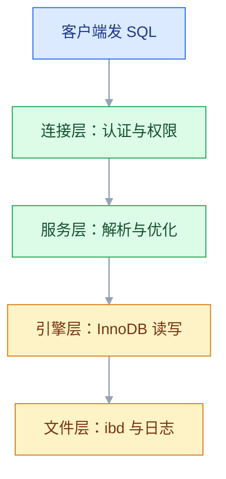

# MySQL

## 一、工程案例：把 500 万行订单表的列表页从 2.85 秒压到 4 毫秒

**场景**：`shop_db.t_order` 长到 500 万行，MySQL 8.4（8.0 行为一致，差异处单独标注）。C 端「我的订单」和后台「订单管理」两个列表页都要 3 秒左右。目标是：从慢日志定位到具体 SQL，改掉执行计划，用数据证明有效，最后沉淀成上线检查项。

**为什么拿这两个页面开刀**：它们覆盖了线上最常见的两类慢查询——「按用户 + 时间取一页」和「按状态 + 时间取一页」。这两条打通，其余列表页基本是同一套动作。

**动手前先确认三件事**（不确认就调参数，等于蒙）：

```sql
SELECT VERSION() AS 版本, @@transaction_isolation AS 隔离级别, @@binlog_format AS binlog格式;
SHOW VARIABLES LIKE 'slow_query_log';
SHOW VARIABLES LIKE 'long_query_time';
```


### 1.1 造一份可复现的数据

生产库不能随便动，测试库按这份最小表结构来。它**只有主键和订单号唯一索引**，这正是事故现场：表还小的时候没人给 `user_id` 建索引。

把 1.1~1.5 的语句按顺序存成一个 `tuning.sql`，在一台空实例上从头跑就能复现全过程。毫秒数随机器波动，但 `type`、`key`、`Extra` 的变化是硬的，验收看它们。

```sql
CREATE DATABASE IF NOT EXISTS shop_db
  DEFAULT CHARACTER SET utf8mb4 COLLATE utf8mb4_0900_ai_ci;
USE shop_db;

DROP TABLE IF EXISTS t_order;
CREATE TABLE t_order (
    id         BIGINT UNSIGNED NOT NULL AUTO_INCREMENT,
    order_no   VARCHAR(32)     NOT NULL,
    user_id    BIGINT UNSIGNED NOT NULL,
    status     TINYINT         NOT NULL DEFAULT 0 COMMENT '0待支付 1已支付 2已发货 3已完成 4已取消 5已退款',
    pay_amount DECIMAL(12,2)   NOT NULL DEFAULT 0.00,
    created_at DATETIME        NOT NULL DEFAULT CURRENT_TIMESTAMP,
    PRIMARY KEY (id),
    UNIQUE KEY uk_order_no (order_no)
) ENGINE=InnoDB DEFAULT CHARSET=utf8mb4 COLLATE=utf8mb4_0900_ai_ci;

-- 500 万行：20000 个用户，每人约 250 单，状态均匀分布
SET SESSION cte_max_recursion_depth = 5000000;
INSERT INTO t_order (order_no, user_id, status, pay_amount, created_at)
WITH RECURSIVE seq(n) AS (
    SELECT 1 UNION ALL SELECT n + 1 FROM seq WHERE n < 5000000
)
SELECT CONCAT('SO', LPAD(n, 12, '0')), n % 20000 + 1, n % 6,
       ROUND(RAND() * 1000, 2), DATE_ADD('2024-01-01 00:00:00', INTERVAL n SECOND)
FROM seq;
```

> 一条语句插 500 万行是一个大事务，生产造数要分批（每批 1000~5000 行）。递归 CTE 会在临时表里堆满 500 万行，测试机上跑几分钟是正常的，别当成卡死；这段只求结果，不参与性能对比。

### 1.2 用慢日志把 SQL 揪出来

`long_query_time` 设 1 秒足够抓出这两条；线上 P99 要求 200ms 的话可以设 0.2，但日志量会明显上升。

```sql
SET GLOBAL slow_query_log = ON;
SET GLOBAL long_query_time = 1;
SET GLOBAL log_output = 'FILE';
SHOW VARIABLES LIKE 'slow_query_log_file';
```

> `long_query_time` 是会话级变量，`SET GLOBAL` 只对**之后新建的连接**生效。改完先重连，或在当前会话补一句 `SET SESSION long_query_time = 1`，否则日志仍按 10 秒记，慢 SQL 一条都抓不到。

把两个页面各点几次（第一次是冷缓存，不算），然后看日志：

```text
# Time: 2026-10-20T10:12:31.884512+08:00
# User@Host: app[app] @ 10.0.0.5 []  Id: 8123
# Query_time: 2.851204  Lock_time: 0.000087  Rows_sent: 20  Rows_examined: 5000000
SET timestamp=1792462351;
SELECT * FROM t_order WHERE user_id = 2 AND status IN (1,2,3)
ORDER BY created_at DESC LIMIT 20;
```

第二条是后台的 `WHERE status = 0 ORDER BY created_at DESC LIMIT 20`，同样是 3.1 秒、扫描 500 万行。

**判断只看一个比值**：`Rows_examined / Rows_sent`。这里是 250000，为了返回 20 行扫了 500 万行，索引一定没起作用。经验值：比值小于 10 正常，大于 1000 基本可以断定索引缺失或失效。

工具用 `mysqldumpslow -s at -t 10`（按平均耗时排序）或 `pt-query-digest`（按总耗时排序，找高频小慢查询）。

> 慢日志**只记录执行完的语句**。正在跑的长事务、被锁住 30 秒的 UPDATE 不会出现在里面，要另查 `information_schema.INNODB_TRX`。

### 1.3 第一条：按用户查订单

```sql
EXPLAIN SELECT * FROM t_order
WHERE user_id = 2 AND status IN (1,2,3)
ORDER BY created_at DESC LIMIT 20;
```

```text
+----+-------------+---------+------+---------------+------+---------+------+---------+-----------------------------+
| id | select_type | table   | type | possible_keys | key  | key_len | ref  | rows    | Extra                       |
+----+-------------+---------+------+---------------+------+---------+------+---------+-----------------------------+
|  1 | SIMPLE      | t_order | ALL  | NULL          | NULL | NULL    | NULL | 4983210 | Using where; Using filesort |
+----+-------------+---------+------+---------------+------+---------+------+---------+-----------------------------+
```

三个信号同时出现，结论没有悬念：

| 字段 | 值 | 含义 |
|---|---|---|
| `type` | `ALL` | 全表扫描，500 万行逐行读 |
| `key` | `NULL` | 一个索引都没用上 |
| `Extra` | `Using filesort` | 命中的行还要排序才能取前 20 |

**加索引**。列表页的固定形状是「一个用户 + 按时间倒序 + 取一页」，所以列顺序就是 `(user_id, created_at)`：

```sql
ALTER TABLE t_order ADD INDEX idx_user_created (user_id, created_at);
```

MySQL 8.0 加二级索引走 Online DDL（`ALGORITHM=INPLACE, LOCK=NONE`），不阻塞读写，但 500 万行仍要消耗几分钟 IO；上千万行且不能等时用 `gh-ost` 或 `pt-online-schema-change`。

```sql
EXPLAIN SELECT * FROM t_order
WHERE user_id = 2 AND status IN (1,2,3)
ORDER BY created_at DESC LIMIT 20;
```

```text
+----+-------------+---------+------+-----------------+-----------------+---------+-------+------+----------------------------------+
| id | select_type | table   | type | possible_keys   | key             | key_len | ref   | rows | Extra                            |
+----+-------------+---------+------+-----------------+-----------------+---------+-------+------+----------------------------------+
|  1 | SIMPLE      | t_order | ref  | idx_user_created| idx_user_created| 8       | const |  250 | Using where; Backward index scan |
+----+-------------+---------+------+-----------------+-----------------+---------+-------+------+----------------------------------+
```

`type` 从 `ALL` 变 `ref`，`rows` 从 498 万降到 250，`Using filesort` 消失——索引本身按 `created_at` 有序，倒着读就是 `ORDER BY created_at DESC`，8.0 标成 `Backward index scan`。

**`Using where` 还在是正常的**：`status` 不在索引里，只能回表后过滤。但有 `LIMIT 20`，扫到 20 条满足条件的行就停，实际只读四五十行。实测 **2.85 秒 → 0.004 秒**。

### 1.4 第二条：后台按状态查全站订单

后台没有 `user_id` 条件，`(user_id, created_at)` 帮不上忙，又是全表扫。这次建 `(status, created_at)`：

```sql
ALTER TABLE t_order ADD INDEX idx_status_created (status, created_at);

EXPLAIN SELECT * FROM t_order WHERE status = 0 ORDER BY created_at DESC LIMIT 20;
```

```text
+----+-------------+---------+------+--------------------+--------------------+---------+-------+--------+--------------------------+
| id | select_type | table   | type | possible_keys      | key                | key_len | ref   | rows   | Extra                    |
+----+-------------+---------+------+--------------------+--------------------+---------+-------+--------+--------------------------+
|  1 | SIMPLE      | t_order | ref  | idx_status_created | idx_status_created | 1       | const | 833333 | Backward index scan      |
+----+-------------+---------+------+--------------------+--------------------+---------+-------+--------+--------------------------+
```

**这里必须讲清**：`rows` 还是 83 万，看起来没变好，但耗时已从 3.1 秒降到亚毫秒。`rows` 是「预计检查多少行」的**估算值**，`LIMIT 20` 让执行器读 20 条就停。真实读数看 `EXPLAIN ANALYZE`（8.0.18 起支持 SELECT，8.0.19 起支持多表 UPDATE/DELETE）：

```sql
EXPLAIN ANALYZE SELECT * FROM t_order WHERE status = 0 ORDER BY created_at DESC LIMIT 20;
```

```text
-> Limit: 20 row(s)  (cost=0.35 rows=20) (actual time=0.021..0.038 rows=20 loops=1)
    -> Index lookup on t_order using idx_status_created (status=0)
       (cost=0.35 rows=20) (actual time=0.019..0.033 rows=20 loops=1)
```

`actual ... rows=20` 才是真实读取行数。**估算 83 万、实读 20 行**，这就是「`rows` 大但查询很快」的合理解释。注意 `EXPLAIN ANALYZE` 会真的执行语句，别在生产上对写语句随手加。

### 1.5 别急着把 status 塞进复合索引

看到第一条还在回表过滤 `status`，直觉是加 `(user_id, status, created_at)`。先建出来实测：

```sql
-- 实验用，验证完就删
ALTER TABLE t_order ADD INDEX idx_user_status_created (user_id, status, created_at);

-- 两张索引都在时，优化器会直接挑能免排序的 idx_user_created，看不出差别；强制指定才看得见
EXPLAIN SELECT * FROM t_order FORCE INDEX (idx_user_status_created)
WHERE user_id = 2 AND status IN (1,2,3) ORDER BY created_at DESC LIMIT 20;
-- type=range, Extra: Using where; Using filesort
```

`status IN (1,2,3)` 是**三个不相交的区间**，每个区间内部按 `created_at` 有序，跨区间不保证全局有序，所以排序回来了。125 行排序无所谓，但 `IN` 列表很长、命中上万行时，它反而比 `(user_id, created_at)` 慢。

| 查询形状 | 合适索引 | 原因 |
|---|---|---|
| `user_id = ? ORDER BY created_at DESC` | `(user_id, created_at)` | 等值 + 排序，索引顺序即结果顺序 |
| `user_id = ? AND status = ? ORDER BY created_at DESC` | `(user_id, status, created_at)` | 两个等值 + 排序，仍有序 |
| `user_id = ? AND status IN (...) ORDER BY created_at DESC` | `(user_id, created_at)` | `IN` 是范围，后续列失去全局有序 |
| `status = ? ORDER BY created_at DESC` | `(status, created_at)` | 等值 + 排序 |

结论：**先按「等值列 + 排序列」建，范围条件放最后，别指望范围列后面的列还能保序。** 这条复合索引没有收益，验收后删掉，少一棵 B+ 树就少一份写入开销：

```sql
ALTER TABLE t_order DROP INDEX idx_user_status_created;
```

### 1.6 验收（10 项全过才算完成）

| # | 检查项 | 命令或检查 | 通过标准 |
|---|---|---|---|
| 1 | 慢日志开启 | `SHOW VARIABLES LIKE 'slow_query_log'` | `ON`，阈值按业务设定 |
| 2 | 慢 SQL 已定位 | `mysqldumpslow -s at -t 10` | 目标 SQL 在榜首，扫描/返回比 > 1000 |
| 3 | 优化前基线 | `EXPLAIN` + 计时 | `type=ALL` 或 `key=NULL`，有实测秒数 |
| 4 | 索引已建 | `SHOW INDEX FROM t_order` | 有 `idx_user_created`、`idx_status_created` |
| 5 | 执行计划改善 | `EXPLAIN` | `type` 为 `ref`/`range`，`key` 非 NULL |
| 6 | 无多余排序 | `Extra` 列 | 不再出现 `Using filesort` |
| 7 | 真实耗时 | `EXPLAIN ANALYZE` | 首行 `actual time` < 10ms |
| 8 | 扫描行数 | 慢日志 `Rows_examined` | 从 5000000 降到 100 以内 |
| 9 | 写入未被拖慢 | 压测写入 TPS，与加索引前对比 | 下降 < 5% |
| 10 | 可回退 | 备份 `DROP INDEX` 语句 | 一分钟内能撤销 |

> 第 9 项最容易被跳过。每个二级索引都要在每次 `INSERT`/`UPDATE` 时维护，**索引不是白给的**。单表索引超过 5 个就要开始审。

> 同一套动作可以复制到任何列表页：慢日志看扫描/返回比 → EXPLAIN 看 `type`/`key`/`Extra` → 按查询形状建索引 → `EXPLAIN ANALYZE` 和接口 P95 双重验收。

---

## 二、高频问答：会卡住你的地方，也是面试最常问的

### 2.1 明明建了索引，EXPLAIN 还是全表扫描

**现场**

`EXPLAIN` 看 `type=ALL`、`key=NULL`；紧跟一条 `SHOW WARNINGS`，能看到改写后的 `cast(phone as double)`。

```sql
-- ✘ phone 是 VARCHAR(20)，右边是数字
SELECT * FROM t_user WHERE phone = 13800138000;
-- ✔ 参数类型与列类型一致
SELECT * FROM t_user WHERE phone = '13800138000';
```

**要点**

- 建了索引还全表扫，先查隐式类型转换，不是索引建错了。
- 列是 `VARCHAR`，条件写成了数字，MySQL 把**列**转成数字再比较，等于在列上套了函数，B+ 树无法定位。
- `FORCE INDEX` 也救不了：强制走索引只是把扫表换成扫索引，转换仍在，通常更慢。

**追问**

- 为什么转的是列不是参数？→ 规则是字符串与数字比较时把字符串侧转成数字，于是函数落在列上。
- Java 侧怎么避免？→ 实体字段用 `String`，MyBatis 用 `#{}`。
- 还有哪些隐式转换？→ 两表 JOIN 的列字符集或 collation 不一致，同样会让索引失效。

### 2.2 搜索框一输入就慢：`LIKE '%关键词%'`

**现场**

`EXPLAIN` 的 `type=ALL`；把 `%` 去掉做对照，立刻变 `range`。

```sql
SELECT id, name FROM t_product WHERE name LIKE '%手机%';  -- ✘ 索引用不上
SELECT id, name FROM t_product WHERE name LIKE '手机%';   -- ✔ range
```

**要点**

- B+ 树按**前缀**有序，`%` 在前等于没有起点，只能全表逐行匹配。
- 索引不是"有列就能用"，是"有序才能用"。
- 中间匹配只有四条路：改成前缀匹配、额外存一列反转字符串再 `LIKE 'x%'`、`FULLTEXT` 加 ngram 分词器、上搜索引擎。

**追问**

- 为什么反转字符串有用？→ 后缀变成前缀，B+ 树能定位起点。
- `FULLTEXT` 中文要注意什么？→ 必须额外指定 ngram 分词器。
- 什么时候该上搜索引擎？→ 看查询复杂度和写入容忍度，不是单纯看行数。

### 2.3 翻到后面几页就超时：`LIMIT 1000000, 20`

**现场**

`EXPLAIN` 的 `rows` 接近 offset；`Handler_read_next` 数值巨大。

```sql
SELECT * FROM t_order ORDER BY id LIMIT 1000000, 20;   -- ✘ 500 万行实测 3.2 秒
-- ✔ 游标分页：1000020 是上一页最后一行的 id，不是 offset，毫秒级
SELECT * FROM t_order WHERE id > 1000020 ORDER BY id LIMIT 20;
SELECT o.* FROM t_order o                              -- ✔ 延迟关联：先在索引里翻页，再回表取 20 行
INNER JOIN (SELECT id FROM t_order ORDER BY id LIMIT 1000000, 20) AS t ON o.id = t.id;
```

**要点**

- `LIMIT offset, n` 要先**取出并丢弃**前 offset 行，offset 越大越慢，而且这些行往往还要回表。
- 加索引不会让 offset 消失，只让"丢弃"这一步便宜一点；调大 buffer pool 同样无效。
- 两条出路：游标分页（`WHERE id > 上一页最后一条`）和延迟关联（先在索引里翻页，再回表取 20 行）。

**追问**

- 游标分页的代价？→ 不能跳页，产品上通常只留上一页/下一页，或限制最大页数。
- 延迟关联为什么快？→ 子查询在覆盖索引里翻页不回表，外层只回表取 20 行。
- 为什么深分页一定要换成游标？→ offset 的成本随页数线性增长，翻得越深越慢。

### 2.4 翻页时同一条记录出现两次，或者漏了一条

**现场**

在 `ORDER BY` 末尾补主键，重复立刻消失；对比两次查询的 id 集合。

```sql
SELECT id, order_no FROM t_order WHERE user_id = 2
ORDER BY created_at DESC, id DESC LIMIT 20 OFFSET 40;   -- 加唯一列兜底
```

**要点**

- 不是缓存也不是丢数据，是**排序不是全序**：`ORDER BY` 的列不唯一，同秒的多行顺序由执行计划决定。
- 数据库只保证按你给的列有序，值相等的行想怎么排都合法。
- 加唯一列兜底；二级索引末尾本来就隐含主键，多数情况下 `(user_id, created_at)` 已够，别为"保序"重复建列。

**追问**

- 为什么 `created_at` 精确到秒会出问题？→ 同秒多行没有稳定次序，两次查询的顺序可以不同。
- 要不要在索引里显式补 `id`？→ 用 `EXPLAIN` 的 `Extra` 判断，二级索引本身已带主键。
- 游标分页时更要注意什么？→ 游标列必须唯一且稳定，否则照样漏行或重复。

### 2.5 事务里改完，另一个会话就是读不到

**现场**

`SELECT @@transaction_isolation`；在另一个会话用 `SELECT ... FOR UPDATE`（当前读）能读到最新值。

```sql
BEGIN;
SELECT balance FROM t_account WHERE id = 1;              -- 1000
-- 另一个会话：UPDATE t_account SET balance=500 WHERE id=1; COMMIT;
SELECT balance FROM t_account WHERE id = 1;              -- 还是 1000
SELECT balance FROM t_account WHERE id = 1 FOR UPDATE;   -- 500
```

**要点**

- 不是没提交，也不是缓存：RR 下普通 `SELECT` 是**快照读**，读的是本事务第一次查询时建立的 Read View。
- 提交只决定**之后新建的** Read View 能不能看到它，已经存在的快照不会刷新。
- 要读最新值就走当前读，或把读放到写之后的新事务里。

**追问**

- 快照读和当前读区别？→ 当前读读最新版本并加锁，快照读不加锁读历史版本（见 3.10）。
- RC 下还会这样吗？→ 每条 `SELECT` 新建 Read View，能看到别人新提交的数据。
- 同一个事务里能刷新快照吗？→ 做不到，只能结束事务重开。

### 2.6 `Lock wait timeout exceeded`

**现场**

`sys.innodb_lock_waits` 看谁阻塞谁；`INNODB_TRX` 看 `trx_started` 和 `trx_query`。

```sql
SELECT waiting_pid, blocking_pid, wait_age, locked_table
FROM sys.innodb_lock_waits;

SELECT trx_id, trx_started, trx_rows_locked, LEFT(trx_query, 80) AS 当前SQL
FROM information_schema.INNODB_TRX ORDER BY trx_started;
```

**要点**

- 不是数据库卡死，是有事务持锁不放：忘了提交、事务里调了远程接口，或 `UPDATE` 没走索引锁了整张表。
- 先看 `trx_started`，跑了几分钟还没提交的那个就是元凶。
- 重启能好，但会断掉所有连接，根因还在。

**追问**

- 默认会等多久？→ `innodb_lock_wait_timeout` 50 秒，现象常是"卡 50 秒后报错"，以官方当前稳定版为准。
- 为什么 `UPDATE` 没索引会锁全表？→ 行锁靠索引定位，定位不到就退化成锁住所有扫描行。
- 事务里为什么不能调远程接口？→ 外部服务一慢，连接和锁全被它占住。

### 2.7 两个事务互相等：`ERROR 1213 Deadlock`

**现场**

`SHOW ENGINE INNODB STATUS\G` 的 `LATEST DETECTED DEADLOCK` 段，能看到各持有什么、在等什么。

```sql
BEGIN;
SELECT * FROM t_account WHERE id IN (1, 2) ORDER BY id FOR UPDATE;  -- 一条语句锁两行，别分两次锁
UPDATE t_account SET balance = balance - 100 WHERE id = 1;
UPDATE t_account SET balance = balance + 100 WHERE id = 2;
COMMIT;
```

**要点**

- 死锁检测是正常功能，不是 MySQL 有 bug：InnoDB 会主动回滚代价小的一方，避免真卡死。
- 根因是两个事务以**相反顺序**访问同样的行；或 RR 下间隙锁把范围放大，交叉出一把新锁。
- 要做的是让加锁顺序一致、缩短事务，而不是关掉检测；应用层还要捕获 1213 并重试，这是兜底不是可选项。

**追问**

- 一条语句锁两行和分两次锁差在哪？→ 前者一次定位，后者中间留了窗口给对方插进来。
- 改成 RC 能减少死锁吗？→ 间隙锁基本消失，交叉范围变小，但顺序问题还在。
- 重试几次合适？→ 有限次并退避，无限重试只会放大冲突。

### 2.8 JOIN 之后金额翻了几倍

**现场**

同一条 SQL 里对比 `COUNT(*)` 与 `COUNT(DISTINCT o.id)`，不等就说明行膨胀了。

```sql
-- ✘ 一个订单 3 条明细，7898 被加了 3 次 = 23694
SELECT DATE_FORMAT(o.paid_at, '%Y-%m') AS 月份, SUM(o.pay_amount) AS 销售额
FROM t_order o JOIN t_order_item oi ON oi.order_id = o.id
GROUP BY 月份;

-- ✔ 先在订单粒度聚合，再和明细粒度关联
SELECT m.月份, m.销售额, IFNULL(s.件数, 0) AS 件数
FROM (SELECT DATE_FORMAT(paid_at, '%Y-%m') AS 月份, SUM(pay_amount) AS 销售额
      FROM t_order WHERE paid_at IS NOT NULL GROUP BY 月份) AS m
LEFT JOIN (SELECT DATE_FORMAT(o.paid_at, '%Y-%m') AS 月份, SUM(oi.quantity) AS 件数
           FROM t_order o JOIN t_order_item oi ON oi.order_id = o.id
           GROUP BY 月份) AS s ON s.月份 = m.月份;
```

**要点**

- 不是数据重复、也不是 `SUM` 算错：一对多 JOIN 让主表一行变成多行，`SUM(主表字段)` 按 JOIN 后的行重复累加。
- 规则是**一个聚合只在一张表的粒度上做**：先在订单粒度聚合，再和明细粒度关联。
- `SUM(DISTINCT)` 只在"每个订单金额都不同"时凑巧正确，两单都是 100 元就少算一单。

**追问**

- 怎么快速确认膨胀倍数？→ 先单独查主表 `SUM`，再和 JOIN 后的结果比，差值就是倍数。
- `LEFT JOIN` 会膨胀吗？→ 会，只要右表是一对多。
- 明细的过滤条件该写在哪？→ 写进子查询，写在外层 `WHERE` 会把主表行一起过滤掉。

### 2.9 `LEFT JOIN` 写完变成了 `INNER JOIN`

**现场**

把条件从 `WHERE` 挪到 `ON`，看行数是否变多；`COUNT(*)` 与 `COUNT(o.id)` 对比。

```sql
-- ✘ 退化成 INNER JOIN，没下过单的用户消失
SELECT u.id, u.name FROM t_user u
LEFT JOIN t_order o ON o.user_id = u.id WHERE o.status = 1;

-- ✔ 右表条件放 ON，左表全量保留
SELECT u.id, u.name FROM t_user u
LEFT JOIN t_order o ON o.user_id = u.id AND o.status = 1;
```

**要点**

- `LEFT JOIN` 没失效，是右表的过滤条件写在了 `WHERE`。
- `WHERE` 在 JOIN **之后**过滤，不匹配的行右表是 NULL，`NULL = 1` 不成立，整行被删掉，于是退化成 `INNER JOIN`。
- 右表条件放 `ON`；统计订单数要用 `COUNT(o.id)`，`COUNT(*)` 会把"没有订单"算成 1。

**追问**

- 换 `RIGHT JOIN` 能解决吗？→ 不能，只是把问题挪到另一边。
- 左表的条件放 `ON` 会怎样？→ 左表过滤失效，仍然全量保留。
- 怎么一眼看出退化了？→ 行数变少，且少的正好是右表没匹配的那些。

### 2.10 中文乱码、emoji 存不进、JOIN 报排序规则冲突

**现场**

`SHOW CREATE TABLE`；查 `information_schema.COLUMNS` 的字符集与 collation。

```sql
SELECT TABLE_NAME, COLUMN_NAME, CHARACTER_SET_NAME, COLLATION_NAME
FROM information_schema.COLUMNS
WHERE TABLE_SCHEMA = 'shop_db' AND COLUMN_NAME IN ('phone','name');
-- 典型报错：ERROR 1267 Illegal mix of collations；ERROR 1366 Incorrect string value
```

**要点**

- `SET NAMES utf8` 只改当前连接的传输编码，改不了列定义，而且 `utf8` 是 `utf8mb3`，最多 3 字节，存不了 emoji。
- 根因是库、表、列的字符集或 collation 不一致；collation 不同则 JOIN 时要转换，索引失效。
- 修法是 `ALTER TABLE ... CONVERT TO CHARACTER SET utf8mb4 COLLATE utf8mb4_0900_ai_ci`，大表走在线 DDL。

**追问**

- 为什么 JOIN 会报 `Illegal mix of collations`？→ 两列 collation 不同且不能隐式转换。
- 能隐式转换就没事吗？→ 不报错但索引失效，代价是慢查询。
- 从 5.7 迁过来的库要注意什么？→ 5.7 默认 `latin1`，必须逐表确认。

### 2.11 一个大事务把磁盘、undo 和锁全拖下水

**现场**

`INNODB_TRX` 看 `trx_rows_modified` 和已运行时间；`SHOW BINARY LOGS` 看文件暴涨。

```sql
SELECT trx_id, trx_started, trx_rows_modified, trx_rows_locked
FROM information_schema.INNODB_TRX
ORDER BY trx_rows_modified DESC LIMIT 5;

-- 拆批：脚本里循环执行下面这条，直到影响行数为 0；默认自动提交，每条就是一个小事务，批间 sleep 0.1s 给从库留重放时间
DELETE FROM t_log WHERE created_at < '2025-01-01' LIMIT 2000;
```

`WHERE` 的列必须能走索引，否则每批还是全表扫一遍，拆批只解决锁和 undo，不解决速度。

**要点**

- 不是磁盘不够，是一个事务改了上百万行：提交前 undo 不能回收、锁不能释放、binlog 在提交时集中写入，从库还要重放。
- `trx_rows_modified` 超过十万就要警惕。
- 这是低频但致命的一类：磁盘写满、主从延迟暴涨、大批锁等待会同时发生，而"扩容或重启"通常让情况更糟。

**追问**

- 为什么重启更糟？→ 回滚也要读 undo，大事务回滚可能比执行还久，期间业务全停。
- 为什么从库会延迟？→ 大事务在提交时集中写 binlog，SQL 线程重放跟不上。
- 拆批的批大小怎么定？→ 1000~5000 行量级，批间留 sleep，按从库延迟调。

### 2.12 误删之后才发现没有能恢复的备份

**现场**

`SHOW VARIABLES LIKE 'log_bin'`；`SHOW BINARY LOGS` 看最早文件时间；确认最近全备的可恢复性。

```bash
# 立刻停写；起点取全备文件头注释里的 binlog 文件名与位点（mysqldump --source-data=2 会写进去）
# 终点选在误删语句之前，别用「删完之后」的时间
mysqlbinlog --start-position=123456789 --stop-datetime="2026-10-20 10:15:00" \
  mysql-bin.000123 mysql-bin.000124 | mysql -uroot -p shop_db
```

`--stop-datetime` 只是上界，没有起点就会把该文件从头重放，早于备份时间点的变更被重复执行，数据反而更乱。先把全备恢复到测试实例、再按位点重放、核对行数，最后才在生产重来一遍。

**要点**

- `ROLLBACK` 只能撤销**当前事务里**还没提交的操作，自动提交下单独执行的 `DELETE` 根本不在事务里。
- 恢复靠全备加 binlog 重放：起点取全备文件头注释里的文件名与位点，终点选在误删语句之前。
- `log_bin` 如果是 OFF，就只剩全备一条路，误删后的数据直接没了。

**追问**

- 为什么必须带起点？→ 没起点会把文件从头重放，早于备份的变更被重复执行。
- 为什么先恢复到测试实例？→ 核对行数、位点、字符集都对了，再动生产。
- 平时要做哪三件事？→ 开 binlog 并留够天数、备份异地存一份、每月真恢复一次。

---

## 三、核心知识：从零开始要建立的东西

### 3.1 服务端进程与四层结构

MySQL 是**独立运行的服务进程**（`mysqld`），你的程序只是客户端。这个分工决定了两件事：数据库挂了程序不会崩，但所有要数据的功能都会报错；数据库必须单独监控、单独备份。



| 层 | 负责 | 出问题时看什么 |
|---|---|---|
| 连接层 | 连接管理、认证、权限 | `max_connections`、`Threads_connected` |
| 服务层 | 解析 SQL、选索引、执行 | `EXPLAIN`、优化器统计信息 |
| 引擎层 | 事务、行锁、MVCC、索引 | `INNODB_TRX`、`data_locks` |
| 文件层 | 数据文件、redo、undo、binlog | 磁盘占用、`SHOW BINARY LOGS` |

**三条结论**：SQL 不直接读磁盘，是交给优化器决定怎么读；索引在「优化器 + 引擎」这一层生效；业务表一律 InnoDB。

> **版本**：生产主力是 8.4 LTS；8.0 的 Premier 支持已于 2026 年 4 月结束，之后只剩付费扩展支持期，新项目不要再选；5.7 更早已停止支持。MariaDB 命令基本兼容，但复制、JSON、窗口函数细节有差异。具体小版本行为以官方当前稳定版为准。

### 3.2 库、表、行、列与主键

库（`shop_db`）→ 表（`t_order`）→ 列（`pay_amount DECIMAL(12,2)`）→ 行（一条记录）。主键唯一标识一行，外键指向另一张表的主键，索引是加速定位的数据结构。

**主键三种方案**：

| 方案 | 优点 | 代价 | 适用 |
|---|---|---|---|
| `BIGINT AUTO_INCREMENT` | 占空间小、插入有序、页分裂少 | 分布式要另做分片 | 单库业务首选 |
| 业务字段（手机号） | 天然唯一、可读 | 业务会变，改主键牵动全库 | 只加 `UNIQUE`，不做主键 |
| UUID / 雪花 ID | 全局唯一 | UUID 无序，写入造成随机页分裂 | 分库分表用雪花 ID |

**外键的取舍**：外键能挡住「订单里出现不存在的用户」，但每次写入都要回查父表并加锁，高并发下是额外的锁竞争，分库分表后也无法维护。国内互联网的常见做法是**不建物理外键，只建索引，由应用层保证一致性**；中小项目、并发不高时建议建，挡脏数据的收益很实在。

### 3.3 数据类型与金额精度

**整数**：`TINYINT` 1 字节、`INT` 4 字节（约 ±21 亿）、`BIGINT` 8 字节。主键统一 `BIGINT`——`INT` 到 21 亿就顶了，订单表、日志表很容易超，事后改类型是大手术。布尔用 `TINYINT`（`BOOLEAN` 只是别名）；`TINYINT(1)` 是旧习惯，括号里的显示宽度 8.0.17 起已废弃。

**小数**：金额只用 `DECIMAL`。

```sql
CREATE TABLE t_bad (price FLOAT);
INSERT INTO t_bad VALUES (0.1), (0.2);
SELECT SUM(price) FROM t_bad;   -- 0.30000001
```

同样两行换成 `DECIMAL(10,2)`，结果是精确的 `0.30`。`FLOAT`/`DOUBLE` 是二进制浮点，只能精确表示 1/2、1/4 这类数，十进制 0.1 存进去就被截断。`DECIMAL(M,D)` 以十进制保存，`M` 是总位数（最大 65），`D` 是小数位（最大 30），`DECIMAL(10,2)` 最大 99999999.99。

| 类型 | 精度 | 空间 | 用途 |
|---|---|---|---|
| `FLOAT` | 约 7 位有效数字 | 4 字节 | 坐标、科学计算 |
| `DOUBLE` | 约 15 位有效数字 | 8 字节 | 精度要求更高的测量值 |
| `DECIMAL(M,D)` | 精确 | 随 M 增长 | 金额、税率、结算 |

> 另一种主流做法是用 `BIGINT` 存「分」，完全避开小数。两种都行，**唯独不能用 `FLOAT`/`DOUBLE` 存金额**。

**字符串**：`CHAR(N)` 定长，适合状态码、MD5；`VARCHAR(N)` 变长，是绝大多数文本字段的选择；`TEXT` 系列存大段内容，只能建前缀索引。`VARCHAR` 的 N 按业务取合理值（手机号 20、邮箱 100、姓名 50），行长度有 65535 字节上限。

**时间**：

| 类型 | 范围 | 时区 | 空间 |
|---|---|---|---|
| `DATE` | 1000-01-01 ~ 9999-12-31 | 无 | 3 字节 |
| `DATETIME` | 1000 ~ 9999 | 存什么读什么 | 5 字节（5.6.4 起） |
| `TIMESTAMP` | 1970-01-01 ~ 2038-01-19 | 按 UTC 存，按会话时区转 | 4 字节 |

新项目统一 `DATETIME`：不受 2038 限制，也不会因为会话时区变化读出不同的值。要跨时区对齐时间点，就统一存 UTC 的 `DATETIME`，展示层再转。自动填充用 `DEFAULT CURRENT_TIMESTAMP` 加 `ON UPDATE CURRENT_TIMESTAMP` 两段声明即可。

### 3.4 字符集与排序规则

字符集决定「能存哪些字符」，排序规则（collation）决定「怎么比较和排序」，两个都要统一。

| 项 | 说明 |
|---|---|
| `utf8mb4` | 真正的 UTF-8，最多 4 字节，emoji 能存 |
| `utf8` / `utf8mb3` | 最多 3 字节，emoji 报 `Incorrect string value`，已不推荐 |
| `utf8mb4_0900_ai_ci` | 8.0 默认，基于 Unicode 9.0，不区分大小写和重音 |
| `utf8mb4_general_ci` | 老默认，比较快，多语言排序不够准 |
| `utf8mb4_bin` | 按字节比较，区分大小写 |

- 8.0 的库默认 `utf8mb4` + `utf8mb4_0900_ai_ci`；**5.7 的库默认是 `latin1`**，从 5.7 迁过来的库必须逐表确认。
- JOIN 两列的 collation 不一致时，能隐式转换的不报错但索引失效，不能转换的直接报 `Illegal mix of collations`。单列索引前缀最长 3072 字节（8.0 默认 DYNAMIC 行格式），`utf8mb4` 下约 768 字符。

### 3.5 存储引擎与事务能力

MySQL 是插件式引擎，同一库不同表可以用不同引擎，但业务表只该用 InnoDB：只有它同时支持事务、行锁、外键和崩溃恢复。MyISAM 只有表锁、没有事务，`COUNT(*)` 靠维护行计数器所以很快；InnoDB 在 MVCC 下不同事务看到不同行数，只能实际遍历（优化器会挑一棵最小的二级索引来扫，但仍要扫完整棵）——**这就是大表 `COUNT(*)` 慢的根因**。

### 3.6 B+ 树与索引结构

无索引时 `WHERE id = 888888` 要逐行比对；有索引时从根节点往下 3~4 次页读取就能定位。


三个关键特征：**只有叶子节点存数据**，中间节点只存键和指针，一页能放上千个键；**层级很浅**，每页 16KB，三层就能覆盖上亿行；**叶子节点用链表相连**，范围查询找到起点后顺着扫，`BETWEEN`、`>` 才快。

**聚簇索引就是主键索引**，InnoDB 把整行数据放在主键 B+ 树的叶子上，一张表只有一个。**二级索引**的叶子只存「索引列 + 主键」，查别的列要拿主键再查一次聚簇索引，这一步叫**回表**。

```sql
SELECT name FROM t_user WHERE phone = '13800138001';
-- ① idx_phone 找到 phone，拿到 id=2；② 用 id=2 回表取 name
```

**覆盖索引**把查询要的列都放进索引，就不用回表：

```sql
ALTER TABLE t_user ADD INDEX idx_phone_name (phone, name);
SELECT phone, name FROM t_user WHERE phone = '13800138001';  -- Extra: Using index
```

`Extra` 出现 `Using index` 就是覆盖索引生效，这也是少写 `SELECT *` 的实际意义：查的列越多，越不可能被覆盖。

> **面试**：常问「聚簇索引和二级索引区别？什么是回表、覆盖索引？」答：聚簇索引叶子存整行，二级索引叶子存索引列加主键，查其他列要回表；查询列都在索引里就是覆盖索引。

### 3.7 联合索引与最左前缀

```sql
ALTER TABLE t_order ADD INDEX idx_user_status_time (user_id, status, created_at);
```

它在树里先按 `user_id` 排，相同的按 `status`，再相同的按 `created_at`，像电话簿按「姓 + 名」排。

| 查询条件 | 能否用上 | 说明 |
|---|---|---|
| `user_id = 1` | 能 | 用最左列 |
| `user_id = 1 AND status = 2` | 能 | 用前两列 |
| `user_id = 1 AND status = 2 AND created_at > '2026-01-01'` | 能 | 三列都参与 |
| `status = 2` | 不能 | 跳过最左列 |
| `user_id = 1 AND created_at > '2026-01-01'` | 部分 | 只用到 `user_id`，`created_at` 回表后过滤 |

两条实用规则：**先想清楚这张索引要服务哪几条 SQL**——等值条件放左边，范围条件（`>`、`<`、`BETWEEN`、`LIKE 'x%'`）放右边，范围列后面的列不再能用于定位；同为等值列时，把区分度高、最常单独出现的那列放左边，这样只查它也能用上索引。

**索引失效的典型写法**：

| 情况 | 失效写法 | 正确写法 |
|---|---|---|
| 列上做运算 | `WHERE id + 1 = 100` | `WHERE id = 99` |
| 列上用函数 | `WHERE DATE(created_at) = '2026-10-11'` | `WHERE created_at >= '2026-10-11' AND created_at < '2026-10-12'` |
| 隐式类型转换 | `WHERE phone = 13800138000` | `WHERE phone = '13800138000'` |
| 前导模糊 | `WHERE name LIKE '%张%'` | `WHERE name LIKE '张%'` |
| `OR` 一侧无索引 | `WHERE a = 1 OR b = 2` | 两侧都建索引，或拆成 `UNION` |
| 联合索引跳列 | 索引 `(a,b)` 却只查 `b` | 带上 `a`，或另建索引 |
| 两表字符集不同 | JOIN 列 collation 不一致 | 统一 `utf8mb4` 与同一 collation |

判断到底用没用上索引，唯一可靠的方法是 `EXPLAIN`。

### 3.8 执行计划的读法

```sql
EXPLAIN SELECT * FROM t_order WHERE user_id = 2 ORDER BY created_at DESC LIMIT 20;
```

| 字段 | 看什么 |
|---|---|
| `type` | 访问方式，最重要，从好到坏见下表 |
| `key` | 实际用的索引，`NULL` 就是没用索引 |
| `key_len` | 用了联合索引的几列（估算字节数） |
| `rows` | 预计检查行数，是**估算**，不是实际 |
| `filtered` | 过滤后剩余百分比 |
| `Extra` | 覆盖索引、排序、临时表等关键信息 |

| `type` | 含义 | 评价 |
|---|---|---|
| `const` | 主键或唯一索引等值命中一行 | 最好 |
| `eq_ref` | JOIN 时被驱动表用主键/唯一索引 | 很好 |
| `ref` | 普通索引等值 | 好 |
| `range` | 索引范围扫描 | 可以 |
| `index` | 扫整棵索引树 | 一般 |
| `ALL` | 全表扫描 | 最差 |

`Extra` 里重点看四个：`Using index` 是覆盖索引（好）；`Using index condition` 是索引下推（好）；`Using filesort` 是额外排序；`Using temporary` 是临时表（常见于 `GROUP BY`、`DISTINCT`）。

### 3.9 事务、redo 与 undo

| 特性 | 含义 | 靠什么 |
|---|---|---|
| 原子性 | 要么全做，要么全不做 | undo log |
| 一致性 | 前后都满足约束 | 由原子性、隔离性、持久性共同保证 |
| 隔离性 | 并发事务互不干扰 | MVCC + 锁 |
| 持久性 | 提交后不丢 | redo log |

写路径是 WAL：改之前把旧值写进 undo，改内存里的 Buffer Pool，把新值顺序写进 redo log，提交时 redo 刷盘，事务就算持久化；脏数据页由后台线程慢慢刷。顺序写日志比随机写数据页快几个数量级。

> `UPDATE` 把值改成一样时，InnoDB 判断没有变化，不产生新行版本，服务端返回的「影响行数」是 0。客户端口径还要分开看：命令行默认按**实际改变**计 0，而 Connector/J 默认带 `CLIENT_FOUND_ROWS`（`useAffectedRows=false`），返回的是**匹配行数** 1。用影响行数判断「是否更新成功」前，先确认驱动口径。

### 3.10 隔离级别与 MVCC

| 隔离级别 | 脏读 | 不可重复读 | 幻读 | 默认 |
|---|---|---|---|---|
| `READ UNCOMMITTED` | 会 | 会 | 会 | |
| `READ COMMITTED` | 不会 | 会 | 会 | Oracle、PostgreSQL |
| `REPEATABLE READ` | 不会 | 不会 | 基本不会 | MySQL |
| `SERIALIZABLE` | 不会 | 不会 | 不会 | |

- 脏读：读到别人未提交、后来回滚的数据；不可重复读：同一事务内两次读同一行，中间别人提交了修改；幻读：两次范围查询之间，别人插入或删除了行。

MVCC 靠每行的隐藏字段干活：最近修改它的事务 ID、指向 undo 里旧版本的指针（还有一个仅在无主键时才用的行 ID），后两者串成版本链；读的时候用 Read View 判断哪个版本可见。

| 隔离级别 | Read View 时机 | 效果 |
|---|---|---|
| `READ COMMITTED` | 每条 SELECT 新建 | 能看到别人新提交的数据 |
| `REPEATABLE READ` | 第一次 SELECT 建，之后复用 | 整个事务一个快照 |

RR 下防幻读是两条腿走路：快照读靠 Read View 看不见别人新插入的行，当前读靠临键锁不让别人插进来，所以上面写「基本不会」；RC 下这两条都不成立，同一个范围查两次随时可能多出行。

**普通 `SELECT` 是快照读**，不加锁；`SELECT ... FOR UPDATE`、`UPDATE`、`DELETE` 是当前读，读最新版本并加锁。这条区别能解释绝大多数「我改了别人看不到」和「锁住了谁」的问题。

```sql
SELECT @@transaction_isolation;
SET SESSION TRANSACTION ISOLATION LEVEL READ COMMITTED;  -- 只影响当前会话
```

MySQL 默认 RR 是历史原因：早期 binlog 只有 STATEMENT 格式，RC 下主从容易不一致。5.7.7 起 binlog 默认就是 ROW（8.0 沿用），这个顾虑已经不存在，很多团队改成 RC，锁更少、死锁更少；代价是同一事务内两次读可能不同。改之前确认自己的 binlog 确实是 ROW（`@@binlog_format`）。

> **面试**：常问「RR 怎么防幻读？快照读和当前读区别？」答：快照读靠 Read View，当前读靠临键锁；普通 SELECT 不加锁，`FOR UPDATE` 读最新版本并加锁。

### 3.11 行锁、间隙锁与死锁

| 锁 | 粒度 | 说明 |
|---|---|---|
| 行锁（Record Lock） | 单行 | 只有通过索引定位才生效 |
| 间隙锁（Gap Lock） | 两条索引记录之间 | 只在 RR 下存在，用于防幻读 |
| 临键锁（Next-Key Lock） | 行 + 前面的间隙 | RR 下的默认加锁单位 |
| 表锁 / MDL | 整表 | 无索引的 UPDATE 会锁全表；DDL 会拿元数据锁 |

```sql
UPDATE t_user SET name = 'x' WHERE id = 1;                -- 只锁这一行
UPDATE t_user SET name = 'x' WHERE phone = '13800138000'; -- phone 无索引，所有行都被锁
```

**这就是「UPDATE 的 WHERE 列必须有索引」的真正原因**：不只是快，更是别把别人堵死。

间隙锁的副作用是范围变大：表里 id 有 1、5、10，RR 下 `WHERE id BETWEEN 3 AND 7 FOR UPDATE` 会锁住 (1,5] 和 (5,10]，别人插不进 4 和 6。RC 下基本没有间隙锁（外键检查和唯一性检查除外），这也是很多团队改 RC 的原因之一。

死锁是两个事务互相等对方的锁，InnoDB 会检测并回滚代价小的一方。工程上做两件事：所有事务按相同顺序访问数据、缩短事务；应用层捕获 1213 并重试。诊断看 `SHOW ENGINE INNODB STATUS` 的 `LATEST DETECTED DEADLOCK`，8.0 还可以打开 `innodb_print_all_deadlocks` 把每次死锁写进 error log。

> **面试**：常问「`UPDATE` 的 WHERE 列为什么必须有索引？」答：行锁靠索引定位，没索引会退化成锁住所有扫描行，把别人全堵死。

### 3.12 日志体系与保留期

| 日志 | 作用 | 默认 | 关键点 |
|---|---|---|---|
| error log | 启动、崩溃、报错 | 开 | 出问题第一个看 |
| slow query log | 超过阈值的 SQL | 关 | `long_query_time` 默认 10 秒 |
| binlog | 数据变更，复制与恢复 | 8.0 开，5.7 关 | 格式默认 ROW |
| redo log | 崩溃恢复、持久性 | 开 | 循环覆盖，大小固定；8.0.30 起由 `innodb_redo_log_capacity` 统一控制 |
| undo log | 回滚 + MVCC 版本链 | 开 | 长事务会让它膨胀 |

binlog 有两个用途：从库拉取重放做复制；全备 + 重放做时间点恢复。8.0 默认保留 30 天（`binlog_expire_logs_seconds`），5.7 用 `expire_logs_days` 且默认不自动清理。**上线前必须确认 binlog 开着、保留期覆盖「最晚发现误删」的时间**，用 `SHOW BINARY LOGS` 看现存文件。

### 3.13 备份、恢复与时间点回滚

```bash
mysqldump -h 127.0.0.1 -uroot -p \
  --single-transaction --routines --triggers --events \
  --source-data=2 --set-gtid-purged=OFF --default-character-set=utf8mb4 \
  --databases shop_db > /backup/shop_db_$(date +%F_%H%M).sql
```

| 参数 | 作用 |
|---|---|
| `--single-transaction` | RR 下开一致性快照，InnoDB 不锁表；备份期间不能执行 DDL |
| `--source-data=2` | 把 binlog 位置以注释写进文件，做时间点恢复的锚点（8.0.26 前叫 `--master-data`） |
| `--routines --triggers --events` | 存储过程、触发器、事件一起备份；`--set-gtid-purged=OFF` 避免 GTID 冲突，`--default-character-set=utf8mb4` 防乱码 |

恢复顺序永远是：先恢复到测试库验证，再动生产。全备 + `mysqlbinlog --stop-datetime="..."` 重放能回到任意时刻。

备份策略用 3-2-1：三份副本、两种介质、一份异地。**没验证过恢复的备份不算备份**，每月至少真恢复一次，核对行数、字符集、自增 id。

### 3.14 主从复制与读写分离

| 线程 | 位置 | 职责 |
|---|---|---|
| binlog dump | 主库 | 读 binlog 推给从库 |
| IO 线程 | 从库 | 收 binlog 写进 relay log |
| SQL 线程 | 从库 | 读 relay log 重放 |

从库的数据完全来自重放主库 binlog，所以**从库上不应该有人直接写**。复制格式默认 ROW：记录每行的前后值，最安全，代价是日志大；STATEMENT 记录 SQL 本身，遇到 `NOW()`、`RAND()` 会主从不一致。

配置用 `CHANGE REPLICATION SOURCE TO`（主机、账号、binlog 文件名与位置）→ `START REPLICA` → `SHOW REPLICA STATUS\G`。8.0.22 起 `SHOW SLAVE STATUS` 改名 `SHOW REPLICA STATUS`，8.0.23 起 `CHANGE MASTER TO` 改名 `CHANGE REPLICATION SOURCE TO`，老名字仍可用但会告警。

关键看两个 `Yes`：`Replica_IO_Running`、`Replica_SQL_Running`；延迟看 `Seconds_Behind_Source`。**写完立刻读从库可能读不到**，延迟从毫秒到几十秒不等，原因是 SQL 线程重放能力有限、大事务、从库负载高。解决办法是写后读强制走主库、关键读走主库，或用半同步复制缩小窗口。

> **面试**：常问「主从延迟怎么产生？写完立刻读从库为什么读不到？」答：SQL 线程重放跟不上，大事务和从库负载会进一步拉长；关键读走主库，或用半同步缩小窗口。

### 3.15 账号、权限与网络边界

**账号由 `user` + `host` 共同决定**，`root@localhost` 和 `root@%` 是两个账号。host 取 `localhost`（只走 socket）、`127.0.0.1`（只走 TCP）、`%`（任意主机）、`10.0.0.%`（指定网段）。

```sql
CREATE USER 'app'@'10.0.0.%' IDENTIFIED BY '***';
GRANT SELECT, INSERT, UPDATE, DELETE ON shop_db.* TO 'app'@'10.0.0.%';
REVOKE DELETE ON shop_db.* FROM 'app'@'10.0.0.%';
SHOW GRANTS FOR 'app'@'10.0.0.%';
```

三条红线：业务账号不给 `DROP`、`FILE`、`ALL PRIVILEGES`；`bind-address` 不要图省事改成 `0.0.0.0` 再配安全组放行 3306；数据库只在内网，通过跳板机或 VPN 访问。

> 8.0 默认认证插件是 `caching_sha2_password`，老客户端会报 `Authentication plugin ... cannot be loaded`。优先升级驱动；连接串加 `allowPublicKeyRetrieval=true&useSSL=false` 只适合内网开发。8.4 起 `mysql_native_password` 默认关闭，不要再依赖它。

### 3.16 建表与 SQL 书写的工程约定

- 主键 `BIGINT UNSIGNED AUTO_INCREMENT`；金额 `DECIMAL`；时间 `DATETIME`；字符集 `utf8mb4` + 同一 collation。
- 每列写 `COMMENT`，索引按 `uk_` / `idx_` 命名，单表索引不超过 5 个；批量插入代替循环单条（Java 连接串加 `rewriteBatchedStatements=true`），事务里不做远程调用，分页必须带唯一排序列。

---

## 四、冷门知识汇总

这一节是「查得到就不用背」的清单：平时碰不到，真遇到时按关键词翻官方文档即可，不需要提前记住。

| 知识点 | 为什么冷门 | 用到时的关键词 |
|---|---|---|
| 前缀索引 | 只在超长字段（URL、邮箱）上才需要 | `INDEX (email(10))`、`Sub_part`、选择性 |
| 降序索引 | 8.0 才有；只有 `ORDER BY a ASC, b DESC` 这种混合方向才需要，单列倒序靠反向扫描就够了 | `INDEX (a ASC, b DESC)`、`Using filesort`、`Backward index scan` |
| 索引下推 ICP | 5.6 起的默认优化，看不到也正常 | `Using index condition` |
| 哈希连接 | 8.0.18 起才有，等值 JOIN 无索引时自动出现 | `Using join buffer (hash join)` |
| 全文索引 | 中文要额外指定分词器，多数团队直接用搜索引擎 | `FULLTEXT`、`WITH PARSER ngram` |
| 优化器统计信息 | 只在执行计划明显跑偏时才查 | `ANALYZE TABLE`、`Cardinality`、直方图 |
| 表空间碎片 | 需要看磁盘占用时才关注 | `OPTIMIZE TABLE`、`innodb_file_per_table` |
| 双一配置 | 装完就默认对了，很少有人主动查 | `innodb_flush_log_at_trx_commit=1`、`sync_binlog=1` |
| Buffer Pool 大小 | 云数据库一般已调好，自建才需要算 | `innodb_buffer_pool_size`、命中率 |
| 在线 DDL 工具 | 只有上千万行改结构时才用得上 | `gh-ost`、`pt-online-schema-change`、`LOCK=NONE` |
| 元数据锁 MDL | 平时无感，长事务会把 DDL 和后续查询一起堵住 | `metadata lock`、`performance_schema.metadata_locks` |
| 半同步复制 | 默认异步就够，只有怕丢数据才开 | `rpl_semi_sync_source_enabled`、`AFTER_SYNC` |
| 并行复制 | 主从延迟严重时才调 | `replica_parallel_workers`、`LOGICAL_CLOCK` |
| GTID | 手工搭主从可以不用，切库时才显出价值 | `gtid_mode=ON`、`--set-gtid-purged=OFF` |
| MGR / 高可用 | 中小项目用不上，成本高 | Group Replication、MySQL Router、Orchestrator |
| 分库分表 | 单表过亿才考虑，过早拆分是负担 | 分片键、ShardingSphere、一致性哈希 |
| 物理备份 | 逻辑备份够用时不会想到它 | XtraBackup、热备、大库恢复 |
| 窗口函数与 CTE | 8.0 才有，5.7 只能靠变量硬写 | `ROW_NUMBER`、`WITH RECURSIVE`、`PARTITION BY` |
| 触发器与事件 | 维护困难，业务逻辑一般写在应用层 | `BEFORE/AFTER INSERT`、`event_scheduler` |
| 保存点 | 长事务里只想回滚一部分才用 | `SAVEPOINT`、`ROLLBACK TO SAVEPOINT` |
| XA 分布式事务 | 跨库强一致场景少，性能代价大 | `XA START`、两阶段提交 |
| 审计插件 | 合规项目才需要 | `audit_log`、`general_log` 替代方案 |
| 升级检查工具 | 只在跨大版本升级时用一次 | `mysqlsh`、`util.checkForServerUpgrade()` |
| 云数据库差异 | 自建和 RDS 的参数、权限、binlog 行为不同 | 只读实例、代理层读写分离、参数模板 |
