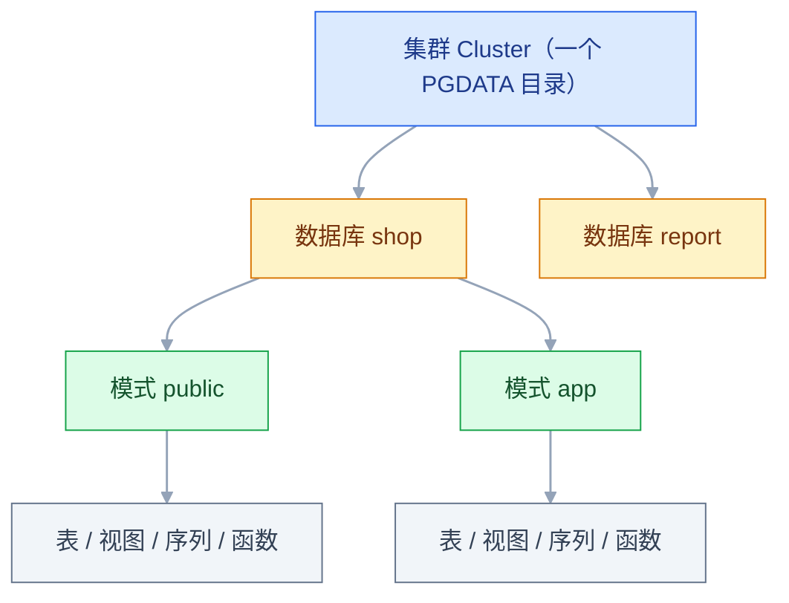
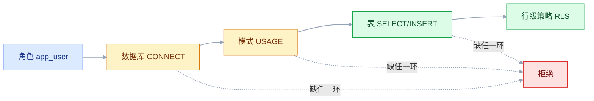

# PostgreSQL

## 一、工程案例：用 JSONB + GIN 做商品多条件筛选

**场景**：多租户商城，商品表 20 万行。每个租户的类目属性完全不同——数码有颜色、重量，服装有尺码、材质。属性列不能写死成字段，用 `attrs jsonb` 存。列表页要支持「租户 + 上架状态 + 任意属性组合 + 按上架时间倒序 + 分页」。

**要交付的结果**：这条查询从全表扫描的几十毫秒降到 1 毫秒级，执行计划里能看到 GIN 索引；同时外部系统推来的商品数据必须幂等，重复同步不产生重复行。

**环境**：PostgreSQL 当前稳定版，`psql` 连上一个空库。执行计划里的数字随机器和数据分布变化，**判断依据是计划结构（走没走索引、有没有 Sort），不是那几位小数**。

**文件与命令**：按下表拆成四个文件，按顺序执行。顺序不能乱——1.2 的基线必须在建索引之前跑，否则拿不到对比。

| 文件 | 内容 | 命令 |
|---|---|---|
| `setup.sql` | 1.1 建表与造数 | `psql -v ON_ERROR_STOP=1 -d postgres -f setup.sql` |
| `before.sql` | 1.2 无索引的查询 | `psql -v ON_ERROR_STOP=1 -d shop -f before.sql` |
| `index.sql` | 1.3 两条 `CREATE INDEX` | `psql -v ON_ERROR_STOP=1 -d shop -f index.sql` |
| `after.sql` | 1.4 列表页查询 + 1.5 的 UPSERT（连跑两次） | `psql -v ON_ERROR_STOP=1 -d shop -f after.sql` |

`ON_ERROR_STOP=1` 让第一条错误就中断，避免半套数据被当成「验收通过」。`psql` 默认自动提交，`CREATE INDEX CONCURRENTLY` 才能执行；用图形客户端时先确认没开事务。

### 1.1 建表与造数

```sql
DROP DATABASE IF EXISTS shop;
CREATE DATABASE shop;
\c shop

DROP TABLE IF EXISTS product;
CREATE TABLE product (
    id         bigint GENERATED ALWAYS AS IDENTITY PRIMARY KEY,
    tenant_id  bigint NOT NULL,
    sku        text   NOT NULL,
    name       text   NOT NULL,
    price      numeric(12,2) NOT NULL,
    status     text   NOT NULL DEFAULT 'on' CHECK (status IN ('on','off')),
    attrs      jsonb  NOT NULL DEFAULT '{}'::jsonb,
    created_at timestamptz NOT NULL DEFAULT now(),
    CONSTRAINT uk_product_tenant_sku UNIQUE (tenant_id, sku)
);

-- 20 万行：20 个租户，颜色/品牌各几种，其余属性随机
-- ★ 颜色用 (g / 20) 而不是 g % 4：租户号是 g % 20，20 与 4 有公因子，
--   直接对 g 取模会让每个租户只剩一种颜色，造出假的选择性
INSERT INTO product (tenant_id, sku, name, price, status, attrs, created_at)
SELECT
    (g % 20) + 1,
    'SKU-' || lpad(g::text, 7, '0'),
    '商品 ' || g,
    round((random() * 1000)::numeric, 2),
    CASE WHEN random() < 0.9 THEN 'on' ELSE 'off' END,
    jsonb_build_object(
        'color',  (ARRAY['黑色','白色','银色','蓝色'])[1 + ((g / 20) % 4)],
        'brand',  (ARRAY['星辰','蓝海','云图'])[1 + ((g / 20) % 3)],
        'weight', 30 + (g % 500)
    ),
    now() - (g || ' minutes')::interval
FROM generate_series(1, 200000) AS g;

ANALYZE product;      -- ★ 不跑这句，规划器拿不到分布，后面所有计划都不可信
```

### 1.2 先看没有索引时的计划

```sql
EXPLAIN (ANALYZE, BUFFERS)
SELECT id, sku, name, price
FROM product
WHERE tenant_id = 3
  AND status = 'on'
  AND attrs @> '{"color":"黑色","brand":"星辰"}'
ORDER BY created_at DESC
LIMIT 20;
```

```text
 Limit  (cost=8912.40..8912.45 rows=20 width=64) (actual time=46.207..46.212 rows=20 loops=1)
   Buffers: shared hit=118 read=2612
   ->  Sort  (cost=8912.40..8914.28 rows=750 width=64) (actual time=46.205..46.206 rows=20 loops=1)
         Sort Key: created_at DESC
         Sort Method: top-N heapsort  Memory: 78kB
         ->  Seq Scan on product  (cost=0.00..8890.00 rows=750 width=64) (actual time=0.013..40.882 rows=750 loops=1)
               Filter: ((tenant_id = 3) AND (status = 'on'::text)
                        AND (attrs @> '{"color": "黑色", "brand": "星辰"}'::jsonb))
               Rows Removed by Filter: 199250
               Buffers: shared hit=118 read=2612
 Planning Time: 0.298 ms
 Execution Time: 46.251 ms
```

两个信号：`Seq Scan` 说明 20 万行全读了，`Rows Removed by Filter: 199250` 说明只有 750 行命中。数据量再涨十倍，这条查询就进不了 200ms。

### 1.3 建两种索引，各管一段查询

```sql
-- ① 属性组合：GIN，键不固定，支撑 @> / ? / ?&
CREATE INDEX CONCURRENTLY idx_product_attrs_gin
    ON product USING GIN (attrs jsonb_path_ops);

-- ② 列表分页：部分复合索引，只覆盖上架商品，且顺序与 ORDER BY 一致
CREATE INDEX CONCURRENTLY idx_product_list
    ON product (tenant_id, created_at DESC)
    WHERE status = 'on';
```

`jsonb_path_ops` 的索引比默认 `jsonb_ops` 小很多，代价是只支持 `@>`、`@?`、`@@`，**不支持 `?`、`?|`、`?&`**。本案例只按「包含」查，选它。

再跑同一条查询：

```text
 Limit  (cost=1042.10..1042.15 rows=20 width=64) (actual time=0.905..0.910 rows=20 loops=1)
   Buffers: shared hit=706
   ->  Sort  (cost=1042.10..1044.00 rows=750 width=64) (actual time=0.904..0.905 rows=20 loops=1)
         Sort Key: created_at DESC
         Sort Method: top-N heapsort  Memory: 78kB
         ->  Bitmap Heap Scan on product  (cost=58.20..1012.50 rows=750 width=64) (actual time=0.180..0.760 rows=750 loops=1)
               Recheck Cond: ((tenant_id = 3) AND (status = 'on'::text)
                              AND (attrs @> '{"color": "黑色", "brand": "星辰"}'::jsonb))
               Heap Blocks: exact=690
               ->  BitmapAnd  (cost=58.20..58.20 rows=750 width=0) (actual time=0.160..0.161 rows=0 loops=1)
                     ->  Bitmap Index Scan on idx_product_list  (cost=0.00..12.10 rows=9000 width=0)
                     ->  Bitmap Index Scan on idx_product_attrs_gin  (cost=0.00..45.60 rows=16700 width=0)
                           Index Cond: (attrs @> '{"color": "黑色", "brand": "星辰"}'::jsonb)
 Planning Time: 0.289 ms
 Execution Time: 0.948 ms
```

`BitmapAnd` 把两个索引的结果取交集，再回表。耗时从 46ms 降到 0.9ms，读的块从 2730 降到 706。

**边界**：命中行数占比高时（比如某租户只有 200 个商品），规划器会认定走索引不如直接读堆，退回 `Seq Scan`。这不是索引失效，是代价估算的结果。

### 1.4 纯列表页：让排序也消失

列表页默认不带属性筛选，只有租户 + 上架状态 + 时间倒序：

```sql
EXPLAIN (ANALYZE, BUFFERS)
SELECT id, sku, name, price
FROM product
WHERE tenant_id = 3 AND status = 'on'
ORDER BY created_at DESC
LIMIT 20;
```

```text
 Limit  (cost=0.42..2.85 rows=20 width=64) (actual time=0.021..0.038 rows=20 loops=1)
   Buffers: shared hit=9
   ->  Index Scan using idx_product_list on product
         (cost=0.42..848.00 rows=9000 width=64) (actual time=0.020..0.036 rows=20 loops=1)
         Index Cond: (tenant_id = 3)
         Buffers: shared hit=9
 Planning Time: 0.201 ms
 Execution Time: 0.061 ms
```

没有 `Sort` 节点，只读了 9 个块。原因是索引定义里的 `created_at DESC` 与 `ORDER BY created_at DESC` 方向一致，`tenant_id` 等值条件又对齐第一列，于是正向扫描直接按序输出，取满 20 行就停。若索引写成 `created_at ASC`、查询要 `DESC`，计划才会变成 `Index Scan Backward`，同样不需要排序。

### 1.5 幂等同步：`ON CONFLICT`

外部系统推商品，网络重试会导致同一批数据重复到达。用唯一键 `(tenant_id, sku)` 做冲突目标：

```sql
INSERT INTO product (tenant_id, sku, name, price, status, attrs)
VALUES (3, 'SKU-0000042', '商品 42（改）', 199.00, 'on',
        '{"color":"黑色","brand":"星辰","weight":120}')
ON CONFLICT (tenant_id, sku) DO UPDATE
SET name  = EXCLUDED.name,
    price = EXCLUDED.price,
    attrs = EXCLUDED.attrs
RETURNING id, sku, (xmax = 0) AS 是新增;
```

```text
 id |     sku     | 是新增
----+-------------+--------
 42 | SKU-0000042 | f
(1 row)
```

再执行一次，仍然是 `f`、仍然只有一行——这就是幂等。`EXCLUDED` 指「本次想插入的那一行」。`(xmax = 0)` 是判断本次走插入还是更新的常用技巧：新插入的行 `xmax` 为 0，走 `DO UPDATE` 时返回的 `xmax` 非 0。它是社区惯用法而不是文档里的语义保证，换版本、加触发器或遇到并发锁都可能改变结果；关键业务别拿它做分支，改用 `DO NOTHING` 后检查影响行数，或先查后写并用唯一约束兜底。

PG 18 起有更直观的写法：`RETURNING id, sku, (OLD IS NULL) AS 是新增`——插入时 `OLD` 为 NULL，更新时非 NULL，不依赖 `xmax` 的实现细节。版本能力以官方当前稳定版为准。

下表以目标表有 `updated_at` 列为例：

| 写法 | 语义 | 适用 |
|---|---|---|
| `DO UPDATE SET c = EXCLUDED.c` | 全量覆盖 | 外部数据是权威源 |
| `DO UPDATE SET c = EXCLUDED.c WHERE product.updated_at < EXCLUDED.updated_at` | 只在对方更新时覆盖 | 保护本地更新的数据 |
| `DO NOTHING` | 已存在就跳过 | 只补缺失数据 |

`WHERE` 里引用目标表要写表名；如果 `INSERT INTO product AS p` 起了别名，就只能写 `p.updated_at`。

### 1.6 验收

| 检查项 | 命令或检查 | 通过标准 |
|---|---|---|
| 数据量与统计信息 | `SELECT count(*) FROM product;` 与 `pg_stat_user_tables.last_analyze` | 200000 行，`last_analyze` 非空 |
| 属性筛选走 GIN | `EXPLAIN (ANALYZE, BUFFERS)` 跑 1.2 的查询 | 出现 `Bitmap Index Scan on idx_product_attrs_gin` |
| 列表页无排序 | 1.4 的查询计划 | `Index Scan using idx_product_list`，**无 `Sort`** |
| 部分索引条件 | `\d+ product` | 索引定义含 `WHERE status = 'on'` |
| 索引体积 | `SELECT pg_size_pretty(pg_relation_size('idx_product_attrs_gin'));` | 小于 `pg_relation_size('product')` 的一半；同数据下 `jsonb_path_ops` 明显小于 `jsonb_ops` |
| 幂等同步 | 同一条 UPSERT 执行两次 | 第二次 `是新增 = f`，`count(*)` 不变 |
| 索引有效 | `SELECT indexrelid::regclass FROM pg_index WHERE NOT indisvalid;` | 无输出（有输出见 2.9） |

> 索引建完后 `ANALYZE product;` 再验一次。新索引本身会改变代价估算，旧计划不能作为对比基线。

---

## 二、高频问答：会卡住你的地方，也是面试最常问的

### 2.1 建完表，应用报 `permission denied for schema public`

**现场**

按权限链从外往里查，第一个返回 `false` 的就是断点：

```sql
SELECT has_database_privilege('app_user','shop','CONNECT');
SELECT has_schema_privilege('app_user','public','USAGE');
SELECT has_table_privilege('app_user','product','SELECT');
```

补齐时要把序列和以后新建的对象一起给：

```sql
GRANT CONNECT ON DATABASE shop TO app_user;
GRANT USAGE   ON SCHEMA public TO app_user;
GRANT SELECT, INSERT, UPDATE, DELETE ON ALL TABLES IN SCHEMA public TO app_user;
GRANT USAGE, SELECT ON ALL SEQUENCES IN SCHEMA public TO app_user;
-- 以后新建的表/序列也要自动授权，否则每建一张就再断一次
ALTER DEFAULT PRIVILEGES IN SCHEMA public
  GRANT SELECT, INSERT, UPDATE, DELETE ON TABLES TO app_user;
ALTER DEFAULT PRIVILEGES IN SCHEMA public
  GRANT USAGE, SELECT ON SEQUENCES TO app_user;
```

**要点**

- 表权限给了还报错，断点在更早一层：会话连模式都「看不见」，权限检查在表之前就失败了。
- 一条 SQL 要过三关：库的 `CONNECT`、模式的 `USAGE`、表的 `SELECT`，缺任一环都到不了表。
- PG 15 起 `public` 的 `CREATE` 默认从 `PUBLIC` 收回，加固脚本常连 `USAGE` 一起收，报错就落在模式这一层。
- `ON ALL TABLES` 不包含序列；`ALTER DEFAULT PRIVILEGES` 只作用于执行者以后创建的对象，表由别的角色建时要写 `FOR ROLE`。

**追问**

- 只给了 `GRANT SELECT ON 表` 为什么还是不行？→ 解析表名那一步就要求模式 `USAGE`。
- 表权限给全了，插入还是 `permission denied for sequence`？→ 序列是独立对象，要单独授权。
- 新建的表为什么又断了？→ 没配 `ALTER DEFAULT PRIVILEGES`，或者建表的是另一个角色。
- 应用账号要不要给 `CREATE`？→ 只读写就不给，跑迁移的角色单独授权。

### 2.2 导入历史数据后，插入报主键冲突

**现场**

对比序列当前值和表里的最大 id，前者更小就是它：

```sql
SELECT last_value FROM 序列;
SELECT max(id) FROM 表;
```

```sql
SELECT setval(pg_get_serial_sequence('product','id'), (SELECT max(id) FROM product));
```

**要点**

- 冲突不是数据重复，是显式插入了带 id 的行，序列却没跟着前进。
- 下一条 `nextval` 撞上已存在的 id，于是报主键冲突。
- `GENERATED ALWAYS AS IDENTITY` 不接受手工插 id（除非 `OVERRIDING SYSTEM VALUE`），真实现场多半是历史表或 `SERIAL` 表。

**追问**

- 为什么怀疑数据会走偏？→ 重复数据会报唯一约束，序列脱节报的也是主键冲突，两种要分开。
- 表是 `ALWAYS` 为什么也会遇到？→ 用 `OVERRIDING SYSTEM VALUE` 硬导过就会。
- 除了 `setval` 还有什么做法？→ 让序列继续跑，重建表再导，代价大得多。

### 2.3 `ALTER TABLE` 一执行，整张表连查询都卡住

**现场**

先给 DDL 设上限，再查谁在挡路：

```sql
-- 给 DDL 设个上限，等不到就失败，不要无限排队
SET lock_timeout = '3s';
ALTER TABLE product ADD COLUMN subtitle text;

-- 查谁在挡路
SELECT pid, pg_blocking_pids(pid) AS 阻塞者, state, query
FROM pg_stat_activity WHERE cardinality(pg_blocking_pids(pid)) > 0;
```

**要点**

- 不是死锁，是锁排队：`ALTER TABLE` 要拿 `ACCESS EXCLUSIVE`，与任何锁都冲突。
- DDL 本身可能只要几毫秒，但它在等一个长事务，后面来的 `SELECT` 又排在它后面，整表停摆。
- 处置顺序是先处理长事务，再重试 DDL，而不是重启数据库。

**追问**

- 为什么一条读也会被挡？→ 它排在了等 `ACCESS EXCLUSIVE` 的 DDL 后面，锁队列不插队。
- `ADD COLUMN` 都要重写表吗？→ 带常量默认值在 PG 11 之后不重写，但 `ALTER COLUMN TYPE` 和加约束仍会。
- `lock_timeout` 为什么必须设？→ 让 DDL 失败重试，好过它拖着全表一起等。

### 2.4 表只增不减，查询越来越慢

**现场**

一次看死元组比例、最长事务和复制槽：

```sql
SELECT relname, n_live_tup, n_dead_tup, last_autovacuum,
       round(n_dead_tup * 100.0 / greatest(n_live_tup + n_dead_tup, 1), 1) AS 死元组占比
FROM pg_stat_user_tables ORDER BY n_dead_tup DESC LIMIT 5;

SELECT pid, now() - xact_start AS 持续, state, left(query, 60)
FROM pg_stat_activity
WHERE xact_start IS NOT NULL AND now() - xact_start > interval '5 minutes';

SELECT slot_name, active, xmin, catalog_xmin FROM pg_replication_slots;
```

**要点**

- 不是数据涨了，是死元组没被回收，表和索引一起膨胀。
- 清理下界会被长事务、`idle in transaction`、备库的 `hot_standby_feedback`、逻辑复制槽的 `catalog_xmin` 顶住。
- `VACUUM` 只把空间标记为可复用，不还给操作系统。

**追问**

- 逻辑复制槽 `active = false` 还会拦清理吗？→ 会，只要没 drop 就压着 `xmin`。
- 物理槽本身拦 VACUUM 吗？→ 不拦，配了 `hot_standby_feedback` 的备库才拦。
- 空间要还给 OS 怎么办？→ `VACUUM FULL` 锁全表，或 `pg_repack` 在线整理。
- 加索引为什么没用？→ 扫描的是膨胀后的表和索引，成本跟着页数走。

### 2.5 MySQL 的查询搬过来，结果不对或直接报错

**现场**

把 `WHERE` 拆开逐条试，或看 `Filter` 里的实际条件：

```sql
-- 忽略大小写用 ILIKE（MySQL 的 LIKE 默认不区分）
SELECT * FROM product WHERE name ILIKE '%phone%';

-- 判空只能用 IS NULL / IS NOT NULL
SELECT * FROM product WHERE subtitle IS NULL;

-- 字符串拼接口径不同
SELECT 'SKU-' || id FROM product LIMIT 1;
```

**要点**

- 不是数据没同步，是三处语义差异：`LIKE` 区分大小写、类型严格、`= NULL` 永远不成立。
- 类型严格的表现是直接报错，比如 `invalid input syntax for type integer`，不会静默转换。
- 方言差异要逐个条件验，不要拿「MySQL 能跑」当依据。

**追问**

- `WHERE col = NULL` 为什么一行都查不到？→ 结果还是 `NULL`，`WHERE` 只放行 `TRUE`。
- 字符串拼接为什么不同？→ PG 用 `||`，不是 `CONCAT` 那套隐式转换。
- 大小写不敏感会不会影响索引？→ 普通 B-tree 索引用不上 `ILIKE`，要建对应的表达式索引。

### 2.6 连接数打满，报 `too many clients already`

**现场**

看连接都停在什么状态：

```sql
SELECT state, count(*) FROM pg_stat_activity GROUP BY state ORDER BY 2 DESC;
SHOW max_connections;
```

**要点**

- 调大 `max_connections` 只是把崩溃点往后推，PG 是每连接一个后端进程，内存和上下文切换一起上去。
- 大量连接是 `idle`，说明应用没复用连接，该上 PgBouncer 的 transaction 模式，而不是加上限。
- 问题不在连接数上限，在连接的用法。

**追问**

- transaction 模式的代价是什么？→ `SET`、会话级 advisory lock、命名 prepared statement 跨事务不可靠。
- `work_mem` 是每连接的吗？→ 是每个排序/哈希操作的上限，一条 SQL 三个排序就用三份。
- 为什么短连接高并发更糟？→ 建连要 fork，建连本身成了瓶颈。

### 2.7 存进去的时间，读出来差 8 小时

**现场**

先确认列类型和会话时区：

```sql
SHOW timezone;
SELECT now(), now() AT TIME ZONE 'UTC';
\d product
```

**要点**

- `timestamptz` 内部一律存 UTC，显示时按会话时区转换，同一时刻不会漂。
- `timestamp` 存的是「墙上时间」，写入端按本地塞、读取端按 UTC 解释，就差 8 小时。
- 时间点（订单、日志、事件）一律用 `timestamptz`；只有「每天 9 点开门」这类与地点无关的规则才用 `timestamp`。

**追问**

- 只查服务器时区为什么不够？→ 还要看 JDBC 的 `TimeZone` 与会话时区是否一致。
- 改了会话时区，历史数据会变吗？→ `timestamptz` 的值不变，只是显示变了；`timestamp` 本来就没有时区。
- `timestamp` 一定不能用吗？→ 只适合与地点无关的规则，业务时间点不要用。

### 2.8 JSONB 建了 GIN 索引，查询还是 `Seq Scan`

**现场**

看条件是落在 `Filter` 还是 `Index Cond`：

```sql
-- 能走 GIN（jsonb_ops / jsonb_path_ops 都支持）
SELECT * FROM product WHERE attrs @> '{"color":"黑色"}';

-- 单键高频查询：建表达式索引，注意双括号
CREATE INDEX idx_product_color ON product ((attrs->>'color'));
SELECT * FROM product WHERE attrs->>'color' = '黑色';
```

**要点**

- 有索引不等于能用索引，条件出现在 `Filter` 里就是没走。
- `attrs->>'color' = '黑色'` 是表达式匹配，GIN 索引用不上，要改写成 `@>` 或建表达式索引。
- 建的是 `jsonb_path_ops` 却用了 `?` 操作符，同样用不上。

**追问**

- 为什么 `Filter` 和 `Index Cond` 是关键区别？→ 前者是读完再筛，后者是索引定位。
- 表达式索引为什么双括号？→ 外层括号表示「这是表达式」，不是列清单。
- `jsonb_path_ops` 为什么更小？→ 只索引路径哈希，能力也只剩包含类操作符。

### 2.9 `CREATE INDEX CONCURRENTLY` 中断，索引一直是 `INVALID`

**现场**

```sql
SELECT indexrelid::regclass FROM pg_index WHERE NOT indisvalid;
```

先删残骸再重建：

```sql
DROP INDEX CONCURRENTLY idx_product_list;   -- 先删残骸
CREATE INDEX CONCURRENTLY idx_product_list ON product (tenant_id, created_at DESC) WHERE status = 'on';
```

**要点**

- 命令没报错不等于成功，并发建索引分多个阶段，中断会留下 `indisvalid = false` 的残骸。
- 残骸不被查询使用，但每次写入都要维护它。
- `CONCURRENTLY` 不能在事务块里执行，也不能和 `DROP INDEX CONCURRENTLY` 混在一个事务里。

**追问**

- 为什么中断就 INVALID？→ 它在等旧事务结束、做唯一性校验，任何一步失败都留在中间态。
- 能直接 `REINDEX` 吗？→ 先删掉重建更干净，残骸本来就没有保留价值。
- 怎么避免？→ 单独执行、别放事务、留足时间。

### 2.10 随机 UUID 主键，写入越跑越慢

**现场**

拿同规模的自增主键表做对照，看索引大小和插入时的 `shared read`：

```sql
SELECT n_tup_ins FROM pg_stat_user_tables WHERE relname = 'product';
```

| 主键 | 写入局部性 | 适用 |
|---|---|---|
| `bigint` identity | 最好，总在右端追加 | 单库、绝大多数业务 |
| 随机 `uuid` | 最差，全索引随机落点 | 客户端生成、不可枚举、量不大 |
| UUIDv7 / 时间有序 | 接近自增 | 分布式且要求全局唯一 |

**要点**

- 不是硬件不行，是访问模式：随机 UUID 让 B-tree 每次插入落在随机页上。
- 结果是缓存命中率低、页分裂多，索引体积也比自增主键大。
- 取舍看是否真需要客户端生成和不可枚举，多数业务用 identity 就够。

**追问**

- 索引为什么更大？→ 16 字节键 + 随机分布导致的页填充率低。
- 分布式又想有序怎么办？→ UUIDv7 这类时间有序方案，PG 18 起内置 `uuidv7()`。
- 什么时候随机 UUID 可以接受？→ 写入量不大、或客户端必须先生成主键的场景。

### 2.11 两个事务互相等，报 `deadlock detected`

**现场**

日志里 `DETAIL: Process ... waits for ... blocked by process ...`，把两边 SQL 按行号摆出来看加锁顺序。

```sql
-- 批量更新前先排序，让所有会话的加锁顺序一致
UPDATE stock SET qty = qty - 1
WHERE sku IN (SELECT sku FROM stock WHERE sku = ANY($1) ORDER BY sku FOR UPDATE);
```

**要点**

- 两个事务以相反顺序锁同样两行，形成环，PG 检测到后主动杀掉一个。
- 只重试不改代码能过去，但下次还会发生。
- 根治是统一访问顺序、缩短事务、给 `WHERE` 加索引减少锁范围。

**追问**

- 为什么重试解决不了？→ 环还在，只是这次运气好。
- 统一顺序具体怎么做？→ 批量操作先按 id 或业务键排序再加锁。
- 隔离级别调高能避免吗？→ 不能，反而增加冲突和重试。

### 2.12 备份恢复后，扩展报错、行数对不上

**现场**

先看恢复日志的第一条 ERROR，再对行数：

```bash
pg_restore -l shop.dump | grep -i extension      # 备份里到底要求哪些扩展
psql -d shop -c "SELECT count(*) FROM product;"  # 与源库比对
```

**要点**

- 逻辑备份不是物理快照：`pg_dump` 只导出 `CREATE EXTENSION`，不导出扩展的二进制。
- 目标库没装 contrib 包就会失败；`--no-owner` 会改变属主。
- 只恢复数据或手工导数时序列不会前进，要 `setval` 校正。

**追问**

- 恢复前要准备什么？→ 装好同名扩展（PostGIS、pg_trgm 等）并确认版本兼容。
- 行数为什么对不上？→ 部分表恢复失败，或被 `--data-only` 漏掉了序列。
- 为什么不能把 dump 当快照？→ 它是逻辑语句的重放，依赖目标库环境。

### 2.13 数据库突然拒绝新事务：事务号回卷

**现场**

```sql
SELECT datname, age(datfrozenxid) AS 年龄 FROM pg_database ORDER BY 2 DESC;
```

**要点**

- 事务号只有 32 位、循环使用，`age(datfrozenxid)` 逼近上限时会停止接受新事务。
- 不冻结旧行，旧行会被当成「未来」的版本，所以必须先冻结。
- 根因通常是长期禁用 autovacuum，或某个库的大表一直没被冻结。

**追问**

- 重启为什么没用？→ 卡的是事务号年龄，不是进程状态。
- 怎么处理？→ 低峰 `VACUUM (FREEZE)`，进不去再用单用户模式。
- 平时监控什么？→ `age(datfrozenxid)` 和 `age(relfrozenxid)`。

### 2.14 磁盘被 `pg_wal` 悄悄吃满：复制槽没推进

**现场**

```sql
SELECT slot_name, slot_type, active,
       pg_size_pretty(pg_wal_lsn_diff(pg_current_wal_lsn(), restart_lsn)) AS 落后
FROM pg_replication_slots;
```

**要点**

- 复制槽记着「还没消费到的 WAL」，槽不推进，WAL 就不许回收。
- `active = false` 或 `restart_lsn` 长时间不动，就是它。
- 不要手工删 `pg_wal` 下的文件，那会让实例直接起不来。

**追问**

- 业务确认槽废弃了怎么办？→ `pg_drop_replication_slot`，WAL 才会恢复回收。
- 活跃槽为什么也涨？→ 订阅或备库停了，要去查对端。
- 怎么防？→ 设 `max_slot_wal_keep_size`，让它超限失效而不是写满磁盘。

---

## 三、核心知识：从零开始要建立的东西

### 3.1 进程模型与连接开销

PG 的服务端是**多进程**结构：一个 postmaster 监听端口，每来一个连接就 fork 一个后端进程，这个进程独占一份内存（排序、哈希、缓存的工作区都算在它头上）。所以连接数不是「越多越好」，而是直接乘上内存。

| 事实 | 后果 |
|---|---|
| 每连接一个进程 | 上下文切换和内存随连接数线性增长 |
| `work_mem` 是**每个排序/哈希操作**的上限，不是每连接 | 一条 SQL 有 3 个排序就可能用 3 份 |
| 连接建立要 fork | 短连接高并发时，建连本身成为瓶颈 |

取舍：应用侧用连接池（PgBouncer 的 transaction 模式复用度最高），把真实连接数压在几十条。代价是 transaction 模式不支持会话级状态——`SET`、会话级 advisory lock、命名 prepared statement 在跨事务时不可靠。

### 3.2 集群、数据库、模式的三层结构



| 层级 | 隔离什么 | 典型用途 |
|---|---|---|
| 集群 | 整个数据目录、WAL、角色 | 一台机器一个实例 |
| 数据库 | 对象命名空间，**不能跨库 JOIN** | 按业务拆分，或 dev/prod 分库 |
| 模式 | 库内的对象分组，可单独授权 | 多租户、按模块分组 |

关键约束：一个连接只属于一个数据库，跨库访问要靠 `postgres_fdw`、`dblink` 或复制。`search_path` 决定未限定名先找哪个模式，生产环境建议显式写 `SET search_path = app, public`，避免同名表被意外解析到 `public`。

### 3.3 堆表与行的物理位置

PG 的表是**堆（heap）**：行按写入顺序堆放，不按主键排序。每一行有一个物理地址 `ctid`，形如 `(页号, 页内偏移)`。页固定 8KB。

```sql
SELECT ctid, id, sku FROM product LIMIT 3;
--  (0,1) | 1 | SKU-0000001
--  (0,2) | 2 | SKU-0000002
```

| 结论 | 说明 |
|---|---|
| 主键查询要回表 | 索引叶子存的是 `ctid`，还要再读堆页 |
| 范围扫描可能乱序 | 物理顺序与逻辑顺序无关，`ORDER BY` 常需额外排序 |
| `CLUSTER` 能重排一次 | 按指定索引重写表，过程中拿 `ACCESS EXCLUSIVE`，之后新写入又会乱 |
| `fillfactor` 留空位 | 给同页 HOT 更新留空间，降低页分裂 |

### 3.4 MVCC 的版本可见性

与 MVCC 相关的有两个系统列：`xmin` 是创建它的事务号，`xmax` 是删除/更新它的事务号。`UPDATE` 不原地改，而是**写一个新版本**，把旧版本的 `xmax` 标成当前事务。读操作拿一个快照，按事务号判断哪些版本可见。

`xmax` 为 0 只说明「还没有删除事务」；非 0 既可能是删除/更新它的事务号，也可能只是行锁（多事务同时锁一行时是 multixact）。所以不能单凭 `xmax != 0` 判断这行已经死了，判断可见性要按快照来。

```sql
SELECT xmin, xmax, ctid, price FROM product WHERE id = 42;
UPDATE product SET price = 299 WHERE id = 42;
SELECT xmin, xmax, ctid, price FROM product WHERE id = 42;   -- xmin 变了，ctid 通常也变了
```

| 操作 | 堆表动作 | 索引动作 |
|---|---|---|
| `INSERT` | 追加一行 | 每个索引加一条指向新 `ctid` |
| `UPDATE` | 写新版本 + 旧版本标 `xmax` | 新版本要进所有索引 |
| `DELETE` | 旧版本标 `xmax` | 索引项保留，等清理 |
| HOT 更新 | 新版本同页且未改索引列 | 不新增索引项 |

边界：MVCC 让读不阻塞写、写不阻塞读，代价是**旧版本留在堆里**，必须有人清理。这就是下一节的问题。

> **面试**：常问「PG 的 UPDATE 是原地改吗？」答：不是，写新版本、旧版本标 `xmax`，读按快照判断可见性。

### 3.5 死元组、VACUUM 与表膨胀


`autovacuum` 的触发条件是「死元组数超过阈值 + 表规模的一个比例」，默认阈值和比例以官方当前稳定版文档为准。它**不阻塞读写**，但只把空间标记成可复用，文件不会变小。

| 手段 | 锁 | 空间还给 OS | 适用 |
|---|---|---|---|
| `VACUUM` | 弱，几乎不阻塞 | 否 | 日常清理 |
| `VACUUM FULL` | `ACCESS EXCLUSIVE` | 是 | 小表、维护窗口 |
| `pg_repack` | 短暂锁 | 是 | 大表在线整理 |
| `TRUNCATE` | `ACCESS EXCLUSIVE` | 是 | 整表清空 |

长事务是这里的关键变量：一个开着快照不提交的事务，会让 `VACUUM` 无法清理它开始之后产生的死元组。监控看 `n_dead_tup`、`last_autovacuum`，需要精确数字时装 `pgstattuple`。

### 3.6 WAL 与崩溃恢复

改数据页之前，先把「改了什么」顺序写进 WAL（Write-Ahead Log）。这样崩溃后可以重放 WAL 到一致状态。检查点（checkpoint）负责把脏页刷盘，并把「从这里之前的 WAL 已落盘」记下来。

| 概念 | 作用 |
|---|---|
| WAL 段文件 | 循环使用，归档后可做时间点恢复 |
| checkpoint | 缩短崩溃恢复时间，刷脏页有 IO 峰值 |
| `synchronous_commit` | 关掉可提升写入吞吐，崩溃时可能丢最近若干事务，但**不会损坏数据** |
| `wal_level` | 决定 WAL 里记多少信息，逻辑复制需要更高等级 |

流复制、逻辑复制、PITR 全都建立在 WAL 上：主库不断产生 WAL，备库连续重放。`pg_basebackup` 做基础备份，配合归档的 WAL 就能恢复到任意时间点。

### 3.7 事务边界、保存点与隔离级别

显式事务用 `BEGIN` 开始、`COMMIT` 提交、`ROLLBACK` 撤销。任意一条语句报错后，事务进入 aborted 状态，后续语句全部返回 `current transaction is aborted`，只能整体 `ROLLBACK` 或退回保存点——这是新手最常见的「代码没改却一直报错」。

```sql
BEGIN;
UPDATE product SET price = price + 1 WHERE id = 42;
SAVEPOINT s1;
INSERT INTO product (tenant_id, sku, name, price) VALUES (NULL, 'X', 'x', 1);  -- NOT NULL 违约
ROLLBACK TO SAVEPOINT s1;                        -- 只撤销上面一条，事务还能继续
COMMIT;
```

PG 的 DDL 也能进事务：`BEGIN; ALTER TABLE ...; ROLLBACK;` 会整体回滚。例外是 `CREATE INDEX CONCURRENTLY`、`VACUUM`、`CREATE DATABASE` 这类不允许出现在事务块里的语句。

隔离级别决定并发事务之间的可见性：

| 级别 | 脏读 | 不可重复读 | 幻读 | PG 的实现 |
|---|---|---|---|---|
| Read Uncommitted | 不可能 | 可能 | 可能 | 内部等同 Read Committed |
| Read Committed | 不可能 | 可能 | 可能 | **默认**，每条语句取新快照 |
| Repeatable Read | 不可能 | 不可能 | 不可能 | 整个事务一个快照 |
| Serializable | 不可能 | 不可能 | 不可能 | SSI，冲突时让事务失败 |

RC 下同一条 SQL 在事务里跑两次可能看到不同结果，因为每条语句都取新快照。RR 下快照固定，代价是并发更新同一行时可能报「could not serialize access due to concurrent update」。

`SERIALIZABLE` 用可串行化快照隔离（SSI）实现，不靠加锁，而是在执行和提交过程中检测危险结构，冲突就报 SQLSTATE `40001`：

```sql
BEGIN ISOLATION LEVEL SERIALIZABLE;
-- 业务读写
COMMIT;   -- 报 40001 就整个事务重试，不是只重试最后一句
```

> **面试**：常问「Read Committed 和 Repeatable Read 差在哪？」答：RC 每条语句取新快照，RR 整个事务一个快照，PG 的 RR 连幻读都不会有。

### 3.8 锁模式与 DDL 的阻塞范围

PG 的表锁有 8 个等级，从 `ACCESS SHARE` 到 `ACCESS EXCLUSIVE`。冲突矩阵决定谁能和谁并行。

| 语句 | 表锁 | 阻塞普通 `SELECT` |
|---|---|---|
| `SELECT` | `ACCESS SHARE` | 否 |
| `INSERT` / `UPDATE` / `DELETE` | `ROW EXCLUSIVE` | 否 |
| `CREATE INDEX` | `SHARE` | 否，但阻塞写入 |
| `CREATE INDEX CONCURRENTLY` | 较弱，分阶段 | 否 |
| `ALTER TABLE` / `DROP` / `TRUNCATE` | `ACCESS EXCLUSIVE` | **是** |

最危险的不是锁本身，是**排队**：一个 `ALTER TABLE` 在等长事务，后面所有 `SELECT` 又排在它后面。所以 DDL 前先设 `lock_timeout`，让它等不到就放弃，而不是拖垮全表。

行锁由 `SELECT ... FOR UPDATE` 显式获取，`FOR NO KEY UPDATE` 不阻止别人加外键引用，`FOR KEY SHARE` 只保护键列。

### 3.9 B-tree 的页结构与分裂

B-tree 索引也是一棵页树：根、内部页、叶子页。叶子页存「键 + `ctid`」，页内有序，页间用兄弟指针串起来，所以范围扫描可以顺着叶子走。

插入时如果目标页满了，就**分裂**成两页，并把中间键提升到父页。顺序插入（自增主键）总是打最右页，分裂少、缓存热；随机插入（随机 UUID）会打到任意页，分裂多、缓存冷。

```sql
CREATE INDEX idx_product_price ON product (price);
SELECT pg_size_pretty(pg_relation_size('idx_product_price')) AS 索引大小,
       pg_size_pretty(pg_relation_size('product'))           AS 表大小;
```

边界：索引不是免费的，每个写操作都要维护所有相关索引。一张表挂十几个索引，写入吞吐会明显下降；`pg_stat_user_indexes.idx_scan` 长期为 0 的索引应该删掉。另一个容易漏的点：外键约束**不会**给子表的外键列自动建索引，父表 `DELETE`/`UPDATE` 时要扫子表验证引用，这是线上删除卡顿的常见来源。

### 3.10 复合索引的列顺序

复合索引 `(a, b, c)` 的排序是先按 `a`，`a` 相同再按 `b`，再按 `c`。所以它能服务「`a` 的等值/范围」「`a` 等值 + `b` 等值」这类前缀查询，不能跳过 `a` 直接用 `b`（PG 18 的 skip scan 是有限例外，见下）。

| 查询 | `(tenant_id, status, created_at)` 是否可用 |
|---|---|
| `WHERE tenant_id = 3` | 可用（用第一列） |
| `WHERE tenant_id = 3 AND status = 'on'` | 可用（前两列） |
| `WHERE tenant_id = 3 ORDER BY created_at` | 部分可用，排序仍需处理 |
| `WHERE status = 'on'` | 旧版本不可用（跳过第一列）；PG 18 起可能用上 skip scan |

经验规则：**等值条件列在前，范围/排序列在后**。PG 18 起 B-tree 支持 skip scan：前导列没有条件、但后续列有等值条件且被跳过列的基数低时，仍可能用上这个索引；更早的版本遇到前导列缺失通常直接全表扫。是否触发以官方当前稳定版的文档和 `EXPLAIN` 为准。

需要覆盖查询时用 `INCLUDE` 把非键列挂在叶子上，换取 `Index Only Scan`：

```sql
CREATE INDEX idx_product_cover ON product (tenant_id, created_at DESC) INCLUDE (name, price);
```

代价是索引变大，且 `Index Only Scan` 依赖可见性地图，刚大批量写入后可能仍要回表。

> **面试**：常问「复合索引 `(a,b,c)` 能服务 `WHERE b = ?` 吗？」答：通常不能，要按最左前缀；PG 18 起 skip scan 是有限例外。

### 3.11 部分索引与表达式索引

部分索引只收录满足 `WHERE` 的行，索引更小、写代价更低。生效前提是**查询条件必须蕴含索引条件**，规划器要能证明「要查的行一定在索引里」。

```sql
CREATE INDEX idx_product_on ON product (tenant_id, created_at DESC) WHERE status = 'on';

-- 能用：条件完全一致
SELECT * FROM product WHERE status = 'on' AND tenant_id = 3 ORDER BY created_at DESC LIMIT 20;

-- 不一定能用：IN 列表覆盖了索引条件之外的值
SELECT * FROM product WHERE status IN ('on','off') AND tenant_id = 3;
```

表达式索引对**表达式的结果**建索引，解决「函数包住列」导致索引失效的问题。写法必须与查询的表达式完全一致——键名、函数、括号层次都算：

```sql
-- 复用 2.8 建的 idx_product_color
SELECT * FROM product WHERE attrs->>'color' = '黑色';         -- 表达式一致，能走
SELECT * FROM product WHERE lower(attrs->>'color') = '黑色';   -- 外面多套函数，走不了
SELECT * FROM product WHERE attrs->>'Color' = '黑色';          -- 键名大小写不同，走不了
```

软删除场景的经典用法是部分唯一索引：只对未删除的行要求唯一，删掉后同一个值可以再建。

```sql
CREATE UNIQUE INDEX uk_user_email_active ON users (email) WHERE deleted_at IS NULL;
```

### 3.12 GIN、GiST、BRIN 与 HNSW 的分工

| 类型 | 结构 | 擅长 | 写代价 |
|---|---|---|---|
| B-tree | 平衡树 | 等值、范围、排序 | 低 |
| GIN | 倒排：键 → 行集合 | `jsonb`、数组、全文、三元组 | 高，更新要动多处 |
| GiST | 平衡树 + 可概括的键 | 几何、范围重叠、`EXCLUDE` 约束 | 中，查询有 lossy 重检查 |
| BRIN | 按块区间存摘要 | 超大且物理有序的表（日志、时序） | 极低，索引极小 |
| HNSW（pgvector） | 多层近邻图 | 向量相似度排序（`<->`、`<=>`） | 高，建索引慢且吃内存 |

GIN 有个 `fastupdate` 机制：新条目先写进待处理列表，批量合并，写入快但查询要多扫一遍列表。批量导入后可以 `VACUUM` 一下把列表清空。

BRIN 的效果完全取决于**物理相关性**：数据按时间追加、查询也按时间范围，BRIN 用几百 KB 就能替代几 GB 的 B-tree；数据乱序插入时 BRIN 几乎没用。

HNSW 属于扩展 `pgvector`，不是内核索引：它给的是近似最近邻，召回率由查询时的 `hnsw.ef_search` 控制，调高更准也更慢；`m`、`ef_construction` 在建索引时定死，改参数只能重建。距离算子要和列类型、索引 opclass 对上（如 `vector_l2_ops` 配 `<->`），默认值和可用算子以扩展当前稳定版文档为准。

### 3.13 执行计划的阅读顺序

`EXPLAIN` 输出是一棵树，缩进表示父子关系，执行顺序**从最内层往外**。`EXPLAIN ANALYZE` 会真的执行语句并给出实际行数与耗时。

| 字段 | 含义 |
|---|---|
| `cost=0.00..12.40` | 估算的启动代价..总代价，单位是抽象页访问代价，不是毫秒 |
| `rows=2870` | 估算返回行数，偏差大说明统计信息过期 |
| `actual time=... rows=... loops=N` | 实际耗时与行数，**乘以 `loops` 才是该节点总耗时** |
| `Buffers: shared hit/read` | 命中缓存 / 从磁盘读的块数 |
| `Rows Removed by Filter` | 读进来又被过滤掉的行数；很大通常说明条件没进 `Index Cond`，索引选择性差或根本没走索引 |

常见节点：`Seq Scan`（全表）、`Index Scan`（索引 + 回表）、`Index Only Scan`（只读索引）、`Bitmap Index Scan` + `Bitmap Heap Scan`（先攒位图再批量回表）、`Nested Loop` / `Hash Join` / `Merge Join`、`Sort`、`HashAggregate`、`Gather`（并行汇总）。

`Sort Method: external merge Disk` 表示排序落盘，说明 `work_mem` 不够。

> **面试**：常问「`EXPLAIN` 里看到 `Seq Scan` 就是没走索引吗？」答：不一定，命中行占比高时规划器会主动选全表扫，要看 `rows` 和代价。

### 3.14 统计信息与规划器的估算

规划器靠 `pg_statistic` 里的直方图、最常见值、区分度来估算行数，再乘代价常数选计划。统计信息过期是「明明有索引却不走」的第一大原因。

```sql
ANALYZE product;                                  -- 重新采样
ALTER TABLE product ALTER COLUMN status SET STATISTICS 500;  -- 提高该列采样精度
```

两个常见修正点：

| 现象 | 处理 |
|---|---|
| 多列强相关（城市与邮编），估算严重偏低 | `CREATE STATISTICS` 建多列统计 |
| SSD 上仍按机械盘代价估算，偏爱全表扫 | 调低 `random_page_cost`（默认值以官方文档为准，SSD 常设到接近 1） |

边界：改代价常数是全局影响，先在会话里 `SET random_page_cost = 1.1;` 验证计划变化，再决定是否落到配置。

### 3.15 类型系统与隐式转换

PG 的类型检查是严格的：字面量会按上下文推断类型，但列与列、列与参数之间不做 MySQL 那种宽松隐式转换。

| 类型 | 用途 | 陷阱 |
|---|---|---|
| `text` | 变长字符串，无长度上限 | 长度约束用 `CHECK`，别用 `varchar(n)` 硬编码业务规则 |
| `numeric` | 精确小数，金额必用 | 比 `float8` 慢，但不会出现 0.1 + 0.2 的问题 |
| `timestamptz` | 时间点，内部存 UTC | 与 `timestamp` 混用会漂 |
| `jsonb` | 结构化扩展属性 | 键无序、重复键只留最后一个 |
| `uuid` | 16 字节原生类型 | 不要存成 `text`，比较和索引都更贵 |

隐式转换的典型坑：`WHERE int_col = 'abc'` 直接报错；`WHERE text_col = 123` 也会报错，因为不存在从 integer 到 text 的隐式转换。跨类型比较时显式写 `::`，让意图和错误都清楚。

`NULL` 是「未知」，不是 0 也不是空串：`NULL = NULL` 的结果仍是 `NULL`，而 `WHERE` 只放行 `TRUE`，所以 `WHERE col = NULL` 一行都查不到，必须写 `IS NULL`。同理，`NOT IN (子查询里含 NULL)` 会整体返回空集。空安全比较用 `IS DISTINCT FROM`，取默认值用 `COALESCE(col, 0)`；多数聚合（`sum`、`avg`、`count(列)`）忽略 `NULL`，但 `count(*)` 计所有行，`array_agg`/`json_agg` 会把 `NULL` 一起收进去。

### 3.16 权限链与行级安全



三层授权缺一不可，行级安全（RLS）在最里面再加一层「哪些行可见」：

```sql
ALTER TABLE orders ENABLE ROW LEVEL SECURITY;

CREATE POLICY tenant_isolation ON orders
    USING (tenant_id = current_setting('app.tenant_id')::bigint);

SET app.tenant_id = '1001';
SELECT * FROM orders;    -- 只返回 tenant_id = 1001 的行
```

三个必须知道的边界：

1. **表属主默认绕过 RLS**，要 `FORCE ROW LEVEL SECURITY` 才受策略约束。
2. 策略里的函数**逐行执行**，写复杂子查询会让全表扫描变慢，尽量用简单比较并给对应列建索引。
3. `current_setting` 取不到值会报错，用 `current_setting('app.tenant_id', true)` 返回 NULL，再配合策略里的 `COALESCE` 兜底。

---

## 四、冷门知识汇总

| 知识点 | 为什么冷门 | 用到时的关键词 |
|---|---|---|
| `COPY` 与 `\copy` 的区别 | 日常导入导出都用图形工具 | `COPY` 走服务端路径需超级用户或 `pg_read_server_files`/`pg_write_server_files` 角色，`\copy` 走客户端 |
| 大批量导入的提速组合 | 一次性迁移才用，平时感受不到 | `COPY`、`UNLOGGED` 表、导入前删索引、导入后 `ANALYZE` |
| 索引的 `INCLUDE` 与可见性地图 | 只在做覆盖索引优化时提起 | `Index Only Scan`、`VACUUM` 更新 VM、`pg_visibility` |
| GIN 的待处理列表 | 写入慢时才查，平时无感 | `fastupdate`、`gin_pending_list_limit`、`gin_clean_pending_list` |
| 多列统计 | 单列统计够用的场景占绝大多数 | `CREATE STATISTICS`、`dependencies`、`ndistinct` |
| 并行查询的门槛 | 小表永远不并行，调了也看不到效果 | `max_parallel_workers_per_gather`、`min_parallel_table_scan_size`、`Gather` |
| JIT 编译 | 只在超大查询上开启，小查询反而更慢 | `jit`、`jit_above_cost`、`EXPLAIN` 里的 `JIT` 段 |
| 逻辑复制的限制 | 用物理复制或托管服务时接触不到 | 不复制 DDL、序列需单独处理、`wal_level = logical` |
| 时间点恢复 | 有托管备份后很少手工做 | `pg_basebackup`、`restore_command`、`recovery_target_time` |
| 大版本升级的两条路 | 几年一次 | `pg_upgrade --link`、逻辑复制双写切换 |
| 表空间 | 云盘时代很少手工规划 | `CREATE TABLESPACE`、`pg_tablespace_location` |
| advisory lock | 应用层已有 Redis 锁时不会想到数据库 | `pg_advisory_lock`、`pg_try_advisory_xact_lock` |
| 事件触发器 | 只在做 DDL 审计时用 | `CREATE EVENT TRIGGER`、`ddl_command_end` |
| `pg_stat_activity` 的等待事件 | 慢查询分析通常只看耗时 | `wait_event_type`、`Lock`、`IO`、`Client` |
| 会话级参数覆盖 | 调参一般改配置文件 | `ALTER ROLE ... SET`、`ALTER DATABASE ... SET`、`pg_settings.source` |
| 备份的三种粒度 | 日常只有全量备份 | 逻辑 `pg_dump`、物理 `pg_basebackup`、PITR |
| 递归 CTE | 只有组织树、BOM、评论楼这类层级数据才用 | `WITH RECURSIVE`、`UNION ALL`、`CYCLE`（PG 14 起） |
| 队列消费的 `SKIP LOCKED` | 已经有消息队列时不会想到直接用表 | `FOR UPDATE SKIP LOCKED`、`NOWAIT`、按 `ctid` 批量删除 |
