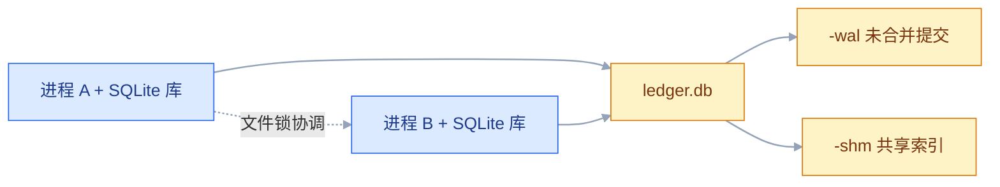
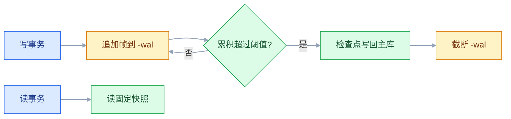

# SQLite

## 一、工程案例：桌面端记账应用的本地库

**场景**：LedgerDesk 是一个单机桌面记账应用（Python 3.12 标准库 `sqlite3`），数据放在用户目录的 `ledger.db`。四条硬需求：断电不丢已提交的账；界面线程和后台 CSV 导入线程同时写不报错；版本升级能平滑改表；用户点「导出备份」能得到一个可打开、可校验的副本。

**为什么值得做完**：桌面应用没有 DBA，也没有备份窗口。SQLite 的出厂配置优先保证「任何环境都能跑」，不是「长期运行最合适」：日志模式是 `delete`、外键是关的、锁等待是 0 毫秒。下面 5 步把这些默认值改到位，第 6 步统一验收。

**动手前确认**：`sqlite3 --version` 和 `python3 -c "import sqlite3; print(sqlite3.sqlite_version)"` 都有输出——命令行和 Python 可能链接到不同的 SQLite，本例的 `STRICT` 要求 3.37 以上（版本行为以官方当前稳定版为准）；应用数据目录可写；**库文件不要放进 iCloud / Dropbox / OneDrive 同步目录**，同步客户端会在事务中途替换文件。

### 1.1 建库并固定连接参数

```bash
DB="$HOME/Library/Application Support/LedgerDesk/ledger.db"
mkdir -p "$(dirname "$DB")"
sqlite3 "$DB" <<'SQL'
PRAGMA journal_mode = WAL;
PRAGMA synchronous = NORMAL;
PRAGMA foreign_keys = ON;
PRAGMA busy_timeout = 5000;
SQL
```

```text
wal
```

`journal_mode` 是**写进文件头、一次设置长期有效**；另外三个是**连接级**，每开一条连接都要重设。所以应用里不能只在初始化脚本设一次，要放进 `open_db()`：

```python
import sqlite3

def open_db(path):
    conn = sqlite3.connect(path, isolation_level=None)   # 事务自己管
    conn.row_factory = sqlite3.Row
    conn.execute("PRAGMA journal_mode = WAL")
    conn.execute("PRAGMA synchronous = NORMAL")
    conn.execute("PRAGMA foreign_keys = ON")
    conn.execute("PRAGMA busy_timeout = 5000")
    return conn
```

`isolation_level=None` 关掉 Python 的隐式事务，进入自动提交模式，后面才能明确写 `BEGIN IMMEDIATE`。代价是失去「一条语句也自动开事务」的保护：单条 `INSERT` 执行完就提交，多语句事务必须自己 `BEGIN` / `COMMIT`，漏写 `BEGIN` 就没有原子性，中途失败会留下半截数据。

把上面两段存成 `app_db.py`，1.3 和 1.4 的函数继续加在这个文件里。

### 1.2 schema v1：金额用整数分，时间用 UTC 文本

```sql
CREATE TABLE account (
    id       INTEGER PRIMARY KEY,
    name     TEXT NOT NULL UNIQUE,
    currency TEXT NOT NULL DEFAULT 'CNY'
) STRICT;

CREATE TABLE entry (
    id           INTEGER PRIMARY KEY,
    account_id   INTEGER NOT NULL REFERENCES account(id) ON DELETE RESTRICT,
    kind         TEXT NOT NULL CHECK (kind IN ('income', 'expense')),
    amount_cents INTEGER NOT NULL CHECK (amount_cents > 0),
    memo         TEXT NOT NULL DEFAULT '',
    occurred_on  TEXT NOT NULL
                 CHECK (occurred_on GLOB '[0-9][0-9][0-9][0-9]-[0-9][0-9]-[0-9][0-9]'),
    created_at   TEXT NOT NULL DEFAULT (strftime('%Y-%m-%dT%H:%M:%fZ', 'now'))
) STRICT;

CREATE INDEX idx_entry_account_date ON entry (account_id, occurred_on DESC);
PRAGMA user_version = 1;
```

三个决定的理由：

| 决定 | 替代方案 | 理由 |
|---|---|---|
| 金额存 `INTEGER` 分 | `REAL` 元 | `0.1 + 0.2 != 0.3`，金额用浮点迟早对不上账 |
| 时间存 UTC ISO 8601 文本 | 本地时间文本 / Unix 秒 | 字典序等于时间序，能直接比较和建索引；UTC 没有时区歧义 |
| 加 `STRICT` | 默认弱类型 | 脏数据在写入时报错，而不是三个月后对账时才发现 |

`STRICT` 表只接受 `INT`、`INTEGER`、`REAL`、`TEXT`、`BLOB`、`ANY` 六种类型声明（3.37 起）。`GLOB` 那个 `CHECK` 只能保证形状，保证不了 `2026-02-31` 这种日期合法——合法性在应用层校验。

### 1.3 迁移：用 `user_version` 做版本号

```python
MIGRATIONS = {
    2: ["ALTER TABLE entry ADD COLUMN tags TEXT NOT NULL DEFAULT ''",
        "CREATE INDEX idx_entry_kind_date ON entry (kind, occurred_on)"],
    3: ["CREATE TABLE budget (id INTEGER PRIMARY KEY, month TEXT NOT NULL UNIQUE, "
        "limit_cents INTEGER NOT NULL CHECK (limit_cents >= 0)) STRICT"],
}

def migrate(conn):
    target = max(MIGRATIONS)
    while (v := conn.execute("PRAGMA user_version").fetchone()[0]) < target:
        conn.execute("BEGIN IMMEDIATE")
        try:
            for stmt in MIGRATIONS[v + 1]:
                conn.execute(stmt)
            conn.execute(f"PRAGMA user_version = {v + 1}")
            conn.execute("COMMIT")
            print(f"user_version {v} -> {v + 1}")
        except Exception:
            if conn.in_transaction:
                conn.execute("ROLLBACK")
            raise
```

```text
user_version 1 -> 2
user_version 2 -> 3
```

三个细节决定这段代码能不能用：

- **`PRAGMA user_version = ?` 不支持参数绑定**，版本号只能拼进字符串。版本号来自代码常量而不是用户输入，拼接是安全的。
- **不能用 `executescript()` 包迁移**：它会先发一条 `COMMIT`，把外面的 `BEGIN` 提前结束，迁移就不再是原子的。
- **`user_version` 的写入是事务性的**，和建表语句一起提交或一起回滚。SQLite 的 DDL 本身也在事务里，这点和服务端数据库不同。

### 1.4 并发写：一个写者排队，读者不等

界面线程保存一笔账，后台线程导入 CSV，两者都会写。**每个线程用 `open_db()` 各开一条连接**，连接对象不跨线程传递（Python 的 `sqlite3` 默认禁止，见 2.12）。WAL 下允许**多个读者 + 一个写者**，两个写者必须排队：

```python
def add_entry(conn, account_id, kind, cents, memo, day):
    conn.execute("BEGIN IMMEDIATE")          # 一开始就拿写锁，不抢升级
    try:
        conn.execute(
            "INSERT INTO entry (account_id, kind, amount_cents, memo, occurred_on)"
            " VALUES (?, ?, ?, ?, ?)",
            (account_id, kind, cents, memo, day),
        )
        conn.execute("COMMIT")
    except Exception:
        if conn.in_transaction:              # BEGIN 自己失败时没有事务可回滚
            conn.execute("ROLLBACK")
        raise
```

对照实验用同一个脚本起两个进程：

```python
# writer.py  ——  python writer.py A "$DB"
import random, sqlite3, sys, time
from app_db import add_entry, open_db

tag, path = sys.argv[1], sys.argv[2]
conn = open_db(path)                     # 每个进程一条连接
busy, rows, err = 0, 0, None
t0 = time.perf_counter()
for i in range(200):
    try:
        add_entry(conn, 1, "expense", random.randint(1, 9999), f"{tag}-{i}", "2026-10-21")
        rows += 1
    except sqlite3.OperationalError as e:
        busy, err = busy + 1, e
print(f"writer {tag}: {rows} rows, {time.perf_counter() - t0:.2f}s, busy={busy}")
if err is not None and rows < 200:
    raise err
```

```bash
DB="$HOME/Library/Application Support/LedgerDesk/ledger.db"
sqlite3 "$DB" "INSERT OR IGNORE INTO account (id, name) VALUES (1, '现金');"
python writer.py A "$DB" & python writer.py B "$DB" & wait
sqlite3 "$DB" "SELECT count(*) FROM entry;"
```

在 `entry` 为空的库副本上跑（M2 MacBook，APFS 本地盘，数字随机器变化）：

```text
writer A: 200 rows, 0.28s, busy=0
writer B: 200 rows, 0.31s, busy=0
total rows: 400
```

把 `BEGIN IMMEDIATE` 换成默认的 `BEGIN`、并去掉 `busy_timeout`，同样的脚本会变成：

```text
writer A: 200 rows, 0.27s, busy=0
writer B: 63 rows, 0.09s, busy=137
sqlite3.OperationalError: database is locked
```

差别不在「SQLite 慢」，而在**第二个写者没有等待**。`busy_timeout` 默认是 0，拿不到锁立刻报错；B 少写的那 137 笔全部是被拒绝的 `BEGIN IMMEDIATE`，进程随即退出。

### 1.5 备份：在线生成，校验，再演练恢复

```bash
STAMP=$(date +%Y%m%d-%H%M%S)
DIR="$HOME/Library/Application Support/LedgerDesk"
DB="$DIR/ledger.db"
sqlite3 "$DB" "VACUUM INTO '$DIR/backup-$STAMP.db'"
sqlite3 "$DIR/backup-$STAMP.db" "PRAGMA integrity_check;"
```

```text
ok
```

`VACUUM INTO` 在一个读事务里把整库写成一个**紧凑的新文件**，不需要停应用，也不会拷到半个事务。目标文件**必须不存在**，所以文件名要带时间戳；重复执行同一个名字会直接报错。

保留 7 份并演练恢复：

```python
import glob, os, sqlite3
from datetime import datetime

def backup(conn, dirpath):
    stamp = datetime.now().strftime("%Y%m%d-%H%M%S")
    conn.execute("VACUUM INTO ?", (os.path.join(dirpath, f"backup-{stamp}.db"),))
    for old in sorted(glob.glob(f"{dirpath}/backup-*.db"))[:-7]:
        os.remove(old)

def verify(path):                        # 只读打开，不动备份文件
    c = sqlite3.connect(f"file:{path}?mode=ro", uri=True)
    ok = c.execute("PRAGMA integrity_check").fetchone()[0]
    return ok, c.execute("SELECT count(*) FROM entry").fetchone()[0]
```

```text
backup-20261021-093012.db  integrity=ok  entries=400
restore drill: opened read-only, 400 rows, 0 errors
```

**恢复演练必须做一次**：只生成备份、从不打开，等于没有备份。校验至少包含「能打开 + `integrity_check` 返回 ok + 行数在预期范围」。

### 1.6 验收（9 项全过才算交付）

| # | 检查项 | 命令或检查 | 通过标准 |
|---|---|---|---|
| 1 | 日志模式 | `sqlite3 "$DB" "PRAGMA journal_mode;"` | 回显 `wal` |
| 2 | 连接参数 | 用 `open_db()` 返回的连接查 `PRAGMA foreign_keys; PRAGMA busy_timeout;`（新开的 CLI 连接只有默认值，查不到应用设置） | `1` 和 `5000` |
| 3 | 版本号 | `PRAGMA user_version;` | 等于代码里的 `max(MIGRATIONS)` |
| 4 | 迁移幂等 | 连续启动两次 | 第二次不打印迁移日志，版本号不变 |
| 5 | 外键真的生效 | 在开了外键的连接上插一条 `account_id=99999` 的账 | 报 `FOREIGN KEY constraint failed` |
| 6 | 类型真的生效 | 往 `amount_cents` 插 `'abc'` | 报错，而不是静默存成文本 |
| 7 | 并发写 | 两个进程各写 200 笔 | 400 行，`busy` 计数为 0 |
| 8 | 在线备份 | 写入过程中执行 `VACUUM INTO` | 生成文件，`integrity_check` 为 `ok` |
| 9 | 恢复演练 | 只读打开备份并计数 | 行数与主库一致 |

> 第 4 项最容易被跳过。迁移脚本写成「每次启动都执行」时，第二次会因为 `duplicate column name` 直接崩，用户看到的是「软件打不开」。
> 第 7 项要在**两个进程**里跑，同一进程的两个连接测不出文件锁的真实行为。
> 第 9 项不能只看文件大小。备份文件大小对、内容错的情况，只在真正打开时才会暴露。

---

## 二、高频问答：会卡住你的地方，也是面试最常问的

### 2.1 `database is locked`

**现场**

先看等待时间设没设，再量持锁时长：

```sql
PRAGMA busy_timeout = 5000;
BEGIN IMMEDIATE;   -- 事务里只放数据库操作
COMMIT;
```

**要点**

- 写事务本来就全库串行，报错的原因是**没有等待**和**事务太长**，不是数据库容量。
- `busy_timeout` 默认是 0，第二个写者拿不到锁立刻失败，不排队。
- 先量持锁时间：超过 50ms 的写事务就该拆。

**追问**

- 换 MySQL 能解决吗？→ 串行是设计，先看事务里是不是夹了慢操作。
- WAL 下能并发写吗？→ 不能，WAL 只提升读写并发，写写仍然一条一条排。
- `BEGIN IMMEDIATE` 为什么能减少报错？→ 冲突提前到事务开始，配合 `busy_timeout` 就从报错变排队。

### 2.2 外键写了却管不住脏数据

**现场**

```sql
PRAGMA foreign_keys;          -- 回显 1 才算开
PRAGMA foreign_key_check;     -- 查存量数据有没有孤儿行
```

**要点**

- 建表里的 `REFERENCES` 只是声明，不是执行。
- `PRAGMA foreign_keys` 默认 `OFF`，而且是连接级开关，每条连接都要开。
- 在事务里执行这条 PRAGMA 是空操作。

**追问**

- 官方为什么默认关？→ 为了兼容 3.6.19 之前的老库。
- 连接池怎么办？→ 写在 `open_db()` 或每条物理连接的初始化回调里。
- 存量脏数据怎么找？→ `foreign_key_check`，它会列出孤儿行。

### 2.3 存进去的时间差 8 小时

**现场**

```sql
SELECT datetime('now'), datetime('now','localtime');   -- 东八区相差 8 小时
```

**要点**

- SQLite 里没有「库的时区」这个配置项，`datetime('now')` 返回 UTC，加 `localtime` 返回本地时间。
- 错位发生在写入那一刻，事后无法用 SQL 判断某一行是 UTC 还是本地时间。
- 统一存 UTC，显示时在应用层转。

**追问**

- 已经有混合数据怎么办？→ 只能按业务时间范围人工修，没法靠 SQL 分辨。
- 为什么不能用本地时间直接存？→ 换时区、跨机器、夏令时都会让比较和排序错。
- 那 `localtime` 什么时候能用？→ 只在展示层，不写进库。

### 2.4 Python 插入成功，重启后数据没了

**现场**

另开一个连接查行数，或看同一个连接上的 `conn.in_transaction`：

```python
conn.execute("INSERT INTO entry (...) VALUES (...)")
conn.commit()          # 漏这一行，程序退出就没了

with conn:             # 默认隔离级别下：正常退出自动提交
    conn.execute("INSERT INTO entry (...) VALUES (...)")
```

**要点**

- `execute()` 返回成功只代表语句执行了，不代表事务提交了。
- Python 的 `sqlite3` 在 DML 前隐式 `BEGIN`，但不自动提交，`close()` 也不提交，直接回滚。
- `COMMIT` 之前另开连接查不到新行，提交后才查到——这就是最快的核实方式。

**追问**

- `with conn` 什么时候提交？→ 正常退出提交，抛异常回滚。
- `isolation_level=None` 之后还要注意什么？→ 没有隐式事务，漏写 `BEGIN` 就没有原子性。
- DDL 也会这样吗？→ 会，DDL 同样要提交才落库。

### 2.5 恢复备份后少了最近几小时的账

**现场**

对比主库和备份的行数，再对备份跑一次完整性检查：

```bash
sqlite3 ledger.db "PRAGMA wal_checkpoint(TRUNCATE);"   # 先合并
cp ledger.db backup.db                                  # 再拷
```

**要点**

- `.db` 不是完整数据库，最新提交在 `-wal` 里，只拷 `.db` 就漏了。
- 写入过程中直接 `cp`，还可能拷到半个事务。
- 正确做法是 `VACUUM INTO` 或 `.backup`，它们在读事务里生成一致的副本。

**追问**

- 先 checkpoint 再 `cp` 行不行？→ 可以，但必须同时停止写入。
- `VACUUM INTO` 和 `.backup` 怎么选？→ 前者输出紧凑文件，后者能分页拷贝、看进度。
- 为什么备份完必须 `integrity_check`？→ 文件大小对、内容错的情况只有打开才知道。

### 2.6 `INT PRIMARY KEY` 不自动生成 id

**现场**

```sql
CREATE TABLE bad  (id INT PRIMARY KEY,     name TEXT);   -- 不是 rowid 别名
CREATE TABLE good (id INTEGER PRIMARY KEY, name TEXT);   -- 是
```

**要点**

- 只有 `INTEGER PRIMARY KEY`（必须是这个词）才是 rowid 别名。
- `INT`、`BIGINT` 只是普通列，插入 NULL 不报错也不回填。
- 加 `AUTOINCREMENT` 也救不了，它只对 `INTEGER PRIMARY KEY` 生效。

**追问**

- 为什么 `INT PRIMARY KEY` 允许 NULL？→ 历史兼容行为，多行 NULL 还能共存。
- `INTEGER PRIMARY KEY DESC` 算别名吗？→ 不算，也是历史兼容。
- 什么时候才需要 `AUTOINCREMENT`？→ id 被外部引用、绝不能复用时。

### 2.7 声明了 TEXT，还是存进了数字

**现场**

```sql
CREATE TABLE t (v TEXT);
INSERT INTO t VALUES (12345);
SELECT typeof(v), v FROM t;     -- text | 12345
```

**要点**

- 列类型只决定**亲和性**，是「尽量转换」，不是约束。
- 往 `TEXT` 列存 12345 会变成文本 `'12345'`，往 `INTEGER` 列存 `'abc'` 会原样保留。
- 要真约束就加 `STRICT`，或用 `CHECK (typeof(v) = 'text')` 兜住老版本。

**追问**

- 核实看什么？→ `typeof()` 的结果，不是建表语句里写的类型。
- `STRICT` 从哪个版本开始？→ 3.37 起。
- 老库能直接加 `STRICT` 吗？→ 不能，要重建表。

### 2.8 批量插入慢到不可用

**现场**

同一批数据，一次逐条跑、一次包在一个事务里跑，比总耗时：

```python
conn.execute("BEGIN IMMEDIATE")
conn.executemany("INSERT INTO entry (memo) VALUES (?)", rows)
conn.execute("COMMIT")
```

**要点**

- 瓶颈是提交次数，不是数据库引擎：默认日志模式下每条 `INSERT` 自成一个事务，各 fsync 一次。
- 一万条就是一万次落盘，包事务后常见提升在两个数量级。
- 再配合 `executemany()` 和预编译语句，还能省掉重复的 SQL 编译。

**追问**

- `executemany` 还需要事务吗？→ 需要，它只省编译，不省提交。
- 包了事务还是慢说明什么？→ 事务里夹了慢操作，或索引维护成了瓶颈。
- 一批多大合适？→ 几千到一万条，按内存和锁持有时间权衡。

### 2.9 连接池一开，建好的表不见了

**现场**

在两条连接上分别 `SELECT count(*) FROM sqlite_master;`，结果不同就是这个原因：

```text
jdbc:sqlite::memory:                                  # 每连接一个库
jdbc:sqlite:file:testdb?mode=memory&cache=shared      # 同进程共享
```

**要点**

- `:memory:` 是**每条连接一个独立库**，连接池换一条连接，看到的就是全新的空库。
- 文件库不会有这个问题，路径是共享的。
- 要用内存库就上命名共享内存库，或把连接池固定成 1 条连接。

**追问**

- 共享缓存能跨进程吗？→ 不能，只在同进程内共享。
- 为什么测试里用 `:memory:` 有时是对的？→ 全程一条连接，没有换连接的问题。
- 这是初始化脚本没执行吗？→ 不是，是初始化只跑在了另一条连接上。

### 2.10 `database disk image is malformed`

**现场**

```bash
sqlite3 broken.db "PRAGMA integrity_check;"
sqlite3 broken.db ".recover" | sqlite3 repaired.db    # 尽量抢救数据
```

**要点**

- 损坏一旦发生，没有「修复」只有「抢救」，`integrity_check` 只诊断不修复。
- 常见成因是库放在网盘、NFS、SMB 或同步目录上，文件锁语义不完整；或 `synchronous=OFF` 时断电。
- 先把文件复制出来留证，再用 `.recover` 导出能读的行。

**追问**

- `.recover` 能全部救回来吗？→ 取决于坏页位置，能恢复多少算多少。
- 网盘为什么必坏而不是报错？→ 两个客户端可能同时认为自己持有写锁。
- 预防只有三条？→ 本地盘、WAL + `synchronous=NORMAL` 以上、定期在线备份。

### 2.11 `INSERT OR REPLACE` 把关联数据删了

**现场**

```sql
INSERT OR REPLACE INTO entry (id, memo) VALUES (1, '改备注');   -- 危险：删行再插行
INSERT INTO entry (id, memo) VALUES (1, '改备注')               -- 安全：只改指定列
ON CONFLICT (id) DO UPDATE SET memo = excluded.memo;
```

**要点**

- 它的语义是 `DELETE` + `INSERT`，不是「有则更新」。
- 未写的列会回默认值，子表上的 `ON DELETE CASCADE` 会被触发。
- 只要表上有外键引用它，就必须假设级联删除会发生。

**追问**

- 怎么提前发现？→ `PRAGMA foreign_key_list(子表)` 看有没有级联。
- 和 `UPDATE` 的根本区别？→ 一个换整行，一个只改指定列。
- 新代码该用什么？→ 统一 `ON CONFLICT ... DO UPDATE`。

### 2.12 后台线程一写就报线程错误

**现场**

先看异常全文是不是 `SQLite objects created in a thread can only be used in that same thread`：

```python
def import_worker(path):              # 导入线程
    conn = open_db(path)              # 自己开一条，不接收界面线程的 conn
    conn.execute("BEGIN IMMEDIATE")
    try:
        conn.executemany("INSERT INTO entry (memo) VALUES (?)", rows)
        conn.execute("COMMIT")
    except Exception:
        if conn.in_transaction:
            conn.execute("ROLLBACK")
        raise
```

**要点**

- 限制来自 Python 驱动的 `check_same_thread=True`，不是 SQLite 引擎。
- 引擎在 `SQLITE_THREADSAFE=1` 时本身按连接串行化，多线程写是支持的。
- 三条路：每线程一条连接（首选）、`check_same_thread=False` 加应用层互斥、写请求统一丢给一个写线程。

**追问**

- 关掉检查就安全了吗？→ 不安全，还要自己把同一连接的所有访问串行化。
- 为什么首选每线程一条连接？→ 配合 `busy_timeout`，冲突变成排队而不是报错。
- 连接能跨线程传吗？→ 不能，别把界面线程的 conn 传进导入线程。

---

## 三、核心知识：从零开始要建立的东西

### 3.1 嵌入式库的边界

SQLite 是链接进进程的 C 库，不是服务。一次查询是函数调用，不是网络往返；没有监听端口，没有账号体系，没有连接串。



| 维度 | 服务端数据库 | SQLite |
|---|---|---|
| 部署单元 | 独立进程 + 数据目录 | 一个库文件 |
| 通信 | TCP / Unix socket | 函数调用 |
| 并发写 | 行级锁 | 全库串行 |
| 权限 | 账号 + 授权 | 文件系统权限，能读文件就能读全库 |
| 复制 / 故障切换 | 内置 | 无 |
| 跨机器 | 天然支持 | 禁止 |

四条同时成立才选它：数据在单机、写不密集、不需要库内权限、容量在几百 GB 以内。任何一条不成立，事后迁移的代价都比一开始就选服务端数据库高。

边界：「单文件」的优势只在**本地盘**成立。放到 NFS / SMB / 网盘上，`fcntl` 锁语义不完整，两个客户端可能同时认为自己持有写锁，结果是文件损坏而不是报错。

> **面试**：常问「什么场景不该用 SQLite？」答：要多机并发写、要库内权限、要主从切换，或写非常密集，这四条任一成立就该换服务端数据库。

### 3.2 文件构成与页

运行中的库不止一个文件：

| 文件 | 何时存在 | 作用 | 能否删 |
|---|---|---|---|
| `ledger.db` | 始终 | 主库，B-tree 页 | 不能 |
| `ledger.db-wal` | WAL 模式 | 已提交但未合并的帧 | 不能，删了等于丢数据 |
| `ledger.db-shm` | WAL 模式 | 共享内存索引，进程间协调 | 所有连接关闭后可删，会重建 |
| `ledger.db-journal` | 回滚日志模式、事务中 | 回滚用的旧页 | `DELETE` 模式下事务结束即删 |

读写以**页**为单位，默认 4096 字节（3.12 起，更早的默认是 1024）。页大小只能在空库时设，建表后要改必须 `VACUUM`。

```sql
PRAGMA page_size;        -- 4096
PRAGMA page_count;       -- 总页数
PRAGMA freelist_count;   -- 空闲页数
```

文件大小约等于 `page_count * page_size`。`freelist_count` 大于 0 说明删过数据，但空间没有还给操作系统。

边界：`-wal` 和 `-shm` 是库的一部分。任何「拷一个 `.db` 就走」的操作，都必须先确认没有未合并的 WAL，或者改用在线备份接口。

### 3.3 类型亲和性与 STRICT

SQLite 有 5 种存储类别（NULL / INTEGER / REAL / TEXT / BLOB），列的声明类型只决定**亲和性**——一个转换偏好，不是约束。

| 声明里含 | 亲和性 | 存 `'123'` 时 |
|---|---|---|
| `INT` | INTEGER | 转成整数 123 |
| `CHAR` / `CLOB` / `TEXT` | TEXT | 保持文本 |
| `BLOB` 或无类型 | BLOB | 原样存 |
| `REAL` / `FLOA` / `DOUB` | REAL | 转成 123.0 |
| 其他（`NUMERIC`、`DECIMAL`、`DATETIME`） | NUMERIC | 能无损转数字就转，否则存文本 |

```sql
CREATE TABLE t (v TEXT);
INSERT INTO t VALUES (12345);
SELECT v, typeof(v) FROM t;     -- 12345 | text
```

`STRICT` 表（3.37 起）把亲和性变成真约束：

```sql
CREATE TABLE s (v TEXT) STRICT;
INSERT INTO s VALUES (12345);
-- Runtime error: cannot store INTEGER value in TEXT column s.v
```

边界：`STRICT` 只允许 `INT` / `INTEGER` / `REAL` / `TEXT` / `BLOB` / `ANY`；`ANY` 列保留弱类型行为，用于确实要混存的列。老库加 `STRICT` 需要重建表，不能直接 `ALTER`。

### 3.4 rowid、主键与 WITHOUT ROWID

普通表每行有一个 64 位有符号 `rowid`。`INTEGER PRIMARY KEY` 是它的别名——不额外占空间，插入 NULL 时自动取「当前最大 + 1」。

| 写法 | 是不是 rowid 别名 | 删掉最大 id 后 |
|---|---|---|
| `INTEGER PRIMARY KEY` | 是 | 新行可能复用该 id |
| `INT PRIMARY KEY` | **不是** | 不自动赋值；主键列还允许 NULL |
| `INTEGER PRIMARY KEY AUTOINCREMENT` | 是 | 永不复用，靠 `sqlite_sequence` 记账 |
| `TEXT PRIMARY KEY` | 不是 | 普通唯一索引 |

`AUTOINCREMENT` 的代价是每次插入多一次 `sqlite_sequence` 更新，多一个事务写。只有「id 被外部引用、绝不能复用」时才需要。

```sql
CREATE TABLE kv (k TEXT PRIMARY KEY, v TEXT) WITHOUT ROWID;
```

`WITHOUT ROWID`（3.8.2 起）把整行存进主键 B-tree，省掉一次 rowid 间接寻址。适合**小行 + 短主键**的字典表、关联表；行宽或主键很长时反而更慢。

边界：`INTEGER PRIMARY KEY DESC` 因为历史兼容**不是** rowid 别名。rowid 用尽后插入会尝试随机未用值，最终可能返回 `SQLITE_FULL`。

### 3.5 事务与锁状态机

回滚日志模式下，一个写事务要依次经过四种锁：SHARED → RESERVED → PENDING → EXCLUSIVE。

| 锁 | 持有者能做什么 | 别人还能做什么 |
|---|---|---|
| SHARED | 读 | 别人也能读 |
| RESERVED | 准备写，改动先缓存在内存 | 别人能读，不能写 |
| PENDING | 等现有读者退出 | 新读者被拒 |
| EXCLUSIVE | 改主库文件 | 谁都不能读写 |

锁的状态是单向推进的，事务结束才会全部释放：


`BEGIN` 的三种形态决定**什么时候开始拿锁**：

| 写法 | 拿锁时机 | 适用 |
|---|---|---|
| `BEGIN` / `BEGIN DEFERRED` | 第一条读拿 SHARED，第一条写才升级 | 只读事务 |
| `BEGIN IMMEDIATE` | 立刻拿 RESERVED | 任何会写的事务 |
| `BEGIN EXCLUSIVE` | 立刻拿 EXCLUSIVE | 回滚日志模式下的独占维护 |

「读了再写」的事务用默认 `BEGIN` 会踩锁升级：两个连接都持有 SHARED，都想升到 RESERVED，谁也升不上去。`BEGIN IMMEDIATE` 把冲突提前到事务开始，配合 `busy_timeout` 就变成排队而不是报错。

边界：WAL 模式下没有 PENDING 这个排斥读者的阶段，`BEGIN EXCLUSIVE` 的效果和 `IMMEDIATE` 基本相同。

### 3.6 WAL 模式

WAL 是追加写的日志。提交时新页写进 `-wal`，主库文件不动；读者按自己的快照读，不受写者影响。



| | 回滚日志（delete） | WAL |
|---|---|---|
| 读写互斥 | 是，写时不能读 | 否 |
| 并发写 | 1 | 1 |
| 提交代价 | 改主库页 + 写日志 | 追加帧 |
| 崩溃恢复 | 回滚未完成事务 | 重放已提交帧 |
| 网络文件系统 | 勉强 | 禁止，依赖共享内存 |

自动检查点默认在 WAL 累积 1000 页时触发，把帧搬回主库。`-wal` 只增不减时，用 `journal_size_limit` 限制检查点后保留的大小：

```sql
PRAGMA wal_autocheckpoint = 1000;
PRAGMA journal_size_limit = 67108864;   -- 64MB
PRAGMA wal_checkpoint(TRUNCATE);        -- 立即收口，返回 0|N|N
```

边界：WAL 提升的是**读写并发**，不是写写并发。写事务仍然全库串行，换日志模式不会改变这一点。

### 3.7 并发写与 BUSY 处理

四条措施按收益排序：

| 措施 | 作用 | 代价 |
|---|---|---|
| 缩短写事务 | 减少锁持有时间，收益最大 | 要把网络调用、文件 IO 挪出事务 |
| `PRAGMA busy_timeout` | 拿不到锁时等待而不是立刻失败 | 只是等待，不解决长事务 |
| `BEGIN IMMEDIATE` | 避免锁升级死锁 | 事务开始就可能阻塞 |
| 单写者队列 | 应用层把写请求串到一个线程 | 失去写并行（本来也没有） |

WAL 下有一种 `busy_timeout` 救不了的错误：连接 A 开了读事务，期间连接 B 提交了，A 再想写就会拿到 `SQLITE_BUSY_SNAPSHOT`。此时 A 的快照已经过期，唯一正确的是回滚重来。

```python
import time

for attempt in range(3):
    try:
        with write_txn(conn):
            do_work(conn)
        break
    except sqlite3.OperationalError as e:
        if "locked" not in str(e) or attempt == 2:
            raise
        time.sleep(0.05 * (attempt + 1))     # 退避后重试
```

边界：`busy_timeout` 是连接级的毫秒数，不是全局配置；它对死锁检测直接返回的 BUSY 也不起作用。重试要加退避，不能忙等。

> **面试**：常问「WAL 让 SQLite 支持并发写了吗？」答：没有，它只让读写不互斥，写事务仍然全库串行。

### 3.8 索引与查询计划

索引是有序的 B-tree，叶子存「索引列 + rowid」（`WITHOUT ROWID` 表存主键列）。查询能用上索引的前提是**最左前缀**匹配。

```sql
CREATE INDEX idx_entry_account_date ON entry (account_id, occurred_on DESC);
```

| 查询条件 | 能否用上 |
|---|---|
| `account_id = ?` | 能 |
| `account_id = ? AND occurred_on > ?` | 能，第二列用于范围 |
| `occurred_on > ?` | 不能，跳过最左列 |
| `memo LIKE '%dinner'` | 不能，前置通配符 |

```sql
EXPLAIN QUERY PLAN
SELECT * FROM entry WHERE account_id = 1 AND occurred_on >= '2026-10-01';
```

```text
QUERY PLAN
`--SEARCH entry USING INDEX idx_entry_account_date (account_id=? AND occurred_on>?)
```

| 计划里的词 | 含义 |
|---|---|
| `SEARCH ... USING INDEX` | 走索引定位 |
| `SEARCH ... USING COVERING INDEX` | 只读索引就够，不回表 |
| `SCAN` | 全表扫描 |
| `USE TEMP B-TREE FOR ORDER BY` | 排序没吃到索引 |

边界：索引让读变快、写变慢，每次写都要维护所有索引。低基数列（状态只有两三种）单独建索引通常没用；`ANALYZE` 生成统计信息后计划器才可能选对，长期运行用 `PRAGMA optimize` 代替手工 `ANALYZE`。两种特殊索引要写到表达式一模一样：表达式索引 `CREATE INDEX ... ON t(lower(email))` 只被 `WHERE lower(email) = ?` 命中，部分索引 `... WHERE deleted_at IS NULL` 只在查询条件能推出同一个 `WHERE` 时才被选中，否则白付写入成本。

### 3.9 时间、金额与文本的存储约定

| 数据 | 推荐存法 | 比较方式 | 常见错法 |
|---|---|---|---|
| 时间点 | `TEXT`，UTC，`2026-10-21T09:30:12.345Z` | 字符串比较 | 一半 UTC 一半本地时间 |
| 日期 | `TEXT`，`YYYY-MM-DD` | 字符串比较 | 存 `2026/10/21`，排序错 |
| 金额 | `INTEGER`，最小货币单位 | 整数比较 | `REAL` 存元 |
| 布尔 | `INTEGER` 0 / 1 加 `CHECK` | 整数比较 | 存 `'true'` / `'false'` 文本 |
| 枚举 | `TEXT` 加 `CHECK IN (...)` | 字符串比较 | 存数字，含义靠注释 |

```sql
SELECT strftime('%Y-%m', occurred_on) AS month, sum(amount_cents)
FROM entry GROUP BY month ORDER BY month;
```

`strftime` 作用在列上会让索引失效，按月查大表要改成范围条件 `WHERE occurred_on >= '2026-10-01' AND occurred_on < '2026-11-01'`，这样 `occurred_on` 上的索引才能用上。

边界：`datetime('now')` 返回 UTC，`datetime('now','localtime')` 返回本地时间，两者相差一个时区偏移。同一列混用两种写法，数据永久错位，事后无法用 SQL 区分哪条是哪种。

### 3.10 约束：CHECK、UNIQUE、外键

| 约束 | 生效条件 | 易错点 |
|---|---|---|
| `NOT NULL` | 始终 | 空字符串不是 NULL |
| `CHECK` | 始终 | 结果为 NULL 时**视为通过** |
| `UNIQUE` | 始终 | 多行 NULL 不冲突 |
| `FOREIGN KEY` | `PRAGMA foreign_keys=ON`，且不在事务中设置 | 默认关闭，连接级 |
| `ON DELETE CASCADE` | 外键开启时 | `INSERT OR REPLACE` 会触发它 |

```sql
PRAGMA foreign_keys = ON;          -- 每条连接都要执行
PRAGMA foreign_key_check;          -- 查存量数据有没有孤儿行
```

`CHECK (amount_cents > 0)` 遇到 `NULL` 不会失败，因为 `NULL > 0` 的结果是 NULL，而 CHECK 只在结果为假时拒绝。金额列必须同时写 `NOT NULL`。

边界：外键在 SQLite 里是**可选的性能取舍**，官方默认关闭是为了兼容旧库。开启后每次写多一次父表查找；批量导入时可以临时关掉，导入完再 `foreign_key_check`。

### 3.11 Schema 迁移

`PRAGMA user_version` 是一个存在库头的 32 位整数，读写都不需要建表，适合做迁移版本号。

| 变更 | 做法 |
|---|---|
| 加列 | `ALTER TABLE ... ADD COLUMN`；默认值必须是常量，旧行不重写、读出来就是默认值 |
| 删列 | 3.35 起 `DROP COLUMN`；更早要重建表 |
| 改类型 / 改约束 | 只能重建：建新表、拷数据、删旧表、改名 |
| 加索引 | `CREATE INDEX`，大表会持写锁一段时间 |

重建表的顺序不能错：`BEGIN IMMEDIATE` → `CREATE TABLE new` → `INSERT INTO new SELECT` → `DROP TABLE old` → `ALTER TABLE new RENAME TO old` → 更新 `user_version` → `COMMIT`。

边界：`ALTER TABLE ... RENAME` 在 3.25 前后的行为不同，旧版本不会同步改视图和触发器里的引用，跨版本升级要实测。迁移前先做一次 `VACUUM INTO`，失败就直接换回旧文件。

### 3.12 备份与恢复

| 方式 | 是否在线安全 | 输出 | 适用 |
|---|---|---|---|
| `cp ledger.db` | 否，有写入时 | 二进制 | 应用已退出 |
| `VACUUM INTO 'x.db'` | 是 | 紧凑二进制 | 定时备份首选 |
| `.backup` / `conn.backup()` | 是 | 二进制 | 需要分页拷贝、进度控制 |
| `.dump` | 是 | SQL 文本 | 跨大版本迁移、人工查看 |

```bash
sqlite3 ledger.db ".backup 'snap.db'"
sqlite3 ledger.db ".dump" > ledger.sql
sqlite3 new.db < ledger.sql
```

只拷主文件时，WAL 里已提交但未检查点的数据会丢。要么先 `PRAGMA wal_checkpoint(TRUNCATE)`，要么用上面的在线接口。

边界：`VACUUM INTO` 需要约一份库大小的临时空间，目标文件不能已存在。备份完必须 `PRAGMA integrity_check`；这个命令扫描整库，大库上很慢，但它是唯一能证明副本可用的低成本手段。

> **面试**：常问「WAL 模式下为什么不能直接 `cp` 库文件？」答：已提交的数据可能还在 `-wal` 里，`cp` 也躲不开半个事务。

### 3.13 空间回收与 VACUUM

删除行只是把页标记为空闲，文件不会缩小。用 `page_count * page_size` 算实际占用，用 `freelist_count` 算其中的空洞。

`VACUUM` 重建整个文件，把空闲页压掉。它需要独占锁和约两倍空间，不能在事务里执行。

| `auto_vacuum` | 行为 | 代价 |
|---|---|---|
| `NONE`（默认） | 不自动回收 | 文件只增不减 |
| `FULL` | 每次提交搬页 | 写放大明显 |
| `INCREMENTAL` | 配合 `PRAGMA incremental_vacuum(N)` 手动回收 | 需要提前设置 |

边界：`auto_vacuum` 只能在建表前设置；已有表时要先 `VACUUM` 才能切换。桌面应用更适合闲时手动 `VACUUM`，而不是 `FULL` 的持续写放大。

### 3.14 FTS5 与 JSON

全文检索用虚表：

```sql
CREATE VIRTUAL TABLE entry_fts USING fts5(memo, content='entry', content_rowid='id');
INSERT INTO entry_fts(entry_fts) VALUES('rebuild');
SELECT rowid FROM entry_fts WHERE entry_fts MATCH '房租';
```

`content='entry'` 是外部内容表，FTS 只存索引不存原文；主表变动后要自己维护（触发器或手动 `rebuild`）。

| 能力 | 版本 | 注意 |
|---|---|---|
| `json_extract` | 3.9 起 | 每次调用都解析文本 |
| `->` / `->>` | 3.38 起 | `->>` 返回 SQL 值 |
| `jsonb` 二进制 | 3.45 起 | 省解析，但不可读 |
| FTS5 | 3.9 起 | 中文需要分词器或 `trigram` |

边界：`unicode61` 分词器按空格和标点切，中文整段会被当成一个词；中文检索要么用 `trigram`（3.34 起），要么在应用层先分词。`json_extract` 无法走普通索引，高频查询字段应抽成独立列或建表达式索引。

### 3.15 规模边界与迁移时机

| 信号 | 说明 |
|---|---|
| 出现第二个写进程且频率高 | 写写串行开始成为瓶颈 |
| 需要库内账号与权限 | SQLite 没有用户体系 |
| 需要多机读写同一份数据 | 网络文件系统上必然损坏 |
| 需要主从 / 自动故障切换 | 没有内置复制 |
| 单表过亿行且要复杂分析 | 单线程扫描，缺并行执行 |

反过来的信号是「读多写少、单机、数据几十 GB」——这类负载 SQLite 完全够用，换服务端数据库只会多出一套运维。

边界：迁移不是只改连接串。自增语义、`UPSERT` 语法、时间函数、锁行为、事务隔离都要重写和重测；把 SQLite 当临时方案、指望「以后再说」，通常会在数据量和并发同时上来时付出更高代价。

---

## 四、冷门知识汇总

| 知识点 | 为什么冷门 | 用到时的关键词 |
|---|---|---|
| `PRAGMA locking_mode=EXCLUSIVE` | 只在单进程独占场景有意义，日常都靠默认锁 | 避免 `-shm`；只读介质、U 盘分发 |
| `PRAGMA application_id` | 库头里的应用标识，几乎没人写 | 打开前确认不是别的软件的库 |
| `PRAGMA schema_version` | 只在 schema 变化时变，容易和 `user_version` 混 | 缓存失效；`user_version` 归应用 |
| `PRAGMA table_xinfo` | 比 `table_info` 多返回隐藏列和生成列 | 生成列、虚表列 |
| `PRAGMA index_xinfo` | 比 `index_info` 多出排序方向、表达式和 rowid 列 | 核对 `DESC`、表达式索引 |
| `RETURNING` | 3.35 起才有，写完想立刻拿回值 | `INSERT ... RETURNING id`；`UPDATE ... RETURNING *` |
| `json_each` / `json_tree` | 表值函数，把 JSON 摊成行，写法不直观 | 展开数组；`SELECT * FROM json_each(...)` |
| `sqlite3_analyzer` | 独立小工具，报每张表每个索引的实际占用 | 空间排查；与 `dbstat` 虚表配合 |
| `PRAGMA trusted_schema` | 安全加固项，默认开，出事才被搜到 | 禁用 schema 里的危险函数 |
| `PRAGMA temp_store` | 临时表落内存还是落盘，默认由编译期决定 | `temp_store=MEMORY`；大排序的临时文件 |
| `PRAGMA reverse_unordered_selects` | 测试专用，用来暴露漏写 `ORDER BY` | 打开后行序反转 |
| `PRAGMA data_version` | 只在同库其它连接提交时变化 | 缓存失效、跨进程通知 |
| `PRAGMA defer_foreign_keys` | 事务级延迟约束，只在批量调整顺序时用 | 单事务内互换外键 |
| `.recover` 命令 | 官方恢复工具，几乎只在出事时被搜到 | 库损坏时按表导出可读行 |
| `PRAGMA writable_schema` | 直接改系统表，改错就报废 | 修复 `sqlite_master`，务必先备份 |
| `SQLITE_DBCONFIG_DEFENSIVE` | 加固开关，应用层很少主动开 | 防止误改系统表、防止 `PRAGMA` 越权 |
| `ATTACH` 数量上限 | 默认 10 个，分库查询才碰到 | `SQLITE_MAX_ATTACHED`；跨库 `JOIN` |
