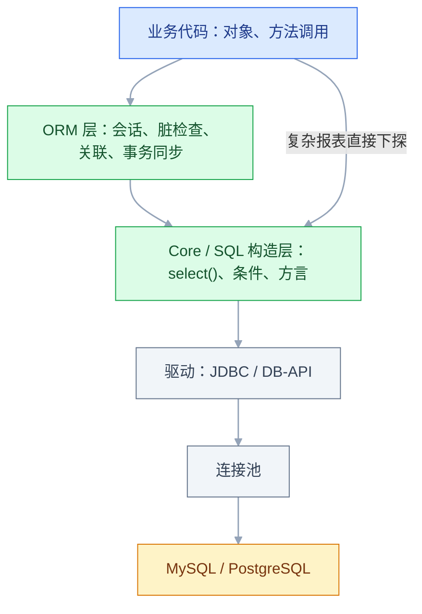
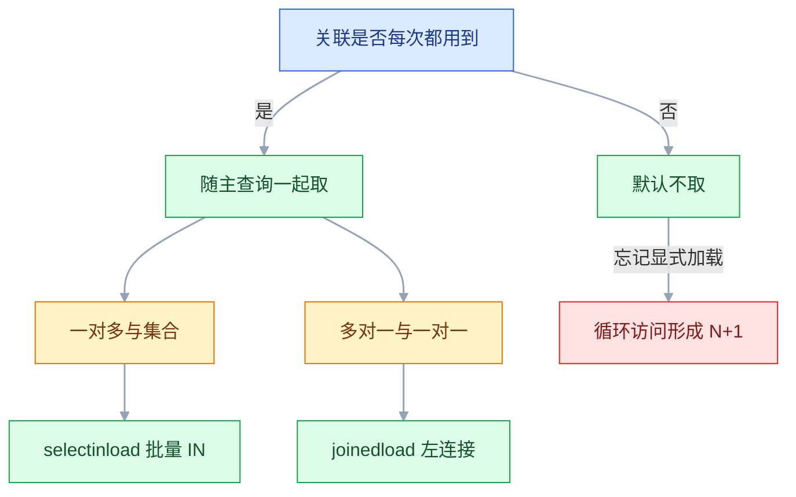

# ORM 与数据访问

## 一、工程案例：把订单列表的 101 条 SQL 压到 2 条，并让下单在 200 并发下不超卖

**场景**：商城后台的 `GET /api/orders?page=1&size=50`，每行显示订单号、金额、状态、下单人昵称、明细件数。上线两周后 P99 从 80 ms 涨到 1.3 s，数据库 CPU 从 12% 涨到 45%，但慢查询日志里**一条慢 SQL 都没有**。抓一次请求的 SQL 日志：**101 条**。

**为什么值得完整做一遍**：这 101 条里没有一条是慢的，全部走索引，单条 0.2 ms。问题不在 SQL 本身，在**调用次数**和**会话/事务边界**。同一套代码在本地 5 条测试数据上完全正常——这是 ORM 类问题最典型的形态：**数据量小的时候一切都对**。

**动手前确认**：能打开 SQL 日志（MyBatis-Plus 的 `log-impl`、SQLAlchemy 的 `echo=True`），并且能在测试里数 SQL 条数。看不到 SQL 的 ORM 等于闭着眼睛调优。

```sql
CREATE TABLE t_user (
  id        BIGINT UNSIGNED PRIMARY KEY AUTO_INCREMENT,
  username  VARCHAR(50)  NOT NULL,
  nickname  VARCHAR(50)      NULL,
  balance   DECIMAL(12,2) NOT NULL DEFAULT 0.00,
  deleted   TINYINT      NOT NULL DEFAULT 0,
  UNIQUE KEY uk_username (username)
) ENGINE=InnoDB DEFAULT CHARSET=utf8mb4;

CREATE TABLE t_product (
  id      BIGINT UNSIGNED PRIMARY KEY AUTO_INCREMENT,
  name    VARCHAR(200)  NOT NULL,
  price   DECIMAL(10,2) NOT NULL,
  stock   INT           NOT NULL DEFAULT 0,
  status  TINYINT       NOT NULL DEFAULT 1,
  version INT           NOT NULL DEFAULT 0,
  deleted TINYINT       NOT NULL DEFAULT 0
) ENGINE=InnoDB DEFAULT CHARSET=utf8mb4;

CREATE TABLE t_order (
  id           BIGINT UNSIGNED PRIMARY KEY AUTO_INCREMENT,
  order_no     VARCHAR(32)     NOT NULL,
  user_id      BIGINT UNSIGNED NOT NULL,
  total_amount DECIMAL(12,2)   NOT NULL,
  status       TINYINT         NOT NULL DEFAULT 0,
  deleted      TINYINT         NOT NULL DEFAULT 0,
  created_at   DATETIME        NOT NULL DEFAULT CURRENT_TIMESTAMP,
  UNIQUE KEY uk_order_no (order_no),
  KEY idx_user_created (user_id, created_at),
  KEY idx_created (created_at, id)
) ENGINE=InnoDB DEFAULT CHARSET=utf8mb4;

CREATE TABLE t_order_item (
  id         BIGINT UNSIGNED PRIMARY KEY AUTO_INCREMENT,
  order_id   BIGINT UNSIGNED NOT NULL,
  product_id BIGINT UNSIGNED NOT NULL,
  price      DECIMAL(10,2)   NOT NULL,
  quantity   INT             NOT NULL DEFAULT 1,
  KEY idx_order (order_id)
) ENGINE=InnoDB DEFAULT CHARSET=utf8mb4;
```

> 两个 ORM 的版本与 API 都以官方当前稳定版为准。下面的 MyBatis-Plus 代码在 Spring Boot 3 下使用 `mybatis-plus-spring-boot3-starter`，SQLAlchemy 代码使用 2.0 风格（`select()` + `Mapped[]`），1.x 的 `session.query()` 写法不再展开。

### 1.1 先量：把 SQL 条数变成数字

**MyBatis-Plus** 打开日志（开发环境，`application.yml`）：

```yaml
mybatis-plus:
  configuration:
    log-impl: org.apache.ibatis.logging.stdout.StdOutImpl
```

**SQLAlchemy** 打开回显，并加一个计数器——比肉眼数日志可靠：

```python
from sqlalchemy import event

# engine 已在应用启动时创建：create_engine(url, echo=True)
COUNTER = {"n": 0}

@event.listens_for(engine, "before_cursor_execute")
def _count_sql(conn, cursor, statement, params, context, executemany):
    COUNTER["n"] += 1
    print(f"[{COUNTER['n']:03d}] {statement.splitlines()[0][:120]}")
```

**Java 侧在测试里数**（`SqlCounter.java`，比翻日志可靠，可以直接做回归断言）：

```java
@Component
@Intercepts(@Signature(type = Executor.class, method = "query",
        args = {MappedStatement.class, Object.class, RowBounds.class, ResultHandler.class}))
public class SqlCounter implements Interceptor {
    public static final ThreadLocal<Integer> COUNT = ThreadLocal.withInitial(() -> 0);

    @Override
    public Object intercept(Invocation invocation) throws Throwable {
        COUNT.set(COUNT.get() + 1);
        return invocation.proceed();
    }

    public static void reset() {
        COUNT.set(0);                 // 每个用例执行前清零，否则计数会跨请求累加
    }
}
```

一次请求的真实日志（`size=50`，只截了头尾）：

```text
==>  Preparing: SELECT id,order_no,user_id,total_amount,status,created_at FROM t_order WHERE deleted=0 ORDER BY created_at DESC, id DESC LIMIT ?
<==      Total: 50
==>  Preparing: SELECT id,username,nickname FROM t_user WHERE id=? AND deleted=0
==>  Preparing: SELECT COUNT(*) FROM t_order_item WHERE order_id=?
==>  Preparing: SELECT id,username,nickname FROM t_user WHERE id=? AND deleted=0
==>  Preparing: SELECT COUNT(*) FROM t_order_item WHERE order_id=?
... 后面还有 48 轮，共 1 + 50 + 50 = 101 条
```

### 1.2 定位：三个访问点，两个在循环里

| 访问点 | 代码位置 | SQL 条数 |
|---|---|---|
| 订单主查询 | Service 第一行 `selectPage` | 1 |
| 下单人昵称 | 循环里 `o.getUser().getNickname()`（懒加载）或 `userMapper.selectById` | 50 |
| 明细件数 | 循环里 `selectCount(order_id=?)` | 50 |

两个关键观察：

1. **50 个订单只有 37 个不同的 `user_id`**。逐条查等于把同一个用户重复查了多次，批量 `IN` 只需要 1 条。
2. **明细件数是一个聚合**，天然可以按 `order_id` 分组一次算完，不需要每单查一次。

### 1.3 改查询：批量 IN，固定 3 条

**SQLAlchemy**（`order_service.py`）：`selectinload` 就是"收集主键 + 一条 `IN`"，框架替你做了第二、三步：

```python
from sqlalchemy import select, func
from sqlalchemy.orm import selectinload

stmt = (
    select(Order)
    .options(selectinload(Order.user))                 # 一对多/多对一都可，发 IN 查询
    .order_by(Order.created_at.desc(), Order.id.desc())
    .limit(50)
)
orders = db.execute(stmt).scalars().all()

counts = dict(db.execute(
    select(OrderItem.order_id, func.count())
    .where(OrderItem.order_id.in_([o.id for o in orders]))
    .group_by(OrderItem.order_id)
).all())
```

**MyBatis-Plus**（`OrderService.java`）：手写三步，逻辑一样，只是没有框架代劳：

```java
List<Order> orders = orderMapper.selectPage(new Page<>(1, 50),
        new LambdaQueryWrapper<Order>()
                .orderByDesc(Order::getCreatedAt)
                .orderByDesc(Order::getId)).getRecords();
if (orders.isEmpty()) return List.of();

Set<Long> userIds = orders.stream().map(Order::getUserId).collect(Collectors.toSet());
Map<Long, User> userMap = userMapper.selectBatchIds(userIds).stream()
        .collect(Collectors.toMap(User::getId, Function.identity()));

List<Long> orderIds = orders.stream().map(Order::getId).toList();
Map<Long, Long> itemCount = orderItemMapper.countByOrderIds(orderIds).stream()
        .collect(Collectors.toMap(OrderItemCount::getOrderId, OrderItemCount::getCnt));
```

```java
// Mapper：一条 GROUP BY 拿到所有订单的件数
// 注解里写动态标签必须用 <script> 包起来，否则 <foreach> 会被当成普通文本
@Select("""
        <script>
        SELECT order_id AS orderId, COUNT(*) AS cnt
        FROM t_order_item WHERE order_id IN
        <foreach collection="ids" item="id" open="(" separator="," close=")">#{id}</foreach>
        GROUP BY order_id
        </script>
        """)
List<OrderItemCount> countByOrderIds(@Param("ids") List<Long> ids);
```

结果：**3 条**（订单 1 + 用户 1 + 明细 1），且 `IN` 里的 id 已经去重。代价是 `IN` 列表不能无限长——超过几百个 id 要分批，否则 SQL 解析和网络传输本身会变慢。

> 这 3 条换来了可复用的实体对象，适合详情页和写路径。纯列表页只需要展示字段、不需要对象，下一个小节的 JOIN 方案能再省一条。

### 1.4 列表页：一次 JOIN + 聚合，含 COUNT 共 2 条

列表页要分页，最省内存的是把过滤、排序、分页全交给数据库，只取当前页的 50 行（`OrderMapper.xml`）：

```xml
<select id="selectOrderPage" resultType="com.example.mall.vo.OrderVO">
  SELECT o.id, o.order_no AS orderNo, o.total_amount AS totalAmount, o.status,
         u.nickname, COUNT(i.id) AS itemCount
  FROM t_order o
  INNER JOIN t_user u ON u.id = o.user_id AND u.deleted = 0
  LEFT JOIN t_order_item i ON i.order_id = o.id
  WHERE o.deleted = 0
  <if test="q.status != null">AND o.status = #{q.status}</if>
  GROUP BY o.id, o.order_no, o.total_amount, o.status, u.nickname
  ORDER BY o.created_at DESC, o.id DESC
</select>
```

三个必须知道的边界：

- **`GROUP BY` 要覆盖所有非聚合列**。按主键分组时 MySQL 能识别函数依赖，写法可以放宽；但混入没分组的列，开启 `ONLY_FULL_GROUP_BY` 就直接报错——本地关掉、生产打开，是最常见的"本地能跑、上线 500"。
- **分页插件会把整条 SQL 包成子查询去 `COUNT`**。带 `GROUP BY` 时只能生成 `SELECT COUNT(*) FROM (原 SQL) t`，结果正确但代价高；页面上不需要总数时用 `searchCount=false`（`new Page<>(1, 50, false)`）直接省掉这条。
- **一对多 JOIN 不能让行数膨胀到分页失真**。这里用 `COUNT(i.id)` 聚合而不是把明细列展开，所以 JOIN 后仍是"一订单一一行"。若要展开明细列表，就得改成两阶段：先分页查订单 id，再用 id 查明细。
- **`ORDER BY` 的列要能被索引兜住**。`created_at` 上有索引，但和 `GROUP BY o.id` 一起用时 MySQL 仍可能建临时表；这是聚合的固有成本，别为了消掉 `Using temporary` 把 `GROUP BY` 删掉。

### 1.5 写入：同一事务 + 原子扣减

下单 = 扣库存 + 扣余额 + 插订单 + 插明细，四步必须同生共死（`OrderService.java`）。

```java
@Transactional(rollbackFor = Exception.class)
public Long createOrder(Long userId, Long productId, int qty) {
    Product p = productMapper.selectById(productId);
    if (p == null || p.getStatus() != 1) throw new BizException("商品不存在或已下架");

    // 判断和扣减合成一条原子 SQL：返回 0 就是库存不足，不存在"查完被别人抢走"
    int n = productMapper.deductStock(productId, qty);
    if (n == 0) throw new BizException("库存不足");

    BigDecimal amount = p.getPrice().multiply(BigDecimal.valueOf(qty));
    if (userMapper.deductBalance(userId, amount) == 0) throw new BizException("余额不足");

    Order order = new Order();
    order.setOrderNo(nextOrderNo());
    order.setUserId(userId);
    order.setTotalAmount(amount);
    order.setStatus(OrderStatus.PENDING);
    orderMapper.insert(order);                 // 自增 id 回填到 order.id

    OrderItem item = new OrderItem();
    item.setOrderId(order.getId());
    item.setProductId(p.getId());
    item.setPrice(p.getPrice());
    item.setQuantity(qty);
    orderItemMapper.insert(item);
    return order.getId();
}
```

```sql
-- 扣库存：WHERE 里带库存判断，靠 InnoDB 行锁保证原子性
UPDATE t_product SET stock = stock - #{qty}
WHERE id = #{productId} AND stock >= #{qty} AND deleted = 0;
```

**SQLAlchemy 侧的重点不是 SQL，而是会话边界**：

```python
def create_order(db: Session, user_id: int, product_id: int, qty: int) -> int:
    with db.begin():            # 出错自动 rollback；已有事务时改用 begin_nested()
        product = db.get(Product, product_id)
        if product is None or product.status != 1:
            raise BizError("商品不存在或已下架")
        price = product.price   # 先取出来：后面对象会过期，避免多一次查询

        n = db.execute(
            update(Product)
            .where(Product.id == product_id, Product.stock >= qty)
            .values(stock=Product.stock - qty)
            .execution_options(synchronize_session=False)   # ORM 版 update，但不让工作单元同步内存对象
        ).rowcount
        if n == 0:
            raise BizError("库存不足")
        db.expire(product)      # 上面绕过了身份映射，手动让内存里的对象过期

        order = Order(user_id=user_id, total_amount=price * qty)
        db.add(order)
        db.flush()              # 发 INSERT 拿自增 id，但还没提交
        order_id = order.id     # 先记下：Session 默认 expire_on_commit=True，提交后再读会多发一条 SELECT
        db.add(OrderItem(order_id=order_id, product_id=product_id, quantity=qty))
    return order_id
```

> `with db.begin()` 只在会话尚未开启事务时可用；如果 `create_order` 被上层事务包裹，直接执行即可，提交交给上层——**事务边界画在业务用例上，不在每个函数里**。

> **多商品下单的加锁顺序**：按 `product_id` 升序依次扣减。两个订单以不同顺序锁同样的两行，就是死锁的标准配方；顺序一致能把死锁概率降到接近零。

### 1.6 验收（9 项全过才算改完）

| # | 检查项 | 命令或检查 | 通过标准 |
|---|---|---|---|
| 1 | 列表 SQL 条数 | `SqlCounter.COUNT.get()` 或 `COUNTER["n"]` | `size=50` 时 ≤ 2 条（1 条列表 + 1 条 COUNT）；走 1.3 的批量方案则 ≤ 3 条（不含分页 COUNT） |
| 2 | 翻页不重不漏 | 连续取 3 页，比对 id 集合 | 三页 id 无交集，重复执行结果一致 |
| 3 | 索引命中 | `EXPLAIN` 主查询 | `rows` 远小于订单总数，且不随 offset 线性增长；`Using temporary` 是 `GROUP BY` 的固有成本，不判失败 |
| 4 | 事务回滚 | 库存不足用例 | 余额与库存都保持原值，订单数不变 |
| 5 | 并发不超卖 | 200 并发抢 10 件 | 成功 10 单，`stock=0`，无负数 |
| 6 | 连接池 | HikariCP 的 `active` / `pending` | 压测后 `active` 能回落，`pending` 不持续大于 0 |
| 7 | 慢 SQL | `slow_query_log` | 列表接口无 > 200 ms 的语句 |
| 8 | 回归防退化 | CI 里断言 SQL 条数 | 超过阈值直接失败 |
| 9 | 明细件数正确 | 与 `SELECT COUNT(*)` 手工核对 | 每行一致 |

并发验证可以直接用 shell 打。先准备确定的前置数据，否则 200 个请求会先死在"余额不足"而不是库存上：

```sql
UPDATE t_product SET stock = 10, status = 1, deleted = 0 WHERE id = 1;
UPDATE t_user    SET balance = 100000.00, deleted = 0 WHERE id = 1;
DELETE FROM t_order_item WHERE product_id = 1;
DELETE FROM t_order WHERE user_id = 1;
```

```bash
seq 200 | xargs -P 50 -I{} curl -s -o /dev/null -w "%{http_code}\n" \
  -X POST 'http://127.0.0.1:8080/api/orders' \
  -H 'Content-Type: application/json' \
  -d '{"userId":1,"productId":1,"qty":1}' | sort | uniq -c
# 期望：10 个 2xx，190 个 4xx（库存不足）；出现任何 5xx 都算失败
```

```sql
-- 两条断言，必须同时成立
SELECT stock FROM t_product WHERE id = 1;                                  -- 期望 0
SELECT COUNT(DISTINCT order_id) FROM t_order_item WHERE product_id = 1;    -- 期望 10
```

> 把第 1 项写进测试，是这一节最值钱的产出：N+1 不会一次改完就永远消失，后面任何人加一个 `for` 循环里的查询，CI 都会拦住。

---

## 二、高频问答：会卡住你的地方，也是面试最常问的

### 2.1 列表接口的 SQL 条数随页大小线性增长

**现场**

数 `==>  Preparing` 的条数；把 `size` 从 10 改到 50，条数从 21 变成 101 就坐实了。

**要点**

- 这是 N+1：1 条主查询 + 每行一次关联查询（或每行一次 `COUNT`）。
- N+1 里没有慢 SQL，每条 `EXPLAIN` 都漂亮，加索引一点用没有；加机器只是让更多连接同时发 101 条。
- 条数随页大小线性增长就是 N+1，恒定才是真慢。

**追问**

- 为什么慢查询日志一条都没有？→ 每条都是 0.2ms，压根进不了阈值。
- 怎么在测试里防退化？→ 用拦截器或事件监听器断言条数，超阈值让 CI 失败。
- 为什么能打满数据库？→ 它打满的不是 CPU，是连接池。

### 2.2 加了 `@Transactional`，出错却没回滚

**现场**

在方法首尾各打一行日志，再看 `TransactionSynchronizationManager.isActualTransactionActive()`，确认事务到底开没开。

**要点**

- 四选一：同类内部 `this.methodB()` 调用绕过代理、方法不是 `public`、异常被 `catch` 吞掉、抛的是检查型异常而 `rollbackFor` 没配。
- 注解不生效时框架不会报错，只会安静地当成普通方法执行。
- 这是代理模型的必然结果，不是 Spring 的 bug。

**追问**

- 自调用为什么绕过？→ 只有外部调用才进代理，`this.` 拿的是原对象。
- 内层异常被外层 `catch` 了还能提交吗？→ 不能，事务已 `rollback-only`，提交时抛 `UnexpectedRollbackException`。
- 检查型异常默认回滚吗？→ 不回滚，要显式 `rollbackFor = Exception.class`。

### 2.3 循环里逐条 `insert`，一万条跑了四分钟

**现场**

看日志里 `INSERT` 出现次数；`SHOW GLOBAL STATUS LIKE 'Com_commit'` 前后差值等于行数就是逐条提交。

**要点**

- 不是磁盘带宽问题，是一万次网络往返 + 一万次提交；自动提交开着时每条都要一次 `fsync`。
- 单条 INSERT 本身只要 0.1 ms，开销全在往返和刷盘。
- 改成多值 `INSERT`（每批 500-1000 行）或批量接口，耗时通常从分钟级掉到秒级。

**追问**

- 加了 JDBC batch 为什么还是逐条发？→ MySQL 要在 URL 上加 `rewriteBatchedStatements=true`。
- 同一个事务里一万条还慢呢？→ 那才是真碰到索引维护或锁竞争。
- 一批多少合适？→ 500-1000 行，太大则锁和 undo 都变长。

### 2.4 `updateById` 改不了一个字段为 NULL

**现场**

看生成的 SQL：`SET` 里根本没有那一列，就是被跳过了。

**要点**

- MyBatis-Plus 默认字段策略是 `NOT_NULL`，`null` 字段被直接从 `SET` 子句里剔除。
- 传 `null` 的语义是「这个字段不参与更新」，不是「设成空」。
- JPA 侧对应的是该列标了 `updatable = false`，永远不参与 UPDATE。

**追问**

- 怎么强制设成 NULL？→ 显式 `UpdateWrapper.set(col, null)`。
- JPA 里为什么也改不了？→ 检查字段或列上有没有 `updatable = false`。
- 部分更新怎么避免覆盖别的列？→ 只 `set` 要改的列，别查出来整对象再存。

### 2.5 第 1 页和第 2 页出现同一条数据

**现场**

把 `ORDER BY` 加上主键再翻页，重复消失即命中。

**要点**

- `ORDER BY` 的字段有重复值时，数据库对相同键的行返回顺序不保证稳定。
- 分页的稳定性由排序键的唯一性决定，不由 `LIMIT` 决定。
- 任何分页查询都必须有唯一的兜底排序键，这是零成本的修复。

**追问**

- 为什么第一页正常、第二页才重复？→ 两次查询的计划和读取顺序可以不同。
- 兜底键加什么？→ `ORDER BY created_at DESC, id DESC`。
- 深分页也这样吗？→ 深分页是扫描量问题，见 2.9。

### 2.6 `LazyInitializationException` / `DetachedInstanceError`

**现场**

异常栈里找触发点：是不是在 Controller、序列化、模板渲染阶段访问了关联属性。

**要点**

- 会话/事务已经关闭，代理对象无法再发 SQL 初始化；JPA 是 Session 关了，SQLAlchemy 是对象 detach 了。
- `EAGER` 只是把「访问时才查」改成「每次加载都查」，集合仍是一条条补查，问题从报错变成慢。
- 正确做法是在 Service（有事务）内用 `JOIN FETCH` / `@EntityGraph` / `selectinload` 查齐，再返回 DTO。

**追问**

- Controller 上再加 `@Transactional` 为什么不好？→ 事务边界画错了，会话被开到渲染阶段。
- 怎么让问题早点暴露？→ `open-in-view=false`，别把会话藏到视图层。
- `EAGER` 为什么不能按查询关闭？→ 它是映射级配置，全局生效。

### 2.7 `Connection is not available, request timed out after 30000ms`

**现场**

`SHOW PROCESSLIST` 看长期 `Sleep` 的连接，`information_schema.innodb_trx` 看未提交事务的 `trx_started`；再看 HikariCP 的活跃连接数是否长期等于上限。

**要点**

- 连接被占着没干活：事务里调外部 API、大事务、慢查询、连接泄漏。
- 池大小应该由数据库的处理能力决定，不是由并发量决定。
- 8 核数据库给 200 个连接，只会让上下文切换和缓冲区争抢把吞吐压下去。

**追问**

- 怎么定位谁占着连接？→ `leak-detection-threshold=60000`，它会打印借出连接的堆栈。
- 调小池子会不会 500？→ 会排队，配合较短的 `connection-timeout` 快速失败更可控。
- 为什么 `maximum-pool-size` 不是越大越好？→ 数据库同时能处理的查询数远小于应用并发。

### 2.8 逻辑删除后，同名用户注册不了

**现场**

`SELECT id, username, deleted FROM t_user WHERE username='zhangsan';` 能查到 `deleted=1` 的行。

**要点**

- 旧行还在表里，`uk_username` 唯一索引仍然管着它，只是 `deleted=1` 让它查不出来。
- 逻辑删除只改了查询条件，没改约束。
- 解法是联合唯一索引 `(username, deleted)`，或删除时把 `username` 改写为 `username_del_<id>`。

**追问**

- `(username, deleted)` 有什么坑？→ `deleted` 只能取 0/1，多次删除同一个名字仍会撞。
- 为什么不干脆物理删除？→ 审计要求；要求不强就直接删，更简单。
- 自定义 SQL 会自动带 `deleted=0` 吗？→ 不会，要手写，JOIN 的每张表都要加。

### 2.9 深分页：翻到几万页之后，接口要 3 秒

**现场**

`EXPLAIN` 看 `rows` 是否约等于 `offset + limit`；把 offset 改成 0 对比耗时。

**要点**

- `LIMIT 1000000, 20` 要扫描并丢弃前 100 万行，`SELECT *` 还要回表，代价和偏移量成正比。
- 这是扫描行数问题，不是索引缺失问题，索引再好也省不掉「扫并丢」。
- 改成游标分页或延迟关联，深页应回到毫秒级，同时给业务加最大页数限制。

**追问**

- 延迟关联为什么快？→ 子查询走覆盖索引只带回 20 个 id，再回表。
- 游标分页的代价是什么？→ 不能跳页，只能上一页/下一页。
- `SELECT *` 为什么更慢？→ 每一行都要回表取全部列。

### 2.10 枚举值全部错位，或者时间差 8 小时

**现场**

`SELECT DISTINCT status FROM t_order;` 看是不是 0/1/2 这种序号；`SELECT @@time_zone, @@system_time_zone;` 对比应用时区。

**要点**

- 枚举用了 `ordinal` 存序号，中间插入一个值后历史数据整体位移。
- 时间字段用了不带时区的 `DATETIME`，JVM/容器/数据库三方时区不一致。
- 这两类问题都是「写入时就已经错了」，事后查代码看不出来。

**追问**

- 枚举该怎么存？→ 字符串或显式 code（`@Enumerated(EnumType.STRING)`、`@EnumValue`）。
- 连接串要配什么？→ 显式指定时区，Connector/J 8 用 `connectionTimeZone`。
- 时区统一成什么？→ 存储用 UTC，展示层按用户时区格式化。

### 2.11 乐观锁更新返回 0 行，代码当成成功

**现场**

看 `updateById` 的返回值；并发测试里两个线程读同一版本，第二个必然返回 0。

**要点**

- 版本号对不上，`UPDATE ... WHERE id=? AND version=?` 影响 0 行——这是**冲突信号**，不是异常。
- 把 0 当成「没这条数据」，既不重试也不报错，库存就这么丢了。
- 处置是重新查 → 重算 → 重试，超过次数抛业务异常。

**追问**

- 重试为什么必须在新事务里？→ 当前事务已被标记回滚，在里面重试必然失败。
- 自己 `new` 一个只设 id 的对象为什么不生效？→ version 是 null，条件退化。
- 重试几次合适？→ 有限次数（如 3 次）后失败，别无限循环。

### 2.12 `LIKE '%关键词%'` 让索引彻底失效

**现场**

`EXPLAIN` 里 `type=ALL`、`rows` 等于表行数。

**要点**

- B+ 树按前缀有序，前导 `%` 无法定位起点，只能全表扫。
- `Containing`、`likeLeft` 生成的都是这种，索引对「包含匹配」天然无能为力。
- 能改右模糊就改（`likeRight` / `StartingWith`），确实要全文搜索就上倒排索引。

**追问**

- 右模糊为什么就能走索引？→ 前缀固定，B+ 树能定位起点。
- 千万行表怎么办？→ Elasticsearch 或数据库全文索引，别赌 `LIKE '%x%'`。
- 覆盖索引能救吗？→ 不能，仍然要扫全部索引项。

---

## 三、核心知识：从零开始要建立的东西

### 3.1 阻抗不匹配与 ORM 的职责边界

对象世界有引用、继承、集合、身份；表世界只有行、列、外键。ORM 的全部工作就是把这两边对上，并且**只对能对上的部分负责**。

| 对象世界 | 表世界 | ORM 的处理 |
|---|---|---|
| 对象引用 `order.user` | 外键 `user_id` | 关联映射 + 按需加载 |
| `List<OrderItem>` | 子表的多行 | 一对多，靠 `order_id` 反查 |
| 继承 `PayOrder extends Order` | 无继承 | 单表 + 类型列，或 joined 策略 |
| 对象身份（同一对象） | 主键 | 身份映射（同一 Session 内主键唯一） |
| 事务（`begin/commit`） | `BEGIN/COMMIT` | 会话绑定事务 |

**职责边界**：ORM 负责 SQL 生成、参数绑定、结果映射、连接获取与归还、事务同步、变更跟踪。**它不负责**决定该不该发这条 SQL、该不该 JOIN、索引够不够、分页深不深。这四件事仍然是人做，所以"用了 ORM 就不用懂 SQL"是错得最贵的一句话。

> 判断一个 ORM 用法是否健康，只看一个指标：**一个请求打了几条 SQL、每条扫了多少行**。这两件事 ORM 都不会主动告诉你，得自己打开日志。

### 3.2 分层：ORM、Core、驱动



| 层 | 各框架的叫法 | 什么时候直接用 |
|---|---|---|
| ORM | SQLAlchemy ORM、Hibernate、MyBatis 映射 | 单对象增删改查、需要脏检查/级联 |
| Core / SQL 构造 | SQLAlchemy Core、JPA Criteria、MyBatis XML | 聚合、批量、复杂 JOIN |
| 驱动 | `pymysql`、`psycopg`、`mysql-connector-j` | 几乎不直接碰 |
| 连接池 | `QueuePool`、HikariCP、Druid | 配置层 |

**关键结论**：ORM 与手写 SQL 不是二选一。同一套代码里，**写路径走 ORM，读路径的复杂查询下探到 Core/SQL**，是 SQLAlchemy 和 MyBatis 都支持的正常用法。反过来，把报表硬塞进对象导航（JPA Criteria 写 50 行）才是真的难维护。

### 3.3 会话与身份映射

**会话（Session / EntityManager / SqlSession）是一次工作单元的边界**：它持有连接、缓存已加载的对象、记录待写入的变更、管理事务。

| 概念 | SQLAlchemy | JPA / Hibernate | MyBatis |
|---|---|---|---|
| 工作单元 | `Session` | `EntityManager` | `SqlSession` |
| 一级缓存 | identity map（自动） | persistence context（自动） | 一级缓存（默认开） |
| 事务开始 | `with db.begin()` / 首次执行 | `@Transactional` | `SqlSession` + Spring 事务 |
| 对象状态 | persistent / detached | managed / detached | 无身份映射（一级缓存按语句+参数命中，命中时返回同一对象） |

**身份映射的直观效果**：同一会话里按主键查两次，第二次不发 SQL，返回的是同一个对象。

```python
a = db.get(User, 1)
b = db.get(User, 1)
assert a is b          # 同一个 Python 对象，第二条 SELECT 被身份映射拦下
a.nickname = "新名字"
assert b.nickname == "新名字"
```

**边界一**：会话不是线程安全的，也**不能跨请求复用**。一个全局 `Session` 会让不同请求共享事务和缓存，轻则读到别人的未提交数据，重则事务互相污染。Web 框架里的正确做法是"每请求一个会话"（依赖注入 + `finally: close()`）。

**边界二**：会话持有强引用。批量处理百万行时如果一直不 `close()`/`expire`，内存会随对象数量线性上涨，最后 OOM——这不是内存泄漏，是工作单元的正常代价。

### 3.4 工作单元、脏检查与 flush 时机

**脏检查**：会话记录加载时每个属性的快照，`flush` 时对比当前值，有差异就生成 `UPDATE`。所以 ORM 里改字段**不需要调用 update**。

```python
user = db.get(User, 1)
user.nickname = "改名了"      # 没有任何 save/update 调用
db.commit()                   # flush 时生成 UPDATE t_user SET nickname=? WHERE id=?
```

`flush` 不等于 `commit`：flush 把 SQL 发给数据库（同一事务内可见），commit 才真正提交。flush 会在这些时刻发生：

| 触发时机 | 说明 |
|---|---|
| 执行查询前 | 保证查询能看到前面的改动（autoflush） |
| 显式 `flush()` | 需要立刻拿自增 id，或提前暴露约束冲突 |
| `commit()` | 提交前必然 flush |
| 会话 `close()` | **不 flush**，未提交的改动直接丢弃（等同回滚） |

**三个高频坑**：

- `expire_on_commit=True`（SQLAlchemy 默认）会让 commit 后所有对象属性过期，下一次访问触发新查询。Web 请求里通常设 `False`，但要清楚代价：拿到的是提交前的快照。
- 批量改一万个对象再 commit，flush 会生成一万条 `UPDATE`。这种场景应该用 Core 的批量 `update()`，而不是让工作单元逐条比对。
- **Core 风格的 `update()` 绕过工作单元**：内存里已加载的对象不会自动同步，需要 `expire()` 或 `synchronize_session` 策略。这正是 1.5 里那行 `db.expire(product)` 的原因。

### 3.5 事务边界与传播行为

事务边界应该画在**业务用例**上：一个"下单"是一个事务，不是一次 insert 一个事务，也不是整个 HTTP 请求一个事务。

| 传播行为 | 含义 | 用在哪 |
|---|---|---|
| `REQUIRED`（默认） | 有就加入，没有就新建 | 绝大多数业务方法 |
| `REQUIRES_NEW` | 挂起外层，总是新建 | 失败也要留痕的日志、审计 |
| `NESTED` | 保存点，内层回滚不影响外层 | 可容忍部分失败的批处理 |
| `SUPPORTS` | 有就加入，没有就非事务执行 | 只读查询 |
| `NOT_SUPPORTED` | 挂起外层，非事务执行 | 事务里不该做的慢操作 |
| `MANDATORY` | 必须已有事务，否则抛异常 | 强制调用方开事务 |
| `NEVER` | 必须没有事务 | 禁止在事务内调用 |

**`REQUIRED` 最反直觉的一点**：内层方法抛异常后，即使外层 `catch` 住了，事务已被标记 `rollback-only`，外层提交时会抛 `UnexpectedRollbackException`。要"内层失败不影响外层"，只能用 `REQUIRES_NEW`（代价是占两条连接）。

> `NESTED` 依赖 JDBC savepoint。JPA 的 `JpaTransactionManager` 默认不支持嵌套事务，JPA 项目别指望它兜底；需要"部分失败可回滚"时，拆成独立用例 + `REQUIRES_NEW` 更可靠。

**注解失效的根因**：`@Transactional` 靠代理生效。同类内部 `this.b()` 不经过代理，注解被完全跳过；非 `public` 方法同理。这不是 Spring 的 bug，是代理模型的必然结果。

```java
// 让 REQUIRED 的"污染"显形：外层捕获了异常，提交仍然失败
@Transactional(rollbackFor = Exception.class)
public void outer() {
    orderMapper.insert(order);
    try {
        innerService.inner();            // 内层 REQUIRED，抛运行时异常
    } catch (Exception e) {
        log.warn("内层失败，继续", e);     // 吞掉也没用，事务已 rollback-only
    }
}   // → UnexpectedRollbackException
```

**只读事务**的真实作用：给驱动/数据库一个提示（可以走只读路由、禁写），Hibernate 还会据此跳过脏检查。它**不会**让查询变快，也不会自动加锁。

> **面试**：常问「`@Transactional` 为什么有时候完全不生效？」答：靠代理生效，自调用、非 public 方法都不经过代理，注解被静默跳过。

### 3.6 关联加载策略



| 策略 | SQL 形态 | 适用 | 代价 |
|---|---|---|---|
| `lazy="select"` / `FetchType.LAZY` | 访问时单条查询 | 默认，按需 | 循环访问就是 N+1 |
| `lazy="selectin"` / `@BatchSize` / `default_batch_fetch_size` | 一条 `IN` 批量 | **一对多首选** | 首次访问会多加载一批 |
| `lazy="joined"` / `JOIN FETCH` | 主查询 JOIN | 多对一、一对一 | 一对多会行数膨胀 |
| `lazy="raise"` | 访问即报错 | 强制显式加载 | 开发期严格，容易误伤 |
| `lazy="dynamic"` | 返回可继续过滤的 Query | 关联数据极多 | 用法受限 |
| `EAGER` | 强制 JOIN/子查询 | 几乎不该用 | 无法按查询关闭 |

**一对多 + 分页的死结**：`JOIN` 之后 `LIMIT 10` 限制的是行数，不是订单数，可能只拿到 3 个订单。Hibernate 会发 `HHH90003004` 警告；具体是退回内存分页还是改用窗口函数，随版本不同（以官方当前稳定版为准），但都不能保证"10 个订单"的语义。正确做法是两阶段：先分页查主表 id，再用 id 查关联。

### 3.7 N+1 的成因与三种解法

**成因**：ORM 把"取关联"设计成一次按需查询，而业务代码在循环里访问关联，于是 1 条主查询 + N 条关联查询。

| 解法 | SQL 条数 | 适用 | 注意 |
|---|---|---|---|
| 批量 `IN` / `selectinload` | 2 | **通用首选** | `IN` 列表要限长，几百个一批 |
| `JOIN` / `JOIN FETCH` | 1 | 多对一、一对一；列表页 | 一对多 + 分页会失真 |
| DTO 投影 | 1 | 列表、报表，只要部分列 | 要写 DTO，但传输最小 |

**为什么条数比单条耗时更重要**：每次 SQL 都有网络往返、解析、优化、权限检查的固定成本。单条 0.2 ms 的查询，1000 次串行就是 200 ms 起，而且全程占着连接。**N+1 打满数据库的方式不是把 CPU 跑满，而是把连接池占满。**

**发现手段**（按可靠性排序）：

1. 测试里断言 SQL 条数（最可靠，能防退化）
2. SQL 日志里同一语句反复出现、只有参数不同
3. `p6spy` / `datasource-proxy` 统计每请求条数
4. 代码审查搜"循环里调 Mapper / 访问关联属性"

> **面试**：常问「N+1 为什么比一条慢 SQL 更危险？」答：单条都快，慢查询日志抓不到，它打满的是连接池而不是 CPU。

### 3.8 条件构造器、动态 SQL 与参数绑定

三种表达动态条件的方式，本质都是"拼 SQL + 绑参数"，区别只在类型安全程度：

| 方式 | 代表 | 字段名怎么表示 | 拼错何时发现 |
|---|---|---|---|
| 方法引用 DSL | MyBatis-Plus `LambdaQueryWrapper` | `User::getUsername` | 编译期 |
| 字符串 DSL | `QueryWrapper`、JPA Criteria | `"username"` | 运行期 |
| 模板 | MyBatis XML `<if>` | XML 里的列名 | 运行期 |

**参数绑定与拼接的界线**：`#{}` / `:param` 走预编译，值永远不进入 SQL 文本，天然防注入；`${}` / `last()` / 字符串拼接把值直接写进 SQL，**只要有一个参数来自用户输入就是注入漏洞**。

```java
// ✔ 值走绑定
wrapper.eq(User::getUsername, username);

// ✘ 值拼进 SQL：username 传 "x' OR '1'='1" 就直接改变语义
wrapper.apply("username = '" + username + "'");

// ✘ 排序字段来自前端时，白名单是唯一安全的做法
wrapper.last("ORDER BY " + sortBy);      // sortBy 必须是枚举/白名单里的值
```

**AND / OR 的括号**：`OR` 的优先级低于 `AND`，裸 `.or()` 会把前面的条件一起绕过。

```java
// 意图：status=1 且（name 含"张" 或 name 含"李"）
// 实际：status=1 AND name LIKE '%张%' OR name LIKE '%李%'  ← 李 的那半边绕过了 status
wrapper.eq(User::getStatus, 1).like(User::getName, "张").or().like(User::getName, "李");

// 正确：把 OR 的条件包进一个分组
wrapper.eq(User::getStatus, 1)
       .and(w -> w.like(User::getName, "张").or().like(User::getName, "李"));
```

**动态条件的简洁写法**：MyBatis-Plus 的条件方法大多提供了 `boolean condition` 重载，为 `false` 时整个条件不进入 SQL，不用写一堆 `if`。XML 侧对应 `<if test="...">` 和 `<where>`（自动去掉多余的 `AND`）。

### 3.9 主键生成与自增回填

| 策略 | 谁生成 | 适用数据库 | 代价 |
|---|---|---|---|
| `AUTO_INCREMENT` / `IDENTITY` | 数据库 | MySQL、PG | 单条插入随语句带回 id；批量插入的回填要单独处理 |
| `SEQUENCE` | 数据库序列 | PG、Oracle | 可预分配，批量插入友好 |
| 雪花 ID | 应用 | 都行 | 19 位、趋势递增、无需中心；时钟回拨要处理 |
| UUID | 应用 | 都行 | 无序，作为聚簇索引会造成页分裂 |
| 业务自定义 | 应用 | 都行 | 要自己保证唯一 |

**自增回填**：单条 `insert` 之后对象上就有 id，因为驱动在同一个协议往返里返回了 `LAST_INSERT_ID()` 或 `RETURNING`。

```java
orderMapper.insert(order);
Long id = order.getId();        // 已回填，不需要再查一次
```

**边界**：

- **批量插入不一定回填**。MyBatis 的 `useGeneratedKeys` 在多值 INSERT 下行为依赖驱动版本，JPA 的 `IDENTITY` 策略会**禁用 JDBC 批处理**（Hibernate 必须逐条插入才能拿 id）。批量场景更适合雪花 ID 或序列。
- **序列的 `allocationSize`** 决定一次预取多少个值。设成 1 等于每次插入都访问序列；设成 50 会跳号，但跳号在业务上通常无害。
- **自增 id 不泄露规模**：对外暴露的订单号、用户号应该另生成，不要直接返回自增主键。

### 3.10 并发写入：乐观锁、悲观锁与原子更新

| | 乐观锁（version） | 悲观锁（`FOR UPDATE`） | 原子 UPDATE |
|---|---|---|---|
| 加锁时机 | 更新时校验 | 读取时锁定 | 数据库行锁，瞬时 |
| 冲突时 | 影响 0 行，需重试 | 排队等待 | 影响 0 行，业务判断 |
| 吞吐 | 冲突少时最好 | 冲突多时最差 | 最好 |
| 实现 | 要写重试 | 加一行 SQL | 一条 SQL |
| 典型场景 | 资料编辑、配置修改 | 读后要复杂判断 | **库存、余额扣减** |

**原子更新是库存场景的首选**，因为它把"判断"和"修改"压进同一条语句，不存在检查与写入之间的窗口：

```sql
UPDATE t_product
SET stock = stock - 5
WHERE id = 100 AND stock >= 5;
-- 影响 0 行 = 库存不足，不需要先 SELECT
```

**乐观锁的三条铁律**：

1. 必须"先查后改"，让对象带上当前 version；自己 `new` 一个只设 id 的对象，version 是 null，条件不生效，退化成普通更新。
2. MyBatis-Plus 的内置更新方法（`updateById`、`update(entity, wrapper)`、`saveOrUpdate` 等）会拼 version 条件，具体支持范围以官方当前稳定版为准；`update(entity, wrapper)` 的 wrapper 不能复用，自定义 SQL 必须自己写 `AND version = ?` 并 `SET version = version + 1`。
3. 冲突后重试要**在新事务里**，否则当前事务已被标记回滚，重试必然失败。

**悲观锁的三条铁律**：必须在事务内（事务外锁立即释放）；`WHERE` 必须走索引（否则行锁升级为表锁）；多行加锁顺序一致（否则死锁）。

> **面试**：常问「乐观锁和悲观锁怎么选？」答：冲突少用乐观锁加重试，冲突多或读后要复杂判断用悲观锁，库存扣减首选一条原子 UPDATE。

### 3.11 分页：偏移、游标与计数

| 方式 | SQL | offset 100 万时耗时 | 能跳页 |
|---|---|---|---|
| `LIMIT offset, size` | 读 offset+size 行，丢前 offset 行 | 秒级 | 能 |
| 延迟关联 | 子查询只扫索引取 id，再回表 | 百毫秒 | 能 |
| 游标 / keyset | `WHERE id > ? ORDER BY id LIMIT size` | 毫秒 | 不能 |

```sql
-- 延迟关联：子查询走覆盖索引，只带回 20 个 id
SELECT o.* FROM t_order o
INNER JOIN (SELECT id FROM t_order ORDER BY id LIMIT 1000000, 20) t ON o.id = t.id;

-- 游标：翻到多深都是同样的代价
SELECT * FROM t_order WHERE id > 1000000 ORDER BY id LIMIT 20;
```

**页码基数**：JPA 的 `PageRequest.of` 从 0 开始，MyBatis-Plus 的 `Page` 从 1 开始，SQLAlchemy 的 `offset` 是行数。前后端联调差一位，八成是这里。

**COUNT 的代价**：`SELECT COUNT(*)` 带复杂条件时无法用任何捷径，千万行表上几秒很正常。四种处理：不查总数（移动端加载更多）、用 `Slice` 只判断有没有下一页、缓存总数、维护计数表。**"必须显示总页数"是一个产品决策，不是技术必然。**

### 3.12 批量写入的三种形态

| 形态 | 写法 | 一万行耗时量级 | 适用 |
|---|---|---|---|
| 逐条 | 循环 `insert` | 分钟级 | 几十行以内 |
| 多值 INSERT | `VALUES (...),(...),(...)` | 秒级 | 几百到几千行一批 |
| 驱动批处理 | `executemany` / JDBC batch | 秒级 | 大批量导入 |

```python
# 一条语句插多行，比循环 add 快一个数量级
db.execute(insert(User), [
    {"username": "u1", "nickname": "一"},
    {"username": "u2", "nickname": "二"},
])
```

**三个开关**：

- MySQL JDBC 必须加 `rewriteBatchedStatements=true`，否则 `addBatch` 仍然逐条发送。
- JPA 需要 `hibernate.jdbc.batch_size` + `order_inserts=true`，并且**不能用 `IDENTITY` 主键**（它强制逐条插入拿 id）。
- 事务不要开太大：一万行一个事务会长时间持有锁和 undo log，按 500-1000 行分批提交。

**批量更新的真相**：`saveBatch` 之类的接口如果底层是逐条 `UPDATE`，那就是 N 条 SQL。真正的批量更新要么用 `CASE WHEN`，要么用 `INSERT ... ON DUPLICATE KEY UPDATE`（PG 是 `ON CONFLICT`），要么接受分批。

### 3.13 逻辑删除与唯一约束

逻辑删除 = 删除时改标记，查询时自动加条件。

| 操作 | 实际 SQL |
|---|---|
| `deleteById` | `UPDATE t_user SET deleted=1 WHERE id=? AND deleted=0` |
| `selectById` | `SELECT ... WHERE id=? AND deleted=0` |
| `updateById` | `UPDATE ... WHERE id=? AND deleted=0` |
| 自定义 XML | **不会自动加**，要手写 `deleted=0` |

**三个代价**：

1. **唯一索引冲突**：旧行还在，`uk_username` 仍然拦着同名注册。解法是联合唯一索引 `(username, deleted)`，或删除时改写业务键。
2. **表只增不减**：需要归档任务把 `deleted=1` 的行搬到历史表，否则索引越来越大、扫描越来越慢。
3. **自定义 SQL 漏加条件**：这是最隐蔽的一条，JOIN 的每一张表都要单独加。

> 逻辑删除不是免费的。审计要求不强、又能接受物理删除的表，直接删更简单。

### 3.14 类型映射：枚举、时间、金额

| 对象类型 | 数据库类型 | 坑 |
|---|---|---|
| 枚举 | `TINYINT` / `VARCHAR` | 用序号存储，中间插值后历史数据整体错位 |
| `LocalDateTime` | `DATETIME` | 不带时区，应用与数据库时区不一致就差 8 小时 |
| `Instant` / `timestamptz` | 带时区时间戳 | 推荐：存 UTC，展示层转换 |
| `BigDecimal` | `DECIMAL(12,2)` | `equals()` 比较 scale，`1.0` 与 `1.00` 不相等，要用 `compareTo` |
| `Boolean` | `TINYINT(1)` | 写入 0/1 之外的值时，各驱动/框架解释不一致，别依赖隐式转换 |
| `List<String>` | `JSON` | 需要类型转换器，且无法走普通索引 |
| `Long` | `BIGINT UNSIGNED` | 超过 `Long.MAX_VALUE` 溢出 |

**枚举的正确姿势**：显式指定存哪个值，永远不要依赖 `ordinal`。

```java
public enum OrderStatus {
    PENDING(0), PAID(1), SHIPPED(2), CANCELLED(3);
    @EnumValue private final int code;      // MyBatis-Plus 存这个
}
```

```java
@Enumerated(EnumType.STRING)                // JPA：存字符串，增删枚举值不会错位
private OrderStatus status;
```

**时间的三层**：数据库时区、连接时区、应用时区。三者任一不一致，就会出现"存进去 10 点、查出来 18 点"。统一策略是**存储用 UTC、连接串显式指定时区、展示层按用户时区格式化**，不要依赖任何一层的默认值。

### 3.15 连接池容量与失效连接

建一条连接的成本：TCP 三次握手 + 认证 + 会话初始化，约 5-7 ms；执行一条 SQL 约 0.1 ms。**没有池时 98% 的时间花在建立连接上**，池的作用就是把这部分摊掉。

| 参数（HikariCP） | 默认 | 怎么设 |
|---|---|---|
| `maximum-pool-size` | 10 | 按数据库处理能力算，不是按并发量 |
| `minimum-idle` | = max | 建议等于 max，避免反复创建 |
| `connection-timeout` | 30 s | 改成 3-10 s，快速失败好过堆积 |
| `max-lifetime` | 30 min | **必须小于数据库的 `wait_timeout`** |
| `leak-detection-threshold` | 0（关） | 开发环境设 60 s，抓忘记归还的连接 |

**容量公式**（PostgreSQL 社区的经验值，HikariCP 文档也引用）：

```text
连接数 ≈ CPU 核心数 × 2 + 有效磁盘数
8 核 + 1 块 SSD → 17
```

这个数字小得反直觉，但它衡量的是"数据库能同时处理多少查询"，不是"应用能接多少请求"。多出来的请求在应用层排队，比一起涌进数据库好得多。

**失效连接**：MySQL 的 `wait_timeout` 默认 28800 秒（8 小时），云数据库常常只有 5 分钟。池里躺着的连接被服务端单方面断开后，客户端还以为可用，借出去就报 `Communications link failure`。两个解法一起用：`max-lifetime` 小于 `wait_timeout`，`pool_pre_ping` / `keepalive-time` 在借用前探活。

```sql
SHOW VARIABLES LIKE 'wait_timeout';          -- 服务端多久断开空闲连接
SHOW STATUS LIKE 'Threads_connected';        -- 当前连接数
SHOW STATUS LIKE 'Threads_running';          -- 正在执行的连接数
```

`Threads_connected` 很高而 `Threads_running` 很低，说明连接被占着但没干活——查事务里有没有调外部接口、有没有忘记提交。

> **面试**：常问「连接池开多大合适？」答：按数据库处理能力算，约 `CPU 核数 × 2 + 磁盘数`，不是按应用并发量算。

### 3.16 迁移：DDL 也要版本化

生产库的每一次改表都必须来自仓库里的迁移文件，不能手工 `ALTER` 后"忘了同步"。迁移要保证三件事：新环境能从零建到最新版、老环境能增量升级、出问题能定位到具体版本。

| 工具 | 版本表 | 常用命令 | 注意 |
|---|---|---|---|
| Flyway | `flyway_schema_history` | `migrate` / `info` / `repair` | 已执行的脚本被改动会导致 checksum 校验失败 |
| Liquibase | `databasechangelog` | `update` / `rollback` / `status` | changelog 拆小，避免长事务持锁 |
| Alembic | `alembic_version` | `upgrade head` / `downgrade -1` / `revision --autogenerate` | autogenerate 只是草稿，必须人工审 |
| Django migrations | `django_migrations` | `makemigrations` / `migrate` / `sqlmigrate` | 跨 app 的依赖顺序要显式声明 |

四条规则：

1. **已发布的迁移不回改**，只能追加新文件；否则各环境的校验值对不上。
2. **先迁移后发代码**：新列先可空、旧代码继续能跑，再切读写，最后删旧列（expand / contract）。
3. **大表回填分批做**：不要在一个迁移里 `UPDATE` 全表，长事务会持锁、撑大 undo，还会拖慢主从同步。
4. **加索引先看锁**：MySQL 8 的 InnoDB 在线 DDL 支持 `ALGORITHM=INPLACE, LOCK=NONE`，但并非所有变更都支持（以官方当前稳定版为准）；千万行表优先用 gh-ost / pt-online-schema-change。

> 回滚脚本可以不写，但必须知道"这一版怎么退"：能前滚修复就前滚，不能就提前准备反向迁移，别在上线当晚现写。

### 3.17 选型：一张表定方向

| ORM | 语言 | 定位 | 复杂查询 | 典型场景 |
|---|---|---|---|---|
| MyBatis-Plus | Java | 半自动，SQL 自己写、映射框架管 | 手写 SQL 最舒服 | 国内互联网业务系统 |
| Spring Data JPA / Hibernate | Java | 全自动，对象导航 | Criteria / Specification 绕 | 中小项目、DDD、国外团队 |
| SQLAlchemy 2.0 | Python | 双层，Core 与 ORM 可混用 | Core 写 SQL 很顺 | Python 后端、数据脚本 |
| Django ORM | Python | 全家桶自带 | `raw()` 兜底 | 已用 Django 的项目 |
| Prisma | TypeScript | schema 文件生成客户端 | `$queryRaw` 兜底 | Node BFF、全栈框架 |
| GORM | Go | 约定优于配置 | `Raw()` / `Joins()` | Go 业务服务 |
| EF Core | C# | LINQ 表达式树 | `FromSql` 兜底 | .NET 服务 |

**选型只看三件事**：团队最熟哪个、复杂查询占比多少、要不要换库。第三条基本可以忽略——只要项目里有一句 `LIMIT`、`DATE_FORMAT` 或 `ON CONFLICT`，换库就得改代码，ORM 带来的"可移植性"远小于宣传。

**一句话**：写路径用 ORM 省样板，读路径的复杂查询直接下探 SQL；无论选哪个，`EXPLAIN` 和 SQL 日志都得会看。

---

## 四、冷门知识汇总

| 知识点 | 为什么冷门 | 用到时的关键词 |
|---|---|---|
| 长会话里对象不刷新 | 批量改同一批对象、或跨请求复用会话时才暴露 | `Session.expire_all()`、`populate_existing()` |
| `synchronize_session` | ORM 版 UPDATE 绕过工作单元，平时用不到 | `execution_options(synchronize_session=False)` |
| 序列的 `allocationSize` | MySQL 用自增，只有 PG/Oracle 才碰到 | `@SequenceGenerator`、跳号 |
| 批量插入的主键回填 | 单条插入稳定回填，批量要看驱动 | `useGeneratedKeys`、`getGeneratedKeys` |
| `ONLY_FULL_GROUP_BY` | 本地关了、生产开了才炸 | `sql_mode`、`ANY_VALUE()` |
| 游标分页的组合键 | 单列游标在重复值上会漏行 | `(created_at, id) < (?, ?)` |
| 乐观锁的 ABA | 版本号递增基本消除，极端场景才讨论 | `version`、时间戳列 |
| JPA 的逻辑删除 | 规范里没有，要自己补 | `@SQLDelete`、`@SQLRestriction`（旧版 `@Where`） |
| Hibernate 参数日志的版本差异 | 只在排查绑定值时用 | 6.x `org.hibernate.orm.jdbc.bind`；5.x `org.hibernate.type.descriptor.sql`（更早为 `.BasicBinder`） |
| `EXPLAIN` 的 rows 是估算值 | 只在 COUNT 太慢时当近似值 | `EXPLAIN`、`SHOW TABLE STATUS` |
| 二级缓存 | 分布式下默认关闭，多数团队用 Redis 替代 | `cache-enabled`、`@Cacheable` |
| `Session.merge()` 与 `add()` | 只有"detached 对象重新入库"才用 | `merge`、`DetachedInstanceError` |
| `@DynamicUpdate` | 列多、每次只改几列时才划算 | Hibernate 只把脏列放进 `SET` |
| `ON DUPLICATE KEY UPDATE` 的返回值 | 批量 upsert 时统计口径对不上 | 1=插入、2=更新、0=未变（受 `useAffectedRows` 影响） |
| MySQL UPDATE 的影响行数 | Connector/J 默认按"匹配行"返回，不是"实际改变行" | `useAffectedRows`、`CLIENT_FOUND_ROWS` |
| 迁移的 baseline / stamp | 已有库首次接入迁移工具时才遇到 | `flyway baseline`、`alembic stamp head` |
