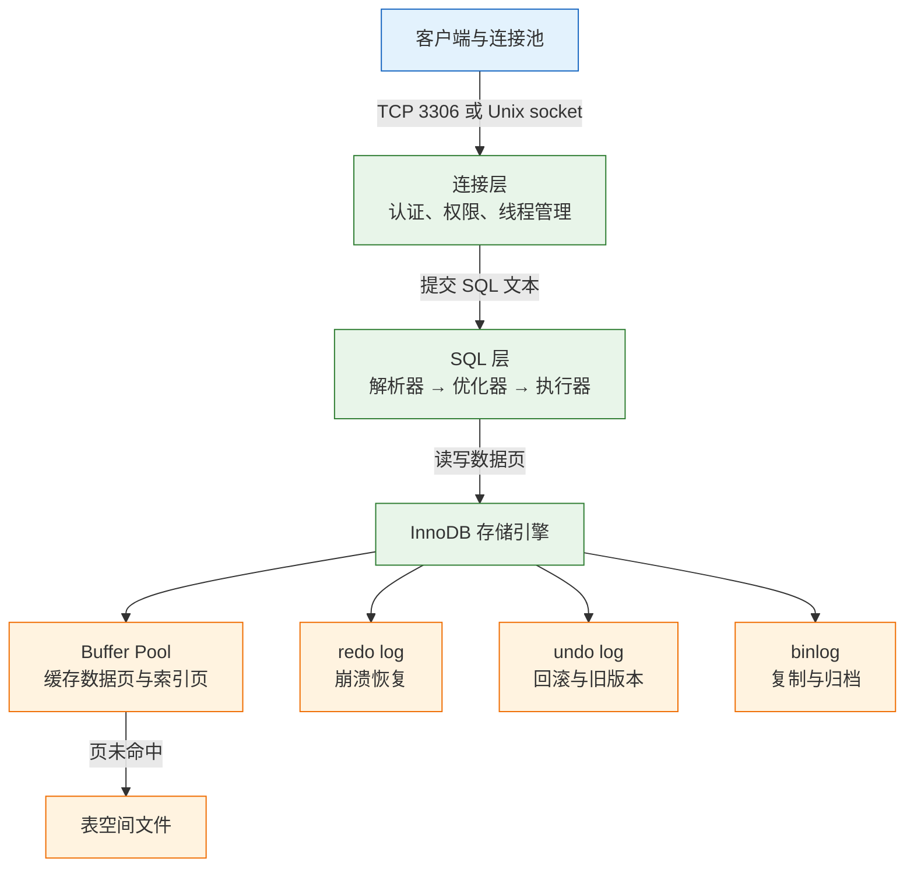
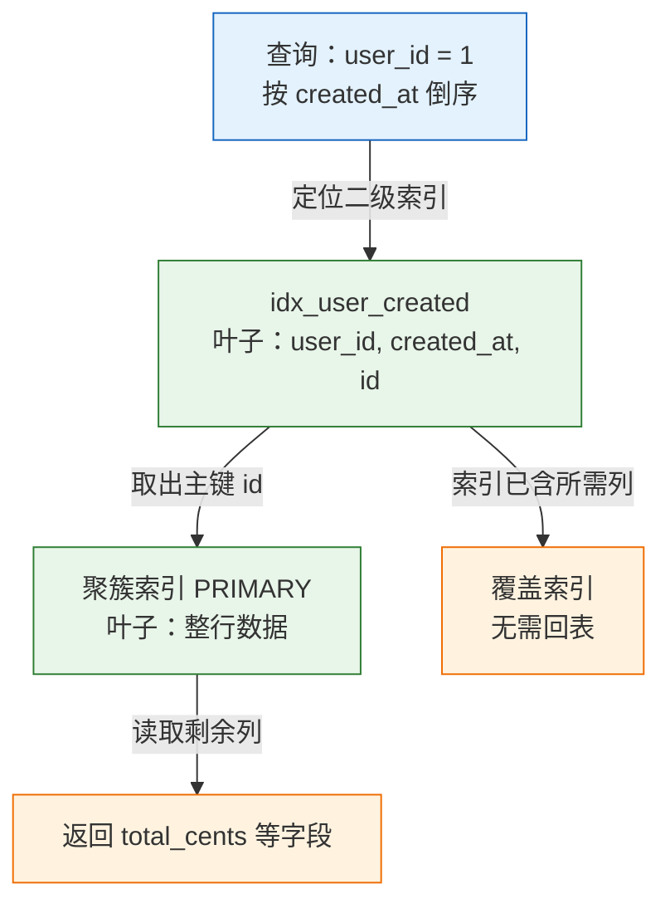
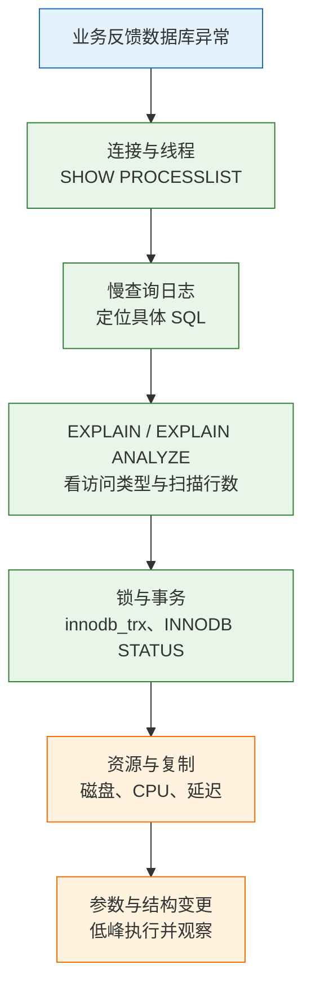

# MySQL

---

## 一、MySQL 是什么

MySQL 是使用最广的开源关系型数据库之一，长期占据 Web 业务主库的位置。它的难点不在会写 `SELECT`，而在知道一条 SQL 会走哪棵索引、拿什么锁、留下多少 undo。慢查询、死锁、复制延迟，都是这三件事的外在表现。

从研发与运维视角看，MySQL 承担四项职责：把业务数据持久化到进程之外；用事务保证一组写入的原子性与隔离性；用索引把“找一行”从扫描全表变成走几层树；用日志与复制完成崩溃恢复和多副本。它不负责跨多个独立数据库的强一致事务、亿级数据的列式聚合、复杂全文相关性排序，这些分别交给分布式事务框架、ClickHouse 或 Spark、Elasticsearch 或 OpenSearch。

本文按“是什么、怎么装、怎么设计、怎么查、怎么保证一致、怎么恢复、完整演练、怎么排障”的顺序展开，命令可以直接复制，关键判断给出依据。

作为关系型数据库管理系统，它以表、行、列组织数据，用 SQL 访问，默认存储引擎为 InnoDB。业务系统选它，通常是因为读写混合的在线事务处理场景成熟、生态完整、运维资料充足，而不是因为它能覆盖所有数据形态。

### 1.1 核心概念

| 概念 | 本质 | 常见操作 |
|---|---|---|
| 实例 | 一个 `mysqld` 进程及其内存、日志、表空间 | 启动、停止、改参数 |
| 数据库 | 表、视图、权限的命名空间 | `CREATE DATABASE` |
| 表 | 行与列的集合，InnoDB 按主键聚簇存放 | `CREATE TABLE` |
| 索引 | 加速定位的辅助结构，InnoDB 为 B+ 树 | `CREATE INDEX` |
| 事务 | 一组要么全成、要么全不成的语句 | `BEGIN`、`COMMIT` |
| 日志 | redo、undo、binlog 三类，职责不同 | 恢复、回滚、复制 |

一个实例可以承载多个数据库，一个数据库包含多张表，表的数据与索引最终落在表空间文件里。理解这个层次很重要：连接数、Buffer Pool、redo 容量是实例级资源，字符集、排序规则、索引是库表级对象，两者的调优手段完全不同。

InnoDB 与 MyISAM 的差别不只是“支持事务”。InnoDB 使用聚簇索引、行级锁、MVCC 和崩溃恢复，写入时维护 redo 与 undo；MyISAM 只有表级锁，崩溃后可能长时间修复。新系统没有理由再选 MyISAM，存量表迁移前要先确认全文索引、计数方式等差异。

事务的隔离性由 MVCC 与锁共同实现。每行记录带有隐藏的事务 ID 和回滚指针，普通查询沿 undo 链构造可见版本，写操作则对索引记录加锁。后面第五节会把这条链路拆开。

### 1.2 与相邻技术的关系

| 技术 | 数据模型 | 强项 | 典型场景 |
|---|---|---|---|
| MySQL | 关系表 | 在线事务、生态成熟、复制简单 | Web 业务主库 |
| PostgreSQL | 关系表加扩展类型 | 复杂查询、约束、JSONB、地理 | 强一致业务、混合模型 |
| SQLite | 单文件关系库 | 零运维、嵌入式 | 本地工具、边缘应用 |
| ClickHouse | 列式存储 | 大宽表聚合、压缩比高 | 日志与指标分析 |
| Redis | 内存键值 | 亚毫秒读写、丰富结构 | 缓存、会话、队列 |

MySQL 与 PostgreSQL 的差异经常被简化成“快与慢”，实际差别在取舍：MySQL 的复制与在线变更工具链更成熟，单条主键查询路径短；PostgreSQL 的类型系统、约束能力和复杂查询优化更强，DDL 可以放进事务。选型应看访问模式、一致性要求和团队经验，而不是看排行榜。

### 1.3 架构组成



- **连接层**：负责握手、认证、权限校验和线程分配。MySQL 采用每连接一个线程，连接数过高会带来线程切换与内存开销。
- **SQL 层**：解析 SQL、做语义检查、由优化器选择索引与连接顺序，再交给执行器调用存储引擎。
- **存储引擎**：插件式设计，InnoDB 是默认引擎，支持事务、行锁、外键和崩溃恢复。MyISAM 不支持事务，新项目不应再用。
- **内存与日志**：Buffer Pool 决定读性能；redo 保证已提交事务不丢；undo 支撑回滚与 MVCC；binlog 服务复制与数据恢复。

连接层之前通常还有应用侧连接池。池化减少握手与认证开销，但会把“连接数”从数据库问题变成应用配置问题：池上限之和超过 `max_connections`，高峰期必然出现拒绝连接。容量规划要按实例总连接数倒推每个应用的池上限，而不是各应用分别拍一个数字。

> **运维提示**：`innodb_buffer_pool_size` 通常设为可用内存的 50%–70%，剩余内存留给连接、排序和操作系统。该参数在 8.0 起支持在线调整，但扩容过程仍会占用资源，低峰执行更稳。

---

## 二、安装与连接

> **版本现状（2026-10）**：MySQL 8.4 是当前长期支持版本，InnoDB 为默认引擎。8.4 起 `mysql_native_password` 默认禁用，新账号使用 `caching_sha2_password`；旧客户端连接报错多与此有关。8.0 系列逐步退出主流支持，9.x 属于创新版本，生产环境优先选择 LTS。

### 2.1 版本选择与安装

| 系列 | 定位 | 建议 |
|---|---|---|
| 8.4 LTS | 长期支持，补丁周期长 | 新项目首选 |
| 8.0 | 旧稳定系列 | 按支持周期评估，规划升级 |
| 9.x 创新版 | 新特性验证 | 不优先用于核心生产 |

Debian 与 Ubuntu 通过官方仓库安装，避免发行版自带版本过旧：

```bash
# ========== 安装 MySQL 8.4（Debian / Ubuntu） ==========
# 从 dev.mysql.com 下载 mysql-apt-config 包后执行，交互界面选择 8.4 LTS
sudo dpkg -i ./mysql-apt-config_*.deb

# 更新索引并安装服务端
sudo apt update
sudo apt install -y mysql-server

# 启动并设置开机自启
sudo systemctl enable --now mysql

# ========== 验证 ==========
# 查看版本与默认端口
mysql --version
sudo ss -lntp | grep 3306

# 查看服务状态与错误日志位置
sudo systemctl status mysql
sudo journalctl -u mysql -n 50 --no-pager
```

RHEL 系使用 `dnf install -y mysql-community-server`，仓库配置方式以官网当前说明为准。安装完成后必须执行 `mysql_secure_installation` 设置 root 密码、删除匿名账号、禁止 root 远程登录，这三项是基线。

### 2.2 容器化启动

开发和验证环境用容器更快，注意数据卷必须命名，否则容器删除即丢库。

```bash
# ========== 启动 MySQL 8.4 容器 ==========
docker run -d --name mysql84 \
  -e MYSQL_ROOT_PASSWORD='change-me' \
  -e MYSQL_DATABASE=shop \
  -e TZ=Asia/Shanghai \
  -p 3306:3306 \
  -v mysql84-data:/var/lib/mysql \
  mysql:8.4

# 等待日志出现 ready for connections
docker logs -f mysql84

# ========== 进入容器执行客户端 ==========
docker exec -it mysql84 mysql -uroot -p
```

| 环境变量 | 作用 | 注意 |
|---|---|---|
| `MYSQL_ROOT_PASSWORD` | 设置 root 密码 | 必填，不要写进镜像 |
| `MYSQL_DATABASE` | 初始化时创建库 | 仅首次启动生效 |
| `MYSQL_USER` / `MYSQL_PASSWORD` | 创建普通账号 | 不要用它替代业务账号规划 |
| `TZ` | 容器时区 | 与应用、备份策略保持一致 |

> **注意**：初始化只在数据目录为空时执行。改了 `MYSQL_DATABASE` 后重启不会补建新库，需要手工执行 `CREATE DATABASE`，或删除卷后重新初始化。

### 2.3 连接与认证

```bash
# ========== 本地连接 ==========
# 默认走 Unix socket，root 使用 auth_socket 时无需密码
mysql -uroot -p

# 指定主机、端口、库
mysql -h 127.0.0.1 -P 3306 -uapp_rw -p shop

# 执行单条语句后退出，适合脚本
mysql -h 127.0.0.1 -uapp_rw -p -N -e "SELECT VERSION();" shop
```

```sql
-- ========== 创建业务账号 ==========
CREATE USER 'app_rw'@'10.0.%' IDENTIFIED BY 'change-me';

-- 只授予业务库的增删改查权限，不用 ALL PRIVILEGES
GRANT SELECT, INSERT, UPDATE, DELETE ON shop.* TO 'app_rw'@'10.0.%';

-- 需要执行迁移时单独授权，不要长期保留
GRANT CREATE, ALTER, INDEX, DROP ON shop.* TO 'app_rw'@'10.0.%';

SHOW GRANTS FOR 'app_rw'@'10.0.%';
```

| 认证插件 | 传输方式 | 适用 |
|---|---|---|
| `caching_sha2_password` | TLS 或 RSA 公钥交换 | 8.4 默认，推荐 |
| `mysql_native_password` | 挑战应答，强度较低 | 仅兼容旧客户端，需显式启用 |
| `auth_socket` | 本机 socket 与系统用户绑定 | 本机管理账号 |

8.4 上老客户端报 `ERROR 2059 (HY000): Authentication plugin 'caching_sha2_password' cannot be loaded`，原因不是密码错，而是客户端不支持新插件。处理顺序是升级驱动、启用 TLS 或加 `--get-server-public-key`，最后才考虑退回旧插件。

> **安全警告**：业务账号不要使用 `%` 作为主机通配，也不要授予 `GRANT OPTION`。数据库账号应按应用和网段划分，一个应用一套凭据，泄露时才能单独吊销。

### 2.4 配置文件与关键参数

配置文件通常位于 `/etc/mysql/my.cnf` 或 `/etc/my.cnf`，包含 `[mysqld]`、`[client]` 等段落。改完必须重启或按参数是否动态生效决定加载方式。

```ini
[mysqld]
# ========== 基础路径 ==========
datadir = /var/lib/mysql
socket = /var/run/mysqld/mysqld.sock

# ========== 字符集 ==========
character-set-server = utf8mb4
collation-server = utf8mb4_0900_ai_ci

# ========== 内存与日志 ==========
innodb_buffer_pool_size = 4G
innodb_redo_log_capacity = 1G
innodb_flush_log_at_trx_commit = 1
sync_binlog = 1

# ========== 慢查询 ==========
slow_query_log = ON
long_query_time = 0.2
log_output = FILE

# ========== 连接 ==========
max_connections = 500
wait_timeout = 600
```

| 参数 | 默认值 | 作用 |
|---|---|---|
| `innodb_buffer_pool_size` | 128MB | 缓存数据页与索引页，读性能核心 |
| `innodb_redo_log_capacity` | 100MB | redo 总容量，8.0.30 起替代旧参数 |
| `innodb_flush_log_at_trx_commit` | 1 | 每次提交刷 redo，最安全 |
| `sync_binlog` | 1 | 每次提交刷 binlog，最安全 |
| `max_connections` | 151 | 最大连接数 |
| `wait_timeout` | 28800 | 空闲非交互连接超时秒数 |
| `long_query_time` | 10 | 慢查询阈值秒数 |

参数分动态与静态两类：`innodb_buffer_pool_size`、`max_connections`、`long_query_time` 可以在线修改，`innodb_page_size`、`datadir` 等只能改配置文件后重启。在线修改只影响新会话或后续行为，排查时要确认当前会话取到的值，用 `SHOW GLOBAL VARIABLES` 与 `SHOW SESSION VARIABLES` 对照。

> **注意**：`innodb_buffer_pool_size`、`innodb_redo_log_capacity` 的修改要结合实例规格与磁盘空间核算，不能照抄。连接池的 `maxLifetime` 必须小于 `wait_timeout`，否则会取到服务端已关闭的连接。

---

## 三、数据类型与表设计

表设计决定后续索引能否生效、存储是否膨胀。原则是：类型够用即可、金额不用浮点、时间语义明确、主键短而有序。

### 3.1 数值类型

| 类型 | 存储 | 适用 |
|---|---|---|
| `TINYINT` | 1 字节 | 状态、布尔标记 |
| `SMALLINT` | 2 字节 | 小范围计数 |
| `INT` | 4 字节 | 常规整数 ID |
| `BIGINT` | 8 字节 | 大表主键、金额分 |
| `DECIMAL(p,s)` | 变长 | 精确金额、比率 |
| `FLOAT` / `DOUBLE` | 4 / 8 字节 | 科学计算，不用于金额 |

金额用 `DECIMAL(12,2)` 或整数分存储。`FLOAT` 与 `DOUBLE` 是二进制浮点，`0.1 + 0.2` 不等于 `0.3`，对账时会出现分差。整数分的好处是运算快、范围清晰，代价是展示层要除以 100。

`DECIMAL` 的精度包含整数位和小数位，`DECIMAL(12,2)` 最多存 10 位整数。汇率、税率这类需要更多小数位的场景要单独放大 `s`，但不要用“统一保留 6 位”掩盖业务精度定义不清的问题。

自增主键用 `BIGINT UNSIGNED`，避免几年后 `INT` 溢出。`UNSIGNED` 只扩大正数范围，不改变索引行为，但与应用层的无符号类型要匹配。

### 3.2 字符串与时间类型

| 类型 | 特点 | 适用 |
|---|---|---|
| `CHAR(n)` | 定长，右侧补空格 | 固定长度编码 |
| `VARCHAR(n)` | 变长，长度前缀 | 名称、标题、状态 |
| `TEXT` | 页外存储，不能整列索引 | 正文、备注 |
| `DATE` | 仅日期 | 生日、账期 |
| `DATETIME` | 日期时间，不做时区转换 | 业务本地时间 |
| `TIMESTAMP` | UTC 存储，按会话时区转换 | 创建、更新时间 |
| `JSON` | 二进制 JSON，可路径查询 | 稀疏扩展字段 |

`TIMESTAMP` 的范围受 32 位限制，到 2038 年溢出；`DATETIME` 范围更大但不带时区。跨时区业务统一用 `TIMESTAMP` 或存 UTC 的 `DATETIME`，不要一半用一个。时间字段建议带精度，如 `DATETIME(3)`，否则毫秒会被截断，排序出现同秒并列。

`VARCHAR` 长度不是越大越好：排序、临时表、内存计算会按最大长度分配。`utf8mb4` 下 `VARCHAR(255)` 最多占 1020 字节，参与排序时可能超过 `tmp_table_size` 而落盘。

### 3.3 字符集与排序规则

| 排序规则 | 大小写 | 重音 | 适用 |
|---|---|---|---|
| `utf8mb4_0900_ai_ci` | 不敏感 | 不敏感 | 大多数业务 |
| `utf8mb4_0900_as_cs` | 敏感 | 敏感 | Token、大小写唯一键 |
| `utf8mb4_general_ci` | 不敏感 | 不敏感 | 老库兼容 |
| `utf8mb4_bin` | 按字节比较 | 敏感 | 精确匹配 |

```sql
-- ========== 建库时固定字符集 ==========
CREATE DATABASE IF NOT EXISTS shop
  CHARACTER SET utf8mb4
  COLLATE utf8mb4_0900_ai_ci;

-- ========== 建表时显式声明 ==========
CREATE TABLE demo (
  id BIGINT UNSIGNED NOT NULL AUTO_INCREMENT,
  name VARCHAR(64) NOT NULL,
  PRIMARY KEY (id)
) ENGINE=InnoDB DEFAULT CHARSET=utf8mb4 COLLATE=utf8mb4_0900_ai_ci;
```

`utf8` 是旧的三字节字符集，不能存 emoji 和部分生僻字，新项目一律用 `utf8mb4`。跨表连接时两边排序规则不一致，会让索引失效并触发隐式转换，建库阶段统一可以省掉大量排查。

> **注意**：`ALTER TABLE ... CONVERT TO CHARACTER SET utf8mb4` 会重建表并复制数据，大表执行时间长、占用磁盘翻倍。先在与生产同规格的副本上计时，再安排低峰窗口和回滚方案。

### 3.4 主键与约束设计

```sql
-- ========== 订单主表 ==========
CREATE TABLE orders (
  id BIGINT UNSIGNED NOT NULL AUTO_INCREMENT,
  user_id BIGINT UNSIGNED NOT NULL,
  status VARCHAR(16) NOT NULL,
  total_cents INT UNSIGNED NOT NULL,
  created_at DATETIME(3) NOT NULL DEFAULT CURRENT_TIMESTAMP(3),
  updated_at DATETIME(3) NOT NULL DEFAULT CURRENT_TIMESTAMP(3)
    ON UPDATE CURRENT_TIMESTAMP(3),
  PRIMARY KEY (id),
  KEY idx_status_created (status, created_at)
) ENGINE=InnoDB DEFAULT CHARSET=utf8mb4 COLLATE=utf8mb4_0900_ai_ci;

-- ========== 订单明细 ==========
CREATE TABLE order_items (
  id BIGINT UNSIGNED NOT NULL AUTO_INCREMENT,
  order_id BIGINT UNSIGNED NOT NULL,
  sku_id BIGINT UNSIGNED NOT NULL,
  qty INT UNSIGNED NOT NULL,
  price_cents INT UNSIGNED NOT NULL,
  PRIMARY KEY (id),
  KEY idx_order (order_id),
  CONSTRAINT fk_items_order FOREIGN KEY (order_id) REFERENCES orders (id)
) ENGINE=InnoDB;
```

| 约束 | 作用 | 代价 |
|---|---|---|
| `PRIMARY KEY` | 唯一且非空，决定聚簇顺序 | 主键过长会放大所有二级索引 |
| `UNIQUE` | 业务唯一性，可含多列 | 写入时多一次索引维护 |
| `FOREIGN KEY` | 引用完整性 | 高并发写入下增加锁与检查开销 |
| `NOT NULL` | 避免三值逻辑 | 需要业务提供默认值 |
| `CHECK` | 值域校验，8.0.16 起真正生效 | 复杂表达式增加写入 CPU |

主键用自增整数，插入集中在 B+ 树最右侧，页利用率高。随机 UUID 作为主键会导致随机插入、页分裂和更大的二级索引；如果业务需要对外不可枚举的 ID，用独立列存 UUID 并加唯一索引，主键仍保持自增。

---

## 四、索引与执行计划

索引是 MySQL 性能的第一杠杆，也是最容易被滥用的对象。理解 B+ 树结构，才能判断一条 SQL 为什么走索引、为什么回表、为什么排序仍然落盘。

### 4.1 B+ 树与聚簇索引

InnoDB 的主键索引是聚簇索引，叶子节点直接存放整行数据；二级索引的叶子存放“索引列 + 主键值”。因此按二级索引查非索引列，必须拿主键再查一次聚簇索引，这就是回表。



B+ 树的每个节点是一个页，默认 16KB。非叶子节点只存键和页号，所以三层树可以容纳千万级记录。页内记录按主键有序，页满时分裂成两页；随机主键会让分裂分散在整个树中，自增主键只在最右侧分裂。

由此得到三条硬规则：主键要短，因为每个二级索引都复制主键；主键要有序，避免页分裂；二级索引不要盲目建，写放大与 Buffer Pool 占用都是真实成本。

### 4.2 联合索引与最左前缀

联合索引 `(a, b, c)` 按 `a`、再按 `b`、再按 `c` 排序。它能服务以 `a` 开头的任意前缀，不能直接服务从 `b` 或 `c` 开始的查询。

| 查询条件 | 能否用 `(a,b,c)` | 说明 |
|---|---|---|
| `a = 1` | 能 | 使用第一列 |
| `a = 1 AND b = 2` | 能 | 使用前两列 |
| `a = 1 AND b = 2 AND c = 3` | 能 | 三列全用 |
| `b = 2` | 不能 | 缺少最左列 |
| `a = 1 AND c = 3` | 部分 | `c` 只能靠索引条件下推过滤 |
| `a > 1 AND b = 2` | 部分 | 范围列之后无法继续定位 |

```sql
-- ========== 等值在前，排序在后 ==========
ALTER TABLE orders ADD INDEX idx_user_created (user_id, created_at);

-- 同时服务过滤与排序，避免额外 filesort
EXPLAIN SELECT id, total_cents
FROM orders
WHERE user_id = 42
ORDER BY created_at DESC
LIMIT 20;

-- ========== 范围条件会截断后续列 ==========
-- created_at 用了范围，status 无法继续用于定位
EXPLAIN SELECT id FROM orders
WHERE user_id = 42
  AND created_at >= '2026-10-01'
  AND status = 'paid';
```

列顺序的判断依据是查询形状，不是区分度。所有查询都带 `tenant_id` 时，它应放在第一列；如果有一半查询不带，则要为另一半单独建索引。等值条件放前、范围和排序放后，是联合索引最稳妥的默认规则。

当查询分别命中两个索引、优化器又判断合并更便宜时，会出现 `index_merge`。它通常意味着缺少一个更合适的联合索引，而不是优化器变聪明了；频繁出现时应检查查询条件与索引覆盖是否错位。

### 4.3 覆盖索引与索引条件下推

查询所需列全部在索引中时，不需要回表，`EXPLAIN` 的 `Extra` 显示 `Using index`。覆盖索引能把随机读变成顺序读，是订单列表、消息列表这类分页查询最有效的手段。

```sql
-- ========== 覆盖索引 ==========
ALTER TABLE orders
  ADD INDEX idx_user_created_cover (user_id, created_at, total_cents);

EXPLAIN SELECT id, total_cents
FROM orders
WHERE user_id = 42
ORDER BY created_at DESC
LIMIT 20;
-- Extra: Using where; Using index

-- ========== 索引条件下推 ==========
-- status 不在索引中时，5.6 起可在存储引擎层先过滤，减少回表
EXPLAIN SELECT id FROM orders
WHERE user_id = 42 AND status = 'paid';
-- Extra 可能出现 Using index condition
```

索引条件下推（ICP）只减少回表次数，不改变索引能定位的范围。看到 `Using index condition` 说明部分过滤在引擎层完成，但 `rows` 仍可能很大，不能把它当成“索引已经最优”的证据。

覆盖索引会让索引变宽，写入成本和 Buffer Pool 占用同步上升。把 `SELECT *` 改成明确列，再决定是否追加覆盖列，比一上来就建大索引更稳。

### 4.4 执行计划解读

`EXPLAIN` 展示优化器的估算，不执行 SQL。重点看访问类型、实际使用的索引、估算行数、过滤比例和额外动作。

| 列 | 含义 | 关注点 |
|---|---|---|
| `type` | 访问类型 | `ALL` 全表扫，`ref` 等值索引，`range` 范围 |
| `key` | 实际选择的索引 | 为空说明没走索引 |
| `rows` | 估算扫描行数 | 与结果集差距过大要警惕 |
| `filtered` | 过滤后剩余比例 | 很低说明大量行被浪费 |
| `Extra` | 额外动作 | `Using filesort`、`Using temporary` 是重点 |

`type` 从好到差大致为 `system > const > eq_ref > ref > range > index > ALL`。看到 `ALL` 不一定是错：几十行的小表全扫比走索引更快。真正需要处理的是 `rows` 很大、`filtered` 很低、又伴随 `Using filesort` 或 `Using temporary` 的查询。

```sql
-- ========== 估算计划 ==========
EXPLAIN SELECT id, total_cents
FROM orders
WHERE user_id = 1
ORDER BY created_at DESC
LIMIT 10;

-- ========== 真实执行（8.0.18 起） ==========
EXPLAIN ANALYZE
SELECT id, total_cents
FROM orders
WHERE user_id = 1
ORDER BY created_at DESC
LIMIT 10;
```

`EXPLAIN ANALYZE` 输出 `actual time=... rows=... loops=...`，可以和估算值逐节点对比。估算 1000 行、实际 1 行，通常是统计信息过期，先执行 `ANALYZE TABLE orders;`；如果某列分布极不均匀，再考虑直方图 `ANALYZE TABLE orders UPDATE HISTOGRAM ON status;`。

### 4.5 索引设计取舍

- 每个二级索引都复制主键，主键越长，所有索引越大。
- 联合索引已经覆盖前缀查询时，单独的前缀索引是冗余的，应删除。
- 低基数列单独建索引收益有限，除非某个值极少且查询专门找它。
- 函数、表达式、隐式类型转换会让索引失效，条件要改写成对列本身的范围比较。
- 索引不是越多越好，写入、更新、删除都要维护全部索引。

```sql
-- ========== 找出未使用的索引（8.0 起） ==========
SELECT object_schema, object_name, index_name
FROM performance_schema.table_io_waits_summary_by_index_usage
WHERE index_name IS NOT NULL
  AND count_star = 0
  AND object_schema = 'shop';

-- ========== 先隐藏，观察一段时间再删除 ==========
ALTER TABLE orders ALTER INDEX idx_status INVISIBLE;
-- 确认无影响后
ALTER TABLE orders DROP INDEX idx_status;
```

> **注意**：`performance_schema` 的统计从实例启动开始累计，重启后清零。刚启动就查“未使用索引”会把所有索引都列出来，至少观察一个完整业务周期再判断。

---

## 五、事务与锁

事务保证一组写入的原子性，锁保证并发写入不互相破坏，MVCC 让读不阻塞写。三者共同决定隔离级别和数据一致性。

### 5.1 隔离级别与 MVCC

| 级别 | 脏读 | 不可重复读 / 幻读 | InnoDB 实现 |
|---|---|---|---|
| `READ UNCOMMITTED` | 可能 | 可能 / 可能 | 直接读最新版本 |
| `READ COMMITTED` | 否 | 可能 / 可能 | 每条语句新建 Read View |
| `REPEATABLE READ` | 否 | 否 / 大部分避免 | 事务内复用 Read View 加间隙锁 |
| `SERIALIZABLE` | 否 | 否 / 否 | 读也加锁 |

InnoDB 默认 `REPEATABLE READ`。普通 `SELECT` 是快照读，不加锁，沿 undo 链找事务开始时可见的版本；`SELECT ... FOR UPDATE`、`UPDATE`、`DELETE` 是当前读，读取最新版本并加锁。

因此会出现两种看似矛盾的行为：事务 A 在 RR 下重复查询看不到事务 B 刚提交的数据，这是快照一致性，不是缓存；而事务 A 执行 `UPDATE` 时又能看到 B 的最新值并据此加锁，这是当前读。理解“快照读与当前读”的分界，才能解释很多“读不到自己刚改的数据”的疑问。

```sql
-- ========== 查看与设置隔离级别 ==========
SELECT @@transaction_isolation;
SET SESSION transaction_isolation = 'READ-COMMITTED';

-- ========== 快照读与当前读 ==========
BEGIN;
SELECT total_cents FROM orders WHERE id = 1;          -- 快照读
SELECT total_cents FROM orders WHERE id = 1 FOR UPDATE; -- 当前读并加锁
COMMIT;
```

### 5.2 日志与两阶段提交

一次提交涉及三类日志：redo 记录页的物理修改，undo 记录旧值用于回滚和 MVCC，binlog 记录逻辑变更用于复制与归档。redo 与 binlog 必须一致，否则主库与从库会出现数据分叉。

提交顺序大致是：修改 Buffer Pool 中的数据页并写 undo；写 redo 并进入 prepare；写 binlog 并刷盘；redo 进入 commit。崩溃发生在 binlog 写完之前，事务回滚；发生在 binlog 写完之后，事务按 redo 前滚。这就是两阶段提交的作用。

| 参数 | 值 | 行为 | 风险 |
|---|---|---|---|
| `innodb_flush_log_at_trx_commit` | `1` | 每次提交刷 redo | 最安全，性能最低 |
| | `2` | 写操作系统缓存，每秒刷 | 主机断电可能丢约 1 秒 |
| | `0` | 后台每秒刷 | 崩溃可能丢约 1 秒 |
| `sync_binlog` | `1` | 每次提交刷 binlog | 最安全 |
| | `0` | 交给操作系统 | 崩溃可能丢 |

金融类业务通常用 `1/1`；普通业务若改成 `1/0` 或 `2/1`，必须先明确可接受的丢失窗口，再做压测。只看到 QPS 上升就改参数，等于用数据安全换吞吐。

### 5.3 行锁与间隙锁

| 锁类型 | 锁定对象 | 触发场景 |
|---|---|---|
| 记录锁 | 单条索引记录 | 唯一索引等值命中 |
| 间隙锁 | 两条记录之间的区间 | RR 下范围查询或唯一索引未命中 |
| 临键锁 | 记录加前面的间隙 | RR 下范围扫描的默认形式 |
| 插入意向锁 | 插入位置 | `INSERT` 等待间隙释放 |
| 表级意向锁 | 表 | 行锁操作自动附加，不需手工加 |

```sql
-- ========== 唯一索引等值命中：只锁一行 ==========
BEGIN;
UPDATE orders SET status = 'paid' WHERE id = 100;
COMMIT;

-- ========== 范围条件：RR 下锁住区间，阻止插入 ==========
BEGIN;
SELECT id FROM orders
WHERE id > 100 AND id < 200
FOR UPDATE;
COMMIT;
```

RR 下的间隙锁能防幻读，也容易与插入互相阻塞。RC 级别间隙锁更少，但同一事务内两次读可能不一致。隔离级别应按业务一致性要求选择，不能为了“少死锁”盲目全局改成 RC。

唯一索引等值命中且记录存在时，临键锁会退化为记录锁；记录不存在时仍会锁住相邻间隙。这个差异解释了“同样的 SQL，有的只锁一行，有的却阻塞插入”。分析锁冲突时必须带上索引条件与记录是否存在，不能只看 SQL 文本。

> **运维红线**：生产环境禁止执行 `LOCK TABLES ... WRITE` 和 `FLUSH TABLES WITH READ LOCK` 做“临时备份”。前者会让所有写入排队，后者会让整个实例只读；连接池迅速打满后，故障会从数据库扩散到全部应用。

### 5.4 死锁分析与处理

死锁是两个事务各自持有对方需要的锁，形成环路。InnoDB 会主动回滚代价较小的一方，报 `ERROR 1213`；等锁超时则报 `ERROR 1205`。

```sql
-- ========== 会话 1 ==========
BEGIN;
UPDATE orders SET total_cents = 100 WHERE id = 1;

-- ========== 会话 2 ==========
BEGIN;
UPDATE orders SET total_cents = 200 WHERE id = 2;
UPDATE orders SET total_cents = 200 WHERE id = 1;  -- 等待会话 1

-- ========== 回到会话 1 ==========
UPDATE orders SET total_cents = 100 WHERE id = 2;  -- 触发死锁
```

```sql
-- ========== 查看最近一次死锁 ==========
SHOW ENGINE INNODB STATUS\G

-- ========== 查看当前事务与等待 ==========
SELECT trx_id, trx_state, trx_started, trx_mysql_thread_id, trx_query
FROM information_schema.innodb_trx
ORDER BY trx_started;

SELECT * FROM performance_schema.data_lock_waits;
```

| 现象 | 错误码 | 含义 | 处理 |
|---|---|---|---|
| 等锁超时 | `1205` | 锁被其他事务持有超过阈值 | 找阻塞源，缩短事务 |
| 死锁回滚 | `1213` | 检测到循环等待 | 统一加锁顺序，应用重试 |
| 元数据锁等待 | `1205` | DDL 与长查询互相阻塞 | 查 `performance_schema.metadata_locks` |

等锁的默认上限由 `innodb_lock_wait_timeout` 控制，默认 50 秒。处理顺序是统一加锁顺序、缩短事务、减少一次事务更新的行数。重试只能兜底，不能消除根因。批量更新按主键升序执行，事务里不要等待外部 HTTP 调用，这两条能消掉大部分死锁。

### 5.5 大事务的代价与控制

| 影响面 | 表现 | 控制手段 |
|---|---|---|
| undo | 回滚慢、空间膨胀 | 分批提交 |
| redo 与 binlog | 提交刷盘集中 | 控制批量大小 |
| 锁 | 行锁与间隙锁持有久 | 缩短事务 |
| 复制 | 从库回放延迟跳升 | 拆小事务、并行复制 |

一次更新 100 万行会同时产生大量 undo、redo 和 binlog，行锁持有时间长，从库回放时延迟可能跳几分钟。拆成每批 1000–5000 行循环提交，批间短暂 sleep；删除历史数据用 `DELETE ... LIMIT 1000` 循环，而不是一条语句删几千万行。

```sql
-- ========== 分批删除 ==========
DELETE FROM orders
WHERE created_at < '2025-01-01'
ORDER BY id
LIMIT 1000;
-- 受影响行数为 1000 时继续，直到为 0
```

---

## 六、备份与恢复

备份的目标不是“有一份文件”，而是在约定时间内恢复出可用数据。先定义 RPO（能丢多少）与 RTO（多久恢复），再选择备份方式。

### 6.1 备份类型与策略

| 类型 | 工具 | 优点 | 局限 |
|---|---|---|---|
| 逻辑备份 | `mysqldump` | 跨版本、可读、单表恢复 | 大库慢，恢复耗时长 |
| 物理备份 | XtraBackup | 快，支持增量 | 版本与平台受限 |
| 全量备份 | 上述两者 | 恢复链路简单 | 占用空间大 |
| 增量备份 | binlog、XtraBackup | 频率高、体积小 | 依赖基线，恢复步骤多 |

生产常用组合是“每周全量物理备份 + 每日增量 + binlog 持续归档”。只做每日逻辑备份，RPO 就是 24 小时；要分钟级 RPO，必须保留 binlog 并支持按时间点恢复。binlog 的保留时长由 `binlog_expire_logs_seconds` 控制，默认 30 天，磁盘容量与恢复窗口要一起核算。

### 6.2 逻辑备份与恢复

```bash
# ========== 全库备份（不含 CREATE DATABASE） ==========
# 密码从环境变量读取，避免写入 shell 历史
docker exec mysql84 sh -c 'mysqldump -uroot -p"$MYSQL_ROOT_PASSWORD" \
  --single-transaction --routines --triggers --events \
  --set-gtid-purged=OFF shop' > shop.sql

# ========== 单表备份 ==========
docker exec mysql84 sh -c 'mysqldump -uroot -p"$MYSQL_ROOT_PASSWORD" \
  --single-transaction shop orders' > orders.sql

# ========== 恢复到新库 ==========
docker exec -i mysql84 sh -c 'mysql -uroot -p"$MYSQL_ROOT_PASSWORD" \
  -e "CREATE DATABASE IF NOT EXISTS shop_restore"'
docker exec -i mysql84 sh -c 'mysql -uroot -p"$MYSQL_ROOT_PASSWORD" shop_restore' < shop.sql
```

`--single-transaction` 在 InnoDB 上开启一致性快照，不锁表，但备份期间不能执行 DDL，否则快照与表结构可能不一致。`--routines`、`--triggers`、`--events` 用来带上存储过程、触发器和事件，漏掉会导致恢复后功能缺失。

> **注意**：`mysqldump` 默认不加 `--databases` 时，备份文件里没有 `CREATE DATABASE` 和 `USE`，恢复前必须先建库并指定目标库，否则会报“No database selected”。

### 6.3 物理备份与增量

```bash
# ========== 全量物理备份 ==========
xtrabackup --backup \
  --target-dir=/backup/mysql/full \
  --user=backup --password='change-me'

# 准备备份，使数据文件一致可恢复
xtrabackup --prepare --target-dir=/backup/mysql/full

# ========== 增量备份 ==========
xtrabackup --backup \
  --target-dir=/backup/mysql/inc1 \
  --incremental-basedir=/backup/mysql/full \
  --user=backup --password='change-me'

# ========== 恢复 ==========
# 停库后清空数据目录，再执行 copy-back
sudo systemctl stop mysql
xtrabackup --copy-back --target-dir=/backup/mysql/full
sudo chown -R mysql:mysql /var/lib/mysql
sudo systemctl start mysql
```

物理备份必须用同大版本的工具，跨版本恢复经常失败。增量恢复要先把增量按顺序应用到全量（`--apply-log-only`），最后统一 `--prepare`，再执行 `--copy-back`；只复制全量会丢掉增量数据。恢复前确认 `datadir` 为空或已完整备份，`--copy-back` 不会覆盖已有文件，残留旧文件会导致启动异常。

### 6.4 复制与延迟


```sql
-- ========== 8.0.22 起使用新命令 ==========
SHOW REPLICA STATUS\G

-- ========== 查看复制链路 ==========
SELECT * FROM performance_schema.replication_connection_status\G
SELECT * FROM performance_schema.replication_applier_status_by_worker\G
```

| 字段 | 含义 | 异常判断 |
|---|---|---|
| `Replica_IO_Running` | IO 线程是否在拉日志 | `No` 查网络、账号、主库 |
| `Replica_SQL_Running` | SQL 线程是否在回放 | `No` 查冲突、数据不一致 |
| `Seconds_Behind_Source` | 回放落后秒数 | 持续增大说明回放跟不上 |
| `Retrieved_Gtid_Set` | 已拉到的 GTID | 与主库对比 |
| `Executed_Gtid_Set` | 已执行的 GTID | 落后于 Retrieved 说明回放慢 |

`Seconds_Behind_Source` 为 0 不一定没有延迟：主库长时间无写入时它也是 0，大事务执行期间也可能短暂显示 0。可靠做法是对比 GTID 集合，或在业务表写入心跳时间并定时检查。

生产建议开启 GTID，让故障切换后从库知道从哪里继续：

```ini
# ========== 主从都要配置，需重启生效 ==========
gtid_mode = ON
enforce_gtid_consistency = ON
```

读写分离要处理“写后读”的一致性：写事务提交后立刻读从库可能读不到新数据。解决方式是按业务标记走主库，或等待从库执行到指定 GTID。对一致性敏感的查询不要走从库。半同步复制能降低丢数据概率，但会增加提交延迟，也不保证绝不丢数据。

### 6.5 恢复演练与校验

| 指标 | 含义 | 验证方法 |
|---|---|---|
| RPO | 最多丢多少数据 | 备份频率与 binlog 保留时长 |
| RTO | 多久恢复服务 | 在隔离环境计时恢复 |
| 完整性 | 数据是否齐全 | 表数量、行数、校验和 |
| 可用性 | 应用能否启动 | 恢复后跑核心查询与写入 |

每次演练都在独立实例上做，不要在原库验证。恢复后核对关键表的行数、最大 ID、金额汇总，再让应用连接跑一遍核心链路。没有演练过的备份只能算“可能可用”。

需要恢复到某个时刻时，逻辑备份只能回到备份开始的时间点，之后的变化要靠 binlog 重放。先恢复全量，再用 `mysqlbinlog --start-datetime --stop-datetime` 截取区间重放，最后核对误操作前后的数据。binlog 必须与备份在同一时间基线，否则重放会重复或缺失。

> **运维红线**：禁止在未确认目标实例的情况下执行 `DROP DATABASE`、`TRUNCATE TABLE` 或 `--copy-back`。恢复前先确认连接串、实例标识和备份时间点，生产恢复必须两人复核。

---

## 七、完整示例：订单库

这一节在全新实例上执行，建库、造数、查询、优化、备份恢复，形成一条可复现的链路。前面的示例表与这里重名，不要在同一实例上直接续做。

### 7.1 建库与建表

```sql
-- ========== 建库 ==========
CREATE DATABASE IF NOT EXISTS shop
  CHARACTER SET utf8mb4
  COLLATE utf8mb4_0900_ai_ci;

USE shop;

-- ========== 订单表 ==========
CREATE TABLE orders (
  id BIGINT UNSIGNED NOT NULL AUTO_INCREMENT,
  user_id BIGINT UNSIGNED NOT NULL,
  status VARCHAR(16) NOT NULL,
  total_cents INT UNSIGNED NOT NULL,
  created_at DATETIME(3) NOT NULL DEFAULT CURRENT_TIMESTAMP(3),
  PRIMARY KEY (id),
  KEY idx_status_created (status, created_at)
) ENGINE=InnoDB DEFAULT CHARSET=utf8mb4 COLLATE=utf8mb4_0900_ai_ci;
```

初始只建 `(status, created_at)`，用来复现“查询走错索引”的场景。订单列表的真实条件是 `user_id` 加时间排序，这个索引并不匹配。

### 7.2 写入与查询验证

```sql
-- ========== 造 10 万行测试数据（MySQL 8.0+） ==========
SET SESSION cte_max_recursion_depth = 100000;

INSERT INTO orders (user_id, status, total_cents, created_at)
WITH RECURSIVE seq(n) AS (
  SELECT 1
  UNION ALL
  SELECT n + 1 FROM seq WHERE n < 100000
)
SELECT FLOOR(RAND() * 1000) + 1,
       ELT(1 + FLOOR(RAND() * 3), 'pending', 'paid', 'cancelled'),
       FLOOR(RAND() * 100000),
       NOW() - INTERVAL FLOOR(RAND() * 2592000) SECOND
FROM seq;

-- ========== 更新统计信息 ==========
ANALYZE TABLE orders;

-- ========== 验证数据分布 ==========
SELECT status, COUNT(*) AS cnt FROM orders GROUP BY status;
SELECT COUNT(*) FROM orders WHERE user_id = 42;
```

```sql
-- ========== 目标查询 ==========
EXPLAIN ANALYZE
SELECT id, total_cents
FROM orders
WHERE user_id = 42
ORDER BY created_at DESC
LIMIT 20;
```

预期看到 `type=ALL` 或走 `idx_status_created` 后大量回表，`rows` 接近全表，`Extra` 带 `Using filesort`。这不是统计信息问题，而是没有匹配“等值过滤加排序”的索引。

### 7.3 慢查询定位与索引优化

```sql
-- ========== 开启慢查询日志 ==========
SET GLOBAL slow_query_log = ON;
SET GLOBAL long_query_time = 0.2;
SET GLOBAL log_output = 'TABLE';

-- ========== 查看最近慢 SQL ==========
SELECT start_time, query_time, rows_examined, rows_sent,
       LEFT(sql_text, 120) AS sql_text
FROM mysql.slow_log
ORDER BY start_time DESC
LIMIT 10;
```

确认 `rows_examined` 远大于 `rows_sent` 后，建联合索引：

```sql
-- ========== 等值列在前，排序列在后 ==========
ALTER TABLE orders ADD INDEX idx_user_created (user_id, created_at);

ANALYZE TABLE orders;

EXPLAIN ANALYZE
SELECT id, total_cents
FROM orders
WHERE user_id = 42
ORDER BY created_at DESC
LIMIT 20;
```

此时应看到 `type=ref`、`key=idx_user_created`，扫描行数降到几十，`Using filesort` 消失。如果列表还要展示金额且不回表，再追加覆盖索引：

```sql
ALTER TABLE orders
  ADD INDEX idx_user_created_cover (user_id, created_at, total_cents);
```

观察一周的 `rows_examined` 与 P99，确认写入没有明显退化，再删除不再使用的旧索引。索引调整必须带着观测数据上线，不能只凭一次 `EXPLAIN`。

### 7.4 备份恢复演练

```bash
# ========== 备份 ==========
docker exec mysql84 sh -c 'mysqldump -uroot -p"$MYSQL_ROOT_PASSWORD" \
  --single-transaction --routines --triggers --events \
  --databases shop' > /backup/shop-$(date +%F).sql

# ========== 恢复到独立实例 ==========
docker run -d --name mysql84-restore \
  -e MYSQL_ROOT_PASSWORD='change-me' \
  -v mysql84-restore-data:/var/lib/mysql \
  mysql:8.4

docker exec -i mysql84-restore sh -c \
  'mysql -uroot -p"$MYSQL_ROOT_PASSWORD"' < /backup/shop-2026-10-29.sql
```

| 验收项 | 方法 | 通过标准 |
|---|---|---|
| 表结构 | `SHOW CREATE TABLE orders` | 索引、字符集一致 |
| 行数 | `SELECT COUNT(*)` | 与源库一致 |
| 金额汇总 | `SUM(total_cents)` | 与源库一致 |
| 应用连通 | 用业务账号执行核心查询 | 无权限与字符集错误 |
| 恢复耗时 | 记录开始与结束时间 | 满足 RTO |

恢复演练的价值在于暴露权限、字符集、`sql_mode`、时区这些“备份文件里看不出来”的差异。每次变更表结构后重新演练一次，成本远低于事故当天的试错。

---

## 八、常见故障与排查

| 现象 | 最可能原因 | 处理 |
|---|---|---|
| `Too many connections` | 连接池泄漏或上限过低 | 查 `SHOW PROCESSLIST`，修泄漏，再评估上限 |
| 查询突然变慢 | 统计信息过期、计划翻转 | `ANALYZE TABLE`，对比 `EXPLAIN`，必要时加索引 |
| `Lock wait timeout exceeded` | 长事务持有行锁 | 查 `innodb_trx`，定位阻塞源，缩短事务 |
| `Deadlock found` | 加锁顺序不一致 | 统一顺序，缩小事务，按主键排序批量更新 |
| 磁盘快速写满 | binlog 未清理、undo 膨胀、大事务 | 查保留时长与日志空间，拆分大事务 |
| 主从延迟增大 | 大事务、单线程回放、无主键表 | 拆小事务，开并行复制，补齐主键 |
| 重启后数据消失 | 卷未挂载或挂错 | 确认 `-v ...:/var/lib/mysql`，使用命名卷 |
| 插入变慢、页分裂 | 随机主键、频繁更新索引列 | 改用有序主键，减少二级索引 |
| 备份恢复少数据 | 备份范围不全或时间点错误 | 校验备份集，按 RPO 补 binlog |
| 客户端连接失败 | 认证插件、绑定地址、防火墙 | 按 2059、1045、2003 分别排查 |



排查顺序按“先看现场、再看语句、最后动参数”推进：

1. `SHOW PROCESSLIST` 看连接数、长时间 `Sleep` 事务、堆积的同类查询。
2. 慢查询日志找具体 SQL，记录 `rows_examined` 与 `rows_sent` 的比例。
3. `EXPLAIN` 或 `EXPLAIN ANALYZE` 看访问类型、索引、估算与真实行数。
4. 锁问题查 `information_schema.innodb_trx` 与 `SHOW ENGINE INNODB STATUS`。
5. 再看磁盘、CPU、网络与复制延迟，区分数据库自身与外部依赖。
6. 最后才调参数或改表结构，变更前后都要有观测数据。

> **运维红线**：一条缺少索引的查询在高并发下可以把实例拖垮，表现为 CPU 打满、连接堆积、所有业务超时。上线前必须对核心 SQL 做 `EXPLAIN` 审核，并对单表扫描设置查询超时与告警，不能等故障发生后再加索引。

> **注意**：`max_execution_time` 只限制只读 `SELECT`，不限制 `UPDATE`、`DELETE`。写操作的超时要靠事务粒度、锁等待参数和应用侧超时共同控制。

> **运维提示**：把“连接数、慢查询数、锁等待、复制延迟、磁盘余量”五项做成固定监控面板，比事后翻日志更快定位。数据库排障的多数时间花在确认“是哪一类问题”，而不是修复本身。
