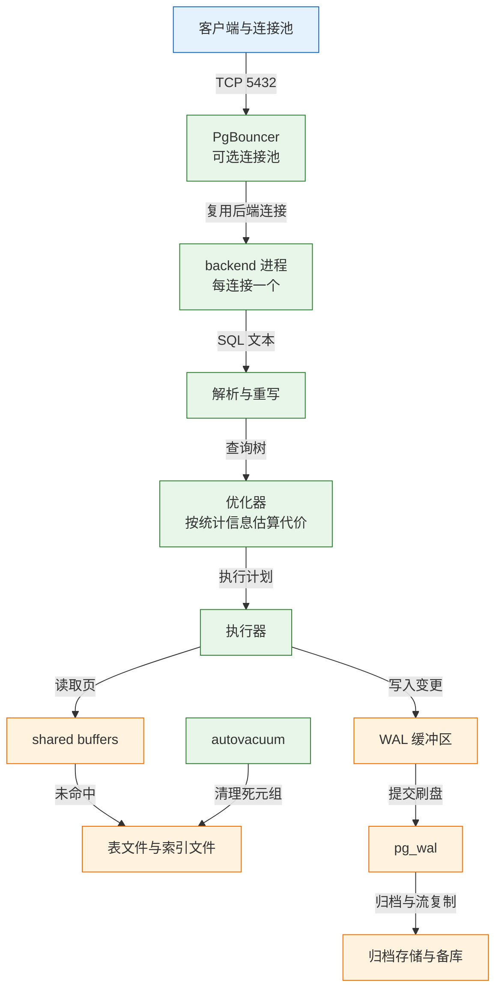
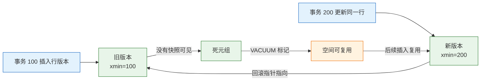
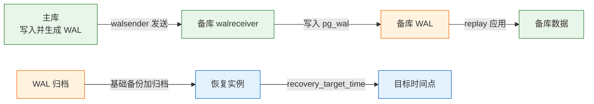
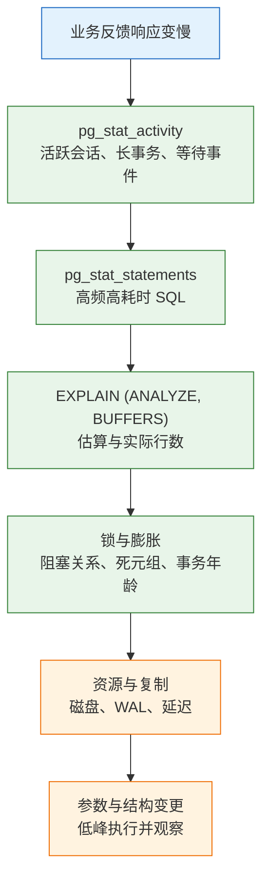

# PostgreSQL

---

## 一、PostgreSQL 是什么

PostgreSQL 把“正确”放在“快”前面：事务、约束、类型系统都更严格。用它的收益是数据模型能表达得更准，代价是要理解 MVCC、VACUUM 和查询计划，否则一样会慢。

它适合需要一份“可信”关系数据的场景：金额不能为负、状态只能是几个值、并发扣库存不能超卖、JSON 字段也能被索引、出问题能恢复到某个时间点。它不擅长超高写入吞吐的简单键值、跨库分片事务、亿级列式聚合，这些交给专用系统，PostgreSQL 通过 FDW 或 CDC 与它们对接。

本文从进程模型讲到备份恢复，再用一个订单库把建表、造数、执行计划、慢查询和恢复串起来。命令按组给出，参数以官方文档和实际版本为准。

PostgreSQL 是开源对象关系型数据库，强调标准兼容、可扩展性和数据完整性。它把 DDL 也放进事务，迁移脚本失败可以整体回滚；它提供丰富的类型、索引和扩展机制，让复杂数据模型不必过早拆到多个系统。

### 1.1 核心概念

| 概念 | 本质 | 常见操作 |
|---|---|---|
| 实例 | 一组后端进程加共享内存 | 启动、停止、改参数 |
| 数据库 | 独立的数据目录与系统目录 | `CREATE DATABASE` |
| 模式 schema | 库内的命名空间 | `CREATE SCHEMA` |
| 表 | 行与列的集合，堆表存储 | `CREATE TABLE` |
| 索引 | 独立的访问方法结构 | `CREATE INDEX` |
| 事务 | 由 MVCC 提供快照隔离 | `BEGIN`、`COMMIT` |

一个实例可以包含多个数据库，数据库之间默认不能直接跨库查询；一个数据库包含多个模式，模式用于隔离权限和对象命名。这个三层结构与 MySQL 的“实例、库、表”不同，跨库访问需要 `dblink`、`postgres_fdw` 或应用层拆分。

系统目录本身也是一组表，存放在 `pg_catalog` 模式中。查询 `pg_class`、`pg_attribute`、`pg_statistic` 能看到表、列和统计信息，排查“表是否存在、索引是否有效、统计是否过期”时比图形工具更直接。

PostgreSQL 的行版本不是原地更新。`UPDATE` 会写一个新版本，旧版本保留到没有事务需要它，再由 `VACUUM` 标记为可复用。这个机制让读写互不阻塞，也带来表膨胀和事务 ID 回卷两个长期运维主题。

### 1.2 与相邻技术的关系

| 技术 | 数据模型 | 强项 | 典型场景 |
|---|---|---|---|
| PostgreSQL | 关系表加扩展类型 | 约束、复杂查询、JSONB、地理 | 强一致业务、混合模型 |
| MySQL | 关系表 | 在线事务、复制工具链成熟 | Web 业务主库 |
| SQLite | 单文件关系库 | 零运维、嵌入式 | 本地工具、边缘应用 |
| ClickHouse | 列式存储 | 大宽表聚合、压缩比高 | 日志与指标分析 |
| Redis | 内存键值 | 低延迟、丰富结构 | 缓存、会话、队列 |

PostgreSQL 与 MySQL 的差异不只在功能列表。PostgreSQL 的优化器对复杂连接、子查询、CTE 的处理更强，类型与约束更严格；MySQL 的主键查询路径短，复制与在线变更经验更普及。选择时应看查询复杂度、数据模型稳定性、团队排障能力，而不是只看单条基准测试。

### 1.3 架构组成



- **进程模型**：每个连接对应一个后端进程，不是线程。连接数上升会带来进程切换、内存和锁竞争，生产通常在前面放 PgBouncer。
- **共享内存**：`shared_buffers` 缓存数据页，所有后端共享；`work_mem` 是每个排序或哈希操作私有，按并发数叠加。
- **WAL**：预写日志，修改先写日志再刷数据页。提交时由 `synchronous_commit` 决定是否等待 WAL 落盘。
- **后台进程**：checkpointer 定期刷脏页，background writer 平滑写回，autovacuum 清理死元组，walwriter 负责 WAL 写入。

进程模型决定了连接成本：每个后端进程都有独立内存、文件描述符和会话状态，空闲连接同样占资源。连接池不是可选项，而是中大型实例的默认组件；池化模式选错，会带来会话状态、预备语句和事务语义上的新问题。

> **运维提示**：`shared_buffers` 通常设为内存的 25% 左右，剩余内存留给操作系统页缓存；`work_mem` 不能按“总量”理解，一个复杂查询可能有多个排序节点，每个节点都可能占用一份。

---

## 二、安装与连接

> **版本现状（2026-10）**：PostgreSQL 18 是当前稳定大版本，新增 `uuidv7()`、异步 I/O、B-tree skip scan，生成列默认使用虚拟方式。官方容器镜像的数据目录从 PostgreSQL 18 起挂载 `/var/lib/postgresql`，不再是旧版的 `/var/lib/postgresql/data`。

### 2.1 版本选择与安装

| 版本 | 状态 | 建议 |
|---|---|---|
| PostgreSQL 18 | 当前稳定版 | 新项目首选 |
| PostgreSQL 17 | 上一稳定版 | 存量系统维持 |
| PostgreSQL 16 及更早 | 按官方支持周期评估 | 规划升级 |

Debian 与 Ubuntu 使用 PGDG 官方仓库，能拿到比发行版更新的小版本：

```bash
# ========== 添加 PGDG 仓库 ==========
sudo apt install -y postgresql-common
sudo /usr/share/postgresql-common/pgdg/apt.postgresql.org.sh

# ========== 安装 PostgreSQL 18 ==========
sudo apt update
sudo apt install -y postgresql-18

# 启动并设置开机自启
sudo systemctl enable --now postgresql

# ========== 验证 ==========
psql --version
sudo systemctl status postgresql
sudo ss -lntp | grep 5432
```

RHEL 系先安装 PGDG 仓库包，禁用系统自带模块，再安装 `postgresql18-server`，并用 `/usr/pgsql-18/bin/postgresql-18-setup initdb` 初始化数据目录。不同小版本的包名以仓库实际内容为准。

### 2.2 容器化启动

```bash
# ========== 启动 PostgreSQL 18 容器 ==========
docker run -d --name pg18 \
  -e POSTGRES_PASSWORD='change-me' \
  -e POSTGRES_DB=shop \
  -e TZ=Asia/Shanghai \
  -p 5432:5432 \
  -v pg18-data:/var/lib/postgresql \
  postgres:18

# 等待日志出现 ready to accept connections
docker logs -f pg18

# ========== 进入容器执行 psql ==========
docker exec -it pg18 psql -U postgres -d shop
```

| 环境变量 | 作用 | 注意 |
|---|---|---|
| `POSTGRES_PASSWORD` | 设置超级用户密码 | 必填 |
| `POSTGRES_DB` | 初始化时创建库 | 仅首次启动生效 |
| `POSTGRES_USER` | 指定超级用户名 | 默认 `postgres` |
| `TZ` | 容器时区 | 与应用、备份保持一致 |

> **注意**：PostgreSQL 18 镜像把卷挂在 `/var/lib/postgresql`，继续沿用 `/var/lib/postgresql/data` 会把数据写到容器可写层，容器删除即丢失。升级镜像前先核对官方镜像说明和现有卷路径。

### 2.3 连接与认证

```bash
# ========== 本地连接 ==========
# 默认使用当前系统用户，peer 认证要求系统用户名与数据库角色一致
psql -d shop

# 指定主机、端口、用户
psql -h 127.0.0.1 -p 5432 -U app_rw -d shop

# ========== psql 常用元命令 ==========
\conninfo          # 当前连接信息
\l                 # 列出数据库
\dn                # 列出模式
\dt                # 列出表
\d+ orders         # 表结构、索引、约束
\x                 # 行列转置显示
\timing on         # 显示每条语句耗时
```

认证由 `pg_hba.conf` 控制，按“连接类型、数据库、用户、来源地址、认证方法”逐行匹配，第一条命中即生效。

| 认证方法 | 机制 | 适用 |
|---|---|---|
| `peer` | 操作系统用户与数据库角色匹配 | 本机管理 |
| `scram-sha-256` | 挑战应答，密码不明文传输 | 远程应用，推荐 |
| `md5` | 旧式密码哈希 | 兼容旧客户端 |
| `cert` | 客户端证书 | 高安全内网 |
| `trust` | 无条件放行 | 仅限隔离测试 |

```bash
# ========== 修改 pg_hba.conf 后重载 ==========
sudo -u postgres psql -c "SELECT pg_reload_conf();"

# ========== 确认监听地址 ==========
sudo -u postgres psql -c "SHOW listen_addresses;"
```

> **安全警告**：`trust` 等于没有认证，`0.0.0.0/0` 加 `trust` 会把数据库直接暴露给整个网络。远程访问至少使用 `scram-sha-256`，并在防火墙或安全组限制来源网段。

### 2.4 配置文件与关键参数

配置文件位于数据目录，Debian 系通常在 `/etc/postgresql/18/main/postgresql.conf`。优先用 `ALTER SYSTEM` 修改，避免手工编辑出错。

```sql
-- ========== 在线修改参数 ==========
ALTER SYSTEM SET shared_buffers = '4GB';
ALTER SYSTEM SET work_mem = '16MB';
ALTER SYSTEM SET max_connections = 300;
ALTER SYSTEM SET log_min_duration_statement = '200ms';

-- 重载配置；shared_buffers 等需要重启
SELECT pg_reload_conf();

-- 查看当前值与来源
SHOW shared_buffers;
SELECT name, setting, source FROM pg_settings WHERE name = 'work_mem';
```

| 参数 | 默认值 | 作用 |
|---|---|---|
| `shared_buffers` | 128MB | 共享缓存页 |
| `work_mem` | 4MB | 每个排序或哈希操作的内存 |
| `maintenance_work_mem` | 64MB | VACUUM、建索引使用 |
| `effective_cache_size` | 4GB | 优化器估算的可用缓存 |
| `max_connections` | 100 | 最大连接数 |
| `wal_level` | replica | WAL 记录级别 |
| `synchronous_commit` | on | 提交是否等待 WAL 落盘 |
| `log_min_duration_statement` | -1 | 慢语句记录阈值 |

`effective_cache_size` 不分配内存，只影响优化器对索引扫描成本的判断；设得过低会让优化器偏向顺序扫描。`work_mem` 调大能减少落盘，但高并发下会成倍占用内存，应按“最大并发排序数 × work_mem”估算上限。

日志参数同样影响排障效率。`log_min_duration_statement` 记录慢语句，`log_lock_waits` 记录锁等待，`log_autovacuum_min_duration` 记录自动清理。三者都打开会增加日志量，应配合轮转与保留周期，避免日志本身写满磁盘。

连接池常用 PgBouncer 的 transaction 模式，它在事务结束后把后端连接复用给下一个客户端，效率最高；但会话级 `SET`、临时表和部分预备语句的语义会变化。依赖这些特性的应用要用 session 模式，或改成事务级设置。

---

## 三、数据类型与表设计

PostgreSQL 的类型系统比多数关系库更丰富，正确选型能减少应用层校验和后期迁移。原则是：语义优先、精度明确、能约束的不要在代码里补。

### 3.1 数值类型与金额

| 类型 | 存储 | 适用 |
|---|---|---|
| `smallint` | 2 字节 | 小范围计数 |
| `integer` | 4 字节 | 常规 ID、数量 |
| `bigint` | 8 字节 | 大表主键、金额分 |
| `numeric(p,s)` | 变长 | 精确金额、比率 |
| `real` / `double precision` | 4 / 8 字节 | 科学计算，不用于金额 |
| `money` | 8 字节 | 受区域设置影响，不推荐 |

金额用 `numeric(12,2)` 或整数分。`numeric` 是精确十进制，适合财务计算；整数分运算快，但展示与输入都要转换。`double precision` 是二进制浮点，累加后会出现分差，不能用于对账。

`numeric` 的精度包含整数位和小数位，`numeric(12,2)` 最多存 10 位整数。超过精度会直接报错而不是静默截断，这是它比浮点更安全的地方。

### 3.2 时间、UUID 与自增

| 场景 | 推荐类型 | 原因 |
|---|---|---|
| 时间点 | `timestamptz` | 存 UTC，按会话时区显示 |
| 本地日期 | `date` | 不含时间，语义清晰 |
| 时间段 | `tstzrange` | 可用 GiST 索引与排除约束 |
| 自增主键 | `GENERATED ALWAYS AS IDENTITY` | 标准写法，权限清晰 |
| 对外 ID | `uuidv7()` | 时间有序，插入局部性好 |
| 随机 ID | `gen_random_uuid()` | 全局唯一但插入分散 |

```sql
-- ========== 自增与 UUID ==========
CREATE TABLE demo (
  id bigint GENERATED ALWAYS AS IDENTITY PRIMARY KEY,
  public_id uuid NOT NULL DEFAULT uuidv7(),
  created_at timestamptz NOT NULL DEFAULT now()
);

-- ========== 生成列：默认虚拟，需要落盘时写 STORED ==========
ALTER TABLE demo
  ADD COLUMN created_date date
  GENERATED ALWAYS AS (created_at::date) STORED;
```

`timestamp` 不带时区，存进去什么就显示什么；`timestamptz` 存 UTC，按会话时区转换。跨时区业务统一用 `timestamptz`，不要一半用一个。`uuidv7()` 在 PostgreSQL 18 中提供，按时间排序，既保留全局唯一，又让 B-tree 插入更集中。

### 3.3 JSONB 与数组

| 类型 | 存储 | 索引 | 适用 |
|---|---|---|---|
| `json` | 原始文本 | 不能直接建 GIN | 只存不改的原始报文 |
| `jsonb` | 二进制，去重键 | GIN、表达式索引 | 稀疏扩展字段 |
| 数组 | 变长 | GIN、GiST | 标签、多值属性 |
| 范围 | 变长 | GiST、SP-GiST | 时间段、区间 |

`jsonb` 适合“字段不固定、整体读取”的数据，不适合替代所有列。需要过滤、排序、唯一约束的字段应拆成普通列；只在展示时读取的扩展信息才放 `jsonb`。`json` 保留原始文本和键顺序，但每次查询都要解析，且不能直接建 GIN 索引。

```sql
-- ========== JSONB 查询与索引 ==========
CREATE INDEX idx_orders_attrs ON orders USING gin (attrs jsonb_path_ops);

SELECT id FROM orders WHERE attrs @> '{"channel":"app"}';

-- 取字段做普通 B-tree
CREATE INDEX idx_orders_channel ON orders ((attrs ->> 'channel'));

-- 数组包含查询
SELECT id FROM orders WHERE tags @> ARRAY['vip'];
```

`jsonb_path_ops` 体积小，只支持 `@>` 等包含操作；需要 `?`、`?|`、`?&` 键存在判断时用默认 `jsonb_ops`，索引更大。表达式索引要求查询写法完全匹配，`attrs->>'channel'` 与 `attrs->'channel'` 不是一回事。

JSONB 的更新会重写整个字段值，频繁修改大文档会产生大量死元组。把高频更新、需要约束的字段拆成普通列，只把低频扩展信息留在 JSONB，能同时降低膨胀和索引维护成本。

### 3.4 约束、生成列与分区键

| 约束 | 作用 | 注意 |
|---|---|---|
| `PRIMARY KEY` | 唯一且非空 | 分区表必须包含分区键 |
| `UNIQUE` | 业务唯一性 | 多列唯一要评估空值语义 |
| `CHECK` | 值域校验 | 复杂表达式增加写入 CPU |
| `FOREIGN KEY` | 引用完整性 | 高并发下增加锁检查 |
| `EXCLUDE` | 区间不重叠 | 常配 GiST，如会议室预订 |

```sql
-- ========== 订单表：约束把业务规则写进数据库 ==========
CREATE TABLE orders (
  id bigint GENERATED ALWAYS AS IDENTITY PRIMARY KEY,
  user_id bigint NOT NULL,
  status text NOT NULL CHECK (status IN ('pending', 'paid', 'cancelled')),
  total_cents integer NOT NULL CHECK (total_cents >= 0),
  attrs jsonb NOT NULL DEFAULT '{}'::jsonb,
  created_at timestamptz NOT NULL DEFAULT now()
);

-- ========== 生成列：默认虚拟，读时计算 ==========
ALTER TABLE orders
  ADD COLUMN total_yuan numeric(12,2)
  GENERATED ALWAYS AS (total_cents / 100.0);
```

PostgreSQL 18 起生成列默认是虚拟列，读时计算，不占存储；需要落盘时显式写 `STORED`。虚拟列不能建普通索引，但可以在表达式上建索引。分区表的主键与唯一约束必须包含分区键，否则数据库无法保证全局唯一。

### 3.5 模式、角色与权限

```sql
-- ========== 业务角色 ==========
CREATE ROLE app_rw LOGIN PASSWORD 'change-me';

GRANT CONNECT ON DATABASE shop TO app_rw;
GRANT USAGE ON SCHEMA public TO app_rw;
GRANT SELECT, INSERT, UPDATE, DELETE ON ALL TABLES IN SCHEMA public TO app_rw;

-- 未来新建的表自动授权
ALTER DEFAULT PRIVILEGES IN SCHEMA public
  GRANT SELECT, INSERT, UPDATE, DELETE ON TABLES TO app_rw;
```

应用不要用超级用户连库。迁移账号与运行账号分开：迁移账号有 `CREATE`、`ALTER`，运行账号只有增删改查。多租户场景可以用行级安全（RLS）兜底：

```sql
ALTER TABLE orders ENABLE ROW LEVEL SECURITY;

CREATE POLICY orders_tenant ON orders
  USING (tenant_id = current_setting('app.tenant_id')::bigint);
```

连接池模式下必须在事务开始时 `SET LOCAL app.tenant_id = ...`，事务结束自动失效；用会话级 `SET` 会污染下一个借到连接的请求。RLS 不能替代应用层校验，但能在漏写 `WHERE tenant_id` 时阻止越权读取。

`ALTER DEFAULT PRIVILEGES` 只影响执行该语句的角色之后创建的对象。如果迁移由另一个角色执行，要么由该角色设置默认权限，要么在迁移脚本末尾重新授权，否则新表对运行账号不可见。

### 3.6 全文检索与 tsvector

`tsvector` 把文本拆成词位并记录位置，`tsquery` 表示查询条件，GIN 索引加速 `@@` 匹配。它适合站内搜索的简单场景，复杂相关性排序仍应外移。

```sql
ALTER TABLE orders ADD COLUMN search_doc tsvector
  GENERATED ALWAYS AS (to_tsvector('simple', coalesce(attrs->>'note', ''))) STORED;

CREATE INDEX idx_orders_search ON orders USING gin (search_doc);

SELECT id FROM orders
WHERE search_doc @@ websearch_to_tsquery('simple', 'refund OR return');
```

`simple` 配置只按空格和标点切词，不做词干还原；中文需要 `zhparser` 或 `pg_jieba` 等扩展，否则分词效果有限。全文检索需求复杂时，考虑 Elasticsearch 或 OpenSearch，而不是在数据库里硬做。

---

## 四、索引与执行计划

PostgreSQL 的索引是独立对象，访问方法可插拔。选对类型只是第一步，能否被优化器使用取决于查询写法、统计信息和代价估算。

### 4.1 索引类型与适用场景

| 索引 | 适合 | 例子 |
|---|---|---|
| B-tree | 等值、范围、排序、前缀 | `(user_id, created_at DESC)` |
| GIN | 包含、数组、JSONB、全文 | `USING gin (attrs jsonb_path_ops)` |
| GiST | 几何、范围、最近邻 | `USING gist (period)` |
| BRIN | 物理有序的大表 | `USING brin (created_at)` |
| Hash | 仅等值，少用 | `USING hash (token)` |

B-tree 是默认选择，能服务大多数条件与排序。GIN 适合“一个值包含多个键”的场景，写入比 B-tree 慢，更新代价高。GiST 支持范围与几何的相交、包含和最近邻。BRIN 只记录每个数据块的摘要，体积极小，适合按时间顺序追加、查询按范围扫描的大表。Hash 只支持等值，通常不如 B-tree 通用。

```sql
-- ========== 常用索引 ==========
CREATE INDEX idx_orders_user_created ON orders (user_id, created_at DESC);
CREATE INDEX idx_orders_attrs ON orders USING gin (attrs jsonb_path_ops);
CREATE INDEX idx_orders_created_brin ON orders USING brin (created_at);

-- 大表建索引不阻塞写入
CREATE INDEX CONCURRENTLY idx_orders_status ON orders (status);
```

`CREATE INDEX CONCURRENTLY` 不持有阻止写入的强锁，但耗时更长，失败会留下无效索引，需要 `DROP INDEX CONCURRENTLY` 后重建。它不能在事务块内执行，生产大表建索引优先用它，并在低峰执行。

### 4.2 B-tree 联合索引与覆盖

联合索引按列顺序排序，能服务最左前缀、等值与范围组合。与 MySQL 不同，PostgreSQL 的二级索引叶子不存整行，回表通过 `ctid` 定位堆表；用 `INCLUDE` 可以把非过滤列放进索引叶子，形成覆盖索引。

| 查询 | 索引 `(a, b, c)` | 说明 |
|---|---|---|
| `a = 1` | 能用 | 最左前缀 |
| `a = 1 AND b = 2` | 能用 | 前两列 |
| `a = 1 ORDER BY b` | 能用 | 过滤加排序 |
| `b = 2` | 通常不能 | 缺少前导列 |
| `a > 1 AND b = 2` | 部分 | 范围后难以继续定位 |
| `a = 1 AND c = 3` | 部分 | `c` 需回表或走索引过滤 |

```sql
-- ========== 覆盖索引 ==========
CREATE INDEX idx_orders_user_created_cover
  ON orders (user_id, created_at DESC) INCLUDE (total_cents);

EXPLAIN (ANALYZE, BUFFERS)
SELECT id, total_cents FROM orders
WHERE user_id = 42
ORDER BY created_at DESC
LIMIT 20;
```

排序方向要与索引一致。PostgreSQL 默认 `ASC NULLS LAST`、`DESC NULLS FIRST`；查询写了 `ORDER BY created_at DESC NULLS LAST`，而索引是默认 `DESC`，排序就可能用不上索引。空值多的列要显式声明 `NULLS` 位置。

### 4.3 部分索引与表达式索引

部分索引只对满足条件的行建索引，体积小、写入便宜；表达式索引把计算结果固化，服务固定写法的查询。

```sql
-- ========== 部分索引：只关心未完成订单 ==========
CREATE INDEX idx_orders_pending
  ON orders (created_at) WHERE status = 'pending';

-- ========== 表达式索引：按 JSON 字段过滤 ==========
CREATE INDEX idx_orders_channel
  ON orders ((attrs ->> 'channel'));

-- ========== 部分唯一索引：软删除后允许重复 ==========
CREATE UNIQUE INDEX uq_orders_no
  ON orders (order_no) WHERE deleted_at IS NULL;
```

部分索引要求查询条件能推出索引谓词。查询写 `WHERE status = 'pending'` 能用，写 `WHERE status <> 'paid'` 通常用不上。表达式索引要求表达式完全一致，参数类型、函数、括号都要匹配。

### 4.4 执行计划解读

`EXPLAIN` 显示优化器选择的计划与估算代价，`EXPLAIN ANALYZE` 真正执行并给出实际行数与耗时。生产排查优先用后者，但注意它会执行写语句，`UPDATE`、`DELETE` 要放进事务后回滚。

| 字段 | 含义 | 关注点 |
|---|---|---|
| `cost` | 启动代价与总代价 | 估算值，不是毫秒 |
| `rows` | 估算返回行数 | 与实际差一个数量级要查统计 |
| `width` | 平均行宽字节 | 过宽说明取了不必要的大列 |
| `actual time` | 实际耗时 | 首行到全部返回 |
| `loops` | 节点执行次数 | 嵌套循环内层可能很大 |
| `Buffers` | 共享缓存命中与读盘 | `read` 高说明缓存不足或过滤差 |
| `Sort Method` | 排序方式 | `external merge Disk` 表示落盘 |

```sql
-- ========== 估算计划 ==========
EXPLAIN SELECT id, total_cents FROM orders
WHERE user_id = 42 ORDER BY created_at DESC LIMIT 20;

-- ========== 真实执行与缓存统计 ==========
EXPLAIN (ANALYZE, BUFFERS)
SELECT id, total_cents FROM orders
WHERE user_id = 42 ORDER BY created_at DESC LIMIT 20;
```

输出结构类似：

```text
Index Scan using idx_orders_user_created on orders
  Index Cond: (user_id = 42)
  Buffers: shared hit=...
Planning Time: ...
Execution Time: ...
```

具体数值随数据分布与缓存状态变化，不能照抄。看到 `Seq Scan` 加 `Rows Removed by Filter` 很大，说明索引缺失或条件不可索引；看到 `external merge Disk`，说明 `work_mem` 不足或排序量过大。

`loops` 容易被忽略：嵌套循环内层节点显示的是单次平均耗时，实际总耗时要乘以循环次数。`Buffers` 中的 `hit` 是缓存命中，`read` 是读盘，`dirtied` 是写脏页；读盘比例高时，先判断是缓存不足还是索引过滤太差，不要直接加内存。

### 4.5 连接方式与代价

| 方式 | 适用 | 代价 |
|---|---|---|
| Nested Loop | 小表驱动大表，内表有索引 | 内表无索引会退化成多次全扫 |
| Hash Join | 两边都大、等值连接 | 建哈希表，受 `work_mem` 限制 |
| Merge Join | 两边按连接键有序 | 需要排序或索引有序 |

优化器按统计信息选择连接方式。估算错误时会出现“小表被当大表，选了 Hash Join 却溢出磁盘”。看 `EXPLAIN (ANALYZE, BUFFERS)` 里的 `Sort Method: external merge Disk` 与 `Batches`，再决定调 `work_mem`、补索引或改写查询。

### 4.6 统计信息与计划翻转

优化器靠 `pg_statistic` 估算选择性与行数。大批量导入后没 `ANALYZE`，估算可能差几个数量级，计划就从索引扫描变成全表扫描。

```sql
-- ========== 手动收集统计信息 ==========
ANALYZE orders;

-- ========== 提高某列统计精度 ==========
ALTER TABLE orders ALTER COLUMN user_id SET STATISTICS 1000;
ANALYZE orders;

-- ========== 多列相关性统计 ==========
CREATE STATISTICS st_orders_status_created (dependencies, ndistinct)
  ON status, created_at FROM orders;
ANALYZE orders;
```

`default_statistics_target` 默认 100，越高越精确，但 `ANALYZE` 更慢、系统目录更大。列之间强相关时，单列统计会低估组合条件的选择性，扩展统计能改善。PostgreSQL 18 的 B-tree skip scan 能在缺少前导列条件时跳过重复值，但它不能替代正确的索引列顺序。

### 4.7 分区表与分区裁剪

单表超过几千万行、按时间删除历史、查询总带时间范围时，可以考虑声明式分区。分区把大表拆成多个物理表，裁剪后只扫描相关分区。

```sql
CREATE TABLE events (
  id bigint GENERATED ALWAYS AS IDENTITY,
  tenant_id bigint NOT NULL,
  created_at timestamptz NOT NULL,
  payload jsonb,
  PRIMARY KEY (id, created_at)
) PARTITION BY RANGE (created_at);

CREATE TABLE events_2026_10 PARTITION OF events
  FOR VALUES FROM ('2026-10-01') TO ('2026-11-01');

-- 查询带分区键，计划里能看到裁剪
EXPLAIN SELECT count(*) FROM events
WHERE created_at >= '2026-10-01' AND created_at < '2026-10-02';
```

| 约束 | 说明 |
|---|---|
| 主键包含分区键 | 否则无法保证全局唯一 |
| 分区数量适中 | 过多增加规划与锁开销 |
| 查询带分区键 | 否则可能扫描全部分区 |
| 默认分区慎用 | 会让裁剪失效 |

分区不是性能银弹。查询能走合适索引时，单表可能更快；先用索引、归档和查询优化，确认瓶颈是“表太大或删除太慢”再分区。

---

## 五、事务与锁

PostgreSQL 用 MVCC 提供快照读，用行锁处理写冲突，用 SSI 实现可串行化。理解版本可见性，才能解释“为什么查询看不到刚提交的数据”和“为什么表越来越大”。

### 5.1 MVCC 与隔离级别

| 级别 | 快照范围 | 典型现象 | 适用 |
|---|---|---|---|
| `READ COMMITTED` | 每条语句开始 | 同一事务两次读可能不同 | 默认，大多数业务 |
| `REPEATABLE READ` | 事务第一条语句 | 写冲突报错，读一致 | 报表、批量校验 |
| `SERIALIZABLE` | 事务级 | 冲突报 `40001` | 强一致、防写偏斜 |

PostgreSQL 默认 `READ COMMITTED`。`REPEATABLE READ` 在同一事务内复用快照，看到的是事务开始时的数据；`SERIALIZABLE` 使用可串行化快照隔离，检测到可能破坏串行化的并发时主动中止一方。



```sql
-- ========== 事务内读一致 ==========
BEGIN ISOLATION LEVEL REPEATABLE READ;
SELECT balance FROM accounts WHERE id = 1;
-- 其他事务提交了修改，这里仍然看到事务开始时的值
COMMIT;
```

`REPEATABLE READ` 下更新已被其他事务修改的行会报“could not serialize access due to concurrent update”，应用必须重试整个事务。重试要带退避和次数上限，不能无限循环。

### 5.2 行锁与 SKIP LOCKED

| 锁模式 | 语句 | 冲突 |
|---|---|---|
| `FOR UPDATE` | 强锁，阻止更新与删除 | 与其他写锁冲突 |
| `FOR NO KEY UPDATE` | 更新非键列 | 不阻止外键引用 |
| `FOR SHARE` | 共享读锁 | 阻止写，不阻止其他共享 |
| `FOR KEY SHARE` | 只保护键列 | 外键检查使用 |

```sql
-- ========== 队列消费：跳过已被其他 worker 锁住的行 ==========
BEGIN;
SELECT id FROM jobs
WHERE status = 'queued'
ORDER BY id
FOR UPDATE SKIP LOCKED
LIMIT 1;
-- 处理任务并更新状态
COMMIT;
```

`SKIP LOCKED` 让多个 worker 不必等同一行，适合队列；它会跳过暂时被锁的任务，如果要求严格顺序就不能用。`NOWAIT` 则相反，遇到锁立即报错，适合快速失败的交互操作。

行锁持有到事务结束，因此取任务、处理任务、更新状态应拆成“短事务取任务加长任务处理”两段，而不是把外部调用包在锁里。锁等待时间要有上限，`lock_timeout` 能避免请求在数据库里无限堆积。

### 5.3 死锁与序列化冲突

死锁是事务互相等待对方持有的锁，PostgreSQL 检测到后中止一方，报 `deadlock detected`，SQLSTATE 为 `40P01`。可串行化冲突报 `could not serialize access`，SQLSTATE 为 `40001`。

| 错误 | SQLSTATE | 原因 | 处理 |
|---|---|---|---|
| 死锁 | `40P01` | 加锁顺序不一致 | 统一顺序，缩短事务 |
| 序列化失败 | `40001` | SSI 检测到危险结构 | 重试整个事务 |
| 锁等待超时 | `55P03` | `lock_timeout` 到期 | 找阻塞源或调整超时 |
| 语句取消 | `57014` | `statement_timeout` 到期 | 优化查询或调整阈值 |

```sql
-- ========== 查看阻塞关系 ==========
SELECT pid, wait_event_type, wait_event, state,
       now() - xact_start AS xact_age, left(query, 80) AS query
FROM pg_stat_activity
WHERE state <> 'idle'
ORDER BY xact_age DESC;

-- ========== 设置本地超时，避免无限等待 ==========
SET LOCAL lock_timeout = '3s';
SET LOCAL statement_timeout = '5s';
```

统一的加锁顺序、按主键排序批量更新、事务内不等待外部 HTTP 调用，这三条能消掉大部分死锁。重试只能兜底，不能消除根因。

### 5.4 VACUUM 与事务 ID 回卷

`UPDATE` 和 `DELETE` 留下旧版本，`VACUUM` 把不再可见的版本标记为可复用。它不把空间还给操作系统，只让后续插入复用；要缩表得用 `VACUUM FULL`，而它会持有排他锁并重写整表。

- **长事务阻止清理**：一个开了半小时的事务会让这期间所有死元组都留着，表和索引持续膨胀。
- **复制槽阻止清理**：失效的复制槽会卡住 WAL 与旧版本清理，必须先确认再删除。
- **事务 ID 会回卷**：32 位事务 ID 约 40 亿个，老数据必须 freeze，接近上限会强制停库保护。

```sql
-- ========== 查膨胀与长事务 ==========
SELECT relname, n_live_tup, n_dead_tup, last_autovacuum
FROM pg_stat_user_tables
ORDER BY n_dead_tup DESC
LIMIT 10;

SELECT pid, state, now() - xact_start AS xact_age, left(query, 80) AS query
FROM pg_stat_activity
WHERE xact_start IS NOT NULL
ORDER BY xact_age DESC
LIMIT 10;

-- ========== 查事务 ID 年龄 ==========
SELECT datname, age(datfrozenxid) AS xid_age
FROM pg_database
ORDER BY xid_age DESC;
```

`age` 接近 15 亿就要安排清理，不要等到 20 亿。autovacuum 通常能处理，但长事务、复制槽、失效的预备事务都会阻止 freeze。

> **运维红线**：生产库禁止随意执行 `VACUUM FULL`。它会持有 `ACCESS EXCLUSIVE` 锁，期间该表所有读写阻塞，大表可能持续数十分钟并额外占用等量磁盘。需要缩表时优先用 `pg_repack` 或在线重建，并准备回滚方案。

---

## 六、备份与恢复

备份方案由 RPO 与 RTO 反推：能接受丢多少数据，决定备份频率与 WAL 归档；能接受停多久，决定逻辑恢复还是物理恢复。

### 6.1 备份类型与 RPO/RTO

| 方案 | RPO | RTO | 适用 |
|---|---|---|---|
| 每日逻辑备份 | 24 小时 | 小时级 | 小库、开发 |
| 基础备份加 WAL 归档 | 分钟级 | 小时级 | 生产标配 |
| 流复制加延迟副本 | 秒级 | 分钟级 | 高可用 |
| 跨地域副本 | 分钟级 | 较长 | 容灾 |

逻辑备份可跨版本、可单表恢复，但大库导出与恢复都慢；物理备份快，依赖相同大版本与平台；WAL 归档让恢复可以精确到某个时间点。生产常用“每周基础备份、持续 WAL 归档、每日逻辑备份做补充”。

### 6.2 逻辑备份与恢复

```bash
# ========== 自定义格式，便于并行恢复 ==========
docker exec pg18 pg_dump -U postgres -Fc -d shop -f /tmp/shop.dump
docker cp pg18:/tmp/shop.dump ./shop.dump

# ========== 目录格式，支持并行导出 ==========
docker exec pg18 pg_dump -U postgres -Fd -j 4 -d shop -f /tmp/shop.dir

# ========== 恢复到新库 ==========
docker exec pg18 createdb -U postgres shop_restore
docker exec -i pg18 pg_restore -U postgres -d shop_restore \
  --clean --if-exists < shop.dump

# ========== 只恢复某张表 ==========
docker exec -i pg18 pg_restore -U postgres -d shop_restore \
  --table=orders < shop.dump
```

`pg_dump` 默认一致性快照，不阻塞普通读写，但备份期间不能执行会改变表结构的 DDL。`-Fc` 是自定义格式，支持压缩与选择性恢复；`-Fd` 是目录格式，配合 `-j` 并行更快。恢复前确认目标库为空或允许覆盖，`--clean` 会先删对象。

> **注意**：`pg_dump` 不包含角色、表空间等全局对象，需要单独用 `pg_dumpall --globals-only` 备份。只恢复数据库而漏掉角色和权限，应用连接会报权限错误。

> **运维红线**：禁止在未确认实例与备份可用性的情况下执行 `DROP DATABASE`、`DROP SCHEMA ... CASCADE`。删除前核对连接串、实例标识和最近一次可恢复时间点，生产操作必须两人复核。

### 6.3 物理备份与 PITR

```bash
# ========== 基础备份 ==========
pg_basebackup -h 127.0.0.1 -U repl -D /backup/base \
  -Ft -z -Xs -P
```

```ini
# ========== 开启 WAL 归档（postgresql.conf） ==========
archive_mode = on
archive_command = 'test ! -f /archive/%f && cp %p /archive/%f'
```

时间点恢复的步骤是：恢复基础备份，配置 `restore_command` 从归档取 WAL，设置 `recovery_target_time`，启动后重放到目标时间点。

```ini
# ========== recovery.conf 已并入 postgresql.conf（12 起） ==========
restore_command = 'cp /archive/%f %p'
recovery_target_time = '2026-10-29 10:03:22+08'
recovery_target_action = 'promote'
```

```bash
# ========== 触发恢复 ==========
# 12 起用 recovery.signal 标记进入恢复模式
touch $PGDATA/recovery.signal
pg_ctl -D $PGDATA start
```

只做 `pg_dump` 不能恢复到“误删前的 10:03:22”，因为它只有备份时刻的快照。PITR 依赖连续归档，归档中断期间的时间点无法恢复，因此必须监控归档失败。

归档命令必须幂等：重复拷贝同一个 WAL 文件不应报错，否则恢复流程会卡住。基础备份与 WAL 归档要放在不同故障域，恢复前校验备份集完整性，再在隔离实例上重放，避免把错误备份覆盖到生产。

### 6.4 流复制与延迟



```sql
-- ========== 查看复制状态与延迟 ==========
SELECT client_addr, state, sent_lsn, replay_lsn,
       pg_wal_lsn_diff(sent_lsn, replay_lsn) AS lag_bytes
FROM pg_stat_replication;

-- ========== 查看复制槽 ==========
SELECT slot_name, active, restart_lsn,
       pg_wal_lsn_diff(pg_current_wal_lsn(), restart_lsn) AS retained_bytes
FROM pg_replication_slots;
```

`lag_bytes` 持续增大，先查备库 I/O、网络和主库 WAL 生成速度，不要只看 `state=streaming`。失效的复制槽会无限保留 WAL，最终写满磁盘，确认不再使用后必须删除。

### 6.5 恢复演练与校验

| 验收项 | 方法 | 通过标准 |
|---|---|---|
| 数据库可启动 | 启动恢复实例并看日志 | 无恢复错误 |
| 数据完整 | 表数量、行数、汇总值 | 与源库一致 |
| 时间点准确 | 核对目标时间前后的数据 | 误操作未重放 |
| 权限可用 | 用业务角色连接 | 无权限错误 |
| 耗时达标 | 记录恢复开始与结束 | 满足 RTO |

恢复演练在隔离实例进行，不能在原库验证。每次调整归档、复制或表结构后重新演练，确认备份链路仍然可用。没有演练过的备份，等于没有备份。

---

## 七、完整示例：订单库

这一节从空实例开始，建表、造数、看计划、定位慢查询、恢复备份，形成可复现的闭环。

### 7.1 建库建表

```sql
-- ========== 选择数据库 ==========
-- 容器示例的 POSTGRES_DB 已创建 shop；裸机安装先执行 CREATE DATABASE shop;
\c shop

-- ========== 订单表 ==========
CREATE TABLE orders (
  id bigint GENERATED ALWAYS AS IDENTITY PRIMARY KEY,
  user_id bigint NOT NULL,
  status text NOT NULL CHECK (status IN ('pending', 'paid', 'cancelled')),
  total_cents integer NOT NULL CHECK (total_cents >= 0),
  attrs jsonb NOT NULL DEFAULT '{}'::jsonb,
  created_at timestamptz NOT NULL DEFAULT now()
);

-- 初始只建时间索引，用来复现“查询走错计划”
CREATE INDEX idx_orders_created ON orders (created_at);
```

真实列表查询是“按用户过滤、按时间倒序”，只建 `(created_at)` 无法同时服务过滤和排序。

### 7.2 批量写入与查询验证

```sql
-- ========== 造 10 万行 ==========
INSERT INTO orders (user_id, status, total_cents, attrs)
SELECT (random() * 1000)::bigint,
       (ARRAY['pending','paid','cancelled'])[1 + floor(random() * 3)::int],
       (random() * 10000)::int,
       jsonb_build_object(
         'channel', (ARRAY['web','app'])[1 + floor(random() * 2)::int]
       )
FROM generate_series(1, 100000);

ANALYZE orders;

-- ========== 数据分布 ==========
SELECT status, count(*) FROM orders GROUP BY status;
SELECT count(*) FROM orders WHERE user_id = 42;
```

```sql
-- ========== 目标查询 ==========
EXPLAIN (ANALYZE, BUFFERS)
SELECT id, total_cents
FROM orders
WHERE user_id = 42
ORDER BY created_at DESC
LIMIT 20;
```

预期看到 `Seq Scan` 或走 `idx_orders_created` 后大量过滤，`Rows Removed by Filter` 接近全表，排序可能落盘。问题不是统计信息，而是索引与查询形状不匹配。

### 7.3 慢查询定位与索引优化

```sql
-- ========== 启用扩展（需 shared_preload_libraries 并重启） ==========
CREATE EXTENSION IF NOT EXISTS pg_stat_statements;

-- ========== 按总耗时排序 ==========
SELECT calls, mean_exec_time, rows,
       left(query, 100) AS query
FROM pg_stat_statements
ORDER BY total_exec_time DESC
LIMIT 10;
```

确认目标 SQL 的 `rows` 与 `shared_blks_read` 偏高后，建联合索引：

```sql
-- ========== 过滤列在前，排序列在后 ==========
CREATE INDEX CONCURRENTLY idx_orders_user_created
  ON orders (user_id, created_at DESC);

ANALYZE orders;

EXPLAIN (ANALYZE, BUFFERS)
SELECT id, total_cents FROM orders
WHERE user_id = 42
ORDER BY created_at DESC
LIMIT 20;
```

计划应变为 `Index Scan using idx_orders_user_created`，`Buffers` 的 `read` 明显下降。如果仍需回表且列表只要金额，追加覆盖列：

```sql
CREATE INDEX CONCURRENTLY idx_orders_user_created_cover
  ON orders (user_id, created_at DESC) INCLUDE (total_cents);
```

若排序仍显示 `external merge Disk`，先估算并发排序数量，再调整会话级或角色级 `work_mem`，不要直接改全局到几个 GB。索引上线后观察一周写入延迟与磁盘增长，再删除不再使用的旧索引。

判断索引是否值得保留，可以看 `pg_stat_user_indexes` 的扫描次数和 `pg_statio_user_indexes` 的读页量；长期为零且不是唯一约束的索引，通常是历史遗留。删除前先确认没有报表、离线任务或低频接口依赖它。

### 7.4 备份与恢复演练

```bash
# ========== 逻辑备份 ==========
docker exec pg18 pg_dump -U postgres -Fc -d shop -f /tmp/shop.dump
docker cp pg18:/tmp/shop.dump ./shop.dump

# ========== 恢复到独立库 ==========
docker exec pg18 createdb -U postgres shop_restore
docker exec -i pg18 pg_restore -U postgres -d shop_restore \
  --clean --if-exists < shop.dump

# ========== 核对 ==========
docker exec pg18 psql -U postgres -d shop_restore \
  -c "SELECT count(*), sum(total_cents) FROM orders;"
```

| 验收项 | 方法 | 通过标准 |
|---|---|---|
| 表与索引 | `\d+ orders` | 结构与源库一致 |
| 行数与金额 | `count`、`sum` | 与源库一致 |
| 约束 | 插入非法状态 | 被 `CHECK` 拒绝 |
| 应用连接 | 业务角色执行查询 | 无权限错误 |
| 恢复耗时 | 记录起止时间 | 满足 RTO |

恢复演练会暴露角色、扩展、表空间、时区这些逻辑备份之外的差异。每次结构调整后重跑一次，比事故当天才发现缺扩展更划算。

---

## 八、常见故障与排查

| 现象 | 最可能原因 | 处理 |
|---|---|---|
| `too many clients already` | 连接数打满或池泄漏 | 查 `pg_stat_activity`，上 PgBouncer，修泄漏 |
| 查询越来越慢、表膨胀 | 长事务阻止 VACUUM | 找最老 `xact_start`，结束失控事务 |
| `deadlock detected` | 加锁顺序不一致 | 统一顺序，缩短事务，捕获 `40P01` 重试 |
| `could not serialize access` | 可串行化冲突 | 重试整个事务，不要只重试单条 SQL |
| 磁盘满 | WAL 堆积、归档失败、临时文件 | 查 `pg_wal`、归档命令、排序落盘 |
| 复制延迟持续增大 | 备库资源不足、网络、长事务 | 看 `pg_stat_replication`，查备库 I/O |
| `database is not accepting connections` | 连接数达到上限 | 用 `superuser_reserved_connections` 保留槽登录处理 |
| 导入后计划变差 | 没跑 `ANALYZE` | 导入后分析，必要时提高统计目标 |
| 备份恢复少最后几分钟 | 只做逻辑备份，没有 WAL 归档 | 配 PITR，定期演练 |
| 容器重启数据消失 | 卷挂到旧路径 | PostgreSQL 18 挂 `/var/lib/postgresql` |



排查顺序按“先看会话、再看语句、最后动参数”推进：

1. `pg_stat_activity` 看活跃会话、长事务、等待事件与锁类型。
2. `pg_stat_statements` 找总耗时和平均耗时最高的语句。
3. `EXPLAIN (ANALYZE, BUFFERS)` 对比估算行数与实际行数，定位扫描与落盘。
4. 查锁、VACUUM、复制槽与事务年龄，区分并发问题与维护问题。
5. 再看磁盘、CPU、网络与复制延迟，确认不是外部依赖。
6. 最后才调参数或改表结构，变更前后保留观测数据。

> **运维红线**：长事务会同时阻止 VACUUM、放大表膨胀、拖慢复制。生产库必须设置 `statement_timeout`、`idle_in_transaction_session_timeout` 和监控告警，禁止在业务库上开事务后去调用外部接口。

> **注意**：`pg_terminate_backend` 会回滚目标连接的事务，可能让调用方报错。执行前确认 pid 对应的是失控查询或空闲事务，不要对复制连接、备份连接和未知会话随手操作。

> **运维提示**：把“连接数、长事务、死元组、事务年龄、复制延迟、WAL 目录大小”做成固定监控项。PostgreSQL 的多数故障不是突然发生，而是这些指标先持续恶化，再被一次流量高峰放大。
