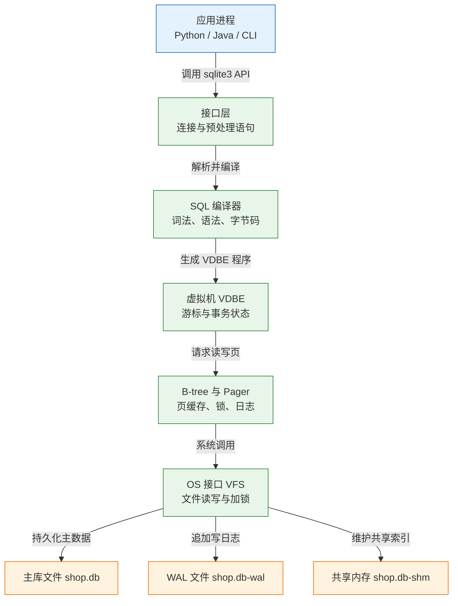
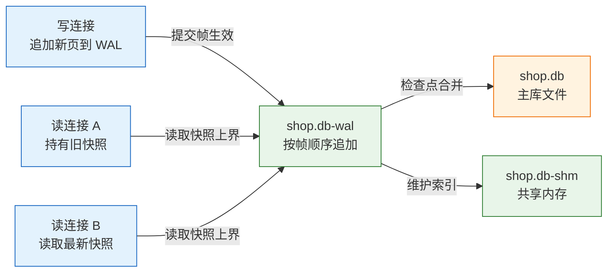
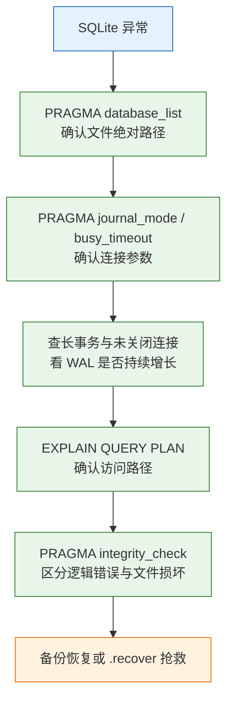

# SQLite 进程内嵌入式数据库

---

## 一、SQLite 是什么

SQLite 是一个把关系数据库引擎编译进宿主进程的嵌入式库。它没有独立服务进程、没有监听端口、没有账号体系，一个数据库就是一个文件，SQL 由调用它的进程在本地解析和执行。它解决的核心问题是：应用需要事务、SQL、索引和约束，但不想为此部署、配置和维护一套数据库服务。

它的边界同样明确。SQLite 不提供多机共享写、数据库级用户权限、在线扩容、主从切换和并行查询；同一时刻只允许一个写事务，这个限制来自文件锁模型，而不是配置项。把 SQLite 当"小号 MySQL"来规划容量，是最常见的误判。

### 1.1 核心概念

SQLite 的运行单元不是"服务器"，而是**连接**。一个连接持有页缓存、锁状态、预处理语句和一组 PRAGMA 设置；多个连接打开同一个文件时，靠操作系统文件锁协调。数据库文件本身则包含 schema、表、索引、触发器和视图，默认页大小 4096 字节。

| 概念 | 本质 | 直接影响 |
|---|---|---|
| 数据库文件 | 由固定大小页组成的单文件 | 备份、迁移、权限都以文件为单位 |
| 连接 | `sqlite3` 句柄，持有缓存与锁 | 线程不能共享，PRAGMA 按连接生效 |
| 事务 | 一组原子执行的语句 | 写事务全局串行 |
| 页 | 读写与缓存的最小单位 | 页大小建库后基本不可改 |
| rowid | 隐藏的 64 位整数主键 | `INTEGER PRIMARY KEY` 即其别名 |
| VFS | 操作系统适配层 | 决定文件锁与共享内存是否可靠 |

理解"文件是存储单位、连接是运行单位"之后，很多现象就能解释：同一个进程开两个连接会互相阻塞；`PRAGMA foreign_keys` 在 A 连接打开、B 连接仍然关闭；数据库文件复制走了，`-wal` 里已提交的数据却留在原地。

### 1.2 与相邻技术的关系

SQLite 与客户端-服务器数据库的差别不在 SQL 方言，而在进程边界。MySQL、PostgreSQL 把查询执行放在独立进程里，客户端通过协议访问，因而能做权限、并发连接、主从复制和在线扩容；SQLite 把执行放在应用进程内，省掉网络往返和运维，也放弃了这些能力。

| 技术 | 部署形态 | 并发写 | 典型定位 |
|---|---|---|---|
| SQLite | 进程内库 + 单文件 | 单写者串行 | 桌面、移动、边缘、测试 |
| MySQL | 独立服务 + 网络协议 | 多写者、行锁 | 在线业务主库 |
| PostgreSQL | 独立服务 + 网络协议 | 多写者、MVCC | 复杂事务与分析混合 |
| DuckDB | 进程内列存 | 单写者为主 | 本地分析与批量扫描 |

选型看三个条件：写入集中在单机、并发写低于每秒数十次、数据不需要被多台机器同时修改。三条都满足时 SQLite 非常合适；只要有一条不满足，就应换客户端-服务器数据库。分析型全表扫描多、列存更划算时，DuckDB 比 SQLite 更贴近需求。

### 1.3 架构组成



五层各有可观察的后果：

- **接口层**负责连接、绑定参数和预处理语句。重复执行同一条 SQL 时，复用预处理语句可以跳过解析和编译。
- **编译器**把 SQL 翻成 VDBE 字节码，`EXPLAIN` 看到的就是这份程序，`EXPLAIN QUERY PLAN` 则是优化器选出的访问路径摘要。
- **虚拟机**按字节码驱动 B-tree 游标，维护事务状态和保存点栈。
- **B-tree 与 Pager** 管理页缓存、空闲页、日志与锁。查询慢在磁盘还是慢在锁，区别就在这一层。
- **VFS** 把文件操作抽象成统一接口。WAL 依赖共享内存和可靠的字节范围锁，这正是网络文件系统上容易损坏的根源。

---

## 二、安装与命令行接入

> **版本现状（2026）**：SQLite 当前稳定系列为 3.5x，具体小版本以官方发布为准，用 `sqlite3 --version` 确认。`STRICT` 表从 3.37 起提供，`VACUUM INTO` 从 3.27 起提供，`.recover` 从 3.29 起提供，`RETURNING` 从 3.35 起提供。旧版本缺少这些能力时，应升级库而不是改写语义。

### 2.1 各平台安装

```bash
# ========== macOS ==========
# 系统自带 sqlite3，先确认版本
sqlite3 --version

# 需要新版本时用 Homebrew 安装，注意 PATH 优先级
brew install sqlite
which -a sqlite3

# ========== Debian / Ubuntu ==========
# sqlite3 是命令行工具，libsqlite3-dev 提供头文件与静态库
sudo apt update
sudo apt install -y sqlite3 libsqlite3-dev

# ========== RHEL / Rocky ==========
sudo dnf install -y sqlite sqlite-devel

# ========== Windows ==========
# 官方提供预编译工具包，解压后把目录加入 PATH
# 也可从包管理器搜索结果中选择对应的 SQLite Id 安装
winget search sqlite
sqlite3 --version
```

| 平台 | 安装方式 | 注意 |
|---|---|---|
| macOS | 系统自带或 Homebrew | 两套二进制可能混用，用 `which -a` 核对 |
| Debian/Ubuntu | `apt` | 运行库与命令行工具分开安装 |
| RHEL/Rocky | `dnf` | 发行版版本偏旧，注意 `STRICT` 支持 |
| Windows | 官方工具包或包管理器 | 路径含空格时命令行要加引号 |

应用侧还需要语言绑定：Python 标准库自带 `sqlite3`，Java 使用 `org.xerial:sqlite-jdbc`，Go 常用 `mattn/go-sqlite3` 或纯 Go 驱动。绑定层携带的 SQLite 版本可能与系统命令行不同，排查时要分别确认。

### 2.2 命令行与初始化验证

```bash
# 打开或创建数据库文件，文件不存在时在第一次写入时创建
sqlite3 /tmp/shop.db

# 以下为交互式输入
```

```text
# 在 sqlite3 交互式终端中执行；点命令不是 SQL
# 输出格式便于人工核对，不影响存储
.mode box
.headers on

# 查看当前连接与文件路径
PRAGMA database_list;

# 建立最小表并写入
CREATE TABLE users (
  id INTEGER PRIMARY KEY,
  email TEXT NOT NULL UNIQUE
) STRICT;

INSERT INTO users (email) VALUES ('a@example.com');

SELECT id, email FROM users;

# 查看对象清单与建表语句
.tables
.schema users
```

预期输出类似：

```text
┌────┬─────────────────┐
│ id │ email           │
├────┼─────────────────┤
│ 1  │ a@example.com   │
└────┴─────────────────┘
```

命令行工具的能力常被低估。`.backup` 做在线备份，`.dump` 导出 SQL，`.recover` 绕过坏页抢救数据，`.import` 导入 CSV，`.read` 执行脚本文件，`.output` 把结果写入文件。这些点命令不是 SQL，不能在应用驱动里使用，排障时应区分。

| 点命令 | 作用 | 典型场景 |
|---|---|---|
| `.tables` / `.schema` | 列出表与建表语句 | 确认对象是否真的存在 |
| `.backup FILE` | 在线备份 | 生产库热备 |
| `.dump` | 导出 SQL 文本 | 小库迁移、审计 |
| `.recover` | 从损坏库抢救数据 | 坏页恢复 |
| `.import FILE TABLE` | 导入 CSV | 批量初始化 |

### 2.3 运行参数与编译选项

```bash
# 查看编译期能力，确认 FTS5、JSON、线程模式是否启用
sqlite3 :memory: "PRAGMA compile_options;"

# 关注以下几项
# ENABLE_FTS5
# ENABLE_JSON1（3.38 起 JSON 已内置，旧版看此项）
# THREADSAFE=1
```

```sql
-- 数据库级设置，写入文件头，重连后仍然有效
PRAGMA journal_mode = WAL;

-- 连接级设置，每条新连接都要重新执行
PRAGMA busy_timeout = 5000;
PRAGMA foreign_keys = ON;
PRAGMA synchronous = NORMAL;

-- 缓存与临时表，按可用内存调整
PRAGMA cache_size = -64000;
PRAGMA temp_store = MEMORY;
```

| 参数 | 作用域 | 建议值 |
|---|---|---|
| `journal_mode` | 数据库级，持久 | 绝大多数场景 `WAL` |
| `synchronous` | 连接级 | WAL 下 `NORMAL`，强持久用 `FULL` |
| `busy_timeout` | 连接级 | 3000–5000 毫秒 |
| `foreign_keys` | 连接级 | 统一设为 `ON` |
| `cache_size` | 连接级 | 负值表示 KiB，`-64000` 约 62 MiB |
| `temp_store` | 连接级 | `MEMORY` 减少临时文件 |

> **注意**：`journal_mode` 是少数会持久化到数据库文件的 PRAGMA，设一次即可；`foreign_keys`、`busy_timeout`、`synchronous` 都按连接生效。连接池里每新建一条连接都必须重新设置，否则会出现"有的请求外键生效、有的不生效"的随机现象。

---

## 三、数据模型与类型系统

### 3.1 五种存储类型与亲和性

SQLite 的值只有五种存储类型：`NULL`、`INTEGER`、`REAL`、`TEXT`、`BLOB`。列上声明的类型不是强约束，而是**类型亲和性**，决定写入时尝试转换成什么。只有 `STRICT` 表才把声明类型变成真正的约束。

| 声明类型 | 亲和性 | 实际行为 |
|---|---|---|
| `INTEGER` / `INT` | INTEGER | 能无损转整数就转，否则按原类型存 |
| `TEXT` / `VARCHAR` | TEXT | 数字会转成文本 |
| `REAL` / `FLOAT` | REAL | 整数可能被转成浮点 |
| `BLOB` | BLOB | 原样存储，不做转换 |
| `NUMERIC` / `DECIMAL` | NUMERIC | 尽量转数字，失败则按文本存 |

```sql
-- 普通表不会拒绝错误类型
CREATE TABLE demo (amount INTEGER);
INSERT INTO demo (amount) VALUES ('abc');

-- 查询结果说明值仍是文本
SELECT typeof(amount), amount FROM demo;
-- text|abc
```

这个特性带来两类现实问题。金额用 `REAL` 会积累二进制浮点误差，应存整数分或定点文本；日期用 `TEXT` 时，排序正确性依赖格式统一，混用 `2026/10/28` 与 `2026-10-28` 会让范围查询和 `ORDER BY` 一起出错。

日期时间只有两种推荐存法：

- `TEXT`：统一 UTC 的 ISO 8601，如 `2026-10-28T02:00:00Z`，可读且可直接比较。
- `INTEGER`：Unix 秒或毫秒，范围计算快，可读性差。

`datetime('now')` 返回 UTC，格式是 `YYYY-MM-DD HH:MM:SS`，不含时区标记；需要带 `T` 和 `Z` 时用 `strftime('%Y-%m-%dT%H:%M:%fZ','now')`。带偏移量的字符串不能按字典序直接比较，统一存 UTC、展示时再转本地时区，是唯一稳妥的做法。

### 3.2 STRICT 表与约束

```sql
PRAGMA foreign_keys = ON;

CREATE TABLE users (
  id         INTEGER PRIMARY KEY,
  email      TEXT NOT NULL UNIQUE,
  created_at TEXT NOT NULL DEFAULT (strftime('%Y-%m-%dT%H:%M:%fZ','now'))
) STRICT;

CREATE TABLE orders (
  id          INTEGER PRIMARY KEY,
  user_id     INTEGER NOT NULL REFERENCES users(id) ON DELETE CASCADE,
  total_cents INTEGER NOT NULL CHECK (total_cents >= 0),
  status      TEXT NOT NULL DEFAULT 'pending'
              CHECK (status IN ('pending','paid','cancelled')),
  created_at  TEXT NOT NULL DEFAULT (strftime('%Y-%m-%dT%H:%M:%fZ','now'))
) STRICT;

CREATE INDEX idx_orders_user_created ON orders (user_id, created_at DESC);
```

`STRICT` 表只接受 `INT/INTEGER/REAL/TEXT/BLOB/ANY` 六种声明，写入 `'abc'` 到 `INTEGER` 列会直接报错，主键列隐式 `NOT NULL`。这适合新项目；历史库改造要逐表评估，因为原有依赖隐式转换的写入会立刻失败。

| 约束 | 作用 | 注意 |
|---|---|---|
| `NOT NULL` | 禁止空值 | `STRICT` 表主键自动具备 |
| `UNIQUE` | 唯一索引 | 允许多个 `NULL` |
| `CHECK` | 行级布尔校验 | 结果为 `NULL` 时视为通过 |
| `FOREIGN KEY` | 引用完整性 | 每个连接都要 `foreign_keys=ON` |
| `DEFAULT` | 缺省值 | 只影响插入，不改历史行 |

> **注意**：外键在 SQLite 中默认关闭，且开关是连接级的。建表时写了 `REFERENCES` 不等于约束会生效。迁移或批量导入前常临时关闭外键，结束后必须用 `PRAGMA foreign_key_check` 校验，再重新打开。

### 3.3 表结构与索引设计

SQLite 的表默认是 rowid 表：数据按隐藏 rowid 组织的 B-tree 存放，`INTEGER PRIMARY KEY` 直接成为 rowid 别名，因此按主键查询最快，且不产生额外索引。没有整数主键、又经常按复合键查询时，可以用 `WITHOUT ROWID` 把主键本身作为聚簇键。

```sql
-- 复合主键且按主键顺序访问为主，省掉一层索引
CREATE TABLE order_items (
  order_id   INTEGER NOT NULL REFERENCES orders(id) ON DELETE CASCADE,
  product_id INTEGER NOT NULL,
  quantity   INTEGER NOT NULL CHECK (quantity > 0),
  PRIMARY KEY (order_id, product_id)
) STRICT, WITHOUT ROWID;

-- 部分索引：只索引未支付订单，体积小、命中准
CREATE INDEX idx_orders_pending
  ON orders (created_at) WHERE status = 'pending';

-- 覆盖索引：查询所需列全在索引里，可避免回表
CREATE INDEX idx_orders_cover
  ON orders (user_id, created_at DESC, total_cents);
```

| 索引类型 | 适用场景 | 代价 |
|---|---|---|
| 普通 B-tree | 等值、范围、排序 | 写入变慢，占用空间 |
| 复合索引 | 多列组合条件 | 列顺序决定能否命中 |
| 部分索引 | 只查少量状态的行 | 查询条件必须包含过滤项 |
| 覆盖索引 | 列表页只取少数列 | 索引变宽，写入成本上升 |

复合索引遵循最左前缀：`(user_id, created_at)` 能服务 `user_id = ?` 和 `user_id = ? ORDER BY created_at`，不能单独服务 `created_at > ?`。索引不是越多越好，每个索引都会增加写入时的 B-tree 维护成本，低选择性的列单独建索引通常没有收益。

---

## 四、查询执行与索引

### 4.1 查询计划读取

```sql
EXPLAIN QUERY PLAN
SELECT id, total_cents FROM orders
WHERE user_id = 1
ORDER BY created_at DESC
LIMIT 10;
```

预期输出类似：

```text
QUERY PLAN
`--SEARCH orders USING INDEX idx_orders_user_created (user_id=?)
```

不同版本可能额外显示 `created_at>?` 之类的下界条件，判断标准不变：出现 `SEARCH ... USING INDEX` 说明走了索引；出现 `SCAN orders` 说明全表扫描；出现 `USE TEMP B-TREE FOR ORDER BY` 说明排序没有索引支撑，需要临时 B-tree。

| 计划信号 | 含义 | 处理方向 |
|---|---|---|
| `SEARCH ... USING INDEX` | 用索引定位 | 正常，核对是否覆盖 |
| `SCAN ...` | 全表扫描 | 补索引或缩小结果集 |
| `USE TEMP B-TREE` | 额外排序或去重 | 让索引顺序匹配 `ORDER BY` |
| `COVERING INDEX` | 索引覆盖查询列 | 理想，避免回表 |

`EXPLAIN QUERY PLAN` 只给访问路径，不给实际耗时和行数。判断代价还要看表规模、索引选择性和结果集大小；同样的计划在小表上快、在大表上慢，是常态。

### 4.2 索引选择与统计信息

优化器依赖统计信息估算行数。没有统计信息时，它按内置默认值猜测，可能选错索引。

```sql
-- 收集索引与表的统计信息，写入 sqlite_stat1
ANALYZE;

-- 查看某索引的统计，数字依次表示总行数与各前缀平均行数
SELECT * FROM sqlite_stat1 WHERE tbl = 'orders';

-- 长期运行的应用在连接关闭前调用，按需触发 ANALYZE
PRAGMA optimize;
```

| 场景 | 索引设计 | 说明 |
|---|---|---|
| 按用户查最近订单 | `(user_id, created_at DESC)` | 过滤与排序一次满足 |
| 按状态扫待处理任务 | `(status, created_at)` | 低选择性列放前也可用 |
| 只查少量状态 | 部分索引 | 索引体积显著减小 |
| 列表页固定几列 | 覆盖索引 | 避免回表读主表页 |

> **注意**：`LIKE '%keyword%'` 前置通配无法使用普通 B-tree 索引，`LIKE 'keyword%'` 才可以。需要任意位置匹配时，用 FTS5 或 trigram 分词器，而不是给列硬加索引。

### 4.3 表达式索引与全文检索

SQLite 内置 JSON 函数和 FTS5。JSON 适合存放稀疏扩展字段，但每次调用都会解析文本，高频过滤应把关键字段抽成普通列或生成列。

```sql
-- 假设 orders 表另有 attrs TEXT 列存放扩展属性
-- 表达式索引：把 JSON 路径的结果建成索引
CREATE INDEX idx_orders_channel
  ON orders (json_extract(attrs, '$.channel'));

-- 查询时必须使用同样的表达式，否则索引不命中
SELECT id FROM orders
WHERE json_extract(attrs, '$.channel') = 'web';

-- FTS5 虚拟表：倒排索引，适合本地全文搜索
CREATE VIRTUAL TABLE order_search USING fts5(note, tokenize='unicode61');
INSERT INTO order_search (note) VALUES ('refund request'), ('return policy');

SELECT rowid FROM order_search
WHERE order_search MATCH 'refund OR return';
```

| 能力 | 适用 | 限制 |
|---|---|---|
| JSON 函数 | 稀疏属性、配置快照 | 每次解析，难索引 |
| 表达式索引 | 固定路径的高频过滤 | 查询表达式必须一致 |
| FTS5 | 文本检索、离线搜索 | 中文分词需额外配置 |
| trigram 分词 | 子串匹配、CJK | 索引体积大 |

中文全文检索不能指望 `unicode61` 自动分词。项目若需要中文搜索，应评估 trigram 分词器或外部分词方案，并实测索引体积与召回效果，不能照搬英文示例。

---

## 五、事务与并发模型

### 5.1 日志模式与 WAL 原理

默认的 rollback journal 模式在写入前把旧页复制到 journal，提交时删除日志。写事务进行期间，读者会被挡住。WAL 模式改成追加写：新内容写入 `-wal` 文件，读者继续看主库加 WAL 的旧快照，提交只是写入一条提交帧。



WAL 让读写并行，但没有改变写者数量：同一时刻仍然只有一个写事务，第二个写者要等第一个提交。它还需要 `-wal` 与 `-shm` 两个附属文件，二者必须与主库同目录、放在支持可靠文件锁和共享内存的本地文件系统上。

| 模式 | 读写并发 | 崩溃恢复 | 适用 |
|---|---|---|---|
| DELETE | 写时阻塞读 | 靠 journal 回滚 | 极简场景 |
| TRUNCATE | 写时阻塞读 | journal 截断为 0 | 减少日志文件残留 |
| PERSIST | 写时阻塞读 | journal 保留待覆盖 | 减少文件创建开销 |
| WAL | 读写并行、单写者 | 重放 WAL 到检查点 | 绝大多数应用 |
| MEMORY | 快，无持久保障 | 可能损坏 | 临时数据 |
| OFF | 最快，最危险 | 不恢复 | 可重建的只读数据 |

> **安全警告**：WAL 的共享内存与文件锁在 NFS、SMB、部分容器共享卷上不可靠。把库放在网络盘上，典型结果是随机 `database is locked`，严重时出现 `database disk image is malformed`。SQLite 的文件必须落在本地盘。

### 5.2 锁状态与加锁时机

rollback journal 模式下，文件锁分五级，逐级升级；WAL 模式简化成"多读加单写"，但写锁仍然互斥。

| 锁状态 | 含义 | 冲突 |
|---|---|---|
| UNLOCKED | 无锁 | 无 |
| SHARED | 读锁 | 可多个读者共存 |
| RESERVED | 准备写 | 仍允许新读者 |
| PENDING | 等待读者退出 | 阻止新读者 |
| EXCLUSIVE | 写锁 | 阻止所有读写 |

事务的起始语句决定加锁时机。默认 `BEGIN` 是 deferred，先拿读锁，第一条写语句才尝试升级；如果升级时快照已过期，会返回 `SQLITE_BUSY_SNAPSHOT`，且整个事务必须重试。要写就一开始声明写意图：

```sql
-- 终端 1：立即拿写锁，不提交
BEGIN IMMEDIATE;
UPDATE orders SET status = 'paid' WHERE id = 2;

-- 终端 2：等待 3 秒后失败
PRAGMA busy_timeout = 3000;
BEGIN IMMEDIATE;
-- Error: database is locked
```

```python
import sqlite3

# timeout 参数等价于设置 busy_timeout，单位秒
con = sqlite3.connect("/tmp/shop.db", timeout=5)
con.execute("PRAGMA journal_mode = WAL")
con.execute("PRAGMA busy_timeout = 5000")
con.execute("PRAGMA foreign_keys = ON")
con.execute("PRAGMA synchronous = NORMAL")
```

`busy_timeout` 让冲突的连接等待重试而不是立刻失败，但它不是排队公平的锁服务。写事务越短、越早拿写锁，冲突窗口越小。rollback journal 模式下 `BEGIN EXCLUSIVE` 会阻止其他连接读取；WAL 模式下它与 `IMMEDIATE` 基本相同，除单用户维护外不要依赖它做隔离。`PRAGMA locking_mode=EXCLUSIVE` 会让连接长期独占文件，其他连接完全进不来，不要用它提升性能。

> **安全警告**：锁升级是 SQLite 并发写入最隐蔽的故障源。deferred 事务先拿读锁，执行第一条写语句时才尝试升级；若期间其他连接已提交，升级失败并返回 `SQLITE_BUSY_SNAPSHOT`，此时整个事务的快照已失效，不能从中间语句继续，只能回滚后整体重试。所有"先读后写"的事务都应从 `BEGIN IMMEDIATE` 开始，不要依赖默认的 `BEGIN`。

### 5.3 事务边界与保存点

SQLite 不支持嵌套 `BEGIN`，外层事务里再开事务会报 `cannot start a transaction within a transaction`。需要部分回滚时用保存点：

```sql
BEGIN IMMEDIATE;
SAVEPOINT sp_item;

-- 可能失败的子操作
UPDATE inventory SET stock = stock - 1 WHERE product_id = 7;

-- 只撤销子操作，外层事务继续
ROLLBACK TO sp_item;
RELEASE sp_item;

COMMIT;
```

`RELEASE` 只释放保存点，不提交外层事务；最终仍要 `COMMIT`。ORM 的嵌套事务通常翻译成 SAVEPOINT，但不同框架对"内层失败是否标记外层回滚"的处理不同，接入时要确认实际语义。

| 边界模式 | 写法 | 适用 |
|---|---|---|
| 单语句自动提交 | 不显式 `BEGIN` | 独立只读查询 |
| 显式写事务 | `BEGIN IMMEDIATE` … `COMMIT` | 多语句写入 |
| 保存点 | `SAVEPOINT` / `ROLLBACK TO` | 子操作可失败 |
| 只读事务 | `BEGIN` 后只读 | 需要一致快照的多次查询 |

> **注意**：Python 的 `with con:` 只负责提交或回滚，不会关闭连接；连接仍需显式 `close()`。Java JDBC 默认自动提交，必须 `setAutoCommit(false)` 才有事务边界，忘记恢复会在连接归还池时留下未提交事务。

### 5.4 检查点与空间回收

WAL 不会无限增长：写满 `wal_autocheckpoint`（默认 1000 页，约 4 MiB）会触发检查点，把 WAL 合并回主库。但长读事务持有旧快照时，检查点无法推进到最新帧，WAL 就会持续变大。

```sql
-- 查看检查点状态：第一列 0 表示成功，后两列是日志页与已检查点页
PRAGMA wal_checkpoint;
-- 0|3|3

-- 查看自动检查点阈值
PRAGMA wal_autocheckpoint;
-- 1000

-- 尽量推进，不阻塞读写，但可能做不完
PRAGMA wal_checkpoint(PASSIVE);

-- 等所有读事务结束再推进
PRAGMA wal_checkpoint(FULL);

-- 推进后把 WAL 截断为 0，线上慎用
PRAGMA wal_checkpoint(TRUNCATE);
```

| 检查点模式 | 是否阻塞 | 适用 |
|---|---|---|
| PASSIVE | 不阻塞 | 常规后台维护 |
| FULL | 等读者结束 | 备份前、计划维护 |
| RESTART | 等读者并重启日志 | 需要干净状态 |
| TRUNCATE | 等读者并截断 | 迁移前，风险最高 |

删除大量数据后主库文件不会自动缩小，因为释放的页进入空闲列表。`VACUUM` 重建整个数据库，需要额外磁盘空间并持有写锁；`VACUUM INTO` 生成一份紧凑副本，不锁原库太久，更适合线上。`auto_vacuum=INCREMENTAL` 能分批回收，但必须在建表前开启，已有库要执行一次 `VACUUM` 才能切换。

```sql
PRAGMA page_size;        -- 默认 4096，建库后修改需 VACUUM
PRAGMA page_count;       -- 总页数
PRAGMA freelist_count;   -- 空闲页数
PRAGMA auto_vacuum;      -- 0=NONE，1=FULL，2=INCREMENTAL
```

> **安全警告**：直接删除 `-wal` 或 `-shm` 文件会丢掉已提交但尚未检查点的数据，严重时导致主库与日志不匹配。空间异常时先查长读事务和未关闭连接，再执行检查点，不能靠删文件"清空间"。

---

## 六、连接管理与批量写入

### 6.1 连接初始化

连接初始化要一次做全，避免每个调用点各写一套 PRAGMA。下面两个示例覆盖 Python 与 Java 两条常见路径。

```python
import sqlite3

DB_PATH = "/var/lib/myapp/app.db"

def open_db(path: str = DB_PATH) -> sqlite3.Connection:
    # isolation_level=None 关闭隐式事务，事务由代码显式控制
    con = sqlite3.connect(path, timeout=5, isolation_level=None)
    con.row_factory = sqlite3.Row          # 按列名取值
    con.execute("PRAGMA journal_mode = WAL")
    con.execute("PRAGMA busy_timeout = 5000")
    con.execute("PRAGMA foreign_keys = ON")
    con.execute("PRAGMA synchronous = NORMAL")
    con.execute("PRAGMA cache_size = -64000")
    return con
```

```java
import java.sql.Connection;
import java.sql.SQLException;
import org.sqlite.SQLiteConfig;

public final class Db {
    public static Connection open(String path) throws SQLException {
        SQLiteConfig cfg = new SQLiteConfig();
        cfg.setJournalMode(SQLiteConfig.JournalMode.WAL);   // 持久化到库文件
        cfg.setBusyTimeout(5000);                          // 毫秒
        cfg.enforceForeignKeys(true);                      // 每条连接生效
        cfg.setSynchronous(SQLiteConfig.SynchronousMode.NORMAL);
        return cfg.createConnection("jdbc:sqlite:" + path);
    }
}
```

| 设置 | 作用域 | 遗漏后果 |
|---|---|---|
| `journal_mode` | 数据库 | 重连后仍是 WAL，通常无需重设 |
| `busy_timeout` | 连接 | 冲突立即报 `SQLITE_BUSY` |
| `foreign_keys` | 连接 | 外键形同虚设 |
| `synchronous` | 连接 | 回到默认 `FULL`，写入变慢 |

### 6.2 线程与进程模型

SQLite 的连接对象不是线程安全的。规则很简单：每个线程用自己的连接，不跨线程共享；多进程各自打开同一个文件，靠文件锁协调；`fork()` 前打开的连接不能在子进程复用，文件锁状态会错乱。

| 编译模式 | 含义 | 使用建议 |
|---|---|---|
| serialized | 同一连接可跨线程串行使用 | 仍需避免并发调用 |
| multi-thread | 连接不可同时被多线程使用 | 默认常见模式 |
| single-thread | 完全无线程保护 | 仅单线程程序 |

Python 的 `check_same_thread=False` 只是关掉运行时检查，不提供并发安全。要共享连接就必须自己加锁，而锁会抵消多连接并行的意义。Web 应用更稳妥的做法是每请求一个连接，或使用小连接池并为写操作单独串行化。

> **注意**：容器里把应用扩到多个副本、共用一个数据库卷，是 SQLite 最危险的生产用法。文件锁在共享卷上不可靠，`-shm` 也无法跨主机共享，结果通常是随机锁超时或数据库损坏。SQLite 只适合单写实例。

部署形态直接决定连接与写入模型：

| 形态 | 写入者 | 注意 |
|---|---|---|
| 桌面 / 移动 App | 单进程 | 升级迁移要可回滚，文件权限交给系统 |
| 边缘 / 单机服务 | 单进程 | 备份、磁盘监控、进程数要控制 |
| 容器 | 单副本 | 只挂本地卷，不能多副本共享 |
| CI / 测试 | 临时库 | 每次从迁移脚本重建，不提交二进制库 |

文件权限按最小可用设置：目录 `chmod 700`，数据库文件 `chmod 600`。Web 进程只读时，给它独立的只读副本或 `mode=ro` 连接，不要为了省事授予写权限。

### 6.3 只读与不可变数据库

发布静态数据（词典、离线包、测试夹具）时，可以把数据库标记为只读，避免运行期误写。

```python
# mode=ro：只读打开，写入直接报错
con = sqlite3.connect("file:/srv/data/app.db?mode=ro", uri=True)
con.execute("PRAGMA query_only = ON")
```

```text
file:/srv/data/app.db?mode=ro&immutable=1
```

| 模式 | 行为 | 适用 |
|---|---|---|
| `mode=ro` | 只读，仍参与文件锁 | 运行期只读副本 |
| `query_only=ON` | 连接级禁止写入 | 防止代码误写 |
| `immutable=1` | 跳过锁与变更检测 | 文件绝不变化的只读包 |

> **注意**：`immutable=1` 的前提是文件在连接生命周期内绝不变化。文件被替换或修改后继续使用，会读到缓存旧页或损坏数据。更新时应换新文件名或版本目录，再切换软链，不要原地覆盖。

### 6.4 批量写入与性能

SQLite 默认每条语句自动提交。循环插一万条就是一万次事务、一万次日志同步，慢到不可接受。把循环放进一个显式事务，写入次数不变，提交次数降为一次。

```python
rows = [(1, 9900, "paid"), (1, 1200, "pending"), (2, 300, "paid")]

con.execute("BEGIN IMMEDIATE")
try:
    # executemany 复用预处理语句，整批在一个事务内
    con.executemany(
        "INSERT INTO orders (user_id, total_cents, status) VALUES (?, ?, ?)",
        rows,
    )
    con.execute("COMMIT")
except Exception:
    con.execute("ROLLBACK")
    raise
```

批量大小按 1000–10000 行实测，太大占内存、失败回滚也慢。WAL 加 `synchronous=NORMAL` 已能满足大多数场景，不要为了速度改成 `OFF`：`OFF` 在断电时可能损坏数据库，而不只是丢最近几个事务。

| 调整项 | 效果 | 风险 |
|---|---|---|
| 显式事务包裹 | 提交次数从 N 降到 1 | 事务过长会阻塞写者 |
| `executemany` | 复用语句、减少解析 | 仍需事务包裹 |
| `synchronous=NORMAL` | 减少 fsync | 断电可能丢最近提交 |
| `cache_size` 增大 | 减少读盘 | 占用进程内存 |
| 批量 1000–10000 行 | 平衡吞吐与内存 | 过大增加回滚成本 |

---

## 七、备份、迁移与恢复

### 7.1 在线备份

直接 `cp` 正在写的数据库会拿到撕裂状态：主文件可能是旧的，WAL 里却有更新的已提交帧。正确方式是用备份 API，它在一个读事务里复制页，并在写入干扰时自动重启，保证副本一致。


```bash
# 在线备份，源库可以继续读写
sqlite3 /tmp/shop.db ".backup '/tmp/shop-backup.db'"

# 生成紧凑副本，顺带整理空闲页
sqlite3 /tmp/shop.db "VACUUM INTO '/tmp/shop-compact.db'"

# 校验副本可用
sqlite3 /tmp/shop-backup.db "PRAGMA integrity_check;"
```

| 方式 | 是否在线 | 特点 |
|---|---|---|
| `.backup` | 是 | 页级一致副本，可反复覆盖 |
| `VACUUM INTO` | 是 | 紧凑、无空闲页，目标文件必须不存在 |
| 文件复制 | 否 | 必须停写并完成检查点 |
| `.dump` | 是 | SQL 文本，慢但可跨版本 |

文件系统快照要包含主库、`-wal` 和 `-shm`，并且快照动作必须原子；只快照主库会得到旧数据。跨平台或跨大版本迁移优先用 `.backup`、`VACUUM INTO` 或 `.dump`，不要直接拷文件。

### 7.2 结构迁移

SQLite 的 `ALTER TABLE` 能力有限：可以重命名表、重命名列、添加列、删除列，不能修改列类型、约束和主键。复杂变更要走"建新表、复制数据、替换旧表"的流程。SQLite 的 DDL 支持事务，建表、改表、删表可以与数据变更一起提交或回滚，这一点与 MySQL 的隐式提交不同。

| 操作 | 是否支持 | 说明 |
|---|---|---|
| `ADD COLUMN` | 支持 | 不能加非空且无默认值的列 |
| `RENAME COLUMN` | 3.25+ | 会更新引用 |
| `DROP COLUMN` | 3.35+ | 受索引和约束限制 |
| 修改类型/约束 | 不支持 | 必须重建表 |

```sql
BEGIN IMMEDIATE;

-- 1. 建新表，结构与目标一致
CREATE TABLE orders_new (
  id          INTEGER PRIMARY KEY,
  user_id     INTEGER NOT NULL REFERENCES users(id),
  total_cents INTEGER NOT NULL CHECK (total_cents >= 0),
  status      TEXT NOT NULL DEFAULT 'pending',
  note        TEXT NOT NULL DEFAULT '',
  created_at  TEXT NOT NULL
) STRICT;

-- 2. 复制并转换数据
INSERT INTO orders_new (id, user_id, total_cents, status, note, created_at)
SELECT id, user_id, total_cents, status, '', created_at FROM orders;

-- 3. 替换旧表
DROP TABLE orders;
ALTER TABLE orders_new RENAME TO orders;

-- 4. 重建索引与触发器
CREATE INDEX idx_orders_user_created ON orders (user_id, created_at DESC);

-- 5. 版本号与结构变更同事务提交，失败时一起回滚
PRAGMA user_version = 3;

COMMIT;

-- 6. 校验外键与完整性
PRAGMA foreign_key_check;
PRAGMA integrity_check;
```

> **运维红线**：`DROP TABLE` 不可恢复。重建表前必须先 `.backup`，并核对行数、索引、触发器、视图是否全部迁移。迁移脚本要在副本上演练一次，再对生产执行。

### 7.3 损坏检测与恢复

先确认是不是真损坏，再决定修复路径。`integrity_check` 全量校验，`quick_check` 更快但会跳过部分检查。

```bash
# 全量校验，正常输出 ok，否则列出问题页
sqlite3 /tmp/shop.db "PRAGMA integrity_check;"

# 快速校验
sqlite3 /tmp/shop.db "PRAGMA quick_check;"

# 仅索引损坏时可重建索引
sqlite3 /tmp/shop.db "REINDEX;"

# 数据页损坏时尽量抢救，输出 SQL 再导入新库
sqlite3 /tmp/shop.db ".recover" | sqlite3 /tmp/shop-recovered.db

# 恢复后再次校验
sqlite3 /tmp/shop-recovered.db "PRAGMA integrity_check;"
```

| 检查项 | 用途 | 局限 |
|---|---|---|
| `integrity_check` | 全量结构与页校验 | 大库耗时 |
| `quick_check` | 快速筛查 | 跳过部分索引检查 |
| `foreign_key_check` | 找出悬空引用 | 只查外键 |
| `.recover` | 绕过坏页导出 | 不保证全部恢复 |

`.recover` 比 `.dump` 更能绕过坏页，但救回的数据必须逐表校验行数与业务约束。恢复完成后要重新建索引、核对 `user_version`，再切流量。

---

## 八、完整示例：订单库的建库、访问与备份

### 8.1 建库与初始化

```bash
# 准备目录，权限收紧到仅属主可读写
mkdir -p /tmp/shop-demo
chmod 700 /tmp/shop-demo
```

| 文件 | 作用 | 说明 |
|---|---|---|
| `shop.db` | 主库文件 | 表、索引与 schema 都在其中 |
| `shop.db-wal` | 预写日志 | 运行期存在，备份时不能漏 |
| `init.sql` | 初始化脚本 | 建表、索引与种子数据 |
| `repo.py` | 访问层 | 连接初始化、事务与查询 |

把下面的内容保存为 `/tmp/shop-demo/init.sql`：

```sql
-- /tmp/shop-demo/init.sql
PRAGMA journal_mode = WAL;
PRAGMA foreign_keys = ON;

CREATE TABLE users (
  id         INTEGER PRIMARY KEY,
  email      TEXT NOT NULL UNIQUE,
  created_at TEXT NOT NULL DEFAULT (strftime('%Y-%m-%dT%H:%M:%fZ','now'))
) STRICT;

CREATE TABLE orders (
  id          INTEGER PRIMARY KEY,
  user_id     INTEGER NOT NULL REFERENCES users(id) ON DELETE CASCADE,
  total_cents INTEGER NOT NULL CHECK (total_cents >= 0),
  status      TEXT NOT NULL DEFAULT 'pending'
              CHECK (status IN ('pending','paid','cancelled')),
  created_at  TEXT NOT NULL DEFAULT (strftime('%Y-%m-%dT%H:%M:%fZ','now'))
) STRICT;

CREATE INDEX idx_orders_user_created ON orders (user_id, created_at DESC);

INSERT INTO users (email) VALUES
  ('a@example.com'), ('b@example.com');

INSERT INTO orders (user_id, total_cents, status) VALUES
  (1, 9900, 'paid'), (1, 1200, 'pending'), (2, 300, 'paid');
```

```bash
# 建库并执行初始化脚本
sqlite3 /tmp/shop-demo/shop.db < /tmp/shop-demo/init.sql

# 核对对象
sqlite3 /tmp/shop-demo/shop.db ".tables"
```

### 8.2 Python 访问层

访问层要解决三件事：统一的连接初始化、写事务的显式边界、锁冲突的有限重试。重试必须整体重放事务，不能从中间语句继续。

```python
# /tmp/shop-demo/repo.py
import sqlite3
import time

DB = "/tmp/shop-demo/shop.db"

def connect() -> sqlite3.Connection:
    con = sqlite3.connect(DB, timeout=5, isolation_level=None)
    con.row_factory = sqlite3.Row
    con.execute("PRAGMA busy_timeout = 5000")
    con.execute("PRAGMA foreign_keys = ON")
    con.execute("PRAGMA synchronous = NORMAL")
    return con

def pay_order(order_id: int) -> bool:
    con = connect()
    try:
        for attempt in range(3):
            try:
                # 一开始就拿写锁，避免读锁升级失败
                con.execute("BEGIN IMMEDIATE")
                cur = con.execute(
                    "UPDATE orders SET status = 'paid' "
                    "WHERE id = ? AND status = 'pending'",
                    (order_id,),
                )
                con.execute("COMMIT")
                return cur.rowcount == 1
            except sqlite3.OperationalError as exc:
                # BEGIN 本身失败时没有活动事务，直接回滚会二次报错
                if con.in_transaction:
                    con.execute("ROLLBACK")
                # 只对锁冲突重试，其余错误直接抛出
                if "locked" not in str(exc) or attempt == 2:
                    raise
                time.sleep(0.05 * (attempt + 1))
        return False
    finally:
        con.close()

def recent_orders(user_id: int, limit: int = 10) -> list[sqlite3.Row]:
    con = connect()
    try:
        return con.execute(
            "SELECT id, total_cents, status, created_at FROM orders "
            "WHERE user_id = ? ORDER BY created_at DESC, id DESC LIMIT ?",
            (user_id, limit),
        ).fetchall()
    finally:
        con.close()

if __name__ == "__main__":
    print("pay:", pay_order(2))
    for row in recent_orders(1):
        print(dict(row))
```

```bash
python3 /tmp/shop-demo/repo.py
```

预期输出类似：

```text
pay: True
{'id': 2, 'total_cents': 1200, 'status': 'paid', 'created_at': '...'}
{'id': 1, 'total_cents': 9900, 'status': 'paid', 'created_at': '...'}
```

### 8.3 备份、校验与恢复演练

```bash
# 备份前先推进检查点，减少 WAL 残留
sqlite3 /tmp/shop-demo/shop.db "PRAGMA wal_checkpoint(FULL);"

# 在线备份并校验
sqlite3 /tmp/shop-demo/shop.db ".backup '/tmp/shop-demo/backup.db'"
sqlite3 /tmp/shop-demo/backup.db "PRAGMA integrity_check;"

# 模拟故障：先清理旧日志，再移走主库并用备份恢复
# 残留的 -wal/-shm 属于旧库，不能套用到恢复出来的文件
rm -f /tmp/shop-demo/shop.db-wal /tmp/shop-demo/shop.db-shm
mv /tmp/shop-demo/shop.db /tmp/shop-demo/shop.db.broken
cp /tmp/shop-demo/backup.db /tmp/shop-demo/shop.db

# 恢复后核对数据与版本
sqlite3 /tmp/shop-demo/shop.db "SELECT count(*) FROM orders;"
sqlite3 /tmp/shop-demo/shop.db "PRAGMA user_version;"
```

恢复演练必须定期做。只备份不演练，真正故障时才会发现副本缺表、权限不对或 `-wal` 没带上。

---

## 九、常见故障与排查

| 现象 | 最可能原因 | 处理 |
|---|---|---|
| `database is locked` | 另一写事务未提交，或未设 `busy_timeout` | 设超时，改用 `BEGIN IMMEDIATE`，缩短事务 |
| `SQLITE_BUSY_SNAPSHOT` | deferred 事务升级写锁时快照过期 | 改立即加写锁，失败后整体重试 |
| `no such table` 但文件存在 | 连到了相对路径或另一个文件 | 打印绝对路径，查 `PRAGMA database_list` |
| 外键约束不生效 | 连接未执行 `foreign_keys=ON` | 在连接初始化统一设置 |
| 查询走全表扫描 | 缺索引或前置通配 `LIKE '%x%'` | 看 `EXPLAIN QUERY PLAN`，补合适索引 |
| 数据库文件持续变大 | 删除后页不回收，WAL 未检查点 | `VACUUM INTO`，排查长读事务 |
| 网络盘上随机锁失败 | WAL 依赖共享内存与可靠文件锁 | 迁回本地盘，禁止多机共享 |
| `database disk image is malformed` | 断电、拷贝在写的库、磁盘故障 | 备份恢复，`integrity_check` 验证 |
| 写入吞吐上不去 | 单写者模型，事务过碎 | 合并写事务、批量提交，或换服务端数据库 |
| 时间排序错乱 | 文本日期格式或时区不统一 | 统一 UTC ISO 8601，或存 Unix 整数 |



排查顺序按"先定位文件、再确认参数、最后碰数据"推进：

1. `PRAGMA database_list;` 确认连接的是哪个绝对路径，排除相对路径和工作目录问题。
2. 查 `journal_mode`、`busy_timeout`、`foreign_keys`，确认每条连接都设了该设的参数。
3. 查是否有长事务、未提交连接或未关闭的读游标，它们会同时造成锁等待和 WAL 膨胀。
4. 用 `EXPLAIN QUERY PLAN` 看慢查询是扫描还是索引，再决定加索引或改 SQL。
5. 逻辑问题排除后跑 `PRAGMA integrity_check;`，区分"锁与性能"和"文件损坏"。
6. 确认损坏再从备份恢复；没有备份才用 `.recover`，救回数据必须逐表校验。

> **运维提示**：SQLite 的生产保障只有三条——库放本地盘、写事务短且用 `BEGIN IMMEDIATE`、备份用 `.backup` 或 `VACUUM INTO` 并定期演练恢复。做到这三条，绝大多数故障都能在分钟级定位。
