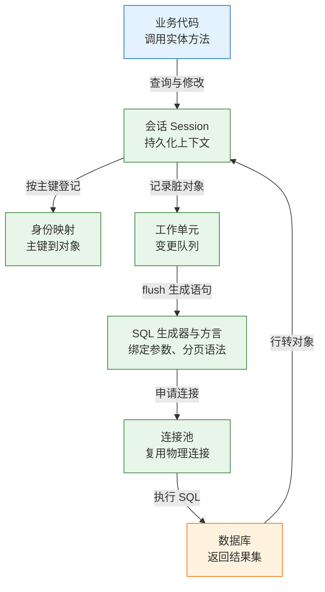
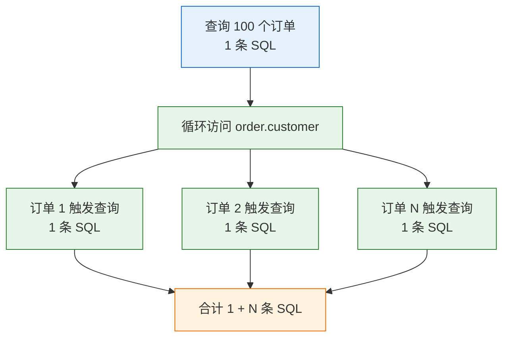
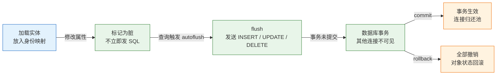
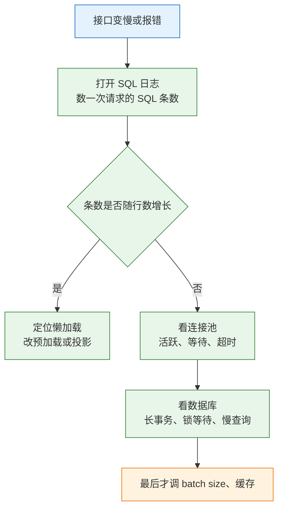

# ORM 与数据访问

---

## 一、ORM 是什么

ORM（Object-Relational Mapping，对象关系映射）把数据库中的行映射成程序里的对象，再用工作单元把对象的变更翻译成 SQL。它省掉的是重复的列赋值、关联拼装和手写 CRUD，不省数据库知识：索引、执行计划、事务边界和连接容量仍然要由开发者负责。

它适合以主键查询、简单关联和增删改查为主的业务代码；不适合复杂报表、批量数据管道和需要精细控制锁与执行计划的场景。N+1、连接池耗尽、事务过长这三类问题，最终都要回到 SQL 条数与连接占用上解决，ORM 本身无法屏蔽。

### 1.1 核心概念

ORM 的核心不是"把 SQL 藏起来"，而是三个协作对象：**会话**保存持久化上下文，**身份映射**保证同一主键只有一个对象，**工作单元**记录变更并在适当时机统一发 SQL。

| 概念 | 本质 | 常见表现 |
|---|---|---|
| 实体 Entity | 映射到表的类 | `User`、`Order` |
| 会话 Session | 持久化上下文与一级缓存 | `Session`、`EntityManager` |
| 身份映射 | 主键到对象实例的字典 | 同主键重复查询返回同一对象 |
| 工作单元 | 待执行的插入、更新、删除队列 | 提交时按依赖排序发送 |
| 脏检查 | 比较对象当前值与加载快照 | 改属性后自动生成 `UPDATE` |
| 方言 Dialect | 生成目标数据库方言的 SQL | 分页、upsert、类型各不相同 |
| flush | 把内存变更发送为 SQL | 事务未提交，其他连接看不到 |

会话不是线程安全的，也不应跨请求复用。身份映射只保证"同一会话、同一主键、同一对象"，它不是查询缓存：按非主键条件查询，即使结果相同也会重新发 SQL。

### 1.2 与相邻技术的关系

数据访问层有四种典型形态，差别在于"SQL 由谁写、结果如何映射"。

| 技术 | SQL 控制权 | 映射方式 | 典型定位 |
|---|---|---|---|
| JDBC / 驱动 | 开发者手写 | 手动逐列取值 | 极简查询、底层工具 |
| MyBatis | 开发者手写 | XML 或注解映射 | SQL 复杂、需精细控制 |
| jOOQ / Drizzle | 类型安全 DSL | 自动映射 | 复杂查询、强类型 |
| JPA / SQLAlchemy ORM | 框架生成 | 全自动对象映射 | 领域模型、CRUD 为主 |

ORM 与 SQL 映射器不是替代关系。一个系统可以主体用 ORM，报表和批量任务下沉到原生 SQL；也可以主体用 MyBatis，简单 CRUD 用代码生成。判断标准是查询复杂度与团队对 SQL 的掌控程度，而不是"ORM 是否先进"。

ORM 也无法完全抽象数据库差异。分页语法、`RETURNING`、upsert、JSON 路径、隔离级别和锁提示，各数据库的支持程度不同，方言层只能抹平一部分。涉及这些能力时，要么在 ORM 里使用方言扩展，要么明确下沉到原生 SQL，并把这部分代码集中管理，避免同一语义在项目里出现多种写法。

### 1.3 架构组成



分层带来几个直接后果：

- **方言决定 SQL 形态**。同一段 JPQL 或 `select()` 在 MySQL、PostgreSQL、SQLite 上生成的语句不同，分页、`RETURNING`、upsert 的支持程度也不同。
- **连接池位于 ORM 之下**。会话不等于连接：会话可以长时间存在，只在 flush 或查询时借连接；但事务一旦开启，连接就被占住直到提交。
- **身份映射与工作单元共享生命周期**。会话关闭后对象变成游离态，再访问懒加载关联就会报错。
- **SQL 生成器不理解业务**。它只按映射和查询表达式生成语句，索引是否命中、是否放大行数，仍要回到数据库侧验证。

---

## 二、接入与最小工程

> **版本现状（2026）**：Java 侧 JPA 实现以 Hibernate 6.x/7.x 为主，具体大版本跟随 Spring Boot 管理；MyBatis 3.5.x 仍在维护。Python 侧 SQLAlchemy 2.x 是当前主线，Alembic 跟随其版本；Node 侧 Prisma、Drizzle 以官方当前版本为准。ORM 的 API 与小版本行为差异较大，升级前先读对应版本的迁移说明，不要照旧文抄写。

### 2.1 依赖与版本

```bash
# ========== Python ==========
# SQLAlchemy 2.x 与迁移工具 Alembic
python3 -m venv /tmp/orm-demo/.venv
source /tmp/orm-demo/.venv/bin/activate
pip install "sqlalchemy>=2,<3" "alembic>=1,<2"

# 确认实际安装版本
python -c "import sqlalchemy; print(sqlalchemy.__version__)"
```

```xml
<!-- ========== Java：Spring Boot 管理版本，不手写 Hibernate 版本 ========== -->
<dependency>
  <groupId>org.springframework.boot</groupId>
  <artifactId>spring-boot-starter-data-jpa</artifactId>
</dependency>

<!-- 使用 MyBatis 时替换为对应 starter -->
<dependency>
  <groupId>org.mybatis.spring.boot</groupId>
  <artifactId>mybatis-spring-boot-starter</artifactId>
  <version>3.0.4</version>
</dependency>
```

| 生态 | 核心依赖 | 迁移工具 |
|---|---|---|
| Java / JPA | `spring-boot-starter-data-jpa` | Flyway、Liquibase |
| Java / MyBatis | `mybatis-spring-boot-starter` | Flyway、Liquibase |
| Python | `sqlalchemy` | Alembic |
| Node / TS | `prisma` 或 `drizzle-orm` | Prisma Migrate、Drizzle Kit |

依赖版本应统一由 BOM 或锁文件管理。同一工程里同时出现两个 Hibernate 大版本，常见结果是注解不识别、方言类找不到，启动时才暴露。

### 2.2 引擎与会话创建

引擎持有连接池和方言，是进程级单例；会话是请求级短生命周期对象。两者不能混用：每次请求新建引擎会不断创建连接池，最终耗尽数据库连接。

```python
# /tmp/orm-demo/engine.py
from sqlalchemy import create_engine
from sqlalchemy.orm import sessionmaker

# echo=True 仅用于本地观察 SQL，默认关闭
engine = create_engine(
    "sqlite:////tmp/orm-demo/shop.db",
    echo=False,
    connect_args={"timeout": 5},
)

# expire_on_commit=False 让提交后对象仍可读取，适合返回 DTO 的场景
SessionLocal = sessionmaker(bind=engine, expire_on_commit=False)
```

```yaml
# Java：Spring Boot 的数据源与 JPA 关键配置
spring:
  datasource:
    url: jdbc:mysql://db:3306/shop?useSSL=false
    username: app
    password: ${DB_PASSWORD}
    hikari:
      maximum-pool-size: 20
      minimum-idle: 5
      connection-timeout: 3000
      max-lifetime: 1200000
  jpa:
    open-in-view: false
    hibernate:
      ddl-auto: validate
    properties:
      hibernate:
        jdbc.batch_size: 50
        order_inserts: true
```

| 对象 | 生命周期 | 关键点 |
|---|---|---|
| 引擎 / DataSource | 进程级单例 | 持有连接池与方言 |
| 会话工厂 | 进程级单例 | 只负责创建会话 |
| 会话 / EntityManager | 请求或事务级 | 非线程安全，用完关闭 |
| 事务 | 方法或请求级 | 提交前占用连接 |

### 2.3 第一个映射与 SQL 验证

```python
# /tmp/orm-demo/models.py
from sqlalchemy import ForeignKey, String
from sqlalchemy.orm import DeclarativeBase, Mapped, mapped_column, relationship

class Base(DeclarativeBase):
    pass

class User(Base):
    __tablename__ = "users"
    id: Mapped[int] = mapped_column(primary_key=True)
    name: Mapped[str] = mapped_column(String(50))
    orders: Mapped[list["Order"]] = relationship(back_populates="user")

class Order(Base):
    __tablename__ = "orders"
    id: Mapped[int] = mapped_column(primary_key=True)
    user_id: Mapped[int] = mapped_column(ForeignKey("users.id"))
    total: Mapped[int]
    user: Mapped[User] = relationship(back_populates="orders")
```

```python
# 仅用于本地原型：按模型建表
from models import Base, Order, User
from engine import SessionLocal, engine

Base.metadata.drop_all(engine)
Base.metadata.create_all(engine)

with SessionLocal() as s:
    s.add_all([User(name=f"u{i}", orders=[Order(total=i * 100)]) for i in range(5)])
    s.commit()
```

`create_all` 只做"表不存在则建"，不会改已有表结构，也没有版本记录。它适合本地原型和测试初始化；生产必须用版本化迁移，见第七节。

| 映射要素 | SQLAlchemy 2.x | JPA |
|---|---|---|
| 实体声明 | `DeclarativeBase` + `Mapped` | `@Entity` |
| 表名 | `__tablename__` | `@Table(name=...)` |
| 主键 | `mapped_column(primary_key=True)` | `@Id` + `@GeneratedValue` |
| 普通列 | `mapped_column(String(50))` | `@Column(length=50)` |
| 关联 | `relationship()` | `@ManyToOne` / `@OneToMany` |

> **注意**：`create_all` 与 `ddl-auto=update` 都不是迁移工具。前者不会修改已有表，后者会按实体推断并执行变更，可能删列、改类型、丢数据。生产环境用 `validate` 校验实体与库一致，变更交给迁移脚本。

---

## 三、数据模型与映射

### 3.1 类与表的映射

映射的第一层是命名与类型。表名、列名、布尔值、枚举、时间戳在不同数据库上的表示差异很大，靠约定统一比靠逐处注解可靠。

| 需求 | 推荐做法 | 易错点 |
|---|---|---|
| 表名/列名 | 统一小写加下划线 | 大小写在不同库上行为不同 |
| 布尔值 | 数据库布尔类型或 `smallint` | SQLite 无布尔类型，用 0/1 |
| 枚举 | 存字符串并加 `CHECK` | 存序号后调整顺序会错位 |
| 时间戳 | 统一 UTC，`timestamp` 或 `text` | 本地时间跨时区会错 |
| 金额 | 整数分或定点数 | 浮点会积累误差 |

命名策略应在项目初期固定。后期改表名要同步改实体、迁移、索引和外部报表，成本远高于一开始统一。

### 3.2 关联关系与加载策略

| 关系 | 数据库形态 | 拥有方 | 默认加载 |
|---|---|---|---|
| 多对一 | 外键在本表 | 本表 | JPA EAGER，SQLAlchemy 延迟 |
| 一对多 | 外键在对方表 | 对方表 | 两者均延迟 |
| 一对一 | 唯一外键或共享主键 | 有外键一侧 | JPA EAGER，SQLAlchemy 延迟 |
| 多对多 | 中间表 | 任一方的集合 | 两者均延迟 |

JPA 用 `mappedBy` 声明反向端，反向端不管理外键；SQLAlchemy 用 `back_populates` 双向绑定。只在一侧配置关联，常见结果是写入不生效或查询多一条 SQL。

```java
@Entity
public class Order {
    @Id @GeneratedValue(strategy = GenerationType.IDENTITY)
    private Long id;

    // 多对一：默认 EAGER，显式改 LAZY 避免每次连带查询
    @ManyToOne(fetch = FetchType.LAZY, optional = false)
    @JoinColumn(name = "customer_id")
    private Customer customer;

    // 一对多：由对方的外键维护，mappedBy 指向对方属性
    @OneToMany(mappedBy = "order", cascade = CascadeType.ALL, orphanRemoval = true)
    private List<OrderItem> items = new ArrayList<>();
}
```

`cascade` 决定父对象操作是否传播到子对象，`orphanRemoval` 决定解除关联后是否删除子行。两者都只作用于 ORM 管理的对象，批量 SQL 和原生语句不会触发级联。

> **注意**：把集合默认设为 `EAGER` 会让每次查订单都附带查明细，列表页极易放大成笛卡尔积。集合一律延迟加载，需要时用预加载显式取，不要靠全局 `EAGER` 图省事。

### 3.3 主键、版本与审计字段

| 字段 | 作用 | 实现方式 |
|---|---|---|
| 代理主键 | 稳定、无业务含义 | 自增或序列 |
| 业务唯一键 | 防重复 | 唯一索引 |
| 版本号 | 乐观锁 | `@Version`、`version_id_col` |
| 创建时间 | 审计 | 插入时赋值，禁止更新 |
| 更新时间 | 审计与增量同步 | 更新时赋值 |

代理主键优于让业务字段做主键：邮箱、手机号会变更，变更就要级联更新所有引用。业务唯一性用唯一索引保证，不用主键兼做。

```python
from datetime import datetime, timezone
from sqlalchemy import DateTime
from sqlalchemy.orm import Mapped, mapped_column

class Order(Base):
    __tablename__ = "orders"
    id: Mapped[int] = mapped_column(primary_key=True)
    version: Mapped[int] = mapped_column(default=0, nullable=False)
    created_at: Mapped[datetime] = mapped_column(
        DateTime(timezone=True),
        default=lambda: datetime.now(timezone.utc),
    )
    # 告诉 ORM 用 version 列做乐观锁
    __mapper_args__ = {"version_id_col": version}
```

乐观锁字段由 ORM 在 `UPDATE` 时自动加 `WHERE version = ?` 并递增；手写 SQL 更新同一行时，必须自己维护版本号，否则 ORM 的并发保护会被绕过。

---

## 四、查询与加载策略

### 4.1 查询接口分层

| 接口 | 表达方式 | 适用 |
|---|---|---|
| JPQL / HQL | 面向实体与属性 | 常规查询，可移植 |
| Criteria / Specification | 代码拼装条件 | 动态筛选 |
| 原生 SQL | 直接写数据库方言 | 报表、窗口函数、优化 |
| MyBatis Mapper | XML 或注解 | SQL 复杂、需要精细控制 |
| SQLAlchemy `select()` | Python 表达式 | 组合条件、预加载 |

同一业务可以混用，但要有边界：领域查询走 ORM，报表和批处理走原生 SQL，并在代码结构上分开，避免"半 ORM 半原生"的状态混在同一个服务方法里。

查询接口的选择还影响可测试性。JPQL 与 `select()` 可以脱离数据库拼装和断言，适合单元测试；原生 SQL 依赖具体方言，适合集成测试。把复杂报表 SQL 放进独立的查询类或 Mapper，既能让 ORM 的会话边界保持干净，也能让 DBA 直接审阅语句，不必穿过实体映射去推断最终 SQL。

### 4.2 N+1 的成因与验证

N+1 指先查主表一次，再对每一行触发一次关联查询。数据量小时延迟不明显，行数上来后 SQL 条数线性增长，接口 P99 突然抖动。



```python
# /tmp/orm-demo/demo.py
from sqlalchemy import event, select
from sqlalchemy.orm import Session, selectinload
from engine import engine
from models import User

queries = 0

@event.listens_for(engine, "before_cursor_execute")
def count_sql(conn, cursor, statement, parameters, context, executemany):
    global queries
    queries += 1

with Session(engine) as s:
    users = s.scalars(select(User)).all()
    total = sum(len(u.orders) for u in users)
    print(f"lazy: queries={queries}, orders={total}")

queries = 0
with Session(engine) as s:
    users = s.scalars(select(User).options(selectinload(User.orders))).all()
    total = sum(len(u.orders) for u in users)
    print(f"eager: queries={queries}, orders={total}")
```

```text
lazy: queries=6, orders=5
eager: queries=2, orders=5
```

五个用户时，懒加载是 `1 + 5 = 6` 条；`selectinload` 是"查用户一条 + 按 `IN (ids)` 查订单一条"，共两条。计数要放在同一进程、同一引擎上，且统计的是真实执行语句，不是 ORM 方法调用次数。

插桩位置决定统计是否可信。挂在引擎的 `before_cursor_execute` 上能覆盖 ORM 生成和原生 SQL，但会把迁移、健康检查也算进去；挂在会话上则可能漏掉连接池内部的探活语句。压测时先确认计数口径，再看改造前后的差值，否则很容易把"少查了一次健康检查"当成优化成果。

### 4.3 预加载策略选择

| 策略 | SQL 形态 | 适用 | 风险 |
|---|---|---|---|
| 懒加载 | 访问时按需查询 | 单体、关联少 | N+1、会话关闭后报错 |
| `JOIN` 预加载 | 一条带 `JOIN` 的 SQL | 多对一、一对一 | 一对多放大行数 |
| `IN` 预加载 | 两条 SQL | 一对多集合 | 主表 ID 过多时 `IN` 很长 |
| 批量加载 | 按批 `IN` 查询 | 大结果集 | 批大小要调 |
| 禁止加载 | 访问即报错 | 发现隐性 N+1 | 仅用于开发排查 |

JPA 对应 `FetchType.LAZY`、`JOIN FETCH`、`@EntityGraph`；MyBatis 对应嵌套查询加 `fetchType="lazy"`，或直接手写 `JOIN`。名字不同，问题相同：一对多集合不能用 `JOIN` 加 `LIMIT` 直接分页。

```java
// 多对一：一条 JOIN 取回，不会放大行数
@Query("select o from Order o join fetch o.customer where o.status = :status")
List<Order> findPaidWithCustomer(@Param("status") String status);

// 一对多：EntityGraph 让 Hibernate 选择加载图，分页时仍需注意集合放大
@EntityGraph(attributePaths = "items")
@Query("select o from Order o where o.customer.id = :customerId")
List<Order> findByCustomer(@Param("customerId") Long customerId);
```

一对多分页的正确顺序是：先对主表分页取 ID，再用 `IN` 查关联，最后在内存按主键归组。直接把集合 `JOIN` 进来再 `LIMIT`，数据库会先放大行再截断，返回条数和总数都会错。Hibernate 对这类查询会在内存中分页并给出告警，其他 ORM 可能直接返回错误结果。

### 4.4 投影与深分页

列表页只需要少数列，加载完整实体会经过身份映射、可能触发懒加载，还把无关字段带进内存。投影查询直接返回元组或 DTO，结构稳定，也不会意外触发关联。

```python
from sqlalchemy import select
from models import Order

rows = session.execute(
    select(Order.id, Order.total, Order.status)
    .where(Order.user_id == user_id)
    .order_by(Order.created_at.desc(), Order.id.desc())
    .limit(50)
).all()
```

深分页的问题在 `OFFSET`：`LIMIT 100000, 20` 会让数据库先扫十万行再丢掉。改成基于排序键的游标分页，每次从上一页最后一个键继续。

```sql
-- 游标分页：按 (created_at, id) 稳定排序，条件用行值比较
SELECT id, created_at, total_cents
FROM orders
WHERE (created_at, id) < ($1, $2)
ORDER BY created_at DESC, id DESC
LIMIT 20;
```

| 分页方式 | 成本 | 适用 |
|---|---|---|
| `OFFSET` | 随页码线性增长 | 前几页、后台小数据 |
| 游标 / Keyset | 每页稳定 | 信息流、导出、大表 |
| 先 ID 后关联 | 两条查询 | 一对多集合分页 |

游标分页要求排序键唯一且稳定，通常用 `(created_at, id)` 联合索引。返回 `next_cursor` 而不是页码，前端不能再随意跳到第 N 页，这是接口契约上的取舍。

---

## 五、事务与并发控制

### 5.1 工作单元与提交流程



flush 与 commit 是两个动作。flush 把内存变更翻译成 SQL 发给数据库，但事务仍可回滚；commit 才让变更对其他连接可见并持久化。很多"SQL 已经发了，为什么查不到"的问题，是把 flush 当成了 commit。

| 动作 | 发生时机 | 效果 |
|---|---|---|
| 脏检查 | 查询前或提交前 | 找出属性被改的对象 |
| autoflush | 执行查询前默认触发 | 先发未决 SQL，保证查询一致 |
| flush | 显式调用或提交时 | 发送 SQL，事务未提交 |
| commit | 事务结束 | 提交并释放连接 |
| rollback | 异常或显式调用 | 撤销事务内全部变更 |

> **注意**：`autoflush` 会在查询前偷偷发 SQL，调试时看到的语句数量可能比预期多。排查 N+1 时要把 autoflush 的影响算进去，必要时临时关闭，但不要在生产长期关闭，否则查询可能读到未发送的旧状态。

### 5.2 事务边界

事务应覆盖"一组必须一起成功的数据库写操作"，不应覆盖远程调用、文件读写和消息发送。事务越长，锁持有越久，连接占用越久，并发能力越差。

| 边界 | 范围 | 评价 |
|---|---|---|
| 请求级会话 | 整个 HTTP 请求 | 易把连接持有到响应结束 |
| 服务方法级 | 一个业务用例 | 推荐，边界清晰 |
| DAO 方法级 | 单条语句 | 过碎，无法组合 |
| 事务外调用 | 远程、消息、文件 | 必须移出事务 |

```text
BEGIN
  UPDATE inventory SET stock = stock - 1 WHERE product_id = 7;
  HTTP 调用支付网关（可能 3 秒）
COMMIT
```

这段代码会把行锁和连接持有三秒，并发一高就排队。正确做法是本地事务只改库，外部调用放到提交之后，用 outbox 表或补偿任务保证最终一致。

Spring 的 `spring.jpa.open-in-view=true` 会把 `EntityManager` 绑定到整个请求，视图渲染期间仍可懒加载。它方便，但掩盖 N+1，并让连接持有到响应结束。生产通常关闭，在服务层把需要的数据取完再返回 DTO。

### 5.3 事务传播

| 传播行为 | 外层有事务 | 外层无事务 | 典型用途 |
|---|---|---|---|
| `REQUIRED` | 加入 | 新建 | 默认，绝大多数写操作 |
| `REQUIRES_NEW` | 挂起外层、新建 | 新建 | 失败也要记录的日志 |
| `NESTED` | 保存点 | 新建 | 子操作可单独回滚 |
| `SUPPORTS` | 加入 | 无事务执行 | 只读查询 |
| `NOT_SUPPORTED` | 挂起外层 | 无事务执行 | 不受事务控制的长任务 |
| `MANDATORY` | 加入 | 抛异常 | 强制在事务内调用 |
| `NEVER` | 抛异常 | 无事务执行 | 明确禁止事务 |

`@Transactional` 依赖代理生效。同一个类里 `this.methodB()` 调用带注解的 `methodB`，不经过代理，事务不生效；必须通过注入的代理对象调用，或把方法拆到另一个 Bean。

默认只对 `RuntimeException` 和 `Error` 回滚，受检异常要显式 `rollbackFor`。内层事务抛异常被外层 `catch` 吞掉时，事务可能已被标记为 rollback-only，最终提交仍会失败，这类问题要看日志里的 `UnexpectedRollbackException`。

### 5.4 乐观锁与批量操作

ORM 的"读—改—写"默认是最后写入覆盖。两个请求同时读到 `status='pending'`，各自改成不同值，后提交的会覆盖先提交的。乐观锁用版本号把冲突暴露出来。

```sql
-- 版本号条件更新，影响行数为 0 说明已被他人修改
UPDATE orders
SET status = 'paid', version = version + 1
WHERE id = ? AND version = ?;
```

```python
from sqlalchemy import update

# 批量更新直接打数据库，不经过身份映射
session.execute(
    update(Order)
    .where(Order.status == "pending")
    .values(status="cancelled")
)
session.commit()
session.expire_all()   # 丢弃会话中已加载的旧对象状态
```

批量 `UPDATE` 绕过工作单元，会话里已加载的对象仍是旧值。要么提交后 `expire_all()`，要么设置 `synchronize_session` 让 ORM 同步内存状态，要么干脆只用原生 SQL 并避免混用对象缓存。

批量插入同理：逐条 `save()` 再逐条 flush 是最慢的写法。`add_all()` 加一次 `flush()` 能减少往返；SQLAlchemy 2.x 的 `insertmanyvalues` 在支持 `RETURNING` 的数据库上会合并插入；Java 侧 MySQL 走 JDBC 批处理时，需要 `rewriteBatchedStatements=true` 才能真正合并。批量大小按 500–1000 起步，太大反而增加锁持有和内存。

---

## 六、连接池与容量

### 6.1 池参数

每次请求新建物理连接要经历 TCP 握手、认证、服务端分配资源，成本远高于查询本身。连接池复用连接，但参数必须和数据库容量匹配。

| 参数（HikariCP / SQLAlchemy） | 作用 | 常见错误 |
|---|---|---|
| `maximumPoolSize` / `pool_size` | 池内最多连接 | 所有实例之和超过数据库上限 |
| `minimumIdle` | 常驻空闲连接 | 设太大，空闲也占库连接 |
| `connectionTimeout` / `pool_timeout` | 取连接等待上限 | 太长请求堆积，太短误杀慢查询 |
| `maxLifetime` / `pool_recycle` | 连接最长寿命 | 大于数据库空闲超时，拿到死连接 |
| `leakDetectionThreshold` | 借出多久未归还告警 | 不设则泄漏只能靠现象发现 |

### 6.2 容量估算

估算公式：`实例数 × 每实例池上限 + 后台任务连接 < 数据库 max_connections`。四个实例、每池 20，就是 80 条，再给迁移、监控和运维留余量。

```yaml
spring:
  datasource:
    hikari:
      maximum-pool-size: 20
      minimum-idle: 5
      connection-timeout: 3000
      max-lifetime: 1200000      # 小于数据库 wait_timeout
      leak-detection-threshold: 20000
```

池不是越大越好。数据库 CPU 核数有限，连接过多会加剧上下文切换和锁竞争；PostgreSQL 前面通常加 PgBouncer，把几百个客户端连接压到几十个后端连接。连接池解决的是复用，不解决数据库并发能力。

估算要按最坏情况留余量。假设数据库 `max_connections=200`，四个应用实例各配 20，后台批处理再占 10，总计 90，看似安全；但滚动发布时新旧版本会短暂共存，实例数翻倍就变成 170，再叠加迁移连接和监控，余量迅速消失。容量评审要把发布策略、故障转移和批处理窗口一起算进去，而不是只算稳态副本数。

### 6.3 泄漏与探活

| 现象 | 最可能原因 | 处理 |
|---|---|---|
| 池等待超时逐渐增多 | 连接借出未归还 | 开泄漏检测，查未关闭会话 |
| 夜间固定报连接断开 | `maxLifetime` 大于库空闲超时 | 调小生命周期，开 `pre_ping` |
| 空闲连接很多但请求排队 | `minimumIdle` 与池上限配置失衡 | 核对池指标与库侧连接数 |
| 单条慢查询拖垮全池 | 长事务或全表扫描 | 修 SQL，设查询超时 |

`pre_ping` 在取连接前执行一次轻量探测，能避免拿到已被服务端关闭的连接，代价是每个借出动作多一次往返。数据库稳定、网络可靠时可以关闭；跨网络或经过代理时必须开启。

监控至少覆盖四个指标：活跃连接数、空闲连接数、等待连接的线程数、获取连接的超时次数。活跃数长期贴近上限说明池容量不足或查询太慢；等待数周期性升高说明流量峰值超过容量；超时次数增长则要区分是池太小还是连接泄漏。单看平均响应时间无法定位这三类问题。

> **安全警告**：连接泄漏比慢查询更隐蔽。一个请求忘记关闭会话，连接就一直被占，直到池耗尽，所有接口一起超时。必须设置 `leakDetectionThreshold` 并监控池的活跃数、等待数、超时数，不能只看接口平均耗时。

---

## 七、迁移与测试

### 7.1 版本化迁移

| 生态 | 工具 | 管理方式 |
|---|---|---|
| Java | Flyway | 版本化 SQL 脚本，按版本号顺序执行 |
| Java | Liquibase | XML/YAML/SQL changelog，支持回滚 |
| Python | Alembic | 基于模型的迁移脚本，可自动生成草稿 |
| Node | Prisma Migrate | schema 驱动生成迁移 |
| Node | Drizzle Kit | 从 schema 生成 SQL 迁移 |

迁移脚本要进版本库、按序执行、只增不改。已经上线的脚本不能再修改，否则不同环境的执行历史会分叉。回滚脚本可以准备，但数据删列这类操作往往无法真正回滚，靠备份更可靠。

既有系统接入迁移工具时，先做一次基线：把当前结构导出为初始脚本，在空库上执行并校验，再让后续变更从下一个版本号开始。没有基线就直接生成迁移，工具会把现有表当成"待创建"，首次执行必然冲突。

### 7.2 扩展、回填、收缩

大表结构变更不能一步到位。直接加非空列、改类型或建索引，可能锁表数分钟甚至更久。标准做法分四步：

| 阶段 | 操作 | 目的 |
|---|---|---|
| 扩展 | 加可空列、加索引 | 不破坏旧代码 |
| 双写 | 新代码同时写新旧字段 | 两边都有数据 |
| 回填 | 分批把旧数据补到新字段 | 避免长事务 |
| 收缩 | 切读、删旧列 | 完成迁移 |

```sql
-- 1. 扩展：先加可空列，旧代码不受影响
ALTER TABLE orders ADD COLUMN channel TEXT;

-- 2. 回填：分批更新，每批提交，避免长事务
UPDATE orders SET channel = 'legacy'
WHERE channel IS NULL AND id BETWEEN 1 AND 10000;
-- 重复执行下一批区间，直到无 NULL

-- 3. 收缩：确认新代码已全量读取新列后再加约束
-- 以下为 PostgreSQL 语法，MySQL 与 SQLite 的写法不同
ALTER TABLE orders ALTER COLUMN channel SET NOT NULL;
```

每批大小按 1000–10000 行实测，批间留间隔，观察复制延迟和锁等待。ORM 的实体要能同时兼容新旧结构，部署顺序是"先迁移、再发代码、最后清理"，不能反过来。

### 7.3 测试数据库

| 方案 | 优点 | 缺点 |
|---|---|---|
| H2 / SQLite 内存库 | 快、无依赖 | 方言、锁、类型与生产不同 |
| Testcontainers | 与生产同版本 | 启动慢，CI 需要 Docker |
| 共享测试库 | 接近生产 | 数据隔离难，容易互相污染 |

ORM 的 SQL 由方言生成，H2 能跑不代表 MySQL 或 PostgreSQL 能跑。关键路径至少用 Testcontainers 跑一遍真实数据库，覆盖迁移脚本、唯一约束、JSON 字段、锁行为和分页 SQL。

> **注意**：内存库常把 `NULL` 排序、字符串比较、事务隔离级别处理得与生产不同。用 H2 跑通的用例，换到生产库可能因为一条 `ORDER BY` 或唯一索引失败。测试数据库的选择要写进项目约定，不能由个人随意切换。

测试数据应由工厂或夹具按用例生成，不要依赖一套长期共享的种子数据。共享数据会被前一个用例改动，失败原因难以复现；每个用例自建数据、事务回滚或清库，才能保证结果稳定。迁移测试则相反，要在空库上从第一个版本跑到最新版本，验证升级路径而不只是最终结构。

---

## 八、完整示例：订单列表查询改造

### 8.1 环境与模型

沿用第二节的 `engine.py`，把模型换成带客户关联的版本，构造可复现的 N+1 场景。

```python
# /tmp/orm-demo/full_demo.py
from datetime import datetime, timezone

from sqlalchemy import DateTime, ForeignKey, String, event, select
from sqlalchemy.orm import (DeclarativeBase, Mapped, Session, mapped_column,
                            relationship)

class Base(DeclarativeBase):
    pass

class Customer(Base):
    __tablename__ = "customers"
    id: Mapped[int] = mapped_column(primary_key=True)
    name: Mapped[str] = mapped_column(String(50))
    orders: Mapped[list["Order"]] = relationship(back_populates="customer")

class Order(Base):
    __tablename__ = "orders"
    id: Mapped[int] = mapped_column(primary_key=True)
    customer_id: Mapped[int] = mapped_column(ForeignKey("customers.id"))
    total: Mapped[int]
    status: Mapped[str] = mapped_column(String(20), default="pending")
    created_at: Mapped[datetime] = mapped_column(
        DateTime(timezone=True),
        default=lambda: datetime.now(timezone.utc),
    )
    customer: Mapped[Customer] = relationship(back_populates="orders")
```

### 8.2 计数与改造

```python
from engine import engine

Base.metadata.drop_all(engine)
Base.metadata.create_all(engine)

with Session(engine) as s:
    for i in range(50):
        s.add(Customer(name=f"c{i}", orders=[Order(total=i * 100)]))
    s.commit()

counter = {"n": 0}

@event.listens_for(engine, "before_cursor_execute")
def count_sql(conn, cursor, statement, parameters, context, executemany):
    counter["n"] += 1

# 改造前：列表一次，循环访问 customer 五十次
counter["n"] = 0
with Session(engine) as s:
    orders = s.scalars(select(Order).limit(50)).all()
    names = [o.customer.name for o in orders]
print(f"before: sql={counter['n']}, rows={len(names)}")

# 改造后：JOIN 预加载，一条 SQL 取回订单与客户
from sqlalchemy.orm import joinedload

counter["n"] = 0
with Session(engine) as s:
    orders = s.scalars(
        select(Order).options(joinedload(Order.customer)).limit(50)
    ).all()
    names = [o.customer.name for o in orders]
print(f"after: sql={counter['n']}, rows={len(names)}")
```

```text
before: sql=51, rows=50
after: sql=1, rows=50
```

多对一用 `joinedload` 是一条 SQL，不会放大行数；如果这里是一对多集合，就应换 `selectinload`，否则 `LIMIT` 会被集合行放大。改造后用同一套计数逻辑复核，不能只看接口变快。

### 8.3 结果核对与 Java 对照

```python
# 投影 + 游标分页：列表页只取需要的列
from datetime import datetime, timezone
from sqlalchemy import tuple_

last_created = datetime(2026, 10, 29, tzinfo=timezone.utc)
last_id = 1000

with Session(engine) as session:
    rows = session.execute(
        select(Order.id, Order.total, Order.status)
        .where(tuple_(Order.created_at, Order.id) < (last_created, last_id))
        .order_by(Order.created_at.desc(), Order.id.desc())
        .limit(20)
    ).all()
```

Java 侧同一改造用 `@EntityGraph` 或 `JOIN FETCH`，并在服务层返回 DTO，避免把实体带出事务：

```java
@Service
public class OrderQueryService {
    private final OrderRepository repo;

    public OrderQueryService(OrderRepository repo) {
        this.repo = repo;
    }

    @Transactional(readOnly = true)
    public List<OrderView> list(Long customerId) {
        // 一条 SQL 取回订单与客户，再映射为 DTO
        return repo.findWithCustomer(customerId).stream()
                .map(o -> new OrderView(o.getId(), o.getTotal(),
                                        o.getCustomer().getName()))
                .toList();
    }
}
```

核对标准有三条：SQL 条数从 N+1 降到常数级；返回行数与分页参数一致；DTO 字段与接口契约一致。三条都满足，才说明改造完成，而不是把慢查询挪到了别处。

| 指标 | 改造前 | 改造后 | 判定 |
|---|---|---|---|
| SQL 条数 | 51 | 1 | 随行数增长即为 N+1 |
| 返回行数 | 50 | 50 | 与分页参数一致 |
| 关联访问 | 循环触发查询 | 预加载取回 | 会话关闭后仍可读 |

---

## 九、常见故障与排查

| 现象 | 最可能原因 | 处理 |
|---|---|---|
| 接口慢、SQL 条数暴增 | N+1 懒加载 | 预加载、批量查询、DTO 投影 |
| `LazyInitializationException` | 会话关闭后访问关联 | 服务层取完数据，或改 DTO |
| `DetachedInstanceError` | 对象已脱离会话 | 在会话内取值，禁用过期对象 |
| 连接池等待超时 | 池太小、慢查询占连接、泄漏 | 看池指标与数据库会话，修慢查询或泄漏 |
| 拿到已关闭的连接 | `maxLifetime` 大于库空闲超时 | 调小生命周期，开 `pre_ping` |
| 更新丢失 | 读改写无版本控制 | 乐观锁或悲观锁 |
| 批量更新后读到旧值 | 绕过身份映射 | `expire_all`、`synchronize_session` |
| 分页数量不对 | 一对多 `JOIN` 放大行数 | 先分页主表，再查集合 |
| 实体与表结构不一致 | 生产用 `create_all`/`ddl-auto=update` | 改版本化迁移，启动时 `validate` |
| 事务长时间不提交 | 事务里做 HTTP 或文件操作 | 缩小事务，外部调用移出 |
| 事务注解不生效 | 同类自调用，未经过代理 | 拆 Bean 或走代理调用 |
| 原生 SQL 报语法错 | 拼接字符串、占位符不匹配 | 统一绑定参数，按方言写 |



排查顺序按"先数 SQL、再看连接、最后看数据库"推进：

1. 打开 SQL 日志，统计一次请求发了几条 SQL，先排除 N+1 和循环查询。
2. 看连接池活跃数、等待数、超时数，区分"SQL 慢"和"拿不到连接"。
3. 查数据库侧长事务、锁等待和慢查询日志，确认瓶颈在语句还是锁。
4. 核对事务边界，确认没有在事务里做远程调用、文件读写或大批量计算。
5. 核对实体与表结构，确认迁移已执行、`validate` 通过。
6. 以上都正常，才调整批大小、缓存和池参数，且每次只改一项并压测对比。

> **安全警告**：N+1 的解法是减少 SQL 条数，不是加缓存。用 Redis 挡住慢查询只会把不一致和雪崩风险带进来；连接泄漏也不能靠加大池上限缓解，那只是把耗尽时间往后推。

> **运维提示**：ORM 的三条底线——会话不跨请求、事务不包远程调用、上线前用真实数据库跑迁移与关键查询。守住这三条，绝大多数性能与一致性问题都能在开发阶段暴露。
