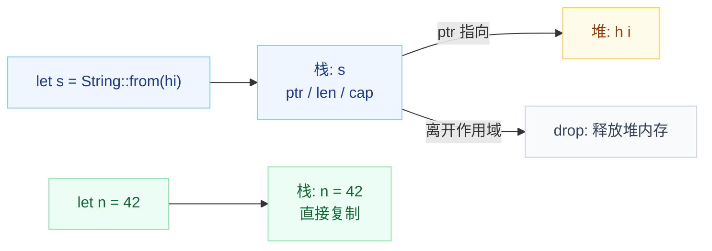

# Rust所有权与借用

> 这篇从值在栈与堆上的归属讲起，经过移动、克隆、借用、切片和生命周期标注，最后落到一套能读懂借用检查器报错、并把冲突改写成可编译代码的完整程序。
>
> 学完能判断一个值该由谁拥有、什么时候借、借多久，并独立修复 `E0382`、`E0502`、`E0597` 一类所有权错误。

## 一、所有权模型

Rust 不用垃圾回收，也不要求手动 `free`，靠三条编译期规则管理堆内存：每个值有且只有一个所有者；所有权可以转移，但转移后旧变量立即失效；所有者离开作用域时值被释放（drop）。

这三条规则由编译器静态检查，不产生运行时开销。理解所有权，先要分清值存在哪里。



- 栈（stack）：大小在编译期已知，分配和释放是移动栈指针，极快；
- 堆（heap）：大小运行期决定，分配要找到足够空间，释放要归还；
- `String`、`Vec<T>`、`Box<T>` 这类类型在栈上存一个「指针 + 长度 + 容量」的描述符，真实数据在堆上。

```rust
fn main() {
    let s = String::from("所有权"); // 堆上分配 9 字节 UTF-8 数据
    println!("len={} cap={}", s.len(), s.capacity());
    // s 在此离开作用域，编译器插入 drop(s)，堆内存被释放
}
```

预期输出：

```text
len=9 cap=9
```

> 版本基线（2026-11）：Rust 1.99 稳定版，`edition = "2024"`。所有权规则自 1.0 未变；2024 edition 的变化在闭包捕获、`gen` 关键字、`unsafe` 属性等语法层，不影响本篇的规则本身。

### 1.1 所有权三规则的直接后果

| 规则 | 编译期后果 | 运行期后果 |
|---|---|---|
| 一个值一个所有者 | 赋值即转移，旧变量失效 | 不会重复释放 |
| 所有者唯一 | 不能有两个变量同时负责释放 | 无双重 free |
| 作用域结束即释放 | 释放点由词法作用域决定 | 无 GC 停顿 |

边界：所有权只约束「负责释放的那个句柄」，不约束「能不能读数据」。共享读、独占写由下一节的借用规则处理。

## 二、移动、克隆与 Copy

赋值、传参、返回、插入集合，默认都是移动（move）。移动只复制栈上的描述符，堆数据不复制，旧变量立刻失效。

```rust
fn main() {
    let s1 = String::from("hello");
    let s2 = s1; // 所有权从 s1 移到 s2，s1 从此不可用
    println!("{}", s2);

    // println!("{}", s1); // 编译错误 E0382: borrow of moved value: `s1`
}
```

编译错误（片段，故意不修复）：

```text
error[E0382]: borrow of moved value: `s1`
 --> src/main.rs:6:20
  |
2 |     let s1 = String::from("hello");
  |         -- move occurs because `s1` has type `String`,
  |            which does not implement the `Copy` trait
3 |     let s2 = s1;
  |              -- value moved here
6 |     println!("{}", s1);
  |                    ^^ value borrowed here after move
  |
  = note: this error originates in the macro `$crate::format_args_nl`
```

移动的代价只是复制栈上的三个机器字（ptr/len/cap），堆数据一个字节都不动；所有权转移本身是编译期概念，运行期没有额外动作。所以「Rust 传参很贵」是误解，真正贵的是 `clone()`。

### 2.1 Copy：栈上类型按位复制

实现了 `Copy` 的类型在赋值时复制而不是移动，旧变量仍然可用。`Copy` 要求类型的所有字段都 `Copy`，并且不能实现 `Drop`。

```rust
fn main() {
    let a = 42;
    let b = a; // i32: Copy，a 仍然有效
    println!("a={} b={}", a, b);

    let p = (1, 2.5, true); // 元组所有元素都 Copy，元组也 Copy
    let q = p;
    println!("{:?}", p); // 仍可使用

    let s = String::from("x");
    // let t = (s, 1); let u = t; // 含 String 的元组不是 Copy，t 被移动
    println!("{}", s);
}
```

常见的 `Copy` 类型：

| 类别 | 类型 |
|---|---|
| 整数 | `i8`–`i128`、`u8`–`u128`、`isize`、`usize` |
| 浮点 | `f32`、`f64` |
| 布尔与字符 | `bool`、`char` |
| 引用 | `&T`（复制的是引用本身） |
| 组合 | 元素全是 `Copy` 的数组、元组、`Option<T>` |

> 边界：`&mut T` 不是 `Copy`，它被移动。函数签名里连续两次传同一个 `&mut`，第二次会报「value moved」。

### 2.2 Clone：显式深拷贝

`Clone` 是显式操作，必须写 `.clone()`。对 `String`、`Vec<T>`，`clone()` 会在堆上重新分配并复制全部元素。

```rust
fn main() {
    let s1 = String::from("hello");
    let s2 = s1.clone(); // 堆数据完整复制，两个所有者各自负责释放
    println!("s1={} s2={}", s1, s2);

    let v1 = vec![1, 2, 3];
    let v2 = v1.clone();
    println!("{:?} {:?}", v1, v2);
}
```

预期输出：

```text
s1=hello s2=hello
[1, 2, 3] [1, 2, 3]
```

`clone()` 是 O(n)。在热路径里对长 `Vec` 或大 `String` 反复 `clone`，会把借用问题变成性能问题。判断标准：**数据需要独立生命周期才 clone；只是为了绕过借用检查而 clone，通常有更好的写法**（见第六章）。

### 2.3 函数签名中的所有权

函数参数默认按「移动」接收，返回时把所有权交回调用方或交给 `main`。

```rust
fn consume(s: String) -> usize {
    // s 进入函数即拥有；函数结束 drop
    s.len()
}

fn borrow(s: &str) -> usize {
    // 只借用，不改变调用方的所有权
    s.len()
}

fn give_back(s: String) -> String {
    // 需要「用完还回来」时直接返回，不要传 &mut 只为取长度
    s
}

fn main() {
    let s = String::from("hello");
    println!("{}", borrow(&s));    // 借用：s 之后仍可用
    let n = consume(s);            // 移动：s 失效
    // println!("{}", s);          // E0382
    println!("{}", n);
}
```

设计原则：**能用借用就不用移动，能返回新值就不用 `&mut` 输出参数**。函数只在需要保存、转移或消费数据时才拿所有权。

| 函数要做什么 | 参数写成 | 理由 |
|---|---|---|
| 只读查看 | `&T` / `&str` / `&[T]` | 不夺走调用方数据 |
| 原地修改 | `&mut T` | 独占写，调用方保留所有权 |
| 保存到结构体或线程 | `T` 或 `String` | 需要独立生命周期 |
| 接收任意字符串 | `impl AsRef<str>` 或 `&str` | 兼顾 `String` 与字面量 |

## 三、借用与引用

借用（borrow）是在不转移所有权的前提下访问值。`&T` 是不可变借用，`&mut T` 是可变借用。借用检查器保证引用永远指向有效数据，因此 Rust 没有悬垂指针。

### 3.1 两条借用规则

1. 任意时刻，要么有任意多个 `&T`，要么只有一个 `&mut T`，二者不能同时存在；
2. 引用必须在被引用值失效前结束使用。

```rust
fn main() {
    let mut data = vec![1, 2, 3];

    let a = &data;       // 不可变借用
    let b = &data;       // 可以有多个
    println!("{:?} {:?}", a, b); // a、b 最后一次使用，借用到此结束

    let c = &mut data;   // 现在可以可变借用
    c.push(4);
    println!("{:?}", c);

    // let d = &data;    // 若在 c 使用期间再取不可变借用，报 E0502
}
```

违反规则的错误（片段）：

```text
error[E0502]: cannot borrow `data` as immutable because it is also
              borrowed as mutable
 --> src/main.rs:9:13
  |
8 |     let c = &mut data;
  |             ---- mutable borrow occurs here
9 |     let d = &data;
  |             ^^^^^ immutable borrow occurs here
10|     c.push(4);
  |     ---------- mutable borrow later used here
```

报错最后一行「mutable borrow later used here」是关键：借用检查器按**最后一次使用**判断借用的结束点，不是按作用域结尾。

### 3.2 非词法生命周期（NLL）

Rust 2018 起使用 NLL（non-lexical lifetimes），借用在实际最后一次使用后立即结束。这解释了为什么下面这段能编译：

```rust
fn main() {
    let mut s = String::from("hello");
    let r = s.as_str();       // 不可变借用
    println!("{}", r);        // r 最后一次使用
    s.push_str(" world");     // 不可变借用已结束，可以可变借用
    println!("{}", s);        // hello world
}
```

同一段代码在 2015 edition 的早期编译器里会失败。判断借用是否仍然活着，看「最后一次使用位置」，不看大括号。

### 3.3 可变借用期间不能读原变量

```rust
fn main() {
    let mut v = vec![1, 2, 3];
    let first = &mut v[0];
    // println!("{:?}", v); // E0502：v 已被可变借用
    *first += 10;
    println!("{:?}", v);    // [11, 2, 3]，借用结束后可以读
}
```

> 边界：这条规则不是为了限制写法，而是为了排除「一边扩容一边持有内部引用」导致指针失效。`Vec::push` 可能重新分配堆内存，如果旧引用还活着，就会变成悬垂指针。

### 3.4 借用与函数返回值

返回引用时，引用必须指向调用方仍然拥有的数据，不能指向函数内的局部变量。

```rust
// 编译失败（片段）：返回局部变量引用
// fn bad() -> &str {
//     let s = String::from("temp");
//     &s // E0515: cannot return reference to local variable
// }

// 正确写法一：返回拥有所有权的值
fn good_owned() -> String {
    String::from("temp")
}

// 正确写法二：从入参借用
fn first_word(s: &str) -> &str {
    s.split_whitespace().next().unwrap_or("")
}

fn main() {
    let owned = good_owned();
    println!("{}", owned);
    println!("{}", first_word("alpha beta")); // alpha
}
```

`first_word` 的返回引用生命周期与入参绑定，编译器的省略规则见第五章。

## 四、切片

切片（slice）是对一段连续数据的借用视图，不拥有数据，不复制数据。`&str` 是 UTF-8 字节切片，`&[T]` 是任意元素类型的切片。

### 4.1 字符串切片

```rust
fn main() {
    let s = String::from("hello world");
    let hello = &s[0..5];      // 按字节下标切，左闭右开
    let world = &s[6..];       // 省略结尾表示到末尾
    println!("{} {}", hello, world);

    let all: &str = &s[..];    // 整串切片，等价于 s.as_str()
    println!("{}", all.len()); // 11

    // let bad = &s[0..2];     // 若切在多字节字符中间，运行时 panic
}
```

字符串切片的下标是**字节**，不是字符。中文、emoji 占多个字节，按字符下标切会 panic。

```rust
fn main() {
    let s = "中文";
    println!("{}", s.len());          // 6 字节
    println!("{}", s.chars().count()); // 2 个字符
    println!("{}", &s[0..3]);         // 中，刚好 3 字节边界

    // println!("{}", &s[0..1]);      // panic: byte index 1 is not a char boundary
}
```

需要按字符处理时用 `chars()`、`char_indices()` 或 `s.split_at()` 找到合法边界：

```rust
fn main() {
    let s = "Rust中文";
    let boundary = s.char_indices().nth(4).map(|(i, _)| i).unwrap_or(s.len());
    let (head, tail) = s.split_at(boundary);
    println!("head={} tail={}", head, tail); // head=Rust tail=中文
}
```

### 4.2 数组与 Vec 切片

```rust
fn sum(items: &[i32]) -> i32 {
    // 接收 &[i32] 而不是 &Vec<i32>：数组、Vec、切片都能传
    items.iter().sum()
}

fn main() {
    let v = vec![1, 2, 3, 4, 5];
    let mid = &v[1..4];          // [2, 3, 4]
    println!("{:?}", mid);
    println!("{}", sum(&v));     // 15，&Vec<i32> 自动解引用为 &[i32]
    println!("{}", sum(mid));    // 9

    let arr = [10, 20, 30];
    println!("{}", sum(&arr));   // 60，数组也能传

    let (left, right) = v.split_at(2);
    println!("{:?} {:?}", left, right); // [1, 2] [3, 4, 5]
}
```

`split_at`、`split_at_mut` 是解决「同时需要两个可变片段」的标准工具，安全封装了原本需要 `unsafe` 的指针运算。

### 4.3 String 与 &str 的选择

| 场景 | 用 | 原因 |
|---|---|---|
| 结构体字段、返回值 | `String` | 需要拥有数据，生命周期独立 |
| 函数参数、临时视图 | `&str` | 零复制，接受 `String` 与字面量 |
| 字符串常量 | `&'static str` | 编译期写入二进制，不分配 |
| 需要修改内容 | `String` | 可增长、可拼接 |

`&String` 不是好参数类型：它比 `&str` 限制更多，但没有任何收益，因为 `&String` 可以自动强转成 `&str`。

## 五、生命周期

生命周期（lifetime）是引用有效性的编译期标记，不产生运行时代码。它的作用是告诉借用检查器：**返回的引用活得不能比它指向的数据更久**。

### 5.1 为什么需要标注

一个函数如果有多个引用参数、又有引用返回值，编译器无法判断返回值借用了谁。

```rust
// 编译失败（片段）：返回类型缺少生命周期参数
// fn longest(a: &str, b: &str) -> &str {
//     if a.len() >= b.len() { a } else { b }
// }
```

错误：

```text
error[E0106]: missing lifetime specifier
 --> src/main.rs:1:36
  |
1 | fn longest(a: &str, b: &str) -> &str {
  |               ----     ----     ^ expected named lifetime parameter
  |
  = help: this function's return type contains a borrowed value,
          but there is more than one lifetime available
```

显式标注后，语义是「返回引用与 `a`、`b` 中较短的那个活得一样久」：

```rust
// 'a 表示 a、b、返回值共享同一个生命周期上界
fn longest<'a>(a: &'a str, b: &'a str) -> &'a str {
    if a.len() >= b.len() { a } else { b }
}

fn main() {
    let x = String::from("long string");
    let y = "xy";
    println!("{}", longest(&x, y)); // long string

    let result;
    {
        let inner = String::from("inner");
        // result = longest(&x, &inner); // 若这样写，inner 先释放，借用检查器报 E0597
        result = longest(&x, y);
    }
    println!("{}", result);
}
```

生命周期标注不改变运行期行为，只约束调用方式。`'a` 描述的是一个区间：返回的引用只能在这个区间内使用，标注不会延长任何值的寿命。

### 5.2 三条省略规则

绝大多数函数不需要手写生命周期，因为编译器按固定规则补全：

| 规则 | 内容 |
|---|---|
| 1 | 每个引用参数各获得一个独立生命周期 |
| 2 | 只有一个引用参数时，输出引用取该参数的生命周期 |
| 3 | 有 `&self` / `&mut self` 时，输出引用取 `self` 的生命周期 |

按这三条，`fn first_word(s: &str) -> &str` 合法（规则 2），`fn longest(a: &str, b: &str) -> &str` 不合法（规则 1 产生两个生命周期，规则 2 不适用）。

```rust
struct Parser {
    input: String,
}

impl Parser {
    // 规则 3：返回引用绑定 self，而不是 input
    fn first_line(&self) -> &str {
        self.input.lines().next().unwrap_or("")
    }
}

fn main() {
    let p = Parser { input: String::from("a\nb") };
    println!("{}", p.first_line());
}
```

### 5.3 结构体持有引用

结构体字段是引用时，必须声明生命周期参数，表示「这个结构体不能比被借用的数据活得更久」。

```rust
// Excerpt 借用了外部字符串，因此必须带生命周期参数
#[derive(Debug)]
struct Excerpt<'a> {
    part: &'a str,
}

impl<'a> Excerpt<'a> {
    fn announce(&self, prefix: &str) -> String {
        // 拼接产生新 String，不借用 self
        format!("{}: {}", prefix, self.part)
    }
}

fn main() {
    let text = String::from("Rust 所有权很重要");
    let excerpt = Excerpt { part: &text[0..4] };
    println!("{}", excerpt.announce("摘录")); // 摘录: Rust
    println!("{:?}", excerpt);
    // text 必须比 excerpt 活得久，否则 E0597
}
```

> 边界：能用 `String` 就用 `String`。结构体带生命周期参数会传染到所有使用它的类型和函数，通常只在解析器、零拷贝视图、`&'static str` 常量表里值得这么做。

### 5.4 'static

`'static` 表示引用在整个程序运行期有效。字符串字面量天然是 `&'static str`，因为它被写进二进制只读段。

```rust
static GREETING: &str = "hello"; // 静态变量，'static

fn label() -> &'static str {
    "固定标签" // 字面量，返回 'static 引用合法
}

fn main() {
    let s: &'static str = "字面量";
    println!("{} {} {}", GREETING, label(), s);

    // 常见误用：为了消除生命周期错误，把 &str 全改成 &'static str
    // 那只对字面量成立，运行期生成的 String 借不出 'static
}
```

> 边界：`Box::leak` 可以制造 `'static` 引用，但内存直到进程结束才释放。只在初始化一次、永不回收的场景使用。

## 六、所有权冲突的重构手法

借用检查器的报错几乎都能归到四类冲突。掌握对应改法，比记住错误码更有用。

### 6.1 边遍历边修改

「遍历 `&v` 的同时调用 `v.push`」必然冲突：遍历持有不可变借用，`push` 需要可变借用。

```rust
fn main() {
    let mut v = vec![1, 2, 3];

    // 错误写法（片段）：
    // for x in &v {
    //     if *x == 2 { v.push(4); } // E0502
    // }

    // 改法一：先收集再修改
    let to_add: Vec<i32> = v.iter().filter(|&&x| x == 2).map(|x| x + 10).collect();
    v.extend(to_add);

    // 改法二：用下标或 drain 分离借用
    for i in 0..v.len() {
        if v[i] == 2 {
            v[i] = 20;
        }
    }
    println!("{:?}", v); // [1, 20, 3, 12]
}
```

### 6.2 同时需要两个可变元素

```rust
fn main() {
    let mut v = vec![1, 2, 3, 4];
    let (left, right) = v.split_at_mut(2);
    // 两半互不重叠，借用检查器能证明安全
    left[0] += 100;
    right[1] += 200;
    println!("{:?}", v); // [101, 2, 3, 204]
}
```

需要交换任意两个下标（例如首尾）时，同样用 `split_at_mut` 把数组拆成不重叠的两半：

```rust
fn main() {
    let mut v = [1, 2, 3, 4];
    let mid = v.len() / 2;
    let (front, back) = v.split_at_mut(mid);
    // front 借用 [0..2]，back 借用 [2..4]，互不重叠
    std::mem::swap(&mut front[0], &mut back[1]);
    println!("{:?}", v); // [4, 2, 3, 1]
}
```

### 6.3 闭包捕获与循环中的借用

`move` 闭包把外部变量移进闭包。循环里对同一个变量反复 `move`，第二次就会报「use of moved value」。

```rust
fn main() {
    let handle = std::thread::spawn(|| {
        // 不写 move 也能编译的前提是不借用外部变量
        println!("worker");
    });
    handle.join().unwrap();

    let msg = String::from("payload");
    let t = std::thread::spawn(move || {
        // move 把 msg 移进线程，线程拥有它，生命周期问题消失
        println!("{}", msg);
    });
    t.join().unwrap();
}
```

需要多个闭包共享同一份数据时，用 `Arc` 克隆引用计数，而不是克隆数据本身，详见 [Rust集合与智能指针](../02-Rust常用库/01-Rust集合与智能指针.md)。

### 6.4 返回引用还是返回值

| 现象 | 原因 | 第一条改法 |
|---|---|---|
| `E0515` 返回局部引用 | 局部变量函数结束即释放 | 返回 `String` / `Vec` |
| `E0597` 借用活得不够久 | 被借用值先于引用释放 | 提升被借用值的作用域 |
| `E0716` 临时值被释放 | 借用了临时表达式 | 先 `let` 绑定再借 |
| `E0505` 移动后仍借用 | 移动与借用重叠 | 先结束借用再移动 |

`E0716` 的典型例子：

```rust
fn main() {
    // 错误（片段）：&String::from("x") 的临时值在语句结束即释放
    // let s = &String::from("x");
    // println!("{}", s);

    // 改法：先绑定，临时值升级为局部变量
    let owned = String::from("x");
    let s = owned.as_str();
    println!("{}", s);
}
```

## 七、完整程序与调试

下面把结构体、移动、借用、切片、生命周期串成一个日志分析程序。程序先用 `parse_line` 把借用的行转成拥有的 `LogEntry`，再用只读借用做统计和查找。

```rust
use std::collections::BTreeMap;

// 拥有数据的结构体：日志要长期保存，字段用 String 而不是 &str
#[derive(Debug)]
struct LogEntry {
    level: String,
    message: String,
}

// 输入借用、输出拥有：借用的数据要跨函数保存时，必须转为自有数据
fn parse_line(line: &str) -> Option<LogEntry> {
    // split_once 返回 Option，None 直接传播
    let (level, message) = line.split_once(' ')?;
    if !matches!(level, "INFO" | "WARN" | "ERROR") {
        return None; // 白名单外的行跳过
    }
    Some(LogEntry {
        level: level.to_string(),
        message: message.to_string(),
    })
}

// 统计借用 entries 的数据，返回的 key 借用 entries，生命周期参数对齐
fn count_by_level<'a>(entries: impl IntoIterator<Item = &'a LogEntry>) -> BTreeMap<&'a str, usize> {
    // BTreeMap 按 key 排序，输出稳定；只要速度可用 HashMap
    let mut counts: BTreeMap<&str, usize> = BTreeMap::new();
    for entry in entries {
        // key 借用 entry.level，不产生新的 String 分配
        *counts.entry(entry.level.as_str()).or_insert(0) += 1;
    }
    counts
}

// 只读遍历用不可变借用；返回的 &str 借用 entries
fn longest_message<'a>(entries: &'a [LogEntry]) -> Option<&'a str> {
    entries
        .iter()
        .map(|entry| entry.message.as_str())
        .max_by_key(|message| message.len())
}

fn main() {
    let raw = "ERROR disk full on /data
INFO user login ok
WARN slow query 1200ms
INFO user logout
ERROR timeout calling payment-api";

    // 每个 LogEntry 拥有自己的一份数据
    let entries: Vec<LogEntry> = raw.lines().filter_map(parse_line).collect();

    // 借用视图：后续操作都只读借用 entries
    let errors: Vec<&LogEntry> = entries
        .iter()
        .filter(|entry| entry.level == "ERROR")
        .collect();
    println!("ERROR 条数: {}", errors.len());
    for entry in &errors {
        println!("  - {}", entry.message);
    }

    let counts = count_by_level(&entries);
    println!("按级别统计: {:?}", counts);

    if let Some(message) = longest_message(&entries) {
        println!("最长消息({} 字节): {}", message.len(), message);
    }
}
```

运行与预期输出：

```bash
cargo run -q
```

```text
ERROR 条数: 2
  - disk full on /data
  - timeout calling payment-api
按级别统计: {"ERROR": 2, "INFO": 2, "WARN": 1}
最长消息(27 字节): timeout calling payment-api
```

### 7.1 读错误、定位、修复

借用检查器的输出包含三部分：错误码与一句话结论、`-->` 定位、以及 `move occurs` / `borrow later used here` 之类的证据行。先读证据行，再改代码。

```bash
cargo check           # 只做类型检查，比 build 快
cargo check 2>&1 | head -30
rustc --explain E0502 # 查看错误码的官方解释和例子
```

| 错误码 | 一句话含义 | 第一条改法 |
|---|---|---|
| `E0382` | 使用了已移动的值 | 改借用或在移动前结束使用 |
| `E0502` | 可变借用期间又借了不可变 | 缩短借用范围、先收集 |
| `E0499` | 同时存在两个可变借用 | `split_at_mut` / 拆结构体 |
| `E0597` | 借用的值活不够久 | 提升被借用值作用域 |
| `E0716` | 借用了临时值 | 先 `let` 绑定 |
| `E0515` | 返回局部变量引用 | 返回拥有所有权的值 |

> 边界：不要用 `unsafe`、`Rc<RefCell<T>>` 或无条件 `clone()` 绕过借用错误。前两者把编译期检查换成运行期风险，后者把问题变成性能开销。先确认数据结构是否真的需要共享可变状态。

## 八、最佳实践案例

### 8.1 案例背景

一个批处理工具要从命令行接收「名称,数量」形式的记录，输出有效条数、总量和按名称汇总的结果。输入来自上游系统，可能混入字段缺失、数量非数字的脏数据。

约束：不能因为一条坏记录中断整批；错误信息要指出原始行和原因；汇总结果顺序稳定，便于比对；单条记录处理不复制整行字符串。现状是脚本版用动态语言写，脏数据靠异常捕获，类型错误到运行期才暴露。

### 8.2 案例实操

新建二进制项目：

```bash
cargo new --bin batch-stats
cd batch-stats
```

`Cargo.toml` 只加一个错误库，自定义错误类型的派生交给 `thiserror`：

```toml
[package]
name = "batch-stats"
version = "0.1.0"
edition = "2024"

[dependencies]
thiserror = "2"
```

`src/main.rs`：

```rust
use std::collections::HashMap;
use std::env;

// 自定义错误：调用方需要区分失败原因时用 enum + thiserror
#[derive(Debug, thiserror::Error)]
enum ParseError {
    #[error("字段数量不对: {0}")]
    BadFields(usize),
    #[error("数量不是数字: {0}")]
    BadNumber(String),
}

#[derive(Debug)]
struct Record {
    name: String,
    amount: u64,
}

// 输入借用 &str；错误信息和产物都拥有自己的数据
fn parse_record(line: &str) -> Result<Record, ParseError> {
    // split + trim 产生的是 &str 视图，不复制字符
    let parts: Vec<&str> = line.split(',').map(str::trim).collect();
    if parts.len() != 2 {
        return Err(ParseError::BadFields(parts.len()));
    }
    // 解析失败时把数字文本搬进错误：错误要活过本行，不能借用 line
    let amount = parts[1]
        .parse::<u64>()
        .map_err(|_| ParseError::BadNumber(parts[1].to_string()))?;
    Ok(Record {
        name: parts[0].to_string(),
        amount,
    })
}

fn main() {
    let args: Vec<String> = env::args().skip(1).collect();
    if args.is_empty() {
        eprintln!("用法: batch-stats \"apple,3\" \"banana,5\" \"bad,line,x\"");
        std::process::exit(2);
    }

    let mut records = Vec::new();
    for arg in &args {
        match parse_record(arg) {
            Ok(record) => records.push(record),
            // 失败行打印后跳过，不中断整个批次
            Err(e) => eprintln!("跳过非法记录 {}: {}", arg, e),
        }
    }
    if records.is_empty() {
        println!("没有有效记录");
        return;
    }

    // 汇总只借用 records；map 的 key 借用其 String，不额外分配
    let mut total: u64 = 0;
    let mut by_name: HashMap<&str, u64> = HashMap::new();
    for record in &records {
        total += record.amount;
        // entry API 一行完成"存在则加，不存在则插入"
        *by_name.entry(record.name.as_str()).or_insert(0) += record.amount;
    }

    println!("有效记录 {} 条", records.len());
    println!("总量: {}", total);
    // 排序后再输出，保证跨次运行结果可比对
    let mut names: Vec<(&str, u64)> = by_name.into_iter().collect();
    names.sort_by(|a, b| b.1.cmp(&a.1).then(a.0.cmp(b.0)));
    for (name, amount) in names {
        println!("{}: {}", name, amount);
    }
}
```

编译并运行：

```bash
cargo build --release
./target/release/batch-stats "apple,3" "banana,5" "bad,line,x" "cherry,oops"
```

预期输出：

```text
跳过非法记录 bad,line,x: 字段数量不对: 3
跳过非法记录 cherry,oops: 数量不是数字: oops
有效记录 2 条
总量: 8
banana: 5
apple: 3
```

### 8.3 案例结果

实测 4 条输入、2 条有效：脏数据全部被拦下并给出原因，退出码为 0；无参数的调用退出码为 2，区分「输入错误」与「处理失败」。`parse_record` 只借用入参，`Record` 拥有自己的 `String`，因此记录能存入 `Vec` 并活过循环；汇总 map 的 key 借用 `records`，全程只分配了每条记录的两个 `String`。

失败模式与复盘：

- 一开始把 `Record` 写成 `struct Record<'a> { name: &'a str }`，编译能过，但 `records` 无法跨循环保存，因为每行 `String` 的所有权在迭代器里；改为拥有 `String` 后消失；
- 第一版用 `HashMap<String, u64>`，每次 `entry(name.clone())` 都分配一次；改成 `HashMap<&str, u64>` 后零分配，代价是 map 不能活过 `records`，本例正好满足；
- 错误类型若直接存 `&str`，会因借用 `line` 而无法返回，`BadNumber(String)` 是必要的一次复制；
- 汇总输出改用排序，避免 HashMap 随机顺序导致回归测试不稳定。

下一篇 [Rust特征与错误处理](./03-Rust特征与错误处理.md) 把这里的 `thiserror` 展开，讲清 trait、泛型和 `?` 的完整错误链。
