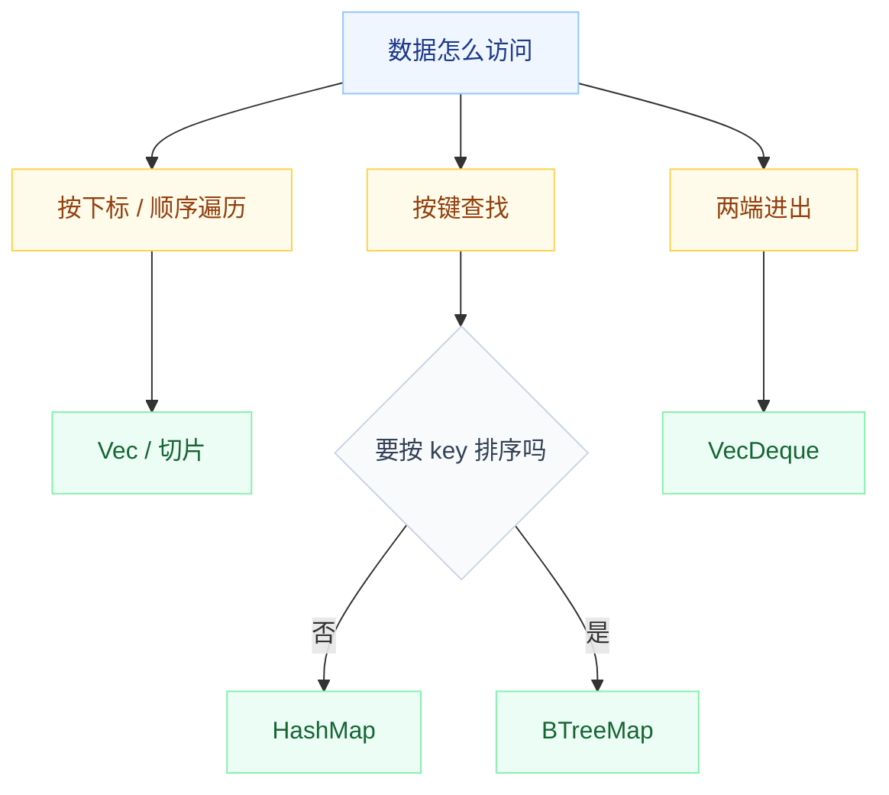

# Rust集合与智能指针

> 这篇从数据放在哪里讲起，经过 `Vec`、`HashMap`、`String` 的取舍与扩容机制、迭代器管线，再到 `Box`、`Rc`、`RefCell`、`Arc`、`Cow` 的所有权补充手段，最后落到一个可搜索的倒排索引程序。
>
> 学完能按访问模式选对容器，用迭代器替代手写循环，并在需要共享、递归或内部可变时选出开销最小的智能指针。

## 一、集合选型

Rust 标准库的集合各有固定的访问复杂度，选错容器比写错算法更常见。默认先用 `Vec`，只有在访问模式明确不匹配时才换。

| 容器 | 底层结构 | 查找 | 适用 |
|---|---|---|---|
| `Vec<T>` | 连续数组 | O(n) / 下标 O(1) | 顺序访问、追加、批量遍历 |
| `VecDeque<T>` | 环形缓冲 | 两端 O(1) | 队列、滑动窗口 |
| `HashMap<K, V>` | 哈希表 | 平均 O(1) | 按键查找、计数、去重 |
| `BTreeMap<K, V>` | B 树 | O(log n) | 需要有序遍历、范围查询 |
| `HashSet<T>` / `BTreeSet<T>` | 同上 | 平均 O(1) / O(log n) | 去重、集合运算 |
| `String` | UTF-8 字节序列 | 下标不是 O(1) | 文本、协议字段 |

选型只看三个问题：访问是按下标、按键还是按顺序；是否需要有序输出；数据量级和修改频率。三问有答案，容器就定了。



> 版本基线（2026-11）：Rust 1.99，`edition = "2024"`。标准库集合接口稳定；`HashMap` 默认使用 `RandomState`（SipHash 变体），有抗哈希碰撞攻击的考虑。

## 二、Vec 与 VecDeque

`Vec<T>` 是唯一保证内存连续的集合，也是默认选择。它的长度和容量分离：`len` 是已用元素数，`capacity` 是不重新分配的前提下能放多少。

### 2.1 增长与扩容

`push` 在容量不足时按倍增策略重新分配（通常翻倍），把旧元素搬到新缓冲区。扩容是 O(n)，但均摊到每次 `push` 是 O(1)。

```rust
fn main() {
    let mut v: Vec<i32> = Vec::with_capacity(4); // 预分配，避免前几次扩容
    v.push(3);
    v.push(1);
    v.push(2);
    println!("len={} cap={}", v.len(), v.capacity()); // len=3 cap=4
    v.push(4);
    v.push(5); // 超过 4，触发扩容
    println!("len={} cap={}", v.len(), v.capacity()); // len=5 cap=8
}
```

已知最终规模时用 `with_capacity` 或 `Vec::with_capacity(n)`，能省掉多次搬移。批量导入 CSV、读取文件行数已知的场景收益明显。

```rust
fn main() {
    // collect 前用 size_hint 自动预留：这里长度已知，一次分配到位
    let squares: Vec<u64> = (1..=5).map(|x| x * x).collect();
    println!("{:?}", squares); // [1, 4, 9, 16, 25]

    // vec! 宏按给定元素分配
    let zeros = vec![0u8; 3];
    println!("{:?}", zeros); // [0, 0, 0]
}
```

### 2.2 删除、保留与取出

| 操作 | 语义 | 复杂度 |
|---|---|---|
| `push` / `pop` | 尾部进出 | 均摊 O(1) |
| `insert(i, x)` / `remove(i)` | 中间插入/删除，元素搬移 | O(n) |
| `retain(f)` | 原地保留满足条件的元素 | O(n) |
| `drain(range)` | 取出区间，返回迭代器 | O(n) |
| `truncate(n)` | 截断到前 n 个 | O(n) |
| `swap_remove(i)` | 用末尾元素填补空位 | O(1) |

```rust
fn main() {
    let mut v = vec![3, 1, 2];
    v.sort();
    println!("{:?}", v); // [1, 2, 3]

    // retain 原地过滤，不额外分配
    v.retain(|x| *x != 1);
    println!("{:?}", v); // [2, 3]

    v.insert(0, 9);
    println!("{:?}", v); // [9, 2, 3]
    let removed = v.remove(0);
    println!("removed={} {:?}", removed, v); // removed=9 [2, 3]

    v.extend([7, 8]);
    // drain 把区间元素交给迭代器，原 Vec 保留剩余部分
    let drained: Vec<i32> = v.drain(1..3).collect();
    println!("drained={:?} left={:?}", drained, v); // drained=[3, 7] left=[2, 8]
}
```

> 边界：顺序不重要且要删除中间元素时用 `swap_remove`，O(1)；需要保持顺序才用 `remove`。循环里 `remove` 会让后续下标整体前移，常见 bug 是漏删。

### 2.3 切片视图

`windows`、`chunks`、`split_at` 返回借用视图，不复制数据，是滑动窗口、批量处理、分片并行（见 [Rust并发模型](../02-Rust常用库/02-Rust并发模型.md)）的基础。

```rust
fn main() {
    let v = vec![2, 8, 5, 1];

    // 窗口长度 2，步长 1
    for w in v.windows(2) {
        println!("window {:?}", w);
    }

    // 每块最多 2 个元素
    for c in v.chunks(2) {
        println!("chunk {:?}", c);
    }

    let (left, right) = v.split_at(2);
    println!("{:?} {:?}", left, right); // [2, 8] [5, 1]
}
```

### 2.4 排序与二分查找

```rust
fn main() {
    let mut v = vec![3, 7, 2];
    v.sort();                       // 升序，稳定排序
    println!("{:?}", v);            // [2, 3, 7]

    v.sort_by_key(|x| -x);          // 按 key 降序
    println!("{:?}", v);            // [7, 3, 2]

    v.sort_unstable();              // 不稳定但更快，元素无重复语义时用
    let idx = v.binary_search(&3).unwrap();
    println!("3 at {}", idx);       // 1
}
```

`binary_search` 只对已排序切片有效，返回 `Result<usize, usize>`：找到时是下标，找不到时是应插入位置。对未排序数据调用不会报错，只会得到错误结果。

### 2.5 VecDeque

`VecDeque<T>` 是环形缓冲区，两端插入删除都是 O(1)。队列、BFS、滑动窗口最大值用它。

```rust
use std::collections::VecDeque;

fn main() {
    let mut dq: VecDeque<u8> = VecDeque::new();
    dq.push_back(1);
    dq.push_back(2);
    dq.push_front(0);
    println!("{:?} front={:?} back={:?}", dq, dq.front(), dq.back()); // [0, 1, 2] Some(0) Some(2)
    println!("pop_front={:?}", dq.pop_front()); // Some(0)
}
```

> 边界：`VecDeque` 不保证连续内存，不能直接传给需要 `&[T]` 的 C 接口。需要连续视图时先 `make_contiguous()` 或收集成 `Vec`。

## 三、HashMap 与 BTreeMap

按键查找用映射。`HashMap` 平均 O(1)，无序；`BTreeMap` O(log n)，按 key 有序。两者接口几乎一致，区别只在遍历顺序和范围查询能力。

### 3.1 entry API

`entry` 把「查一次 + 可能插入」合成一次哈希计算，是计数、分组、缓存的标配写法。

```rust
use std::collections::HashMap;

fn main() {
    let mut counts: HashMap<String, u32> = HashMap::new();

    // or_insert 返回 &mut V，直接累加
    *counts.entry("a".to_string()).or_insert(0) += 1;

    // 默认值需要计算时用 or_insert_with，避免无谓构造
    counts.entry("b".to_string()).or_insert_with(|| 10);
    println!("{:?}", counts.get("a")); // Some(&1)

    // 分组：把单词按首字母归类
    let mut groups: HashMap<char, Vec<&str>> = HashMap::new();
    for word in ["apple", "avocado", "banana"] {
        let first = word.chars().next().unwrap();
        groups.entry(first).or_default().push(word);
    }
    println!("{:?}", groups);
}
```

### 3.2 key 的约束

| 映射 | key 需要 | 常见错误 |
|---|---|---|
| `HashMap` | `Eq + Hash` | 用 `f64` 作 key |
| `BTreeMap` | `Ord` | 自定义类型忘派生 `Ord` |
| 两者 | 所有权或 `'static` 借用 | key 借用局部变量 |

`HashMap` 的 key 必须实现 `Eq + Hash`，浮点不满足（`NaN != NaN`），字符串、整数、枚举、元组都可以。

```rust
use std::collections::HashMap;

#[derive(Debug, PartialEq, Eq, Hash)]
struct UserId(u64);

fn main() {
    let mut seen: HashMap<UserId, &str> = HashMap::new();
    seen.insert(UserId(7), "张三");
    println!("{:?}", seen.get(&UserId(7))); // Some("张三")
}
```

### 3.3 BTreeMap 的有序能力

```rust
use std::collections::BTreeMap;

fn main() {
    let mut scores: BTreeMap<u32, &str> = BTreeMap::new();
    scores.insert(3, "c");
    scores.insert(1, "a");
    scores.insert(2, "b");

    // 遍历即有序，不需要额外 sort
    for (k, v) in &scores {
        println!("{}:{}", k, v); // 1:a 2:b 3:c
    }

    // 范围查询是 BTreeMap 独有的
    for (k, v) in scores.range(1..=2) {
        println!("range {}:{}", k, v);
    }
}
```

> 边界：需要「按分数排名 + 按 id 查详情」时，用 `HashMap<Id, Item>` 存数据，另建 `BTreeMap<Score, Vec<Id>>` 做排名索引；不要为了排序每次把 HashMap 全量 collect 再 sort。

### 3.4 遍历顺序不是插入顺序

`HashMap` 的迭代顺序由哈希和随机种子决定，跨进程、跨运行都不同。输出、快照、测试断言依赖顺序时，必须先排序或用 `BTreeMap`。

```rust
use std::collections::HashMap;

fn main() {
    let mut m = HashMap::new();
    m.insert("b", 2);
    m.insert("a", 1);
    // 下面两行的顺序可能互换，不能用于断言
    for k in m.keys() {
        println!("{}", k);
    }

    // 需要稳定输出时排序
    let mut keys: Vec<&&str> = m.keys().collect();
    keys.sort();
    println!("{:?}", keys); // ["a", "b"]
}
```

## 四、String 与文本处理

`String` 是拥有所有权的 UTF-8 字节序列，`&str` 是借用视图。所有字符串索引都按**字节**，这是 Rust 文本处理最重要的边界。

### 4.1 常用操作

```rust
fn main() {
    let mut s = String::from("Rust");
    s.push_str(" 集合"); // 追加 &str
    s.push('!');         // 追加单个 char
    println!("{} len={} chars={}", s, s.len(), s.chars().count());

    println!("{}", " a,b , c ".trim());                  // a,b , c
    println!("{:?}", "a,b,c".split(',').collect::<Vec<_>>()); // ["a", "b", "c"]
    println!("{}", "hello".replace('l', "L"));           // heLLo
    println!("{:?}", "42".parse::<i32>());               // Ok(42)
    println!("{}", format!("{}-{:02}", "id", 7));        // id-07
}
```

预期输出：

```text
Rust 集合! len=12 chars=8
a,b , c
["a", "b", "c"]
heLLo
Ok(42)
id-07
```

`len()` 是字节数，`chars().count()` 是字符数。中文一个字占 3 字节，`len` 会明显大于直觉。

### 4.2 字节与字符边界

```rust
fn main() {
    let s = "中文";
    println!("{}", s.len());           // 6 字节
    println!("{}", s.chars().count()); // 2 个字符

    // 按字符切分必须用 split_at 的合法边界
    let mid = s.char_indices().nth(1).map(|(i, _)| i).unwrap();
    let (first, rest) = s.split_at(mid);
    println!("{} {}", first, rest); // 中 文

    // &s[0..1] 会 panic: byte index 1 is not a char boundary
}
```

需要逐字符处理时用 `chars()`、`char_indices()`；需要按显示宽度对齐时用 `unicode-width` 之类的库，不要假设一个字符占一列。

### 4.3 字节到 String

从网络或文件读到的 `Vec<u8>` 转 `String` 时必须处理非法 UTF-8。

```rust
fn main() {
    let bytes = vec![104, 105];
    println!("{:?}", String::from_utf8(bytes)); // Ok("hi")

    let bad = vec![0xff, 0xfe];
    match String::from_utf8(bad) {
        Ok(s) => println!("{}", s),
        // from_utf8 失败会把原始字节还回来，便于按 latin-1 等方式兜底
        Err(e) => println!("非法 UTF-8，丢 {} 字节", e.as_bytes().len()),
    }
}
```

> 边界：`from_utf8_unchecked` 是 `unsafe`，只在已经验证过编码时使用；协议解析、用户输入一律走安全版本。

## 五、迭代器

迭代器是 Rust 的零成本抽象：链式调用编译后与手写循环基本等价，没有虚调用和中间集合，除非显式 `collect`。

### 5.1 惰性与消费

适配器（`map`、`filter`、`take`）只构建管线，不执行；消费者（`collect`、`sum`、`fold`、`for`）才驱动执行。

```rust
fn main() {
    let nums = vec![1, 2, 3, 4, 5, 6];

    // 没有 collect 或 for，这条管线什么也不做
    let _lazy = nums.iter().map(|x| {
        println!("计算 {}", x);
        x * 2
    });

    // 消费者触发执行
    let evens: Vec<i32> = nums.iter().filter(|x| *x % 2 == 0).map(|x| x * 10).collect();
    println!("{:?}", evens); // [20, 40, 60]

    let total: i32 = nums.iter().sum();
    println!("{}", total); // 21
}
```

`filter` 的闭包参数是 `&&i32`（迭代器产生 `&i32`，`filter` 又传引用），所以写 `|x| *x % 2 == 0` 或 `|&&x|`。这类多层引用是初学阶段最常见的类型错误来源。

### 5.2 适配器组合

| 适配器 | 作用 | 注意 |
|---|---|---|
| `map` | 一对一转换 | 不会过滤 |
| `filter` | 保留满足条件的 | 闭包拿到 `&Item` |
| `filter_map` | 转换并丢弃 `None` | 等价 map + flatten |
| `flat_map` | 一对多展开 | 处理嵌套集合 |
| `take_while` | 条件不满足即停 | 不是 filter |
| `chain` | 拼接两个迭代器 | 类型必须一致 |
| `zip` | 按位置配对 | 以短的一方结束 |
| `enumerate` | 附带下标 | 下标从 0 开始 |

```rust
fn main() {
    let nums = vec![1, 2, 3, 4, 5, 6];

    println!("{:?}", nums.iter().zip(["a", "b"]).collect::<Vec<_>>());
    // [(1, "a"), (2, "b")]，zip 以短的为准

    println!("{:?}", nums.iter().enumerate().take(2).collect::<Vec<_>>());
    // [(0, 1), (1, 2)]

    println!("{:?}", nums.iter().chain([7, 8].iter()).collect::<Vec<_>>());
    // [1, 2, 3, 4, 5, 6, 7, 8]

    println!("{:?}", vec![vec![1, 2], vec![3]].into_iter().flatten().collect::<Vec<_>>());
    // [1, 2, 3]

    println!("{:?}", nums.iter().take_while(|x| **x < 4).collect::<Vec<_>>());
    // [1, 2, 3]，遇到 4 立即停，不再看 5、6
}
```

### 5.3 fold 与收集

`fold` 是通用归约，`sum`、`count`、`max` 都可以由它表达。收集到映射时，`fold` 配合 `entry` 是最常见的手写分组。

```rust
use std::collections::{HashMap, HashSet};

fn main() {
    let nums = vec![1, 2, 3, 4, 5, 6];

    println!("{}", nums.iter().fold(0, |acc, x| acc + x)); // 21
    println!("{:?}", nums.iter().max_by_key(|x| **x));     // Some(6)

    // 收集到 HashSet 顺便去重
    let odds: HashSet<i32> = nums.iter().copied().filter(|x| x % 2 == 1).collect();
    println!("{:?}", odds); // {1, 3, 5}

    // 词频：fold + entry，不产生中间 Vec
    let freq: HashMap<&str, usize> = "a b a"
        .split_whitespace()
        .fold(HashMap::new(), |mut acc, w| {
            *acc.entry(w).or_insert(0) += 1;
            acc
        });
    println!("{:?}", freq); // {"a": 2, "b": 1}
}
```

### 5.4 实现自定义迭代器

实现 `Iterator` 只需提供 `next`，其余几十个方法由默认实现免费获得。

```rust
struct Countdown(u32);

impl Iterator for Countdown {
    type Item = u32;

    fn next(&mut self) -> Option<u32> {
        if self.0 == 0 {
            None // 用 None 表示结束，不依赖特殊值
        } else {
            self.0 -= 1;
            Some(self.0)
        }
    }
}

fn main() {
    let v: Vec<u32> = Countdown(3).collect();
    println!("{:?}", v); // [2, 1, 0]

    // 自定义迭代器能直接接标准适配器
    let doubled: Vec<u32> = Countdown(3).map(|x| x * 2).collect();
    println!("{:?}", doubled); // [4, 2, 0]
}
```

> 边界：`next` 返回 `None` 后再次调用属于逻辑错误，标准库不保证行为。有状态的迭代器要在 `None` 后保持 `None`。

## 六、智能指针

智能指针是「拥有数据 + 额外行为」的类型。它们不改变所有权规则，而是补充规则覆盖不到的场景：递归类型、共享所有权、内部可变性、跨线程共享。

### 6.1 Box：把值放到堆上

`Box<T>` 是最简单的智能指针，唯一作用是堆分配和固定大小。两个典型用途：递归类型、trait 对象。

```rust
#[derive(Debug)]
enum List {
    Cons(i32, Box<List>), // 不用 Box 的话，List 大小无限递归，编译不过
    Nil,
}

fn sum_list(list: &List) -> i32 {
    match list {
        List::Cons(v, next) => v + sum_list(next),
        List::Nil => 0,
    }
}

fn main() {
    let list = List::Cons(1, Box::new(List::Cons(2, Box::new(List::Nil))));
    println!("sum={}", sum_list(&list)); // 3
    println!("{:?}", list);              // Cons(1, Cons(2, Nil))
}
```

`Box<dyn Trait>` 是异构集合的标准做法，代价是一次堆分配加运行期虚调用。选择依据见 [Rust特征与错误处理](../01-Rust语法/03-Rust特征与错误处理.md)。

### 6.2 Rc：单线程共享所有权

`Rc<T>` 用引用计数让多个所有者共享同一份数据。克隆 `Rc` 只增加计数，不复制数据；计数归零时释放。

```rust
use std::rc::Rc;

fn main() {
    let shared = Rc::new(String::from("shared"));
    let second = Rc::clone(&shared); // 只加计数，不复制字符串
    println!("count={} {}", Rc::strong_count(&shared), second); // count=2 shared
} // second、shared 依次离开作用域，计数归零，字符串释放
```

> 边界：`Rc` 不是线程安全的，跨线程编译会报 `E0277`（`Rc<String>` cannot be sent between threads safely）。跨线程用 `Arc`。

### 6.3 RefCell：运行期借用检查

`RefCell<T>` 把借用检查从编译期推迟到运行期，从而允许「通过不可变引用修改内部值」。代价是违反规则时 panic，而不是编译错误。

```rust
use std::cell::RefCell;

fn main() {
    let cell = RefCell::new(vec![1]);
    cell.borrow_mut().push(2); // 运行期检查：当前没有其他借用
    println!("{:?}", cell.borrow()); // [1, 2]
}
```

同时持有不可变借用和可变借用会 panic：

```rust
use std::cell::RefCell;

fn main() {
    let cell = RefCell::new(vec![1]);
    let first = cell.borrow();
    let _second = cell.borrow_mut(); // panic: RefCell already borrowed
    println!("{:?}", first);
}
```

```text
thread 'main' panicked at src/main.rs:5:24:
RefCell already borrowed
```

> 边界：`borrow()` 返回的 `Ref` 必须在使用完后释放（离开作用域）。把 `Ref` 存进结构体或跨函数传递，很容易在后续调用 `borrow_mut` 时 panic。能用编译期借用就不用 `RefCell`。

### 6.4 Rc 与 RefCell 的组合

需要「多个所有者 + 可修改」时，组合 `Rc<RefCell<T>>`。父子双向引用会产生循环计数，必须用 `Weak` 打破，否则内存永远不释放。

```rust
use std::cell::RefCell;
use std::rc::{Rc, Weak};

#[derive(Debug)]
struct Node {
    value: i32,
    parent: RefCell<Weak<Node>>,   // 指向父节点用 Weak，不增加强计数
    children: RefCell<Vec<Rc<Node>>>,
}

fn main() {
    let left = Rc::new(Node { value: 1, parent: RefCell::new(Weak::new()), children: RefCell::new(vec![]) });
    let right = Rc::new(Node { value: 2, parent: RefCell::new(Weak::new()), children: RefCell::new(vec![]) });

    left.children.borrow_mut().push(Rc::clone(&right));
    *right.parent.borrow_mut() = Rc::downgrade(&left);

    // 子节点通过 Weak 找到父节点：upgrade 成功说明父节点还活着
    println!("parent value={:?}", right.parent.borrow().upgrade().map(|p| p.value)); // Some(1)
    println!("left strong={} right refs={}", Rc::strong_count(&left), Rc::strong_count(&right));
    // left strong=1，right refs=2
}
```

### 6.5 Arc 与多线程共享

`Arc<T>` 是原子引用计数的 `Rc`，可以跨线程。它只保证计数安全，不保证内部数据可修改；要修改仍需 `Mutex` 或 `RwLock`，组合与锁的细节见 [Rust并发模型](../02-Rust常用库/02-Rust并发模型.md)。

### 6.6 Cow：借用或拥有

`Cow<'a, str>` 在不需要修改时借用，需要修改时才分配。适合「大多数输入不变、少数需要处理」的规范化函数。

```rust
use std::borrow::Cow;

fn normalize(s: &str) -> Cow<'_, str> {
    if s.contains(' ') {
        Cow::Owned(s.replace(' ', "_")) // 需要改写才分配
    } else {
        Cow::Borrowed(s) // 原样返回，零复制
    }
}

fn main() {
    println!("{}", normalize("a b")); // a_b
    let borrowed = normalize("ab");
    println!("is_borrowed={}", matches!(borrowed, Cow::Borrowed(_))); // true
}
```

### 6.7 选择表

| 需求 | 类型 | 代价 |
|---|---|---|
| 递归类型、trait 对象 | `Box<T>` | 一次堆分配 |
| 单线程多所有者 | `Rc<T>` | 非原子计数增减 |
| 多线程多所有者 | `Arc<T>` | 原子指令开销 |
| 不可变引用下修改 | `RefCell<T>` | 运行期借用检查 |
| 多线程下修改 | `Mutex<T>` / `RwLock<T>` | 加锁与争用 |
| 可能借用可能拥有 | `Cow<'a, T>` | 少量分支判断 |

## 七、完整程序与调试

下面的程序把 `Vec`、`HashMap`、迭代器管线和切片组合成一个销售汇总：按区域聚合、过滤、排序、分批处理。

```rust
use std::collections::HashMap;

#[derive(Debug)]
struct Order {
    region: String,
    amount: u64,
}

fn main() {
    let orders = vec![
        Order { region: String::from("华东"), amount: 320 },
        Order { region: String::from("华南"), amount: 150 },
        Order { region: String::from("华东"), amount: 480 },
        Order { region: String::from("华北"), amount: 90 },
        Order { region: String::from("华南"), amount: 260 },
    ];

    // entry API：一次查表完成"累加或插入"，避免 contains_key + insert 两次哈希
    let mut by_region: HashMap<&str, u64> = HashMap::new();
    for order in &orders {
        *by_region.entry(order.region.as_str()).or_insert(0) += order.amount;
    }

    // 迭代器管线：过滤 → 映射 → 排序 → 收集
    let mut ranking: Vec<(&str, u64)> = by_region
        .into_iter()
        .filter(|(_, total)| *total >= 100)
        .collect();
    ranking.sort_by(|a, b| b.1.cmp(&a.1));

    println!("区域\t总额\t占比");
    let grand_total: u64 = orders.iter().map(|o| o.amount).sum();
    for (region, total) in &ranking {
        // 整数百分比，避免浮点格式差异
        let pct = total * 100 / grand_total;
        println!("{}\t{}\t{}%", region, total, pct);
    }

    let avg = grand_total as f64 / orders.len() as f64;
    println!("总单数 {}，总金额 {}，均值 {:.1}", orders.len(), grand_total, avg);

    // chunks 按固定大小分批，适合批量写库
    for (idx, chunk) in orders.chunks(2).enumerate() {
        let sum: u64 = chunk.iter().map(|o| o.amount).sum();
        println!("批次 {}: {} 笔，合计 {}", idx + 1, chunk.len(), sum);
    }
}
```

预期输出：

```text
区域	总额	占比
华东	800	61%
华南	410	31%
总单数 5，总金额 1300，均值 260.0
批次 1: 2 笔，合计 470
批次 2: 2 笔，合计 570
批次 3: 1 笔，合计 260
```

### 7.1 常见错误与定位

| 现象 | 原因 | 第一条改法 |
|---|---|---|
| `index out of bounds` | 下标越界 | 用 `get()` 返回 `Option` |
| `capacity` 反复增长 | 未预留空间 | `with_capacity` |
| 输出顺序每次都变 | 遍历 `HashMap` | 排序或换 `BTreeMap` |
| `RefCell already borrowed` | 借用跨越了 `borrow_mut` | 缩短 `Ref` 作用域 |
| `E0277: cannot be sent between threads` | 跨线程用了 `Rc` | 换 `Arc` |
| 迭代器没执行 | 只有适配器没有消费者 | 加 `collect` / `for` |

```bash
cargo run 2>&1 | grep -E 'panicked|error'
RUST_BACKTRACE=1 cargo run 2>&1 | head -30
```

调试集合代码时，先确认三点：容器是否选对、下标是否越界、迭代器是否被消费。三者能覆盖大部分「结果不对」的问题。

## 八、最佳实践案例

### 8.1 案例背景

一个内部文档站要做标题加正文的关键词检索，文档量在几千篇，全部放进内存。要求：返回得分最高的前几条；标题命中的权重高于正文；同一文档多次命中同一词只累计一次；输出顺序稳定，便于回归测试。

约束：不引入搜索引擎或数据库；单次查询在毫秒级；新增打分策略时不改检索主流程。

### 8.2 案例实操

`src/main.rs`：

```rust
use std::collections::{BTreeMap, HashMap};

#[derive(Debug)]
struct Document {
    id: usize,
    title: String,
    body: String,
}

// 倒排索引：词 → 文档 id 列表；Vec 保持插入顺序，便于稳定打分
type Index = HashMap<String, Vec<usize>>;

fn tokenize(text: &str) -> Vec<String> {
    // 统一小写并保留字母、数字和 CJK 字符，其余作为分隔符
    text.to_lowercase()
        .split(|c: char| !(c.is_alphanumeric() || ('\u{4e00}'..='\u{9fff}').contains(&c)))
        .filter(|w| !w.is_empty())
        .map(str::to_string)
        .collect()
}

fn build_index(docs: &[Document]) -> Index {
    let mut index: Index = HashMap::new();
    for doc in docs {
        for word in tokenize(&format!("{} {}", doc.title, doc.body)) {
            // 同一个词在同一文档里只记一次
            let postings = index.entry(word).or_default();
            if postings.last() != Some(&doc.id) {
                postings.push(doc.id);
            }
        }
    }
    index
}

// 打分：标题命中给 weight_title，正文命中给 10 分
fn search<'a>(
    index: &Index,
    docs: &'a [Document],
    query: &str,
    weight_title: u32,
) -> Vec<(&'a Document, u32)> {
    let mut scores: BTreeMap<usize, u32> = BTreeMap::new();
    for word in tokenize(query) {
        // let else：索引里没有该词就跳过，不写嵌套 if
        let Some(ids) = index.get(&word) else { continue };
        for &id in ids {
            let doc = &docs[id];
            let title_hit = doc.title.to_lowercase().contains(&word);
            let score = if title_hit { weight_title } else { 10 };
            *scores.entry(id).or_insert(0) += score;
        }
    }
    let mut result: Vec<(&Document, u32)> = scores
        .into_iter()
        .map(|(id, score)| (&docs[id], score))
        .collect();
    // 分数相同时按 id 升序，保证结果可复现
    result.sort_by(|a, b| b.1.cmp(&a.1).then(a.0.id.cmp(&b.0.id)));
    result
}

fn main() {
    let docs = vec![
        Document {
            id: 0,
            title: String::from("Rust 所有权"),
            body: String::from("所有权与借用是 Rust 内存安全的基础"),
        },
        Document {
            id: 1,
            title: String::from("Rust 并发"),
            body: String::from("线程与通道构建并发程序，共享状态需要同步"),
        },
        Document {
            id: 2,
            title: String::from("异步编程"),
            body: String::from("tokio 用 Future 表达异步任务，并发执行多个任务"),
        },
    ];

    let index = build_index(&docs);

    // 按 postings 长度排序，观察高频词
    let mut terms: Vec<(&String, &Vec<usize>)> = index.iter().collect();
    terms.sort_by(|a, b| b.1.len().cmp(&a.1.len()).then(a.0.cmp(b.0)));
    println!("索引词数: {}", index.len());
    for (word, ids) in terms.iter().take(3) {
        println!("{} -> {:?}", word, ids);
    }

    for query in ["rust 并发", "所有权", "tokio"] {
        let hits = search(&index, &docs, query, 30);
        println!("查询 {:?}: {} 条命中", query, hits.len());
        for (doc, score) in hits.iter().take(2) {
            println!("  {} 分  #{} {}", score, doc.id, doc.title);
        }
    }
}
```

运行：

```bash
cargo run -q
```

预期输出：

```text
索引词数: 13
rust -> [0, 1]
future -> [2]
tokio -> [2]
查询 "rust 并发": 2 条命中
  60 分  #1 Rust 并发
  30 分  #0 Rust 所有权
查询 "所有权": 1 条命中
  30 分  #0 Rust 所有权
查询 "tokio": 1 条命中
  10 分  #2 异步编程
```

### 8.3 案例结果

3 篇文档建出 13 个词的索引，三次查询全部命中预期文档，标题命中权重生效（#1 得 60 分，#0 得 30 分）。查询复杂度是「词数 × 平均 postings 长度」，几千篇文档仍在毫秒级。

失败模式与复盘：

- 分词第一版用 `split_whitespace`，中文整句成一个词，查询永远不命中；改为按字符类别切分后，中文仍以连续片段为单位，长句检索需要外部分词库，这是方案边界；
- postings 用 `Vec<usize>` 而不是 `HashSet`，插入时靠 `last()` 去重；文档量大时应换成 `BTreeSet` 或倒排块加跳表；
- 打分累加用 `BTreeMap` 而不是 `HashMap`，输出顺序天然稳定，回归测试不用额外排序；
- `search` 的返回借用 `docs`，生命周期参数把「结果不能活过文档数组」写进签名，调用方无法误用；
- 若需要新增 BM25 之类的打分，把 `search` 里的打分抽成 `Box<dyn Fn(&Document, &str) -> u32>` 参数，主流程不动。

下一篇 [Rust并发模型](../02-Rust常用库/02-Rust并发模型.md) 把这套数据结构放进多线程，讲清 `Arc`、`Mutex` 和通道的使用边界。
