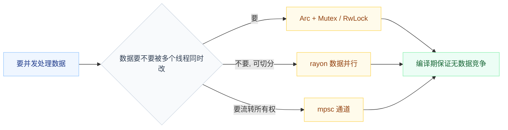

# Rust并发模型

> 这篇从操作系统的线程与数据竞争讲起，经过 `std::thread` 的创建与作用域、`Arc<Mutex<T>>` 的共享状态、`mpsc` 通道的消息传递、`Send`/`Sync` 的自动判定，最后落到 rayon 数据并行和一个百万行日志的并行统计程序。
>
> 学完能按「共享内存还是消息传递」选择并发路线，安全地拆分数据给多线程，并诊断死锁、锁中毒、跨线程类型错误。

## 一、并发模型：两条路线

Rust 的线程是操作系统线程（1:1 模型），创建、切换由内核调度；数据竞争在编译期被所有权规则排除——两个线程同时写一个值，必然有一个持有 `&mut`，借用检查器直接拒绝。

并发状态共享有两条路线，选用哪种取决于数据形态：

- 共享内存：多线程读写同一份数据，用 `Arc<Mutex<T>>`；
- 消息传递：把数据的所有权通过通道发给另一个线程，用 `mpsc`。



> 版本基线（2026-11）：Rust 1.99，`edition = "2024"`；`std::thread`、`std::sync`、`std::sync::mpsc` 为标准库；数据并行用 rayon 1.12；跨线程多生产多消费通道用 crossbeam（本篇给接口对照）。CPU 密集任务优先用线程或 rayon，IO 密集任务见 [Rust异步编程与tokio](../02-Rust常用库/03-Rust异步编程与tokio.md)。

## 二、thread：创建线程

`thread::spawn` 接收一个闭包，返回 `JoinHandle`。`join` 等待线程结束并取回返回值；不 `join`，线程在主线程退出时整个进程直接结束。

### 2.1 spawn 与 join

```rust
use std::thread;

fn main() {
    let handle = thread::spawn(|| {
        let sum: u64 = (1..=100).sum();
        sum // 闭包返回值就是 JoinHandle 的输出
    });
    println!("子线程求和: {}", handle.join().unwrap()); // 5050
}
```

`join` 返回 `Result`：线程 panic 时返回 `Err`，携带 panic 的载荷。吞掉这个结果会丢失线程失败的信息，服务里应当记录并按策略处理。

### 2.2 move 闭包

线程可能比创建它的函数活得久，因此闭包不能借用局部变量，必须 `move` 拿走所有权。

```rust
use std::thread;

fn main() {
    let data = vec![1, 2, 3];

    // 不写 move（片段，编译失败）：
    // thread::spawn(|| println!("{:?}", data));
    // E0373: closure may outlive the current function, but it borrows `data`

    let handle = thread::spawn(move || {
        // move 把 data 的所有权交给线程，线程结束时释放
        println!("拿到 {:?}", data);
    });
    handle.join().unwrap();
}
```

需要多个线程共享同一份数据时，把 `move` 与 `Arc::clone` 组合，见第三章。

### 2.3 作用域线程：借用局部变量

`thread::scope` 保证所有线程在作用域结束前完成，因此允许闭包借用局部变量，不需要 `Arc`，也不需要 `move`。

```rust
use std::thread;

fn main() {
    let mut results = vec![0u64; 3];

    // scope 退出前会 join 所有内部线程，借用不会悬垂
    thread::scope(|s| {
        for (i, slot) in results.iter_mut().enumerate() {
            s.spawn(move || {
                // slot 是主线程栈上的 &mut u64，作用域保证它活着
                *slot = (i as u64 + 1).pow(2);
            });
        }
    });

    println!("{:?}", results); // [1, 4, 9]
}
```

> 边界：`scope` 内不能 `spawn` 到外部线程池，也不能把内部 `JoinHandle` 带出作用域。它是「并行一段计算再合并」的最简写法，长生命周期后台任务仍然用 `spawn` + `Arc`。

### 2.4 线程数参考

```rust
fn main() {
    let cores = std::thread::available_parallelism().map(|n| n.get()).unwrap_or(1);
    println!("可用核数: {}", cores); // 10（示例机器）
}
```

CPU 密集任务的线程数不超过核数；IO 密集的阻塞任务（同步文件、数据库连接）可以适度超出，但上限要显式配置，而不是无限 `spawn`。

## 三、共享状态：Mutex 与 RwLock

多个线程同时修改一个值，必须把值放进 `Mutex`（互斥锁）并用 `Arc` 共享锁的所有权。锁的语义是「同一时刻只有一个线程能拿到内部数据的 `&mut`」。

### 3.1 Arc\<Mutex\<T\>\> 计数器

```rust
use std::sync::{Arc, Mutex};
use std::thread;

fn main() {
    let counter = Arc::new(Mutex::new(0u64));
    let mut handles = Vec::new();

    for _ in 0..4 {
        let counter = Arc::clone(&counter); // 只克隆引用计数，不复制数据
        handles.push(thread::spawn(move || {
            for _ in 0..1000 {
                // 锁的 guard 在语句结束时立即释放
                let mut n = counter.lock().unwrap();
                *n += 1;
            }
        }));
    }
    for h in handles {
        h.join().unwrap();
    }
    println!("计数结果: {}", *counter.lock().unwrap()); // 4000
}
```

三个要点：

1. `Mutex<T>` 拥有 `T`，`lock()` 返回 `MutexGuard`，guard 借用 `Mutex` 并提供了对 `T` 的可变访问；
2. `lock()` 返回 `Result`，因为锁可能被上一个持有者「毒化」（见 3.4）；
3. guard 离开作用域自动解锁，锁的粒度由 guard 的生命周期决定。

### 3.2 锁粒度

锁的范围决定争用程度。正确的粒度是「一次锁覆盖一次完整的业务不变量」，而不是「能锁多短锁多短」。

```rust
use std::sync::{Arc, Mutex};
use std::thread;

fn transfer(accounts: &Arc<Mutex<[(u64, u64); 2]>>, from: usize, to: usize, amount: u64) {
    // 转账必须在一个锁里完成两个账户的修改
    // 拆成两次加锁，中间可能被别的转账插入，账就不平了
    let mut guard = accounts.lock().unwrap();
    if guard[from].1 >= amount {
        guard[from].1 -= amount;
        guard[to].1 += amount;
    }
}

fn main() {
    let accounts = Arc::new(Mutex::new([(7, 1000u64), (8, 500u64)]));
    let a = Arc::clone(&accounts);
    let h = thread::spawn(move || transfer(&a, 0, 1, 300));
    h.join().unwrap();
    println!("{:?}", accounts.lock().unwrap()); // [(7, 700), (8, 800)]
}
```

### 3.3 RwLock：读多写少

`RwLock` 允许多个读者并发，写者独占。读多写少且读操作耗时时收益明显；临界区极短时 `Mutex` 反而更快（RwLock 的计数开销更大）。

```rust
use std::sync::{Arc, RwLock};
use std::thread;

fn main() {
    let config = Arc::new(RwLock::new(String::from("mode=fast")));

    let readers: Vec<_> = (0..2)
        .map(|_| {
            let config = Arc::clone(&config);
            thread::spawn(move || {
                // 多个 read() 可以同时持有
                let r = config.read().unwrap();
                r.len()
            })
        })
        .collect();
    for r in readers {
        println!("读到 {} 字节", r.join().unwrap());
    }

    // 写锁独占，拿到后可以修改
    let mut w = config.write().unwrap();
    w.push_str(",level=info");
    println!("{}", w); // mode=fast,level=info
}
```

> 边界：RwLock 可能写者饿死（取决于实现策略）。读写时长差异不大时，用 `Mutex` 更简单、行为更好预测。

### 3.4 锁中毒

线程持有锁时 panic，锁进入「中毒」状态，后续 `lock()` 返回 `Err(PoisonError)`。这是防御机制：数据可能处于半更新状态，继续使用不安全。

```rust
use std::sync::{Arc, Mutex};
use std::thread;

fn main() {
    let m = Arc::new(Mutex::new(0u64));
    let m2 = Arc::clone(&m);
    let h = thread::spawn(move || {
        let _g = m2.lock().unwrap();
        panic!("持有锁时失败"); // guard 还活着，锁被毒化
    });
    let _ = h.join();

    // is_err 说明锁已中毒；需要时 from 网络异常恢复或重建状态
    println!("poisoned={}", m.lock().is_err()); // poisoned=true
}
```

> 边界：`unwrap` 遇到毒化锁会 panic，在服务线程里导致连环崩溃。中毒后通常的做法是重建被保护的数据结构，而不是继续用。

### 3.5 死锁

两个线程以相反顺序锁两把锁，互相等待，程序挂死。Rust 的借用检查器不检测死锁，运行期也没有默认超时。

```rust
// 片段：会死锁，不要运行
// let (a, b) = (Mutex::new(0), Mutex::new(0));
// thread::spawn(|| { let _ga = a.lock(); let _gb = b.lock(); });  // 先 a 后 b
// let _ga = b.lock(); let _gb = a.lock();                          // 先 b 后 a，互相等待
```

防死锁三原则：

1. 全程序统一加锁顺序（按地址排序或固定层次）；
2. 临界区内不调用会再次加锁的函数；
3. 避免在持锁时 `join`、`send`、`recv` 等阻塞调用。

```bash
# 线程卡住时，第一件事是看每个线程栈停在哪把锁上
sudo gdb -p <pid> -ex "thread apply all bt" | grep -A5 mutex
# 或用 lldb（macOS）
lldb -p <pid> -o "thread backtrace all" -o quit
```

## 四、通道：mpsc

`std::sync::mpsc` 是「多生产者、单消费者」（multi-producer, single-consumer）通道。发送是转移所有权：值离开发送线程，接收线程独占使用，共享状态问题从类型上消失。

### 4.1 基本收发

```rust
use std::sync::mpsc;
use std::thread;

fn main() {
    let (tx, rx) = mpsc::channel::<u64>();

    thread::spawn(move || {
        let sum: u64 = (1..=100).sum();
        // send 转移所有权：sum 不能再被这个线程使用
        tx.send(sum).expect("接收端已关闭");
    });

    // recv 阻塞直到有数据或所有发送端关闭
    match rx.recv() {
        Ok(v) => println!("收到 {}", v), // 5050
        Err(_) => println!("发送端已全部关闭"),
    }
}
```

### 4.2 多生产者

`tx` 克隆后分给多个线程，`rx` 按到达顺序收到全部消息。

```rust
use std::sync::mpsc;
use std::thread;

fn main() {
    let (tx, rx) = mpsc::channel::<(u32, u64)>();
    let mut producers = Vec::new();

    for id in 0..3u32 {
        let tx = tx.clone(); // 克隆的是发送端句柄，不是数据
        producers.push(thread::spawn(move || {
            let sum: u64 = (1..=1000).map(|x| x * id as u64).sum();
            tx.send((id, sum)).expect("接收端已关闭");
        }));
    }
    drop(tx); // 关闭主线程持有的发送端，否则 rx 的迭代永不结束

    let mut total = 0;
    for (id, sum) in rx { // rx 实现 IntoIterator，发送端全关后自然结束
        println!("生产者 {} 合计 {}", id, sum);
        total += sum;
    }
    for p in producers {
        p.join().unwrap();
    }
    println!("通道汇总: {}", total); // 1501500
}
```

`drop(tx)` 是这段代码的关键：主线程的 `tx` 不关闭，`rx` 迭代器认为还有生产者，循环不会结束。

### 4.3 有界通道与背压

`sync_channel(n)` 的缓冲区容量为 n，满了之后 `send` 阻塞，形成背压，防止生产速度远超消费速度时内存膨胀。

```rust
use std::sync::mpsc;
use std::thread;

fn main() {
    let (tx, rx) = mpsc::sync_channel::<u32>(2);

    tx.send(1).unwrap();
    tx.send(2).unwrap(); // 缓冲填满
    println!("{:?}", rx.try_recv()); // Ok(1)，空出一个位置

    let t = thread::spawn(move || {
        for i in 3..6 {
            tx.send(i).unwrap(); // 缓冲再次满时阻塞，等待消费者取走
        }
        // tx 在线程结束时 drop，接收端才能感知结束
    });

    let rest: Vec<u32> = rx.iter().collect(); // [2, 3, 4, 5]
    t.join().unwrap();
    println!("{:?}", rest);
}
```

### 4.4 超时与关闭语义

| 操作 | 语义 | 触发条件 |
|---|---|---|
| `recv()` | 阻塞直到有值 | 发送端全关返回 `Err` |
| `try_recv()` | 立即返回 `Option` | 空缓冲返回 `Err(Empty)` |
| `recv_timeout(d)` | 限时等待 | 超时返回 `Err(Timeout)` |
| `send(v)` | 无界通道不阻塞 | 接收端 drop 返回 `Err` |

```rust
use std::sync::mpsc;
use std::thread;
use std::time::Duration;

fn main() {
    let (tx, rx) = mpsc::channel::<u32>();

    println!("{:?}", rx.recv_timeout(Duration::from_millis(50))); // Err(Timeout)
    drop(tx);
    println!("{:?}", rx.recv()); // Err(RecvError)，发送端已关闭

    let (tx2, rx2) = mpsc::channel::<u32>();
    drop(rx2);
    println!("{:?}", tx2.send(1)); // Err(SendError)，接收端已关闭
}
```

> 边界：标准库 mpsc 只有单消费者。需要多个消费者或共享 `Receiver` 时，用 `Mutex<Receiver>` 包一层，或改用 crossbeam-channel（多生产多消费、`select` 支持）。crossbeam 接口与 mpsc 几乎一致，`crossbeam_channel::unbounded()` / `bounded(n)` 对应 `channel()` / `sync_channel(n)`。

## 五、Send 与 Sync

`Send` 表示类型可以跨线程转移所有权，`Sync` 表示可以跨线程共享引用（`&T` 能安全地被多线程同时持有）。两者都是标记 trait，由编译器按字段自动推导。

| 类型 | Send | Sync | 说明 |
|---|---|---|---|
| `i32`、`String`、`Vec<T>` | 是 | 是 | 普通数据 |
| `Rc<T>` | 否 | 否 | 引用计数是非原子操作 |
| `Arc<T>` | 是 | 是（T: Sync） | 原子计数 |
| `Mutex<T>` | 是 | 是（T: Send） | 互斥锁 |
| `RefCell<T>` | 是 | 否 | 运行期借用检查非线程安全 |
| `&mut T` | 是（T: Send） | 否 | 独占引用不能共享 |

`Rc` 跨线程直接被编译器拒绝：

```rust
use std::rc::Rc;
use std::thread;

fn main() {
    let shared = Rc::new(String::from("data"));

    // 片段，编译失败：
    // thread::spawn(move || println!("{}", shared));
    // error[E0277]: `Rc<String>` cannot be sent between threads safely

    let shared = std::sync::Arc::new(String::from("data"));
    let h = thread::spawn(move || println!("{}", shared)); // Arc 可以
    h.join().unwrap();
}
```

> 边界：`unsafe impl Send` 会关掉这套保护，只在充分理解同步的前提下使用。业务代码的跨线程错误几乎都能通过「`Rc` 换 `Arc`、`RefCell` 换 `Mutex`」解决。

## 六、rayon 数据并行

rayon 把「数据并行」封装成迭代器方法：`par_iter()` 把集合切块分给工作线程，结果自动合并，不出现手写线程的样板代码。适合 CPU 密集的批处理：统计、排序、转换。

### 6.1 par_iter 基础

```rust
use rayon::prelude::*;

fn main() {
    let v: Vec<u64> = (1..=10).collect();

    // 求和自动并行，结果与顺序一致
    let sum: u64 = v.par_iter().sum();
    println!("par sum={}", sum); // 55

    // 适配器与顺序迭代器同名
    let evens: usize = v.par_iter().filter(|x| **x % 2 == 0).count();
    println!("evens={}", evens); // 5

    // 并行排序：数据量大时显著快于 sort_unstable
    let mut data = vec![5, 3, 8, 1, 9, 2];
    data.par_sort_unstable();
    println!("{:?}", data); // [1, 2, 3, 5, 8, 9]

    // into_par_iter 按值消费元素
    let squares: Vec<u64> = v.into_par_iter().map(|x| x * x).collect();
    println!("{:?}", squares);
}
```

### 6.2 fold 与 reduce

并行归约必须给出「每个线程的初始值」和「可结合的合并函数」，rayon 用它们把任务拆开再合并。

```rust
use rayon::prelude::*;

fn main() {
    let nums: Vec<u64> = (1..=1_000).collect();

    let total = nums
        .par_iter()
        // 每个线程从 0 开始累加自己的那一段
        .fold(|| 0u64, |acc, x| acc + x)
        // 各段结果两两相加；加法可结合，结果与顺序无关
        .reduce(|| 0u64, |a, b| a + b);

    println!("total={}", total); // 500500
}
```

合并函数不满足结合律时，并行结果会随调度变化，这是并行 bug 最隐蔽的一类。

### 6.3 线程池

rayon 默认建一个全局线程池，线程数等于核数。需要限制并发度（比如留给其他任务）时建独立线程池并用 `install` 执行。

```rust
fn main() -> Result<(), rayon::ThreadPoolBuildError> {
    // 只用 2 个线程，避免占满整机
    let pool = rayon::ThreadPoolBuilder::new().num_threads(2).build()?;
    let n = pool.install(|| (1..=100u64).sum::<u64>());
    println!("pool sum={}", n); // 5050
    Ok(())
}
```

> 边界：rayon 工作线程里不能执行阻塞 IO 或长时间持锁——它会占住工作线程，拖慢所有 par_iter 调用。CPU 密集用 rayon，阻塞 IO 用独立线程或 tokio 的 `spawn_blocking`。

### 6.4 与 std 迭代器混用

同一个程序里顺序与并行迭代器可以共存，切换成本是一行改动。常见做法是开发期用顺序版本验证逻辑，上线前把热路径换成 `par_iter`，用相同的结果断言保证正确性（见第八章案例）。

## 七、完整程序与调试

下面把线程、锁、通道三种机制串起来：子线程求和、多线程计数、多生产者汇总。

```rust
use std::sync::{mpsc, Arc, Mutex};
use std::thread;

fn main() {
    // 场景 1：线程返回值
    let handle = thread::spawn(|| {
        let sum: u64 = (1..=100).sum();
        sum // 闭包返回值就是 JoinHandle 的输出
    });
    println!("子线程求和: {}", handle.join().unwrap());

    // 场景 2：多线程累加同一个计数器
    let counter = Arc::new(Mutex::new(0u64));
    let mut handles = Vec::new();
    for _ in 0..4 {
        let counter = Arc::clone(&counter);
        handles.push(thread::spawn(move || {
            for _ in 0..1000 {
                // 锁的作用域只有这一行：拿到锁、加一、立即释放
                let mut n = counter.lock().unwrap();
                *n += 1;
            }
        }));
    }
    for h in handles {
        h.join().unwrap();
    }
    println!("计数结果: {}", *counter.lock().unwrap());

    // 场景 3：通道汇总，生产者-消费者
    let (tx, rx) = mpsc::channel::<(u32, u64)>();
    let mut producers = Vec::new();
    for id in 0..3u32 {
        let tx = tx.clone();
        producers.push(thread::spawn(move || {
            let sum: u64 = (1..=1000).map(|x| x * id as u64).sum();
            tx.send((id, sum)).expect("接收端已关闭");
        }));
    }
    drop(tx); // 关闭主线程的发送端，rx 迭代才能结束

    let mut total = 0;
    for (id, sum) in rx {
        println!("生产者 {} 合计 {}", id, sum);
        total += sum;
    }
    for p in producers {
        p.join().unwrap();
    }
    println!("通道汇总: {}", total);
}
```

预期输出：

```text
子线程求和: 5050
计数结果: 4000
生产者 0 合计 0
生产者 1 合计 500500
生产者 2 合计 1001000
通道汇总: 1501500
```

### 7.1 现场手册

| 现象 | 原因 | 第一条检查 |
|---|---|---|
| 程序卡死不动 | 死锁或 `recv` 等不到 | 线程栈：每根线程停在哪个 `lock`/`recv` |
| `poisoned` panic | 持锁线程 panic | panic 栈定位到临界区 |
| `E0277: cannot be sent` | `Rc`/`RefCell` 跨线程 | 换 `Arc`/`Mutex` |
| `E0373: closure may outlive` | 闭包借用局部变量 | 加 `move` 或用 `thread::scope` |
| 并行结果不稳定 | 合并不满足结合律 | 校验并行与顺序结果一致 |
| 速度反而变慢 | 临界区过细 / 伪共享 | 线程局部聚合，减少加锁次数 |

```bash
# 死锁排查：拿到所有线程栈，找互相等待的锁
lldb -p <pid> -o "thread backtrace all" -o quit 2>&1 | grep -B2 -A8 lock

# 线程数与状态
ps -M <pid> | head -20   # macOS
ps -T -p <pid> | head -20 # Linux
```

> 边界：并发 bug 间歇性出现，复现优先于猜测。缩小数据量到必现、加日志确认执行顺序、再对照上表定位，比反复改代码快得多。

## 八、最佳实践案例

### 8.1 案例背景

一个日志平台的接入层要在一台 10 核机器上对每分钟百万行日志做级别计数和延迟统计（平均、最大）。当前实现是单线程 `for` 循环，实测 100 万行约 47ms（示例机器），高峰期多个批次叠加会顶到预算上限。

约束：不能引入 Spark/Flink 一类外部系统；结果必须与顺序版本完全一致；日志行格式固定为 `LEVEL req=N latency=Nms`；后续还要加更多统计字段，扩展方式必须简单。

### 8.2 案例实操

`Cargo.toml`：

```toml
[package]
name = "log-stats"
version = "0.1.0"
edition = "2024"

[dependencies]
rayon = "1"
```

`src/main.rs`：

```rust
use std::sync::Mutex;
use std::time::Instant;
use rayon::prelude::*;

#[derive(Debug, Default, Clone, Copy)]
struct Counts {
    info: u64,
    warn: u64,
    error: u64,
    debug: u64,
    total_latency: u64,
    max_latency: u64,
}

impl Counts {
    // 合并两个部分结果：rayon 的 reduce 要求满足结合律
    fn merge(self, other: Counts) -> Counts {
        Counts {
            info: self.info + other.info,
            warn: self.warn + other.warn,
            error: self.error + other.error,
            debug: self.debug + other.debug,
            total_latency: self.total_latency + other.total_latency,
            max_latency: self.max_latency.max(other.max_latency),
        }
    }

    fn line(&self) -> String {
        format!(
            "INFO={} WARN={} ERROR={} DEBUG={} avg={:.1}ms max={}ms",
            self.info, self.warn, self.error, self.debug,
            self.total_latency as f64
                / (self.info + self.warn + self.error + self.debug).max(1) as f64,
            self.max_latency
        )
    }
}

fn parse_line(line: &str) -> (u8, u64) {
    // 格式固定为 "LEVEL req=N latency=Nms"，直接按空白分段解析
    let mut parts = line.split_whitespace();
    let level = match parts.next().unwrap() {
        "INFO" => 0,
        "WARN" => 1,
        "ERROR" => 2,
        _ => 3,
    };
    let latency = parts
        .nth(1) // 跳过 req=N
        .and_then(|field| field.strip_prefix("latency="))
        .and_then(|v| v.strip_suffix("ms"))
        .and_then(|v| v.parse().ok())
        .unwrap_or(0);
    (level, latency)
}

fn count_sequential(logs: &[String]) -> Counts {
    let mut c = Counts::default();
    for line in logs {
        let (level, latency) = parse_line(line);
        // 顺序版本用普通可变变量，无需任何同步
        match level {
            0 => c.info += 1,
            1 => c.warn += 1,
            2 => c.error += 1,
            _ => c.debug += 1,
        }
        c.total_latency += latency;
        c.max_latency = c.max_latency.max(latency);
    }
    c
}

fn count_parallel(logs: &[String]) -> Counts {
    logs.par_iter()
        // 每个线程维护局部 Counts，避免共享写
        .fold(Counts::default, |mut acc, line| {
            let (level, latency) = parse_line(line);
            match level {
                0 => acc.info += 1,
                1 => acc.warn += 1,
                2 => acc.error += 1,
                _ => acc.debug += 1,
            }
            acc.total_latency += latency;
            acc.max_latency = acc.max_latency.max(latency);
            acc
        })
        // 线程局部结果两两合并，merge 必须可结合
        .reduce(Counts::default, Counts::merge)
}

fn main() {
    const N: usize = 1_000_000;
    const LEVELS: [&str; 4] = ["INFO", "WARN", "ERROR", "DEBUG"];

    // 用 LCG 生成可复现的日志，避免依赖外部文件
    let mut seed: u64 = 42;
    let mut next = || {
        seed = seed.wrapping_mul(6364136223846793005).wrapping_add(1442695040888963407);
        seed
    };
    let logs: Vec<String> = (0..N)
        .map(|i| {
            let r = next();
            let level = LEVELS[(r >> 33) as usize % 4];
            let latency = (r >> 40) % 500;
            format!("{level} req={i} latency={latency}ms")
        })
        .collect();

    let t0 = Instant::now();
    let seq = count_sequential(&logs);
    let seq_ms = t0.elapsed().as_secs_f64() * 1000.0;

    let t1 = Instant::now();
    let par = count_parallel(&logs);
    let par_ms = t1.elapsed().as_secs_f64() * 1000.0;

    println!("日志条数: {}", N);
    println!("顺序: {:.1}ms  {}", seq_ms, seq.line());
    println!("并行: {:.1}ms  {}", par_ms, par.line());
    // 结果必须一致，否则说明合并逻辑漏了字段
    assert_eq!(seq.info, par.info);
    assert_eq!(seq.error, par.error);
    assert_eq!(seq.total_latency, par.total_latency);
    assert_eq!(seq.max_latency, par.max_latency);
    println!("一致性校验通过，加速比 {:.2}x", seq_ms / par_ms);

    // 反面对照：每行都加锁，锁开销吞掉并行收益
    let t2 = Instant::now();
    let shared = Mutex::new(0u64);
    logs.par_iter().for_each(|line| {
        let (level, _) = parse_line(line);
        if level == 2 {
            *shared.lock().unwrap() += 1;
        }
    });
    println!("加锁计数 ERROR: {} 用时 {:.1}ms",
        *shared.lock().unwrap(), t2.elapsed().as_secs_f64() * 1000.0);
}
```

用 release 构建运行：

```bash
cargo run --release -q
```

实测输出（10 核 macOS，2026-11，数字为该机示例）：

```text
日志条数: 1000000
顺序: 47.9ms  INFO=250323 WARN=249042 ERROR=250732 DEBUG=249903 avg=249.6ms max=499ms
并行: 6.9ms  INFO=250323 WARN=249042 ERROR=250732 DEBUG=249903 avg=249.6ms max=499ms
一致性校验通过，加速比 6.94x
加锁计数 ERROR: 250732 用时 78.7ms
```

### 8.3 案例结果

100 万行日志统计从 47.9ms 降到 6.9ms，加速比 6.94x（10 核机器，受内存带宽限制未到 10x）；级别计数、总延迟、最大延迟与顺序版本逐字段一致。反面对照说明锁粒度的代价：每行加锁的版本 78.7ms，比单线程还慢 64%。

失败模式与复盘：

- 第一版直接在 `par_iter().for_each` 里累加共享 `Mutex<Counts>`，结果比顺序还慢；改成 `fold` + `reduce` 线程局部聚合后收益立现——并行的第一优化对象是加锁次数，不是线程数；
- `max_latency` 用 `max` 合并而不是 `+=`，合并函数的可结合性是正确性的前提，字段增加时逐一检查；
- 一致性断言保留在代码里：下次改 `Counts` 或合并逻辑时，任何漏合并字段都会立刻暴露，而不是线上数字悄悄变小；
- 数据用 LCG 生成，复现不需要外部文件，回归测试可移植；换成真实日志文件时按行 `read` 后同样流程；
- 单批 7ms 已满足分钟级预算，未继续做 SIMD 解析和 `memchr` 优化——先量化，再优化。

下一步，IO 密集的高并发接入（每连接一个等待）用异步模型，见 [Rust异步编程与tokio](../02-Rust常用库/03-Rust异步编程与tokio.md)。
