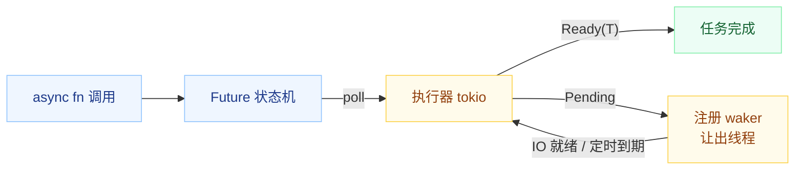

# Rust异步编程与tokio

> 这篇从线程模型的瓶颈讲起，经过 `Future` 的轮询机制、`async`/`await` 语法、tokio 运行时与任务、异步通道、`select!` 与超时取消，最后落到一个能并发处理任务的调度器和一个 TCP echo 服务。
>
> 学完能把阻塞代码改造成异步任务，用有界通道和信号量控制并发度，并定位「异步里写阻塞代码」「跨 `await` 持锁」「运行时没启动」这几类典型故障。

## 一、异步模型

线程模型的问题是每个连接占一个 OS 线程：1 万并发连接就要 1 万个线程，栈内存和上下文切换成本都不可接受。异步模型用少量线程跑大量任务，等待 IO 时主动让出执行权。

| 维度 | OS 线程 | 异步任务 |
|---|---|---|
| 单位成本 | 栈约 MB 级 | 状态机，几百字节起 |
| 切换 | 内核调度，微秒级 | 用户态，纳秒级 |
| 并发量级 | 数千 | 数十万 |
| 编程模型 | 阻塞调用 | `async`/`await`，不能阻塞 |
| 适用 | CPU 密集、阻塞 IO | 高并发 IO |

Rust 的异步是「零成本状态机」：`async fn` 编译成一个实现了 `Future` 的状态机，`.await` 是状态机的挂起点，不产生额外线程。

### 1.1 Future 是什么

`Future` 只有一个核心方法 `poll`，返回 `Poll::Ready(T)` 或 `Poll::Pending`。返回 `Pending` 前必须注册 waker，否则执行器不知道该在什么时候重新轮询。

```rust
// 标准库的定义（简化）
// pub trait Future {
//     type Output;
//     fn poll(self: Pin<&mut Self>, cx: &mut Context<'_>) -> Poll<Self::Output>;
// }
```

三个直接结论：

1. `Future` 是惰性的，创建它不会执行任何代码，必须被 `await` 或被执行器轮询；
2. `Future` 不自带执行器，标准库不提供运行时，`async fn` 单独写在 `main` 里编译不过；
3. `Future` 可能被移动，因此自引用状态机需要 `Pin`，这部分由 `async` 语法自动处理。



> 版本基线（2026-11）：Rust 1.99，`edition = "2024"`；tokio 1.54（1.4x 系列），`features = ["full"]` 仅用于示例，生产按需开启 `rt-multi-thread`、`macros`、`net`、`time`、`sync`。异步生态的 HTTP 框架见 Axum 0.8。

## 二、第一个 tokio 程序

tokio 是运行时：提供执行器、IO 驱动、定时器和异步原语。创建项目并加依赖：

```bash
cargo new --bin async-demo
cd async-demo
cargo add tokio --features full
```

`src/main.rs`：

```rust
use std::time::Duration;

#[tokio::main]
async fn main() {
    println!("开始");
    // sleep 是异步定时器：等待期间让出线程，不阻塞执行器
    tokio::time::sleep(Duration::from_millis(100)).await;
    println!("100ms 后");
}
```

```bash
cargo run -q
```

```text
开始
100ms 后
```

`#[tokio::main]` 是宏，把 `async fn main` 展开成「建多线程运行时 + `block_on`」：

```rust
fn main() {
    // 展开后近似这样，多线程运行时默认线程数等于核数
    tokio::runtime::Builder::new_multi_thread()
        .enable_all() // 开启 IO 与定时器驱动
        .build()
        .unwrap()
        .block_on(async {
            println!("开始");
            tokio::time::sleep(std::time::Duration::from_millis(100)).await;
            println!("100ms 后");
        });
}
```

手动建运行时适合把异步逻辑嵌进已有的同步程序，或需要控制线程数时：

```rust
use std::time::Duration;

async fn fetch(id: u32) -> u32 {
    tokio::time::sleep(Duration::from_millis(10)).await;
    id * 2
}

fn main() {
    // 当前线程运行时：单线程，适合轻量任务或测试
    let rt = tokio::runtime::Builder::new_current_thread()
        .enable_all()
        .build()
        .unwrap();
    let n = rt.block_on(fetch(21));
    println!("runtime 结果: {}", n); // 42
}
```

| 运行时 | 特征 | 使用场景 |
|---|---|---|
| `new_current_thread` | 单线程，无工作窃取 | 测试、CLI、轻量 IO |
| `new_multi_thread` | 多工作线程，任务窃取 | 服务端、CPU 与 IO 混合 |
| `#[tokio::main]` | 默认 multi-thread | 二进制入口 |

> 边界：`block_on` 不能在异步上下文里调用，会 panic（「Cannot start a runtime from within a runtime」）。异步函数里需要跑同步代码，用 `spawn_blocking`，见第三章。

## 三、任务

tokio 的任务是运行时调度的最小单位。`tokio::spawn` 把 Future 交给运行时，立刻返回 `JoinHandle`；任务与创建它的代码并发执行，不要求是 `main` 的直接子调用。

### 3.1 spawn 与 JoinHandle

```rust
#[tokio::main]
async fn main() {
    let handle = tokio::spawn(async {
        let sum: u64 = (1..=100).sum();
        sum
    });

    // 主任务继续做别的事，等结果时再 await
    println!("任务已提交");
    let result = handle.await.unwrap();
    println!("spawn 返回: {}", result); // 5050
}
```

`JoinHandle::await` 返回 `Result<T, JoinError>`：任务 panic 或被取消时是 `Err`。`spawn` 要求 Future 满足 `Send + 'static`，因此不能借用局部变量，跨线程的数据必须拥有或 `Arc` 共享。

### 3.2 并发等待：join! 与 try_join!

```rust
use std::time::Duration;

async fn fetch(id: u32) -> u32 {
    tokio::time::sleep(Duration::from_millis(10)).await;
    id * 2
}

#[tokio::main]
async fn main() {
    // 三个 future 同时推进，总耗时约 10ms 而不是 30ms
    let (a, b, c) = tokio::join!(fetch(1), fetch(2), fetch(3));
    println!("join! {} {} {}", a, b, c); // 2 4 6
}
```

`join!` 等全部完成；`try_join!` 遇到第一个 `Err` 立即返回，其余 future 被丢弃（取消）。

```rust
use std::io;

async fn ok(v: u32) -> io::Result<u32> { Ok(v) }
async fn fail() -> io::Result<u32> { Err(io::Error::other("boom")) }

#[tokio::main]
async fn main() {
    let r = tokio::try_join!(ok(1), ok(2));
    println!("{:?}", r); // Ok((1, 2))

    let r = tokio::try_join!(ok(1), fail());
    println!("{:?}", r.is_err()); // true，另一个 future 被取消
}
```

### 3.3 取消任务

```rust
use std::time::Duration;

#[tokio::main]
async fn main() {
    let handle = tokio::spawn(async {
        tokio::time::sleep(Duration::from_secs(10)).await;
        42
    });

    // abort 只是标记取消，任务在下一次让出点才真正结束
    handle.abort();
    match handle.await {
        Ok(v) => println!("完成 {}", v),
        Err(e) => println!("被取消: {}", e.is_cancelled()), // true
    }
}
```

取消是协作式的：任务在 `.await` 点检查取消标记，纯计算循环不会响应 `abort`。长循环里要主动 `tokio::task::yield_now().await`，给运行时检查取消的机会。

### 3.4 阻塞代码：spawn_blocking

`std::thread::sleep`、同步文件 IO、CPU 密集计算会占住工作线程，必须交给阻塞线程池。

```rust
#[tokio::main]
async fn main() {
    let n = tokio::task::spawn_blocking(|| {
        // 这段是普通同步代码，运行在专用的阻塞线程池
        let mut sum = 0u64;
        for i in 0..1_000_000 {
            sum += i;
        }
        sum
    })
    .await
    .unwrap();
    println!("spawn_blocking: {}", n); // 499999500000
}
```

| 场景 | 正确做法 |
|---|---|
| 异步 IO、定时器 | `.await` |
| 同步文件、CPU 计算 | `spawn_blocking` |
| 已有阻塞库调用 | `spawn_blocking` 包装 |
| 轻微计算（微秒级） | 直接算，不值得切线程 |

> 边界：`spawn_blocking` 的线程池有上限（默认 512），大量阻塞任务会排队。真正的容量规划要靠有界队列和限流，不能靠无限扩池。

## 四、异步通道与共享状态

tokio 的通道把「等待」变成 `.await`，不占线程。四种通道各有明确用途。

| 通道 | 生产者 | 消费者 | 语义 |
|---|---|---|---|
| `mpsc` | 多 | 单 | 消息队列，有界/无界 |
| `oneshot` | 单 | 单 | 一次性回传结果 |
| `broadcast` | 多 | 多 | 每条消息所有订阅者都收到 |
| `watch` | 单 | 多 | 只保留最新值 |

### 4.1 mpsc 与背压

有界 `mpsc::channel(n)` 在缓冲满时让 `send().await` 等待，这是异步系统最基本的限流手段。

```rust
use tokio::sync::mpsc;

#[tokio::main]
async fn main() {
    let (tx, mut rx) = mpsc::channel::<u32>(2);

    // 消费者单独跑成任务：send 满 2 之后阻塞，直到消费者取走
    let consumer = tokio::spawn(async move {
        let mut got = Vec::new();
        while let Some(v) = rx.recv().await {
            got.push(v);
        }
        got
    });

    for i in 0..5 {
        // 缓冲满时 send 阻塞，形成背压，防止内存膨胀
        if tx.send(i).await.is_err() {
            println!("接收端已关闭");
        }
    }
    drop(tx); // 关闭发送端，消费者循环结束
    println!("bounded 收到: {:?}", consumer.await.unwrap());
    // [0, 1, 2, 3, 4]
}
```

`unbounded_channel` 的 `send` 不等待，但生产速度超过消费时内存无上限增长。服务端默认用有界通道，容量按「单条消息大小 × 可接受积压量」估算。

### 4.2 oneshot：请求-响应

```rust
use std::time::Duration;
use tokio::sync::oneshot;

#[tokio::main]
async fn main() {
    let (tx, rx) = oneshot::channel::<String>();
    tokio::spawn(async move {
        tokio::time::sleep(Duration::from_millis(5)).await;
        let _ = tx.send(String::from("done"));
    });

    // 发送端被 drop 时返回 Err，不会永久挂起
    match rx.await {
        Ok(v) => println!("oneshot: {}", v), // done
        Err(_) => println!("oneshot: 发送端丢弃"),
    }
}
```

### 4.3 broadcast 与 watch

`broadcast` 给每个订阅者一份消息副本，适合配置变更、事件广播；订阅者跟不上时会收到 `RecvError::Lagged`，需要处理。`watch` 只保留最新值，适合热更新配置。

```rust
use tokio::sync::{broadcast, watch};

#[tokio::main]
async fn main() {
    let (tx, _rx1) = broadcast::channel::<&str>(8);
    let mut rx2 = tx.subscribe();
    tx.send("first").unwrap();
    let _ = tx.send("second");
    println!("broadcast: {}", rx2.recv().await.unwrap()); // first
    println!("broadcast: {}", rx2.recv().await.unwrap()); // second

    // watch：只关心最新值，中间的更新可以跳过
    let (tx, mut rx) = watch::channel("v1");
    tx.send("v2").unwrap();
    rx.changed().await.unwrap();
    println!("watch: {}", *rx.borrow()); // v2
}
```

### 4.4 tokio::sync::Mutex 与 std::sync::Mutex

| 选择 | 何时用 | 原因 |
|---|---|---|
| `std::sync::Mutex` | 临界区不含 `.await` | 更轻，无异步开销 |
| `tokio::sync::Mutex` | 必须跨 `.await` 持锁 | 等待时让出线程，避免死锁 |
| `RwLock` | 读多写少且跨 `.await` | 并发读 |

```rust
use std::sync::Arc;
use tokio::sync::Mutex;

#[tokio::main]
async fn main() {
    let counter = Arc::new(Mutex::new(0u64));
    let mut handles = Vec::new();

    for _ in 0..4 {
        let counter = Arc::clone(&counter);
        handles.push(tokio::spawn(async move {
            for _ in 0..1000 {
                // guard 跨 await 持有：必须用 tokio::sync::Mutex，std 版本会阻塞工作线程
                let mut n = counter.lock().await;
                *n += 1;
                tokio::task::yield_now().await;
            }
        }));
    }
    for h in handles {
        h.await.unwrap();
    }
    println!("tokio mutex 计数: {}", *counter.lock().await); // 4000
}
```

> 边界：用 `std::sync::Mutex` 并把 guard 跨 `.await` 持有，会阻塞工作线程，甚至在同一线程上造成自锁。编译器不会拦，`clippy::await_holding_lock` 会提示，CI 里应开启。

## 五、select!、超时与取消

`select!` 同时等待多个分支，第一个就绪的分支执行，其余 future 被丢弃。它是超时、竞速、多路复用的基础。

```rust
use std::time::Duration;
use tokio::sync::mpsc;

#[tokio::main]
async fn main() {
    let (tx, mut rx) = mpsc::channel::<u32>(1);
    tokio::spawn(async move {
        tokio::time::sleep(Duration::from_millis(30)).await;
        let _ = tx.send(7).await;
    });

    tokio::select! {
        v = rx.recv() => println!("select 收到 {:?}", v),
        _ = tokio::time::sleep(Duration::from_millis(10)) => println!("select 超时"),
    }
    // 输出 select 超时：10ms 先到
}
```

### 5.1 timeout 包装

`timeout(d, future)` 返回 `Result<T, Elapsed>`，比手写 `select!` 更直观，且取消语义明确。

```rust
use std::time::Duration;

#[tokio::main]
async fn main() {
    let slow = tokio::time::sleep(Duration::from_millis(50));
    let r = tokio::time::timeout(Duration::from_millis(10), slow).await;
    println!("timeout 结果: {:?}", r.is_err()); // true
}
```

超时后传入的 future 被 drop，即取消。这要求 future 在任意 await 点被丢弃都不破坏状态，见 5.2。

### 5.2 取消安全性

`select!` 与 `timeout` 都会丢弃未完成的分支。一个 future 在任意 await 点被取消都安全，才算「取消安全」。

| 操作 | 取消安全 | 说明 |
|---|---|---|
| `mpsc::recv` | 是 | 未取走的消息留在队列 |
| `oneshot::Receiver` | 是 | — |
| `AsyncReadExt::read` | 是 | 已读数据不丢 |
| `AsyncWriteExt::write_all` | 否 | 可能只写了一部分 |
| `BufReader::read_line` | 否 | 可能丢半行 |
| 自定义「读-改-写」序列 | 否 | 中途被取消会留下半状态 |

处理方式：把非取消安全的写操作用 `tokio::spawn` 包成独立任务，或用 `select!` 的 `biased;` 明确优先级，让关键分支先检查。

## 六、并发控制

`tokio::spawn` 不限制并发数，来一个任务开一个。对外部资源（数据库连接、下游 API）必须显式限流。

### 6.1 Semaphore

```rust
use std::sync::Arc;
use std::time::Duration;
use tokio::sync::Semaphore;

#[tokio::main]
async fn main() {
    // 同时最多 2 个任务进入临界区
    let semaphore = Arc::new(Semaphore::new(2));
    let mut handles = Vec::new();

    for i in 0..4 {
        let semaphore = Arc::clone(&semaphore);
        handles.push(tokio::spawn(async move {
            // acquire 返回 permit，drop 时自动归还
            let _permit = semaphore.acquire().await.unwrap();
            tokio::time::sleep(Duration::from_millis(10)).await;
            i
        }));
    }

    let mut done = Vec::new();
    for h in handles {
        done.push(h.await.unwrap());
    }
    println!("semaphore 完成: {:?}", done); // [0, 1, 2, 3]
}
```

信号量只限制「同时进行数」，不限制排队数。需要限制排队长度时，用有界 `mpsc` 作为入口队列。

### 6.2 选择并发度

| 任务类型 | 并发度参考 | 限制手段 |
|---|---|---|
| CPU 密集 | 等于核数 | rayon / `spawn_blocking` 池 |
| 网络 IO | 数百到数千 | Semaphore + 有界通道 |
| 数据库 | 等于连接池大小 | 连接池 + Semaphore |
| 下游有配额 | 等于配额 | 令牌桶 / 信号量 |

> 边界：并发度不是越大越好。超过下游承载能力只会把超时和重试放大，表现为「并发越高吞吐越低」。先压测出拐点，再把并发度固定下来。

## 七、完整服务与排障

下面是一个完整的 TCP echo 服务：每个连接一个任务，读到多少回写多少，对端关闭即退出。

`src/bin/server.rs`：

```rust
use tokio::io::{AsyncReadExt, AsyncWriteExt};
use tokio::net::TcpListener;

#[tokio::main]
async fn main() -> std::io::Result<()> {
    let listener = TcpListener::bind("127.0.0.1:7000").await?;
    println!("echo server on 127.0.0.1:7000");

    loop {
        let (mut socket, addr) = listener.accept().await?;
        println!("连接来自 {addr}");

        // 每个连接一个任务：任务之间互不阻塞
        tokio::spawn(async move {
            let mut buf = [0u8; 1024];
            loop {
                let n = match socket.read(&mut buf).await {
                    Ok(0) => return, // 对端关闭
                    Ok(n) => n,
                    Err(e) => {
                        eprintln!("读失败: {e}");
                        return;
                    }
                };
                if let Err(e) = socket.write_all(&buf[..n]).await {
                    eprintln!("写失败: {e}");
                    return;
                }
            }
        });
    }
}
```

`src/bin/client.rs`：

```rust
use tokio::io::{AsyncReadExt, AsyncWriteExt};
use tokio::net::TcpStream;

#[tokio::main]
async fn main() -> std::io::Result<()> {
    let mut stream = TcpStream::connect("127.0.0.1:7000").await?;
    stream.write_all(b"hello tokio").await?;

    // read_exact 等满 11 字节，确认完整回显
    let mut buf = [0u8; 11];
    stream.read_exact(&mut buf).await?;
    println!("echo 回来: {}", String::from_utf8_lossy(&buf));
    Ok(())
}
```

运行：

```bash
cargo build --release
./target/release/server &
./target/release/client
```

预期输出：

```text
# server
echo server on 127.0.0.1:7000
连接来自 127.0.0.1:57288

# client
echo 回来: hello tokio
```

### 7.1 现场手册

| 现象 | 原因 | 第一条检查 |
|---|---|---|
| `there is no reactor running` | 没在 tokio 运行时里执行 | 用 `#[tokio::main]` 或 `block_on` |
| 吞吐突然掉底 | 异步里调了阻塞函数 | 搜 `std::thread::sleep`、同步 IO |
| 程序卡死 | 持有 `std::sync::Mutex` 跨 `await` | `clippy::await_holding_lock` |
| 任务 panic 无日志 | `JoinHandle` 被丢弃 | 收集并 `await` 所有句柄 |
| 内存持续上涨 | 无界通道 + 生产过快 | 换有界通道，加信号量 |
| 超时后状态错乱 | 使用了非取消安全的 future | 改 `spawn` 或缩短临界区 |
| 单核跑满 | 长计算没有 `yield_now` | `spawn_blocking` 或分片 |

```bash
# 找异步里误用的阻塞调用
cargo clippy -- -W clippy::await_holding_lock
grep -rn 'std::thread::sleep\|std::fs::' src/

# 运行时线程数与任务堆积（需 tokio-console 或 metrics）
RUST_LOG=info cargo run --release 2>&1 | grep -i 'pending\|slow'
```

> 边界：`tokio::time::sleep` 与 `std::thread::sleep` 名字相近、行为完全不同。前者让出线程，后者占住工作线程；在 `async fn` 里出现后者几乎总是 bug。

## 八、最佳实践案例

### 8.1 案例背景

一个数据同步服务要从上游拉取 60 个分片，每个分片处理耗时 10–60ms（示例中模拟）。串行执行总耗时约 2.3 秒，超过 1 秒的调度预算。直接 `for` 循环里 `tokio::spawn` 60 个任务能压到 60ms 左右，但会把上游连接和下游写入同时打满。

约束：并发度控制在 8；任务不能丢、不能重复；需要有界缓冲，上游变慢时生产端自动等待；运行结束要能统计每个 worker 的负载。

### 8.2 案例实操

`Cargo.toml`：

```toml
[package]
name = "job-scheduler"
version = "0.1.0"
edition = "2024"

[dependencies]
tokio = { version = "1", features = ["rt-multi-thread", "macros", "time", "sync"] }
```

`src/main.rs`：

```rust
use std::collections::BTreeMap;
use std::time::{Duration, Instant};
use tokio::sync::mpsc;

// 每个任务的处理结果：谁处理的、哪个任务、耗时多久
#[derive(Debug)]
struct JobResult {
    worker: usize,
    job_id: usize,
    cost_ms: u64,
}

#[tokio::main]
async fn main() {
    const JOBS: usize = 60;
    const WORKERS: usize = 8;
    const BUFFER: usize = 16;

    // LCG 生成可复现的任务耗时，10..=60ms
    let mut seed: u64 = 42;
    let mut next = || {
        seed = seed.wrapping_mul(6364136223846793005).wrapping_add(1442695040888963407);
        seed
    };
    let costs: Vec<u64> = (0..JOBS).map(|_| 10 + (next() >> 40) % 51).collect();
    let serial_ms: u64 = costs.iter().sum();

    let (result_tx, mut result_rx) = mpsc::channel::<JobResult>(JOBS);
    let started = Instant::now();

    // 每个 worker 一条有界通道：缓冲满时派发端等待，天然限流
    let mut senders = Vec::new();
    let mut workers = Vec::new();
    for worker_id in 0..WORKERS {
        let (job_tx, mut job_rx) = mpsc::channel::<(usize, u64)>(BUFFER);
        senders.push(job_tx);
        let result_tx = result_tx.clone();
        workers.push(tokio::spawn(async move {
            while let Some((job_id, cost_ms)) = job_rx.recv().await {
                // 用 sleep 模拟 IO/计算耗时，.await 让出执行权给其他任务
                tokio::time::sleep(Duration::from_millis(cost_ms)).await;
                let result = JobResult { worker: worker_id, job_id, cost_ms };
                if result_tx.send(result).await.is_err() {
                    break; // 汇总端已关闭，提前退出
                }
            }
        }));
    }

    drop(result_tx); // 主线程不再发送结果，否则汇总循环永远等不到关闭

    // 轮询派发：任务均匀分到各 worker，某个 worker 满了就等一下
    for (job_id, cost_ms) in costs.iter().enumerate() {
        if senders[job_id % WORKERS].send((job_id, *cost_ms)).await.is_err() {
            eprintln!("worker {} 已退出，停止派发", job_id % WORKERS);
            break;
        }
    }
    drop(senders); // 关闭所有任务通道，worker 收完剩余任务后退出

    // 汇总：所有 worker 结束时 result_tx 全部 drop，循环自然结束
    let mut per_worker: BTreeMap<usize, (usize, u64)> = BTreeMap::new();
    let mut seen = std::collections::HashSet::new();
    let mut done = 0;
    let mut total_cost = 0;
    while let Some(result) = result_rx.recv().await {
        // 每个任务只应被处理一次，重复即说明派发逻辑有 bug
        assert!(seen.insert(result.job_id), "任务 {} 被重复处理", result.job_id);
        done += 1;
        total_cost += result.cost_ms;
        let entry = per_worker.entry(result.worker).or_insert((0, 0));
        entry.0 += 1;
        entry.1 += result.cost_ms;
    }

    for w in workers {
        w.await.unwrap();
    }

    let elapsed = started.elapsed();
    println!("任务数: {}，worker: {}，缓冲: {}", JOBS, WORKERS, BUFFER);
    println!("串行耗时(理论): {}ms", serial_ms);
    println!("并行耗时(实测): {}ms", elapsed.as_millis());
    println!("任务总耗时: {}ms", total_cost);
    for (worker, (count, cost)) in &per_worker {
        println!("worker {}: {} 个任务，{}ms", worker, count, cost);
    }
    assert_eq!(done, JOBS, "有任务丢失");
    assert_eq!(total_cost, serial_ms, "总耗时不一致");
    println!("校验通过: 全部 {} 个任务完成", done);
}
```

```bash
cargo run --release -q
```

实测输出（10 核 macOS，2026-11，耗时为示例）：

```text
任务数: 60，worker: 8，缓冲: 16
串行耗时(理论): 2333ms
并行耗时(实测): 365ms
任务总耗时: 2333ms
worker 0: 8 个任务，337ms
worker 1: 8 个任务，291ms
worker 2: 8 个任务，325ms
worker 3: 8 个任务，349ms
worker 4: 7 个任务，266ms
worker 5: 7 个任务，259ms
worker 6: 7 个任务，247ms
worker 7: 7 个任务，259ms
校验通过: 全部 60 个任务完成
```

### 8.3 案例结果

60 个任务从理论串行 2333ms 降到 365ms，加速约 6.4x（8 个 worker，长尾任务决定上限）；8 个 worker 各处理 7–8 个任务，负载均匀；任务数、总耗时与预期一致，重复与丢失都被断言拦住。

失败模式与复盘：

- 第一版用一条共享 `mpsc` 给所有 worker，`Receiver` 在当前 tokio 版本不能克隆，编译不过；改为「每 worker 一条有界通道 + 轮询派发」，同时获得更细的背压控制；
- 忘了 `drop(result_tx)`，汇总循环永远等不到通道关闭，程序挂死——异步通道的关闭语义比同步通道更依赖句柄生命周期；
- 曾把 `tokio::time::sleep` 误写成 `std::thread::sleep`，8 个 worker 串行化，耗时回到 2.3 秒；CI 里用 `grep` 拦 `std::thread::sleep`，用 clippy 拦跨 `await` 持锁；
- 缓冲容量 16 是权衡：太小派发端频繁等待，太大失去背压意义；按「单任务耗时 × worker 数 / 目标排队时长」估算后取值；
- 长尾来自任务时长随机分布，固定分片数无法完全均衡；真实系统可按耗时动态派发或让 worker 主动拉取。

至此 Rust 常用库的主线走完：集合与智能指针负责数据，线程与 rayon 负责 CPU 并行，tokio 负责高并发 IO。工程化配置与 Web 框架见 [Rust工程化](../03-Rust工程化/01-Cargo依赖与工程化.md) 与 [Rust Web 服务与 Axum](../04-Rust常用框架/01-RustWeb服务与Axum.md)。
