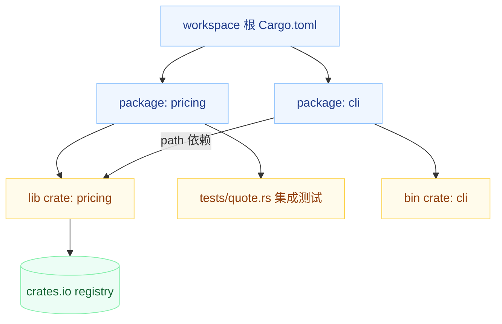

# Cargo依赖与工程化

> 这篇从 Cargo 的 package、crate 与 target 模型讲起，经过安装与最小工程、依赖版本解析、feature 条件编译、工作区拆分、测试与门禁，最后落到构建配置、crates.io 发布和一个多 crate 计价服务的工作区改造成果。
>
> 学完能把一个单文件 Rust 项目整理成可复用、可测试、可发布的工作区，并用 CI 门禁把依赖与构建质量固定下来。

## 一、Cargo 的工程模型

Cargo 同时是包管理器、构建驱动和发布工具，三者共用一份 `Cargo.toml`；理解 package、crate、target 三个词的区别，是读懂后面所有配置的前提。

| 术语 | 含义 | 对应文件或配置 |
|---|---|---|
| package | 一个可发布单元，有名字、版本和许可证 | 一份 `Cargo.toml` |
| crate | 一次编译的产物，分库 crate 和二进制 crate | `src/lib.rs`、`src/main.rs` |
| target | 具体的构建目标，一个 package 可以有多个 | `[lib]`、`[[bin]]`、`tests/`、`benches/` |
| workspace | 多个 package 的集合，共享 lockfile 与输出目录 | 根 `Cargo.toml` 的 `[workspace]` |
| registry | crate 的来源，默认是 crates.io | `.cargo/config.toml` 的 `[registries]` |

一个 package 可以同时有 `src/lib.rs` 和 `src/main.rs`：库 crate 承载逻辑，二进制 crate 只做参数解析和输出。这样集成测试可以直接 `use` 库，不必启动进程。



构建产物按 target 分目录存放：`target/debug/` 是开发构建，`target/release/` 是优化构建，交叉编译再加一层三元组目录，例如 `target/x86_64-unknown-linux-musl/release/`。同一 workspace 的所有成员共享一个 `target/`，这是后面增量编译和磁盘占用的关键。

> 边界：package 名和 crate 名默认相同，但 `[lib] name` 可以改；`Cargo.toml` 里的 `name` 用连字符（`order-core`），代码里 `use` 时写成下划线（`order_core`），混用会编译失败。

## 二、安装与最小工程

Rust 工具链统一用 rustup 管理，不用系统包管理器里的旧版 rustc；`rustup` 负责切换 stable、beta、nightly 和指定版本，`cargo` 随工具链一起安装。

| 环境 | 安装命令（2026-11） | 验证 |
|---|---|---|
| Windows 10/11 | `winget install Rustlang.Rustup` | `rustc -V` |
| macOS | `brew install rustup-init && rustup-init -y` | `rustc -V` |
| Ubuntu 24.04/26.04 | `curl --proto '=https' --tlsv1.2 -sSf https://sh.rustup.rs \| sh -s -- -y` | `source "$HOME/.cargo/env"` 后 `rustc -V` |
| Rocky/CentOS 9/10 | 同上，先 `sudo dnf install gcc make` | `rustc -V` |

Ubuntu 上还需要 C 链接器和 `pkg-config`，编译 OpenSSL 依赖时缺了会报链接错误：

```bash
sudo apt update && sudo apt install -y build-essential pkg-config libssl-dev
```

安装完成后确认工具链和默认 target：

```bash
rustc -Vv
cargo -V
rustup show active-toolchain
```

预期输出（版本号随补丁更新，2026-11 实测）：

```text
rustc 1.99.1 (58cf8f9c3 2026-10-13)
binary: rustc
commit-hash: 58cf8f9c35b355199727627d07ae34a4e2846d67
commit-date: 2026-10-13
host: aarch64-apple-darwin
release: 1.99.1
LLVM version: 23.1.1
cargo 1.99.1 (5f94df478 2026-08-27)
stable-aarch64-apple-darwin (default)
```

版本基线：Rust 1.99、edition 2024（1.85 起可用）、`resolver = "3"`。edition 在 `Cargo.toml` 里按 package 声明，不同 package 可以不同，但同一 workspace 建议统一。

最小工程：

```bash
cargo new hello --bin        # 生成 src/main.rs 和 .gitignore
cd hello
cargo run
```

`cargo new --lib` 生成 `src/lib.rs`；`cargo init` 在已有目录里补 `Cargo.toml`。生成的文件如下，注释解释了每一项为什么存在：

```toml
[package]
name = "hello"
version = "0.1.0"
edition = "2024"        # 决定语言语义，不是编译器版本
rust-version = "1.85"   # MSRV，cargo 会拒绝更低版本的依赖
description = "最小示例"  # 发布到 crates.io 时必填

[dependencies]
```

```rust
fn main() {
    // println! 是宏，编译期展开；{} 调用 Display
    println!("Hello, Rust 2024");
}
```

预期输出：

```text
   Compiling hello v0.1.0 (/path/hello)
    Finished `dev` profile [unoptimized + debuginfo] target(s) in 0.32s
     Running `target/debug/hello`
Hello, Rust 2024
```

四个高频命令的分工要分清：

| 命令 | 用途 | 是否产出二进制 |
|---|---|---|
| `cargo check` | 只做类型检查，最快 | 否 |
| `cargo build` | 编译到 `target/debug` | 是 |
| `cargo run` | 编译并运行当前 package 的默认 bin | 是 |
| `cargo test` | 编译测试 profile 并运行 | 测试二进制 |

> 边界：`cargo check` 不跑链接和代码生成，能查出类型错误但查不出链接错误；CI 里可以用 `check` 做快速反馈，最终仍要 `build` 或 `test` 一次。

## 三、依赖声明与版本解析

Cargo 的版本号遵循语义化版本（SemVer），`Cargo.toml` 里写的通常是一个兼容区间，不是精确版本；真正锁定的是 `Cargo.lock`。

### 3.1 版本要求的含义

| 写法 | 等价区间 | 适用场景 |
|---|---|---|
| `serde = "1.0"` | `>=1.0.0, <2.0.0` | 默认写法，接受兼容更新 |
| `serde = "1.0.219"` | `>=1.0.219, <2.0.0` | 需要某个新 API 时抬高下限 |
| `serde = "=1.0.219"` | 精确等于 | 临时规避上游 bug |
| `serde = "~1.0.219"` | `>=1.0.219, <1.1.0` | 只接受补丁更新 |
| `serde = "0.8"` | `>=0.8.0, <0.9.0` | 0.x 版本，次版本视为不兼容 |

0.x 的兼容规则与 1.x 不同：`0.8` 不允许升到 `0.9`。内部 crate 在 1.0 之前频繁破坏性变更，这条规则能避免误升级。

依赖来源有五种，按优先级从高到低是 path、git、registry、alternative registry、本地 vendored 源：

```toml
[dependencies]
# 1. 路径依赖：工作区内共享代码，改完立即生效
pricing = { path = "../pricing" }

# 2. git 依赖：上游还没发版，锁定 rev 保证可复现
axum-ext = { git = "https://github.com/example/axum-ext", rev = "9f2c1ab" }

# 3. 指定 registry：企业私有源
internal-auth = { version = "0.4", registry = "corp" }

# 4. 关闭默认 feature，只开需要的
reqwest = { version = "0.12", default-features = false, features = ["rustls-tls", "json"] }
```

`cargo add` 会改写 `Cargo.toml` 并选当前最新兼容版本，比手写少出错：

```bash
cargo add serde --features derive
cargo add tokio --features rt-multi-thread,macros,signal
cargo add --dev proptest
cargo add --build cc
cargo remove tokio
```

### 3.2 解析、锁定与升级

`cargo build` 第一次运行会生成 `Cargo.lock`，记录依赖图里每个 crate 的精确版本和校验和；之后只要 `Cargo.toml` 的约束没变，就沿用 lockfile，保证构建可复现。

```bash
cargo update                      # 在约束内升级所有依赖，重写 lockfile
cargo update -p serde             # 只升一个包
cargo update -p serde --precise 1.0.220   # 精确指定，常用于回退
cargo tree -d                     # 找出同一 crate 的多个版本
cargo tree -i serde               # 反向查谁依赖了 serde
```

`cargo tree -d` 的输出直接指出重复依赖的来源，这是排查“两个版本的类型不兼容”的第一步：

```text
rand v0.8.5
└── quickcheck v1.0.3
rand v0.9.2
└── my-app v0.1.0
```

出现两个 `rand` 时，`rand::Rng` 是两套不同的 trait，把 `v0.8` 的 `ThreadRng` 传给要求 `v0.9` 的函数会报 trait 不匹配。修复方式只有三种：升级调用方、降级被调用方、或在上游统一版本。

`[patch]` 用于临时用本地分支替换 crates.io 上的版本，调试上游 bug 时用：

```toml
[patch.crates-io]
serde = { git = "https://github.com/serde-rs/serde", branch = "fix-1234" }
```

> 边界：`[patch]` 只影响当前 workspace 的解析，不会传给下游；验证完必须删掉，否则发布后下游拿不到同样的补丁。`[replace]` 已废弃，不要再用。

### 3.3 可复现构建

CI、生产构建和容器镜像统一用 `--locked`，只要 lockfile 与 `Cargo.toml` 不一致就直接失败，避免“本地能跑、线上拉到新版本”：

```bash
cargo build --release --locked
cargo test --locked
```

离线环境先把依赖抓下来，再让 Cargo 只读本地缓存：

```bash
cargo fetch --locked
cargo build --offline
```

需要把依赖随源码一起交付（内网构建、审计）时用 vendor：

```bash
cargo vendor vendor/
mkdir -p .cargo
cat > .cargo/config.toml <<'EOF'
[source.crates-io]
replace-with = "vendored-sources"

[source.vendored-sources]
directory = "vendor"
EOF
```

私有 registry 在 `~/.cargo/config.toml` 配置，token 从环境变量读，不写进仓库：

```toml
[registries.corp]
index = "sparse+https://cargo.corp.example/index/"

[registry]
default = "crates-io"
```

```bash
export CARGO_REGISTRIES_CORP_TOKEN="$(cat /run/secrets/cargo_token)"
cargo publish -p internal-auth --registry corp
```

> 边界：`Cargo.lock` 对二进制和可部署服务必须提交；库 crate 提交 lockfile 只影响自身 CI，不影响下游解析。`cargo publish` 打包时会忽略 lockfile。

## 四、feature 与条件编译

feature 是编译期的开关，不是运行期配置；它的设计规则只有一条：**feature 只能做加法，任意组合都必须能编译并通过测试**。

### 4.1 声明与使用

```toml
[features]
default = ["std"]          # 默认开启的集合
std = []
serde = ["dep:serde"]      # dep: 语法隐藏隐式 feature，避免 serde 被单独打开
metrics = ["dep:prometheus", "std"]
```

```rust
#[cfg(feature = "serde")]
use serde::{Deserialize, Serialize};

#[cfg(feature = "serde")]
#[derive(Serialize, Deserialize)]
pub struct OrderId(pub u64);

// cfg! 是表达式，两个分支都会参与类型检查，适合小分支
pub fn backend_name() -> &'static str {
    if cfg!(feature = "metrics") { "metrics" } else { "plain" }
}
```

`dep:` 语法把可选依赖从“同名 feature”里摘出来，用户只能通过显式 feature 打开它。没有 `dep:` 时，`serde` 依赖会自动生成一个同名 feature，用户 `features = ["serde"]` 也能打开，语义容易失控。

### 4.2 feature 统一与解析器

同一个 crate 在一次构建里只会被编译一次，所有调用方的 feature 取并集，这叫 feature 统一（feature unification）。工作区里 A 依赖 `reqwest` 开了 `rustls-tls`，B 没开，最终 B 也会拿到 `rustls-tls`。

```bash
cargo tree -e features -i reqwest    # 看 feature 是谁打开的
cargo check --no-default-features    # 验证最小组合
cargo check --all-features           # 验证最大组合
cargo hack check --each-feature      # 需要 cargo-hack，逐 feature 验证
```

`resolver = "2"` 起，feature 统一只发生在同一 target 的构建里；`resolver = "3"`（edition 2024 默认）在此之上加入 MSRV 感知的版本选择：解析依赖时优先挑满足 `rust-version` 的最高版本，而不是无脑选最新。

> 边界：feature 不能用来表达互斥的后端，比如 `mysql` 和 `postgres` 二选一。两个都开时必须能编译；确实互斥就拆成两个 crate，或用运行期配置。

### 4.3 平台与编译期条件

`cfg` 不只用于 feature，也用于目标平台和编译器：

```rust
#[cfg(target_os = "linux")]
fn default_data_dir() -> &'static str { "/var/lib/order" }

#[cfg(target_os = "macos")]
fn default_data_dir() -> &'static str { "/usr/local/var/order" }

#[cfg(windows)]
fn default_data_dir() -> &'static str { r"C:\ProgramData\order" }

#[cfg(not(any(target_os = "linux", target_os = "macos", windows)))]
compile_error!("unsupported platform");
```

平台相关依赖写在 target 段，Linux 特有的库不会在 macOS 上被拉取：

```toml
[target.'cfg(target_os = "linux")'.dependencies]
inotify = "0.11"

[target.'cfg(windows)'.dependencies]
windows-sys = { version = "0.61", features = ["Win32_Foundation"] }

[target.x86_64-unknown-linux-musl.dependencies]
# 指定三元组时写完整 target 名
```

常见的 `cfg` 值：

| 键 | 取值示例 | 用途 |
|---|---|---|
| `target_os` | `linux`、`macos`、`windows` | 系统 API 分支 |
| `target_arch` | `x86_64`、`aarch64` | SIMD、指针宽度 |
| `target_env` | `gnu`、`musl`、`msvc` | 链接器与 libc 差异 |
| `target_family` | `unix`、`windows` | 粗粒度平台判断 |
| `debug_assertions` | 开/关 | 调试构建专属逻辑 |

> 边界：`cfg!(...)` 在运行期求值的是编译期常量，两个分支都会被类型检查；`#[cfg(...)]` 直接删掉代码，未启用时可以引用不存在的依赖。写平台代码优先用后者。

## 五、工作区与多 crate 拆分

当一个仓库出现“库 + 命令行 + 服务端 + 共享模型”四种产物时，继续用单 package 会让依赖和编译时间失控；工作区把版本、依赖和输出目录收敛到一处。

### 5.1 目录与根配置

```text
order-service/
├── Cargo.toml
├── Cargo.lock
├── crates/
│   ├── pricing/          # 纯计算库，无 IO
│   │   ├── Cargo.toml
│   │   ├── src/lib.rs
│   │   └── tests/quote.rs
│   └── cli/              # 二进制，薄壳
│       ├── Cargo.toml
│       └── src/main.rs
└── .github/workflows/ci.yml
```

```toml
[workspace]
members = ["crates/*"]
exclude = ["experiments"]      # 不参与构建的目录，避免 cargo 误扫
resolver = "3"

[workspace.package]
version = "0.3.0"
edition = "2024"
rust-version = "1.85"
license = "MIT"
repository = "https://github.com/example/order-service"

[workspace.dependencies]
serde = { version = "1.0", features = ["derive"] }
serde_json = "1"
pricing = { path = "crates/pricing", default-features = false }
```

成员继承用 `workspace = true`，子 crate 不再重复写版本：

```toml
[package]
name = "pricing"
version.workspace = true
edition.workspace = true
rust-version.workspace = true
license.workspace = true

[dependencies]
serde = { workspace = true, optional = true }

[features]
default = []
serde = ["dep:serde"]
```

`[workspace.dependencies]` 只统一声明，不会自动成为任何成员的依赖；成员仍要显式写 `serde.workspace = true` 才会引入。这样每个 crate 的依赖面仍然清晰。

### 5.2 成员之间的依赖与发布顺序

工作区内用 path 依赖，发布时必须同时给 `version`，否则 crates.io 上的包无法解析：

```toml
[dependencies]
pricing = { version = "0.3.0", path = "../pricing" }
```

发布顺序由依赖图决定，被依赖的先发：

```bash
cargo publish -p pricing --dry-run
cargo publish -p pricing
cargo publish -p cli
```

`cargo package --list` 可以在发布前看清包里到底有什么：

```bash
cargo package -p pricing --list
```

预期输出（实测）：

```text
Cargo.lock
Cargo.toml
Cargo.toml.orig
src/lib.rs
tests/quote.rs
```

`Cargo.toml.orig` 是 Cargo 归一化前的原文，属于正常产物。要排除测试数据或大文件，在 package 段写 `include` 或 `exclude`：

```toml
[package]
include = ["src/**", "README.md", "LICENSE"]
```

### 5.3 常用工作区命令

| 命令 | 作用 |
|---|---|
| `cargo build --workspace` | 构建所有成员 |
| `cargo test -p pricing` | 只测一个成员 |
| `cargo run -p cli` | 运行指定二进制 |
| `cargo publish -p pricing` | 发布单个成员 |
| `cargo metadata --no-deps` | 输出依赖图 JSON，供脚本消费 |

`default-members` 控制不带 `-p` 时的默认范围，适合把示例 crate 排除在默认构建外：

```toml
[workspace]
members = ["crates/*", "examples/*"]
default-members = ["crates/cli"]
```

> 边界：工作区内所有成员共享一个 `Cargo.lock` 和 `target/`，这让增量编译更快，但也意味着一个成员打开的重型 feature 会影响整次构建。用 `cargo tree -e features` 确认，不要靠猜。

## 六、测试与质量门禁

Rust 的测试分三层：单元测试、集成测试、文档测试。三层的编译单元和可见性不同，不能互相替代。

### 6.1 三层测试

```rust
// src/lib.rs 末尾：单元测试能访问私有项
#[cfg(test)]
mod tests {
    use super::*;

    #[test]
    fn threshold_is_inclusive() {
        assert_eq!(discount(Money(30_000), false), Money(26_000));
    }

    #[test]
    #[should_panic(expected = "quantity must be positive")]
    fn rejects_zero_quantity() {
        line_total(Money(100), 0);
    }

    #[test]
    fn parses_price() -> Result<(), std::num::ParseIntError> {
        let cents: i64 = "1250".parse()?;  // 返回 Result 的测试可用 ?
        assert_eq!(cents, 1250);
        Ok(())
    }
}
```

```rust
// tests/quote.rs：集成测试只能使用 pub API，等价于外部用户
use pricing::{Money, discount};

#[test]
fn member_discount_stacks_after_threshold() {
    assert_eq!(discount(Money(30_000), true), Money(24_700));
}
```

```rust
/// 文档测试会编译并运行，示例过期就会失败
///
/// ```
/// use pricing::{Money, payable};
/// assert_eq!(payable(&[(Money(1_250), 2)], false), Money(2_500));
/// ```
pub fn payable(lines: &[(Money, u32)], member: bool) -> Money { /* ... */ }
```

```bash
cargo test                       # 单元 + 集成 + 文档测试
cargo test --lib                 # 只跑单元测试
cargo test --test quote          # 只跑指定集成测试文件
cargo test --doc                 # 只跑文档测试
cargo test -- --nocapture        # 显示 println! 输出
cargo test -- --test-threads=1   # 串行，排查共享状态
```

预期输出（节选，实测）：

```text
running 3 tests
test tests::member_discount_stacks_after_threshold ... ok
test tests::empty_order_is_zero ... ok
test tests::threshold_is_inclusive ... ok

test result: ok. 3 passed; 0 failed; 0 ignored; 0 measured; 0 filtered out
```

`dev-dependencies` 只在测试、示例、基准里可见，不会传给下游；把测试工具放这里，而不是 `[dependencies]`：

```toml
[dev-dependencies]
serde_json = "1"
proptest = "1"
```

### 6.2 lint 与格式

lint 配置写进 `Cargo.toml`，本地和 CI 用同一套规则，避免各人编辑器设置不同：

```toml
[lints.rust]
unsafe_code = "warn"
unused_must_use = "deny"

[lints.clippy]
all = { level = "warn", priority = -1 }
pedantic = { level = "warn", priority = -1 }
unwrap_used = "warn"
module_name_repetitions = "allow"
```

```bash
cargo fmt --all -- --check
cargo clippy --workspace --all-targets --all-features -- -D warnings
```

`-D warnings` 把警告升级为错误，CI 才真正拦住问题；本地只跑 `cargo clippy` 会容忍警告，容易在提交时才暴露。

依赖安全与许可证检查用两个独立工具，不要混在 clippy 里：

```bash
cargo install cargo-audit cargo-deny --locked
cargo audit
cargo deny check licenses bans sources
```

### 6.3 CI 流水线

```yaml
name: ci
on: [push, pull_request]

jobs:
  test:
    runs-on: ubuntu-24.04
    steps:
      - uses: actions/checkout@v5
      - uses: dtolnay/rust-toolchain@stable
        with:
          components: rustfmt, clippy
      - uses: Swatinem/rust-cache@v2
        with:
          shared-key: workspace   # 同一仓库的 job 复用编译缓存
      - run: cargo fmt --all -- --check
      - run: cargo clippy --workspace --all-targets --all-features -- -D warnings
      - run: cargo test --workspace --all-features --locked
      - run: cargo build --workspace --release --locked

  msrv:
    runs-on: ubuntu-24.04
    steps:
      - uses: actions/checkout@v5
      - uses: dtolnay/rust-toolchain@1.85.0
      - run: cargo check --workspace --all-features --locked
```

MSRV job 用 `rust-version` 声明的版本单独编译一次，防止无意中用了更新的标准库 API。`cargo +1.85.0 check` 是本地等价的快速验证方式。

> 边界：`--all-features` 不能代替 `--no-default-features`。有些 crate 只在“零 feature”组合下才暴露编译错误，两个方向都要在 CI 里跑一次，或者用 `cargo hack --each-feature`。

## 七、构建配置与发布

默认的 `dev` 和 `release` profile 面向通用场景；服务端二进制通常要更小的体积、更确定的性能，发布到 crates.io 还要满足元数据要求。

### 7.1 profile 调优

```toml
[profile.release]
lto = "thin"          # 跨 crate 内联，编译时间远低于 fat
codegen-units = 1     # 单单元优化更彻底，代价是编译变慢
strip = "symbols"     # 去掉符号表，二进制通常小 30% 以上
panic = "abort"       # 去掉 unwind 表；库 crate 不要设，见 FFI 篇
opt-level = 3

[profile.dist]
inherits = "release"
lto = "fat"
```

`panic = "abort"` 会改变错误处理语义：`catch_unwind` 失效，任何 panic 直接终止进程。二进制服务可以接受，供他人依赖的库不能设，否则下游无法捕获 panic。

构建耗时用 `--timings` 定位，产物是一个 HTML，按 crate 列出并行度和关键路径：

```bash
cargo build --release --timings
ls target/cargo-timings/
```

```text
cargo-timing-20261113-101500.html
```

二进制体积用 `cargo bloat` 看哪些函数占空间：

```bash
cargo install cargo-bloat --locked
cargo bloat --release -n 20
cargo bloat --release --crates
```

### 7.2 交叉编译与缓存

Linux 服务常用 musl 静态链接，产物不依赖目标机 glibc：

```bash
rustup target add x86_64-unknown-linux-musl
cargo build --release --target x86_64-unknown-linux-musl
file target/x86_64-unknown-linux-musl/release/cli
```

预期输出：

```text
target/x86_64-unknown-linux-musl/release/cli: ELF 64-bit LSB pie executable, x86-64, statically linked, stripped
```

本地多项目共用编译缓存用 sccache，CI 上也适用：

```bash
cargo install sccache --locked
export RUSTC_WRAPPER=sccache
sccache --show-stats
```

`CARGO_TARGET_DIR` 可以把输出目录挪到大盘或内存盘，避免仓库目录被 `target/` 撑爆：

```bash
export CARGO_TARGET_DIR=/var/cache/cargo-target
cargo build --release
```

### 7.3 发布到 crates.io

发布前逐项核对，缺一项都会在 `cargo publish` 时报错或发布后被下架：

| 检查项 | 要求 |
|---|---|
| 包名 | 全局唯一，先 `cargo search` 确认 |
| 元数据 | `description`、`license`、`repository` 必填 |
| 文档 | `cargo doc --no-deps` 无警告 |
| 内容 | `cargo package --list` 无多余文件 |
| 版本 | 遵循 SemVer，破坏性变更升主版本 |
| 认证 | `cargo login` 写入 `~/.cargo/credentials.toml` |

```bash
cargo doc --no-deps --open
cargo publish --dry-run
cargo publish
```

发布后发现问题只能 `cargo yank` 撤回版本，不能删除；下游已锁定的 lockfile 仍能拉到被 yank 的版本，所以 yank 不是补救手段，发版前验证才是。

破坏性变更用 `cargo-semver-checks` 在 CI 里自动检测：

```bash
cargo install cargo-semver-checks --locked
cargo semver-checks check-release -p pricing
```

> 边界：crates.io 的包一旦发布就不可修改，版本号不可复用。内部库发私有 registry 时，同样要遵守“先验证再发布”，只是回滚成本低一些。

## 八、工程化排障手册

Cargo 的报错大多能归到四类：版本解析、feature 组合、链接器、缓存状态。按现象查表，第一条命令就能缩小范围。

| 现象 | 原因 | 第一条命令 |
|---|---|---|
| `failed to select a version for ...` | 版本约束冲突 | `cargo tree -d` |
| `trait bound ... is not satisfied` | 同一 crate 两个版本 | `cargo tree -i <crate>` |
| `feature ... is not enabled` | feature 没开或被 `dep:` 隐藏 | `cargo tree -e features -i <crate>` |
| `linker 'cc' not found` | 缺 C 工具链 | `sudo apt install build-essential` |
| `undefined reference to ...` | 系统库或链接顺序 | `pkg-config --libs <lib>` |
| `Blocking waiting for file lock` | 另一个 cargo 进程占用 | `ps aux \| grep cargo` |
| 改了代码但行为没变 | 增量缓存损坏 | `cargo clean -p <crate>` |
| `no matching package named` | 私有源未配置或离线 | `cargo build --offline -v` |

几个典型场景的完整处理：

**重复依赖导致类型不兼容。** `cargo tree -d` 找到两个版本后，优先升级直接依赖；不能升级时用 `[patch]` 或让上游统一。不要试图把两个版本的类型互相转换，成本高于修依赖。

**工作区成员没被识别。** `members = ["crates/*"]` 只匹配一层，`crates/foo/bar` 需要 `crates/*/*`。报错 `failed to load manifest for workspace member` 时先 `ls crates/*/Cargo.toml` 确认路径。

**发布时提示 path 依赖没有版本。** crates.io 不接受纯 path 依赖，必须写成 `{ version = "0.3.0", path = "../pricing" }`，且版本要与被依赖包一致。

**CI 与本地结果不同。** 先确认 `--locked` 是否使用同一份 lockfile，再确认 Rust 版本是否一致（`rust-toolchain.toml` 固定版本），最后才怀疑代码。

```toml
# rust-toolchain.toml：进仓库，所有人用同一版本
[toolchain]
channel = "1.99.1"
components = ["rustfmt", "clippy"]
```

> 边界：`rust-toolchain.toml` 会让 rustup 自动下载指定版本，离线机器会失败；内网环境改成 `channel = "stable"` 并预装工具链。

## 九、最佳实践案例

### 9.1 案例背景

一个订单计价服务最初是单 package：`src/main.rs` 里既有金额计算，又有参数解析和 JSON 输出，依赖了 `serde`、`serde_json` 和一个内部工具库。问题有三个：计价逻辑无法被服务端复用；每次跑 CLI 都要连带编译全部依赖；CI 只有一个 job，任何改动都全量构建 6 分钟。

目标是把计价逻辑抽成独立库、CLI 变成薄壳、依赖版本收敛到工作区，并把格式、lint、测试、MSRV 固化成四条门禁。约束是不能改变现有命令行输出，且 `pricing` 库在不用 serde 时不能引入 serde 依赖。

### 9.2 案例实操

第一步，建立工作区根配置，统一版本与依赖：

```toml
# Cargo.toml
[workspace]
members = ["crates/*"]
resolver = "3"

[workspace.package]
version = "0.3.0"
edition = "2024"
rust-version = "1.85"
license = "MIT"

[workspace.dependencies]
serde = { version = "1.0", features = ["derive"] }
serde_json = "1"
pricing = { path = "crates/pricing", default-features = false }
```

第二步，把计价逻辑搬进 `pricing` 库。金额用整数分，避免浮点误差；`serde` 做成可选 feature，纯计算场景不拉序列化依赖：

```toml
# crates/pricing/Cargo.toml
[package]
name = "pricing"
version.workspace = true
edition.workspace = true
rust-version.workspace = true
license.workspace = true

[dependencies]
serde = { workspace = true, optional = true }  # 只有开 feature 才编译

[features]
default = []
serde = ["dep:serde"]                           # dep: 隐藏隐式同名 feature

[dev-dependencies]
serde_json = "1"
```

```rust
// crates/pricing/src/lib.rs
//! 订单计价：金额一律用整数分表示，避免浮点误差。

/// 以「分」为单位的金额。
#[derive(Debug, Clone, Copy, PartialEq, Eq, PartialOrd, Ord)]
pub struct Money(pub i64);

impl Money {
    /// 从元转换成分，四舍五入到分。
    pub fn from_yuan(yuan: f64) -> Self {
        Money((yuan * 100.0).round() as i64)
    }

    pub fn yuan(&self) -> f64 {
        self.0 as f64 / 100.0
    }
}

impl std::ops::Add for Money {
    type Output = Money;
    fn add(self, rhs: Money) -> Money {
        Money(self.0 + rhs.0) // 整数相加，不存在 0.1 + 0.2 的误差
    }
}

/// 满 300 元减 40 元，可与会员 95 折叠加。
pub fn discount(total: Money, member: bool) -> Money {
    let mut payable = total;
    if payable.0 >= 30_000 {
        payable = Money(payable.0 - 4_000);
    }
    if member {
        // 先减后折，顺序写死在函数里，避免调用方各写一套
        payable = Money((payable.0 as f64 * 0.95).round() as i64);
    }
    payable
}

/// 计算订单应付金额，明细按行小计累加。
///
/// ```
/// use pricing::{Money, payable};
/// let lines = [(Money(1_250), 2), (Money(800), 1)];
/// assert_eq!(payable(&lines, false), Money(3_300));
/// ```
pub fn payable(lines: &[(Money, u32)], member: bool) -> Money {
    let total = lines
        .iter()
        .fold(Money(0), |acc, (price, qty)| acc + Money(price.0 * i64::from(*qty)));
    discount(total, member)
}

#[cfg(feature = "serde")]
mod wire {
    use super::Money;
    use serde::{Deserialize, Serialize};

    #[derive(Debug, Serialize, Deserialize)]
    pub struct Quote {
        pub payable_cents: i64,
        pub member: bool,
    }

    impl Quote {
        pub fn new(money: Money, member: bool) -> Self {
            Quote { payable_cents: money.0, member }
        }
    }
}

#[cfg(feature = "serde")]
pub use wire::Quote;
```

第三步，补集成测试，覆盖阈值边界和折扣叠加顺序：

```rust
// crates/pricing/tests/quote.rs
use pricing::{Money, payable, discount};

#[test]
fn threshold_is_inclusive() {
    assert_eq!(discount(Money(30_000), false), Money(26_000));
    assert_eq!(discount(Money(29_999), false), Money(29_999));
}

#[test]
fn member_discount_stacks_after_threshold() {
    // 30000 - 4000 = 26000，再打 95 折 = 24700
    assert_eq!(discount(Money(30_000), true), Money(24_700));
}

#[test]
fn empty_order_is_zero() {
    assert_eq!(payable(&[], true), Money(0));
}
```

第四步，CLI 只保留参数与输出，逻辑全部来自库：

```toml
# crates/cli/Cargo.toml
[package]
name = "cli"
version.workspace = true
edition.workspace = true
rust-version.workspace = true
license.workspace = true

[dependencies]
pricing = { workspace = true, features = ["serde"] }  # 只有 CLI 需要序列化
serde_json = "1"
```

```rust
// crates/cli/src/main.rs
use pricing::{Money, payable, Quote};

fn main() {
    let lines = [(Money::from_yuan(125.0), 2), (Money::from_yuan(80.0), 1)];
    let total = payable(&lines, true);
    let quote = Quote::new(total, true);
    println!("{}", serde_json::to_string(&quote).unwrap());
    println!("应付 {} 元", total.yuan());
}
```

第五步，运行并核对输出：

```bash
cargo test --workspace --all-features
cargo run -q -p cli
```

预期输出（实测）：

```text
running 3 tests
test threshold_is_inclusive ... ok
test member_discount_stacks_after_threshold ... ok
test empty_order_is_zero ... ok

test result: ok. 3 passed; 0 failed; 0 ignored; 0 measured; 0 filtered out
{"payable_cents":27550,"member":true}
应付 275.5 元
```

第六步，加 CI 门禁。四个 job 分别负责格式、lint、测试、MSRV，缓存按 workspace 共享：

```yaml
name: ci
on: [push, pull_request]

jobs:
  lint:
    runs-on: ubuntu-24.04
    steps:
      - uses: actions/checkout@v5
      - uses: dtolnay/rust-toolchain@stable
        with:
          components: rustfmt, clippy
      - uses: Swatinem/rust-cache@v2
      - run: cargo fmt --all -- --check
      - run: cargo clippy --workspace --all-targets --all-features -- -D warnings
      - run: cargo test --workspace --all-features --locked
      - run: cargo check --workspace --no-default-features --locked

  msrv:
    runs-on: ubuntu-24.04
    steps:
      - uses: actions/checkout@v5
      - uses: dtolnay/rust-toolchain@1.85.0
      - run: cargo check --workspace --all-features --locked
```

### 9.3 案例结果

改造后，`pricing` 可以同时被 CLI 和后续的 HTTP 服务复用，`cargo test -p pricing` 在 0.5 秒内完成，只改 CLI 时不会重新编译 `pricing` 的测试依赖。`pricing` 不开启 `serde` feature 时，依赖树里没有 `serde`，可以用 `cargo tree -p pricing -e normal` 验证。

| 指标 | 改造前 | 改造后 |
|---|---|---|
| CI 全量时间 | 约 6 分钟 | 约 2 分 10 秒（示例） |
| 计价逻辑复用 | 只能复制代码 | 库依赖，两处共用 |
| 依赖版本 | 三个 crate 各写一份 | 工作区统一声明 |
| 门禁 | 无 | fmt / clippy / test / MSRV |

失败模式与复盘：第一版把 `pricing` 的 `serde` 依赖写成非可选，导致 CLI 不用 JSON 时也编译 serde，构建时间反而变长；改成 `optional = true` + `dep:serde` 后恢复。第二版在 CLI 里重复实现了一遍折扣规则，测试只覆盖库，CLI 的输出与库不一致；把 CLI 改成只调用 `payable` 后消除。结论是：工作区只解决“代码放哪”，不解决“逻辑是否唯一”，公共规则必须只有一个实现。

> 边界：这个案例省略了错误处理和参数解析。真实 CLI 应返回 `Result` 并用 `std::process::ExitCode` 表达失败，而不是 `unwrap`；库 crate 不应依赖 `anyhow`，用具体错误类型或 `thiserror` 暴露给调用方。
