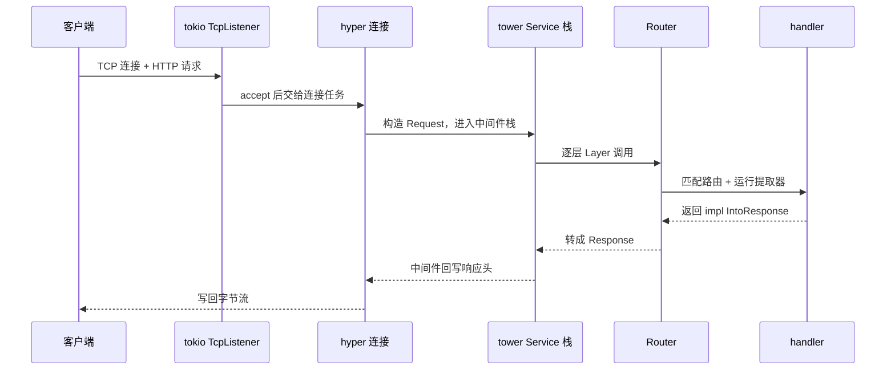

# RustWeb服务与Axum

> 这篇从 Axum 的分层运行模型讲起，经过环境与最小服务、路由分发、提取器解码、共享状态、中间件与可观测性、统一错误响应、sqlx 持久化，最后落到排障手册和一个带分页、校验、测试的待办服务交付。
>
> 学完能独立搭建一个 Axum 0.8 服务，把路由、状态、中间件、错误和数据库访问按生产要求组织起来，并用集成测试与 curl 验证行为。

## 一、Axum 与 tokio 的运行模型

Axum 自己不实现 HTTP 协议，也不实现异步运行时：它把 hyper 的请求转换成 tower 的 `Service` 调用，再把 handler 的返回值转换成响应。理解这三层分工，才能判断问题出在框架、中间件还是业务代码。

| 层 | 组件 | 职责 |
|---|---|---|
| 运行时 | tokio | 任务调度、TCP 监听、信号处理 |
| 协议 | hyper / hyper-util | HTTP/1.1、HTTP/2 编解码 |
| 抽象 | tower | `Service`、`Layer`，中间件组合 |
| 框架 | axum | 路由、提取器、响应、状态 |

一次请求的完整路径：



三个直接推论：

- handler 是 async 函数，里面做阻塞 IO 会占住 worker 线程，拖慢同线程的其他请求；
- 中间件顺序由 `layer` 的调用顺序决定，后加的层包在外层；
- 所有跨 await 持有的类型必须 `Send`，`Rc`、`RefCell` 和未加锁的 `MutexGuard` 都会让 handler 编译失败。

> 边界：Axum 不提供 ORM、配置中心、任务队列和优雅停机，这些要自己选型组装。需要"全家桶"时用 Spring Boot 式的框架更省事；需要控制依赖面和性能时，Axum 的组合式设计更合适。

## 二、环境与最小服务

Axum 0.8 要求 Rust 1.75 以上，实际项目按 edition 2024 用 1.85+；依赖只有 axum 和 tokio 两项就能跑通最小服务。

```bash
cargo new todo-api
cd todo-api
cargo add axum
cargo add tokio --features rt-multi-thread,macros,signal,net
cargo add serde --features derive
cargo add serde_json tracing tracing-subscriber --features tracing-subscriber/env-filter
```

版本基线（2026-11）：

| 组件 | 版本 | 说明 |
|---|---|---|
| Rust | 1.99 / edition 2024 | 最低 1.75 |
| axum | 0.8.9 | 路由参数语法与 0.7 不同 |
| tokio | 1.54 | `rt-multi-thread` 生产必开 |
| tower-http | 0.7.1 | Trace、Cors、Timeout |
| sqlx | 0.9 | 可选，持久化用 |

最小服务只保留一个健康检查：

```rust
// src/main.rs
use axum::{Router, routing::get};

async fn health() -> &'static str {
    "ok"
}

#[tokio::main]
async fn main() {
    // Router 是不可变的路由表，with_state 之后才能 serve
    let app = Router::new().route("/healthz", get(health));
    let listener = tokio::net::TcpListener::bind("127.0.0.1:3000").await.unwrap();
    axum::serve(listener, app).await.unwrap();
}
```

```bash
cargo run
curl -i localhost:3000/healthz
```

预期输出（实测）：

```text
HTTP/1.1 200 OK
content-type: text/plain; charset=utf-8
content-length: 2

ok
```

`axum::serve` 接收 `TcpListener` 和 `Router`，内部为每个连接生成一个 tokio 任务；不调用 `.with_graceful_shutdown(...)` 时，进程收到 SIGTERM 会立即断开所有连接。

> 边界：`cargo add axum` 默认开启 `tokio`、`http1`、`json`、`query` 等 feature，体积足够小；需要 HTTP/2 时显式加 `http2`，需要 WebSocket 时加 `ws`，不要一次性全开。

## 三、路由与请求分发

路由匹配发生在提取器之前：路径不匹配直接走 fallback，方法不匹配返回 405，只有路径和方法都命中才进入 handler。

### 3.1 路由定义

```rust
use axum::{
    Router,
    routing::{delete, get, patch, post},
};

let todos = Router::new()
    // 0.8 用 {id}，0.7 的 :id 写法会 panic
    .route("/todos/{id}", get(get_todo).patch(update_todo).delete(delete_todo))
    .route("/todos", get(list_todos).post(create_todo));

let app = Router::new()
    .nest("/api/v1", todos)                 // 前缀挂载，子路由不用重复写前缀
    .route("/healthz", get(health))
    .fallback(not_found);                   // 没匹配到任何路由
```

| 语法 | 含义 | 示例 |
|---|---|---|
| `/todos/{id}` | 单段参数 | `Path<u64>` 取到 `id` |
| `/files/{*path}` | 捕获剩余全部路径 | `Path<String>` 得到 `a/b/c` |
| `/todos` + `.post()` | 同一路径多方法 | 方法路由链式组合 |
| `nest("/api/v1", r)` | 前缀嵌套 | 子路由路径不含前缀 |
| `merge(r)` | 合并路由表 | 冲突会在启动时 panic |

0.8 的路由参数语法是破坏性变更：`/todos/:id` 不再被识别为参数，而是字面量路径，运行到该路由时才暴露问题。升级时全量搜索 `:` 前缀的路径。

### 3.2 路由冲突与优先级

Axum 不允许两条路由匹配同一请求，`/todos/{id}` 和 `/todos/{name}` 同时注册会在构建 Router 时 panic；静态段优先于参数段，`/todos/count` 与 `/todos/{id}` 可以共存，`/todos/count` 命中静态路由。

```rust
let app = Router::new()
    .route("/todos/count", get(count_todos))   // 静态段优先
    .route("/todos/{id}", get(get_todo));      // 其余走参数
```

> 边界：`nest` 的前缀不能为空，也不能以 `/` 结尾；`merge` 遇到重复路径直接 panic，这是有意的设计——路由冲突在启动期暴露，比运行期随机命中安全。

## 四、提取器与请求解码

提取器（extractor）把请求的某一部分转换成 handler 参数；参数从请求里"消费"数据，因此顺序有硬约束：只能有一个提取器消费 body，且必须放在参数列表最后。

### 4.1 内置提取器

```rust
use axum::{
    Json,
    extract::{Path, Query, State},
    http::HeaderMap,
};
use serde::Deserialize;

#[derive(Deserialize)]
struct ListQuery {
    page: Option<u32>,
    size: Option<u32>,
    done: Option<bool>,
}

async fn list_todos(
    State(state): State<AppState>,   // 从 Router 注入，不读请求
    Query(q): Query<ListQuery>,      // 解析 query string
    headers: HeaderMap,              // 请求头，可放在任意位置
) -> Json<Vec<Todo>> { /* ... */ }

async fn get_todo(Path(id): Path<u64>) -> Json<Todo> { /* ... */ }

async fn create_todo(Json(body): Json<CreateTodo>) -> impl IntoResponse { /* ... */ }
```

| 提取器 | 数据来源 | 失败行为 |
|---|---|---|
| `Path<T>` | 路径参数 | 类型不匹配返回 400 |
| `Query<T>` | 查询字符串 | 反序列化失败返回 400 |
| `Json<T>` | JSON body | 类型或格式错误返回 422 |
| `Form<T>` | 表单 body | 解析失败返回 422 |
| `HeaderMap` | 请求头 | 不会失败 |
| `State<T>` | Router 状态 | 不会失败 |

`Json` 的失败状态码容易被误记：缺 `Content-Type: application/json` 返回 415，body 不是合法 JSON 或字段类型不符返回 422。客户端排障时先看这两个码，再看业务错误。

### 4.2 提取器顺序与 body

body 只能被消费一次，把 `Json<T>` 放在 `HeaderMap` 前面不会报错，但两个 body 提取器会编译失败：

```rust
// 编译失败：body 已被 Json 消费，String 拿不到
async fn bad(Json(body): Json<CreateTodo>, raw: String) {}

// 正确：需要原始 body 时先取，再自行反序列化
async fn ok(raw: axum::body::Bytes) -> impl IntoResponse {
    let body: CreateTodo = serde_json::from_slice(&raw).unwrap();
    // ...
}
```

需要同时读 body 和做校验时，用 `Request` 手动拆分：

```rust
use axum::{body::to_bytes, extract::Request, response::IntoResponse};

async fn echo(req: Request) -> impl IntoResponse {
    let (parts, body) = req.into_parts();
    // 限制读取上限，避免超大 body 占满内存
    let bytes = to_bytes(body, 64 * 1024).await.unwrap();
    format!("{} {} bytes", parts.uri.path(), bytes.len())
}
```

### 4.3 自定义提取器

认证信息、租户 ID、API 版本这类"每个 handler 都要"的数据，写成 `FromRequestParts` 提取器比在每个 handler 里重复解析干净：

```rust
use axum::{
    extract::FromRequestParts,
    http::{StatusCode, request::Parts},
};

struct ApiVersion(u8);

impl<S: Send + Sync> FromRequestParts<S> for ApiVersion {
    type Rejection = (StatusCode, &'static str);

    async fn from_request_parts(parts: &mut Parts, _state: &S) -> Result<Self, Self::Rejection> {
        match parts
            .headers
            .get("x-api-version")
            .and_then(|v| v.to_str().ok())
            .and_then(|v| v.parse().ok())
        {
            Some(v) => Ok(ApiVersion(v)),
            None => Err((StatusCode::BAD_REQUEST, "x-api-version header required")),
        }
    }
}

async fn search(Path(id): Path<u64>, v: ApiVersion) -> String {
    format!("id={id} version={}", v.0)
}
```

> 边界：`Option<Query<T>>` 不能直接当"参数可缺失"用，axum 0.8 要求提取器实现 `OptionalFromRequestParts`，否则 handler 不满足 `Handler` trait，报一串难读的 trait bound 错误。更稳的写法是把字段都设成 `Option`，用 `Query<T>` 接收。

### 4.4 body 体积限制

默认 body 上限是 2 MB，超过返回 413；上传接口要显式调大，同时防止内存被打满：

```rust
use axum::extract::DefaultBodyLimit;

let app = Router::new()
    .route("/upload", axum::routing::post(upload))
    .layer(DefaultBodyLimit::max(8 * 1024 * 1024)); // 单个请求 8 MB
```

> 边界：`DefaultBodyLimit` 是全局层，按路由调小时用 `DefaultBodyLimit::max` 单独挂在该路由上；流式上传不要用 `Bytes` 一次性读入，改用 `Body` 分块消费。

## 五、共享状态与依赖注入

Axum 的状态是类型安全的泛型，不是全局变量：`Router<S>` 在 `with_state(state)` 之后变成 `Router<()>`，才能交给 `axum::serve`。

### 5.1 定义与注入

```rust
use std::sync::{Arc, RwLock};
use axum::extract::State;

#[derive(Clone)]
struct AppState {
    todos: Arc<RwLock<Vec<Todo>>>,
    next_id: Arc<std::sync::atomic::AtomicU64>,
}

async fn list(State(st): State<AppState>) -> String {
    // 锁在同步代码块内释放，不跨 await 持有
    let guard = st.todos.read().unwrap();
    format!("{} items", guard.len())
}

let state = AppState { /* ... */ };
let app = Router::new().route("/todos", axum::routing::get(list)).with_state(state);
```

`AppState` 必须 `Clone`，克隆的是 `Arc`，不是内部数据。`RwLock` 的读锁可以并发，写锁互斥；**锁不能跨 await**，因为 `std::sync::RwLockGuard` 不是 `Send`，编译器会直接拦住。

需要数据库连接池、HTTP 客户端、配置对象时，统一放进状态：

```rust
#[derive(Clone)]
struct AppState {
    db: sqlx::MySqlPool,        // 连接池内部就是 Arc
    http: reqwest::Client,      // 客户端可复用连接
    config: Arc<Config>,
}
```

### 5.2 子状态与只读状态

大型服务按模块拆分状态，避免一个巨型结构体；`FromRef` 让子 Router 只看到自己需要的部分：

```rust
use axum::extract::FromRef;

#[derive(Clone)]
struct AppState {
    todos: Arc<RwLock<Vec<Todo>>>,
    auth: Arc<AuthConfig>,
}

impl FromRef<AppState> for Arc<AuthConfig> {
    fn from_ref(state: &AppState) -> Self {
        state.auth.clone()
    }
}

// 子路由只声明 Arc<AuthConfig>，测试时可以单独构造
let admin = Router::new()
    .route("/admin/stats", get(stats))
    .with_state(auth_only);
```

> 边界：状态里不要放"每个请求一份"的数据（请求 ID、用户身份），那些放 `Extension` 或提取器；`Extension` 是运行期类型擦除，取不到时才报 500，不如 `State` 的类型检查早。

## 六、中间件与可观测性

中间件是 `tower::Layer`，包在 Router 外侧；执行顺序遵循"后加的先进入、先返回"的洋葱模型。

### 6.1 分层顺序

```rust
use std::time::Duration;
use axum::{http::StatusCode, middleware};
use tower_http::{cors::CorsLayer, timeout::TimeoutLayer, trace::TraceLayer};

let app = Router::new()
    .route("/healthz", get(health))
    .layer(DefaultBodyLimit::max(64 * 1024))
    .layer(middleware::from_fn(tag_request))       // 最内层：请求号
    .layer(TimeoutLayer::with_status_code(         // 超时包住业务
        StatusCode::SERVICE_UNAVAILABLE,
        Duration::from_secs(5),
    ))
    .layer(CorsLayer::permissive())                // 最外层：跨域
    .layer(TraceLayer::new_for_http());            // 记录所有请求
```


顺序的三条判断：

- 跨域头必须在外层，否则内层返回的错误响应没有 CORS 头，浏览器看到的是网络错误；
- 超时要包住业务，但不要把 Trace 包在超时里面，否则超时后的日志断档；
- 请求号要在最内层生成，确保所有内层日志都能带上它。

### 6.2 自定义中间件

`from_fn` 适合"读请求、改响应"的轻量逻辑；需要共享状态时用 `from_fn_with_state`：

```rust
use axum::{
    extract::Request,
    http::HeaderValue,
    middleware::Next,
    response::Response,
};
use std::sync::atomic::{AtomicU64, Ordering};

static REQ_SEQ: AtomicU64 = AtomicU64::new(1);

async fn tag_request(mut req: Request, next: Next) -> Response {
    // 网关传了 x-request-id 就透传，否则本地生成
    let id = req
        .headers()
        .get("x-request-id")
        .cloned()
        .unwrap_or_else(|| {
            HeaderValue::from_str(&format!("req-{}", REQ_SEQ.fetch_add(1, Ordering::Relaxed))).unwrap()
        });
    // 写回请求头，内层 handler 与日志才能拿到同一个 id
    req.headers_mut().insert("x-request-id", id.clone());

    let mut res = next.run(req).await;
    // 响应头带回请求号，客户端拿着它可以到日志里查这一条请求
    res.headers_mut().insert("x-request-id", id);
    res
}
```

### 6.3 可观测性

日志用 `tracing`，按环境变量控制级别，生产不要开到 `debug`：

```rust
use tracing_subscriber::EnvFilter;

tracing_subscriber::fmt()
    .with_env_filter(
        EnvFilter::try_from_default_env().unwrap_or_else(|_| "info,tower_http=debug".into()),
    )
    .json()          // 生产用 JSON，采集端好解析
    .init();

tracing::info!(path = %req.uri().path(), "request received");
```

关键指标只记四个：请求数、错误数、P95 延迟、在途请求数。延迟从 `TraceLayer` 的 span 或自定义计时器取，不要每个 handler 手写一遍。

> 边界：`TraceLayer` 默认不记录请求体（可能含敏感数据），需要请求体审计时用专门的审计中间件；`CorsLayer::permissive()` 只用于开发，生产必须列出允许的来源和方法。

## 七、错误处理与统一响应

生产服务的错误响应必须满足三点：状态码语义正确、body 结构稳定、内部细节不外泄。Axum 的 `IntoResponse` 让一个业务错误类型同时承担这三件事。

```rust
use axum::{
    Json,
    http::StatusCode,
    response::{IntoResponse, Response},
};

#[derive(Debug, thiserror::Error)]
pub enum AppError {
    #[error("todo {0} not found")]
    NotFound(u64),
    #[error("{0}")]
    Validation(String),
}

impl IntoResponse for AppError {
    fn into_response(self) -> Response {
        let (status, code) = match &self {
            AppError::NotFound(_) => (StatusCode::NOT_FOUND, "NOT_FOUND"),
            AppError::Validation(_) => (StatusCode::UNPROCESSABLE_ENTITY, "VALIDATION"),
        };
        // 固定 code + message 两个字段，客户端按 code 分支
        let body = Json(serde_json::json!({ "code": code, "message": self.to_string() }));
        (status, body).into_response()
    }
}
```

handler 用 `Result<T, AppError>`，`?` 自动转换，不需要每个分支手写状态码：

```rust
async fn get_todo(
    State(st): State<AppState>,
    Path(id): Path<u64>,
) -> Result<Json<Todo>, AppError> {
    st.todos
        .read()
        .unwrap()
        .get(&id)
        .cloned()
        .map(Json)
        .ok_or(AppError::NotFound(id))
}
```

| 场景 | 状态码 | code | 是否记录日志 |
|---|---|---|---|
| 参数缺失/格式错误 | 400 | `BAD_REQUEST` | 否 |
| 业务校验失败 | 422 | `VALIDATION` | 否 |
| 资源不存在 | 404 | `NOT_FOUND` | 否 |
| 未登录 | 401 | `UNAUTHORIZED` | 是 |
| 无权限 | 403 | `FORBIDDEN` | 是 |
| 内部错误 | 500 | `INTERNAL` | 是，带堆栈 |

内部错误不要直接把 `sqlx::Error` 的文本返回给客户端，那里可能含表名和 SQL；对外只给通用消息，对内用 `tracing::error!` 记录完整错误。

> 边界：`AppError` 里不要放 `anyhow::Error` 直接转换，`anyhow` 丢失类型信息，无法决定状态码；在边界处（handler 或 repository）把它转成具体变体。

## 八、持久化接入 sqlx

内存状态在进程重启后丢失，生产服务要把数据放进 MySQL；sqlx 0.9 的运行时查询不需要连数据库编译，适合从内存版平滑迁移。

```toml
[dependencies]
sqlx = { version = "0.9", default-features = false, features = [
    "runtime-tokio", "mysql", "macros", "migrate", "json",
] }
```

```rust
use sqlx::mysql::MySqlPoolOptions;
use sqlx::{FromRow, MySqlPool};

#[derive(Clone, FromRow)]
pub struct TodoRow {
    pub id: i64,
    pub title: String,
    pub done: bool,
}

pub async fn connect(url: &str) -> Result<MySqlPool, sqlx::Error> {
    MySqlPoolOptions::new()
        .max_connections(20)                                  // 不超过数据库 max_connections 的 1/4
        .min_connections(2)                                   // 预热，避免首批请求等建连
        .acquire_timeout(std::time::Duration::from_secs(3))    // 拿不到连接快速失败
        .connect(url)
        .await
}
```

分页查询用绑定参数，不要拼接字符串：

```rust
pub async fn list(pool: &MySqlPool, page: u32, size: u32) -> Result<Vec<TodoRow>, sqlx::Error> {
    let offset = (page.max(1) - 1) * size.min(100);
    // ? 占位符由驱动编码，避免 SQL 注入；LIMIT/OFFSET 同样可以参数化
    sqlx::query_as::<_, TodoRow>(
        "SELECT id, title, done FROM todo WHERE done = 0 ORDER BY id DESC LIMIT ? OFFSET ?",
    )
    .bind(size)
    .bind(offset)
    .fetch_all(pool)
    .await
}
```

写操作要放事务，尤其是"写业务表 + 写审计表"这种必须一起成功的组合：

```rust
pub async fn create_with_audit(pool: &MySqlPool, title: &str) -> Result<u64, sqlx::Error> {
    let mut tx = pool.begin().await?;   // 开启事务，失败自动回滚
    let id = sqlx::query("INSERT INTO todo (title, done) VALUES (?, 0)")
        .bind(title)
        .execute(&mut *tx)
        .await?
        .last_insert_id();
    sqlx::query("INSERT INTO audit (entity, entity_id, action) VALUES ('todo', ?, 'create')")
        .bind(id)
        .execute(&mut *tx)
        .await?;
    tx.commit().await?;                 // 不 commit 就 drop，等于回滚
    Ok(id)
}
```

迁移文件放 `migrations/`，按时间戳命名，启动时执行一次：

```bash
sqlx migrate add create_todo
# 生成 migrations/20261113100000_create_todo.sql
```

```sql
CREATE TABLE todo (
  id BIGINT UNSIGNED NOT NULL AUTO_INCREMENT PRIMARY KEY,
  title VARCHAR(80) NOT NULL,
  done TINYINT(1) NOT NULL DEFAULT 0,
  created_at DATETIME(3) NOT NULL DEFAULT CURRENT_TIMESTAMP(3),
  KEY idx_done_id (done, id)
) ENGINE=InnoDB DEFAULT CHARSET=utf8mb4 COLLATE=utf8mb4_0900_ai_ci;
```

> 边界：上面三段 sqlx 代码是"片段"，需要 MySQL 8.4 实例和对应表才能运行；本文案例用内存存储保证可复现。`sqlx::query!` 宏需要连库编译，CI 里要么起 MySQL，要么用运行时查询。

## 九、排障手册

Axum 的报错分两类：启动期 panic（路由、状态、层类型）和运行期状态码（提取器、业务、上游）。先看现象，再定位到层。

| 现象 | 原因 | 第一条命令 |
|---|---|---|
| 启动 panic：`Invalid route` | 0.8 仍写 `:id` 或路由冲突 | 搜索 `":\w"` 路径 |
| 编译错误：`Handler ... not satisfied` | 提取器顺序错或类型不实现 trait | 看最后一个参数 |
| 405 Method Not Allowed | 路径存在但方法没注册 | `curl -X OPTIONS -i` |
| 415 Unsupported Media Type | 缺 `Content-Type: application/json` | `curl -H` 补头 |
| 422 Unprocessable Entity | JSON 字段类型不符 | 看响应体 `errors` |
| 500 且日志无内容 | `Extension` 取不到，或在提取器里 panic | 看 `RUST_LOG=debug` |
| 请求卡住 5 秒后 503 | 命中超时层，下游慢 | 查下游 P95 与连接池 |
| 内存持续上涨 | body 未限制或缓冲未释放 | 看 `DefaultBodyLimit` 与在途请求数 |

**405 与 404 的区分。** 路径命中但方法未注册返回 405，路径完全不存在走 fallback 返回 404。网关或前端把 405 当 404 处理会掩盖接口变更，日志里要分开统计。

**`State` 类型不匹配。** `with_state` 只能调用一次，子路由若已 `with_state`，父路由再传不同类型会编译失败；用 `FromRef` 拆子状态，或用 `Router::new().merge()` 前统一状态类型。

**body 提前被消费。** 中间件里读了 body 却没有放回，后续 `Json` 提取器拿到空 body，返回 422。中间件读取后必须用 `Request::from_parts` 重建请求，把 body 放回去。

**跨 await 持有锁。** 报错 `future cannot be sent between threads safely`，指向 `RwLockReadGuard`。把锁的范围缩到一个同步块，或改用 `tokio::sync::Mutex`（但后者会串行化，能不用就不用）。

> 边界：`tower-http` 的 `TraceLayer` 需要 `tracing` 初始化后才有输出；只加层不初始化 subscriber，日志是空的。先确认 `tracing_subscriber::fmt().init()` 在 `main` 最前面。

## 十、最佳实践案例

### 10.1 案例背景

一个内部工具站的待办服务原本是单文件脚本：路由、校验、存储全在 `main.rs`，没有分页，错误直接返回 500 文本，前端无法按错误码分支。服务重启后数据丢失，测试只能手工 curl。团队要求把它整理成可作为模板的 Axum 服务：路由分组、统一错误结构、请求号贯穿日志、分页与校验、集成测试覆盖主流程，并且不引入数据库以便在 CI 直接跑。

约束是不能改变现有 API 路径，响应字段保持 `id/title/done`，错误统一为 `{code, message}`。

### 10.2 案例实操

第一步，把应用拆成库和二进制：库导出 `app(state)`，测试可以直接构造 Router，不必启动端口。

```toml
[package]
name = "todo-api"
version = "0.1.0"
edition = "2024"

[dependencies]
axum = "0.8"
tokio = { version = "1", features = ["rt-multi-thread", "macros", "signal", "net"] }
serde = { version = "1", features = ["derive"] }
serde_json = "1"
tower-http = { version = "0.7", features = ["trace", "cors", "timeout", "limit"] }
thiserror = "2"
tracing = "0.1"
tracing-subscriber = { version = "0.3", features = ["env-filter"] }

[dev-dependencies]
tower = { version = "0.5", features = ["util"] }
http-body-util = "0.1"
```

第二步，状态与数据模型。`BTreeMap` 保证按 id 有序，分页结果稳定；`AtomicU64` 生成 id，避免为计数再加一把锁：

```rust
// src/lib.rs
use axum::{
    Json, Router,
    extract::{DefaultBodyLimit, Path, Query, State},
    http::{HeaderValue, StatusCode},
    middleware::{self, Next},
    response::{IntoResponse, Response},
    routing::get,
};
use serde::{Deserialize, Serialize};
use std::{
    collections::BTreeMap,
    sync::{
        Arc, RwLock,
        atomic::{AtomicU64, Ordering},
    },
};
use tower_http::{cors::CorsLayer, timeout::TimeoutLayer, trace::TraceLayer};

#[derive(Clone)]
pub struct AppState {
    pub todos: Arc<RwLock<BTreeMap<u64, Todo>>>,
    pub next_id: Arc<AtomicU64>,
}

impl Default for AppState {
    fn default() -> Self {
        Self {
            todos: Arc::new(RwLock::new(BTreeMap::new())),
            next_id: Arc::new(AtomicU64::new(1)),
        }
    }
}

#[derive(Debug, Clone, Serialize)]
pub struct Todo {
    pub id: u64,
    pub title: String,
    pub done: bool,
}

#[derive(Debug, Deserialize)]
pub struct CreateTodo {
    pub title: String,
}

#[derive(Debug, Deserialize)]
pub struct UpdateTodo {
    pub title: Option<String>,
    pub done: Option<bool>,
}

#[derive(Debug, Deserialize)]
pub struct ListQuery {
    pub page: Option<u32>,
    pub size: Option<u32>,
    pub done: Option<bool>,
}

#[derive(Debug, Serialize)]
pub struct Page<T> {
    pub items: Vec<T>,
    pub page: u32,
    pub size: u32,
    pub total: usize,
}
```

第三步，错误类型与统一响应。校验失败用 422，资源不存在用 404，客户端按 `code` 分支：

```rust
#[derive(Debug, thiserror::Error)]
pub enum AppError {
    #[error("todo {0} not found")]
    NotFound(u64),
    #[error("{0}")]
    Validation(String),
}

impl IntoResponse for AppError {
    fn into_response(self) -> Response {
        let (status, code) = match &self {
            AppError::NotFound(_) => (StatusCode::NOT_FOUND, "NOT_FOUND"),
            AppError::Validation(_) => (StatusCode::UNPROCESSABLE_ENTITY, "VALIDATION"),
        };
        let body = Json(serde_json::json!({ "code": code, "message": self.to_string() }));
        (status, body).into_response()
    }
}
```

第四步，请求号中间件。优先透传网关的 `x-request-id`，没有才本地生成，响应头同样带回：

```rust
static REQ_SEQ: AtomicU64 = AtomicU64::new(1);

async fn tag_request(mut req: axum::extract::Request, next: Next) -> Response {
    let id = req
        .headers()
        .get("x-request-id")
        .cloned()
        .unwrap_or_else(|| {
            HeaderValue::from_str(&format!("req-{}", REQ_SEQ.fetch_add(1, Ordering::Relaxed)))
                .unwrap()
        });
    // 写回请求头：内层 handler、日志中间件拿到的都是同一个 id
    req.headers_mut().insert("x-request-id", id.clone());

    let mut res = next.run(req).await;
    res.headers_mut().insert("x-request-id", id);
    res
}
```

第五步，校验与五个 handler。标题去空白、限制长度；分页参数做上下界钳制，避免 `size=100000` 拖垮内存：

```rust
fn validate_title(raw: &str) -> Result<String, AppError> {
    let title = raw.trim();
    if title.is_empty() {
        return Err(AppError::Validation("title must not be empty".into()));
    }
    if title.chars().count() > 80 {
        return Err(AppError::Validation("title must be at most 80 chars".into()));
    }
    Ok(title.to_string())
}

pub async fn list_todos(State(st): State<AppState>, Query(q): Query<ListQuery>) -> Json<Page<Todo>> {
    let page = q.page.unwrap_or(1).max(1);
    let size = q.size.unwrap_or(20).clamp(1, 100);
    let guard = st.todos.read().unwrap();
    let filtered: Vec<Todo> = guard
        .values()
        .filter(|t| q.done.map_or(true, |d| t.done == d))
        .cloned()
        .collect();
    let total = filtered.len();
    let items = filtered
        .into_iter()
        .skip(((page - 1) * size) as usize)
        .take(size as usize)
        .collect();
    Json(Page { items, page, size, total })
}

pub async fn create_todo(
    State(st): State<AppState>,
    Json(body): Json<CreateTodo>,
) -> Result<(StatusCode, Json<Todo>), AppError> {
    let title = validate_title(&body.title)?;
    let id = st.next_id.fetch_add(1, Ordering::Relaxed);
    let todo = Todo { id, title, done: false };
    st.todos.write().unwrap().insert(id, todo.clone());
    Ok((StatusCode::CREATED, Json(todo)))
}

pub async fn get_todo(State(st): State<AppState>, Path(id): Path<u64>) -> Result<Json<Todo>, AppError> {
    st.todos.read().unwrap().get(&id).cloned().map(Json).ok_or(AppError::NotFound(id))
}

pub async fn update_todo(
    State(st): State<AppState>,
    Path(id): Path<u64>,
    Json(body): Json<UpdateTodo>,
) -> Result<Json<Todo>, AppError> {
    // 先校验再拿锁：校验失败的请求不占用写锁
    let title = body.title.map(|t| validate_title(&t)).transpose()?;
    let mut guard = st.todos.write().unwrap();
    let todo = guard.get_mut(&id).ok_or(AppError::NotFound(id))?;
    if let Some(title) = title {
        todo.title = title;
    }
    if let Some(done) = body.done {
        todo.done = done;
    }
    Ok(Json(todo.clone()))
}

pub async fn delete_todo(State(st): State<AppState>, Path(id): Path<u64>) -> Result<StatusCode, AppError> {
    st.todos
        .write()
        .unwrap()
        .remove(&id)
        .map(|_| StatusCode::NO_CONTENT)
        .ok_or(AppError::NotFound(id))
}
```

第六步，组装 Router。层顺序与第六章一致，fallback 也返回同样的错误结构：

```rust
pub fn app(state: AppState) -> Router {
    Router::new()
        .route("/healthz", get(health))
        .route("/api/v1/todos", get(list_todos).post(create_todo))
        .route("/api/v1/todos/{id}", get(get_todo).patch(update_todo).delete(delete_todo))
        .fallback(|| async {
            (
                StatusCode::NOT_FOUND,
                Json(serde_json::json!({"code": "NO_ROUTE", "message": "route not found"})),
            )
        })
        .layer(DefaultBodyLimit::max(64 * 1024))
        .layer(middleware::from_fn(tag_request))
        .layer(TimeoutLayer::with_status_code(
            StatusCode::SERVICE_UNAVAILABLE,
            std::time::Duration::from_secs(5),
        ))
        .layer(CorsLayer::permissive())
        .layer(TraceLayer::new_for_http())
        .with_state(state)
}

pub async fn health() -> &'static str {
    "ok"
}
```

第七步，启动与优雅停机。收到 SIGTERM 后停止接收新连接，再有 100 ms 的排空窗口：

```rust
// src/main.rs
use tokio::net::TcpListener;
use todo_api::{AppState, app};
use tracing_subscriber::EnvFilter;

#[tokio::main]
async fn main() -> Result<(), Box<dyn std::error::Error>> {
    tracing_subscriber::fmt()
        .with_env_filter(
            EnvFilter::try_from_default_env().unwrap_or_else(|_| "info,tower_http=debug".into()),
        )
        .init();

    let addr = std::env::var("BIND_ADDR").unwrap_or_else(|_| "127.0.0.1:3000".into());
    let listener = TcpListener::bind(&addr).await?;
    tracing::info!(%addr, "listening");

    axum::serve(listener, app(AppState::default()))
        .with_graceful_shutdown(shutdown_signal())
        .await?;
    Ok(())
}

async fn shutdown_signal() {
    let ctrl_c = async {
        tokio::signal::ctrl_c().await.expect("install ctrl-c handler");
    };

    #[cfg(unix)]
    let terminate = async {
        tokio::signal::unix::signal(tokio::signal::unix::SignalKind::terminate())
            .expect("install SIGTERM handler")
            .recv()
            .await;
    };

    #[cfg(not(unix))]
    let terminate = std::future::pending::<()>();

    tokio::select! {
        _ = ctrl_c => {},
        _ = terminate => {},
    }
    tracing::info!("shutdown signal received, draining connections");
    tokio::time::sleep(std::time::Duration::from_millis(100)).await;
}
```

第八步，跑起来验证接口：

```bash
cargo run
```

```bash
curl -s -i localhost:3000/healthz | head -3
curl -s -i -X POST localhost:3000/api/v1/todos \
  -H 'content-type: application/json' \
  -H 'x-request-id: abc-123' \
  -d '{"title":"写周报"}'
```

预期输出（实测）：

```text
HTTP/1.1 200 OK
content-type: text/plain; charset=utf-8

HTTP/1.1 201 Created
content-type: application/json
x-request-id: abc-123

{"id":1,"title":"写周报","done":false}
```

校验失败、分页、404 的实测响应：

```bash
curl -s -X POST localhost:3000/api/v1/todos \
  -H 'content-type: application/json' -d '{"title":"  "}'
curl -s 'localhost:3000/api/v1/todos?page=1&size=10'
curl -s -i localhost:3000/api/v1/todos/99 | head -1
curl -s -i localhost:3000/nope | tail -1
```

```text
{"code":"VALIDATION","message":"title must not be empty"}
{"items":[{"id":1,"title":"写周报","done":false}],"page":1,"size":10,"total":1}
HTTP/1.1 404 Not Found
{"code":"NO_ROUTE","message":"route not found"}
```

第九步，集成测试不启动端口，直接用 `tower::ServiceExt::oneshot` 调用 Router：

```rust
// tests/api.rs
use axum::body::Body;
use axum::http::{Method, Request, StatusCode};
use http_body_util::BodyExt;
use serde_json::Value;
use tower::ServiceExt;
use todo_api::{AppState, app};

async fn call(state: AppState, req: Request<Body>) -> (StatusCode, Value, String) {
    let res = app(state).oneshot(req).await.unwrap();
    let status = res.status();
    let rid = res
        .headers()
        .get("x-request-id")
        .and_then(|v| v.to_str().ok())
        .unwrap_or_default()
        .to_string();
    let bytes = res.into_body().collect().await.unwrap().to_bytes();
    let json: Value = if bytes.is_empty() {
        Value::Null
    } else {
        serde_json::from_slice(&bytes).unwrap()
    };
    (status, json, rid)
}

fn json_req(method: &str, uri: &str, body: Option<Value>) -> Request<Body> {
    let mut builder = Request::builder()
        .method(Method::from_bytes(method.as_bytes()).unwrap())
        .uri(uri);
    if let Some(body) = body {
        builder = builder.header("content-type", "application/json");
        return builder.body(Body::from(body.to_string())).unwrap();
    }
    builder.body(Body::empty()).unwrap()
}

#[tokio::test]
async fn create_list_update_delete_roundtrip() {
    let state = AppState::default();

    let (status, body, _) = call(
        state.clone(),
        json_req("POST", "/api/v1/todos", Some(serde_json::json!({"title": "写周报"}))),
    )
    .await;
    assert_eq!(status, StatusCode::CREATED);
    assert_eq!(body["id"], 1);
    assert_eq!(body["done"], false);

    let (status, body, _) = call(
        state.clone(),
        json_req("POST", "/api/v1/todos", Some(serde_json::json!({"title": "  "}))),
    )
    .await;
    assert_eq!(status, StatusCode::UNPROCESSABLE_ENTITY);
    assert_eq!(body["code"], "VALIDATION");

    let (status, body, _) = call(
        state.clone(),
        Request::get("/api/v1/todos?size=1").body(Body::empty()).unwrap(),
    )
    .await;
    assert_eq!(status, StatusCode::OK);
    assert_eq!(body["total"], 1);

    let (status, body, _) = call(
        state.clone(),
        json_req("PATCH", "/api/v1/todos/1", Some(serde_json::json!({"done": true}))),
    )
    .await;
    assert_eq!(status, StatusCode::OK);
    assert_eq!(body["done"], true);

    let (status, body, _) = call(
        state.clone(),
        Request::get("/api/v1/todos/99").body(Body::empty()).unwrap(),
    )
    .await;
    assert_eq!(status, StatusCode::NOT_FOUND);
    assert_eq!(body["code"], "NOT_FOUND");

    let (status, _, rid) = call(
        state,
        Request::delete("/api/v1/todos/1").body(Body::empty()).unwrap(),
    )
    .await;
    assert_eq!(status, StatusCode::NO_CONTENT);
    assert!(rid.starts_with("req-"), "request id header missing: {rid}");
}
```

```bash
cargo test
```

预期输出（实测）：

```text
running 2 tests
test unknown_route_is_json_404 ... ok
test create_list_update_delete_roundtrip ... ok

test result: ok. 2 passed; 0 failed; 0 ignored; 0 measured; 0 filtered out
```

### 10.3 案例结果

服务在 0.01 秒内跑完两个集成测试，接口行为可复现：创建返回 201、校验失败 422、不存在 404、未匹配路由也返回结构化 404，请求号在响应头与日志中一致。内存版让 CI 不依赖 MySQL，`app(state)` 的库结构让后续替换成 sqlx 时只需改状态与 handler 内部。

| 指标 | 改造前 | 改造后 |
|---|---|---|
| 错误响应 | 纯文本 500 | `{code, message}` |
| 分页 | 无 | `page/size/total`，size 上限 100 |
| 请求追踪 | 无 | `x-request-id` 透传/生成 |
| 自动化测试 | 手工 curl | 2 个集成测试，0.01s |

失败模式与复盘：第一版把 `x-request-id` 只在响应头设置，没有写回请求头，内层日志拿不到；改为先写请求头再 `next.run`。第二版在 `update_todo` 里先取写锁再校验标题，校验失败时锁已持有，虽未死锁但拉长了临界区；把校验移到拿锁之前。第三版把 `CorsLayer` 放在最内层，404 响应缺少跨域头，前端拿到的是 CORS 错误而不是 404；按第六章的顺序放到外层后修复。结论：Axum 的灵活性来自分层，正确性靠顺序和类型约束，测试要覆盖错误路径而不只是成功路径。
