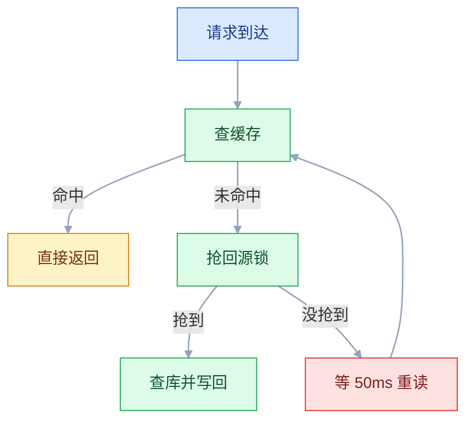
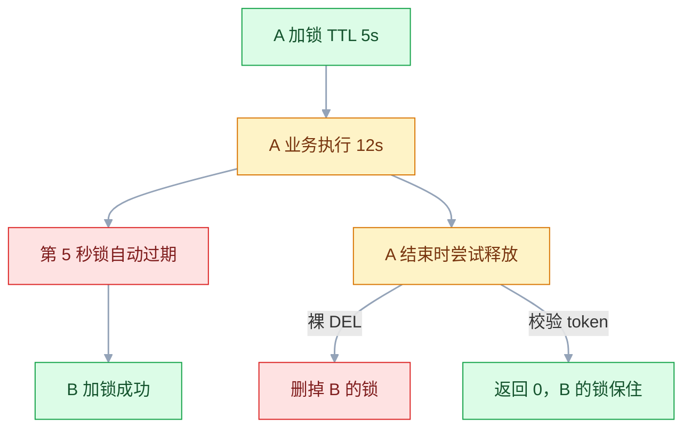

# Redis

## 一、工程案例：用 Redis 做缓存 + 分布式锁 + 限流，并验证击穿与锁过期

**场景**：一个商品服务，详情页读多写少，大促时数据库先被打满；秒杀接口在并发下超卖；下单接口被人用脚本刷。目标是用一个 Redis 同时解决三件事，并且**每一项都有可复现的验证手段**——特别是「缓存击穿时到底回源了几次」和「业务超时后锁被谁拿走了」。

**技术栈**：Redis（版本以官方当前稳定版为准，Docker 启动）+ Python 3.11 + FastAPI + SQLite（只为让案例自带数据，换成 MySQL 结论不变）+ `ab` 压测。所有命令都在本机可跑。

### 1.1 起 Redis 与造数据

```bash
docker run -d --name redis -p 6379:6379 --restart=always \
  -v redis-data:/data redis:latest \
  redis-server --requirepass Redis@123456 --appendonly yes
docker exec redis redis-cli -a Redis@123456 ping
# PONG（第一行是 CLI 的密码告警，可以忽略）
docker exec redis redis-cli -a Redis@123456 INFO server | grep redis_version
# redis_version: x.y.z    ← 记下这个值，后面所有结论都以它为准
```

```bash
python -m venv .venv && source .venv/bin/activate
pip install fastapi "uvicorn[standard]" redis
ab -V > /dev/null && echo "ab ok"     # 没有 ab 就装 apache2-utils / httpd
```

```python
# app.py —— 缓存 + 分布式锁 + 限流，一个文件跑完
import json, os, random, sqlite3, time, uuid
import redis
from fastapi import FastAPI, Header, HTTPException

r = redis.Redis(host="127.0.0.1", port=6379, password="Redis@123456",
                decode_responses=True)
DB = os.getenv("DB_PATH", "shop.db")
NULL = "__NULL__"

def db():
    conn = sqlite3.connect(DB, timeout=5, isolation_level=None)
    conn.execute("PRAGMA journal_mode=WAL")
    return conn

def init_db():
    c = db()
    c.execute("CREATE TABLE IF NOT EXISTS product("
              "id INTEGER PRIMARY KEY, name TEXT, price REAL, stock INTEGER)")
    c.execute("CREATE TABLE IF NOT EXISTS orders("
              "id INTEGER PRIMARY KEY AUTOINCREMENT, product_id INTEGER, user_id TEXT)")
    if c.execute("SELECT COUNT(*) FROM product").fetchone()[0] == 0:
        c.executemany("INSERT INTO product VALUES (?,?,?,?)",
                      [(i, f"商品{i}", 99.0 + i, 1000) for i in range(1, 10001)])

init_db()
app = FastAPI()
```

### 1.2 缓存：旁路缓存 + 互斥回源 + 空值 + TTL 打散

```python
RELEASE = """
if redis.call('GET', KEYS[1]) == ARGV[1] then
  return redis.call('DEL', KEYS[1])
else
  return 0
end
"""

def release_lock(key, token):
    return r.eval(RELEASE, 1, key, token)

def load_product(pid: int):
    key = f"product:detail:{pid}"
    cached = r.get(key)
    if cached == NULL:
        return None                      # 空值缓存命中，连库都不用查
    if cached:
        return json.loads(cached)

    lock_key = f"lock:product:load:{pid}"
    token = uuid.uuid4().hex
    if r.set(lock_key, token, nx=True, ex=5):     # 只放一个人回源
        try:
            cached = r.get(key)                  # 双重检查：可能别人刚写好
            if cached == NULL:
                return None
            if cached:
                return json.loads(cached)
            row = db().execute("SELECT id,name,price,stock FROM product "
                               "WHERE id=?", (pid,)).fetchone()
            print("DB_QUERY", pid, flush=True)   # 用来数回源次数
            if row is None:
                r.set(key, NULL, ex=60)          # 挡穿透，TTL 要短
                return None
            data = {"id": row[0], "name": row[1],
                    "price": row[2], "stock": row[3]}
            # TTL 打散：1800 + 0~300 秒，避免同一批 key 同时失效
            r.set(key, json.dumps(data), ex=1800 + random.randint(0, 300))
            return data
        finally:
            release_lock(lock_key, token)
    time.sleep(0.05)                             # 没抢到：等一小会儿重读
    cached = r.get(key)
    return None if cached in (None, NULL) else json.loads(cached)

@app.get("/product/{pid}")
def product(pid: int):
    return load_product(pid)

@app.get("/product-db/{pid}")                    # 对照接口：绕过缓存直查库
def product_db(pid: int):
    row = db().execute("SELECT id,name,price,stock FROM product "
                       "WHERE id=?", (pid,)).fetchone()
    print("DB_QUERY", pid, flush=True)
    if row is None:
        return None
    return {"id": row[0], "name": row[1], "price": row[2], "stock": row[3]}
```

没抢到锁的请求只等 50ms 就重读一次，回源慢于 50ms 时会返回 `null`。生产里换成有上限的轮询（比如 10 次 × 50ms），超时返回 503 或降级旧值，不要无限等待。

写路径只有一句关键规则：**先改库、再删缓存**，并给缓存留 TTL 兜底。

```python
@app.post("/product/{pid}/price")
def update_price(pid: int, price: float):
    db().execute("UPDATE product SET price=? WHERE id=?", (price, pid))
    r.delete(f"product:detail:{pid}")     # 删，不是改
    return {"ok": True}
```

### 1.3 分布式锁：SET NX EX + 唯一 token + Lua 释放

```python
def acquire(key, token, ttl=5, wait=5.0):
    deadline = time.time() + wait
    while time.time() < deadline:
        if r.set(key, token, nx=True, ex=ttl):    # 一条命令完成加锁与设过期
            return True
        time.sleep(0.005)                         # 让出 GIL，等持有者释放
    return False

@app.post("/seckill/{pid}")
def seckill(pid: int, user_id: str = Header(...)):
    key, token = f"lock:stock:{pid}", uuid.uuid4().hex
    if not acquire(key, token):                   # 抢不到就短暂重试，别直接 429
        raise HTTPException(429, "排队中，请重试")
    try:
        c = db()
        stock = c.execute("SELECT stock FROM product WHERE id=?", (pid,)).fetchone()[0]
        if stock <= 0:
            raise HTTPException(409, "库存不足")
        c.execute("UPDATE product SET stock = stock - 1 WHERE id=?", (pid,))
        c.execute("INSERT INTO orders(product_id, user_id) VALUES (?,?)", (pid, user_id))
        r.delete(f"product:detail:{pid}")         # 写库后让缓存失效
        return {"ok": True, "left": stock - 1}
    finally:
        release_lock(key, token)                  # 只删自己的锁
```

锁持有时间只有几毫秒，200 并发如果抢不到就直接 429，大多数请求根本走不到扣减，压测就永远卖不完 100 件——所以加锁失败要短暂重试，429 只留给等待超时的请求。

```python
@app.post("/seckill-unsafe/{pid}")                # 对照组：故意留窗口
def seckill_unsafe(pid: int, user_id: str = Header(...)):
    c = db()
    stock = c.execute("SELECT stock FROM product WHERE id=?", (pid,)).fetchone()[0]
    if stock <= 0:
        raise HTTPException(409, "库存不足")
    time.sleep(0.002)                             # 放大「查完再扣」的窗口
    c.execute("UPDATE product SET stock = stock - 1 WHERE id=?", (pid,))
    return {"ok": True, "left": stock - 1}
```

```bash
# 库存重置为 100，先压无锁版本
python - <<'EOF'
import sqlite3
c = sqlite3.connect("shop.db")
c.execute("UPDATE product SET stock=100 WHERE id=1")
c.execute("DELETE FROM orders")
c.commit()
EOF

ab -n 200 -c 200 -p /dev/null -T 'application/json' -H "user-id: u1" \
  http://127.0.0.1:8000/seckill-unsafe/1 > /dev/null
python -c "import sqlite3;print(sqlite3.connect('shop.db').execute(
  'SELECT stock FROM product WHERE id=1').fetchone())"
# (-83,)     ← 示例值：查完再扣的窗口被并发穿透，库存变成负数
```

换成 `/seckill/1` 重跑同样的命令，结果是 `(0,)`、订单恰好 100 条：锁把「读—判断—写」变成了串行。负数具体是多少取决于机器和并发，判据只看「库存 < 0」。

### 1.4 限流：滑动窗口 Lua

```python
RATE = """
local key = KEYS[1]
local window = tonumber(ARGV[1])
local limit = tonumber(ARGV[2])
local now = tonumber(ARGV[3])
redis.call('ZREMRANGEBYSCORE', key, 0, now - window)
local count = redis.call('ZCARD', key)
if count < limit then
  redis.call('ZADD', key, now, ARGV[4])
  redis.call('PEXPIRE', key, window + 1000)
  return 1
end
return 0
"""

def allow(user_id: str, limit: int = 10, window_ms: int = 60000) -> bool:
    key = f"rate:user:{user_id}:/order"
    member = f"{time.time_ns()}-{uuid.uuid4().hex[:8]}"   # 防同毫秒覆盖
    return r.eval(RATE, 1, key, window_ms, limit,
                  int(time.time() * 1000), member) == 1

@app.post("/order")
def order(user_id: str = Header(...)):
    if not allow(user_id):
        raise HTTPException(429, "下单太频繁，请 1 分钟后再试")
    return {"ok": True}
```

「删过期 → 计数 → 判断 → 写入」四步必须在一段 Lua 里完成，否则并发下每个请求都看到「还没超限」。

```bash
uvicorn app:app --host 127.0.0.1 --port 8000 2>&1 | tee app.log
# INFO:     Application startup complete.
```

### 1.5 验证一：缓存带来的吞吐差异

```bash
# 对照组：/product-db 绕过缓存，每次请求都查库
ab -n 5000 -c 50 http://127.0.0.1:8000/product-db/1 > /tmp/base.txt
grep -E "Requests per second|Time per request|50%|95%" /tmp/base.txt
# Requests per second:    5xx.xx [#/sec] (mean)
# Time per request:       1xx.xxx [ms] (mean)

# 实验组：先预热一次，之后 5000 次全部命中缓存
curl -s http://127.0.0.1:8000/product/1 > /dev/null
ab -n 5000 -c 50 http://127.0.0.1:8000/product/1 > /tmp/cached.txt
grep -E "Requests per second|Time per request|50%|95%" /tmp/cached.txt
# Requests per second:    7xxx.xx [#/sec] (mean)
# Time per request:       1x.xxx [ms] (mean)
```

上面是**示例量级**，具体数字取决于机器、Python 版本和 SQLite；要记的是**你自己的两组值**。真正说明问题的是另一个指标——缓存生效期间数据库几乎不被访问：

```bash
redis-cli -a Redis@123456 TTL product:detail:1
# (integer) 1873          ← 落在 1800~2100 之间，说明 TTL 被成功打散
redis-cli -a Redis@123456 GET product:detail:1 | head -c 60
# {"id": 1, "name": "\u5546\u54c11", "price": 100.0, ...
#                          ↑ stock 是多少取决于是否跑过 1.3 的秒杀
```

### 1.6 验证二：击穿时回源几次

```bash
before=$(grep -c "DB_QUERY 1" app.log)   # 1.5 的对照流量也在日志里，只看增量
redis-cli -a Redis@123456 DEL product:detail:1
ab -n 2000 -c 200 http://127.0.0.1:8000/product/1 > /dev/null
echo $(( $(grep -c "DB_QUERY 1" app.log) - before ))
# 1        ← 200 并发同时打进来，只有抢到锁的人查了库

# 把 load_product 里的锁去掉再跑一次，同一个命令会得到
# 几十     ← 第一批线程全部回源（uvicorn 默认线程池约 40），这就是击穿
```

去掉锁后回源数不是 200，而是约等于线程池大小：同一批线程一起 miss，缓存写回之后的请求就命中了。

这个计数只数回源次数，等待者直接返回 `null` 不会让它变大；一旦大于 1，就是锁没生效或 TTL 太短，不是「正常抖动」。



### 1.7 验证三：业务超时，锁归谁

这是分布式锁最容易「看起来没问题」的地方。用一个专门暴露时间窗口的接口复现：

```python
@app.get("/lock-demo")
def lock_demo(name: str, hold: int = 12, ttl: int = 5):
    key, token = "lock:demo", f"{name}-{uuid.uuid4().hex[:8]}"
    if not r.set(key, token, nx=True, ex=ttl):
        return {"name": name, "acquired": False, "holder": r.get(key)}
    time.sleep(hold)                          # 模拟业务比 TTL 慢
    released = r.eval(RELEASE, 1, key, token) # 只删 value 等于自己 token 的锁
    return {"name": name, "acquired": True, "released": released,
            "holder_now": r.get(key)}
```

```bash
redis-cli -a Redis@123456 DEL lock:demo
curl -s "http://127.0.0.1:8000/lock-demo?name=A&hold=12&ttl=5" &
sleep 6
curl -s "http://127.0.0.1:8000/lock-demo?name=B&hold=20&ttl=30"
# A 在 t=12s 先返回，此时 B 还持有锁：
# {"name":"A","acquired":true,"released":0,"holder_now":"B-..."}
#                                        ↑ released=0：A 没能删掉 B 的锁
# B 在 t=26s 返回，30 秒 TTL 未到，正常释放：
# {"name":"B","acquired":true,"released":1,"holder_now":null}
```

A 的 `holder_now` 已经是 B 的 token，说明锁换了主人，而 A 的释放被 Lua 校验挡住。

`released = 0` 就是「唯一 token + Lua 校验」的价值。如果释放写成裸 `DEL`，这里会返回 1，B 的锁被 A 删掉，第三个请求就能同时进来——**互斥已经失效，但日志里什么错都没有**。



### 1.8 验证四：限流边界

```bash
redis-cli -a Redis@123456 DEL "rate:user:1001:/order"
for i in $(seq 1 12); do
  curl -s -o /dev/null -w "%{http_code} " -X POST http://127.0.0.1:8000/order \
    -H "user-id: 1001"
done; echo
# 200 200 200 200 200 200 200 200 200 200 429 429

redis-cli -a Redis@123456 ZCARD "rate:user:1001:/order"   # 10
redis-cli -a Redis@123456 TTL "rate:user:1001:/order"     # 约 61
```

注意头名：FastAPI 的 `user_id: str = Header(...)` 对应请求头 `user-id`（下划线转连字符），写成 `X-User-Id` 会因取不到值直接返回 422。

### 1.9 验收表

| # | 检查项 | 命令或检查 | 通过标准 |
|---|---|---|---|
| 1 | Redis 可用且持久化开启 | `redis-cli -a Redis@123456 INFO server`、`CONFIG GET appendonly` | 版本已知，`appendonly` 为 `yes` |
| 2 | 缓存命中 | 连续两次 `GET /product/1`，再 `GET /product-db/1` | 第二次无 `DB_QUERY`，对照组每次都有 |
| 3 | TTL 已打散 | 访问 1~20 号商品后逐个查 `TTL product:detail:{i}` | 值落在 1800~2100 之间 |
| 4 | 空值挡穿透 | `GET /product/99999999` 后查 key | 值为 `__NULL__`，TTL 约 60 |
| 5 | 击穿只回源一次 | `DEL` 后 `ab -n 2000 -c 200`，比较日志前后计数 | `DB_QUERY 1` 的增量恰为 1 |
| 6 | 无锁必超卖 | `stock=100` 后压 `/seckill-unsafe/1` | 库存为负（对照组不写订单） |
| 7 | 加锁不超卖 | 同样条件压 `/seckill/1` | 库存为 0，订单恰好 100 条 |
| 8 | 锁不误删 | 1.7 的两条 curl | A 的 `released` 为 0，`holder_now` 仍是 B |
| 9 | 限流边界 | 连续 12 次 `/order` | 前 10 次 200，第 11 次起 429 |
| 10 | AOF 真能恢复 | `SET persist:check 1`，等 2 秒后 `docker kill redis`，再 `docker start redis` | `GET persist:check` 仍为 1 |

> 第 10 项必须用 `docker kill` 模拟宕机：`docker restart` 走正常关闭流程会落盘，验证不出 `everysec` 的 1 秒丢数据窗口。锁本身带 TTL，重启后过期是正常现象，不要拿锁来验收持久化。

---

## 二、高频问答：会卡住你的地方，也是面试最常问的

### 2.1 加了分布式锁，库存还是超卖

**现场**

在加锁前后各打一条日志，看「读库存」是否落在锁内；`MONITOR` 看 SET 与 SELECT 的先后。

**要点**

- 九成是临界区画错了，不是锁不管用。
- 锁的范围必须盖住「读—判断—写」，只锁扣减那一步等于没锁。
- key 要用商品 ID，用商品分类就是多个商品共用一把锁，也挡不住超卖。

**追问**

- 换 ZooKeeper 有用吗？→ 换组件不解决范围问题，问题在代码不在选型。
- 多实例用了不同 key 呢？→ 等于每个实例各锁各的，互斥根本不存在。
- 怎么确认是范围问题？→ 把读库存也放进锁内重跑，超卖消失就是它。

### 2.2 锁没释放，第二天发现 key 还在

**现场**

`TTL lock:xxx` 返回 `-1`（永不过期）就是它；返回正数是正常带过期的锁。

**要点**

- 加锁和设过期不是原子操作：`SETNX` 成功后进程崩了，`EXPIRE` 没执行，key 永久存在。
- 只查释放逻辑不够，要先查「过期时间有没有设上」。
- 正确写法是一条命令 `SET key token NX EX 10`。

**追问**

- `TTL` 返回正数就万事大吉吗？→ 只说明带过期，也可能马上就要过期。
- 为什么不能 `SETNX` + `EXPIRE`？→ 两步之间崩溃就没有过期时间。
- 死锁怎么兜底？→ 过期时间就是兜底，锁一定会自然释放。

### 2.3 锁把别人持有的锁删了

**现场**

在释放处比较 `GET` 到的 value 与自己的 token，不相等就是这种情况；`released=0` 就是证据。

**要点**

- 业务执行时间超过锁 TTL，锁已自动释放并被别人拿到。
- `finally` 里的 `DEL` 删的是新持有者的锁，「我的 finally」不等于「我的锁」。
- 每次加锁生成唯一 token 存进 value，释放时用 Lua 比较后再删。

**追问**

- 释放写成裸 `DEL` 会怎样？→ 互斥已经失效，但日志里什么错都没有。
- 怎么提前发现锁过期？→ 统计「释放失败次数」，这个指标能直接暴露。
- 续期能解决吗？→ 能，Redisson 的看门狗就是干这个的。

### 2.4 用了 Redisson，锁还是在业务中途失效

**现场**

搜代码里所有 `tryLock` / `lock` 调用，看有没有第二个时间参数；对照业务耗时是否接近租期。

**要点**

- 调了带 `leaseTime` 的重载，比如 `tryLock(3, 10, TimeUnit.SECONDS)`；指定租期后看门狗不续期，10 秒到点就释放。
- 只有 `lock()` 和 `tryLock(waitTime, unit)` 才有看门狗。
- 耗时不确定的任务要么不传 leaseTime，要么把租期设得远大于 P99。

**追问**

- 看门狗默认多久续一次？→ 默认 30 秒有效期，每 10 秒续一次。
- 客户端进程挂了呢？→ 看门狗也停，锁最终自然过期，不会死锁。
- 为什么不干脆自己写续期？→ 定时续期和业务线程的生命周期很难对齐。

### 2.5 缓存和数据库对不上，而且迟迟不恢复

**现场**

看写方法里的顺序；对比 `updated_at` 与缓存 value 里的时间字段。

**要点**

- 写路径写成了「先删缓存、再改库」，删除后到改库前的窗口里，读请求把旧值重新加载进缓存。
- 之后再没人删它，不一致会持续一整个 TTL，所以是「迟迟不恢复」。
- 根因是写顺序，不是缓存本身有 bug。

**追问**

- 加个定时全量刷新行不行？→ 那是拿定时任务盖问题，窗口期照样不一致。
- 改成先改库再删缓存就彻底一致了吗？→ 不是强一致，只是把窗口压到几毫秒，仍要 TTL 兜底。
- 还偶发怎么办？→ 延迟双删，并把 TTL 作为最后一道保险。

### 2.6 热点 key 一过期，数据库瞬间被打满

**现场**

看 DB 的 QPS 曲线是否在某一秒出现尖峰；看应用日志同一 key 是否同时出现大量 `DB_QUERY`。

**要点**

- 单个热点 key 失效瞬间，成百上千请求同时 miss 并全部回源，这是击穿，不是容量问题。
- 扩容的资源在尖峰过去后全闲置，加机器只是把峰值摊平一点。
- 给回源加互斥后，同一 key 的回源次数应该恰好是 1。

**追问**

- 和雪崩怎么区分？→ 击穿是单个热点 key，雪崩是大批 key 同时失效或 Redis 整体不可用。
- 除了加锁还有什么方案？→ 逻辑过期 + 异步刷新，读到的旧值先返回。
- 空值缓存能挡击穿吗？→ 挡的是穿透，缓存里压根不存在的 key。

### 2.7 执行 `KEYS *` 之后整个服务卡住

**现场**

`SLOWLOG GET 10` 里出现 `keys`；`LATENCY MONITOR` 同时段有尖峰。

**要点**

- `KEYS` 是 O(N) 全库扫描，命令执行是单线程，扫的这几百毫秒里所有其他命令排队。
- 不是网络抖动，是自己发了一条重命令。
- 生产代码里用 `SCAN` 游标遍历，或按业务前缀维护集合，不要扫全库。

**追问**

- `SCAN` 有什么坑？→ 遍历期间可能重复返回，需要调用方去重。
- 大 key 的 `HGETALL` 为什么同样危险？→ 一样是单线程上一次做完的大操作。
- 为什么不能靠加机器解决？→ 单实例是单线程执行，加从节点也救不了这个 key。

### 2.8 启动报 `NOAUTH` / `WRONGPASS` 或连接池耗尽

**现场**

手动 `AUTH` 一次区分两种报错；`CLIENT LIST` 看连接数与 `cmd` 字段；`INFO clients` 看 `connected_clients` 是否只涨不降。

**要点**

- `NOAUTH` 是请求根本没带密码（配置没生效、连到了别的实例），`WRONGPASS` 才是密码不对。
- 连接池耗尽则是连接没归还：Lettuce 共享连接被阻塞命令占住，或 `max-active` 太小。
- 两类问题别混成一个「密码错」。

**追问**

- 怎么判断连接被占住？→ `CLIENT LIST` 里大量连接停在 `blpop` 这类阻塞命令上。
- 连接数贴着 `max-active` 说明什么？→ 池子太小或存在泄漏。
- 为什么改密码重启没用？→ 报的可能压根不是密码问题，先看报错文案。

### 2.9 用 `redis-cli` 看到一堆乱码

**现场**

`redis-cli --raw GET key` 仍是乱码，且 Java 端能正常反序列化，就只是序列化器问题。

**要点**

- `RedisTemplate` 默认用 JDK 序列化，key 和 value 都带二进制头，数据本身没坏。
- 「不可读」不等于「损坏」，Java 端读出来正常就说明数据是好的。
- 修法是 key 用 `StringRedisSerializer`、value 用 JSON 序列化器。

**追问**

- 清库能解决吗？→ 不能，只是把数据丢了。
- 为什么 Lua 相关的一律用 `StringRedisTemplate`？→ JDK 序列化后的参数和脚本里的字符串类型对不上。
- 老 key 怎么处理？→ 只能重写或等它过期，序列化格式没法原地转换。

### 2.10 `@Cacheable` 加了但完全不生效

**现场**

在方法体里打日志，每次请求都打印就是没走缓存；看调用方是不是同一个类。

**要点**

- 同类内部 `this.getById(id)` 自调用，绕过了 Spring 代理。
- 方法不是 `public`，同样不经过代理。
- 把方法挪到另一个 Bean 里注入调用，若缓存立刻生效，就是自调用。

**追问**

- 缺 `@EnableCaching` 会怎样？→ 注解完全不解析，连代理都不会生成。
- key 怎么定？→ 显式写，多参数默认生成的 key 容易冲突。
- 查不到数据时也会缓存吗？→ 默认不缓存 null，穿透要靠空值或布隆过滤器另做。

### 2.11 内存满了，写入直接报错

**现场**

`INFO memory` 看 `used_memory` 是否贴近 `maxmemory`；`CONFIG GET maxmemory-policy`。

**要点**

- `maxmemory-policy` 是默认的 `noeviction`，达到上限后写命令直接返回 OOM 错误，不淘汰任何 key。
- 不是内存泄漏，是策略配置问题。
- 纯缓存改 `allkeys-lru`；存了锁和队列的实例保持 `noeviction`，但要加内存告警。

**追问**

- 为什么 key 过期了内存没降？→ 惰性删除 + 定期抽样，还没被抽到，但它已经不返回给客户端了。
- `volatile-*` 有什么坑？→ 一个 key 都没设 TTL 时会退化成 `noeviction`。
- `allkeys-lru` 会淘汰锁吗？→ 会，所以锁和缓存不要放同一个实例。

### 2.12 集群下 `MSET` / `SINTER` 报 `CROSSSLOT`

**现场**

报错信息里带 `CROSSSLOT Keys in request don't hash to the same slot`；`CLUSTER KEYSLOT key` 逐个查。

**要点**

- 多 key 命令要求所有 key 落在同一个哈希槽。
- `user:1` 和 `order:1` 的 CRC16 几乎不可能同槽。
- 要么用 `{tag}` 强制同槽（`{user:1}:name` 与 `{user:1}:order`），要么拆成单 key 循环。

**追问**

- 怎么排除集群故障？→ 报错文案已经写明是槽的问题，先算槽号。
- 哈希标签有什么副作用？→ 同 tag 的 key 全落一个节点，容易变成热点。
- 事务和 Pipeline 跨槽呢？→ 同样受限，MULTI 里的 key 必须同槽。

### 2.13 主节点突然拒写，报 `NOREPLICAS`

**现场**

`INFO replication` 看 `connected_slaves` 与各副本 `lag`；`CONFIG GET min-replicas-*`。

**要点**

- 配了 `min-replicas-to-write`，但在线副本数不足或复制延迟超过 `min-replicas-max-lag`，主节点主动拒绝写入。
- 这是保护性拒写，目的是避免脑裂时丢数据，不是故障本身。
- 重启只会让它再发生，先看从节点是否掉线、网络是否抖动。

**追问**

- 能把保护关掉吗？→ 等于拆掉脑裂防线，宁可临时调大阈值。
- 副本恢复后要手工做什么？→ 不用，写入会自动恢复。
- 和内存满怎么区分？→ 报错文案不同，`NOREPLICAS` 对 OOM 错误。

---

## 三、核心知识：从零开始要建立的东西

### 3.1 内存存储与单线程命令执行

Redis 把数据放在内存里，读写是微秒级；磁盘数据库要先经过缓冲池、索引、事务日志，是毫秒级。这个千倍差距是所有用法的前提。

「单线程」指的是**命令执行单线程**：所有客户端命令排成一队，一条一条执行。带来三个直接后果：

| 后果 | 含义 |
|---|---|
| 每条命令天然原子 | 不需要自己加锁，`INCR`、`SET NX` 可以直接当同步原语 |
| 没有锁竞争与线程切换 | 行为可预测，延迟稳定 |
| 一条慢命令阻塞所有人 | `KEYS`、大 key 的 `HGETALL` 会拖垮整个实例 |

网络 I/O 可以开多线程（`io-threads`，默认关闭），但命令执行仍是单线程，所以「慢命令」这条约束没有变。

> **面试**：常问「Redis 单线程为什么还这么快？」答：纯内存 + 单线程省掉锁竞争和上下文切换，瓶颈在网络和慢命令，不在 CPU。

### 3.2 五种基础结构与选型

| 结构 | 形状 | 典型用途 | 关键命令 |
|---|---|---|---|
| String | 一个键一个值 | 缓存对象、计数、锁 | `SET`、`INCR`、`SET NX` |
| Hash | 一个键下一张字段表 | 对象的部分更新、购物车 | `HSET`、`HMGET`、`HINCRBY` |
| List | 有序可重复、两端进出 | 简单队列、最新列表 | `LPUSH`、`BRPOP`、`LTRIM` |
| Set | 无序去重、支持交并差 | 点赞去重、共同关注 | `SADD`、`SINTER`、`SCARD` |
| ZSet | 去重 + 按分数排序 | 排行榜、延时队列、滑动窗口 | `ZADD`、`ZREVRANGE`、`ZREMRANGEBYSCORE` |

选型的判断顺序：**要不要排序**（要 → ZSet）；**要不要去重**（要 → Set）；**要不要按顺序进出**（要 → List）；**是不是一个对象的多个字段**（是 → Hash）；**以上都不是** → String。

一个常见误用：把对象整体存成 JSON 字符串，然后每次只改一个字段也要读出来改再写回。字段多、且经常只改局部时，Hash 更合适；字段少、总是整体读写时，String 更省事。

### 3.3 键命名与过期时间

命名用 `业务:对象:标识[:字段]`，例如 `product:detail:1001`、`lock:stock:1001`、`rate:user:1001:/order`。三条硬约束：带业务前缀（方便按前缀治理）、长度控制在几十字节（key 也占内存）、不用中文与空格（客户端与工具兼容性差）。

```bash
SET product:detail:1001 '{"id":1001}' EX 1800   # 设值同时设过期，推荐
TTL product:detail:1001                          # 剩余秒数；-1 永久；-2 不存在
PERSIST product:detail:1001                      # 去掉过期时间，慎用
```

**TTL 是缓存方案的安全网**：任何「先改库再删缓存」都可能失败（删缓存时网络断），只有 TTL 能保证错误状态最终自愈。所以缓存 key 一律带 TTL，包括看起来「不会变」的配置。

### 3.4 过期删除与内存淘汰

过期和淘汰是两件不同的事，混起来会得出错误结论：

| 机制 | 触发条件 | 作用对象 |
|---|---|---|
| 惰性删除 | 访问某个 key 时 | 顺手删掉已过期的 |
| 定期删除 | 每秒若干次随机抽样 | 清理一部分已过期的 |
| 内存淘汰 | `used_memory` 达到 `maxmemory` | 按策略删掉还没过期的 |

所以「key 过期了但内存没降」是正常现象：它已经不会返回给客户端，但可能还没被抽样到。真正需要关注的是淘汰策略：

| 策略 | 范围 | 适用 |
|---|---|---|
| `noeviction` | 不淘汰，写入报错 | 存锁、队列等不能丢的数据 |
| `allkeys-lru` | 全部 key，按最近使用 | 纯缓存，最常用 |
| `allkeys-lfu` | 全部 key，按使用频率 | 热点长期稳定 |
| `volatile-lru` | 只淘汰设了 TTL 的 | 缓存与永久数据混用 |

`volatile-*` 的前提是「有 key 设了 TTL」，一个都没设时会退化成 `noeviction`，写入直接报错——这是配置事故的常见来源。

### 3.5 持久化机制

| 方式 | 内容 | 恢复速度 | 丢数据窗口 |
|---|---|---|---|
| RDB | 某一刻的全量快照 | 快 | 分钟级（取决于 `save`） |
| AOF `everysec` | 写命令日志，每秒刷盘 | 慢 | 最多 1 秒 |
| AOF `always` | 每条命令都刷盘 | 慢 | 理论不丢，QPS 大幅下降 |
| 混合持久化 | 快照 + 增量命令 | 快 | 最多 1 秒 |

纯缓存可以只开 RDB；一旦存了锁、计数器、队列，就必须开 AOF `everysec` 或混合持久化。`BGSAVE` 靠 `fork` 子进程写快照，写入时复制（COW）会让内存短暂上涨，**预留一倍内存**是常规做法。

**持久化不等于备份**：文件还在同一块盘上，盘坏了一起没。RDB 要定期传到对象存储，且要真正做过一次恢复演练——没恢复过的备份不算备份。

### 3.6 旁路缓存读写

业务代码自己管缓存，是最常见的模式：

```text
读：查缓存 → 命中返回 → 未命中查库 → 写回缓存（带 TTL）
写：改数据库 → 删除缓存
```

写为什么是「删」而不是「改」：改要关心缓存里的数据结构、要处理并发覆盖，而且没人读的时候白算一次；删只需要一次 `DEL`，下次读自然重建。

为什么是「先改库再删缓存」：反过来做，删除后到改库前的窗口里，读线程会把旧值重新加载进缓存，而下一个 TTL 到期前没人再删它，不一致会持续一整个 TTL。先改库再删，出问题需要读线程「查库」比写线程「改库 + 删缓存」还慢，窗口只有几毫秒。

**边界**：这不是强一致。要绝对强一致只能不用缓存，或者用分布式锁把读写串行化，性能会掉一个量级。工程上追求的是「窗口足够小 + TTL 兜底」。

### 3.7 穿透、击穿与雪崩

| 问题 | 触发条件 | 表现 |
|---|---|---|
| 穿透 | 查的数据在缓存和库里都不存在 | 每个请求都打到库 |
| 击穿 | 单个热点 key 过期瞬间 | 同一 key 的并发全部回源 |
| 雪崩 | 大批 key 同时过期，或 Redis 整体不可用 | 库被整体打满 |

记忆抓手：**穿透靠挡，击穿靠锁，雪崩靠散**。

- 挡：空值缓存（短 TTL）+ 布隆过滤器
- 锁：互斥回源，或逻辑过期 + 异步刷新
- 散：TTL 加随机、多级缓存、熔断降级

三者的验证方式不同：穿透看「不存在的 ID 是否还产生 DB 查询」；击穿看「同一 key 的回源次数」；雪崩看「失效时刻是否集中」。指标不对，方案就是没生效。

> **面试**：常问「穿透、击穿、雪崩怎么区分？」答：穿透是数据两头都没有，击穿是单个热点 key 失效，雪崩是大批 key 同时失效。

### 3.8 空值缓存与布隆过滤器

空值缓存：查不到时写入一个特殊标记（如 `__NULL__`），TTL 设短（几十秒到几分钟）。实现简单，但攻击者每次换不同的 ID 时会写入大量空 key，占内存。

布隆过滤器：一个位数组加多个哈希函数，能回答「一定不存在」或「可能存在」。

| 特性 | 含义 |
|---|---|
| 无假阴性 | 返回「不存在」时一定不存在，不会漏掉真实数据 |
| 有假阳性 | 返回「存在」时，实际可能不存在 |
| 不能删除 | 置 1 的位无法安全复位，只能重建 |
| 内存极小 | 千万级元素、1% 误判率约 12 MB |

组合用法：布隆过滤器挡随机 ID（第一层），空值缓存挡漏网的（第二层）。只用一个都不完整——布隆有误判，空值缓存挡不住海量随机 key。

### 3.9 分布式锁的加锁原子性

单机 `synchronized` 只在同一个 JVM 内有效，多实例部署时两台机器各锁各的，等于没锁。公共锁必须放在所有实例都能访问的地方。

加锁要同时满足三件事：互斥、带过期时间、value 能识别持有者，而且必须在**一条命令**里完成：

```bash
SET lock:stock:1001 "uuid-abc" NX EX 10
# 成功 → OK；已被占用 → nil
```

| 错误写法 | 后果 |
|---|---|
| `SETNX` 成功后再 `EXPIRE` | 中间崩溃 → 锁永不过期 → 死锁 |
| 先 `EXISTS` 再 `SETNX` | 两步之间有窗口，可能同时加锁成功 |
| value 写死 `"1"` | 无法区分是谁的锁，会误删 |

value 必须是本次加锁生成的唯一 token（UUID），它是后面「安全释放」的唯一依据。

### 3.10 锁释放、续期与 Redlock

释放必须是「比较 + 删除」的原子操作，用 Lua：

```lua
if redis.call('GET', KEYS[1]) == ARGV[1] then
  return redis.call('DEL', KEYS[1])
else
  return 0
end
```

不用 Lua 而分两步做，中间可能刚好过期并被别人抢到，于是「判断通过、删掉的是别人的锁」。

续期解决另一个问题：业务比 TTL 慢。Redisson 的看门狗在**不指定 leaseTime** 时生效，默认 30 秒有效期，每 10 秒续一次；指定了 leaseTime 就不续期。看门狗跑在客户端进程里，进程挂了它也停，锁最终会自然过期，不会死锁。

**Redlock 的争议**：Redis 作者提出的多节点算法（向多数独立节点加锁）试图解决主从切换丢锁，但 Martin Kleppmann 等人指出它在时钟漂移、GC 停顿、网络延迟下仍可能失去互斥，作者也有回应。**这场争论没有定论**，工程上的做法是：普通业务用单实例（或哨兵）的 Redisson 锁就够；要求强互斥的场景（金融账务）用带 fencing token 的方案，或直接用 etcd、ZooKeeper、数据库乐观锁。

> **面试**：常问「为什么释放锁要用 Lua 比较 token 再删？」答：判断和删除之间锁可能过期换主，分两步会删掉别人的锁。

### 3.11 限流算法

| 算法 | 形状 | 问题 |
|---|---|---|
| 固定窗口 | 每分钟计数，到点清零 | 边界突刺：两个窗口各打满，实际 2 倍 |
| 滑动窗口 | 记录每次请求时间，统计窗口内数量 | 存时间戳占内存 |
| 令牌桶 | 匀速发令牌，允许攒着用 | 实现稍复杂，能容忍突发 |
| 漏桶 | 恒定速率流出 | 不允许突发 |

滑动窗口的 Redis 实现用 ZSet：score 是时间戳，member 是请求唯一标识。

```text
ZREMRANGEBYSCORE key 0 now-window   删掉窗口外的
ZCARD key                           数窗口内的
ZADD key now member                 没超限就记一笔
PEXPIRE key window+1000             防止 key 堆积
```

四步必须原子，所以整段放进 Lua。**边界**：member 必须唯一（时间戳 + 随机串），否则同毫秒的请求会互相覆盖，计数偏小、限流放水。

### 3.12 主从复制

主从解决读扩展与数据冗余：主节点接受写，异步把命令流发给从节点，从节点只读。首次同步走一遍全量，之后走增量：


| 事实 | 影响 |
|---|---|
| 复制是异步的 | 从节点可能读到旧数据 |
| 主节点挂了不会自动切换 | 需要哨兵或集群 |
| 全量同步会 fork + 传 RDB | 大实例首次同步有明显抖动 |
| `min-replicas-to-write` | 在线副本少于 N 或延迟超过 M 秒时拒写，防脑裂丢数据 |

读写分离要接受「刚写完立刻读可能读不到」。对一致性敏感的读（下单后查订单）必须走主库；会话粘滞只保证同一会话打到同一从节点，仍可能读到旧值。

> **面试**：常问「主从复制是同步的吗？主节点挂了会怎样？」答：异步复制，可能读到旧数据；主节点挂了不会自动切换，要靠哨兵或集群。

### 3.13 哨兵与集群

| 方案 | 解决什么 | 数据分布 |
|---|---|---|
| 单机 | 简单 | 一份 |
| 主从 | 读扩展、冗余 | 每台全量 |
| 哨兵 | 自动故障切换 | 每台全量 |
| 集群 | 容量与写扩展 | 分片，每片一主多从 |

哨兵是独立进程，通常 3 个起（奇数），`quorum` 是判定客观下线所需的哨兵同意数；真正切换还要由多数哨兵选出的 leader 执行。集群把 key 空间分成 16384 个槽，`slot = CRC16(key) mod 16384`，每个主节点负责一段；客户端收到 `MOVED` 后自动重定向。

**选型边界**：数据量小于单机内存、QPS 没到单机上限，主从 + 哨兵就够了。集群带来的是跨槽限制（多 key 操作要用 `{tag}`）、运维复杂度和客户端要求，不是「更高级所以更好」。

### 3.14 大 key 与热 key

| 类型 | 定义 | 危害 |
|---|---|---|
| 大 key | String 超几十 KB，或集合元素过万 | 单次操作阻塞主线程、带宽打满、删除也阻塞 |
| 热 key | 单 key 每秒被访问数万次 | 承载它的节点 CPU 打满，其他节点闲着 |

发现手段：`redis-cli --bigkeys` 全库遍历（内部用 `SCAN`）找每类最大的 key；`MEMORY USAGE key` 看单个占用；`--hotkeys` 需要 LFU 策略才能用。

治理大 key：拆分（`user:1:part:0`）、只存必要字段、用 `HSCAN`/`HMGET` 代替 `HGETALL`、删除用 `UNLINK`（异步回收）。治理热 key：本地缓存挡一层、key 复制成多份分散到不同节点、读写分离、必要时限流。

**边界**：key 复制会让写入放大 N 倍，且多份副本之间有一致性窗口，只适合「读远多于写」的热点数据。

### 3.15 连接、序列化与客户端

| 配置 | 作用 | 常见错误 |
|---|---|---|
| `max-active` | 连接池上限 | 按 QPS × 平均耗时估，拍脑袋设 8 会排队 |
| `timeout` | 命令超时 | 设太长会把线程拖死 |
| 序列化器 | key/value 编解码 | 默认 JDK 序列化，不可读且要求 `Serializable` |
| `StringRedisTemplate` | key/value 都是字符串 | Lua 脚本必须用它，否则参数类型对不上 |

连接池大小的粗算：`并发数 ≈ QPS × 单命令耗时（秒）`。单命令 0.2ms、QPS 5000，理论上 1 个连接就够，实际留 8~16 应对抖动。连接池不是越大越好，超过 Redis 处理能力只会把排队从应用挪到网络。

### 3.16 一致性边界

| 业务 | 方案 | 不一致窗口 |
|---|---|---|
| 商品标题、分类 | 改库 + 删缓存 + TTL | 一个 TTL 周期 |
| 价格、库存展示 | 加延迟双删 | 几百毫秒 |
| 库存扣减、余额 | 不用缓存读，锁 + 数据库为准 | 无 |
| 交易金额 | 数据库是唯一真相 | 无 |

一条铁律：**任何放在 Redis 里的关键数据，都必须能从数据库重新算出来**。锁、计数器、队列这些「丢了就是事故」的数据，要么接受重建逻辑，要么配好持久化并做故障演练。

---

## 四、冷门知识汇总

| 知识点 | 为什么冷门 | 用到时的关键词 |
|---|---|---|
| 哈希标签 | 单机用不到，上集群才暴露 | `{user:1}:name`、`CROSSSLOT` |
| `MOVED` 与 `ASK` | 客户端自动处理，只有自研客户端才关心 | 重定向、`CLUSTER KEYSLOT` |
| `WAIT` 命令 | 准同步复制的临时手段，很少写进业务 | `WAIT 1 100` |
| `OBJECT ENCODING` | 只在调内存时看 | `listpack`、`quicklist`、`skiplist` |
| 内存碎片整理 | RSS 不降时才想起 | `activedefrag`、`MEMORY DOCTOR` |
| 输出缓冲区上限 | 慢消费者拖垮实例时才查 | `client-output-buffer-limit`、`CLIENT LIST` |
| `CLIENT KILL` | 踢异常客户端，平时不碰 | `CLIENT KILL ID`、`CLIENT NO-EVICT` |
| `LATENCY MONITOR` | 偶发卡顿才用，和慢日志互补 | fork、AOF 重写、大 key |
| Lua 脚本缓存 | 用 `EVALSHA` 省带宽才关心 | `SCRIPT LOAD`、`NOSCRIPT` 回退 |
| Pipeline 与事务 | 容易混：前者只省 RTT，不保证原子 | `MULTI`、`EXEC`、`DISCARD` |
| `WATCH` 乐观锁 | 被分布式锁取代，老代码里还有 | `WATCH` + `MULTI` |
| 键空间通知 | 有过期回调需求才用，且会丢事件 | `__keyevent@0__:expired` |
| 惰性删除 `lazyfree` | 删大 key 不阻塞才用到 | `UNLINK`、`lazyfree-lazy-eviction` |
| Stream 消费者组 | 轻量消息队列，用的人少 | `XREADGROUP`、`XACK`、`XPENDING` |
| 持久化恢复演练 | 没人做，真出事才发现备份不可用 | `BGSAVE`、RDB 校验、恢复演练 |
