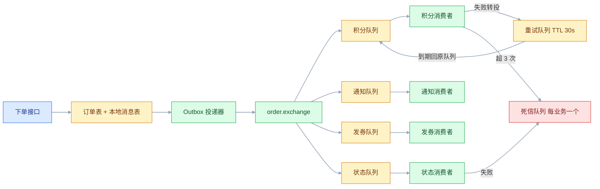
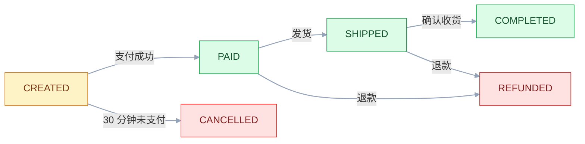
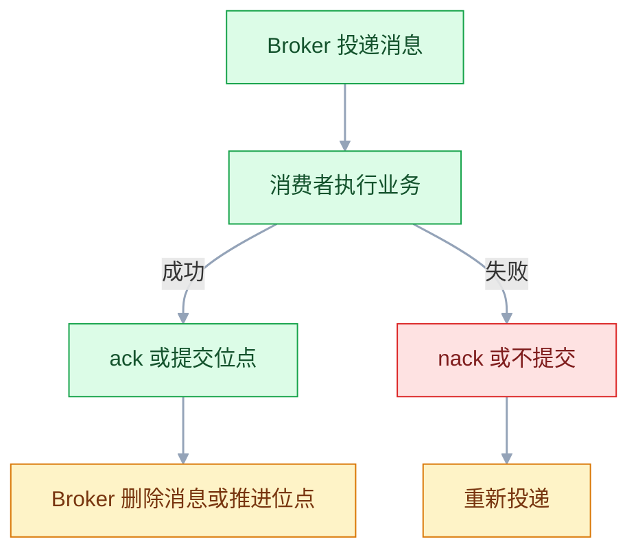

# 消息队列

## 一、工程案例：把下单后的发券、通知、积分改成消息驱动

**场景**：单体订单服务，`POST /order` 在一个 `@Transactional` 方法里依次做四件事：写订单 20ms、扣库存 RPC 80ms、调第三方短信 600ms、加积分 100ms。20 并发压测只有 24 QPS、平均 812ms；短信供应商一抖动，下单直接 500。

**目标**：把「发券、通知、积分」三件事改成消息驱动，主流程只写订单和投递事件；同时保证重复投递不重复发券、同一订单的状态事件不乱序、失败可重试可告警。扣库存仍走同步 RPC——它必须当场成功，否则会超卖。

**动手前确认**：MySQL 可写、RabbitMQ 管理台能登录、本机有 `ab` 或 `wrk`、能改应用配置并重启。

### 1.1 基线：先把问题量化

```bash
printf '{"userId":1,"productId":1,"phone":"13800001111"}' > order.json
ab -n 200 -c 20 -p order.json -T 'application/json' http://localhost:8080/order
# Requests per second:    24.58 [#/sec] (mean)
# Time per request:      813.5 [ms] (mean)
```

| 指标 | 改造前 | 说明 |
|---|---|---|
| 接口平均耗时 | 812ms | 短信 600ms 占 74% |
| QPS（20 并发） | 24 | 线程全卡在等第三方 |
| 短信服务挂掉 | 下单 500 | 非核心功能拖垮核心链路 |

先把「短信服务不可用」演一遍，确认故障域：

```bash
docker stop sms-mock
curl -s -o /dev/null -w '%{http_code}\n' -X POST http://localhost:8080/order \
  -H 'Content-Type: application/json' -d @order.json
# 500        ← 一条短信把订单主流程带走了
```

### 1.2 数据模型：业务表、本地消息表、幂等表

```sql
CREATE TABLE t_order (
  id BIGINT PRIMARY KEY AUTO_INCREMENT,
  user_id BIGINT NOT NULL,
  product_id BIGINT NOT NULL,
  amount DECIMAL(10,2) NOT NULL,
  status VARCHAR(16) NOT NULL DEFAULT 'CREATED',
  created_at DATETIME NOT NULL DEFAULT CURRENT_TIMESTAMP
) ENGINE=InnoDB DEFAULT CHARSET=utf8mb4;

-- 本地消息表：和业务数据同一个事务写入，解决「订单写了、消息没发」
-- status: PENDING → SENDING（认领）→ SENT；SENDING 超时未确认要回收成 PENDING
CREATE TABLE t_local_message (
  id BIGINT PRIMARY KEY AUTO_INCREMENT,
  biz_type VARCHAR(32) NOT NULL,
  biz_id BIGINT NOT NULL,
  routing_key VARCHAR(64) NOT NULL,
  payload JSON NOT NULL,
  status VARCHAR(16) NOT NULL DEFAULT 'PENDING',
  retry_count INT NOT NULL DEFAULT 0,
  next_retry_at DATETIME NOT NULL DEFAULT CURRENT_TIMESTAMP,
  created_at DATETIME NOT NULL DEFAULT CURRENT_TIMESTAMP,
  KEY idx_status_retry (status, next_retry_at)
) ENGINE=InnoDB DEFAULT CHARSET=utf8mb4;

-- 积分流水：message_id 主键，重复消费在这里撞主键
CREATE TABLE t_point_log (
  message_id VARCHAR(64) PRIMARY KEY,
  user_id BIGINT NOT NULL,
  points INT NOT NULL,
  created_at DATETIME NOT NULL DEFAULT CURRENT_TIMESTAMP
) ENGINE=InnoDB DEFAULT CHARSET=utf8mb4;

-- 发券：业务唯一键兜底，同一个订单同一张券只能发一次
CREATE TABLE t_coupon (
  id BIGINT PRIMARY KEY AUTO_INCREMENT,
  user_id BIGINT NOT NULL,
  order_id BIGINT NOT NULL,
  coupon_code VARCHAR(32) NOT NULL,
  created_at DATETIME NOT NULL DEFAULT CURRENT_TIMESTAMP,
  UNIQUE KEY uk_order_coupon (order_id, coupon_code)
) ENGINE=InnoDB DEFAULT CHARSET=utf8mb4;
```

**关键点**：`t_local_message.id` 会作为消息的 `messageId`。重发时 ID 不变，消费端去重才有稳定的键可用。

### 1.3 拓扑：一个 topic 交换机、四条业务队列、一条重试链



| 队列 | 绑定键 | 消费者 | 并发 | 失败去向 |
|---|---|---|---|---|
| `order.point.queue` | `order.created` | 积分 | 4 | `order.point.retry.queue` → `order.point.queue.dead` |
| `order.notify.queue` | `order.created` | 短信 | 8 | `order.notify.retry.queue` → `order.notify.queue.dead` |
| `order.coupon.queue` | `order.created` | 发券 | 4 | `order.coupon.retry.queue` → `order.coupon.queue.dead` |
| `order.state.queue` | `order.state` | 状态机 | **1** | `order.state.queue.dead` |
| `order.delay.queue` | 无（等待队列） | **无** | 0 | 到期经 `order.dlx` 转 `order.timeout.queue` |

```java
@Configuration
public class MqConfig {

    public static final String EX = "order.exchange";
    public static final String DLX = "order.dlx";
    public static final String RETRY_EX = "order.retry.exchange";
    public static final String RECYCLE_EX = "order.recycle.exchange";

    @Bean TopicExchange orderExchange() { return ExchangeBuilder.topicExchange(EX).durable(true).build(); }
    @Bean DirectExchange deadLetterExchange() { return ExchangeBuilder.directExchange(DLX).durable(true).build(); }
    @Bean DirectExchange retryExchange() { return ExchangeBuilder.directExchange(RETRY_EX).durable(true).build(); }
    @Bean DirectExchange recycleExchange() { return ExchangeBuilder.directExchange(RECYCLE_EX).durable(true).build(); }

    /** 业务队列：绑定业务键，失败进死信 */
    private Queue bizQueue(String name) {
        return QueueBuilder.durable(name)
                .deadLetterExchange(DLX)
                .deadLetterRoutingKey(name + ".dead")
                .build();
    }

    @Bean Queue pointQueue()  { return bizQueue("order.point.queue"); }
    @Bean Queue notifyQueue() { return bizQueue("order.notify.queue"); }
    @Bean Queue couponQueue() { return bizQueue("order.coupon.queue"); }
    @Bean Queue stateQueue()  { return bizQueue("order.state.queue"); }

    @Bean Binding pointBinding()  { return bind("order.point.queue", "order.created"); }
    @Bean Binding notifyBinding() { return bind("order.notify.queue", "order.created"); }
    @Bean Binding couponBinding() { return bind("order.coupon.queue", "order.created"); }
    @Bean Binding stateBinding()  { return bind("order.state.queue", "order.state"); }

    private Binding bind(String queue, String key) {
        return BindingBuilder.bind(new Queue(queue)).to(orderExchange()).with(key);
    }

    /** 重试队列：TTL 30s 到期后，经 recycle 交换机回到原队列 */
    private Queue retryQueue(String queue) {
        return QueueBuilder.durable(queue.replace(".queue", ".retry.queue"))
                .ttl(30_000)
                .deadLetterExchange(RECYCLE_EX)
                .deadLetterRoutingKey(queue)
                .build();
    }

    @Bean Queue pointRetry()  { return retryQueue("order.point.queue"); }
    @Bean Queue notifyRetry() { return retryQueue("order.notify.queue"); }
    @Bean Queue couponRetry() { return retryQueue("order.coupon.queue"); }

    /** 死信队列：每个业务队列一个，消费方是告警和人 */
    private Queue deadQueue(String queue) {
        return QueueBuilder.durable(queue + ".dead").build();
    }

    @Bean Queue pointDead()  { return deadQueue("order.point.queue"); }
    @Bean Queue notifyDead() { return deadQueue("order.notify.queue"); }
    @Bean Queue couponDead() { return deadQueue("order.coupon.queue"); }
    @Bean Queue stateDead()  { return deadQueue("order.state.queue"); }

    private Binding bindTo(DirectExchange exchange, String queue, String key) {
        return BindingBuilder.bind(new Queue(queue)).to(exchange).with(key);
    }

    @Bean Binding pointRetryBinding()  { return bindTo(retryExchange(), "order.point.retry.queue", "order.point.retry"); }
    @Bean Binding notifyRetryBinding() { return bindTo(retryExchange(), "order.notify.retry.queue", "order.notify.retry"); }
    @Bean Binding couponRetryBinding() { return bindTo(retryExchange(), "order.coupon.retry.queue", "order.coupon.retry"); }

    @Bean Binding pointRecycleBinding()  { return bindTo(recycleExchange(), "order.point.queue", "order.point.queue"); }
    @Bean Binding notifyRecycleBinding() { return bindTo(recycleExchange(), "order.notify.queue", "order.notify.queue"); }
    @Bean Binding couponRecycleBinding() { return bindTo(recycleExchange(), "order.coupon.queue", "order.coupon.queue"); }

    @Bean Binding pointDeadBinding()  { return bindTo(deadLetterExchange(), "order.point.queue.dead", "order.point.queue.dead"); }
    @Bean Binding notifyDeadBinding() { return bindTo(deadLetterExchange(), "order.notify.queue.dead", "order.notify.queue.dead"); }
    @Bean Binding couponDeadBinding() { return bindTo(deadLetterExchange(), "order.coupon.queue.dead", "order.coupon.queue.dead"); }
    @Bean Binding stateDeadBinding()  { return bindTo(deadLetterExchange(), "order.state.queue.dead", "order.state.queue.dead"); }
}
```

`order.state.queue` 用 `order.state` 单独绑定，避免状态事件混进 `order.created` 的广播；`order.retry.exchange` 按 `order.<业务>.retry` 把重试副本送进各自的 retry 队列，`order.recycle.exchange` 按队列名把到期消息送回原队列，`order.dlx` 按 `<队列名>.dead` 进死信。三层绑定缺任何一层，消息就在那一层被静默丢弃。重试队列的 TTL 是队列级的，队列里所有消息都是 30 秒，不存在长短 TTL 互相阻塞的问题。

### 1.4 生产端：事务内写 outbox，提交后再投递

先写订单再发消息，中间崩溃就是「订单在、消息没了」；先在事务里发消息，事务回滚就是「消息在、订单没了」。两种都错，所以把「要发的消息」当成业务数据的一部分落库。

```java
@Service
@RequiredArgsConstructor
public class OrderService {

    private final OrderMapper orderMapper;
    private final LocalMessageMapper messageMapper;
    private final ObjectMapper json;

    @Transactional
    public Long create(OrderDTO dto) throws JsonProcessingException {
        Order order = new Order(dto.getUserId(), dto.getProductId(), dto.getAmount());
        orderMapper.insert(order);                       // ① 业务数据

        OrderCreatedEvent event = new OrderCreatedEvent(
                order.getId(), dto.getUserId(), dto.getPhone());
        messageMapper.insert(LocalMessage.pending(     // ② 消息记录，同一事务
                "ORDER", order.getId(), "order.created", json.writeValueAsString(event)));
        return order.getId();
    }
}
```

投递器每秒扫一批 `PENDING`：先在短事务里锁行、置为 `SENDING`，提交之后再发送。发送不能放在事务里——等确认的时间会拖长事务、占着行锁不放；提交后再发，靠 `SENDING` 挡住第二个实例。

```java
@Scheduled(fixedDelay = 1000)
public void publish() {
    List<LocalMessage> batch = claim(200);          // 另一个 Bean：短事务内认领，提交后才发送
    for (LocalMessage m : batch) {
        CorrelationData cd = new CorrelationData(String.valueOf(m.getId()));
        cd.getFuture().whenComplete((confirm, ex) -> {
            if (ex == null && confirm != null && confirm.isAck()) {
                messageMapper.markSent(m.getId());
            } else {
                messageMapper.markRetry(m.getId(), "nack or timeout");
            }
        });
        rabbitTemplate.convertAndSend(EX, m.getRoutingKey(), m.getPayload(), msg -> {
            msg.getMessageProperties().setMessageId(String.valueOf(m.getId()));   // 稳定 ID
            msg.getMessageProperties().setDeliveryMode(MessageDeliveryMode.PERSISTENT);
            return msg;
        });
    }
}

@Transactional
public List<LocalMessage> claim(int limit) {
    List<LocalMessage> batch = messageMapper.lockPending(limit);   // SELECT ... FOR UPDATE SKIP LOCKED
    batch.forEach(m -> messageMapper.markSending(m.getId()));
    return batch;
}
```

```sql
-- 认领：短事务内锁行并改成 SENDING
SELECT * FROM t_local_message
WHERE status = 'PENDING' AND next_retry_at <= NOW()
ORDER BY id LIMIT 200 FOR UPDATE SKIP LOCKED;

UPDATE t_local_message SET status = 'SENDING' WHERE id IN (...);
```

发布确认要开 `spring.rabbitmq.publisher-confirm-type=correlated` 与 `publisher-returns=true`，否则 `CorrelationData` 永远等不到 ack，路由失败也没有回调。`claim` 要放在另一个 Bean 里调用：同类方法自调用不走代理，`@Transactional` 会静默失效，`SKIP LOCKED` 就白配了。`SENDING` 是认领态，超过 1 分钟还没拿到确认的要由补偿任务改回 `PENDING`，否则进程崩溃会留下永远不发的记录。确认回调没回来、Broker 已收但应答丢失，都会导致**重发**。所以投递语义是「至少一次」，重复是设计的一部分，不是故障。

### 1.5 消费端：手动 ack、幂等、限次重试

```java
@Component
@RequiredArgsConstructor
@Slf4j
public class PointConsumer {

    private final PointService pointService;
    private final StringRedisTemplate redis;
    private final RabbitTemplate rabbitTemplate;

    @RabbitListener(queues = "order.point.queue", ackMode = "MANUAL")
    public void onCreated(Message message, Channel channel,
                          @Header(AmqpHeaders.DELIVERY_TAG) long tag) throws IOException {
        String msgId = message.getMessageProperties().getMessageId();
        String body = new String(message.getBody(), StandardCharsets.UTF_8);
        if (Boolean.TRUE.equals(redis.hasKey("mq:done:" + msgId))) {
            channel.basicAck(tag, false);                 // 已确认处理过，直接 ack
            return;
        }
        try {
            pointService.addPoints(msgId, body);          // 内部用 t_point_log 主键兜底并发重复
            redis.opsForValue().set("mq:done:" + msgId, "1", Duration.ofHours(72));
            channel.basicAck(tag, false);
        } catch (Exception e) {
            Long attempt = redis.opsForValue().increment("mq:try:" + msgId);
            redis.expire("mq:try:" + msgId, Duration.ofHours(24));
            if (attempt != null && attempt <= 3) {
                rabbitTemplate.convertAndSend(RETRY_EX, "order.point.retry", message.getBody(),
                        m -> {
                            m.getMessageProperties().setMessageId(msgId);
                            m.getMessageProperties().setContentType("application/json");
                            m.getMessageProperties().setDeliveryMode(MessageDeliveryMode.PERSISTENT);
                            return m;
                        });
                channel.basicAck(tag, false);             // 原消息确认，重试副本归 retry 队列
            } else {
                channel.basicNack(tag, false, false);     // 超限，进死信等人工
            }
        }
    }
}
```

三个动作的边界必须分清：

| 动作 | 含义 | 用错会怎样 |
|---|---|---|
| `basicAck` | 处理完了，Broker 可以删 | 业务没做就 ack → 丢消息 |
| `basicNack(requeue=false)` | 处理失败，不要了 | 进死信；没配死信就是直接丢 |
| `basicNack(requeue=true)` | 放回队列重投 | 立刻重投给同一个消费者 → 死循环 |

上面这段还有三个容易漏的窗口：转投重试队列本身可能失败，`convertAndSend` 抛异常时不能 ack，直接 `basicNack(tag, false, false)` 落死信；`mq:done` 只在业务成功后才写，反过来先写再处理，进程在中间崩溃就会把消息永久当成已完成；生产端漏设 `messageId` 时，所有消息会挤在同一个 `mq:done:null` 键上，表现为只有第一条被处理，所以消费端第一步要校验它非空。

`pointService.addPoints` 里先写 `t_point_log`（主键是 `messageId`），撞主键就当作已处理——吞掉 `DuplicateKeyException` 不要往上抛，否则重复消息会一路重试到死信；积分余额用 `UPDATE ... SET points = points + ?`，不要「先查再改」。

### 1.6 顺序：单队列单消费者，正确性靠状态机

订单状态事件走单独的队列，消费者并发固定为 1。合法流转只有图里这几条，图外的 `from → to` 一律被 CAS 拒绝：



```java
@RabbitListener(queues = "order.state.queue", concurrency = "1", ackMode = "MANUAL")
public void onState(OrderStateEvent e, Channel channel,
                    @Header(AmqpHeaders.DELIVERY_TAG) long tag) throws IOException {
    int updated = orderMapper.casStatus(e.getOrderId(), e.getFrom(), e.getTo());
    if (updated == 0) {
        log.warn("状态流转被拒绝 orderId={} {}->{}", e.getOrderId(), e.getFrom(), e.getTo());
    }
    channel.basicAck(tag, false);
}
```

```sql
UPDATE t_order SET status = #{to}
WHERE id = #{orderId} AND status = #{from};
```

`casStatus` 是第二道保险：即使消息因为重试晚到、乱序到达，`PAID → SHIPPED` 成功之后，迟到的 `CREATED → PAID` 会返回 0 行，直接忽略。**顺序是性能优化，状态机才是正确性保证**。`from` 必须来自消息体而不是查库，否则 CAS 就退化成「无条件覆盖」。

单消费者是拿吞吐换顺序。状态事件量小（每单几条），单线程足够；如果量级到几万每秒，换成 Kafka 同 key 同分区，见 3.7。

### 1.7 延迟消息：30 分钟未支付自动取消

```java
@Bean Queue orderDelayQueue() {
    return QueueBuilder.durable("order.delay.queue")
            .ttl(30 * 60 * 1000)                  // 队列级 TTL，30 分钟
            .deadLetterExchange(DLX)
            .deadLetterRoutingKey("order.timeout")
            .build();
}

@Bean Queue orderTimeoutQueue() {
    return QueueBuilder.durable("order.timeout.queue").build();
}

@Bean Binding orderTimeoutBinding() {
    return BindingBuilder.bind(orderTimeoutQueue())
            .to(deadLetterExchange()).with("order.timeout");
}
```

下单时把订单 ID 投进 `order.delay.queue`（同样先落本地消息表，`biz_type=ORDER_DELAY`，否则投递失败就没有关单兜底），这个队列**不能有消费者**。到期后消息变成死信，经 `order.dlx` 进入 `order.timeout.queue`：

```java
@RabbitListener(queues = "order.timeout.queue", ackMode = "MANUAL")
public void onTimeout(Long orderId, Channel channel,
                      @Header(AmqpHeaders.DELIVERY_TAG) long tag) throws IOException {
    int closed = orderMapper.closeIfUnpaid(orderId);   // status='CREATED' 才更新
    log.info("超时关单 orderId={} closed={}", orderId, closed);
    channel.basicAck(tag, false);
}
```

注意三点：所有消息 TTL 相同，所以队头阻塞不成立；要支持「15 分钟提醒 + 30 分钟关单」两种延迟，就拆两个等待队列，或者用延迟消息插件；队列参数声明后不可改，调 TTL 必须先删掉 `order.delay.queue` 再重建（或在管理台用 Policy 设 `x-message-ttl`），否则 Broker 会以参数不一致拒绝启动。还有一处容易写错：这里的 `ackMode` 必须是 `MANUAL`，默认的 `AUTO` 会在方法返回时自动 ack，代码里再 `basicAck` 就是重复确认，直接报 channel 错误。

### 1.8 验收（9 项全过才算改完）

| # | 检查项 | 命令或检查 | 通过标准 |
|---|---|---|---|
| 1 | 主流程耗时 | `ab -n 200 -c 20 ...` | 平均 < 100ms |
| 2 | 吞吐 | 同上 | QPS > 250 |
| 3 | 短信挂掉不影响下单 | `docker stop sms-mock` 后下单 | HTTP 200；短信消息进 `order.notify.retry.queue`，重试 3 次后进 `order.notify.queue.dead` |
| 4 | Broker 重启不丢 | `docker restart rabbitmq` | 队列仍为 durable，重启前 `Ready + Unacked` 总数不归零，恢复后继续消费 |
| 5 | 重复投递不重复加积分 | 同一 `messageId` 重发 100 次 | `t_point_log` 只有 1 行，余额只加一次 |
| 6 | 乱序状态事件不出错 | 并发发 `PAID` 与 `CANCELLED` | 最终状态合法，非法流转日志被拒绝 |
| 7 | 重试 3 次后进死信 | 停掉下游依赖 | `order.point.queue.dead` 有消息并触发告警 |
| 8 | 延迟关单 | 删除 `order.delay.queue`，TTL 改 10s 重建后下单 | 约 10 秒后 `status=CANCELLED`，10 秒内不关单 |
| 9 | Outbox 不堆积 | `SELECT COUNT(*) FROM t_local_message WHERE status IN ('PENDING','SENDING')` | 稳态接近 0，且无持续增长 |

```bash
docker exec rabbitmq rabbitmqctl list_queues name messages_ready messages_unacknowledged
# order.point.queue        0    0
# order.notify.queue    1204    8      ← 消费者停了，消息在等
# order.notify.retry.queue  0    0
# order.state.queue        0    0
# order.delay.queue       37    0      ← 等待队列有消息、没有消费者，正常

docker exec mysql mysql -uroot -p"$MYSQL_PWD" appdb \
  -e "SELECT COUNT(*) FROM t_point_log WHERE message_id='1001';"
# 1        ← 100 次重复投递只落一条
```

改造前后：

| 指标 | 改造前 | 改造后 |
|---|---|---|
| 接口平均耗时 | 812ms | 74ms |
| QPS（20 并发） | 24 | 268 |
| 短信服务挂掉 | 下单 500 | 下单正常，消息堆积 |
| 新增一个「发券」 | 改订单服务 | 加一个队列和消费者 |

---

## 二、高频问答：会卡住你的地方，也是面试最常问的

### 2.1 重复消费，积分和优惠券翻倍

**现场**

按 `messageId` 聚合消费日志，看同一个 ID 是否出现多次；再查业务表有没有重复流水。

**要点**

- 「至少一次」是投递语义本身：ack 丢失、消费者崩溃、outbox 重发都会产生重复。
- Broker 没有业务键，判不了重，重复是要换来「不丢」的代价。
- 验证方式很直接：同一个 `messageId` 手工重发 100 次，积分余额只加一次才算达标。

**追问**

- 换个 MQ 能消除重复吗？→ 不能，「恰好一次」只在它自己的闭环内成立。
- 幂等键从哪来？→ 生产端的 `messageId`，必须是稳定 ID。
- 去重表的代价是什么？→ 会膨胀，要定期归档。

### 2.2 消费失败后无限重投，日志刷屏

**现场**

日志里同一个 `messageId` 每秒重复；`messages_ready` 和 `messages_unacknowledged` 来回抖动，CPU 升高但业务量没涨。

**要点**

- Spring AMQP 默认 `default-requeue-rejected=true`：监听器抛异常就 `basicReject(requeue=true)`，立刻回队列又投给同一个消费者。
- 要改的是拒绝策略：失败进带延迟的重试队列，超过次数进死信。
- 永远不要 `requeue=true` 原地打转。

**追问**

- 重启 MQ 有用吗？→ 没用，消息还在，起来继续循环。
- 为什么 CPU 高但业务量不涨？→ 全在空转重投。
- 死信没人看会怎样？→ 等于一个静默丢消息的洞。

### 2.3 消息明明发了，队列里没有

**现场**

管理台试投一次，再看绑定关系：

```bash
docker exec rabbitmq rabbitmqctl list_bindings source_name destination_name routing_key
# order.exchange  order.point.queue  order.created
# 少了这一行，order.created 的消息就没人收
```

**要点**

- 生产者发给 Exchange 后，没有任何队列绑定匹配的 routingKey，RabbitMQ **静默丢弃**，生产端收不到错误。
- 发到 Exchange 不等于发到队列，这是两件事。
- 生产端加 `spring.rabbitmq.template.mandatory=true`，路由失败会走 `ReturnsCallback`，至少能打日志告警。

**追问**

- 为什么消费端日志一条都没有？→ 消息压根没进队列，消费者无从感知。
- 备用交换机是干什么的？→ 路由失败时兜底转发，默认不配就是静默丢弃。
- 怎么快速确认绑定对不对？→ `list_bindings`，别翻消费者日志。

### 2.4 加了消费者，积压还是不降

**现场**

Kafka `kafka-consumer-groups.sh --describe` 看分区有没有 owner，`kafka-topics.sh --describe` 看 ISR；RabbitMQ 看每个 consumer 的 unacked 分布。

**要点**

- Kafka 消费者数超过分区数，多出来的拿不到分区。
- RabbitMQ `prefetch` 太大，消息全压在少数消费者手里。
- 消费线程卡在慢 SQL 上，加实例只是加等待。

**追问**

- 怎么算需要多少消费者？→ 单条 50ms、4 并发就是 80 条/秒，再看积压要多久清完。
- 生产速率超过消费能力怎么办？→ 加多少消费者都清不完，只能先限流生产端。
- `prefetch` 怎么定？→ 在途消息约等于 `concurrency × prefetch`，太大会重启时全量重投。

### 2.5 顺序错乱，支付消息比创建消息先到

**现场**

消费日志打印 queue/partition、offset、消息时间，按同一 `orderId` 排序看到达顺序。

**要点**

- 顺序只在「单队列单消费者」或「Kafka 单分区」内成立。
- 多消费者、多分区、重试队列都会打乱，重试消息天然晚于后来的新消息。
- 业务能用状态机消化乱序时，比强行保序便宜得多。

**追问**

- 那还要不要保序？→ 投递侧尽量保（同 key 同分区），正确性靠状态机兜底。
- 状态机怎么兜？→ `WHERE status='CREATED'` 的 CAS 更新，迟到的消息自动失效。
- 为什么不全局串行？→ 吞吐直接掉到单线程。

### 2.6 消费端反序列化失败

**现场**

异常是 `MessageConversionException` 或 `ClassNotFoundException`；把消息体原文打印出来对比。

**要点**

- 生产者和消费者的类字段不一致。
- Jackson 的 `__TypeId__` 头指向生产端的全限定类名，消费端没有这个类。
- `LocalDateTime` 没注册 `JavaTimeModule` 也会失败。

**追问**

- 消息会在网络里传坏吗？→ 基本不会，先看 payload 和 headers。
- 重点看哪几个头？→ `__TypeId__` 和 `content_type`。
- 跨团队怎么办？→ 不要依赖类型头，消费端固定反序列化成自己的 DTO。

### 2.7 重启后消息没了

**现场**

管理台队列 Features 列看是否 `durable`；重启前记 Ready 数，重启后再看。

**要点**

- 队列非 durable、消息非 persistent、队列是 auto-delete，任一都会丢。
- 「队列持久化」和「消息持久化」是两件事，缺一个重启就丢。
- 自动 ack 是另一个丢消息窗口，方法返回就删，异常也删。

**追问**

- durable 了就一定不丢吗？→ 还要消息本身 persistent，两者都齐。
- 仲裁队列是什么？→ 镜像队列被移除后，高可用队列的主流选择。
- 消费端怎么丢的？→ 自动 ack 在业务完成前就确认了。

### 2.8 延迟消息不准时，或者根本没触发

**现场**

看等待队列 `messages` 是否只增不减、有没有 consumer；消息级 TTL 看队头消息的 `expiration`，队列级看队列参数 `x-message-ttl`。

**要点**

- TTL 的过期判定在**队头**：同一队列混了 30 分钟和 5 分钟，5 分钟的要等前面的 30 分钟出队。
- 队列级 TTL 从入队算起，不是每条消息一个闹钟。
- 等待队列被误加了消费者，消息会被直接消费掉。

**追问**

- 要支持两种延迟怎么办？→ 拆两个等待队列，或用延迟消息插件。
- TTL 能改吗？→ 队列参数声明后不可改，必须删了重建。
- 为什么消息级 TTL 更容易踩？→ 只有到队头才判定，长短混排就阻塞。

### 2.9 积压（LAG）一直涨，但 CPU 不高

**现场**

`jstack` 看消费线程栈；`SHOW PROCESSLIST` 看长事务；连接池 active 数是否等于 max。

**要点**

- 线程都 BLOCKED 在 IO 上：数据库连接池耗尽、长事务、外部 HTTP 没设超时、死锁。
- 进程活着、心跳正常，所以健康检查不会触发重启。
- 核实顺序：线程栈 → 连接池 → 下游 RT → 数据库锁。

**追问**

- 为什么最难查？→ 「没消费」被误当成「进程死了」，其实进程活着但不干活。
- 外部 HTTP 没超时为什么致命？→ 线程被永久占住，消费能力直接归零。
- 怎么防？→ 所有外部调用设超时，慢依赖用独立线程池隔离。

### 2.10 积压把磁盘打满，Broker 拒绝写入

**现场**

`df -h` 看数据目录；RabbitMQ 日志有 disk free limit 告警；Kafka 看 UnderReplicated 与离线分区。

**要点**

- 积压消息占满数据目录，RabbitMQ 触发 `disk_free_limit` 流控阻塞生产者，Kafka 写失败会让分区离线。
- 根因是消费能力不足，不是磁盘小。
- 清空队列等于丢消息，加磁盘只是把事故推迟几小时。

**追问**

- 第一步该做什么？→ 限流生产端止血，先保住系统。
- 流控后生产端什么表现？→ 反压回生产端，写入被阻塞。
- 扩容顺序？→ 先限流，再扩消费者，最后才考虑扩存储。

### 2.11 事务回滚了，消息却已经发出去

**现场**

对比订单表和下游记录，找「下游有、订单表没有」的孤儿数据。

**要点**

- 在 `@Transactional` 方法里直接 `convertAndSend`，消息投递不受数据库事务控制。
- 事务回滚不会撤回已发出的消息，「在事务里」不等于「受事务保护」。
- 修法只有一条：消息先落本地消息表，和业务同事务提交，再由投递器发出。

**追问**

- 那先发消息再写库行吗？→ 反过来的孤儿，「消息在、订单没了」。
- 事务消息解决什么？→ 半消息 + Broker 回查，省掉本地表。
- CDC 方案呢？→ 订阅 binlog 把数据变更转成消息，不用写扫描任务。

### 2.12 副本不够，`acks=all` 也可能丢消息

**现场**

`kafka-topics.sh --describe` 看 ISR 是否少于副本数；核对 `min.insync.replicas` 和 `unclean.leader.election.enable` 的实际值。

**要点**

- `acks=all` 只等**当前** ISR 全部确认；副本掉线后 ISR 缩到 1，写入只落在 Leader。
- Leader 再挂，若开了非同步副本选主，落后的副本会被选为新 Leader，没同步的消息被直接截断。
- 两个配置都放开，副本就只是心理安慰。

**追问**

- 怎么配才安全？→ `min.insync.replicas` 提到 2，ISR 不足时宁可拒绝写入。
- 代价是什么？→ 可用性下降，副本不足时直接不可写。
- 为什么按致命问题对待？→ 丢的是已经确认成功的数据。

---

## 三、核心知识：从零开始要建立的东西

### 3.1 消息模型的四个角色

先建立一个最粗的框架：MQ 换来的三样东西是异步（把慢调用挪出主链路）、解耦（加一个下游不改编上游）、削峰（把突发流量摊到消费能力之内）；代价也是三样——链路变成最终一致、多一个必须运维的组件、重复与乱序成为常态。后面所有细节都挂在这笔交易上。

生产者把消息发给 Broker，Broker 存进队列或分区，消费者从里面取。四者的职责边界：

| 角色 | 负责 | 不负责 |
|---|---|---|
| 生产者 | 序列化、发送、确认是否到达 Broker | 不保证消费者处理成功 |
| Broker | 存储、路由、按策略投递、副本 | 不懂业务，不会判重 |
| 队列 / 分区 | 消息的物理容器，顺序与并行的单位 | 不做业务校验 |
| 消费者 | 处理业务、确认、失败重试 | 不保证只处理一次 |

最小示例：

```java
rabbitTemplate.convertAndSend("order.exchange", "order.created", event);
```

这行的含义是「把 event 交给名为 order.exchange 的交换机，附带路由键 order.created」，不是「发给某个队列」。这个区别解释了大量「消息去哪了」的问题。

### 3.2 投递语义：三种承诺

| 语义 | 实现方式 | 代价 | 典型场景 |
|---|---|---|---|
| 最多一次 | 自动 ack，发完就忘 | 会丢 | 日志、埋点等可丢数据 |
| 至少一次 | 手动 ack + 失败重投 | 会重 | 绝大多数业务消息 |
| 恰好一次 | 事务 + 位点原子提交 | 复杂、性能低 | Kafka 内部流处理 |

「恰好一次」有严格边界：Kafka 事务能保证「读 topic → 处理 → 写 topic」这个闭环内不重不丢；一旦要写数据库或调外部接口，副作用仍然需要幂等。所以工程上的目标不是「消除重复」，而是「重复无害」。

> **面试**：常问「MQ 能保证恰好一次吗？」答：闭环内可以，跨数据库或外部接口做不到，工程目标是重复无害。

### 3.3 确认机制：ack 与位点提交



两种模型的差别：

| | RabbitMQ | Kafka |
|---|---|---|
| 确认对象 | 单条消息（delivery tag） | 分区位点（offset） |
| 确认效果 | Broker 删除该消息 | 位点前移，之前的消息不再投递 |
| 失败处理 | `basicNack` 可单条重投 | 不提交位点，下次从旧位点重读 |
| 天然结果 | 至少一次 | 至少一次 |

Kafka 的位点提交是「批量的、跳跃的」：处理到 offset 105 时提交 106，意味着 0–105 全部认为完成。所以提交必须发生在**这一批业务都成功之后**。

### 3.4 持久化与副本：丢消息的三个窗口

| 窗口 | RabbitMQ | Kafka |
|---|---|---|
| 生产端发出但没到 Broker | publisher confirm | `acks=all` + 重试 |
| Broker 收到但没落盘 / 副本没同步 | durable 队列 + persistent 消息 + 仲裁队列 | 副本数 ≥ 3 + `min.insync.replicas` ≥ 2 |
| 消费端收到但没处理完 | 手动 ack | 关闭自动提交 |

三个窗口必须同时关上，只做其中一个没有意义。典型误区是「开了 `acks=all` 就万事大吉」——如果 `min.insync.replicas=1`，`acks=all` 实际只等 Leader 落盘，Leader 一挂，这条消息就随它一起消失。

`acks=all` 的代价是等待所有 ISR 副本确认，延迟上升；`min.insync.replicas` 设得太高，副本不足时会直接拒绝写入（可用性下降）。这是典型的「可靠性 vs 可用性」取舍点。

> **面试**：常问「`acks=all` 就不会丢消息了吗？」答：不会，ISR 缩到 1 时只等 Leader 落盘，要配 `min.insync.replicas` 才有效。

### 3.5 路由模型：Exchange 类型与主题分区

RabbitMQ 的生产者只认 Exchange，Exchange 按规则把消息复制到零个或多个队列：

| 类型 | 规则 | 典型用途 |
|---|---|---|
| direct | routingKey 完全相等 | 按事件类型分发 |
| topic | `*` 匹配一个词，`#` 匹配零到多个词 | 按业务域订阅 |
| fanout | 忽略 routingKey，广播给所有绑定队列 | 配置变更、全量通知 |
| headers | 按消息头键值匹配 | 条件复杂且极少变 |

Kafka 没有 Exchange：生产者直接写 Topic，Topic 切成多个 Partition，靠 key 的哈希决定进哪个分区。所以「路由」在 Kafka 里是「选分区」，在 RabbitMQ 里是「交换机匹配」。

### 3.6 分区、消费组与并行度

并行度上限由分区数决定：一个分区同一时刻只能被同组的一个消费者读。

| 消费者数 | 结果 |
|---|---|
| 少于分区数 | 一个消费者读多个分区，并行度等于消费者数 |
| 等于分区数 | 一一对应，并行度最高 |
| 多于分区数 | 多出的实例拿不到分区，只是空闲 |

不同消费组各自维护位点，互不影响，各自消费全量消息。分区数只能增不能减，增加分区会改变 key 到分区的映射，**同 key 的顺序保证在扩容瞬间会断一次**。所以分区数要按未来一两年的峰值定，不要按今天的数据量定。

消费者进出组会触发再均衡：默认的 eager 协议下整个组暂停消费，cooperative 协议只迁移需要动的分区。消费者处理太慢超过 `max.poll.interval.ms` 会被踢出组，引发反复再均衡——表现就是「消费一会儿停一会儿」。

### 3.7 顺序的保证边界

| 场景 | 是否有顺序 | 原因 |
|---|---|---|
| RabbitMQ 单队列单消费者 | 有 | 只有一条投递通道 |
| RabbitMQ 单队列多消费者 | 无 | 轮询投递，谁快谁先处理完 |
| Kafka 单分区 | 有 | 追加写，位点单调递增 |
| Kafka 多分区同 key | 有 | 同 key 哈希到同一分区（分区数不变时） |
| 任何 MQ + 重试队列 | 可能乱 | 重试消息晚于新消息 |

保序的代价是并行度：同 key 的消息只能串行。所以先问「业务到底需不需要严格顺序」，再决定要不要付这个代价。

工程上更常见的组合是：**投递侧尽量保序（同 key 同分区），消费侧用状态机兜底**。状态机把「乱序」转成「非法流转，忽略」，比全局串行便宜得多。

### 3.8 幂等消费的四种手段

| 手段 | 原理 | 边界 |
|---|---|---|
| 唯一键 + 去重表 | 消费前插入 messageId，主键冲突即重复 | 去重表会膨胀，要定期归档 |
| Redis SETNX | `SET key 1 NX EX 3600` | Redis 丢数据或过期会漏判 |
| 业务唯一索引 | 订单号、流水号天然唯一 | 只适用于有业务唯一键的场景 |
| 状态机 CAS | 只有合法前置状态才更新 | 只适用于状态流转类业务 |

代码骨架：

```java
String doneKey = "mq:done:" + msgId;
if (Boolean.TRUE.equals(redis.hasKey(doneKey))) return;       // 明确处理过，跳过
biz.handle(msg);                                              // 并发重复交给唯一索引兜底
redis.opsForValue().set(doneKey, "1", Duration.ofHours(72));  // 成功后才记
```

两种写法只能选一种。上面这种是「只记成功」：并发重复靠唯一索引，进程崩溃最多重做一次。另一种是「先占位、再处理、失败释放」：占位用短 TTL 的「处理中」键（如 5 分钟），成功后写长 TTL 的「已完成」键。混着写——先写 72 小时的 done 再处理——进程在中间崩溃就会把消息永久当成已完成；反过来「失败不释放」，这条消息在 TTL 内会被当成已处理。

去重键要来自消息自带的 `messageId`；生产端漏设时所有消息挤在同一个键上，表现为「只消费了第一条」。

> **面试**：常问「幂等消费有哪几种做法？」答：去重表、Redis SETNX、业务唯一索引、状态机 CAS，按有没有业务唯一键来选。

### 3.9 本地消息表与事务消息

数据库写入和消息发送是两个系统，没有共同的事务。三种收敛方式：

| 方案 | 做法 | 适用 |
|---|---|---|
| 本地消息表 | 业务数据和消息记录同事务落库，后台任务扫描投递 | 任意 MQ，最通用 |
| 事务消息 | 先发半消息，执行本地事务，再提交或回滚，Broker 回查 | RocketMQ |
| CDC | 订阅 binlog，把数据变更转成消息 | 已有 Debezium 这类链路时 |

本地消息表的关键细节：扫描用 `FOR UPDATE SKIP LOCKED` 认领，认领要落 `SENDING` 并带超时回收；投递成功才改 `SENT`；失败要退避重试；`PENDING` 和 `SENDING` 堆积都要告警。它不是「发一次就完」，而是一个小型的可靠投递系统。

事务消息把这张表搬进了 MQ：半消息对消费者不可见，本地事务成功后提交，Broker 定时回查未决消息。省了表，但绑定特定产品。

### 3.10 重试与死信

重试分三类，混用会出问题：

| 类型 | 做法 | 风险 |
|---|---|---|
| 立即重试 | 原地 `requeue=true` | 死循环，打满 CPU |
| 延迟重试 | 进 TTL 重试队列，到期回原队列 | 需要额外队列，顺序被打乱 |
| 退避重试 | 1s、5s、30s 递增 | 实现复杂，但最稳 |

死信的来源：消费者 `nack(requeue=false)`、消息 TTL 过期、队列超长被丢弃，以及仲裁队列的重复投递次数超过 `x-delivery-limit`。

死信队列不是垃圾桶。它需要有人看：落库、告警、提供重投入口。没有告警的死信队列等于一个静默丢消息的洞。

### 3.11 延迟消息的四种实现

| 方式 | 精度 | 限制 |
|---|---|---|
| TTL + DLX | 秒级 | 队列级 TTL，不同延迟要拆多个队列 |
| 延迟插件 | 毫秒级 | 需要装插件，只能用延时交换机，消息量大时性能下降 |
| RocketMQ 定时消息 | 秒级 | 版本差异大，以官方当前稳定版为准 |
| 定时任务扫表 | 取决于扫描间隔 | 简单可靠，但数据库压力大 |

选择标准：延迟种类少（只有 30 分钟关单）用 TTL + DLX；延迟时间任意（用户自选提醒时间）用插件或定时消息；量小又想少一个组件，扫表最省事。

### 3.12 积压的成因与扩容

先算消费能力，再决定动作：

```text
消费能力 = 消费者实例数 × 每实例并发 × (1000 / 单条耗时ms)
积压清空时间 = LAG / (消费能力 - 生产速率)
```

如果生产速率已经大于等于消费能力，加多少消费者都清不完，只能先限流生产端。

扩容顺序：Kafka 先加分区再加消费者（消费者数 ≤ 分区数）；RabbitMQ 加消费者前先确认 `prefetch` 不太大——在途消息数约等于 `concurrency × prefetch`，8 × 250 就是 2000 条压在内存里，重启全部重投。队列也不是无限缓冲，堆到磁盘水位线会触发流控、反压回生产端，所以削峰必须同时配生产端限流。优雅停机也要配：先停止拉取，等在途消息处理完再退出。

### 3.13 消息契约与序列化

消息一旦发出，就成了生产者和消费者之间的接口。契约要满足三点：

| 要求 | 做法 |
|---|---|
| 向后兼容 | 只加字段，不改名、不删字段、不改类型 |
| 显式版本 | 消息头带 `schemaVersion` |
| 不依赖类型头 | 消费端固定反序列化成自己的 DTO |

大消息不要塞进 MQ：Kafka 默认单条上限约 1MB（以官方当前稳定版为准），超了要么改配置（影响所有 Topic），要么把内容放对象存储、消息里只传引用。后者几乎是唯一正确的做法。

### 3.14 选型边界

| 需求 | 选择 | 理由 |
|---|---|---|
| 业务异步、路由灵活、延迟队列 | RabbitMQ | Exchange 模型成熟，管理台好用 |
| 日志、埋点、海量重放 | Kafka | 分区并行、顺序写、保留期内可重读 |
| 电商订单、事务消息、定时消息 | RocketMQ | 国内生态与交易场景适配好 |
| 已有 Redis、只要轻量异步 | Redis Stream | 少一个组件，支持消费组与 ACK |
| 多租户、存算分离 | Pulsar | 计算与存储独立扩缩容 |

选型只看三点：吞吐量级、是否需要重放、团队能不能运维。功能表再长，运维不动就是负债。版本与特性以官方当前稳定版为准。

---

## 四、冷门知识汇总

| 知识点 | 为什么冷门 | 用到时的关键词 |
|---|---|---|
| 仲裁队列 | 镜像队列被移除后，它才成为高可用队列的主流选择，老资料还在讲镜像 | Quorum Queue、Raft、`x-queue-type` |
| 单活跃消费者 | 只在需要「队列内严格串行」时才用 | Single Active Consumer、`x-single-active-consumer` |
| 一致性哈希交换机 | 需要按业务键固定路由到某个队列时才用 | `x-consistent-hash`、hash exchange |
| 备用交换机 | 路由失败兜底，默认不配就是静默丢弃 | Alternate Exchange、`alternate-exchange` |
| 死信头 `x-death` | 排查「这条消息为什么进死信」时才看 | `x-death`、reason、count |
| 延迟消息插件 | 需要任意延迟时间才装，装了要评估性能 | `rabbitmq_delayed_message_exchange`、`x-delay` |
| 惰性队列 | 大量积压时把消息直接写盘，降低内存 | lazy queue、`x-queue-mode` |
| 流（Streams） | 想同时要队列语义和重放能力时才考虑 | RabbitMQ Streams、offset |
| 幂等生产者 | 只在生产者重试时生效，跨会话的重复仍要靠消费端 | `enable.idempotence`、PID、sequence |
| 事务与 read_committed | 只有流处理闭环内才用得上 | `transactional.id`、`isolation.level` |
| ISR 收缩 | 平时看不见，副本落后时才影响可用性 | ISR、`min.insync.replicas`、`acks=all` |
| 日志压缩 | 把 Topic 当 KV 快照用才需要 | `cleanup.policy=compact`、tombstone |
| 分层存储 | 冷数据下沉对象存储，降低成本 | Tiered Storage、remote log |
| 跨集群复制 | 多机房容灾才用 | MirrorMaker 2、Shovel、Federation |
| 消息轨迹 | 排查「到底到没到」时才开，开销不小 | RocketMQ 消息轨迹、trace topic |
| 事务消息回查 | 本地事务状态不明时的兜底机制 | 半消息、回查、`checkLocalTransaction` |
| 定时消息 | 新版支持任意投递时间，老版本是固定延迟级别 | `deliverTimeMs`、定时消息 |
| 位点重置 | 重放历史数据或修复消费时才用 | `--reset-offsets`、`--to-datetime` |
| 消费组协议 | 再均衡卡顿严重时才去换分配器 | CooperativeStickyAssignor、`group.protocol` |
| PENDING 列表 | Redis Stream 的未确认消息要手工认领 | `XPENDING`、`XAUTOCLAIM`、`XACK` |
| 消息大小上限 | 平时不超，超了要改 Broker 全局配置 | `message.max.bytes`、`max.request.size` |
| 消费端灰度 | 新消费者上线时只吃部分分区 | 按 key 过滤、独立消费组 |
| 链路追踪透传 | 消息跨进程后 traceId 会断 | 消息头透传 traceparent |
| Outbox + CDC | 不想写扫描任务时的替代方案 | Debezium、binlog、outbox table |
| 队列级 TTL 与消息级 TTL | 两者同时设时取较小值，过期时间算错时很难想到 | `x-message-ttl`、`expiration` |
| 磁盘水位线 | 只在事故时出现，平时没人配 | `disk_free_limit`、`vm_memory_high_watermark` |
