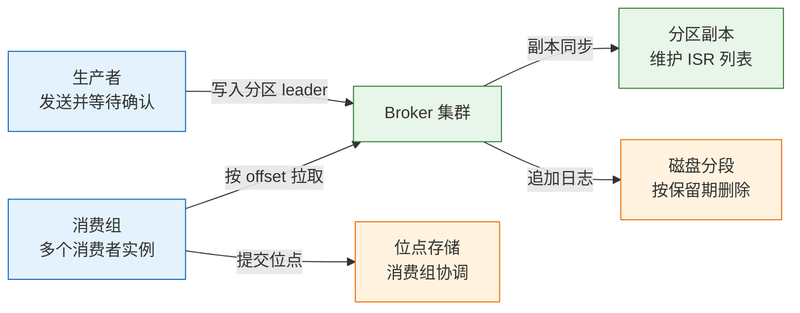
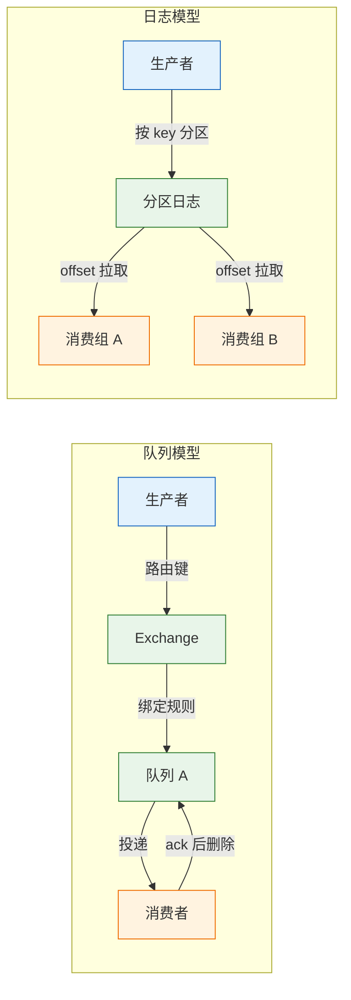
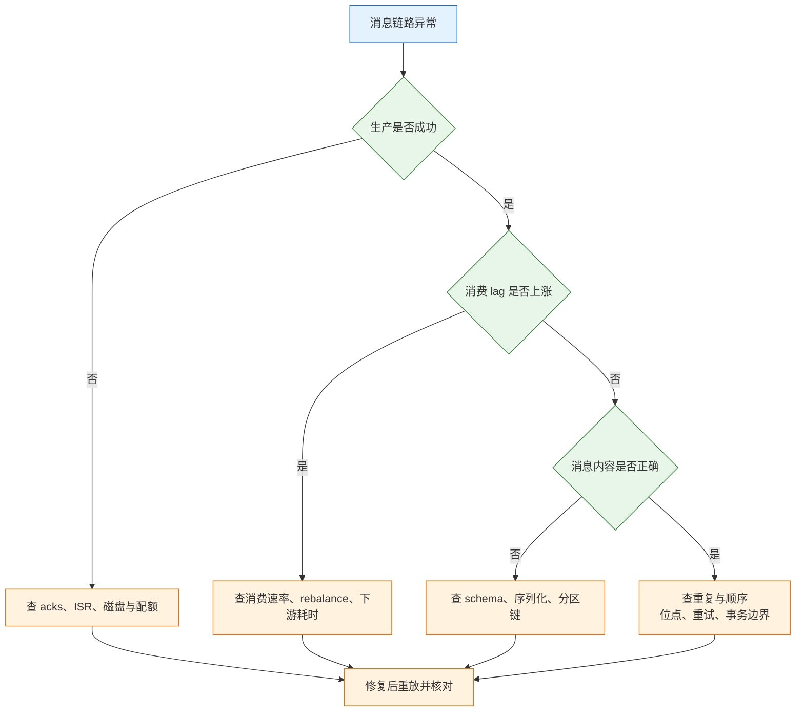

# 消息队列基础与选型

---

## 一、消息队列是什么

消息队列解决的是三个不同主体之间的时间差：调用方不想等，被调用方不想被瞬时流量压垮，两边不必同时在线。它把一次同步调用拆成"写一条消息"和"以后处理"两件事，用 broker 承担存储与转发，代价是重复、乱序、堆积和最终一致。

引入 MQ 之后，系统的失败模式会从"接口报错"扩展为"消息重复、丢失、乱序、堆积"。这四类问题必须在设计阶段回答，而不是等上线后用重试和告警去补。

### 1.1 核心概念

MQ 的典型价值集中在三个场景：

- **削峰**：下单瞬间涌入五万请求，数据库只能处理五千，先把请求写入队列，后台按自身能力消费。
- **解耦**：支付成功后要发短信、加积分、通知仓库，同步调用任一环节失败都会拖垮支付；改成发布事件，各订阅方独立处理。
- **异步**：视频上传后转码需要几分钟，接口不应一直占用连接，提交任务后立即返回。

它不适合"调用方必须立刻拿到结果"的场景，例如验密码、查余额；也不适合要求强一致、失败整体回滚的转账；更不适合只是把一段代码拆成两个函数，却额外引入 broker 和一套重试逻辑。

| 概念 | 本质 | 关键约束 |
|---|---|---|
| 生产者 | 把业务事件写入 broker 的进程 | 需要确认机制才知道是否写成功 |
| Broker | 存储与转发消息的服务端 | 磁盘、副本、网络是主要瓶颈 |
| Topic / Queue | 逻辑上的消息分类 | 命名一旦投产就很难改 |
| 分区 | 日志模型下的并行单元 | 分区数决定消费并行度上限 |
| Offset | 消费者在分区中的位置 | 提交时机决定重复或丢失 |
| 消费组 | 一组共同消费同一主题的实例 | 组内一条消息只给一个消费者 |
| Ack | 消费成功的确认 | ack 与业务写入的顺序决定语义 |
| 死信 | 多次处理失败后被隔离的消息 | 必须有告警与重放流程 |

### 1.2 与相邻技术的关系

同步 RPC 与 MQ 不是替代关系，而是两种时间模型。RPC 把结果放在当前调用栈里，失败立即可见；MQ 把结果推迟到未来，失败要靠重试、死信和对账兜底。

数据库表也能当队列：写入一张 `jobs` 表，后台轮询。它的优点是事务天然一致、实现简单；缺点是轮询延迟、并发抢占需要 `SKIP LOCKED`、高吞吐时表膨胀严重。Redis List 与 Stream 更轻，适合秒级任务和轻量事件，但不承担大规模保留与重放。Kafka 这类日志系统把消息当可重放的日志，适合事件总线和流处理。工作流引擎则进一步把"多步骤、带状态、可补偿"的流程抽象出来，MQ 只负责步骤之间的传递。

| 技术 | 时间模型 | 适用边界 |
|---|---|---|
| HTTP / RPC | 同步，立即返回 | 需要即时结果、强类型契约 |
| 数据库任务表 | 异步，轮询或通知 | 低吞吐、要求与业务同事务 |
| Redis List / Stream | 异步，内存为主 | 轻量队列、允许丢或可重建 |
| Kafka | 异步，日志保留 | 高吞吐、多订阅方、可重放 |
| 工作流引擎 | 异步，状态机 | 长流程、补偿、人工审批 |

> **注意**：把"发消息"放在数据库事务内部并不能保证原子性。事务回滚时消息已经发出，或者事务提交后发送失败，两种不一致都会发生。正确做法是 Outbox 模式或事务消息。

### 1.3 架构组成



四个层次各自承担不同职责：

- **接入层**：处理生产与消费连接、鉴权、配额。连接数暴涨通常先打满这一层。
- **路由层**：决定消息进入哪个队列或分区。队列模型靠 exchange 与 routing key，日志模型靠 key 哈希。
- **存储层**：日志分段、索引、副本同步。磁盘容量与页缓存决定吞吐上限。
- **协调层**：消费组分配、位点提交、控制器选举。协调层抖动会表现为频繁 rebalance。

---

## 二、安装与连接

> **版本现状（2026）**：Kafka 4.x 已完全移除 ZooKeeper，只支持 KRaft 元数据模式，broker 需要 Java 17；RabbitMQ 4.x 移除了经典镜像队列，跨节点复制统一使用 quorum queue。具体小版本以官方发布为准，生产环境固定到具体版本号。

### 2.1 Kafka 单机部署

Kafka 发行包自带启动脚本，KRaft 模式不需要额外安装协调服务。首次启动前必须格式化存储目录，否则 broker 会拒绝启动。

```bash
# ========== 解压与检查 ==========
# 下载二进制包后解压，目录名随版本变化
tar -xzf kafka_2.13-4.0.0.tgz
cd kafka_2.13-4.0.0

# 确认 Java 版本，broker 需要 17 及以上
java -version

# ========== 配置 KRaft 单节点 ==========
# 4.x 发行包的 config/server.properties 即 KRaft 配置
# 3.x 时期该文件位于 config/kraft/ 下
grep -E 'process.roles|node.id|controller.quorum.voters|listeners|log.dirs' \
  config/server.properties

# ========== 格式化与启动 ==========
# 生成集群 ID，同一集群所有节点必须一致
KAFKA_CLUSTER_ID="$(bin/kafka-storage.sh random-uuid)"
echo "$KAFKA_CLUSTER_ID"

# 格式化日志目录，仅首次执行；已格式化的目录会拒绝再次格式化
bin/kafka-storage.sh format -t "$KAFKA_CLUSTER_ID" -c config/server.properties

# 后台启动 broker，日志写入 logs/ 目录
bin/kafka-server-start.sh -daemon config/server.properties

# ========== 验证 ==========
# 能列出空主题列表即表示 broker 已就绪
bin/kafka-topics.sh --bootstrap-server localhost:9092 --list

# 查看 broker 与控制器状态
bin/kafka-broker-api-versions.sh --bootstrap-server localhost:9092 | head -5
```

单节点配置里 `process.roles=broker,controller`、`node.id=1`、`controller.quorum.voters=1@localhost:9093`，三个值必须自洽。生产环境至少三个 controller 节点，`voters` 列出全部投票节点。

### 2.2 RabbitMQ 部署

RabbitMQ 用 Erlang 编写，容器镜像已包含运行时。管理插件提供 Web 控制台与 HTTP API，排障时比命令行直观。

```bash
# ========== 启动容器 ==========
# 5672 为 AMQP 端口，15672 为管理控制台
docker run -d --name rabbitmq \
  -p 5672:5672 -p 15672:15672 \
  -e RABBITMQ_DEFAULT_USER=app \
  -e RABBITMQ_DEFAULT_PASS='change-me-strong' \
  -v rabbitmq-data:/var/lib/rabbitmq \
  rabbitmq:4-management

# ========== 验证 ==========
# 查看节点状态与 listeners
docker exec rabbitmq rabbitmq-diagnostics check_running
docker exec rabbitmq rabbitmq-diagnostics listeners

# 查看队列、连接与通道
docker exec rabbitmq rabbitmqctl list_queues name type messages consumers
docker exec rabbitmq rabbitmqctl list_connections name state channels

# ========== 用户与权限 ==========
# 创建业务用户，授予 / 虚拟主机的配置、写、读权限
docker exec rabbitmq rabbitmqctl add_user billing 'change-me-too'
docker exec rabbitmq rabbitmqctl set_permissions -p / billing '.*' '.*' '.*'
docker exec rabbitmq rabbitmqctl set_user_tags billing monitoring
```

默认虚拟主机 `/` 把所有业务放在一起，多环境共用一套 broker 时应按环境或团队划分 vhost，并用 `set_permissions -p <vhost>` 单独授权。

### 2.3 客户端连接与最小收发

Kafka 的 Python 客户端以 `confluent-kafka` 为主，配置项直接对应 broker 参数。RabbitMQ 用 `pika`，注意 quorum queue 必须声明为持久队列。

```python
# ========== Kafka 生产者 ==========
from confluent_kafka import Producer

producer = Producer({
    "bootstrap.servers": "localhost:9092",
    "acks": "all",                 # 等待 ISR 全部确认
    "enable.idempotence": True,    # 开启幂等，避免重试造成重复
    "linger.ms": 5,                # 小幅攒批，提高吞吐
})
producer.produce("orders", key="A100", value='{"orderId":"A100","type":"order.paid"}')
producer.flush(10)

# ========== Kafka 消费者 ==========
from confluent_kafka import Consumer

consumer = Consumer({
    "bootstrap.servers": "localhost:9092",
    "group.id": "billing",
    "auto.offset.reset": "earliest",
    "enable.auto.commit": False,   # 处理成功后再手动提交
})
consumer.subscribe(["orders"])

while True:
    msg = consumer.poll(1.0)
    if msg is None or msg.error():
        continue
    handle(msg.value())            # 业务处理必须幂等
    consumer.commit(msg, asynchronous=False)
```

```python
# ========== RabbitMQ 声明与发送 ==========
import pika

conn = pika.BlockingConnection(pika.ConnectionParameters("localhost"))
ch = conn.channel()

# quorum queue 必须 durable，且不能 exclusive 或 auto_delete
ch.queue_declare(queue="orders", durable=True, arguments={"x-queue-type": "quorum"})

ch.basic_publish(
    exchange="",
    routing_key="orders",
    body=b'{"orderId":"A100"}',
    properties=pika.BasicProperties(delivery_mode=2),  # 持久化消息
)

# ========== RabbitMQ 消费 ==========
def on_message(channel, method, properties, body):
    handle(body)
    channel.basic_ack(delivery_tag=method.delivery_tag)

ch.basic_qos(prefetch_count=20)   # 未确认消息上限，控制背压
ch.basic_consume(queue="orders", on_message_callback=on_message)
ch.start_consuming()
```

### 2.4 关键配置项

生产端的确认级别、消费者的提交方式、broker 的保留策略，三者共同决定"消息会不会丢"。

| Kafka 配置 | 默认值 | 作用 |
|---|---|---|
| `acks` | `all`（3.0 起） | 0 不等待、1 等 leader、all 等 ISR |
| `enable.idempotence` | `true`（3.0 起） | 按生产者 ID 与序列号去重 |
| `retries` | `2147483647` | 可重试错误的自动重试次数 |
| `delivery.timeout.ms` | `120000` | 从发送到最终失败的总时限 |
| `max.in.flight.requests.per.connection` | `5` | 幂等开启时不应超过 5 |
| `enable.auto.commit` | `true` | 自动提交位点，可能丢或重 |
| `max.poll.records` | `500` | 单次拉取条数，控制单批处理时长 |
| `auto.offset.reset` | `latest` | 无位点时从最新或最早开始 |

| RabbitMQ 配置 | 作用 | 建议 |
|---|---|---|
| `durable` | 队列元数据持久化 | 业务队列一律 `true` |
| `delivery_mode=2` | 消息持久化 | 与 durable 队列配套才有意义 |
| publisher confirms | 确认 broker 已接收 | 生产端必须开启 |
| `prefetch_count` | 单消费者未确认上限 | 按处理耗时与下游能力设置 |
| `x-queue-type=quorum` | Raft 复制队列 | 需要跨节点冗余时使用 |
| `x-message-ttl` | 队列或消息级过期 | 延迟队列与短期缓存 |
| `x-dead-letter-exchange` | 死信转发目标 | 与重试次数配合 |

主题级配置覆盖 broker 级默认值，客户端参数决定单次请求的行为，两者作用在不同层面。排查"为什么这条消息没按预期保留"时，要按 broker、主题、生产者、消费者四层依次核对，只改客户端配置不一定生效。

> **注意**：`durable=true` 只保证队列在重启后还在，消息本身还要设置持久化属性。两者都开启也不等于不丢：broker 可能在写入磁盘前崩溃，Publisher Confirm 只表示 broker 已接管。

---

## 三、消息模型与投递语义

### 3.1 队列模型

队列模型以"消息被消费后删除"为核心。生产者把消息发给 exchange，exchange 按绑定规则路由到一个或多个队列，消费者从队列取走并确认。



RabbitMQ 提供四种 exchange：`direct` 按路由键精确匹配，`fanout` 广播到所有绑定队列，`topic` 按通配符匹配，`headers` 按消息头匹配。路由灵活是它的优势，也意味着拓扑设计要提前做，队列与绑定关系变更需要运维介入。

### 3.2 日志模型

日志模型把消息追加到分区末尾，消费者用 offset 标记自己的位置。消息不因消费而删除，只按保留时间或容量清理。

- **分区**是并行与顺序的单位，同一分区内严格有序，跨分区不保证。
- **分段**把分区切成多个文件，配合索引支持按 offset 快速定位。
- **保留**由 `retention.ms` 与 `retention.bytes` 控制，超期删除整个分段。
- **压实**由 `cleanup.policy=compact` 开启，只保留每个 key 的最新值，适合配置与状态同步。
- **消费组**各自维护 offset，互不影响，因此一条消息可以被多个组各读一遍。

分区的写入是顺序追加，读取主要命中操作系统的页缓存，这也是日志模型吞吐高的原因。消费者落后不多时几乎不读磁盘；落后到页缓存之外才开始产生真实磁盘 IO。保留期越长、分区越多，页缓存被摊薄得越厉害，堆积时的读取延迟就越高。

### 3.3 投递语义

| 语义 | 实现方式 | 后果 | 适用 |
|---|---|---|---|
| At-most-once | 先 ack 再处理，或发完不等待 | 可能丢，不会重 | 日志采集、可丢指标 |
| At-least-once | 处理成功后再 ack，失败重投 | 可能重，不会丢 | 绝大多数业务 |
| Exactly-once | broker 事务 + 幂等 + 消费端事务 | 边界内成立，跨系统难 | 金融级内部流水 |

大多数业务应选 **At-least-once + 消费端幂等**。网络超时时，生产者不知道 broker 是否收到，消费者也不知道 ack 是否送达，要"不重"就必须有跨系统的去重状态。

幂等消费的四类做法：

- 用业务唯一键建唯一索引，重复插入直接忽略。
- 用 `event_id` 建消费记录表，与业务写入放在同一事务。
- 更新类操作写成"设置目标状态"，不要写 `count = count + 1`。
- 外部副作用把幂等键传给对方，不能假设自己只调用一次。

Kafka 的 exactly-once 依赖幂等生产者与事务，能保证"读 topic、处理、写 topic"在 Kafka 内部不重不丢；最后一步如果是调用外部 HTTP，仍然要靠对方幂等。RabbitMQ 没有端到端 exactly-once，文档里不应这样承诺。

### 3.4 分区与顺序

全局有序的代价是单通道串行，吞吐上不去。实际系统通常只要求"同一订单、同一用户的事件有序"。

| 产品 | 顺序范围 | 保证方式 |
|---|---|---|
| Kafka | 单分区内 | 相同 key 哈希到同一分区，分区内单线程处理 |
| RabbitMQ | 单队列单消费者 | 多消费者并发消费同一队列即无序 |
| RocketMQ | 单消息队列内 | 按业务键选择队列，顺序消费 |
| SQS FIFO | 单消息组内 | `MessageGroupId` 相同则有序 |

重试会破坏顺序：第一条失败进入重试队列，第二条已经成功，顺序就反了。要求严格顺序时，失败必须阻塞该 key 的后续消息，或把整批作为一个单元重试。更常见的做法是让消费者按业务版本号或状态机判断，接受乱序到达，例如订单已取消后再收到"支付成功"，应拒绝或转人工，而不是把状态改回已支付。

> **注意**：增加分区数会改变 key 到分区的映射，同一业务键的新消息可能落到不同分区，与历史消息不再同序。分区扩容要选在业务低峰，并接受一段时间的顺序偏差。

---

## 四、常用命令与运维操作

### 4.1 Kafka 命令行

```bash
# ========== 主题管理 ==========
# 创建 3 分区主题；单节点演示副本数只能为 1，生产环境用 3
bin/kafka-topics.sh --bootstrap-server localhost:9092 \
  --create --topic orders --partitions 3 --replication-factor 1

# 查看主题分区、leader、副本与 ISR
bin/kafka-topics.sh --bootstrap-server localhost:9092 --describe --topic orders

# 增加分区（只能增不能减）
bin/kafka-topics.sh --bootstrap-server localhost:9092 \
  --alter --topic orders --partitions 6

# 修改保留时间为 7 天
bin/kafka-configs.sh --bootstrap-server localhost:9092 \
  --entity-type topics --entity-name orders \
  --alter --add-config retention.ms=604800000

# 删除主题，数据不可恢复
bin/kafka-topics.sh --bootstrap-server localhost:9092 --delete --topic orders

# ========== 生产与消费 ==========
# 控制台生产者，开启 key 解析，格式为 key:value
bin/kafka-console-producer.sh --bootstrap-server localhost:9092 \
  --topic orders --property parse.key=true --property key.separator=:

# 控制台消费者，指定消费组并从最早位点开始
bin/kafka-console-consumer.sh --bootstrap-server localhost:9092 \
  --topic orders --group billing --from-beginning --property print.key=true

# ========== 位点与堆积 ==========
# 查看消费组各分区的当前位点、末端位点与 lag
bin/kafka-consumer-groups.sh --bootstrap-server localhost:9092 \
  --describe --group billing

# 重置位点到最早，先 dry-run 确认影响
bin/kafka-consumer-groups.sh --bootstrap-server localhost:9092 \
  --group billing --topic orders --reset-offsets --to-earliest --dry-run

# 确认无误后执行，执行前必须停止该组所有消费者
bin/kafka-consumer-groups.sh --bootstrap-server localhost:9092 \
  --group billing --topic orders --reset-offsets --to-earliest --execute

# ========== 磁盘与日志 ==========
# 查看各 broker 的日志目录占用
bin/kafka-log-dirs.sh --bootstrap-server localhost:9092 --describe
```

`LAG` 列等于 `LOG-END-OFFSET` 减 `CURRENT-OFFSET`。某个分区 lag 持续上涨，说明该分区的消费者处理不过来；所有分区同时上涨，通常是消费者挂掉或下游整体变慢。

### 4.2 RabbitMQ 命令行

```bash
# ========== 队列与消息 ==========
# 查看队列类型、消息总数、待投递、未确认、消费者数
docker exec rabbitmq rabbitmqctl list_queues \
  name type messages messages_ready messages_unacknowledged consumers

# 查看绑定关系，确认路由是否符合预期
docker exec rabbitmq rabbitmqctl list_bindings

# 清空队列消息（不可恢复，先确认队列名）
docker exec rabbitmq rabbitmqctl purge_queue orders

# 删除队列（不可恢复）
docker exec rabbitmq rabbitmqctl delete_queue orders

# ========== 策略与死信 ==========
# 给匹配的队列设置死信交换与最大长度
docker exec rabbitmq rabbitmqctl set_policy --apply-to queues orders-dlx '^orders\.' \
  '{"dead-letter-exchange":"dlx","max-length":100000}'

# 查看当前策略
docker exec rabbitmq rabbitmqctl list_policies

# ========== 连接与告警 ==========
# 查看连接状态与通道数
docker exec rabbitmq rabbitmqctl list_connections name state channels

# 检查内存与磁盘告警，告警期间生产者会被阻塞
docker exec rabbitmq rabbitmq-diagnostics check_local_alarms
```

### 4.3 消费组与位点管理

消费组是并行消费的边界。组内消费者数量超过分区数时，多出来的实例分配不到分区，只会空转；少于分区数时，单个实例要承担多个分区。

Kafka 把位点写在内部主题 `__consumer_offsets` 中，默认 50 个分区。位点提交频率决定重复窗口：自动提交每 5 秒一次，消费者在两次提交之间崩溃，重启后会从上次提交位置重放。手动提交把窗口缩小到"处理完成到提交成功"之间，但仍可能重复。

Rebalance 是消费组重新分配分区的过程。消费者心跳超时、处理超过 `max.poll.interval.ms`、主题分区变化都会触发。频繁 rebalance 会让消费暂停，表现为 lag 阶跃上升。优先使用 cooperative-sticky 分配策略，减少全量 revoke。

位点提交的粒度同样影响故障恢复。按批提交比逐条提交省往返，但一批处理到一半崩溃时，整批都会重放；逐条提交重复窗口小，代价是更多的位点写入。折中做法是"每批处理完提交一次，业务写入本身幂等"，把重复交给消费端消化，而不是靠位点精确性。

### 4.4 监控指标

| 指标 | 含义 | 异常判断 |
|---|---|---|
| `lag` | 末端位点与消费位点之差 | 持续上涨说明消费能力不足 |
| 消费速率 | 每秒处理的条数 | 突降通常是下游变慢或 rebalance |
| 生产速率 | 每秒写入的条数 | 与消费速率对比看缺口 |
| `under-replicated-partitions` | 副本落后于 leader 的分区数 | 大于 0 说明复制异常 |
| `offline-partitions` | 无 leader 的分区数 | 大于 0 表示部分分区不可用 |
| 磁盘使用率 | 日志目录占用 | 超过 80% 要清理或扩容 |
| 请求延迟 P99 | broker 处理请求耗时 | 与页缓存命中率、磁盘 IO 相关 |

---

## 五、可靠性与高可用

### 5.1 生产端确认

| `acks` | 行为 | 风险 |
|---|---|---|
| `0` | 发出即返回 | broker 未收到也会丢，吞吐最高 |
| `1` | leader 写入即确认 | leader 崩溃且未同步时丢 |
| `all` | ISR 全部确认 | 需配合 `min.insync.replicas` 才有意义 |

`acks=all` 单独使用并不安全：如果 ISR 只剩 leader 一个副本，确认仍然只落在这一台上。生产环境应设置 `replication.factor=3`、`min.insync.replicas=2`，此时最多容忍一个副本故障，且不会写入"只有 leader 收到"的消息。

幂等生产者给每个生产者分配 ID，并为每个分区维护序列号，broker 据此丢弃重复批次。它只覆盖单个生产者会话内的重试，进程重启后 ID 变化，跨会话去重仍要靠消费端。

```bash
# ========== 生产端可靠性核对 ==========
# 查看主题的 min.insync.replicas 与副本分布
bin/kafka-configs.sh --bootstrap-server localhost:9092 \
  --entity-type topics --entity-name orders --describe

bin/kafka-topics.sh --bootstrap-server localhost:9092 --describe --topic orders
```

### 5.2 副本与选举

Kafka 每个分区有一个 leader 和若干 follower，ISR 是与 leader 保持同步的副本集合。leader 故障时，控制器从 ISR 中选新 leader；若允许非同步副本参选，可能选到落后很多的副本，造成消息丢失。

| 配置 | 作用 | 生产建议 |
|---|---|---|
| `replication.factor` | 分区副本数 | 3 |
| `min.insync.replicas` | 最少同步副本数 | 2 |
| `unclean.leader.election.enable` | 是否允许非 ISR 副本当选 | `false` |
| `default.replication.factor` | 自动建主题的副本数 | 显式设为 3 |

KRaft 模式下，控制器本身也靠 quorum 选举，生产环境至少三个 controller。RabbitMQ 的 quorum queue 基于 Raft，同样建议三节点或五节点，且队列类型在建队列时就要确定，后期不能从 classic 直接改成 quorum。

### 5.3 消费端确认与重试

消费端要保证"处理成功才确认"。自动提交省事，但会在处理完成前推进位点，进程崩溃就丢消息。手动提交配合幂等处理，才能得到可控的 At-least-once。

重试分两类：网络超时、下游 503、锁冲突属于可重试；参数非法、schema 不兼容、业务规则拒绝属于不可重试。可重试错误用指数退避加随机抖动，例如 1 秒、2 秒、4 秒、8 秒，最多五次；不可重试错误直接进入死信。

重试实现有三种常见形态：

- **原地重试**：不提交位点，休眠后重新处理。简单，但阻塞整个分区。
- **重试主题**：把失败消息写入带延迟级别的 topic，主消费继续推进。
- **数据库重试表**：记录失败次数与下次执行时间，由调度器扫描，适合长延迟。

毒消息会反复失败并拖住整个队列。处理方式不是无限重试，而是快速识别、隔离到死信、告警。重放前先修数据或代码，否则只是再毒一次。

### 5.4 死信与延迟消息

| 产品 | 死信 | 延迟消息 |
|---|---|---|
| Kafka | 无原生死信，需自建重试与死信主题 | 无原生延迟，需外部调度或延时主题 |
| RabbitMQ | `x-dead-letter-exchange` | TTL + DLX 近似，或延迟插件 |
| RocketMQ | 原生死信队列 | 原生延迟消息，5.x 支持任意时间 |
| SQS | 原生 DLQ，按 `maxReceiveCount` 转入 | 原生延迟，单条最长 15 分钟 |

死信队列必须配套三件事：保留原始消息体、记录失败原因与重试次数、有告警和重放入口。只在 broker 里挂一个 DLQ 而没人看，等于把问题从主队列挪到了另一个队列。

> **运维红线**：死信队列持续增长时，先暂停相关消费并定位原因，不要直接批量重放。未经修复的重放会把同一批失败消息再打一遍下游，形成二次故障。

### 5.5 消费端背压

消费者不是拉得越快越好。下游数据库只能承受 500 QPS，消费者一次拉 5000 条，只会把失败和重试堆起来，lag 反而更高。

- 限制消费者实例数与每实例线程数，并行度不超过下游连接池容量。
- 设置 prefetch 与 `max.poll.records`，保证一批消息能在超时前处理完。
- 下游限流时主动暂停分区，Kafka 用 `pause` 与 `resume`，RabbitMQ 降低 prefetch。
- 队列深度超过阈值时告警，而不是无限增加消费者。

扩容前先确认瓶颈在下游还是消费逻辑。把 10 个消费者加到 50 个，如果数据库连接池只有 20，结果只是更多超时和更长的重试队列。

---

## 六、完整示例

### 6.1 Outbox 模式

"订单写库成功，但消息没发出去"是最常见的坑。把发消息放在事务之后，中间崩溃就永久丢失；放在事务之前，回滚后又多出一条不存在的订单。Outbox 把业务数据和待发消息写进同一个本地事务，再由独立进程搬运。


```sql
-- outbox 表至少包含这些列
CREATE TABLE outbox (
  id           BIGINT PRIMARY KEY AUTO_INCREMENT,
  event_id     VARCHAR(64) NOT NULL UNIQUE,
  aggregate_id VARCHAR(64) NOT NULL,
  event_type   VARCHAR(64) NOT NULL,
  payload      JSON NOT NULL,
  created_at   TIMESTAMP NOT NULL DEFAULT CURRENT_TIMESTAMP,
  published_at TIMESTAMP NULL,
  retry_count  INT NOT NULL DEFAULT 0,
  INDEX idx_unpublished (published_at, id)
);
```

Relay 用 `SELECT ... WHERE published_at IS NULL ORDER BY id LIMIT 100 FOR UPDATE SKIP LOCKED` 取一批（`SKIP LOCKED` 需要 MySQL 8.0 或 PostgreSQL），逐条发送，成功后更新 `published_at`。发送成功但标记失败会导致重复发送，因此消费端必须幂等；标记成功但发送失败不会发生，因为顺序是先发后标。CDC 方案则订阅 binlog，把插入事件直接转为消息，延迟更低，但需要维护连接器。

outbox 表会随业务持续增长，必须有清理任务：已发布且超过保留期的记录定期归档或删除，否则索引膨胀会拖慢 relay 的扫描。清理按 `id` 分批删除，避免一次删太多造成长事务与主从延迟。

### 6.2 幂等消费验证

下面用 SQLite 验证 outbox 的事务性与消费端去重，SQL 在 `sqlite3` 交互提示符下执行。

```bash
# ========== 建库与建表 ==========
sqlite3 /tmp/mq-demo.db
```

```sql
PRAGMA journal_mode = WAL;

CREATE TABLE orders (
  id TEXT PRIMARY KEY,
  status TEXT NOT NULL
) STRICT;

CREATE TABLE outbox (
  id INTEGER PRIMARY KEY AUTOINCREMENT,
  event_id TEXT NOT NULL UNIQUE,
  payload TEXT NOT NULL,
  published_at TEXT
) STRICT;

CREATE TABLE consumed (
  consumer TEXT NOT NULL,
  event_id TEXT NOT NULL,
  PRIMARY KEY (consumer, event_id)
) STRICT;

-- 业务写入与 outbox 在同一事务
BEGIN IMMEDIATE;
INSERT INTO orders VALUES ('A100', 'paid');
INSERT INTO outbox (event_id, payload)
VALUES ('evt-1', '{"orderId":"A100","type":"order.paid"}');
COMMIT;

-- 第一次投递
INSERT OR IGNORE INTO consumed VALUES ('billing', 'evt-1');
-- 网络重投，同一 event_id 再来一次
INSERT OR IGNORE INTO consumed VALUES ('billing', 'evt-1');

-- 统计实际处理次数
SELECT COUNT(*) AS handled FROM consumed WHERE consumer = 'billing';
```

```text
# 预期输出
1
```

`(consumer, event_id)` 唯一键把重复投递挡在业务写入之前。若业务写入与去重记录分属两个事务，仍会出现"去重记录写了、业务没写"的不一致，因此两者必须同事务提交。

### 6.3 端到端验证

```bash
# ========== 1. 创建主题 ==========
bin/kafka-topics.sh --bootstrap-server localhost:9092 \
  --create --topic orders --partitions 3 --replication-factor 1

# ========== 2. 生产三条同键消息 ==========
# 同一 key 必然进入同一分区，便于观察顺序
bin/kafka-console-producer.sh --bootstrap-server localhost:9092 \
  --topic orders --property parse.key=true --property key.separator=:
# 输入以下三行后按 Ctrl-D 结束
# A100:{"event":"created"}
# A100:{"event":"paid"}
# A101:{"event":"created"}

# ========== 3. 消费并查看位点 ==========
# 打印分区号，便于确认同 key 是否落在同一分区
bin/kafka-console-consumer.sh --bootstrap-server localhost:9092 \
  --topic orders --group billing --from-beginning --max-messages 3 \
  --property print.key=true --property print.partition=true

bin/kafka-consumer-groups.sh --bootstrap-server localhost:9092 \
  --describe --group billing

# ========== 4. 模拟重放 ==========
# 停掉消费者后重置位点，再消费一次，验证幂等表是否挡住重复
bin/kafka-consumer-groups.sh --bootstrap-server localhost:9092 \
  --group billing --topic orders --reset-offsets --to-earliest --execute
```

| 检查点 | 预期结果 | 不通过时排查 |
|---|---|---|
| 同 key 落在同一分区 | 三条消息中 A100 的两条在同一分区 | key 是否为空、分区数是否刚变更 |
| 消费组 lag 归零 | 所有分区 `LAG` 为 0 | 消费者是否存活、下游是否阻塞 |
| 重放不产生重复副作用 | `consumed` 表条数不变 | 幂等键是否稳定、事务是否包含去重写入 |
| 消息内容可解析 | 字段与 schema 一致 | 生产者序列化方式、版本字段 |

### 6.4 消息体与 Schema 演进

消息一旦发出，生产者和消费者就独立发布，字段不能像单体代码那样随意删改。推荐使用固定信封，把路由信息与业务负载分开：

```json
{
  "event_id": "01J8Z9K3Q7",
  "type": "order.paid",
  "version": 2,
  "occurred_at": "2026-10-28T02:00:00Z",
  "producer": "payment-api",
  "trace_id": "4bf92f3577b34da6a3ce929d0e0e4736",
  "payload": {"orderId": "A100", "amountCents": 9900}
}
```

- **event_id** 用于幂等，必须全局唯一且稳定，重发时不能重新生成。
- **type 与 version** 让消费者知道如何解析，不要用 topic 名代替事件类型。
- **occurred_at** 是业务发生时间，不是发送时间，补发与延迟场景要能区分。
- **payload** 只放业务字段，不要塞整行数据库记录。
- **trace_id** 把消息消费接进调用链，跨服务排查延迟时不可缺少。

兼容规则只有一条主线：只增不改。新增字段必须可选并有默认值，老消费者忽略未知字段；不删字段、不改类型、不复用字段名，确需删除时先让所有消费者停止读取。枚举新增值可能让老消费者的分支落入默认逻辑，要提前约定。二进制 schema 用 registry 做兼容性检查，JSON 至少要有 schema 校验。消息体大小要限制，图片、PDF、大 JSON 放对象存储，消息只传 URL 或 ID，这就是 claim-check 模式。

---

## 七、选型

### 7.1 选型维度

选型先看消费语义，再看吞吐。一条消息要被多个系统各读一遍，选日志模型；只被一个消费者处理且路由复杂，选队列模型。需要按业务键严格顺序，就确认分区键与消费并发；需要延迟三十分钟执行，就确认产品是否原生支持；需要重放历史，就确认保留策略与 offset 重置能力。

| 维度 | 关键问题 | 影响 |
|---|---|---|
| 消费语义 | 一条消息给一个还是多个系统 | 决定队列模型或日志模型 |
| 顺序要求 | 全局有序还是单键有序 | 决定分区键与并发度 |
| 吞吐与延迟 | 峰值多少、可接受延迟多少 | 决定分区数、批量与压缩 |
| 保留与重放 | 保留多久、是否需要重放 | 决定磁盘成本与运维方式 |
| 团队能力 | 能否维护副本、磁盘、监控 | 不能就选托管服务 |

自建与托管的差别不在软件本身，而在故障时谁来处理。自建要负责磁盘扩容、副本重建、版本升级、控制器选举和跨机房容灾；托管把这些转移给云厂商，代价是单价更高、能力受产品限制、迁移成本大。团队没有专职中间件运维时，托管通常是更稳的选择。

### 7.2 主流产品对比

| 产品 | 模型与吞吐 | 突出能力 | 主要代价 |
|---|---|---|---|
| Kafka | 分区日志，很高 | 多订阅方、重放、流处理 | 运维复杂，延迟消息需自建 |
| RabbitMQ | 队列加 exchange，中 | 路由灵活、延迟插件成熟 | 大量堆积时性能下降明显 |
| RocketMQ | 日志加队列，高 | 事务消息、延迟消息、顺序消息 | 生态与托管选择少于 Kafka |
| NATS JetStream | 流与队列，中高 | 轻量、云原生、部署简单 | 大规模数据保留经验较少 |
| AWS SQS | 托管队列，高 | 零运维、按量计费 | 延迟上限 15 分钟，厂商绑定 |

### 7.3 容量与堆积估算

磁盘占用按"写入速率 × 平均大小 × 保留时间 × 副本数"估算：

```text
磁盘 ≈ 消息速率(条/秒) × 平均大小(字节) × 保留秒数 × 副本数
```

例如每秒一万条、每条 1 KB、保留三天、三副本：

```text
10000 × 1024 × 259200 × 3 ≈ 8 TB
```

这还没算索引、压缩与副本重建的临时空间。压缩能省磁盘，但增加 CPU，压缩率取决于消息内容，不能按固定比例估算。

消费能力同样要算：单条处理耗时 50 毫秒，一个消费者每秒最多 20 条；要达到每秒 1000 条，需要 50 个并行单元。Kafka 的并行单元是分区，消费者数超过分区数后多出的实例空闲。扩容前先确认瓶颈在下游数据库还是消费逻辑，否则只是把超时往后传。

> **运维红线**：消息堆积时不要先扩消费者。先确认下游能否承受放大后的并发，再看分区数是否足够，最后才扩容；盲目扩容会把数据库连接池打满，把小故障放大成全局故障。

---

## 八、常见故障与排查

### 8.1 故障对照表

| 现象 | 最可能原因 | 处理 |
|---|---|---|
| 消息重复 | 生产重试、ack 丢失、位点回退 | 消费端按 `event_id` 幂等 |
| 消息丢失 | 生产未确认、副本不足、先 ack 后处理 | `acks=all`、副本数 3、处理后再确认 |
| 消息堆积 | 消费慢、消费者挂掉、分区不足 | 看 lag 与消费速率，优化下游后再扩容 |
| 顺序错乱 | 多消费者、重试、分区键变化 | 按业务键分区，单分区单线程，失败阻塞该键 |
| 毒消息反复重试 | 不可重试错误进入重试队列 | 限制次数，转死信，修数据后重放 |
| 死信持续增长 | 下游长期故障或 schema 不兼容 | 告警、暂停消费、修复后批量重放 |
| 消费组频繁 rebalance | 心跳超时、单批处理过久 | 调整会话超时，降低 `max.poll.records` |
| broker 磁盘满 | 保留过久、副本过多、消息过大 | 缩短保留、压缩、扩容、清理 |
| 消息体过大 | 把文件或大 JSON 塞进消息 | 存对象存储，消息只传 URL 或 ID |
| 端到端延迟高但 lag 低 | 重试队列、延迟队列、下游慢 | 查重试次数、死信、调用链耗时 |
| `NOT_ENOUGH_REPLICAS` | ISR 少于 `min.insync.replicas` | 恢复副本、检查 broker 与网络 |
| `UNKNOWN_TOPIC_OR_PARTITION` | 主题未创建或元数据未同步 | 建主题，检查 controller 与 DNS |

### 8.2 排查顺序



按链路推进，避免直接调 broker 参数：

1. 确认生产端是否收到确认，查 `acks`、ISR 数量、broker 磁盘与配额。
2. 查消费组 lag、消费速率与 rebalance 记录，区分"没消费"与"消费慢"。
3. 抽样消息，确认内容、顺序、重复情况与 schema 版本。
4. 查下游耗时与错误率，确认瓶颈在消费逻辑还是外部依赖。
5. 最后才调整保留时间、分区数、批量大小等 broker 与客户端参数。

> **运维提示**：把 lag、消费速率、生产速率、ISR 不足分区数、磁盘使用率五项做成固定看板，再配一条"lag 持续十分钟上涨"的告警，比事后翻日志有效。

> **运维提示**：全文可压缩为三句话——队列模型是 ack 后删除，日志模型是保留加 offset，选型先看消费语义；默认按 At-least-once 设计，消费端必须幂等；写库与发消息用 Outbox 保原子性，重试要有上限，失败要有死信和重放流程。
